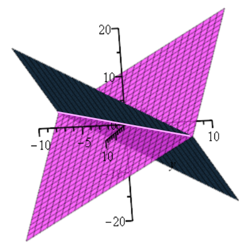
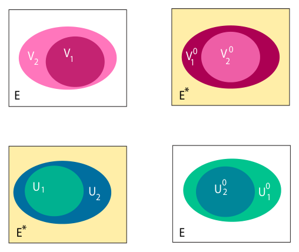
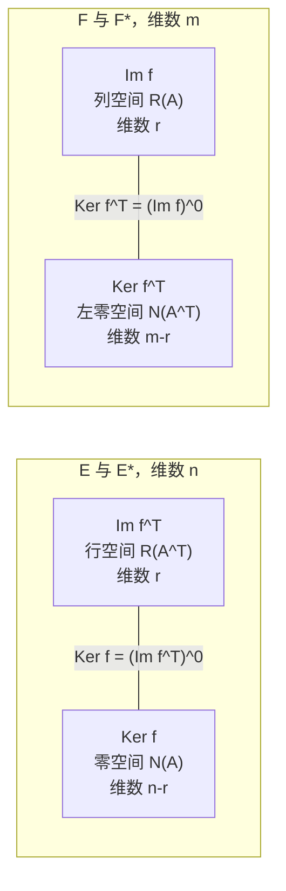

# 第10章 对偶空间与对偶

### 本章总览

本章所有向量空间都定义在任意域 $K$ 上。具体计算时可以把 $K$ 当成 $\mathbb{R}$。

这里的 duality（对偶）是**线性代数里的对偶**：空间 $E$ 与对偶空间 $E^*$ 之间，子空间与线性形式如何互相决定。它解释转置为什么把行和列对调，也把齐次线性方程看成 $E^*$ 里的元素。

这不是 Boyd 优化书里的 Lagrange duality（拉格朗日对偶）。拉格朗日对偶比较的是约束优化的原问题与对偶问题。本章不讨论最优值、对偶间隙或 KKT 条件。

路线是：线性形式与对偶基、典范配对和零化子、对偶定理、双对偶与一般配对、超平面、线性映射的转置、四个基本子空间。10.9 是清单，10.10 是习题。习题不展开。

阅读范围：PDF 第 387–420 页。

视觉里常见的齐次约束，例如平面方程 $ax+by+cz=0$，就是一个线性形式。解集是这个形式的核。多个独立方程切下去，维数按「环境维数减方程个数」下降。这是本章要精确化的事实。

### 核心知识点

#### 对偶空间与线性形式

开篇在 $\mathbb{R}^3$ 里看两条方程

$$
x-y+z=0,\qquad x-y-z=0.
$$

它们作为 $(x,y,z)$ 的函数都是线性的。相减得 $2z=0$，相加得 $2(x-y)=0$，所以公共解是

$$
y=x,\qquad z=0.
$$

这是 $\mathbb{R}^3$ 的一维子空间：平面 $z=0$ 里的直线 $y=x$。环境维数 $n=3$，独立方程 $m=2$，于是

$$
\dim(V)=n-m.
$$

一般情形是定理 10.4。在标准基下，$\mathbb{R}^n$ 里一条线性方程由 $(a_1,\ldots,a_n)$ 给出，解集是映射 $(x_1,\ldots,x_n)\mapsto a_1x_1+\cdots+a_nx_n$ 的核。离开标准基之后，方程就是 $E$ 到 $K$ 的线性映射。

图注：Figure 10.1。品红平面 $x-y+z=0$ 与蓝灰平面 $x-y-z=0$ 的交是粉线 $y=x$（且 $z=0$）。两条独立线性形式把三维空间切成一维解空间。

定义 10.1。$E$ 的 dual space（**对偶空间**）是 $\operatorname{Hom}(E,K)$，也记 $E^*$。其中的线性映射叫做 linear form（**线性形式**），或 covector（余向量）。$E^*$ 的对偶 $E^{**}$ 叫做 $E$ 的 bidual（双对偶）。线性形式常写成带星号的符号，如 $u^*$、$\varphi^*$。

第 2 章已经引入线性形式、对偶空间，以及有限维时对偶基的存在。坐标形式的唯一性来自那里的命题 2.23：给定基 $(u_i)_{i\in I}$，对每个 $i$ 恰有一个线性形式 $u_i^*$ 满足

$$
u_i^*(u_j)=\begin{cases}1&i=j,\cr0&i\neq j.\end{cases}
$$

$u_i^*$ 叫做这组基下指标 $i$ 的 coordinate form（坐标形式）。它读出向量在该基下的第 $i$ 个坐标。

有限维时，定理 2.27 证明：若 $(u_1,\ldots,u_n)$ 是 $E$ 的基，则 $(u_1^*,\ldots,u_n^*)$ 是 $E^*$ 的基，称为 dual basis（对偶基）。定理 10.4(a) 再次列出这一条。

👉 完整深度讲解见第 2 章 2.9 节、命题 2.23 与定理 2.27。📝待补全

在 $K^n$ 里对偶基可以写出来。设 $P$ 的第 $j$ 列是基向量 $u_j$，则 $u_i^*$ 是 $P^{-1}$ 的第 $i$ 行。

例 10.1 用 Bézier 矩阵 $B_4$ 的四列当 $\mathbb{R}^4$ 的基。$u_1^*$ 要满足 $u_1^*(u_1)=1$，并在另外三列上为 0，所以它是 $B_4^{-1}$ 的第一行。书中这一行是 $(1\ 1\ 1\ 1)$。四个对偶形式依次是 $B_4^{-1}$ 的四行。

换基时，形式的坐标与向量的坐标走的矩阵不同。设 $(u_1,\ldots,u_n)$ 与 $(v_1,\ldots,v_n)$ 是 $E$ 的两组基，$P=(a_{ij})$ 是从前者到后者的换基矩阵，

$$
v_j=\sum_{i=1}^n a_{ij}u_i.
$$

记 $P^{-1}=(b_{ij})$。命题 10.1 的结论是：从对偶基 $(u_1^*,\ldots,u_n^*)$ 到 $(v_1^*,\ldots,v_n^*)$ 的换基矩阵是 $(P^{-1})^\top$。任意线性形式 $\varphi$ 的新坐标 $(\varphi'_1,\ldots,\varphi'_n)$ 与旧坐标 $(\varphi_1,\ldots,\varphi_n)$ 满足

$$
(\varphi'_1,\ldots,\varphi'_n)=(\varphi_1,\ldots,\varphi_n)P.
$$

分量写法是 $\varphi'_j=\sum_{i=1}^n a_{ij}\varphi_i$。中间步骤还得到

$$
v_j^*=\sum_{i=1}^n b_{ji}u_i^*,\qquad u_i^*=\sum_{j=1}^n a_{ij}v_j^*.
$$

对照基的替换 $v_j=\sum_i a_{ij}u_i$，线性形式的坐标与换基矩阵 $P$ 同向变化。因此说线性形式的坐标是 covariant（协变）的。把线性形式本身叫做协变，是语言上的借用，covector 这个名字即由此而来。

书中用第 3 章例 3.1 的数字核对。$E=\mathbb{R}^2$，$u_1=(1,0)$，$u_2=(0,1)$，$v_1=(1,1)$，$v_2=(-1,1)$。于是

$$
P=\begin{pmatrix}1&-1\cr1&1\end{pmatrix},\qquad
P^{-1}=\begin{pmatrix}1/2&1/2\cr-1/2&1/2\end{pmatrix},
$$

并且 $(v_1^*,v_2^*)=(u_1^*,u_2^*)(P^{-1})^\top$。旧坐标到新坐标的列向量关系由 $P^\top$ 给出。

👉 这组基的来源见第 3 章例 3.1。📝待补全

同一个线性形式有两种矩阵面孔。相对 $E$ 的基 $(e_1,\ldots,e_n)$ 和 $K$ 的基 $1$，$f\in E^*$ 是 $1\times n$ 行 $(\lambda_1\ \cdots\ \lambda_n)$，其中 $f(e_i)=\lambda_i$。向量 $u=\sum u_ie_i$ 是列。作用 $f(u)$ 就是行乘列：

$$
\lambda_1u_1+\cdots+\lambda_nu_n.
$$

相对对偶基 $(e_1^*,\ldots,e_n^*)$，同一个 $f$ 又是列 $(\lambda_1,\ldots,\lambda_n)^\top$。行还是列，取决于把它看成「作用在 $E$ 上的映射」，还是「$E^*$ 里的向量」。

张量文献常把基向量的指标写在下方，向量坐标 $x^i$ 写在上方，

$$
x=\sum_{i=1}^n x^iu_i.
$$

线性形式的坐标 $\varphi_i$ 则写在下方。上下指标各出现一次就求和，求和号可以省去，这是 Einstein（爱因斯坦）求和约定，例如 $\varphi'_j=a^i_{\ j}\varphi_i$。在这套写法里，矩阵 $(a_{ij})$ 记成 $(a^j_{\ i})$，称为 $(1,1)$-张量。

有的作者把矩阵看成坐标之间的映射，指标上下的位置与上面相反。引用公式时要先确认约定，不能只看字母 $a$。

🔑 关键速记：线性形式是到 $K$ 的线性映射；有限维时对偶基存在，换基用 $(P^{-1})^\top$，形式的坐标用 $P$，因而是协变的。

#### 配对与对偶

$u^*\in E^*$ 作用在 $v\in E$ 上的值也写成 $\langle u^*,v\rangle$。这个典范配对 $\langle-,-\rangle:E^*\times E\to K$ 对两个变元都线性：

\begin{align*}
\langle u_1^*+u_2^*,v\rangle&=\langle u_1^*,v\rangle+\langle u_2^*,v\rangle,\\
\langle u^*,v_1+v_2\rangle&=\langle u^*,v_1\rangle+\langle u^*,v_2\rangle,\\
\langle\lambda u^*,v\rangle&=\lambda\langle u^*,v\rangle,\\
\langle u^*,\lambda v\rangle&=\lambda\langle u^*,v\rangle.
\end{align*}

固定 $v$，求值映射 $\operatorname{eval}_v:E^*\to K$ 由 $\operatorname{eval}_v(u^*)=\langle u^*,v\rangle$ 定义，它本身是 $E^{**}$ 里的线性形式。再让 $v$ 变动，得到线性映射 $\operatorname{eval}_E:E\to E^{**}$，

$$
\operatorname{eval}_E(v)(u^*)=u^*(v).
$$

后文证明它总是单射；$E$ 有限维时它是同构。

定义 10.3。$\langle u^*,v\rangle=0$ 时，称向量 $v$ 与线性形式 $u^*$ orthogonal（正交）。子空间 $V\subseteq E$ 与 $U\subseteq E^*$ 正交，是指每一对元素都正交。$V$ 的 orthogonal（这里是零化子）为

$$
V^0=\{u^*\in E^*\mid \langle u^*,v\rangle=0,\ \forall v\in V\}.
$$

它也叫 annihilator（**零化子**）：在整个 $V$ 上取零的线性形式，等价于 $V\subseteq\operatorname{Ker}u^*$。反过来，

$$
U^0=\{v\in E\mid \langle u^*,v\rangle=0,\ \forall u^*\in U\}=\bigcap_{u^*\in U}\operatorname{Ker}u^*.
$$

$U^0$ 没有专名。它就是方程组 $U$ 的公共解。书中特别记下

$$
E^0=\{0\},\qquad \{0\}^0=E^*.
$$

命题 10.2。包含关系取零化子之后反过来：$V_1\subseteq V_2\subseteq E$ 推出 $V_2^0\subseteq V_1^0\subseteq E^*$；$U_1\subseteq U_2\subseteq E^*$ 推出 $U_2^0\subseteq U_1^0\subseteq E$。更大的集合要满足更多「取零」条件，剩下的形式或向量更少。

图注：Figure 10.2。上排：$E$ 里 $V_1\subseteq V_2$ 时，$E^*$ 里反而 $V_2^0\subseteq V_1^0$。下排：$E^*$ 里 $U_1\subseteq U_2$ 时，$E$ 里 $U_2^0\subseteq U_1^0$。零化子把包含关系反转。

例 10.2。$E=M_2(\mathbb{R})$。由

$$
\begin{pmatrix}0&1\cr1&0\end{pmatrix},\ 
\begin{pmatrix}1&0\cr0&0\end{pmatrix},\ 
\begin{pmatrix}0&0\cr0&1\end{pmatrix}
$$

张成的 $V$ 就是全体对称矩阵 $\begin{pmatrix}b&a\cra&c\end{pmatrix}$，维数 3。它们恰好满足 $a_{12}-a_{21}=0$。因此 $V^0$ 由 $u^*(a_{11},a_{12},a_{21},a_{22})=a_{12}-a_{21}$ 张成，维数 $4-3=1$。

例 10.3 把这件事做到 $M_n(\mathbb{R})$。对称条件由 $i<j$ 的方程 $a_{ij}-a_{ji}=0$ 张成，共 $n(n-1)/2$ 个独立形式。公共解是对称矩阵空间 $S(n)$，维数

$$
\frac{n(n+1)}{2}=n^2-\frac{n(n-1)}{2}.
$$

对角线没有约束；$i\neq j$ 的全部方程里有一半是重复的。

例 10.4。若改成 $a_{ij}+a_{ji}=0$（$i<j$）再加 $a_{ii}=0$，这些形式独立，维数 $n(n+1)/2$。公共解是斜对称矩阵空间 $\operatorname{Skew}(n)$，维数 $n(n-1)/2$。

例 10.5。迹 $\operatorname{tr}(A)=a_{11}+\cdots+a_{nn}$ 是一个线性形式。$\operatorname{tr}(A)=0$ 的矩阵构成维数 $n^2-1$ 的子空间。

有限维时，上面的维数关系是对偶定理的一部分：

$$
\dim(V)+\dim(V^0)=\dim(E),\qquad \dim(U)+\dim(U^0)=\dim(E).
$$

两组记号不要混用。有的书把零化子写成 $V^\perp$。本书把 $V^\perp$ 留给内积意义下、仍落在 $E$ 内部的正交补。$V^0$ 落在 $E^*$ 里。内积正交补要到第 11 章才出现。

内积是正定双线性形式，所以也是一种非退化配对。有限维时，它把每个向量对应到「与该向量做内积」的线性形式，从而给出 $E$ 与 $E^*$ 的同构。那是同一个空间内部的几何，和这里 $E$ 对 $E^*$ 的零化子不是同一个构造。

👉 内积、正交补 $V^\perp$ 以及 $E\cong E^*$ 的同构见第 11 章 11.2 节。📝待补全

线性形式可以看成一次齐次多项式。一般多项式的公共零点集 $Z(U)$ 叫做代数簇；在子空间上消失的多项式组成理想 $I(V)$。线性情形里 $Z(U)=U^0$。一般多项式没有 $U=I(Z(U))$ 这么干净。域代数闭时，Hilbert 的 Nullstellensatz（零点定理）说 $I(Z(U))$ 等于理想 $U$ 的根。书中指向 Lang 与 Dummit–Foote，本章只用它对照：一限制到线性子空间，对偶定理就把 $U=I(Z(U))$、$V=Z(I(V))$ 恢复回来。代数几何本身不展开。

命题 10.3。对 $E$ 的任意子空间 $V$ 有 $V\subseteq V^{00}$；对 $E^*$ 的任意子空间 $U$ 有 $U\subseteq U^{00}$。$V$ 里的向量当然被「在 $V$ 上消失的那些形式」消掉，所以它落在 $V^{00}$ 里。有限维时下一节把包含升级成相等。

$A^\top A=I$ 这种正交约束不是线性方程。$n=2$ 时会出现平方项与乘积项。零化子的维数公式不能直接套到这类集合上。

🔑 关键速记：配对 $\langle u^*,v\rangle=u^*(v)$；$V^0$ 是在 $V$ 上消失的形式，包含关系取零化子后反转，有限维时两边维数相加等于 $\dim E$。

#### 对偶定理

定理 10.4（**对偶定理**，取自 Artin）设 $\dim E=n$。则：

| 条款 | 结论 |
| --- | --- |
| (a) | $(u_1,\ldots,u_n)$ 是 $E$ 的基时，坐标形式 $(u_1^*,\ldots,u_n^*)$ 是 $E^*$ 的对偶基 |
| (b) | 每个子空间 $V\subseteq E$ 满足 $V^{00}=V$ |
| (c) | 若 $E=V\oplus W$ 且 $\dim V=m$，基的前 $m$ 个张成 $V$、后 $n-m$ 个张成 $W$，则 $(u_1^*,\ldots,u_m^*)$ 是 $W^0$ 的基，故 $\dim W+\dim(W^0)=\dim E$，并且 $W^{00}=W$ |
| (d) | 对每个子空间 $U\subseteq E^*$，$\dim U+\dim(U^0)=\dim E$，并且 $U^{00}=U$ |

表后要点：(a) 已在定理 2.27 证明。有限维时 $\dim E=\dim E^*$。$V^{00}=V$ 与 $U^{00}=U$ 把命题 10.3 的包含收成相等。维数公式就是开篇 $\dim(V)=n-m$ 的一般形式：$m$ 个独立方程切出的解空间维数是 $n-m$。

证明只用维数比较，这里不重写。(d) 把 $U$ 的基 $(f_1^*,\ldots,f_m^*)$ 合成映射 $h:E\to K^m$，$h(v)=(f_1^*(v),\ldots,f_m^*(v))$，则 $\operatorname{Ker}h=U^0$，再套秩–零度关系。

第 5 章的秩–零度定理说：像有限维时，$\dim E=\dim(\operatorname{Ker}f)+\operatorname{rk}(f)$，并给出直和分解。本章正文把它引成 Proposition 5.11；知识库按第 5 章标题记为定理 5.11。对偶定理用它比较核与像的维数。

👉 完整深度讲解见第 5 章定理 5.11。📝待补全

(c) 要先把子空间的基补成全空间的基。有限维时这总办得到：子空间的任意基都能延长为 $E$ 的基。

👉 完整深度讲解见第 2 章定理 2.15。📝待补全

定义两个方向相反的对应。$\mathcal{E}$ 把 $E$ 的子空间送到方程（零化子），$\mathcal{Z}$ 把 $E^*$ 的子空间送到公共零点：

$$
\mathcal{E}(V)=V^0,\qquad \mathcal{Z}(U)=U^0.
$$

(c)(d) 给出 $\mathcal{Z}\circ\mathcal{E}=\mathrm{id}$、$\mathcal{E}\circ\mathcal{Z}=\mathrm{id}$。因此在有限维，$E$ 的子空间与 $E^*$ 的子空间成一一对应。维数 $m$ 的 $V$ 正好是 $n-m$ 个独立线性方程的公共零点集。

无穷维时这条双射不再自动成立，要对 $U$、$V$ 的维数另加限制。但 $V=V^{00}$ 对 $E$ 的每个子空间仍然成立，证明改用把 $V$ 的基延长为 $V^{00}$ 的基，允许基是无穷的。

下面四个问题是定理的用法，不是习题节。

问题 1：已知 $V\subseteq\mathbb{R}^n$ 的基 $(v_1,\ldots,v_m)$，求 $V^0$ 的基。第一条路是把基补成 $\mathbb{R}^n$ 的基，再取对偶基的后 $n-m$ 个，它们张成 $V^0$。

例 10.6 取 $\mathbb{R}^4$ 里 Haar 基的前两个向量 $(1,1,1,1)$ 与 $(1,1,-1,-1)$ 张成 $V$。Haar 矩阵 $W$ 的四列是 $\mathbb{R}^4$ 的基，对偶基是 $W^{-1}$ 的行。$V^0$ 由最后两行张成。缩放 $1/2$ 之后，一组基是行向量

$$
(1\ -1\ 0\ 0),\qquad (0\ 0\ 1\ -1).
$$

第二条路不必求逆。令 $A$ 为 $n\times m$ 矩阵，列是 $V$ 的基。行向量 $u$ 属于 $V^0$ 当且仅当 $uA=0$，即 $A^\top u^\top=0$。于是只要求 $A^\top$ 的零空间的基。

行最简形把方程组化成能直接读自由变量的形状。每个自由变量单独取 1、其余自由变量取 0，就得到零空间的一组基。本章用它代替「先补基再求逆」。

👉 行最简形算法见第 7 章 7.10 节。📝待补全

例 10.7 用同一组 $V$。约束化成 $u_1+u_2=0$、$u_3+u_4=0$。书中取的一组基仍是 $(1,-1,0,0)$ 与 $(0,0,1,-1)$。自由变量取 1 时，直接解出的代表向量可能差一个符号，张成的子空间相同。

问题 2：超平面 $H:c_1x_1+\cdots+c_nx_n=0$，某个 $c_j\neq 0$。它是一维空间 $U=\operatorname{span}(u^*)$ 的零化子，维数 $n-1$。取最小的正指标 $j$ 使 $c_j\neq 0$，则 $j$ 之前的系数都是 0。$H$ 的一组基是

$$
e_1,\ldots,e_{j-1},\qquad e_k-\frac{c_k}{c_j}e_j\ (k=j+1,\ldots,n).
$$

删掉第 $j$ 行后，这些列构成单位矩阵，因而线性无关；$u^*$ 在每一列上为 0。

书中 $\mathbb{R}^6$ 的例子是 $x_3+2x_4+3x_5+4x_6=0$。五个基向量是下面矩阵的列：

$$
\begin{pmatrix}
1&0&0&0&0\cr
0&1&0&0&0\cr
0&0&-2&-3&-4\cr
0&0&1&0&0\cr
0&0&0&1&0\cr
0&0&0&0&1
\end{pmatrix}.
$$

问题 3：反过来，$\mathbb{R}^n$ 里由 $n-1$ 个线性无关向量张成的超平面，可以用行列式写出它的方程。正文只把 $n=3$ 写完。两个无关向量 $u,v$ 张成的平面，法向可取叉积

$$
u\times v=\begin{pmatrix}u_2v_3-u_3v_2\cr u_3v_1-u_1v_3\cr u_1v_2-u_2v_1\end{pmatrix},
$$

平面方程是

$$
(u_2v_3-u_3v_2)x+(u_3v_1-u_1v_3)y+(u_1v_2-u_2v_1)z=0.
$$

问题 4：$A\in M_n(\mathbb{R})$ 的各行求和都相等，写成 $n-1$ 个独立方程 $\sum_j(a_{ij}-a_{i+1,j})=0$。这些形式张成的 $U$ 维数是 $n-1$，满足条件的矩阵空间维数是 $n^2-n+1$。书中说明这组基并不显然，没有在正文里构造出来。

🔑 关键速记：有限维时 $V\leftrightarrow V^0$ 是子空间之间的双射，$\dim V+\dim(V^0)=\dim E$，并且 $V^{00}=V$。

#### 双对偶

命题 10.5。

(a) $\operatorname{eval}_E:E\to E^{**}$ 是单射。若 $\operatorname{eval}_E(v)=0$，则它在每个坐标形式 $u_i^*$ 上为 0，而这个值正是 $v$ 的坐标 $v_i$，于是 $v=0$。

(b) $\dim E=n<\infty$ 时，它是同构，称为 canonical isomorphism（**典范同构**）。因为对偶基再取一次对偶，得到 $E^{**}$ 的基 $(u_1^{**},\ldots,u_n^{**})$，所以 $\dim E^{**}=n$。单射加上维数相等就是双射。此时把 $(u_1^{**},\ldots,u_n^{**})$ 与 $(u_1,\ldots,u_n)$ 等同。

同维有限维空间之间，单射、满射、双射等价。这是第 5 章命题 5.15，本章用它从单射跳到同构。

👉 四条等价条件见第 5 章命题 5.15。📝待补全

定义 10.4 把这件事说成配对。$E,F$ 都是 $K$ 上的向量空间时，pairing（配对）是双线性映射 $\varphi:E\times F\to K$。它 nondegenerate（非退化），是指：

1. 若对一切 $v\in F$ 有 $\varphi(u,v)=0$，则 $u=0$；
2. 若对一切 $u\in E$ 有 $\varphi(u,v)=0$，则 $v=0$。

常仍记成 $\langle-,-\rangle$。前面的典范配对 $E^*\times E\to K$ 是非退化的。内积是另一类非退化配对。外代数与微分几何里还有别的例子，本章不展开。

由 $\varphi$ 得到两个线性映射。对 $u\in E$，$l_\varphi(u)\in F^*$ 定义为 $l_\varphi(u)(y)=\varphi(u,y)$。对 $v\in F$，$r_\varphi(v)\in E^*$ 定义为 $r_\varphi(v)(x)=\varphi(x,v)$。

命题 10.6。非退化配对使 $l_\varphi:E\to F^*$ 与 $r_\varphi:F\to E^*$ 都是线性单射。若 $E,F$ 都有限维，则二者维数相等，并且这两个映射都是双射。

因此，有限维时典范配对再次给出 $E\cong E^{**}$。$E=F$ 且配对来自内积时，得到的是 $E\cong E^*$，那一步在第 11 章。

🔑 关键速记：求值映射 $E\to E^{**}$ 永远单射；有限维时是典范同构。非退化配对在有限维把两边与对方的对偶等同起来。

#### 超平面

命题 10.7 可以由定理 10.4 推出。书中仍给了一个直接论证，结论如下。设 $E$ 是向量空间。

(a) 非零线性形式 $f^*$ 的核 $H=\operatorname{Ker}f^*$ 是超平面。

(b) 每个超平面 $H$ 都是某个非零线性形式的核。

(c) 若 $H=\operatorname{Ker}f^*$，$f^*\neq 0$，则 $H=\operatorname{Ker}g^*$ 当且仅当 $g^*=\lambda f^*$，其中 $\lambda\in K$ 且 $\lambda\neq 0$。

(a) 的几何是直和：取 $f^*(v_0)\neq 0$，则 $E=H\oplus Kv_0$。(b) 反着做：由 $E=H\oplus Kv_0$ 把 $v=h+\lambda v_0$ 送到 $\lambda$，得到以 $H$ 为核的线性形式。(c) 说明定义同一张超平面的线性形式构成 $E^*$ 里的一条直线（再添上零形式）。

第 5 章把超平面定义成余维 1 的子空间：存在一维子空间 $L$ 使 $E=H\oplus L$，并证明这等价于某个非零线性形式的核。两个非零形式定义同一个超平面时，彼此差一个非零标量。本章命题 10.7 是同一事实在对偶语言里的再次确认。第 5 章还指出，行秩等于列秩要留到对偶才能看清；那个证明在下一节命题 10.13。

👉 超平面与余维的首次定义见第 5 章命题 5.14。📝待补全

正文把下一句留作练习，只记录结论：$V\neq E$ 时，$V$ 等于所有包含 $V$ 的超平面的交。证明不展开。

🔑 关键速记：超平面就是某个非零线性形式的核；定义同一张超平面的形式彼此只差非零倍数。

#### 转置

定义 10.5。线性映射 $f:E\to F$ 的 transpose（**转置**）是 $f^\top:F^*\to E^*$，

$$
f^\top(v^*)=v^*\circ f,\qquad v^*\in F^*.
$$

也就是 $v^*$ 先经 $f$ 再送到 $K$。等价地，对一切 $u\in E$、$v^*\in F^*$，

$$
\langle v^*,f(u)\rangle=\langle f^\top(v^*),u\rangle. \tag{∗}
$$

立刻有

$$
(f+g)^\top=f^\top+g^\top,\qquad (g\circ f)^\top=f^\top\circ g^\top,\qquad \mathrm{id}_E^\top=\mathrm{id}_{E^*}.
$$

复合的转置把顺序反过来。

命题 10.8。

1. $f$ 单射则 $f^\top$ 满射。
2. $f$ 满射则 $f^\top$ 单射。

单射时存在 retraction（收缩）$r:F\to E$，使 $r\circ f=\mathrm{id}_E$。满射时存在 section（截面）$s:F\to E$，使 $f\circ s=\mathrm{id}_F$。取转置后，复合顺序反过来，就分别得到 $f^\top$ 的右逆或左逆。第 5 章秩–零度分解里的 $s$ 就是满射到像上的截面：$f\circ s=\mathrm{id}$。

👉 截面在秩–零度分解中的用法见第 5 章定理 5.11。📝待补全

命题 10.9。对 $E$ 的任意子空间 $V$，

$$
f(V)^0=(f^\top)^{-1}(V^0)=\{w^*\in F^*\mid f^\top(w^*)\in V^0\}.
$$

特别地，

$$
\operatorname{Ker}f^\top=(\operatorname{Im}f)^0,\qquad \operatorname{Ker}f=(\operatorname{Im}f^\top)^0.
$$

第一条来自配对恒等式 $(*)$：$w^*$ 在整个 $f(V)$ 上为 0，当且仅当 $f^\top(w^*)$ 在整个 $V$ 上为 0。令 $V=E$，并记住 $E^0=\{0\}$，就得到 $\operatorname{Ker}f^\top=(\operatorname{Im}f)^0$。

定理 10.10。

(a) $(\operatorname{Im}f)^*$ 同构于 $\operatorname{Im}f^\top=f^\top(F^*)$。

(b) 若 $F$ 有限维，则 $\operatorname{rk}(f)=\operatorname{rk}(f^\top)$。

(a) 的结构是把 $f$ 分解成满射 $E\to\operatorname{Im}f$ 再接包含 $\operatorname{Im}f\to F$。转置后满射变单射、单射变满射，复合给出所述同构。(b) 是因为有限维空间与其对偶同维，所以 $\dim(\operatorname{Im}f)=\dim((\operatorname{Im}f)^*)=\dim(\operatorname{Im}f^\top)$。

$E,F$ 都有限维时，(b) 也可以不走 (a)：用定理 10.4(c) 写 $\dim(\operatorname{Im}f)+\dim((\operatorname{Im}f)^0)=\dim F$，用秩–零度写 $\dim(\operatorname{Ker}f^\top)+\dim(\operatorname{Im}f^\top)=\dim(F^*)$，再代入 $\operatorname{Ker}f^\top=(\operatorname{Im}f)^0$。

命题 10.11 列出四条，证明要用对偶定理的推广，正文省略。后文只在 $E$ 有限维时补上第一条的证明（命题 10.18）。第二条和第四条已在命题 10.9 证明。因为即使无穷维也有 $V^{00}=V$，由第二条取零化子得到第三条，由第一条取零化子得到第四条。四条是

\begin{align*}
\operatorname{Im}f^\top&=(\operatorname{Ker}f)^0,\\
\operatorname{Ker}f^\top&=(\operatorname{Im}f)^0,\\
\operatorname{Im}f&=(\operatorname{Ker}f^\top)^0,\\
\operatorname{Ker}f&=(\operatorname{Im}f^\top)^0.
\end{align*}

书中说明第一条在 $E$ 无穷维时仍然成立，但这里不证。

命题 10.12。设 $(u_1,\ldots,u_n)$ 是 $E$ 的基，$(v_1,\ldots,v_m)$ 是 $F$ 的基。若 $M(f)$ 是 $f$ 在这两组基下的 $m\times n$ 矩阵，则 $f^\top$ 在对偶基 $(v_1^*,\ldots,v_m^*)$ 与 $(u_1^*,\ldots,u_n^*)$ 下的矩阵是 $M(f)^\top$。

理由是矩阵元两边都等于配对：$M(f)$ 的第 $i$ 行第 $j$ 列是 $\langle v_i^*,f(u_j)\rangle$，而 $M(f^\top)$ 的第 $j$ 行第 $i$ 列是 $\langle f^\top(v_i^*),u_j\rangle$。由 $(*)$ 二者相等。

命题 10.13。域 $K$ 上任意 $m\times n$ 矩阵 $A$ 满足 $\operatorname{rk}(A)=\operatorname{rk}(A^\top)$。把 $A$ 看成 $K^n\to K^m$ 的映射即可。因此最大无关列数等于最大无关行数。行化简也能证明这件事，不必经过对偶。

第 5 章定义 5.9 只把秩定义成列空间的维数，并预告 $\operatorname{rk}(A^\top)=\operatorname{rk}(A)$ 以后再证。命题 10.13 就是那一步。

👉 秩作为最大无关列数的定义见第 5 章定义 5.9。📝待补全

命题 10.14。$\operatorname{rk}(A)$ 是最大的自然数 $r$，使得从 $A$ 里选出 $r$ 行 $r$ 列后，能得到一个可逆的 $r\times r$ 子矩阵。例如 $3\times 2$ 矩阵秩为 2，当且仅当三个 $2\times 2$ 子矩阵里至少有一个可逆。

命题 10.15 把「可逆」换成「行列式非零」。方阵满秩当且仅当行列式非零，所以最大非零子式的阶就是秩。

👉 方阵行列式非零与满秩的等价见第 6 章命题 6.12。📝待补全

用子式扫一遍可以定秩，但并不省事。书中指出更好的办法是 LU、QR 或 SVD 一类分解。这些分解的算法不在本章。

👉 分解算法本章未给出章节号，暂不展开。📝待补全

二次转置 $f^{\top\top}:E^{**}\to F^{**}$ 与求值映射相容。命题 10.16：

$$
f^{\top\top}\circ\operatorname{eval}_E=\operatorname{eval}_F\circ f.
$$

图就是一个交换方块：先把 $E$ 映到 $F$ 再求值，与先求值再做 $f^{\top\top}$ 结果相同。

$E,F$ 有限维时，两个求值映射都是同构，于是

$$
f^{\top\top}=\operatorname{eval}_F\circ f\circ\operatorname{eval}_E^{-1}. \tag{∗}
$$

若把 $E$ 与 $E^{**}$、$F$ 与 $F^{**}$ 依典范同构等同，人们写成 $f^{\top\top}=f$。这是省略同构的说法。严格的等式是上面的 $(*)$。

命题 10.17。$\dim E$ 有限时，$\operatorname{Ker}(f^{\top\top})=\operatorname{eval}_E(\operatorname{Ker}f)$。

命题 10.18。$\dim E$ 有限时，

$$
\operatorname{Im}f^\top=(\operatorname{Ker}f)^0.
$$

包含 $\operatorname{Im}f^\top\subseteq(\operatorname{Ker}f)^0$ 来自配对：$u$ 在核里则 $\langle f^\top(\varphi),u\rangle=\langle\varphi,f(u)\rangle=0$。反过来比维数：左边维数等于 $\operatorname{rk}(f)$，右边维数是 $\dim E-\dim(\operatorname{Ker}f)$，二者相等，子空间只好重合。再取一次零化子，就得到有限维时的 $\operatorname{Ker}f=(\operatorname{Im}f^\top)^0$。

🔑 关键速记：转置把 $f:E\to F$ 变成 $f^\top:F^*\to E^*$，矩阵变成转置矩阵，复合顺序反过来；$F$ 有限维时秩不变，并且 $\operatorname{Ker}f^\top=(\operatorname{Im}f)^0$。

#### 四个基本子空间

设 $f:E\to F$，两边都有限维，$\dim E=n$，$\dim F=m$，$\operatorname{rk}(f)=r$。命题 10.9 说明

$$
\operatorname{Im}f,\quad \operatorname{Im}f^\top,\quad \operatorname{Ker}f,\quad \operatorname{Ker}f^\top
$$

互相锁定。它们叫做 $f$ 的 fundamental subspaces（**基本子空间**）。定理 10.10 再给 $\operatorname{rk}(f)=\operatorname{rk}(f^\top)$。

选定基之后，$f$ 的矩阵 $A$ 是 $m\times n$，第 $j$ 列是 $f(u_j)$ 的坐标。$f^\top$ 的矩阵是 $A^\top$。四个空间变成矩阵的语言：

| 名称 | 记号 | 所在空间 | 维数 | 对应 |
| --- | --- | --- | --- | --- |
| column space（列空间） | $\operatorname{Im}A$ 或 $R(A)$ | $K^m$ | $r$ | $\operatorname{Im}f$ |
| nullspace（零空间） | $\operatorname{Ker}A$ 或 $N(A)$ | $K^n$ | $n-r$ | $\operatorname{Ker}f$，即 $Ax=0$ |
| row space（行空间） | $\operatorname{Im}A^\top$ 或 $R(A^\top)$ | $K^n$ | $r$ | $\operatorname{Im}f^\top$ |
| left nullspace（左零空间） | $\operatorname{Ker}A^\top$ 或 $N(A^\top)$ | $K^m$ | $m-r$ | $A^\top y=0$，也就是 $y^\top A=0$ |

表后要点：这四条维数就是 Strang 所说的线性代数基本定理第一部分。行空间维数等于列空间维数，都是秩 $r$。零空间补的是定义域那边的 $n-r$，左零空间补的是到达空间那边的 $m-r$。

图注：四个基本子空间。行空间与零空间通过配对互为零化子，都用 $n$ 维坐标表示；列空间与左零空间同样成对，用 $m$ 维坐标表示。秩 $r$ 同时是行空间和列空间的维数。

第二部分把命题 10.9 译成矩阵的话：

1. $A$ 的零空间是行空间的零化子。
2. $A$ 的左零空间是列空间的零化子。

在选定的基下，列向量 $x\in K^n$ 与行向量 $y$ 正交，就是 $yx=0$。$x$ 与每一行正交当且仅当 $Ax=0$。$y$ 落在左零空间当且仅当 $y^\top A=0$，即这个线性形式在每个列上为 0。标准基下 $yx$ 的数值和点积一样，但这里的正交是 $E$ 与 $E^*$ 的配对，不是第 11 章里同一个空间内部的内积正交补。

由此得到 $Ax=b$ 的可解准则：有解当且仅当对一切 $y$，$A^\top y=0$ 推出 $y^\top b=0$。右边说的是 $b$ 与左零空间正交，所以 $b$ 落在列空间里。否定的说法是：无解当且仅当存在 $y$ 使 $A^\top y=0$ 但 $y^\top b\neq 0$。

几何上，$y^\top$ 定义超平面 $y^\top z=0$。无解就是存在一张超平面，含有 $A$ 的全部列，却不含 $b$。

有时检查左零空间比直接看 $b$ 是否在列空间里便宜。书中的例子是

$$
x_1-x_2=b_1,\qquad x_2-x_3=b_2,\qquad x_3-x_1=b_3,
$$

矩阵为

$$
A=\begin{pmatrix}1&-1&0\cr0&1&-1\cr-1&0&1\end{pmatrix}.
$$

三行相加是零行。左零空间由 $y=(1,1,1)$ 张成，所以可解当且仅当 $b_1+b_2+b_3=0$。

🔑 关键速记：列空间与左零空间、行空间与零空间分别互为零化子；$\operatorname{rk}(A)=r$ 时四个维数是 $r$、$m-r$、$r$、$n-r$。$Ax=b$ 有解当且仅当 $b$ 正交于整个左零空间。

### 🔑 关键速记

- 线性形式组成 $E^*=\operatorname{Hom}(E,K)$。有限维时对偶基存在，形式的坐标随 $P$ 协变，对偶基本身随 $(P^{-1})^\top$ 变化。
- 零化子 $V^0\subseteq E^*$ 把包含关系反转。有限维时 $V\leftrightarrow V^0$ 是双射，维数相加等于 $\dim E$，并且 $V^{00}=V$。
- $\operatorname{eval}_E:E\to E^{**}$ 总是单射，有限维时是典范同构。无穷维时子空间双射要额外限制，但 $V=V^{00}$ 仍成立。
- 超平面是非零线性形式的核。同一个超平面对应的形式只差非零标量倍数。
- $f^\top(v^*)=v^*\circ f$。复合转置反序。$F$ 有限维时 $\operatorname{rk}(f)=\operatorname{rk}(f^\top)$，矩阵层面就是 $\operatorname{rk}(A)=\operatorname{rk}(A^\top)$。
- 四个基本子空间的维数由秩 $r$ 决定。$Ax=b$ 有解，当且仅当左零空间里每个 $y$ 都满足 $y^\top b=0$。

### 易混淆点与差异对比

本章的对偶、内积正交补、优化里的拉格朗日对偶，名字都带「对偶」，对象不同。

| 名称 | 比较的是什么 | 结果落在哪里 | 本章的界限 |
| --- | --- | --- | --- |
| 零化子 $V^0$ | 哪些线性形式在 $V$ 上为 0 | $E^*$ 的子空间 | 有限维时与子空间一一对应 |
| 内积正交补 $V^\perp$ | 哪些向量与 $V$ 的内积为 0 | 仍在 $E$ 里 | 记号留给第 11 章，本章改用 $V^0$ |
| Lagrange duality | 约束优化的原问题与对偶问题 | 最优值与乘子 | 本章完全不讨论 |

表后要点：标准基下 $yx=0$ 和欧氏点积的数值相同，所以四个基本子空间看起来像「行空间垂直于零空间」。本书仍把这份正交放在配对里。真正把 $E$ 与 $E^*$ 用内积粘成同一个空间，是第 11 章的事。

有限维和无穷维差在「是不是同构」，不是差在「求值是否单射」。

| 陈述 | 有限维 | 无穷维 |
| --- | --- | --- |
| $\operatorname{eval}_E$ 单射 | 是，并且是同构 | 单射仍在，一般不满射 |
| $V=V^{00}$ | 是 | 对 $E$ 的每个子空间仍成立 |
| $U=U^{00}$ 以及子空间双射 | 是 | 双射需要额外维数限制 |
| $\operatorname{rk}(f)=\operatorname{rk}(f^\top)$ | $F$ 有限维即可 | 本章不主张 |
| $\operatorname{Im}f^\top=(\operatorname{Ker}f)^0$ | $\dim E$ 有限时给了证明 | 书中说仍成立，此处不证 |

表后要点：写「转置两次等于自己」时，有限维也只能写成 $f^{\top\top}=\operatorname{eval}_F\circ f\circ\operatorname{eval}_E^{-1}$。省掉两个求值同构，才变成 $f^{\top\top}=f$。

另外几处容易看错：

线性形式相对 $E$ 的基是行向量，相对对偶基是列向量。问「余向量是行还是列」之前，要先问矩阵是对哪一组基写的。

向量换基用 $P$ 表示新基在旧基下的坐标，形式的坐标行向量右乘的也是 $P$。对偶基的换基矩阵则是 $(P^{-1})^\top$。三件事不是同一个矩阵。

爱因斯坦约定里，指标一上一下才求和。有的作者把矩阵元的上下标写反。同一组公式换书之前要核对约定。

$A^\top A=I$ 含有乘积项，不是线性形式。对称矩阵、迹零矩阵才落在本章的维数公式里。

用最大非零子式定秩是命题 10.15 的结论，不是推荐算法。自由变量取 1 得到的零空间基可以和书中列出的基差一个符号，张成空间不变。

### 本章要点总结

- $E^*=\operatorname{Hom}(E,K)$ 由线性形式组成，$E^{**}$ 是双对偶。坐标形式 $u_i^*(u_j)=\delta_{ij}$ 在有限维时构成对偶基。
- 典范配对是 $\langle u^*,v\rangle=u^*(v)$。$\operatorname{eval}_E:E\to E^{**}$ 总单射，有限维时是典范同构。非退化配对在有限维给出同样的同构结论。
- 零化子 $V^0$ 与 $U^0$ 把「在子空间上消失的形式」和「方程组的公共解」对应起来。包含关系取零化子后反转。
- 对偶定理：有限维时 $\dim E=\dim E^*$，$V^{00}=V$，$U^{00}=U$，并且 $\dim V+\dim(V^0)=\dim E$。子空间与其对偶空间里的子空间一一对应。无穷维时双射要加限制，$V=V^{00}$ 仍然成立。
- 超平面是非零线性形式的核。同一个核对应的形式差一个非零倍数。$n-1$ 维超平面的基可以按第一个非零系数 $c_j$ 用 $e_k-(c_k/c_j)e_j$ 写出来；$\mathbb{R}^3$ 里两个向量张成的平面方程由叉积给出。
- $f^\top(v^*)=v^*\circ f$，矩阵就是原矩阵的转置，复合顺序相反。单射与满射在转置下对调。$F$ 有限维时秩不变，因此 $\operatorname{rk}(A)=\operatorname{rk}(A^\top)$。秩也等于最大可逆子矩阵的阶，等价于最大非零子式的阶。
- 四条基本恒等式把核、像和零化子连起来。其中 $\operatorname{Ker}f^\top=(\operatorname{Im}f)^0$ 与 $\operatorname{Ker}f=(\operatorname{Im}f^\top)^0$ 在命题 10.9 已证；$\operatorname{Im}f^\top=(\operatorname{Ker}f)^0$ 在 $\dim E$ 有限时由命题 10.18 证明。
- 四个基本子空间是列空间、零空间、行空间、左零空间，维数依次为 $r$、$n-r$、$r$、$m-r$。$Ax=b$ 有解当且仅当每个左零空间向量 $y$ 满足 $y^\top b=0$；几何上，无解当且仅当有一张超平面含全部列而不含 $b$。
