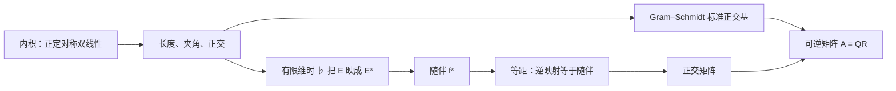
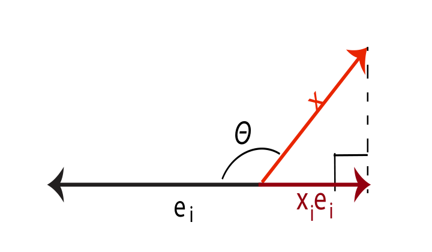
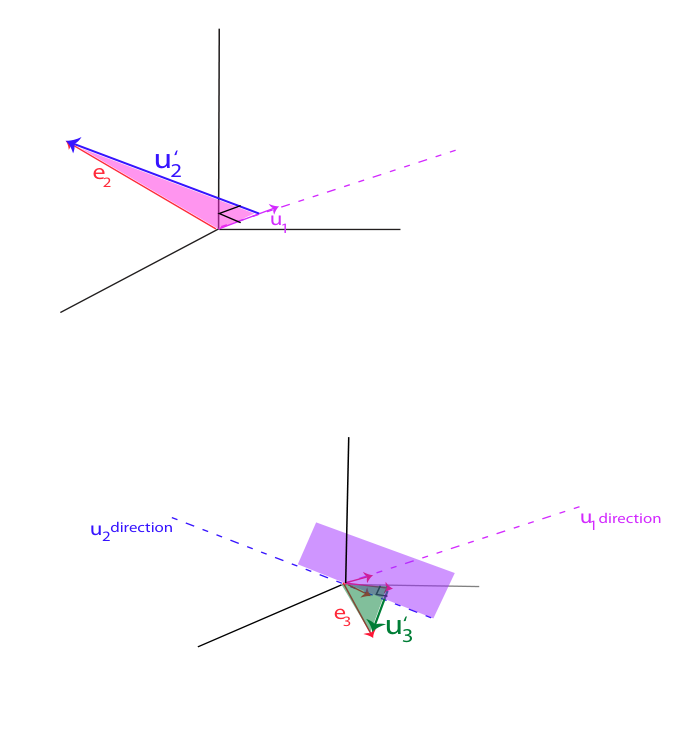

# 第11章 欧氏空间

### 本章总览

前面的向量空间只能谈比例和线性组合。加上 Euclidean structure（欧氏结构）之后，才能谈长度、夹角和 orthogonal（正交）。

本章在实数域上展开。个别说明会走到复数，正文会标出。路线是：inner product（内积）与 Euclidean space（欧氏空间），Cauchy–Schwarz 不等式与 Minkowski 不等式，正交与 orthogonal complement（正交补），有限维时空间与对偶的同构，adjoint（随伴），orthonormal basis（标准正交基）与 Gram–Schmidt 手续，linear isometry（线性等距）和 orthogonal group（正交群），三维旋转的 Rodrigues formula（Rodrigues 公式），以及可逆矩阵的 QR-decomposition（QR 分解）。Hadamard 不等式和应用素描放在后面。证明只留结论。

阅读范围：PDF 第 421–474 页。习题 11.1–11.17 不展开。这些页里的几何插图是 Figure 11.1–11.5（平行四边形法则、勾股、正交投影、Gram–Schmidt、修正 Gram–Schmidt）。Rodrigues 公式没有配旋转示意图。

### 核心知识点

内积、正交、随伴和 QR 的依赖关系如下。

图注：本章主线。内积先产生正交与对偶同构，对偶同构用来定义随伴；等距就是逆映射等于随伴的线性映射，在标准正交基下对应正交矩阵。Gram–Schmidt 从任意基造出标准正交基，可逆矩阵的 QR 分解就是把这个手续用到列向量上。

#### 内积与欧氏空间

symmetric bilinear form（对称双线性形式）$\phi$ $:E\times E\to\mathbb{R}$ 称为 definite（定号），是指 $u\neq0$ 时 $\phi$ $(u,u)\neq0$；称为 positive（正），是指对一切 $u$ 都有 $\phi$ $(u,u)\ge0$。

**Definition 11.1（定义 11.1）**。Euclidean space（欧氏空间）是实向量空间 $E$，配上一个 positive definite（正定）的对称双线性形式 $\phi$。正定在这里比“定号且正”更强：$u\neq0$ 时 $\phi$ $(u,u)>0$。$\phi$ $(u,v)$ 叫做 $u$ 与 $v$ 的内积，也记作 $u\cdot v$、$\langle u,v\rangle$ 或 $(u|v)$。

配套的 quadratic form（二次型）是 $\Phi$ $(u)=$ $\phi$ $(u,u)$，取值非负。由双线性，$\phi$ $(0,0)=0$；由正定，

$$
\Phi(u)=0 \iff u=0.
$$

由 $\phi$ 诱导的范数是 $\|u\|=\sqrt{\Phi(u)}$，叫做 Euclidean norm（欧氏范数）。

书中把这个范数对照 Definition 8.1（定义 8.1）的三条范数公理：Minkowski 不等式给出三角不等式，也就是其中的 (N3)；双线性加上正定给出另外两条。本章没有重写 (N1)、(N2) 的原文。

👉 范数三条公理的原文见第 8 章定义 8.1。📝待补全

标准例子是 $\mathbb{R}^n$ 上的

$$
(x_1,\ldots,x_n)\cdot(y_1,\ldots,y_n)=x_1y_1+\cdots+x_ny_n.
$$

这个欧氏空间记作 $\mathbf{E}^n$。

例 11.2：二维空间里，若 $a>0$ 且 $b^2-ac<0$，则

$$
\phi(x_1e_1+y_1e_2,\,x_2e_1+y_2e_2)=ax_1x_2+b(x_1y_2+x_2y_1)+cy_1y_2
$$

是内积，对应的二次型是 $ax^2+2bxy+cy^2$。

例 11.3：区间 $[a,b]$ 上的连续函数空间 $C[a,b]$ 是无穷维的，内积为

$$
\langle f,g\rangle=\int_a^b f(t)g(t)\,dt.
$$

$a=-$ $\pi$、$b=$ $\pi$ 时，正弦与余弦的这些积分是后面 Fourier 分析的计算基础。

例 11.4：$M_n(\mathbb{R})$ 上

$$
\langle A,B\rangle=\sum_{i,j=1}^n a_{ij}b_{ij}=\operatorname{tr}(A^\top B)=\operatorname{tr}(B^\top A).
$$

它就是把矩阵拉成 $\mathbb{R}^{n^2}$ 后的标准内积。配套范数

$$
\|A\|_F=\sqrt{\operatorname{tr}(A^\top A)}
$$

是 Frobenius norm（Frobenius 范数）。

👉 Frobenius 范数在第 8.2 节还有专节。本章只使用上面的迹公式。📝待补全

**Proposition 11.1（命题 11.1）**。二次型可以反推出双线性形式，$\phi$ 是 $\Phi$ 的 polar form（极化形式）：

$$
\phi(u,v)=\frac12\bigl[\Phi(u+v)-\Phi(u)-\Phi(v)\bigr].
$$

有限维时，取基 $(e_1,\ldots,e_n)$，Gram matrix（Gram 矩阵）$G=($ $\phi$ $(e_i,e_j))$ 满足

$$
\phi(x,y)=x^\top Gy.
$$

这里 $x,y$ 也用来记坐标列，书中说明这是记号上的混用。$\phi$ 对称当且仅当 $G=G^\top$；$\phi$ 正定当且仅当 $x\neq0$ 时 $x^\top Gx>0$。

换基矩阵 $P$ 的第 $j$ 列是新基向量在旧基下的坐标。新基下的 Gram 矩阵是 $P^\top GP$。

**Proposition 11.2（命题 11.2）** 把这三件事收在一起：

1. 内积关于一组基的 Gram 矩阵对称正定。
2. 换基后 Gram 矩阵变成 $P^\top GP$。
3. 任意对称正定的 $n\times n$ 矩阵 $A$ 都用 $\langle x,y\rangle=x^\top Ay$ 定义出一个内积。

书中预告：对称矩阵正定，当且仅当它的特征值全为正。这个等价的证明不在本章。

👉 对称矩阵可用正交矩阵对角化，见第 16 章。特征值全为正与正定的等价，本章只预告、未证明。📝待补全

标准正交基存在之后，任意 Gram 矩阵都能写成 $G=Q^\top Q$，其中 $Q$ 可逆。具体地，若换到标准正交基后 Gram 矩阵变成 $I$，则 $G=(P^{-1})^\top P^{-1}$。

🔑 关键速记：欧氏空间就是带正定对称双线性形式的实向量空间；长度是 $\sqrt{\phi(u,u)}$，极化公式用 $\frac12$ 从二次型找回内积。

#### Cauchy–Schwarz、Minkowski 与平行四边形法则

**Proposition 11.3（命题 11.3）**。Cauchy–Schwarz inequality（Cauchy–Schwarz 不等式）

$$
\phi(u,v)^2\le\Phi(u)\Phi(v),
$$

等号成立当且仅当 $u,v$ 线性相关。也写成 $|u\cdot v|\le\|u\|\|v\|$。

Minkowski inequality（Minkowski 不等式）

$$
\sqrt{\Phi(u+v)}\le\sqrt{\Phi(u)}+\sqrt{\Phi(v)},
$$

也就是 $\|u+v\|\le\|u\|+\|v\|$。等号成立当且仅当 $u,v$ 线性相关；若两者都非零，则还有 $u=$ $\lambda$ $v$ 且 $\lambda$ $>0$。

若 $\phi$ 只是正的、不必定号，两条不等式仍然成立，但等号不再推出线性相关。

非零向量满足

$$
-1\le\frac{u\cdot v}{\|u\|\|v\|}\le 1,
$$

因此存在唯一的 $\theta$ $\in[0,$ $\pi$ $]$，使

$$
\cos\theta=\frac{u\cdot v}{\|u\|\|v\|}.
$$

$u=v$ 当且仅当 $\theta$ $=0$；$u=-v$ 当且仅当 $\theta$ $=$ $\pi$。$0<$ $\theta$ $<$ $\pi$ 时两向量线性无关，它们张成的平面上存在一种定向，使 $\theta$ 就是夹角。定向的精确定义书中放在习题 11.8，这里不展开。

若 $\|u\|=1$，向量

$$
(\|v\|\cos\theta)\,u=(u\cdot v)\,u
$$

是 $v$ 在 $u$ 张成的直线上的 orthogonal projection（正交投影）。

内积一定满足 parallelogram law（平行四边形法则）

$$
\|u+v\|^2+\|u-v\|^2=2\bigl(\|u\|^2+\|v\|^2\bigr).
$$

$u$ 与 $v$ 张成平行四边形时，两条对角线是 $u+v$ 与 $u-v$。由内积直接展开可得

$$
\|u+v\|^2=\|u\|^2+\|v\|^2+2\langle u,v\rangle,
$$
$$
\|u-v\|^2=\|u\|^2+\|v\|^2-2\langle u,v\rangle,
$$

相减就得到用范数写的内积

$$
\langle u,v\rangle=\frac14\bigl(\|u+v\|^2-\|u-v\|^2\bigr).
$$

反过来，若一个范数满足平行四边形法则，则上式定义出的形式确实是内积。因此，一个范数来自某个欧氏内积，当且仅当它满足平行四边形法则。

$\frac12$ 的极化公式从二次型 $\Phi$ 出发；$\frac14$ 的公式从范数出发，并且把 $u+v$ 和 $u-v$ 一起用上。两者在内积范数上算出同一个数。

🔑 关键速记：$|u\cdot v|\le\|u\|\|v\|$，夹角取在 $[0,$ $\pi$ $]$；范数来自内积，当且仅当平行四边形法则成立。

#### 正交、正交补与对偶

**Definition 11.2（定义 11.2）**。$u\cdot v=0$ 时称 $u,v$ 正交。一族向量两两正交，叫做 orthogonal family（正交族）。若还满足每个 $\|u_i\|=1$，叫做 **orthonormal family（标准正交族）**。

子集 $F\subseteq E$ 的正交补是

$$
F^\perp=\{v\in E\mid u\cdot v=0,\ \text{对一切 }u\in F\}.
$$

它总是子空间。正定还推出：与所有向量都正交的向量只能是 $0$。

**Proposition 11.4（命题 11.4）**。非零向量组成的正交族线性无关。把线性关系对其中一个向量做内积，交叉项消失，正定迫使每个系数为 $0$。

**Proposition 11.5（命题 11.5）**。$u,v$ 正交当且仅当

$$
\|u+v\|^2=\|u\|^2+\|v\|^2.
$$

这是 Figure 11.2 里的勾股定理：直角三角形两条直角边的长度平方和等于斜边的长度平方。

在标准正交基 $(e_1,\ldots,e_m)$ 上，坐标特别便宜。若 $x=x_1e_1+\cdots+x_me_m$，则

$$
x_i=x\cdot e_i,
$$

因为 $e_i\cdot e_j$ 在 $i=j$ 时为 $1$，否则为 $0$。于是 $x_ie_i=(x\cdot e_i)e_i$ 就是 $x$ 在 $e_i$ 张成的直线上的正交投影。

图注：Figure 11.3。红向量 $x$ 投到黑色基向量 $e_i$ 上，得到栗色向量 $x_ie_i$。书中同时记下 $x\cdot e_i=\|x\|\cos$ $\theta$。

基只正交、尚未单位化时，

$$
x_i=\frac{x\cdot e_i}{e_i\cdot e_i}=\frac{x\cdot e_i}{\|e_i\|^2}.
$$

这段对无穷标准正交族同样成立，但每个向量的坐标只有有限个非零，也就是 finite support（有限支撑）。

例 11.5 把例 11.3 放到 $[-$ $\pi$ $,$ $\pi$ $]$：

$$
\langle\sin px,\sin qx\rangle=
\begin{cases}
\pi,&p=q,\ p,q\ge 1,\cr
0,&p\neq q,
\end{cases}
\qquad
\langle\cos px,\cos qx\rangle=
\begin{cases}
\pi,&p=q,\ p,q\ge 1,\cr
0,&p\neq q,\ p,q\ge 0,
\end{cases}
$$

并且 $\langle\sin px,\cos qx\rangle=0$（$p\ge1$，$q\ge0$），$\langle1,1\rangle=2$ $\pi$。因此 $(\sin px)_{p\ge1}\cup(\cos qx)_{q\ge0}$ 是正交族。把每个三角函数除以 $\sqrt{\pi}$、把 $1$ 除以 $\sqrt{2\pi}$，才变成标准正交族。

函数写成 Fourier series（傅里叶级数）

$$
f(x)=a_0+\sum_{k=1}^\infty(a_k\cos kx+b_k\sin kx),
$$

并不表示这族三角函数是 $C[-$ $\pi$ $,$ $\pi$ $]$ 的代数基：系数一般有无穷多个非零。无穷和要先证明部分和收敛，这需要在函数空间上放拓扑。

内积是非退化的配对：$u\cdot v=0$ 对一切 $v$ 成立，则 $u=0$；对一切 $u$ 成立，则 $v=0$。第 10 章把这种配对叫做 nondegenerate pairing（非退化配对）。有限维时它给出 $E$ 与对偶 $E^*$ 的同构。本章把这个映射写明确。

👉 非退化配对的一般定义是第 10 章定义 10.4，对应的同构是命题 10.6。本章对内积把映射重新写了一遍。📝待补全

**Definition 11.3（定义 11.3）**。对固定的 $u$，令 $\varphi$ $_u(v)=u\cdot v$。$\varphi$ $_u$ 是线性形式。映射 $\flat:E\to E^*$ 定义为 $\flat(u)=$ $\varphi$ $_u$。

**Theorem 11.6（定理 11.6）**。$\flat$ 是线性单射。$E$ 有限维时，$\flat:E\to E^*$ 是与基无关的同构。逆映射记作 $\sharp:E^*\to E$。书中摘要把这一对叫做 musical isomorphism（音乐同构）。

**Corollary 11.7（推论 11.7）**。有限维欧氏空间上，每个线性形式 $f$ 都对应唯一的 $u\in E$，使 $f(v)=u\cdot v$。$f$ 不是零形式时，它的核是垂直于 $u$ 的超平面。

两点备注。

无穷维时 $\flat$ 不一定满。若只考虑连续线性形式，并且 $E$ 对欧氏范数完备，也就是 Hilbert space（希尔伯特空间），连续线性形式仍能写成内积。书中称这是 “little” Riesz theorem，也叫 Riesz representation theorem（Riesz 表示定理）。本章没有给出证明。

定理 11.6 对非退化的对称双线性形式仍然成立，不必正定。$\mathbb{R}^4$ 上的 Lorentz form（洛伦兹形式）

$$
\phi((x_1,x_2,x_3,x_4),(y_1,y_2,y_3,y_4))=x_1y_1+x_2y_2+x_3y_3-x_4y_4
$$

非退化，但存在非零的 isotropic vector（迷向向量）满足 $\phi$ $(u,u)=0$。欧氏空间里不会出现这种向量。

三个把 $\sharp$ 用出来的例子。

例 11.6：可微函数 $f$ 在 $x$ 处的全微分 $df_x$ 是线性形式。代表它的那个向量就是 gradient（梯度）$\operatorname{grad}(f)_x$，也就是 Jacobian 行矩阵的转置。

例 11.7：$c(u,v)(w)=\det(u,v,w)$ 对应的向量是 cross-product（叉积）

$$
u\times v=\begin{pmatrix}u_2v_3-u_3v_2\cr u_3v_1-u_1v_3\cr u_1v_2-u_2v_1\end{pmatrix}.
$$

它同时正交于 $u$ 和 $v$。推广到 $\mathbb{R}^n$：给定 $n-1$ 个向量，叉积是唯一满足

$$
(u_1\times\cdots\times u_{n-1})\cdot w=\det(u_1,\ldots,u_{n-1},w)
$$

的向量。

例 11.8：在 $\langle A,B\rangle=\operatorname{tr}(A^\top B)$ 下，把矩阵全部元素求和的线性形式，由全 $1$ 矩阵 $\operatorname{ones}(n,n)$ 表示。

🔑 关键速记：标准正交基上第 $i$ 个坐标就是 $x\cdot e_i$；有限维时每个线性形式都是某个向量的内积，这个对应记作 $\flat$ 与 $\sharp$。

#### 随伴

有限维是随伴存在的前提。设 $f:E\to E$ 线性。对固定的 $u$，$v$ $\mapsto$ $u\cdot f(v)$ 是线性形式。定理 11.6 给出唯一的向量，记作 $f^*(u)$，使

$$
f^*(u)\cdot v=u\cdot f(v).
$$

**Proposition 11.8（命题 11.8）**。这样的 $f^*:E\to E$ 存在、唯一，而且是线性的。唯一性来自 $\flat$ 是双射。

**Definition 11.4（定义 11.4）**。这个 $f^*$ 叫做 $f$ 关于该内积的 **adjoint（随伴）**。$f=f^*$ 时称 $f$ 是 self-adjoint（自随伴）。

书中强调自随伴映射的原因：它们有实特征值，特征向量还能配成标准正交基，很多力学问题化成对称矩阵。完整的对角化不在本章。

👉 实对称矩阵有实特征值，并且可用正交矩阵对角化，见第 16 章。📝待补全

命题 11.8 对非退化对称双线性形式仍然成立。

另外两类映射先在这里点名。满足 $f^{-1}=f^*$，也就是 $f^*\circ f=f\circ f^*=\mathrm{id}$ 的，是线性等距，下一节再定。满足 $f^*\circ f=f\circ f^*$ 的叫做 normal linear map（正规线性映射）。书中说正规映射总能在标准正交的特征向量基上对角化，但要用复数上的 Hermitian inner product（Hermite 内积）。本章没有给出该结论所在的章节。

两个欧氏空间之间也有随伴。内积分别记 $\langle-,-\rangle_1$、$\langle-,-\rangle_2$ 时，线性映射 $f:E\to F$ 有唯一的 $f^*:F\to E$，使

$$
\langle f(u),v\rangle_2=\langle u,f^*(v)\rangle_1.
$$

随伴的运算规则：

1. $f^{**}=f$。
2. $(f+g)^*=f^*+g^*$，$($ $\lambda$ $f)^*=$ $\lambda$ $f^*$。
3. $(g\circ f)^*=f^*\circ g^*$。

内积对称，所以也可以写成 $f(u)\cdot v=u\cdot f^*(v)$。

一般基下，随伴矩阵要用两边的 Gram 矩阵来写。书中把这个矩阵公式留在习题 11.5，正文只在标准正交基下处理：见命题 11.14(2)，那时随伴的矩阵就是原矩阵的转置。

🔑 关键速记：随伴由 $f^*(u)\cdot v=u\cdot f(v)$ 定义；自随伴是 $f=f^*$，等距是 $f^{-1}=f^*$。

#### 标准正交基的存在与 Gram–Schmidt

**Proposition 11.9（命题 11.9）**。非零有限维欧氏空间必有标准正交基。

这是用对偶做的归纳。一维时把任意非零向量除以它的长度。更高维时先取单位向量 $u_1$，$\varphi$ $_{u_1}$ 的核 $H$ 就是 $\{u_1\}^\perp$，并且 $E=H\oplus\mathbb{R} u_1$。$H$ 的维数是 $n-1$，归纳得到它的标准正交基，再与 $u_1$ 拼起来。

于是在标准正交基下，内积和长度回到坐标公式

$$
u\cdot v=\sum_{i=1}^n u_iv_i,\qquad
\|u\|=\Bigl(\sum_{i=1}^n u_i^2\Bigr)^{1/2}.
$$

**Proposition 11.10（命题 11.10）** 给出构造手续，也就是 Gram–Schmidt orthonormalization（Gram–Schmidt 标准正交化）。从任意基 $(e_1,\ldots,e_n)$ 造出标准正交基 $(u_1,\ldots,u_n)$，并且对每个 $k$，$(e_1,\ldots,e_k)$ 与 $(u_1,\ldots,u_k)$ 张成同一个子空间。

做法是

$$
u'_1=e_1,\qquad u_1=\frac{u'_1}{\|u'_1\|},
$$

$$
u'_{k+1}=e_{k+1}-\sum_{i=1}^{k}(e_{k+1}\cdot u_i)\,u_i,\qquad
u_{k+1}=\frac{u'_{k+1}}{\|u'_{k+1}\|},
$$

其中 $1\le k\le n-1$。$u'_{k+1}$ 非零，否则 $(e_1,\ldots,e_{k+1})$ 线性相关。因为前面的 $u_i$ 已经标准正交，$u'_{k+1}\cdot u_i=0$。也就是说，先减去 $e_{k+1}$ 在已造好的 $u_1,\ldots,u_k$ 上的投影，再单位化。

同一证明对可数无穷基也成立，得到可数的标准正交基。

例 11.9 在 $\mathbb{R}^3$ 的标准内积下取

$$
e_1=\begin{pmatrix}1\cr1\cr1\end{pmatrix},\quad
e_2=\begin{pmatrix}1\cr0\cr1\end{pmatrix},\quad
e_3=\begin{pmatrix}1\cr1\cr0\end{pmatrix}.
$$

得到

$$
u_1=\frac{1}{\sqrt{3}}\begin{pmatrix}1\cr1\cr1\end{pmatrix},\quad
u'_2=\frac13\begin{pmatrix}1\cr-2\cr1\end{pmatrix},\quad
u_2=\frac{1}{\sqrt{6}}\begin{pmatrix}1\cr-2\cr1\end{pmatrix},
$$

$$
u'_3=\frac12\begin{pmatrix}1\cr0\cr-1\end{pmatrix},\quad
u_3=\frac{1}{\sqrt{2}}\begin{pmatrix}1\cr0\cr-1\end{pmatrix}.
$$

图注：Figure 11.4，对应例 11.9。上图的蓝色 $u'_2$ 是 $e_2$ 减去它在 $u_1$ 上的投影，所以垂直于 $u_1$；下图的绿色 $u'_3$ 垂直于 $u_1$ 与 $u_2$ 决定的平面。

书中说明，一次把对 $u_1,\ldots,u_k$ 的投影全部减掉，数值上不稳定。modified Gram–Schmidt（修正 Gram–Schmidt）改成连减 $k$ 次：

$$
u^{k+1}_1=e_{k+1}-(e_{k+1}\cdot u_1)\,u_1,
$$
$$
u^{k+1}_{i+1}=u^{k+1}_i-(u^{k+1}_i\cdot u_{i+1})\,u_{i+1},\quad 1\le i\le k-1,
$$

并且 $u'_{k+1}=u^{k+1}_k$。例 11.10 用同一组基，只重算第三步，最后仍得到 $u'_3=\frac12(1,0,-1)^\top$。书中的 Figure 11.5 画的就是这两次投影；本章笔记不再另附该图。书里还有一段 Matlab 实现，这里不录代码。

同一手续用到多项式上，得到若干正交多项式族。权函数内积是

$$
\langle f,g\rangle=\int_{-1}^{1} W(t)f(t)g(t)\,dt.
$$

$W$ 在 $(-1,1)$ 上连续且为正时，这个形式正定。

例 11.11：$W=1$，对 $1,x,x^2,\ldots$ 做 Gram–Schmidt，得到与 Legendre polynomial（勒让德多项式）成比例的标准正交多项式。记 $f_n(x)=(x^2-1)^n$，则 $P_0(x)=1$，

$$
P_n(x)=\frac{1}{2^n n!}\,f_n^{(n)}(x).
$$

递推是 $P_0(x)=1$，$P_1(x)=x$，

$$
P_{n+1}(x)=\frac{2n+1}{n+1}x\,P_n(x)-\frac{n}{n+1}P_{n-1}(x).
$$

显式和是

$$
P_n(x)=\frac{1}{2^n}\sum_{k=0}^{\lfloor n/2\rfloor}(-1)^k\binom{n}{k}\binom{2n-2k}{n}x^{n-2k}.
$$

它们正交，长度不一定是 $1$。标准正交化之后

$$
Q_n(x)=\sqrt{\frac{2n+1}{2}}\,P_n(x).
$$

例 11.12：权是 $1/\sqrt{1-t^2}$。Chebyshev polynomial（切比雪夫多项式）

$$
T_n(x)=\cos(n\arccos x),\quad n\ge 0,
$$

也就是 $T_n(\cos$ $\theta$ $)=\cos(n$ $\theta$ $)$，关于这个内积正交。范数是 $n>0$ 时 $\pi$ $/2$，$n=0$ 时 $\pi$。递推为 $T_0=1$，$T_1=x$，

$$
T_{n+1}(x)=2x\,T_n(x)-T_{n-1}(x),\quad n\ge 1.
$$

另外

$$
T_n(x)=\sum_{k=0}^{\lfloor n/2\rfloor}\binom{n}{2k}(x^2-1)^k x^{n-2k},
$$

$$
T_n(x)=\frac{(x-\sqrt{x^2-1})^n+(x+\sqrt{x^2-1})^n}{2}.
$$

$T_n$ 在 $[-1,1]$ 里有 $n$ 个不同的根。它们用来逼近连续函数在上确界范数下的最佳多项式逼近。

另外三族只记下权：Hermite 多项式对应 $W(x)=e^{-x^2}$，Laguerre 多项式对应 $W(x)=e^{-x}$，Jacobi 多项式对应 $W(x)=(1-x)^\alpha(1+x)^\beta$，其中 $\alpha$ $,$ $\beta$ $>-1$。

**Proposition 11.11（命题 11.11）**。$E$ 维数为 $n$，子空间 $F$ 维数为 $k$ 时，$\dim F^\perp=n-k$，而且

$$
E=F\oplus F^\perp,\qquad F^{\perp\perp}=F.
$$

证法是先取 $F$ 的标准正交基，再扩成全空间的标准正交基；与 $F$ 正交的向量恰好是后 $n-k$ 个坐标为零。这个结论用了有限维。习题 11.17 要求在一个无穷维例子里证明某个超平面满足 $H\neq H^{\perp\perp}$，解答这里不写。

🔑 关键速记：有限维欧氏空间必有标准正交基；Gram–Schmidt 逐个减去已得标准正交向量上的投影再单位化，前 $k$ 个向量与原基前 $k$ 个张成同一子空间。

#### 线性等距

**Definition 11.5（定义 11.5）**。$E,F$ 是同一有限维 $n$ 的非零欧氏空间。线性映射 $f:E\to F$ 若满足 $\|f(u)\|=\|u\|$，就叫做 orthogonal transformation（正交变换），或 linear isometry（线性等距）。

因为 $f$ 线性，这与保距 $\|f(v)-f(u)\|=\|v-u\|$ 等价。书中注明：有时把满足定义 11.5 的线性映射叫做 metric map（度量映射），而把线性等距定义为其中的双射。命题 11.12 说明，在本章的有限维条件下，保范数的线性映射自动双射。

不假定线性、只假定保距的映射，有时也叫 isometry（等距）。这个条件很强。

**Proposition 11.12（命题 11.12）**。下列三条等价：

1. $f$ 线性，并且 $\|f(u)\|=\|u\|$。
2. $\|f(v)-f(u)\|=\|v-u\|$，并且 $f(0)=0$。
3. $f(u)\cdot f(v)=u\cdot v$。

这样的 $f$ 是双射。

从保距推出保内积，用的是

$$
2u\cdot v=\|u\|^2+\|v\|^2-\|u-v\|^2.
$$

从保内积推出线性：标准正交基的像仍是标准正交基，坐标 $u\cdot e_i$ 被保内积送过去，所以 $f(u)=\sum u_i f(e_i)$。

维数假设用在两处：由 (3) 推出 (1) 时 $f$ 尚未知道是线性，以及证明满射。单射从 (1) 就能得到。若另外假定 $f$ 满射，则 (3) 推出 (1) 在无穷维也成立。

若保距但不假定 $f(0)=0$，取一点 $\tau$ 当原点，

$$
g(u)=f(\tau+u)-f(\tau)
$$

满足 (2)，因而是线性等距，并且 $f($ $\tau$ $+u)=f($ $\tau$ $)+g(u)$。

**Proposition 11.13（命题 11.13）**。同维有限维欧氏空间之间，保距的 $f:E\to F$ 是 affine map（仿射映射），相伴的线性映射是等距。

👉 书中引用命题 5.19 来确认这种“先平移再加线性映射”的写法就是仿射映射。仿射映射的定义在第 5 章。📝待补全

以后若不再强调“线性”，书中就用 isometry 称呼线性等距。

章首把 rigid motion（刚体运动）说成保距的仿射映射。第 11.5 节又把线性等距也叫做 rigid motion。对照命题 11.13：一般保距映射是仿射，其线性部分才是等距；再加上 $f(0)=0$，它本身就是线性等距。

🔑 关键速记：有限维且 $f(0)=0$ 时，保范数、保距离、保内积是同一件事，而且映射双射；不固定原点的保距映射是仿射等距。

#### 正交群与正交矩阵

**Proposition 11.14（命题 11.14）**。$f:E\to E$ 线性，$E$ 为 $n$ 维欧氏空间。

1. $f$ 是等距当且仅当 $f\circ f^*=f^*\circ f=\mathrm{id}$。
2. 在任一标准正交基下，若 $f$ 的矩阵是 $A$，则 $f^*$ 的矩阵是 $A^\top$。此时 $f$ 是等距当且仅当

$$
AA^\top=A^\top A=I_n,
$$

当且仅当 $A$ 的列是 $\mathbb{R}^n$ 的标准正交基，当且仅当 $A$ 的行也是。

(1) 的要点：保内积写成 $f^*(f(u))\cdot v=u\cdot v$，正定迫使 $f^*\circ f=\mathrm{id}$。有限维上有左逆的自同态是同构，所以右边复合也是恒等。

(2) 的要点：标准正交基上，第 $k$ 个坐标等于与 $e_k$ 的内积。因此 $f^*$ 的矩阵元 $b_{ji}=a_{ij}$，即矩阵是转置。再由

$$
X^\top Y=(X_i\cdot Y_j)
$$

看出 $A^\top A=I_n$ 就是列向量标准正交。

因此等距的逆就是它的随伴。三个条件 $AA^\top=I_n$、$A^\top A=I_n$、$A^{-1}=A^\top$ 彼此等价。

**Definition 11.6（定义 11.6）**。实 $n\times n$ 矩阵 $A$ 叫做 **orthogonal matrix（正交矩阵）**，是指 $AA^\top=A^\top A=I_n$。

两组标准正交基之间的换基矩阵是正交矩阵：新基在旧标准正交基下的坐标就是 $P$ 的列，列与列的内积是 Kronecker $\delta$。等距把标准正交基送到标准正交基。

书中记录了一个常见疑问：列和行都是标准正交的，为什么不叫 orthonormal matrix。书中的回答是，等距保持正交性，而这种矩阵对应等距，所以沿用 orthogonal。

$\det(A)=\det(A^\top)$，且 $\det(AB)=\det(A)\det(B)$。等距的矩阵满足 $AA^\top=I_n$，故 $\det(A)^2=1$，于是 $\det(f)=\pm1$。$\det(f)$ 与基无关，这是第 6 章已经得到的事实。

**Definition 11.7（定义 11.7）**。$E$ 的全体等距构成 $\mathrm{GL}(E)$ 的子群，记作 $\mathrm{O}(E)$；$E=\mathbb{R}^n$ 时记 $\mathrm{O}(n)$，叫做 orthogonal group（正交群）。

$\det(f)=1$ 的等距叫做 rotation（旋转），也叫 proper isometry（正常等距）或 proper orthogonal transformation（正常正交变换）。它们构成 $\mathrm{SL}(E)$ 与 $\mathrm{O}(E)$ 的子群，记作 $\mathrm{SO}(E)$，或 $\mathrm{SO}(n)$，叫做 special orthogonal group（特殊正交群）。

$\det(f)=-1$ 的等距叫做 improper isometry（非正常等距），或 improper orthogonal transformation，或 flip transformation（翻转）。

🔑 关键速记：标准正交基下，随伴的矩阵是转置；等距对应 $A^{-1}=A^\top$，行列式只能是 $\pm1$，取 $+1$ 的是 $\mathrm{SO}(n)$。

#### Rodrigues 公式

$n=3$ 且 $A$ 斜对称时，指数 $e^A$ 可以写成闭式。实 $n\times n$ 斜对称矩阵全体记作 $\mathfrak{so}(n)$。对

$$
A=\begin{pmatrix}
0&-c&b\cr
c&0&-a\cr
-b&a&0
\end{pmatrix},
$$

令 $\theta$ $=\sqrt{a^2+b^2+c^2}$，以及

$$
B=\begin{pmatrix}
a^2&ab&ac\cr
ab&b^2&bc\cr
ac&bc&c^2
\end{pmatrix}.
$$

这就是 Rodrigues’ formula（1840）。向量 $(a,b,c)$ 指定转轴，$\theta$ 是转角。$A$ 直接用 $a,b,c$ 填入，没有先把轴向量除以 $\theta$。用例 11.7 的叉积核对：$A$ 乘列向量 $x$，等于 $(a,b,c)\times x$。

**Proposition 11.15（命题 11.15）**。指数映射 $\exp:\mathfrak{so}(3)\to\mathrm{SO}(3)$ 由

$$
e^A=\cos\theta\, I_3+\frac{\sin\theta}{\theta}A+\frac{1-\cos\theta}{\theta^2}B
$$

给出；等价地，当 $\theta$ $\neq0$ 时

$$
e^A=I_3+\frac{\sin\theta}{\theta}A+\frac{1-\cos\theta}{\theta^2}A^2,
$$

并且 $e^{0_3}=I_3$。

两式能对上，是因为书中先算出

$$
A^2=-\theta^2 I_3+B,\qquad AB=BA=0,
$$

并由此得到 $A^3=-$ $\theta$ $^2 A$。证明把 $e^A$ 的幂级数按奇次、偶次重新并成 $\sin$ $\theta$ 与 $\cos$ $\theta$ 的级数。高于 $A^3$ 的那些 $\theta$ 的幂次关系是合并级数时的中间步骤，这里不逐条列出。

Rodrigues 公式用来说明 $\exp:\mathfrak{so}(3)\to\mathrm{SO}(3)$ 是满射。对 $R\in\mathrm{SO}(3)$：

1. $R=I$ 是平凡情形。
2. 若 $R\neq I$ 且 $\operatorname{tr}(R)\neq-1$，则

$$
\exp^{-1}(R)=\left\{\frac{\theta}{2\sin\theta}(R-R^\top)\;\middle|\; 1+2\cos\theta=\operatorname{tr}(R)\right\}.
$$

这里 $\operatorname{tr}(R)=r_{11}+r_{22}+r_{33}$。存在唯一的斜对称矩阵，书中仍记作 $B$，其对应的 $\theta$ 满足 $0<$ $\theta$ $<$ $\pi$，并且 $e^B=R$。

3. 若 $R\neq I$ 且 $\operatorname{tr}(R)=-1$，则 $R$ 是转角为 $\pi$ 的旋转。此时仍能找到斜对称矩阵，但书中把构造留作习题 16.8。

👉 转角为 $\pi$ 时如何取出斜对称对数，见第 16 章习题 16.8。本章只说明这种旋转存在一个斜对称原像，没有写出矩阵。📝待补全

旋转对数的这套计算用于运动学、机器人学和运动插值。

第 (2) 条里的斜对称矩阵 $B$，与指数公式里那个由 $a^2,ab,\ldots$ 排成的 $B$，是两个不同的矩阵。后者等于 $A^2+$ $\theta$ $^2 I_3$。

🔑 关键速记：轴向量 $(a,b,c)$ 的长度是 $\theta$，斜对称矩阵 $A$ 按书中位置填入 $a,b,c$；$\theta$ $\neq0$ 时 $e^A=I_3+\dfrac{\sin\theta}{\theta} A+\dfrac{1-\cos\theta}{\theta^2} A^2$，零矩阵的指数是 $I_3$。

#### 可逆矩阵的 QR 分解

**Definition 11.8（定义 11.8）**。实 $n\times n$ 矩阵 $A$ 的 QR-decomposition（QR 分解）是一对 $n\times n$ 矩阵 $(Q,R)$，$Q$ 正交，$R$ 上三角，并且 $A=QR$。

$A$ 不可逆时，$R$ 的某个对角元必须是 $0$。

**Proposition 11.16（命题 11.16）**。若 $A$ 可逆，则存在正交矩阵 $Q$，以及对角元全为正的上三角矩阵 $R$，使 $A=QR$。

列 $A_1,\ldots,A_n$ 线性无关。对它们做命题 11.10 的 Gram–Schmidt，得到 $Q_k$ 与 $Q'_k$：

$$
Q'_1=A_1,\qquad Q_1=\frac{Q'_1}{\|Q'_1\|},
$$

$$
Q'_{k+1}=A_{k+1}-\sum_{i=1}^{k}(A_{k+1}\cdot Q_i)\,Q_i,\qquad
Q_{k+1}=\frac{Q'_{k+1}}{\|Q'_{k+1}\|}.
$$

倒过来写，

$$
A_j=(A_j\cdot Q_1)Q_1+\cdots+(A_j\cdot Q_{j-1})Q_{j-1}+\|Q'_j\|\,Q_j.
$$

令

$$
r_{kk}=\|Q'_k\|,\qquad r_{ij}=A_j\cdot Q_i.
$$

右边内积的下标相对 $r_{ij}$ 是对调的，书中写明这种对调是有意的。范围是 $1\le k\le n$，$2\le j\le n$，$1\le i\le j-1$。$Q=(q_{ij})$ 的第 $j$ 列是 $Q_j$ 的分量，$R=(r_{ij})$，于是 $A=QR$。对角元 $r_{kk}=\|Q'_k\|=A_k\cdot Q_k>0$。

对角元为正时，$Q$ 与 $R$ 唯一。更一般地，若可逆矩阵有两种分解 $A=Q_1R_1=Q_2R_2$，则

$$
R_1R_2^{-1}=Q_1^\top Q_2.
$$

左边上三角，右边正交。上三角的正交矩阵必是对角元为 $\pm1$ 的对角矩阵 $D$，因此 $Q_2=Q_1D$，$R_1=DR_2$。正对角把 $D$ 固定成 $I$。习题 11.6 要求证明正对角情形的唯一性，这里不展开。

$A$ 不可逆时 QR 分解仍然存在，$R$ 的对角线上有 $0$。证法换用 Householder matrix（Householder 矩阵），不在本章。

👉 Householder 矩阵以及用它做 QR 的证明，见第 12 章第 12.2 节与命题 12.4。本章只说明：不可逆时对角线上会出现 $0$，Gram–Schmidt 那条证明不够用。📝待补全

数值上更稳的是用修正 Gram–Schmidt 做 QR。书中的 Matlab 过程不录。需要记住的行为是：Matlab 的 `qr` 返回的上三角矩阵，不一定对角元为正。

例 11.13。

$$
A=\begin{pmatrix}0&0&5\cr 0&4&1\cr 1&1&1\end{pmatrix}
=QR,
$$

其中

$$
Q=\begin{pmatrix}0&0&1\cr 0&1&0\cr 1&0&0\end{pmatrix},\qquad
R=\begin{pmatrix}1&1&1\cr 0&4&1\cr 0&0&5\end{pmatrix}.
$$

这里 $A$ 的三列是 $(0,0,1)^\top$、$(0,4,1)^\top$、$(5,1,1)^\top$。例 11.14、例 11.15 是另外的数值例子，对角元的正负约定以命题 11.16 为准，不逐格抄录。

用 QR 解可逆方程组 $Ax=b$：写成 $Rx=Q^\top b$，再从最后一个未知数回代。这比直接消元更稳。QR 也用于最小二乘和特征值。

👉 用 QR 求特征值见第 17 章。最小二乘见第 21 章，下面应用节只留本章给出的法方程。📝待补全

列满秩的长方矩阵也可以做。$A$ 是 $m\times n$，$n\le m$，列线性无关时，$Q$ 是 $m\times n$，列两两正交，但 $Q$ 本身不是方的正交矩阵；$R$ 是 $n\times n$ 可逆上三角，对角元为正。

🔑 关键速记：可逆矩阵 $A=QR$，$Q$ 的列是列向量经 Gram–Schmidt 得到的标准正交基，$R$ 上三角且 $r_{ij}=A_j\cdot Q_i$，正对角时分解唯一。

#### Hadamard 不等式与应用素描

**Proposition 11.17（命题 11.17，Hadamard）**。对实 $n\times n$ 矩阵 $A=(a_{ij})$，

$$
|\det(A)|\le\prod_{i=1}^{n}\Bigl(\sum_{j=1}^{n}a_{ij}^2\Bigr)^{1/2},
$$
$$
|\det(A)|\le\prod_{j=1}^{n}\Bigl(\sum_{i=1}^{n}a_{ij}^2\Bigr)^{1/2}.
$$

左式等号对应行两两正交，右式等号对应列两两正交。行列式为 $0$ 时不等式直接成立。否则取对角元为正的 QR 分解，$|\det(A)|=\prod_j r_{jj}$，而第 $j$ 列的欧氏范数至少是 $r_{jj}$。

**Proposition 11.18（命题 11.18，Hadamard）**。若 $A$ 对称半正定，则

$$
\det(A)\le\prod_{i=1}^{n}a_{ii}.
$$

$A$ 正定时，等号成立当且仅当 $A$ 是对角矩阵。

证明在 $\det(A)\neq0$ 时用 Cholesky 分解：存在唯一的、对角元为正的上三角矩阵 $B$，使 $A=B^\top B$。再把命题 11.17 用到 $B$ 上。$A$ 的对角元正是 $B$ 的列范数的平方。

👉 这条 Cholesky 分解是第 7 章定理 7.10。本章直接引用唯一性与正对角，不重证。📝待补全

书中留了一个练习：第一条 Hadamard 不等式也可以从第二条推回去。习题 11.7，不展开。

第 11.9 节只勾应用，不给算法。

计算几何里，欧氏结构用于 Voronoi 图和 Delaunay 三角剖分，前者又用于运动规划。细节不在本章。

矩阵分析里，实对称矩阵等于自己的转置。每个对称矩阵都可写成 $A=PDP^\top$，其中 $D$ 对角，$P$ 正交。

👉 这个正交对角化见第 16 章。📝待补全

任意实矩阵还有三种与正交矩阵有关的分解，本章只给出形式。

polar decomposition（极分解）：$A=QS$，$Q$ 正交，$S$ 对称半正定，也就是 $S$ 的特征值非负。它把拉伸和旋转分开，用于连续介质力学和机器人学。本章没有给出证明，也没有指出证明所在的章节。

singular value decomposition（奇异值分解，SVD）：

$$
A=VDU^\top,
$$

$U,V$ 正交，$D$ 对角且对角元非负。由此得到 pseudo-inverse（伪逆）。

👉 SVD 与伪逆的完整讲解见第 20 章。本章只记录分解形式。📝待补全

least squares（最小二乘）用来处理方程个数多于未知数、一般不相容的 $Ax=b$。目标是最小化 $\|Ax-b\|_2$，也就是误差平方和。总存在唯一的、范数最小的最小二乘解 $x^+$，它满足法方程

$$
A^\top Ax=A^\top b.
$$

$x^+$ 可以由 Householder 形式的 QR 求出，也可以由伪逆求出，伪逆则由 SVD 计算。计算机视觉里大量使用最小二乘。

👉 法方程的推导、Householder QR 的用法和伪逆，见第 21 章。📝待补全

本章摘要还把 QR 再列一次：Gram–Schmidt 能做，用 Householder 矩阵更好。这与第 11.8 节“不可逆情形另证”是同一条前向引用。

🔑 关键速记：Hadamard 把 $|\det(A)|$ 限制成各列（或各行）欧氏范数的乘积；对称半正定则进一步有 $\det(A)\le\prod a_{ii}$。

### 🔑 关键速记

- 欧氏空间是正定对称双线性形式；$\|u\|=\sqrt{\phi(u,u)}$，极化用 $\frac12$，由范数反推内积用 $\frac14$ 并且要平行四边形法则。
- Cauchy–Schwarz 是 $|u\cdot v|\le\|u\|\|v\|$，夹角在 $[0,$ $\pi$ $]$；正交等价于勾股 $\|u+v\|^2=\|u\|^2+\|v\|^2$。
- 有限维时 $\flat(u)(v)=u\cdot v$ 是 $E$ 与 $E^*$ 的同构；标准正交基上坐标是 $x_i=x\cdot e_i$。
- 随伴由 $f^*(u)\cdot v=u\cdot f(v)$ 确定；标准正交基下它的矩阵是转置。
- 等距等价于 $f^{-1}=f^*$，矩阵满足 $A^{-1}=A^\top$，行列式为 $\pm1$；$\mathrm{SO}(n)$ 是行列式为 $1$ 的那一部分。
- Rodrigues 公式按书中矩阵：$\theta$ $=\sqrt{a^2+b^2+c^2}$，$\theta$ $\neq0$ 时 $e^A=I_3+\frac{\sin\theta}{\theta} A+\frac{1-\cos\theta}{\theta^2} A^2$。
- 可逆矩阵有对角元为正的 QR 分解，此时 $Q,R$ 唯一；$r_{ij}=A_j\cdot Q_i$。

### 易混淆点与差异对比

正交族只要求两两内积为 $0$，向量可以还没有单位长度。标准正交族再要求每个向量长度为 $1$。坐标公式因此差一个分母：标准正交时 $x_i=x\cdot e_i$，仅仅正交时要再除以 $\|e_i\|^2$。

正定强于非退化。洛伦兹形式非退化，却有 $\phi$ $(u,u)=0$ 的非零向量，所以不是欧氏内积。只正、不定号时，Cauchy–Schwarz 和 Minkowski 仍成立，等号却可以不来自线性相关。

$\flat$ 在有限维是同构。无穷维时它仍是单射，不必满；连续线性形式的表示需要完备性，那是 Riesz 表示定理，不是定理 11.6 的原句。命题 11.11 的 $F^{\perp\perp}=F$ 同样用了有限维。Fourier 级数里的无穷和也不是代数基里的有限线性组合。

随伴不是“任何基下都把矩阵转置”。转置对应于标准正交基。一般基要另乘 Gram 矩阵，书中把公式放在习题 11.5，正文没有展开。

保距、保范数、保内积在命题 11.12 里等价，条件包括线性，或者 $f(0)=0$。不固定原点时，保距映射是仿射映射，线性部分才是等距。章首的刚体运动指保距仿射映射；第 11.5 节又用这个词称呼线性等距。$\mathrm{O}(n)$ 包含行列式 $\pm1$，$\mathrm{SO}(n)$ 只留 $+1$。正交矩阵的列是标准正交的，名称仍叫 orthogonal。

Rodrigues 公式里有两个都叫 $B$ 的矩阵。指数公式中的 $B$ 由 $a_ia_j$ 排成，并且 $B=A^2+$ $\theta$ $^2 I_3$。求对数时，书中又用 $B$ 表示满足 $e^B=R$ 的斜对称矩阵。轴向量 $(a,b,c)$ 的长度是 $\theta$，公式里的 $\sin$ $\theta$ $/$ $\theta$ 与 $(1-\cos$ $\theta$ $)/$ $\theta$ $^2$ 已经把尺度放在系数上。$\operatorname{tr}(R)=-1$ 的 $\pi$ 旋转，本章没有给出对数矩阵。

Gram–Schmidt 一次投影和修正格式在精确算术下得到同一个 $u'_{k+1}$，差别在数值稳定性。QR 在对角元限定为正时唯一；若允许对角元为 $\pm1$，两个分解差一个这样的对角矩阵。软件返回的 $R$ 可能没有把对角元取正。可逆方阵的 $Q$ 是方的正交矩阵；列满秩长方矩阵的 $Q$ 只是列正交，不是该定义下的正交矩阵。

两条 Hadamard 不等式对象不同。命题 11.17 对任意实方阵，用行范数或列范数的乘积控制 $|\det(A)|$。命题 11.18 只对对称半正定矩阵，用对角元的乘积控制 $\det(A)$，正定时等号对应对角矩阵。

### 本章要点总结

欧氏空间是带正定内积的实向量空间。内积决定长度、夹角和正交，Cauchy–Schwarz 与 Minkowski 给出范数，平行四边形法则刻画哪些范数来自内积。有限维时，内积把空间等同于对偶，从而每个线性映射都有随伴；在标准正交基下，随伴的矩阵是转置。

每个有限维欧氏空间都有标准正交基。Gram–Schmidt 从任意基造出来，并保持前 $k$ 步张成的子空间。可逆矩阵的 QR 分解就是对列做这套手续：$Q$ 正交，$R$ 上三角且对角元为正，此时分解唯一。保内积的线性映射构成正交群，行列式为 $1$ 的是旋转群。三维斜对称矩阵的指数由 Rodrigues 公式写成 $I_3$、$A$ 和 $A^2$ 的线性组合，轴与角由 $(a,b,c)$ 和 $\theta$ $=\sqrt{a^2+b^2+c^2}$ 读出。Hadamard 不等式把行列式限制在列范数的乘积之内；最小二乘、极分解和 SVD 在本章只给出形式，完整算法在后面的章节。
