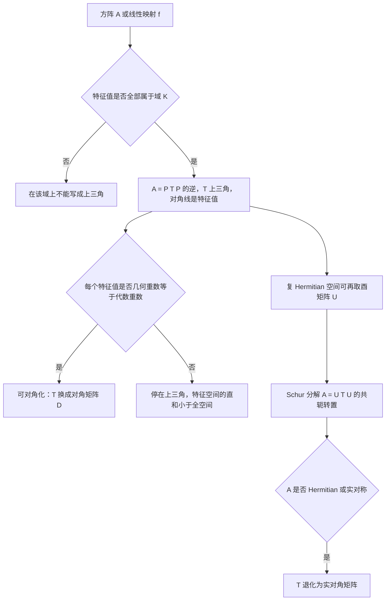
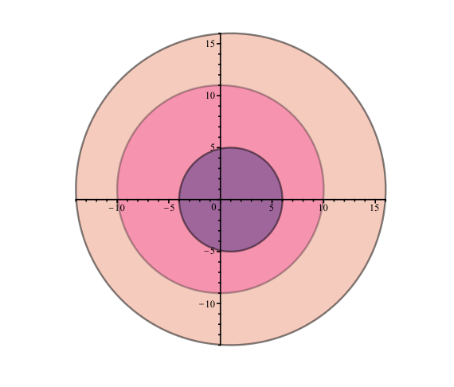
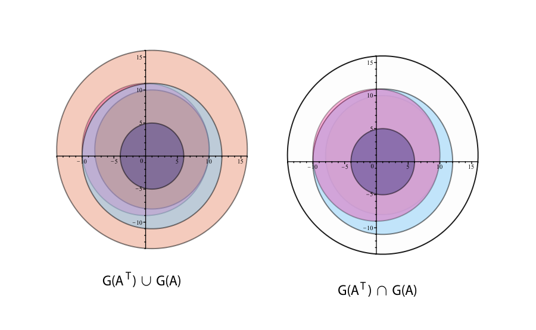

# 第14章 特征向量与特征值

### 本章总览

本章在任意域 ${K}$ 上讨论有限维线性映射的 eigenvector（特征向量）和 eigenvalue（特征值）。具体阅读时可以把 ${K}$ 当成 ${\mathbb{R}}$ 或 ${\mathbb{C}}$。

一条映射若在某组基下是对角矩阵，它就只沿各个基方向做拉伸。特征值都落在 ${K}$ 里、但特征向量不够时，下一步是 upper triangular matrix（上三角矩阵）。在复数上，每个方阵都能上三角化；在 Hermitian 空间里还可以把换基选成酉矩阵，这就是 Schur decomposition（Schur 分解）。

随后用 Gershgorin disc（Gershgorin 圆盘）把特征值圈在复平面的一组圆盘里，用对角化矩阵的 condition number（条件数）衡量特征值对扰动有多敏感，再用 Schur 形读出 matrix exponential（矩阵指数）${e^A}$ 的特征值。书中由此得到

$$
\det(e^A)=e^{\operatorname{tr}(A)}.
$$

这是命题 14.14。斜对称矩阵的指数因此落在 ${\mathrm{SO}(n)}$ 里，也就是旋转。

怎么把特征值算出来，本章不写。QR 算法和 Arnoldi 迭代在第 17 章。

阅读范围：PDF 第 537–568 页。习题不展开。

### 核心知识点

#### 特征向量与特征值

设 ${E}$ 是 ${K}$ 上的 ${n}$ 维向量空间，${f:E\to E}$ 线性。若存在基 ${(e_1,\ldots,e_n)}$ 使 ${f}$ 的矩阵为对角阵 ${D=\operatorname{diag}(\lambda_1,\ldots,\lambda_n)}$，则

$$
f(e_i)=\lambda_i e_i.
$$

在实空间里，这就是沿 ${e_i}$ 拉伸或压缩。矩阵说法是：存在可逆矩阵 ${P}$ 和对角矩阵 ${D}$，使

$$
A=PDP^{-1}.
$$

这时称 ${f}$（或 ${A}$）diagonalizable（可对角化）。${\lambda_i}$ 是特征值，${e_i}$ 是特征向量。

定义 14.1 把这件事从「已经对角」里抽出来。标量 ${\lambda\in K}$ 是 ${f}$ 的 eigenvalue（特征值；书中也叫 proper value、characteristic value），是指存在非零 ${u\in E}$ 使

$$
f(u)=\lambda u.
$$

等价条件是 ${\operatorname{Ker}(\lambda\,\mathrm{id}-f)}$ 非平凡，也就是 ${\lambda\,\mathrm{id}-f}$ 不可逆。后一个等价用到了有限维：从 ${E}$ 到自身的线性映射，单射当且仅当可逆。

非零向量 ${u}$ 若满足上式，就叫 eigenvector（特征向量；也叫 proper vector、characteristic vector），并说 ${u}$ 属于 ${\lambda}$。

**特征空间** ${E_\lambda(f)}$，也记 ${E(\lambda,f)}$ 或 ${E_\lambda}$，定义为

$$
E_\lambda(f)=\operatorname{Ker}(\lambda\,\mathrm{id}-f).
$$

它包含该特征值的全部特征向量，再补上零向量。书中要求特征向量本身非零，所以「全体特征向量」并不是子空间，零向量被排除在外。

不同特征值的特征向量集合互不相交。同一个特征值可以对应很多特征向量。

无限维空间上，${\lambda\,\mathrm{id}-f}$ 可以单射而不满射，这时「有特征向量」和「不可逆」不再等价。本章在进一步声明之前，都假定 ${\dim E=n<\infty}$。

两个 ${2\times 2}$ 例子把后面的分叉先摆出来。

$$
A_1=\begin{pmatrix}1&1\cr0&1\end{pmatrix}
$$

的特征值是 ${1,1}$，但属于 ${1}$ 的特征空间只有 ${1}$ 维，张不成整个平面，所以不能对角化。

$$
A_2=\begin{pmatrix}0&-1\cr1&0\end{pmatrix}
$$

的特征值是 ${\pm i}$。它们不在 ${\mathbb{R}}$ 里，所以在实数上不能对角化；在 ${\mathbb{C}}$ 上可以。

平面旋转

$$
\begin{pmatrix}\cos\theta&-\sin\theta\cr \sin\theta&\cos\theta\end{pmatrix}
$$

的特征多项式在 ${\theta\neq k\pi}$ 时没有实根。在 ${\mathbb{C}}$ 上根是 ${\cos\theta\pm i\sin\theta=e^{\pm i\theta}}$，因此可以对角化。

另一条路不选同一组基做对角或上三角，而用两组基 ${(e_i)}$、${(f_i)}$。当 ${K=\mathbb{R}}$ 或 ${\mathbb{C}}$ 时，这两组基可以都取成标准正交，并且

$$
f(e_i)=\sigma_i f_i,\qquad 1\le i\le n,
$$

其中 ${\sigma_i\ge 0}$。非零的 ${\sigma_i}$ 叫 singular value（奇异值），对应的分解是 singular value decomposition（奇异值分解，SVD）。

👉 奇异值是两组标准正交基之间的非负拉伸系数，矩阵写成「正交 × 非负对角 × 正交」。完整构造见第 20 章。

🔑 关键速记：特征值是 ${f(u)=\lambda u}$ 里的 ${\lambda}$，${u}$ 必须非零；可对角化就是存在基使矩阵成为 ${\operatorname{diag}(\lambda_i)}$。

#### 特征多项式、迹与对称函数

命题 14.1：${f}$ 的特征值就是多项式 ${\det(\lambda\,\mathrm{id}-f)}$ 在 ${K}$ 中的根。证明只依赖「${\lambda}$ 是特征值当且仅当 ${\lambda\,\mathrm{id}-f}$ 不可逆」，再引用第 6 章命题 6.14：不可逆当且仅当行列式为 ${0}$。

定义 14.2 把这个多项式命名为 characteristic polynomial（特征多项式）

$$
P_f(X)=\chi_f(X)=\det(X\,\mathrm{id}-f),
$$

矩阵形式是

$$
P_A(X)=\chi_A(X)=\det(XI-A).
$$

它在第 6 章 6.7 节定义 6.11 已经出现。按任一基把行列式展开，得到

$$
\chi_A(X)=\det(XI-A)=X^n-(a_{11}+\cdots+a_{nn})X^{n-1}+\cdots+(-1)^n\det(A).
$$

对角线之和

$$
\operatorname{tr}(A)=a_{11}+\cdots+a_{nn}
$$

叫 trace（迹）。特征多项式只依赖线性映射 ${f}$（第 6 章 6.7 节已证），所以同一映射的所有矩阵有相同的迹。于是 ${\operatorname{tr}(f)}$ 有定义，并且 ${\operatorname{tr}(f)=\operatorname{tr}(A)}$。

有的书写 ${\det(f-X\,\mathrm{id})}$。它和本书差一个符号：

$$
\det(f-X\,\mathrm{id})=(-1)^n\det(X\,\mathrm{id}-f).
$$

本书用 ${\det(X\,\mathrm{id}-f)}$，${X^n}$ 的系数是 ${+1}$。

把系数写成

$$
\chi_A(X)=X^n-\tau_1(A)X^{n-1}+\cdots+(-1)^k\tau_k(A)X^{n-k}+\cdots+(-1)^n\tau_n(A),
$$

则

$$
\tau_1(A)=\operatorname{tr}(A),\qquad \tau_n(A)=\det(A).
$$

一般的 ${\tau_k(A)}$ 是 ${k}$ 阶主子式之和。对 ${\{1,\ldots,n\}}$ 的非空有序子集 ${I=\{i_1<\cdots<i_k\}}$，${A_{I,I}}$ 是先取下标属于 ${I}$ 的列、再取下标属于 ${I}$ 的行得到的 ${k\times k}$ 主子矩阵。书中给出

$$
\tau_k(A)=\sum_{\substack{I\subseteq\{1,\ldots,n\}\cr |I|=k}}\det(A_{I,I}).
$$

若 ${\det(XI-A)}$ 的根 ${\lambda_1,\ldots,\lambda_n}$ 全在 ${K}$ 里（重根按重数重复），则

$$
\chi_A(X)=(X-\lambda_1)\cdots(X-\lambda_n)=X^n-\sigma_1(\lambda)X^{n-1}+\cdots+(-1)^n\sigma_n(\lambda).
$$

这里 ${\sigma_k(\lambda)}$ 是第 ${k}$ 个 elementary symmetric polynomial（初等对称多项式）

$$
\sigma_k(\lambda)=\sum_{|I|=k}\prod_{i\in I}\lambda_i.
$$

比较系数得到 ${\sigma_k(\lambda)=\tau_k(A)}$。特别地

$$
\operatorname{tr}(f)=\lambda_1+\cdots+\lambda_n,\qquad \det(f)=\lambda_1\cdots\lambda_n.
$$

因此 ${f}$ 不可逆，当且仅当 ${0}$ 是它的特征值。

特征多项式是否在 ${K}$ 里有根，取决于域。algebraically closed field（代数闭域）是指每个非常数多项式的根都在域内。${\mathbb{R}}$ 不是，${\mathbb{C}}$ 是。上面的旋转矩阵就是实系数多项式没有实根的例子。

在复向量空间上，可以不靠行列式证明「至少有一个特征值」。任取非零 ${u}$，向量 ${u,f(u),\ldots,f^n(u)}$ 必线性相关，得到一个复多项式；代数闭性把它拆成一次因式 ${(f-\lambda_i\mathrm{id})}$ 的复合。这些因式不能全是单射，否则复合仍单射，与 ${u\neq 0}$ 矛盾。所以某个 ${\lambda_i}$ 是特征值。

这条论证给出存在性，不给出求根的办法。要真正找出特征值，仍要处理 ${\det(X\,\mathrm{id}-f)}$。

🔑 关键速记：特征值是 ${\det(XI-A)=0}$ 的根；它们的和是迹，积是行列式，重根按重数计入。

#### 重数、直和与可对角化

定义 14.3 假定 ${\chi_A(X)}$ 的根全在 ${K}$ 中，并写成

$$
\det(XI-A)=(X-\lambda_1)^{k_1}\cdots(X-\lambda_m)^{k_m},
$$

其中 ${\lambda_1,\ldots,\lambda_m}$ 两两不同，${k_1+\cdots+k_m=n}$。

${k_i}$ 叫 algebraic multiplicity（代数重数），记 ${\operatorname{alg}(\lambda_i)}$。特征空间的维数 ${\dim\operatorname{Ker}(\lambda_i I-A)}$ 叫 geometric multiplicity（几何重数），记 ${\operatorname{geo}(\lambda_i)}$。

代数重数之和等于 ${n}$。几何重数之和可以严格小于 ${n}$。

命题 14.2：对每个特征值，

$$
\operatorname{geo}(\lambda_i)\le\operatorname{alg}(\lambda_i).
$$

结论来自换基：把 ${E_{\lambda_i}}$ 的基补成全空间的基后，矩阵变成左上角 ${\lambda_i I_{n_i}}$、左下角为 ${0}$ 的分块，于是 ${(X-\lambda_i)^{n_i}}$ 整除特征多项式。这里 ${n_i=\operatorname{geo}(\lambda_i)}$。

命题 14.3：属于两两不同特征值的特征向量线性无关。推论 14.4：若 ${\lambda_1,\ldots,\lambda_m}$ 是 ${f}$ 在 ${K}$ 中的全部不同特征值（${m\le n}$），则和

$$
E_{\lambda_1}\oplus\cdots\oplus E_{\lambda_m}
$$

是直和。这个直和可以是 ${E}$ 的真子空间。

定义 14.4：若这些特征值都在 ${K}$ 中，并且

$$
E=E_{\lambda_1}\oplus\cdots\oplus E_{\lambda_m},
$$

则称 ${f}$ 可对角化。每个特征空间里取基，矩阵就是对角阵，${\lambda_i}$ 出现的次数等于 ${\dim E_{\lambda_i}}$。

这件事发生的条件是：每个特征值的代数重数等于几何重数。特别地，特征多项式在 ${K}$ 中有 ${n}$ 个不同的根时，每个重数都是 ${1}$，因而可对角化。

${A_1}$ 的特征值 ${1}$ 代数重数为 ${2}$、几何重数为 ${1}$，直和填不满 ${E}$。实对称矩阵的特征值全是实数并且可以对角化；证明放在后面的命题 14.8。

🔑 关键速记：可对角化意味着特征空间的直和等于全空间，也就是每个特征值都满足 ${\operatorname{geo}(\lambda)=\operatorname{alg}(\lambda)}$。

#### 上三角化

复数上的线性映射不一定可对角化。次一步是 triangularize（上三角化）：找一组基，使对角线下方全是 ${0}$。上三角矩阵满足 ${j<i}$ 时 ${a_{ij}=0}$。

定理 14.5：有限维空间上的 ${f:E\to E}$ 能在 ${K}$ 上化成上三角矩阵，当且仅当它的特征值全部属于 ${K}$。矩阵形式是：存在 ${P,T\in M_n(K)}$，${P}$ 可逆、${T}$ 上三角，使

$$
A=PTP^{-1},
$$

当且仅当 ${A}$ 的特征值全在 ${K}$ 中。

必要性：上三角矩阵的特征值就是对角线元素，它们已经在 ${K}$ 里。

充分性对维数做归纳。取一个特征值 ${\lambda_1}$ 和特征向量 ${u_1}$，把基补齐后，第一列在对角线以下为 ${0}$，右下角 ${(n-1)\times(n-1)}$ 块的特征多项式整除原来的特征多项式，因而根仍在 ${K}$ 中，可以继续上三角化。

${A=PTP^{-1}}$ 时，${A}$ 与 ${T}$ 有相同的特征多项式，所以 ${T}$ 的对角线就是 ${A}$ 的特征值 ${\lambda_1,\ldots,\lambda_n}$（按重数）。

系数可以保持在原域里：${A}$ 是实矩阵且特征值全实，则 ${P}$ 可取实矩阵；${A}$ 是有理矩阵且特征值全有理，则 ${P}$ 可取有理矩阵。${\mathbb{C}}$ 上每个多项式都有根，所以每个复方阵都能上三角化。

特征向量与上三角化的关系如下。

图注：特征值都在系数域中时，定理 14.5 保证能化成上三角；特征空间维数补满之后，上三角才进一步变成对角。Schur 分解是在复内积空间里把同一步的换基选成酉矩阵。

若 ${\lambda}$ 是 ${A}$ 的特征值、${u}$ 是对应特征向量，则对每个整数 ${k\ge 1}$，${\lambda^k}$ 是 ${A^k}$ 的特征值，${u}$ 仍是特征向量。特征值全在 ${K}$ 中时，${A^k}$ 不会因此冒出别的特征值。更一般的是命题 14.7。

命题 14.7：设 ${A\in M_n(K)}$ 的特征值 ${\lambda_1,\ldots,\lambda_n}$ 全在 ${K}$ 中。则对每个多项式 ${q(X)\in K[X]}$，${q(A)}$ 的特征值恰好是

$$
\bigl(q(\lambda_1),\ldots,q(\lambda_n)\bigr).
$$

因为 ${A=PTP^{-1}}$ 推出 ${q(A)=Pq(T)P^{-1}}$，而 ${q(T)}$ 仍上三角，对角线是 ${q(\lambda_i)}$。

上三角化是理论工具。书中用它说明：每个复矩阵都是一列「特征值互异的可对角化矩阵」的极限。证明细节在习题里，本章正文只陈述这个结论。

🔑 关键速记：特征值全在 ${K}$ 里就能写成 ${A=PTP^{-1}}$；对角线上就是特征值，复矩阵因此总能上三角化。

#### Schur 分解

${E}$ 若是 Hermitian space（Hermitian 空间，见第 13 章），定理 14.5 的归纳可以把下一步的子空间选成 ${\mathbb{C}u_1}$ 的正交补，并在上面取标准正交基。换基矩阵就变成酉矩阵。

Hermitian 空间是带复内积的有限维空间。正交补是与给定方向内积为 ${0}$ 的子空间；标准正交基使换基保持内积。实欧氏空间在特征值全实时，用第 11 章的对应事实得到正交矩阵。

👉 正交补与标准正交基的构造见第 13 章命题 13.12、13.13；实欧氏空间见第 11 章命题 11.10、11.11。

定理 14.6（Schur decomposition，Schur 分解）：复 Hermitian 空间上的 ${f:E\to E}$ 存在标准正交基，使矩阵为上三角。等价地，每个 ${A\in M_n(\mathbb{C})}$ 都有酉矩阵 ${U}$ 和上三角矩阵 ${T}$，使

$$
A=UTU^{*}.
$$

若 ${A}$ 是实矩阵且特征值全为实数，则存在正交矩阵 ${Q}$ 和实上三角矩阵 ${T}$，使

$$
A=QTQ^{\top}.
$$

实矩阵若有复特征值，书中说仍有只用实矩阵的版本，但允许 ${T}$ 是分块上三角：对角块是实数或 ${2\times 2}$ 实矩阵。这几页没有写出分块公式。

👉 该细节原书本章未完整写出分块形式，暂不展开。

命题 14.8 用 Schur 分解处理 Hermitian 与实对称矩阵。

若 ${A^{*}=A}$，由 ${A=UTU^{*}}$ 得到 ${T=T^{*}}$。上三角又下三角，所以 ${T}$ 是对角矩阵；对角线满足 ${\overline{t_{ii}}=t_{ii}}$，因而全是实数。于是存在酉矩阵 ${U}$ 和实对角矩阵 ${D}$，使

$$
A=UDU^{*}.
$$

特征值全实，并且存在由特征向量组成的标准正交基。

实对称矩阵 ${A^{\top}=A}$ 是同一结论的实形式：特征值全实，并且存在正交矩阵 ${Q}$ 和实对角矩阵 ${D}$，使

$$
A=QDQ^{\top}.
$$

更一般的版本在第 16 章证明。本章只用到：Hermitian 与实对称都能用正交（酉）变换对角化，特征值是实数。

👉 正规矩阵的谱定理见第 16 章。本章在条件数一节会引用其中的定理 16.22：正规矩阵可用酉矩阵对角化。

定理 14.6 不适合手算，它用来处理那些不能对角化的矩阵。

🔑 关键速记：复矩阵有 ${A=UTU^{*}}$；Hermitian 与实对称进一步让 ${T}$ 变成实对角，特征向量还能选成标准正交。

#### 特征值落在哪里

定义 14.5：对复 ${n\times n}$ 矩阵 ${A}$，第 ${i}$ 行去掉对角线后的绝对值和是

$$
R'_i(A)=\sum_{j\neq i}|a_{ij}|.
$$

第 ${i}$ 个 Gershgorin disc（Gershgorin 圆盘）是

$$
\{z\in\mathbb{C}:|z-a_{ii}|\le R'_i(A)\}.
$$

它们的并

$$
G(A)=\bigcup_{i=1}^{n}\{z\in\mathbb{C}:|z-a_{ii}|\le R'_i(A)\}
$$

叫 Gershgorin domain（Gershgorin 区域）。

书中的例子是

$$
A=\begin{pmatrix}1&2&3\cr 4&i&6\cr 7&8&1+i\end{pmatrix}.
$$

三个行半径是 ${R'_1(A)=5}$，${R'_2(A)=10}$，${R'_3(A)=15}$。圆盘分别是 ${|z-1|\le 5}$、${|z-i|\le 10}$、${|z-1-i|\le 15}$。圆心在 ${1}$、${i}$ 和 ${1+i}$，彼此靠近，半径又依次变大，所以图上看起来像套在一起。

图注：Figure 14.1。矩阵 ${A}$ 的三个行圆盘：蓝紫色 ${|z-1|\le 5}$，粉色 ${|z-i|\le 10}$，桃色 ${|z-(1+i)|\le 15}$。${G(A)}$ 是这三块的并，定理 14.9 说全部特征值都落在这个并集里。

定理 14.9（Gershgorin’s disc theorem，Gershgorin 圆盘定理）：${A}$ 的每个特征值都属于 ${G(A)}$。另外两条：

1. 若 ${A}$ 严格行对角占优，即对每个 ${i}$

$$
|a_{ii}|>\sum_{j\neq i}|a_{ij}|,
$$

则 ${0}$ 不在任一圆盘中，特征值都不为 ${0}$，${A}$ 可逆。

2. 若同时还满足 ${a_{ii}>0}$，则每个圆盘严格落在右半平面，每个特征值的实部都严格为正。

证明只用到特征向量的最大分量。设 ${Au=\lambda u}$，${u\neq 0}$，取 ${|u_k|=\max_i|u_i|}$。第 ${k}$ 行给出

$$
|\lambda-a_{kk}|\le R'_k(A),
$$

所以 ${\lambda}$ 落进第 ${k}$ 个圆盘。

对称矩阵若严格行对角占优，并且对角线元素严格为正，则它 positive definite（正定）。这是定理 14.9 的直接推论：对称矩阵的特征值是实数（命题 14.8），又被第 2 条压到正实部，所以全是正数。这条定理有时也叫 Gershgorin–Hadamard 定理。

${A}$ 与 ${A^{\top}}$ 有相同的特征值，复矩阵也一样。因此可以把半径改成列和

$$
C'_j(A)=\sum_{i\neq j}|a_{ij}|,
$$

区域 ${G(A^{\top})}$ 同样包住全部特征值。对上面的例子，${C'_1(A)=11}$，${C'_2(A)=10}$，${C'_3(A)=9}$。

定理 14.10：每个特征值属于交集 ${G(A)\cap G(A^{\top})}$。严格列对角占优时，${A}$ 可逆；若对角线还严格为正，则每个特征值的实部严格为正。

图注：Figure 14.3。左图是 ${G(A)\cup G(A^{\top})}$，右图着色区域是 ${G(A)\cap G(A^{\top})}$。定理 14.10 把全部特征值收进右图这个交集。

圆盘还可以再收紧，也可以换成别的区域。书中指向 Horn and Johnson 的 6.1、6.2 节，本章不展开。

严格行占优和严格列占优都不是可逆的必要条件。若把严格不等号放成 ${\ge}$，行（或列）对角占优也不足以保证可逆。

🔑 关键速记：特征值落在以对角元为圆心、非对角绝对值和为半径的圆盘并集里；行区域和列区域的交更小。

#### 特征值问题的条件数

考虑次对角线上为 ${1}$、其余为 ${0}$ 的 ${n\times n}$ 矩阵

$$
A=\begin{pmatrix}
0&&&\cr
1&0&&\cr
&\ddots&\ddots&\cr
&&1&0
\end{pmatrix}.
$$

它的特征值是 ${0}$，重数为 ${n}$。把右上角改成 ${\epsilon}$，

$$
A(\epsilon)=\begin{pmatrix}
0&&& \epsilon\cr
1&0&&\cr
&\ddots&\ddots&\cr
&&1&0
\end{pmatrix},
$$

特征多项式是 ${X^n-\epsilon}$。取 ${n=40}$、${\epsilon=10^{-40}}$ 时，${A(10^{-40})}$ 的特征值是

$$
10^{-1}e^{k\,2\pi i/40},\qquad k=1,\ldots,40.
$$

矩阵只改了 ${10^{-40}}$，特征值却从 ${0}$ 变成模长为 ${10^{-1}}$ 的 ${40}$ 次单位根。书中给出的相对误差是 ${10^{-39}}$。机器精度还会把极小的数当成 ${0}$，所以计算 ${A(10^{-40})}$ 的特征值时，误差可以很大。

第 8 章 8.5 节讨论的是 ${Ax=b}$：系数的小扰动如何传到解上，尺子是 ${\operatorname{cond}(A)}$。特征值问题换了一把尺子。可对角化时，敏感度由对角化所用的换基矩阵 ${P}$ 的条件数决定，而不是由 ${A}$ 自己的条件数决定。

👉 方程组条件数 ${\operatorname{cond}(A)}$ 的定义与扰动估计见第 8 章 8.5 节。

命题 14.11（Bauer and Fike，1960）：设 ${A\in M_n(\mathbb{C})}$ 可对角化，

$$
A=PDP^{-1},\qquad D=\operatorname{diag}(\lambda_1,\ldots,\lambda_n),
$$

矩阵范数满足：对每个对角矩阵，

$$
\|\operatorname{diag}(\alpha_1,\ldots,\alpha_n)\|=\max_{1\le i\le n}|\alpha_i|.
$$

算子范数 ${\|\cdot\|_p}$（${p=1,2,\infty}$）满足这一条。则对任意扰动 ${\Delta A}$，${A+\Delta A}$ 的每个特征值 ${\lambda}$ 都属于圆盘

$$
B_i=\{z\in\mathbb{C}:|z-\lambda_i|\le\operatorname{cond}(P)\,\|\Delta A\|\}
$$

的并。证明里把条件和范数乘积对齐：

$$
\operatorname{cond}(P)=\|P\|\,\|P^{-1}\|.
$$

因此半径是 ${\operatorname{cond}(P)\|\Delta A\|}$。${P}$ 的条件数大，同样大小的 ${\Delta A}$ 把特征值推得更远。

定义 14.6 取所有对角化里条件数最小的那个：

$$
\Gamma(A)=\inf\{\operatorname{cond}(P):P^{-1}AP=D\}.
$$

它叫 ${A}$ 关于特征值问题的 conditioning（条件数）。于是 ${A+\Delta A}$ 的每个特征值落在半径为 ${\Gamma(A)\|\Delta A\|}$、圆心为各个 ${\lambda_k}$ 的圆盘并集里。

normal matrix（正规矩阵）可以用酉矩阵对角化，这是第 16 章定理 16.22。谱范数下 ${\|U\|_2=1}$，所以 ${\Gamma(A)=1}$。正规矩阵对特征值问题的条件很好：${A+\Delta A}$ 的每个特征值 ${\lambda}$ 满足

$$
\lambda\in\bigcup_{k=1}^{n}\{z\in\mathbb{C}:|z-\lambda_k|\le\|\Delta A\|_2\}.
$$

上面的 ${A(\epsilon)}$ 不是正规矩阵。若 ${A}$ 与 ${A+\Delta A}$ 都对称，或都是 Hermitian，书中说有更紧的结果，并指向第 16 章命题 16.28。界的公式不在本章。

👉 该细节原书本章未完整写出，暂不展开，完整讲解见第 16 章命题 16.28。正规矩阵的定义和酉对角化见同章定理 16.22。

🔑 关键速记：可对角化矩阵的特征值扰动半径是 ${\operatorname{cond}(P)\|\Delta A\|}$；正规矩阵在谱范数下 ${\Gamma(A)=1}$。

#### 矩阵指数的特征值

Schur 分解（实际上用到的是定理 14.5 的上三角化）给出 ${e^A}$ 的特征值。矩阵指数是幂级数

$$
e^A=\sum_{p\ge 0}\frac{A^p}{p!}.
$$

第 8 章 8.8 节给出定义，并证明斜对称矩阵的指数是正交矩阵（命题 8.23）。本章在这个级数上读特征值和行列式。

👉 级数定义与命题 8.23 见第 8 章 8.8 节。

命题 14.12：${U}$ 可逆时

$$
e^{UAU^{-1}}=Ue^{A}U^{-1}.
$$

因为 ${UA^pU^{-1}=(UAU^{-1})^p}$，级数逐项可提出 ${U}$ 和 ${U^{-1}}$。

命题 14.13：若 ${\lambda_1,\ldots,\lambda_n}$ 是复方阵 ${A}$ 的特征值，则 ${e^{\lambda_1},\ldots,e^{\lambda_n}}$ 是 ${e^A}$ 的特征值。若 ${u}$ 是 ${A}$ 属于 ${\lambda_i}$ 的特征向量，则 ${u}$ 也是 ${e^A}$ 属于 ${e^{\lambda_i}}$ 的特征向量。

前半用上三角化：${A=PTP^{-1}}$ 推出 ${e^A=Pe^{T}P^{-1}}$。${T}$ 上三角时每个 ${T^p}$ 上三角，对角线是 ${\lambda_i^p}$，所以 ${e^T}$ 上三角，对角线是

$$
\sum_{p\ge 0}\frac{\lambda_i^p}{p!}=e^{\lambda_i}.
$$

后半对单个特征向量直接代级数：${A^pu=\lambda^pu}$，因而 ${e^Au=e^{\lambda}u}$。

命题 14.14：对每个复方阵或实方阵 ${A}$，

$$
\det(e^A)=e^{\operatorname{tr}(A)}.
$$

迹等于特征值之和，行列式等于特征值之积。${e^A}$ 的特征值是 ${e^{\lambda_i}}$，所以

$$
\det(e^A)=e^{\lambda_1}\cdots e^{\lambda_n}=e^{\lambda_1+\cdots+\lambda_n}=e^{\operatorname{tr}(A)}.
$$

斜对称矩阵 ${B}$ 的迹为 ${0}$，于是 ${\det(e^B)=e^0=1}$。实斜对称矩阵全体记为 ${\mathfrak{so}(n)}$。

命题 14.15：每个 ${B\in\mathfrak{so}(n)}$ 满足 ${e^B\in\mathrm{SO}(n)}$，也就是 ${e^B}$ 是旋转。正交性来自命题 8.23，行列式 ${+1}$ 来自上面的迹公式。

因此指数给出映射 ${\exp:\mathfrak{so}(n)\to\mathrm{SO}(n)}$。它不是单射。书中说，用谱定理可以证明它是满射；满射的证明不在本章。

若 ${B}$ 是实对称矩阵，则

$$
(e^B)^{\top}=e^{B^{\top}}=e^B,
$$

所以 ${e^B}$ 也对称。${B}$ 的特征值 ${\lambda_i}$ 是实数，${e^B}$ 的特征值 ${e^{\lambda_i}}$ 全为正，因此 ${e^B}$ 对称正定。书中进一步陈述：每个对称正定矩阵 ${A}$ 都有唯一的对称矩阵 ${B}$ 使 ${A=e^B}$，证明指向 Gallier [24]，本章没有给出。

🔑 关键速记：${e^A}$ 的特征值是 ${e^{\lambda_i}}$，并且 ${\det(e^A)=e^{\operatorname{tr}(A)}}$；斜对称矩阵的指数是行列式为 ${1}$ 的旋转。

#### 计算放在第 17 章

本章说明特征值是什么、落在哪、对扰动有多敏感，以及它们如何进入矩阵指数。把矩阵真正化成上三角、或近似算出部分特征值，是数值算法的工作。

QR 算法反复做 QR 分解，用正交相似把矩阵推向定理 14.6 那种 Schur 上三角，对角线就是全部特征值。Arnoldi 迭代面向大型矩阵：在 Krylov 子空间里取一组正交向量，把原矩阵投影成小矩阵，再用小矩阵的特征值近似原矩阵的一部分特征值。幂迭代和 Lanczos 与它们列在同一章。步骤、停止条件和数值稳定性，这几页都没有。

👉 算法步骤见第 17 章。📝待补全

🔑 关键速记：QR 与 Arnoldi 是计算工具，理论背景是本章的上三角化和 Schur 形；算法本身不在这 32 页里。

### 🔑 关键速记

- ${f(u)=\lambda u}$ 且 ${u\neq 0}$；特征空间是 ${\operatorname{Ker}(\lambda\,\mathrm{id}-f)}$，含零向量。
- ${\chi_A(X)=\det(XI-A)}$，首项系数 ${+1}$；${\operatorname{tr}(f)=\sum\lambda_i}$，${\det(f)=\prod\lambda_i}$。
- ${\operatorname{geo}(\lambda)\le\operatorname{alg}(\lambda)}$；两者相等且特征值都在 ${K}$ 中时，映射可对角化。
- 特征值全在 ${K}$ 中当且仅当 ${A=PTP^{-1}}$，${T}$ 上三角；复矩阵总能做到。
- Schur 分解是 ${A=UTU^{*}}$；Hermitian 与实对称进一步得到实对角和标准正交基。
- 特征值落在 Gershgorin 行圆盘的并集里，也落在行区域与列区域的交集里。
- 特征值扰动看 ${\operatorname{cond}(P)}$；正规矩阵在谱范数下 ${\Gamma(A)=1}$。
- ${\det(e^A)=e^{\operatorname{tr}(A)}}$；${B}$ 斜对称时 ${e^B\in\mathrm{SO}(n)}$。

### 易混淆点与差异对比

可对角化、上三角化、Schur 分解是三层换基，条件一层比一层宽，结论一层比一层弱。

| 形式 | 书中公式 | 何时成立 | 对角线上有什么 |
| --- | --- | --- | --- |
| 对角化 | ${A=PDP^{-1}}$ | 特征值在 ${K}$ 中，且每个 ${\operatorname{geo}=\operatorname{alg}}$ | 特征值，每个出现 ${\dim E_\lambda}$ 次 |
| 上三角化 | ${A=PTP^{-1}}$ | 特征值全部属于 ${K}$ | 特征值，含重数 |
| Schur 分解 | ${A=UTU^{*}}$ | 任意复方阵；${U}$ 酉 | 同样是特征值 |
| Hermitian / 实对称 | ${A=UDU^{*}}$ 或 ${A=QDQ^{\top}}$ | ${A^{*}=A}$，或实的 ${A^{\top}=A}$ | 实特征值，基可标准正交 |

上表的分界是「特征空间是否补满」和「换基是否保持内积」。${A_1}$ 的两个特征值都是 ${1}$，仍然只能停在上三角，因为几何重数是 ${1}$。${A_2}$ 在 ${\mathbb{R}}$ 上连上三角都没有，因为 ${\pm i\notin\mathbb{R}}$；扩到 ${\mathbb{C}}$ 之后可以对角化。

代数重数是特征多项式里因子 ${(X-\lambda)}$ 的次数。几何重数是 ${\operatorname{Ker}(\lambda I-A)}$ 的维数。前者之和恒为 ${n}$，后者可以更小。命题 14.2 只保证几何重数不超过代数重数。

行圆盘 ${G(A)}$ 用非对角元的行和做半径。列圆盘 ${G(A^{\top})}$ 用列和。定理 14.9 把特征值放进并集；定理 14.10 把它们放进交集。Figure 14.3 的右图才是更紧的区域。严格占优能推出可逆，但可逆的矩阵不必严格占优；不等号放宽成 ${\ge}$ 之后，占优也不再保证可逆。

方程组的条件数看 ${A}$。特征值的条件数看对角化矩阵 ${P}$，记成 ${\Gamma(A)}$。同一个 ${A}$ 可以在 ${Ax=b}$ 里很乖、在特征值里很敏感，${A(\epsilon)}$ 就是这种例子，而且它不是正规矩阵。正规矩阵在谱范数下把半径收到 ${\|\Delta A\|_2}$。

${\det(XI-A)}$ 与 ${\det(A-XI)}$ 差因子 ${(-1)^n}$。本书首项是 ${+1}$。引用迹和行列式作为系数时，要沿用 ${\det(XI-A)}$ 这一套。

矩阵指数把特征值送成 ${e^{\lambda_i}}$，把特征向量留在原方向。${A+B}$ 的特征值一般不是两边特征值的和，那是习题里的反例，这里只记住：指数、多项式 ${q(A)}$ 会把 ${\lambda_i}$ 送成 ${e^{\lambda_i}}$、${q(\lambda_i)}$；加法没有这条规则。

SVD 用两组基和一组非负奇异值。特征值只用一组基，对角元可以是负数或复数。两组对象都描述拉伸，基的套数和符号约定不同。

### 本章要点总结

有限维时，${\lambda}$ 是特征值当且仅当存在非零 ${u}$ 使 ${f(u)=\lambda u}$，也当且仅当 ${\det(\lambda\,\mathrm{id}-f)=0}$。特征多项式 ${\det(XI-A)}$ 的一次系数给出迹，常数项给出行列式；根全在域内时，迹是特征值之和，行列式是特征值之积。

不同特征值的特征向量线性无关，对应特征空间构成直和。直和等于全空间时映射可对角化，充要条件是每个特征值的几何重数等于代数重数。否则，只要特征值仍在系数域里，定理 14.5 保证能化成上三角 ${A=PTP^{-1}}$。复矩阵总能上三角化。Schur 分解再把换基选成酉矩阵 ${A=UTU^{*}}$；Hermitian 与实对称矩阵的 ${T}$ 退化为实对角。

Gershgorin 圆盘用对角元当圆心、非对角绝对值和当半径，行区域与列区域的交集仍包住全部特征值。严格对角占优且对角线为正时，特征值实部为正；对称情形下这推出正定。

可对角化矩阵的特征值扰动由 ${\operatorname{cond}(P)}$ 控制。正规矩阵在谱范数下条件数 ${\Gamma(A)=1}$。${e^A}$ 的特征值是 ${e^{\lambda_i}}$，同一特征向量仍属于它，并且 ${\det(e^A)=e^{\operatorname{tr}(A)}}$。因此斜对称矩阵的指数是 ${\mathrm{SO}(n)}$ 中的旋转，实对称矩阵的指数对称正定。QR、Arnoldi 等算法留在第 17 章。
