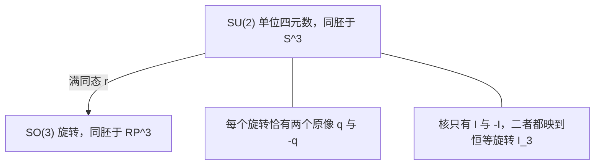
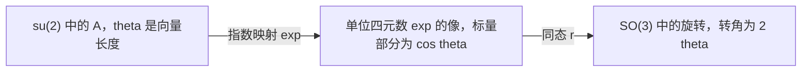
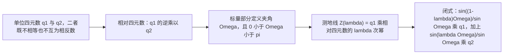

# 第15章 单位四元数与 SO(3) 旋转

### 本章总览

本章讲怎么用单位四元数表示 $\mathrm{SO}(3)$ 里的旋转。单位四元数直接定义成 $\mathrm{SU}(2)$ 的元素。路线是：四元数斜域 $\mathbb{H}$，同态 $r:\mathrm{SU}(2)\to\mathrm{SO}(3)$ 及其核，旋转矩阵 $R_q$，由旋转矩阵反求四元数，指数映射 $\exp:\mathfrak{su}(2)\to\mathrm{SU}(2)$，Ken Shoemake 的 slerp 插值公式，以及不存在“好”的全局截面。

视觉、机器人与图形学里，姿态插值要在旋转之间走一条均匀的路径。四元数把这件事写成 $\mathrm{SU}(2)$ 上的测地线，再化成闭式。代价是每个旋转对应两个四元数，符号不能在整个 $\mathrm{SO}(3)$ 上连续地选定。

阅读范围：PDF 第 569–592 页。第 592 页只有页眉。15.8 节是概念清单，15.9 节是习题，习题不展开。

### 核心知识点

#### SU(2) 与四元数

**单位四元数**就是群 $\mathrm{SU}(2)$ 的元素：$2\times 2$ 复矩阵

$$
\begin{pmatrix} \alpha & \beta \\ -\overline{\beta} & \overline{\alpha} \end{pmatrix},
\qquad \alpha,\beta\in\mathbb{C},\quad
\alpha\overline{\alpha}+\beta\overline{\beta}=1.
$$

四元数全体是实向量空间 $\mathbb{H}=\mathbb{R}\,\mathrm{SU}(2)$。取基

$$
\mathbf{1}=\begin{pmatrix}1&0\\0&1\end{pmatrix},\quad
\mathbf{i}=\begin{pmatrix}i&0\\0&-i\end{pmatrix},\quad
\mathbf{j}=\begin{pmatrix}0&1\\-1&0\end{pmatrix},\quad
\mathbf{k}=\begin{pmatrix}0&i\\i&0\end{pmatrix},
$$

则每个四元数都是 $X=a\mathbf{1}+b\mathbf{i}+c\mathbf{j}+d\mathbf{k}$，$a,b,c,d\in\mathbb{R}$，矩阵写成

$$
X=\begin{pmatrix} a+ib & c+id \\ -(c-id) & a-ib \end{pmatrix}.
$$

Hamilton 恒等式是 $\mathbf{i}^2=\mathbf{j}^2=\mathbf{k}^2=\mathbf{ijk}=-1$，以及 $\mathbf{ij}=-\mathbf{ji}=\mathbf{k}$，$\mathbf{jk}=-\mathbf{kj}=\mathbf{i}$，$\mathbf{ki}=-\mathbf{ik}=\mathbf{j}$。因此四元数是复数的推广：$-1$ 有三个平方根，而且乘法不可交换。

两个四元数 $X=a\mathbf{1}+b\mathbf{i}+c\mathbf{j}+d\mathbf{k}$ 与 $Y=a'\mathbf{1}+b'\mathbf{i}+c'\mathbf{j}+d'\mathbf{k}$ 的乘积，就是上面两个矩阵相乘，结果为

$$
\begin{aligned}
XY={}&(aa'-bb'-cc'-dd')\mathbf{1}
+(ab'+ba'+cd'-dc')\mathbf{i}\\
&+(ac'+ca'+db'-bd')\mathbf{j}
+(ad'+da'+bc'-cb')\mathbf{k}.
\end{aligned}
$$

Olinde Rodrigues 在 1840 年用齐次变换独立得到过同一公式，时间早于 Hamilton，但他没有建立四元数（Veblen and Young [72]）。

共轭转置满足 $XX^*=X^*X=(a^2+b^2+c^2+d^2)\mathbf{1}$，并且

$$
X^*=\begin{pmatrix} a-ib & -(c+id) \\ c-id & a+ib \end{pmatrix}
=a\mathbf{1}-b\mathbf{i}-c\mathbf{j}-d\mathbf{k}.
$$

$X\neq 0$ 时可逆，$X^{-1}=(a^2+b^2+c^2+d^2)^{-1}X^*$。于是 $\mathbb{H}$ 是 skew field（斜域）。它又是以 $(\mathbf{1},\mathbf{i},\mathbf{j},\mathbf{k})$ 为基的 4 维实向量空间，作为向量空间同构于 $\mathbb{R}^4$。

定义 15.2 把 $X$ 简写成 $X=[a,(b,c,d)]$。$a$ 叫 scalar part（标量部分），$(b,c,d)$ 叫 vector part（向量部分）。此时 $X^*=[a,-(b,c,d)]$，书中在 $X$ 上方加横线，记作 $\overline{X}$，称为 conjugate（共轭）。单位四元数的共轭就是它的乘法逆元。

🔑 关键速记：单位四元数 $=$ $\mathrm{SU}(2)$；一般四元数是 4 维斜域 $\mathbb{H}$，单位条件就是 $a^2+b^2+c^2+d^2=1$。

#### 用 SU(2) 表示 SO(3)

旋转表示来自 $\mathrm{SU}(2)$ 的 adjoint representation（伴随表示）。先定义零迹反 Hermitian 矩阵构成的实向量空间（定义 15.3）

$$
\mathfrak{su}(2)
=\left\{
\begin{pmatrix} ix & y+iz \\ -y+iz & -ix \end{pmatrix}
\mid (x,y,z)\in\mathbb{R}^3
\right\}.
$$

其中 $A^*=-A$，$\operatorname{tr}(A)=0$。

定义 15.4：对 $q\in\mathrm{SU}(2)$，

$$
\operatorname{Ad}_q(A)=qAq^*,\qquad A\in\mathfrak{su}(2),
$$

$$
q^*=\begin{pmatrix} \overline{\alpha} & -\beta \\ \overline{\beta} & \alpha \end{pmatrix}.
$$

$\operatorname{Ad}_q$ 是 $\mathfrak{su}(2)$ 上的可逆线性映射，$\operatorname{Ad}$ 是到 $\mathrm{GL}(\mathfrak{su}(2))$ 的群同态。

把 $\mathbb{R}^3$ 嵌进纯四元数：

$$
\psi(x,y,z)
=\begin{pmatrix} ix & y+iz \\ -y+iz & -ix \end{pmatrix}.
$$

这与 $\mathfrak{su}(2)$ 的矩阵是同一族。$q$ 诱导

$$
\rho_q(x,y,z)=\psi^{-1}\bigl(q\,\psi(x,y,z)\,q^*\bigr).
$$

模掉同构 $\psi$ 之后，$\rho_q$ 就是 $\operatorname{Ad}_q$。旋转的四元数表示就是这个伴随表示。

计算时改用零迹 Hermitian 矩阵更方便。Pauli 矩阵为

$$
\sigma_1=\begin{pmatrix}0&1\\1&0\end{pmatrix},\quad
\sigma_2=\begin{pmatrix}0&-i\\i&0\end{pmatrix},\quad
\sigma_3=\begin{pmatrix}1&0\\0&-1\end{pmatrix}.
$$

$-i\psi(x,y,z)=x\sigma_3+y\sigma_2+z\sigma_1$。每个 $2\times 2$ 零迹 Hermitian 矩阵都是这种形状。$(i\sigma_1,i\sigma_2,i\sigma_3)$ 是 $\mathfrak{su}(2)$ 的一组基，并且四元数基与 Pauli 矩阵的关系是 $\mathbf{i}=i\sigma_3$，$\mathbf{j}=i\sigma_2$，$\mathbf{k}=i\sigma_1$。左边是四元数单位，右边的 $i$ 是复数单位。

定义嵌入 $\varphi(x,y,z)=x\sigma_3+y\sigma_2+z\sigma_1$。书中有 $\varphi=-i\psi$，$\varphi^{-1}=i\psi^{-1}$。并且

$$
\det(x\sigma_3+y\sigma_2+z\sigma_1)=-(x^2+y^2+z^2).
$$

$A\mapsto qAq^*$ 保持零迹 Hermitian 矩阵，也保持这个行列式。

定义 15.5：单位四元数 $q$ 诱导

$$
r_q(x,y,z)
=\varphi^{-1}\bigl(q\,\varphi(x,y,z)\,q^*\bigr)
=\varphi^{-1}\bigl(q(x\sigma_3+y\sigma_2+z\sigma_1)q^*\bigr).
$$

$r_q$ 是线性的。由 $\varphi=-i\psi$ 可化回 $\rho_q$，所以 $r_q=\rho_q$。

命题 15.1：$r_q$ 是正交变换，$r_q\in\mathrm{O}(3)$。结论来自它保持范数：$\|r_q(x,y,z)\|^2=\|(x,y,z)\|^2$。

命题 15.2：设 $q$ 的实参数满足 $a^2+b^2+c^2+d^2=1$。若 $(b,c,d)\neq(0,0,0)$，则 $r_q$ 的不动点是方程组

$$
-dy+cz=0,\qquad cx-by=0,\qquad dx-bz=0
$$

的解。非平凡解是 $(b,c,d)$，系数矩阵秩为 2。因此特征值 $1$ 的重数是 1，$r_q$ 是绕轴 $(b,c,d)$ 的旋转。若行列式为 $-1$，特征值型会与“$1$ 只出现一次”矛盾，所以行列式不是 $-1$。

$b=c=d=0$ 时 $q=I$，$r_q$ 是恒等。

映射 $q\mapsto r_q$ 记为 $r:\mathrm{SU}(2)\to\mathrm{SO}(3)$。

定理 15.3：$r$ 是群同态，核是 $\{I,-I\}$。同态性是 $r_{q_2}\circ r_{q_1}=r_{q_2q_1}$。若 $r_q=I_3$，则特征值 $1$ 的重数为 3，从而 $(b,c,d)=0$，于是 $a=\pm 1$，$q=\pm I_2$。

连续版本的旁注：$r$ 连续，$\mathrm{SU}(2)$ 连通，像落在 $I$ 的连通分支里，也就是 $\mathrm{SO}(3)$。

定理 15.4 给出转角。$r_q=I_3$ 当且仅当 $u=(b,c,d)=0$，当且仅当 $|a|=1$。若 $u\neq 0$：

- $a=0$ 时，$r_q$ 是绕 $u=(b,c,d)$ 转角为 $\pi$ 的旋转；
- $0<|a|<1$ 时，轴仍是 $u$，转角 $\theta\neq\pi$ 且 $0<\theta<2\pi$，由

$$
\tan(\theta/2)=\frac{\|u\|}{a}
$$

给出。平面上的定向基 $(w_1,w_2)$ 要满足 $\det(w_1,w_2,u)>0$，向量都按标准基 $(e_1,e_2,e_3)$ 的正定向来写。

在这个定向下，$\cos(\theta/2)=a$，并且 $0<\theta<2\pi$ 使 $\theta$ 被这个等式唯一确定。若改成 $-\pi<\theta<\pi$，则 $\theta$ 与 $-\theta$ 都满足同一等式。$0<a<1$ 时 $0<\theta<\pi$；$-1<a<0$ 时 $\pi<\theta<2\pi$。后一情形也等于绕 $-\,u$、转角 $\theta-2\pi$ 的旋转，垂直平面的正定向变成 $(w_2,w_1)$。

$q$ 与 $-\,q$ 定义同一个旋转。可以把 $a$ 取成正数，从而 $0<\theta<\pi$；若原来 $a<0$，改用 $-\,q$ 时轴向量变成 $-\,u$，相当于把轴的垂直平面定向翻过来。

定理 15.4 的证明不在本章，书中指向 Gallier [24] 第 9 章。本章使用的是上述结论与定向约定。

$r$ 是满射，但此刻还不显然。满射的构造放在 15.4 节。另一种证法是：每个旋转都是两次反射的复合，而 $\mathbb{R}^3$ 的反射 $\sigma$ 可写成

$$
\sigma(x,y,z)=-\varphi^{-1}\bigl(q\,\varphi(x,y,z)\,q^*\bigr),
$$

负号不能去掉。这是 Gallier [24] 第 9 章的做法。本章改用下一节的算法证明满射。

🔑 关键速记：$r_q$ 是绕向量部分 $(b,c,d)$ 的旋转；同态 $r$ 的核是 $\{I,-I\}$，所以 $q$ 与 $-\,q$ 是同一个旋转。

#### 旋转矩阵 $R_q$

设 $\alpha=a+ib$，$\beta=c+id$，$a^2+b^2+c^2+d^2=1$。命题 15.5：$r_q$ 的矩阵是

$$
R_q=
\begin{pmatrix}
a^2+b^2-c^2-d^2 & 2bc-2ad & 2ac+2bd \\
2bc+2ad & a^2-b^2+c^2-d^2 & -2ab+2cd \\
-2ac+2bd & 2ab+2cd & a^2-b^2-c^2+d^2
\end{pmatrix}.
$$

用单位条件改写对角元，得到

$$
R_q=
\begin{pmatrix}
2a^2+2b^2-1 & 2bc-2ad & 2ac+2bd \\
2bc+2ad & 2a^2+2c^2-1 & -2ab+2cd \\
-2ac+2bd & 2ab+2cd & 2a^2+2d^2-1
\end{pmatrix}.
$$

书中称它为四元数 $q$ 诱导的 Euler form（欧拉形式）旋转矩阵，也就是 $\rho_q$ 的矩阵。它来自把 $q(x\sigma_3+y\sigma_2+z\sigma_1)q^*$ 的三个实坐标读出来。本章到此说明每个单位四元数给出一个旋转；每个旋转都有四元数，要等下一节。

🔑 关键速记：$R_q$ 的两套写法只差单位条件；对角元可写成 $2a^2+2b^2-1$ 等，非对角元来自 $a,b,c,d$ 的两两乘积。

#### 由旋转矩阵求四元数

定理 15.6：同态 $r:\mathrm{SU}(2)\to\mathrm{SO}(3)$ 是满射。下面的算法同时给出证明。

##### 迹与半角

$R_q$ 的迹是 $\operatorname{tr}(R_q)=3a^2-b^2-c^2-d^2$。再用 $a^2+b^2+c^2+d^2=1$，得到 $\operatorname{tr}(R_q)=4a^2-1$，故

$$
a^2=\frac{\operatorname{tr}(R_q)+1}{4}.
$$

对任意 $R\in\mathrm{SO}(3)$，要找 $q$ 使 $R_q=R$，因此 $a^2=(\operatorname{tr}(R)+1)/4$。旋转角 $\theta\in[0,\pi]$ 满足 $\operatorname{tr}(R)=1+2\cos\theta$，于是

$$
a^2=\frac{\cos\theta+1}{2}=\cos^2\frac{\theta}{2},
\qquad
|a|=\cos\frac{\theta}{2}
\quad(0\le\theta\le\pi).
$$

可以把角限制在 $[0,\pi]$：若 $\pi\le\theta\le 2\pi$，则绕 $(b,c,d)$ 转 $\theta-2\pi$，等于绕 $-(b,c,d)$ 转 $2\pi-\theta\in[0,\pi]$。

##### 情形 1：迹不等于 $-1$

$\operatorname{tr}(R)\neq -1$，等价于 $\theta\neq\pi$，此时 $a\neq 0$。取正平方根

$$
a=\frac{\sqrt{\operatorname{tr}(R)+1}}{2}.
$$

比较 $R-R^\top$ 与 $R_q-R_q^\top$：

$$
4ab=r_{32}-r_{23},\qquad
4ac=r_{13}-r_{31},\qquad
4ad=r_{21}-r_{12}.
$$

因此

$$
b=\frac{r_{32}-r_{23}}{4a},\qquad
c=\frac{r_{13}-r_{31}}{4a},\qquad
d=\frac{r_{21}-r_{12}}{4a}.
$$

##### 情形 2：迹等于 $-1$

$\operatorname{tr}(R)=-1$，等价于 $\theta=\pi$，此时 $a=0$。比较 $R+R^\top$ 与 $R_q+R_q^\top$：

$$
4bc=r_{21}+r_{12},\qquad
4bd=r_{13}+r_{31},\qquad
4cd=r_{32}+r_{23}.
$$

对角元给出

$$
b^2=\frac{1+r_{11}}{2},\qquad
c^2=\frac{1+r_{22}}{2},\qquad
d^2=\frac{1+r_{33}}{2}.
$$

$a=0$ 且 $q\neq 0$，所以 $b,c,d$ 至少一个非零。

- $b\neq 0$ 时，取 $b=\sqrt{1+r_{11}}/\sqrt{2}$，再用 $4bc=r_{21}+r_{12}$ 与 $4bd=r_{13}+r_{31}$ 定 $c,d$；
- $c\neq 0$ 时，取 $c=\sqrt{1+r_{22}}/\sqrt{2}$，再用 $4bc$ 与 $4cd=r_{32}+r_{23}$ 定 $b,d$；
- $d\neq 0$ 时，取 $d=\sqrt{1+r_{33}}/\sqrt{2}$，再用 $4bd$ 与 $4cd$ 定 $b,c$。

开方若改取负号，得到的是 $-\,q$。$q$ 与 $-\,q$ 给出同一个 $r_q$。

##### 与 Rodrigues 公式的关系

上述按 $\operatorname{tr}(R)$ 是否为 $-1$ 分情形，和用 Rodrigues 公式求旋转对数是同一类手续。👉 完整推导见第 11 章 11.7 节。这里只记录本章写出的公式。

Rodrigues 公式作用在反对称矩阵上。设

$$
B=\begin{pmatrix}
0 & -u_3 & u_2 \\
u_3 & 0 & -u_1 \\
-u_2 & u_1 & 0
\end{pmatrix},
\qquad
\theta=\sqrt{u_1^2+u_2^2+u_3^2},
\quad 0\le\theta\le 2\pi.
$$

则 $\theta\neq 0$ 时

$$
e^B=I+\frac{\sin\theta}{\theta}B+\frac{1-\cos\theta}{\theta^2}B^2,
$$

并且 $e^0=I$。本章指出 $\operatorname{tr}(e^B)=1+2\cos\theta$。$B\neq 0$ 时，旋转 $R=e^B$ 对应的四元数是

$$
q=\left[\cos\frac{\theta}{2},\;
\sin\frac{\theta}{2}\left(\frac{u_1}{\theta},\frac{u_2}{\theta},\frac{u_3}{\theta}\right)\right].
$$

正文把这个对应的验算留作练习，本章不展开。求旋转的对数，与求表示该旋转的四元数，手续本质相同。

##### 拓扑：$S^3$ 与 $\mathbb{R}P^3$

几何上 $\mathrm{SU}(2)$ 同胚于 $\mathbb{R}^4$ 里的 3 维球面

$$
S^3=\{(x,y,z,t)\in\mathbb{R}^4\mid x^2+y^2+z^2+t^2=1\}.
$$

满同态 $r$ 的核是 $\{I,-I\}$，所以 $\mathrm{SO}(3)$ 同胚于把对径点 $(x,y,z,t)$ 与 $-(x,y,z,t)$ 粘起来的商空间，也就是实射影空间 $\mathbb{R}P^3$。$S^3$ 单连通，$\mathbb{R}P^3$ 不是。

图注：同态 $r$ 把单位四元数满射到三维旋转。它是二对一的：$q$ 与 $-\,q$ 落到同一个 $R$，核正好是 $\{I,-I\}$。把 $S^3$ 的对径点粘合，就得到与 $\mathrm{SO}(3)$ 同胚的 $\mathbb{R}P^3$。

🔑 关键速记：$a=\sqrt{\operatorname{tr}(R)+1}/2$ 只用于迹不是 $-1$；迹为 $-1$ 时 $a=0$，改从对角元开方。两种开方符号差一个整体的负号。

#### 指数映射

##### 指数公式

设

$$
A=\begin{pmatrix} iu_1 & u_2+iu_3 \\ -u_2+iu_3 & -iu_1 \end{pmatrix}\in\mathfrak{su}(2),
\qquad
\theta=\sqrt{u_1^2+u_2^2+u_3^2}.
$$

则 $A^2=-\theta^2 I$。命题 15.7（证明与命题 8.22 同类，本章不重写）：

$$
e^A=\cos\theta\, I+\frac{\sin\theta}{\theta}A
\quad(\theta\neq 0),
\qquad e^0=I.
$$

👉 命题 8.22 的细节本章未抽出，暂不展开，完整讲解见第 8 章。

因此 $e^A$ 是单位四元数，表示绕轴 $(u_1,u_2,u_3)$、转角为 $2\theta$ 的旋转；$\theta=k\pi$（$k\in\mathbb{Z}$）时，这个旋转是恒等。由该公式，可把 $\theta$ 取在 $0\le\theta\le\pi$。这给出映射 $\exp:\mathfrak{su}(2)\to\mathrm{SU}(2)$，对应于 $\exp:\mathfrak{so}(3)\to\mathrm{SO}(3)$。

若 $u=(u_1,u_2,u_3)$ 是单位向量，等价于 $\det(A)=1$，则 $A^2=-I$，并且

$$
e^{\theta A}=\cos\theta\, I+\sin\theta\, A.
$$

用四元数记号就是 $e^{\theta A}=[\cos\theta,\,\sin\theta\, u]$。

图注：命题 15.7 里的 $\theta$ 进的是四元数的标量部分 $\cos\theta$。同一个 $e^A$ 经 $r$ 送到 $\mathrm{SO}(3)$ 后，旋转角是 $2\theta$。$\theta=k\pi$ 时旋转成为恒等。

##### 求对数

命题 15.8：$\exp:\mathfrak{su}(2)\to\mathrm{SU}(2)$ 是满射。算法如下。写 $q$ 的参数为 $\alpha=a+bi$，$\beta=c+id$。

- $q=I$（即 $a=1$）时，$A=0$；
- $q=-I$（即 $a=-1$）时，

$$
A=\pm\pi\begin{pmatrix} i & 0 \\ 0 & -i \end{pmatrix};
$$

- 其余情形 $a\neq\pm 1$ 且 $(b,c,d)\neq 0$。求 $A=\theta B$，其中 $\det(B)=1$，$0<\theta<\pi$，使 $q=e^{\theta B}=\cos\theta\, I+\sin\theta\, B$。此时

$$
\cos\theta=a\quad(0<\theta<\pi),
\qquad
(u_1,u_2,u_3)=\frac{1}{\sin\theta}(b,c,d).
$$

$(b,c,d)/\sin\theta$ 是单位向量。若 $q=[\cos\theta,\,\sin\theta\, u]$，$u$ 单位且 $0<\theta<\pi$，则对数是

$$
A=\theta
\begin{pmatrix}
iu_1 & u_2+iu_3 \\
-u_2+iu_3 & -iu_1
\end{pmatrix}.
$$

书中把这个对数记为 $(*{\mathrm{log}})$。

这个指数映射在开球

$$
\{\theta B\in\mathfrak{su}(2)\mid \det(B)=1,\ 0\le\theta<\pi\}
$$

上是单射。给四元数（除了 $\pm I$）求对数，不用再按转角是不是 $\pi$ 分情形。旋转矩阵在 $\operatorname{tr}(R)=-1$ 时必须单独处理，四元数这边没有对应的分岔。

##### 与 $\mathfrak{so}(3)$ 的关系

$\mathfrak{so}(3)$ 与 $\mathfrak{su}(2)$ 都是 3 维实向量空间，因而同构。它们作为 Lie 代数也同构：存在保持括号 $[A,B]=AB-BA$ 的线性同构。群 $\mathrm{SU}(2)$ 与 $\mathrm{SO}(3)$ 不同构。

🔑 关键速记：$e^A$ 的参数角是 $\theta$，它代表的旋转角是 $2\theta$；除 $\pm I$ 外，四元数对数不用为转角 $\pi$ 单开一种情形。

#### 四元数插值 slerp

15.6 节推导两个四元数之间的插值，公式属于 Ken Shoemake。旋转能用四元数表示，所以同一公式用于图形学、机器人与计算机视觉。

乘法可以用 $\mathbb{R}^3$ 的内积和叉积来写。若按公式 $(*{\mathrm{mult}})$ 里的记号 $q_1=[a_1,u_1]$、$q_2=[a_2,u_2]$，则

$$
q_1q_2=[a_1a_2-u_1\cdot u_2,\; a_1u_2+a_2u_1+u_1\times u_2].
$$

这就是 $(*{\mathrm{mult}})$。

正文引入句子里曾把 $q_1$ 的标量写成 $a$，展示式改记为 $a_1$。推导还用到

$$
u\times(u\times v)=(u\cdot v)u-(u\cdot u)v.
$$

设 $q=[\cos\theta,\,\sin\theta\, u]$，$u$ 为单位向量。先对 $I$ 与 $q$ 取对数，在 $\mathfrak{su}(2)$ 里线性插值，再指数回去：

$$
A=\log(I)=0,
\qquad
B=\log(q)=\theta
\begin{pmatrix}
iu_1 & u_2+iu_3 \\
-u_2+iu_3 & -iu_1
\end{pmatrix},
$$

故 $q=e^B$。$\mathrm{SU}(2)$ 是紧 Lie 群。$\mathfrak{su}(2)$ 上的内积

$$
\langle X,Y\rangle=\operatorname{tr}(X^\top Y)
$$

在 $\operatorname{Ad}(\mathrm{SU}(2))$ 下不变，并诱导 $\mathrm{SU}(2)$ 上的双不变 Riemann 度量。曲线 $\lambda\mapsto e^{\lambda B}$（$\lambda\in[0,1]$）是从 $I$ 到 $q$ 的测地线，记 $q_\lambda=e^{\lambda B}$。度量左不变，所以

$$
\lambda\mapsto Z(\lambda)=q_1(q_1^{-1}q_2)^\lambda,
\qquad\lambda\in[0,1],
$$

是从 $q_1$ 到 $q_2$ 的测地线。

设 $q_1=[\cos\theta,\,\sin\theta\, u]$，$q_2=[\cos\varphi,\,\sin\varphi\, v]$，并且 $q_1\neq q_2$、$q_1\neq -q_2$。因为 $q_1^{-1}=[\cos\theta,\,-\sin\theta\, u]$，乘积 $q_1^{-1}q_2$ 的标量部分是 $\cos\theta\cos\varphi+\sin\theta\sin\varphi\,(u\cdot v)$。用它定义夹角 $\Omega$：

$$
\cos\Omega=\cos\theta\cos\varphi+\sin\theta\sin\varphi\,(u\cdot v).
$$

这就是 $(*{\Omega})$。前提 $q_1\neq\pm q_2$ 推出 $0<\Omega<\pi$。$q_1,q_2$ 是单位四元数，故 $q_1^{-1}q_2$ 也是，乘在 $\sin\Omega$ 上的那一项是单位向量。再用 $(*{\mathrm{log}})$ 得到 $(q_1^{-1}q_2)^\lambda$，左乘 $q_1$。标量部分与向量部分合起来是

$$
q_1(q_1^{-1}q_2)^\lambda
=\frac{\sin((1-\lambda)\Omega)}{\sin\Omega}\,[\cos\theta,\sin\theta\, u]
+\frac{\sin(\lambda\Omega)}{\sin\Omega}\,[\cos\varphi,\sin\varphi\, v].
$$

这就是 slerp：

$$
Z(\lambda)=q_1(q_1^{-1}q_2)^\lambda
=\frac{\sin((1-\lambda)\Omega)}{\sin\Omega}\,q_1
+\frac{\sin(\lambda\Omega)}{\sin\Omega}\,q_2,
$$

其中 $\cos\Omega$ 仍由 $(*{\Omega})$ 给出。

图注：slerp 是 $\mathrm{SU}(2)$ 上从 $q_1$ 到 $q_2$ 的测地线。闭式的权重是 $\sin((1-\lambda)\Omega)/\sin\Omega$ 与 $\sin(\lambda\Omega)/\sin\Omega$，夹角 $\Omega$ 只按 $(*{\Omega})$ 计算。前提是 $q_1\neq\pm q_2$，这样 $0<\Omega<\pi$，分母 $\sin\Omega\neq 0$。

🔑 关键速记：本章的 slerp 是 $Z(\lambda)=\dfrac{\sin((1-\lambda)\Omega)}{\sin\Omega}q_1+\dfrac{\sin(\lambda\Omega)}{\sin\Omega}q_2$，$\cos\Omega=\cos\theta\cos\varphi+\sin\theta\sin\varphi\,(u\cdot v)$，插值参数是 $\lambda$，夹角是 $\Omega$。

#### 不存在好的全局截面

符号问题是：给旋转 $R=\rho_q\in\mathrm{SO}(3)$，能否一致地选定 $q$。15.7 节把同一个满同态写成 $\rho:\mathrm{SU}(2)\to\mathrm{SO}(3)$，要找截面 $s:\mathrm{SO}(3)\to\mathrm{SU}(2)$，使 $\rho\circ s=\mathrm{id}$。

命题 15.9：$\rho$ 的任何截面既不是同态，也不连续。直观说法是，没有又好又简单的办法为每个旋转选定四元数的符号。

Marcel Berger 的论证结论如下。令 $\Gamma$ 为形如 $q=[a,(b,0,0)]$ 的单位四元数。由 $R_q$ 的公式及 $a^2+b^2=1$，可写 $a=\cos\theta$、$b=\sin\theta$，得到绕 $x$ 轴转角 $2\theta$ 的旋转

$$
R_q=
\begin{pmatrix}
1&0&0\\
0&\cos 2\theta&-\sin 2\theta\\
0&\sin 2\theta&\cos 2\theta
\end{pmatrix}.
$$

$\Gamma$ 与它的像都同构于 $\mathrm{SO}(2)$，也同构于 $U(1)=\{w\in\mathbb{C}:|w|=1\}$。把 $\mathbf{i}$ 与复数 $i$ 等同后，$\rho$ 限制在 $\Gamma$ 上是 $\rho(w)=w^2$。

若 $s$ 是同态，则 $(s(-1))^2=s(1)=1$。截面条件又要求 $(s(-1))^2=\rho(s(-1))=-1$。两式不能同时成立。

若 $s$ 连续，可设 $s(1)=1$（$s(1)=-1$ 类似）。它在这圈上必须是

$$
s(\cos\theta+i\sin\theta)=\cos(\theta/2)+i\sin(\theta/2),
\qquad -\pi\le\theta<\pi.
$$

$\theta\to\pi$ 时 $s$ 趋向 $i$；$\theta\to-\pi$ 时 $s$ 趋向 $-\,i$。故 $s$ 在 $-1$ 处不连续。

Jean Dieudonné 的论证只留结论：若还要求截面是同态，则 $s(\mathrm{SO}(3))$ 会是 $\mathrm{SU}(2)$ 里指数为 2 的正规子群，从而有满同态 $\eta:\mathrm{SU}(2)\to\{1,-1\}$。任意两个纯四元数彼此共轭，这是 $\mathrm{SO}(3)$ 可迁的重述，于是 $\eta$ 在单位纯四元数上取常数；再由 $\mathbf{k}=\mathbf{ij}$ 得这个常数是 $1$。每个单位四元数又都是两个单位纯四元数的乘积，于是 $\eta$ 把所有单位四元数都送到 $1$，与满射矛盾。

局部地，15.5 节的指数在所述开球上单射，所以在那个范围内可以取对数。命题 15.9 否定的是整个 $\mathrm{SO}(3)$ 上的同态截面和连续截面。

🔑 关键速记：全局截面 $s$ 不能是同态，也不能连续；绕一圈时平方映射 $\rho(w)=w^2$ 让符号在 $-1$ 处对不上。

### 🔑 关键速记

- 单位四元数是 $\mathrm{SU}(2)$；$\mathbb{H}$ 以 $(\mathbf{1},\mathbf{i},\mathbf{j},\mathbf{k})$ 为基，单位条件 $a^2+b^2+c^2+d^2=1$，共轭即逆。
- $r:\mathrm{SU}(2)\to\mathrm{SO}(3)$ 是满同态，核为 $\{I,-I\}$。轴由 $(b,c,d)$ 给出，$\cos(\theta/2)=a$。
- $R_q$ 见命题 15.5 的两套矩阵。迹给出 $a^2=(\operatorname{tr}(R)+1)/4$。
- $\operatorname{tr}(R)\neq -1$ 时 $a=\sqrt{\operatorname{tr}(R)+1}/2$，向量部分用 $R-R^\top$；$\operatorname{tr}(R)=-1$ 时 $a=0$，从对角元开方。
- $e^A=\cos\theta\, I+(\sin\theta/\theta)A$ 表示转角 $2\theta$。对数公式是 $(*{\mathrm{log}})$，在 $0\le\theta<\pi$ 的开球上单射。
- slerp 必须写成 $Z(\lambda)=\dfrac{\sin((1-\lambda)\Omega)}{\sin\Omega}q_1+\dfrac{\sin(\lambda\Omega)}{\sin\Omega}q_2$，$\cos\Omega$ 用 $(*{\Omega})$。
- 任何截面 $s:\mathrm{SO}(3)\to\mathrm{SU}(2)$ 既非同态也不连续。$\mathrm{SU}(2)\simeq S^3$，$\mathrm{SO}(3)\simeq\mathbb{R}P^3$。

### 易混淆点与差异对比

定理 15.4 把转角放在 $0<\theta<2\pi$，使 $\cos(\theta/2)=a$ 唯一确定 $\theta$，轴保持为 $(b,c,d)$，因此 $a$ 可以是负数。15.4 节的算法把角收到 $[0,\pi]$，并取 $a\ge 0$。$a$ 从负变正时，轴从 $u$ 换成 $-\,u$。

指数映射里的 $\theta$ 进四元数的 $\cos\theta$。命题 15.7 说明相应旋转的转角是 $2\theta$。和 Rodrigues 公式对照时，旋转角 $\theta$ 出现在四元数的半角 $\theta/2$ 上，两套 $\theta$ 的含义差这一倍。

从旋转矩阵求四元数，$\operatorname{tr}(R)=-1$ 要单独开方。从四元数求对数，只有 $q=\pm I$ 特殊；转角为 $\pi$ 但 $q\neq -I$ 时，仍用 $\cos\theta=a$ 与 $(b,c,d)/\sin\theta$，不再分岔。

$\mathfrak{su}(2)$ 与 $\mathfrak{so}(3)$ 作为 Lie 代数同构。群 $\mathrm{SU}(2)$ 与 $\mathrm{SO}(3)$ 不同构，差别就是核 $\{I,-I\}$，拓扑上是 $S^3$ 与 $\mathbb{R}P^3$。

记号 $\varphi$ 在 15.2–15.3 节是零迹 Hermitian 嵌入 $\varphi(x,y,z)=x\sigma_3+y\sigma_2+z\sigma_1$。15.6 节的 $\varphi$ 是 $q_2=[\cos\varphi,\sin\varphi\, v]$ 的角参数。四元数 $\mathbf{i}$ 等于复数 $i$ 乘 $\sigma_3$，两个 $i$ 不是同一个对象。

15.2–15.6 节的同态叫 $r$，旋转叫 $r_q$，早期纯四元数版本叫 $\rho_q$，并且 $r_q=\rho_q$。15.7 节把同一个满同态写成 $\rho$，截面条件是 $\rho\circ s=\mathrm{id}$。

slerp 的夹角是 $\Omega$，插值参数是 $\lambda\in[0,1]$，第二个四元数的角是 $\varphi$。$(*{\Omega})$ 是 $q_1^{-1}q_2$ 的标量部分。公式要求 $q_1\neq q_2$ 且 $q_1\neq -q_2$，从而 $0<\Omega<\pi$。

### 本章要点总结

单位四元数是 $\mathrm{SU}(2)$，一般四元数构成斜域 $\mathbb{H}$，基为 $(\mathbf{1},\mathbf{i},\mathbf{j},\mathbf{k})$，共轭在单位元上就是逆。伴随作用 $A\mapsto qAq^*$ 在 $\mathbb{R}^3$ 上给出旋转 $r_q$，其矩阵为命题 15.5 的 $R_q$。$r:\mathrm{SU}(2)\to\mathrm{SO}(3)$ 是满同态，核为 $\{I,-I\}$：每个旋转有两个四元数，轴由向量部分决定，$\cos(\theta/2)=a$。

反求时用 $a^2=(\operatorname{tr}(R)+1)/4$。迹不是 $-1$ 就取正平方根再用反对称分量；迹是 $-1$ 则 $a=0$，从某个对角元开方。这与第 11.7 节的 Rodrigues 对数是同一手续。$B\neq 0$ 时对应四元数是 $\bigl[\cos(\theta/2),\,\sin(\theta/2)\,(u_1/\theta,u_2/\theta,u_3/\theta)\bigr]$。

$\mathfrak{su}(2)$ 的指数是 $e^A=\cos\theta\, I+(\sin\theta/\theta)A$，代表转角 $2\theta$。它在 $0\le\theta<\pi$ 且 $\det(B)=1$ 的开球上单射，故局部能取对数。slerp 沿左不变测地线走，闭式是 $\sin((1-\lambda)\Omega)/\sin\Omega$ 与 $\sin(\lambda\Omega)/\sin\Omega$ 分别乘 $q_1,q_2$，$\Omega$ 由 $(*{\Omega})$ 定义。任何从 $\mathrm{SO}(3)$ 到 $\mathrm{SU}(2)$ 的全局截面都既不是同态也不连续，因为 $\mathrm{SO}(3)$ 是 $S^3$ 粘合对径点后的 $\mathbb{R}P^3$。
