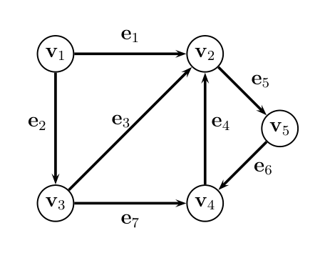
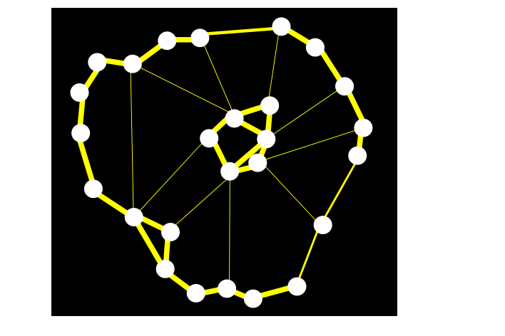
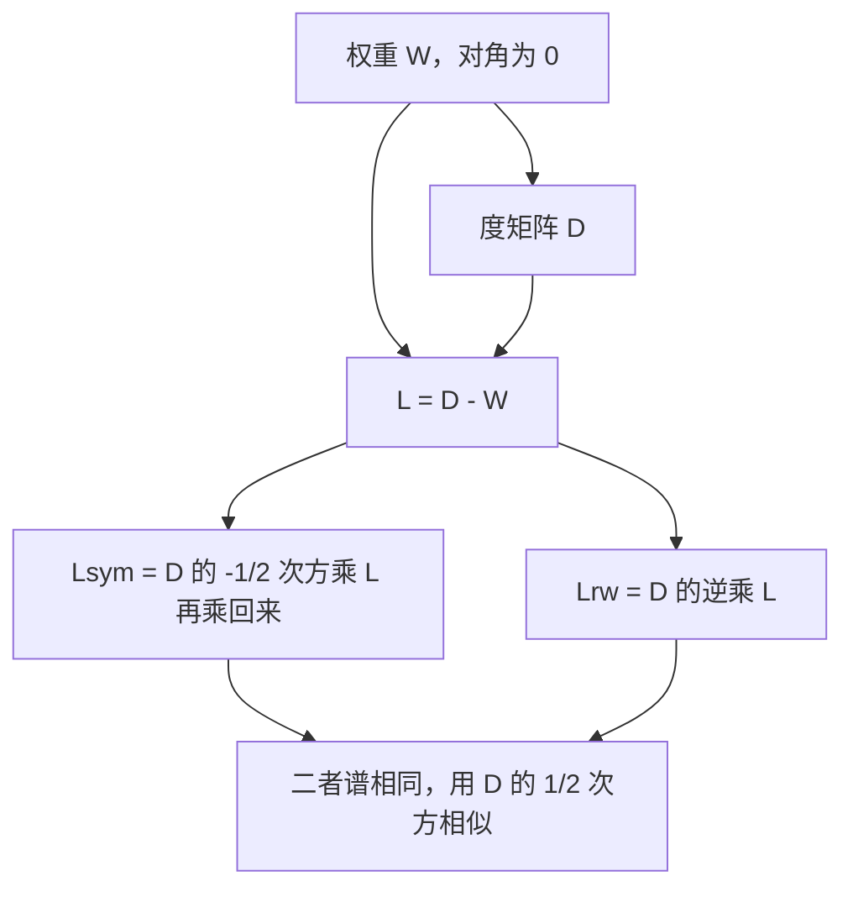
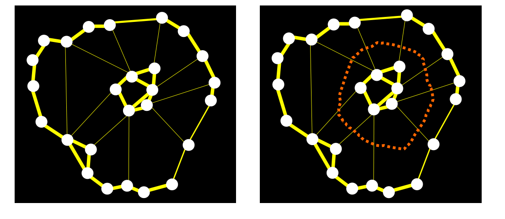

# 第18章 图与图拉普拉斯

### 本章总览

本章把图写成矩阵，再用这些矩阵的谱读连通性。路线是：有向图、无向图、加权图，然后是未归一化的 graph Laplacian（图拉普拉斯），两种 normalized graph Laplacian（归一化图拉普拉斯），最后用 normalized cut（归一化割）描述聚类要优化的量。

图拉普拉斯是实对称半正定矩阵。特征值从 0 起跳，0 的重数等于连通分支个数。归一化版本出现在聚类里；用特征向量把图画进低维空间，是下一章的事。

章首写明：normalized cuts 的矩阵理论这章不展开，图绘制放到下一章。18.4 节仍定义了体积、割和 Ncut 代价，并把 Rayleigh 比形式留到 Gallier [25]。

阅读范围：PDF 第 659–682 页。习题 18.1–18.8 不展开。

### 核心知识点

#### 有向图

directed graph（有向图）是一对 G=(V,E)。顶点 $V=\{v_1,\ldots,v_m\}$。边是不同顶点的有序对 (u,v)，$u\neq v$。因此没有自环，而且从 u 到 v 至多一条边。这样的图有时叫 simple graph（简单图）。边 e=(u,v) 的 source（起点）是 s(e)=u，target（终点）是 t(e)=v。

顶点 v 的 degree（度）是进入或离开 v 的边数，进出合在一起计，不分成入度和出度：

$$
d(v)=\lvert\{u\in V\mid (v,u)\in E\text{ 或 }(u,v)\in E\}\rvert.
$$

degree matrix（度矩阵）$D(G)=\operatorname{diag}(d_1,\ldots,d_m)$。无特别说明时写成 D。

从 u 到 v 的 path（路径）是顶点序列 $(v_0,\ldots,v_k)$，v_0=u，v_k=v，每一步 (v_i,v_{i+1}) 都是边。k 是长度。u=v 时路径闭合。任意两个不同顶点互相都有路径，图就是 strongly connected（强连通）。

书中备注：别的文献常把这种可重复经过顶点的序列叫 walk（游走），而把 path 留给顶点彼此不同的情形（闭合时只允许首尾相同）。本章按自己的 path 用法叙述。

「互相可达」是等价关系。等价类叫 strongly connected component（强连通分支）。

图注：Figure 18.2，有向图 G_1。边是有序对，箭头从起点指向终点。$e_1:v_1\to v_2$，$e_2:v_1\to v_3$，$e_3:v_3\to v_2$，$e_4:v_4\to v_2$，$e_5:v_2\to v_5$，$e_6:v_5\to v_4$，$e_7:v_3\to v_4$。按进出边合计，五个顶点的度是 2,4,3,3,2。

G_1 的度矩阵是 $D=\operatorname{diag}(2,4,3,3,2)$。

🔑 关键速记：有向边是有序对，度把进入和离开的边加在一起。

#### 无向图，以及第 6 章指向的定义 18.5

定义 18.5：graph（图，即无向图）是 G=(V,E)。$V=\{v_1,\ldots,v_m\}$，每条边是两个不同顶点组成的子集 $\{u,v\}$。因此没有自环，两个顶点之间至多一条边，同样常被叫做简单图。无向图可以看成忘掉边方向之后的有向图。

第 6 章用二部图上的 perfect matching（完美匹配）个数解释 permanent（积和式），并把二部图的定义指向本章定义 18.5。按这几页的正文，定义 18.5 写的是无向图。

二部图这个词出现在后面的谱性质里。命题 18.6(7) 说：归一化拉普拉斯的最大特征值 $\nu$_m=2，当且仅当底图含有一个 nontrivial connected bipartite component（非平凡的连通二部连通分支）。这一条的证明书中放在 Chung [13] 第 1 章，不在这几页。习题 18.3 把 complete bipartite graph（完全二部图）K_{m,n} 描述成 m+n 个顶点分成前 m 个与后 n 个、两段之间每对顶点都有边。一般二部图（顶点分成两堆、边只出现在两堆之间、不要求每一对都相连）以及完美匹配，这几页没有单独定义。

👉 积和式与匹配计数的组合解释见第 6 章。📝待补全

无向图的度是与 v 关联的边数，$d(v)=\lvert\{u\in V\mid\{u,v\}\in E\}\rvert$。度矩阵与定义 18.2 相同。

无向路径把有向边换成无向边 $\{v_i,v_{i+1}\}$。任意两个不同顶点之间有路径，图就是 connected（连通）。「有路径相连」的等价类叫 connected component（连通分支）。

有边 (u,v) 或 $\{u,v\}$ 时，说 v 与 u adjacent（相邻），常写 $u\sim v$。无向图上 $\sim$ 对称；有向图上一般不对称。

🔑 关键速记：定义 18.5 是无向简单图；二部图在本章只出现在 $\nu$_m=2 的谱条件和习题里的完全二部图。

#### 关联矩阵与邻接矩阵

有向图有 m 个顶点、n 条边时，incidence matrix（关联矩阵）B(G) 是 m $\times$ n 矩阵。第 j 列在起点放 +1，在终点放 -1，其余为 0：

$$
b_{ij}=
\begin{cases}
+1 & s(e_j)=v_i,\cr
-1 & t(e_j)=v_i,\cr
0 & \text{其他}.
\end{cases}
$$

每一列恰好两个非零元，+1 和 -1。有的文献整体取相反符号，他们的关联矩阵是 -B。

$\mathbb{R}$^m 可以看成顶点上的函数空间 $\mathbb{R}$^V，$\mathbb{R}$^n 看成边上的函数空间 $\mathbb{R}$^E。B 是从边到顶点的 boundary map（边缘映射），$B^\top$ 是从顶点到边的 coboundary map（上边缘映射）。

无向图也有一张关联矩阵（定义 18.8）：顶点落在该边上则为 +1，否则为 0。元素非负。书中说这张矩阵不如有向情形有用。用这张无向关联矩阵时，

$$
BB^\top=D+A.
$$

邻接矩阵对有向图和无向图都是对称的 m $\times$ m 矩阵 A=(a_{ij})。

有向图：v_i 与 v_j 之间至少有一个方向的边时 a_{ij}=1，否则为 0。方向不写进 A。

无向图：存在边 $\{v_i,v_j\}$ 时 a_{ij}=1，否则为 0。对角元为 0。

G_1 与后面的无向图 G_2（Figure 18.3，边标成 $a,\ldots,g$）共用同一张邻接矩阵

$$
A=
\begin{pmatrix}
0&1&1&0&0\cr
1&0&1&1&1\cr
1&1&0&1&0\cr
0&1&1&0&1\cr
0&1&0&1&0
\end{pmatrix}.
$$

无向图上，A 作用在顶点函数上是把邻居的值加起来：

$$
(Ax)_i=\sum_{j\sim i}x_j.
$$

书中把 A 看成 diffusion operator（扩散算子）。x 是特征值 $\lambda$ 的特征向量，意思就是每个顶点上邻居值之和等于 $\lambda$ x_i。

orientation（定向）$\sigma$ 给每条无向边指定起点和终点。定向后的图记 $G_\sigma$。

命题 18.1：无向图有 m 个顶点、n 条边、c 个连通分支。对任意定向，若 B 是 $G_\sigma$ 的关联矩阵，则

$$
c=\dim(\operatorname{Ker} B^\top),\qquad \operatorname{rank}(B)=m-c.
$$

$\operatorname{Ker} B^\top$ 的一组基是各连通分支的 indicator vector（指示向量）：该分支上的分量为 1，其余为 0。路径两端的函数值必须相等，所以核里的函数在每个连通分支上是常数。

全 1 列向量记为 $\mathbf{1}$。每一列有一个 +1 和一个 -1，所以 $B^\top\mathbf{1}=0$。图连通，当且仅当 B 的秩为 m-1，当且仅当 $\operatorname{Ker} B^\top$ 就是 $\mathbf{1}$ 张成的一维空间。

🔑 关键速记：有向关联矩阵用 +1,-1 记录方向；邻接矩阵只记录「有没有边」，有向图的方向也不会进 A。

#### 加权图

weighted graph（加权图）是 G=(V,W)。W 是对称的权重矩阵，$w_{ij}\ge0$，并且 w_{ii}=0。w_{ij}>0 时 $\{v_i,v_j\}$ 才算一条边。底图就是这些正权重边组成的无向图。$w_{ij}\in\{0,1\}$ 时退回定义 18.5。

w_{ij} 越小，联系或相似度越弱；越大越强。图像里它表示 similarity（相似度）或 affinity（亲和度），网络里可以表示代价。边画得越粗，权重越大。

图注：Figure 18.4。黄边的粗细表示权重大小。外圈粗边权重大，连向内部的细边权重小。这张图是后面体积、割和两簇划分的同一类例子。

顶点 v_i 的度改为关联边的权重之和：

$$
d(v_i)=\sum_{j=1}^{m} w_{ij}.
$$

只有 $v_i\sim v_j$ 的项才非零。$D=\operatorname{diag}(d(v_1),\ldots,d(v_m))$。$W\mathbf{1}$ 就是全体度数组成的列向量。

W 作用在顶点函数上是邻居值的加权和：$(Wx)_i=\sum_{j\sim i} w_{ij}x_j$。

书中的一个 4 $\times$ 4 例子是

$$
W=
\begin{pmatrix}
0&3&6&3\cr
3&0&0&3\cr
6&0&0&3\cr
3&3&3&0
\end{pmatrix}.
$$

按定义，四个度数是 12,6,9,9。

🔑 关键速记：加权图用对称、非负、对角为 0 的 W；度是行和，正的 w_{ij} 才是边。

#### 未归一化图拉普拉斯

先对无向图的定向来做。命题 18.2：$B_\sigma$ 是定向图的关联矩阵，A 是邻接矩阵，D 是度矩阵，则

$$
B_\sigma(B_\sigma)^\top=D-A.
$$

右端与定向 $\sigma$ 无关。记

$$
L=B_\sigma(B_\sigma)^\top=D-A.
$$

L 对称，而且半正定：特征值是非负实数。定义 18.15 把 L 叫做 unnormalized graph Laplacian（未归一化图拉普拉斯）。无向图直接写成 L=D-A。

G_1 的拉普拉斯是

$$
L=
\begin{pmatrix}
2&-1&-1&0&0\cr
-1&4&-1&-1&-1\cr
-1&-1&3&-1&0\cr
0&-1&-1&3&-1\cr
0&-1&0&-1&2
\end{pmatrix}.
$$

每一行的和为 0，因为 $(B_\sigma)^\top\mathbf{1}=0$，所以 $\mathbf{1}$ 在 L 的零空间里。

命题 18.2 不能随便换成「任意有向图」的关联矩阵。若两个顶点之间两个方向的边都在，对应两行的内积可以是 -2 而不是 -1，于是 $BB^\top$ 可以不等于 D-A。书中给了一个 3 顶点、4 边的反例。

加权图的定义 18.16：

$$
L=D-W,\qquad d_i=\sum_{j=1}^{m} w_{ij}.
$$

把它看成 $\mathbb{R}$^V 上的线性映射，则

$$
(Lx)_i=\sum_{j\sim i} w_{ij}(x_i-x_j).
$$

行和仍为 0，$\mathbf{1}$ 仍在零空间里。半正定可以从加权版关联矩阵看出来。定义 18.17：底图任意定向后，第 j 列在边 e_j 的起点、终点分别放该边权重的正、负平方根，其余为 0。命题 18.3：

$$
B_\sigma(B_\sigma)^\top=D-W=L.
$$

结果与定向无关，L 对称半正定。命题 18.1 对底图仍然适用：$B_\sigma$ 的秩是 m-c，并且 $(B_\sigma)^\top\mathbf{1}=0$。

另一条直接算二次型的路是命题 18.4。对任意对称 W，令 L=D-W，$d_i=\sum_j w_{ij}$，则对一切 x $\in\mathbb{R}$^m，

$$
x^\top Lx=\frac12\sum_{i,j=1}^{m} w_{ij}(x_i-x_j)^2.
$$

右端不依赖 W 的对角元。若所有 $w_{ij}\ge0$，则 L 半正定。

由此得到：加权图的 L 有非负实特征值 0= $\lambda$ $_1\le$ $\lambda$ $_2\le\cdots\le$ $\lambda$_m，并且有一组特征向量组成的规范正交基；最小特征值是 0，对应特征向量可以取 $\mathbf{1}$。

实对称矩阵可以正交对角化，半正定等价于特征值非负，也等价于对一切 x 有 $x^\top Lx\ge0$。图拉普拉斯用的就是这件事。

👉 正交对角化与半正定的完整说法见第 16 章谱定理。📝待补全

下面四张矩阵都由同一张图决定。度数在对角线上，拉普拉斯把「自己的度数」和「到邻居的权重」放在同一张矩阵里。

| 名称 | 功能 | 主要式子 | 约束与坑点 |
| --- | --- | --- | --- |
| 度矩阵 D | 记录每个顶点的度 | 对角元 $d_i=\sum_j w_{ij}$ | 有向图的度是进出边条数，加权图的度是权重和 |
| 邻接 / 权重 A 或 W | 记录边或相似度 | 无向时 $a_{ij}\in\{0,1\}$；加权时 $w_{ij}\ge0,\ w_{ii}=0$ | 有向图的 A 仍对称，方向不在 A 里 |
| 关联矩阵 $B_\sigma$ | 把边和端点连起来 | 无权：列上 +1,-1；加权：$\pm\sqrt{w}$ | 两个方向同时存在时，$BB^\top=D-A$ 可以失败 |
| 拉普拉斯 L | 二次型测量相邻顶点函数值之差 | $L=D-W=B_\sigma(B_\sigma)^\top$ | 行和为 0；半正定依赖 $w_{ij}\ge0$；无向关联矩阵给出的是 D+A |

要点：未归一化拉普拉斯与定向无关，零空间至少含有 $\mathbf{1}$。归一化要等下一节，而且先排除孤立点。

🔑 关键速记：L=D-W，二次型是相邻顶点之差的加权平方和，权重非负时半正定。

#### 连通分支与 Fiedler 数

命题 18.5：底图的连通分支个数 c，等于 L 的零空间维数，也等于特征值 0 的重数。零空间的一组基仍是各分支的指示向量。证明用 $L=BB^\top$ 与 $B^\top$ 零空间相同，再引用命题 18.1。

底图连通时，第二个特征值 $\lambda$_2>0。Fiedler 在 1973 年指出 $\lambda$_2 携带图的大量信息，因此 $\lambda$_2 常叫 Fiedler number（Fiedler 数）。更细的组合性质书中指向 Godsil 与 Royle [27] 第 13 章、Chung [13]。谱 (0,$\lambda$ $_2,\ldots,$ $\lambda$_m) 与图的组合结构之间的关系，是 spectral graph theory（谱图论）的内容。本章点出这件事，不展开 Fiedler 数的那些不等式。📝待补全

👉 用 $\lambda$_2,$\lambda$_3 的特征向量给顶点派坐标，见第 19 章。📝待补全

🔑 关键速记：0 的重数等于连通分支数；连通图的 Fiedler 数 $\lambda$_2 严格为正。

#### 归一化拉普拉斯

归一化只在没有孤立顶点时有意义。定义 18.18 先说：孤立顶点是不与任何其他顶点关联的顶点。紧接着的一句写成「这意味着 W 的每一行都含有严格正的元素」。后一句描述的是没有孤立点时的行，和前一句的孤立定义对不上。下一段又写：若没有孤立点，则 D 的对角元为正，从而 D 可逆，

$$
D^{-1/2}=\operatorname{diag}(d_1^{-1/2},\ldots,d_m^{-1/2})
$$

有意义，任意实指数 $\alpha$ 同样可写成对角矩阵。使用时以后一段为准：每个 d_i>0 才做归一化。

定义 18.19 的原文写的是 weighted directed graph（加权有向图）。对象仍是带对称权重 W、且没有孤立顶点的图。两种归一化拉普拉斯是

$$
\begin{aligned}
L_{\mathrm{sym}}&=D^{-1/2}LD^{-1/2}=I-D^{-1/2}WD^{-1/2},\cr
L_{\mathrm{rw}}&=D^{-1}L=I-D^{-1}W.
\end{aligned}
$$

$L_{\mathrm{sym}}$ 对称。二者相似：

$$
L_{\mathrm{rw}}=D^{-1/2}L_{\mathrm{sym}}D^{1/2}.
$$

下标 rw 是因为 $L_{\mathrm{rw}}$ 与图上的 random walk（随机游走）关系密切。游走的转移概率这几页没有写出来。

👉 随机游走与 D^{-1}W 的概率解释，本章只点了名字。📝待补全

若 B 是底图某定向的加权关联矩阵，令 $B_{\mathrm{sym}}=D^{-1/2}B$，则 $L_{\mathrm{sym}}=B_{\mathrm{sym}}B_{\mathrm{sym}}^\top$。对 $B_{\mathrm{sym}}$ 做奇异分解 $B_{\mathrm{sym}}=U$ $\Sigma$ $ V^\top$（U 为 m $\times$ m 正交矩阵，$\Sigma$ 为 m $\times$ n 的奇异值「对角」阵，V 为 n $\times$ n 正交矩阵），$L_{\mathrm{sym}}$ 的特征值是 $B_{\mathrm{sym}}$ 前 m 个奇异值的平方，U 的列是相应的规范正交特征向量。特征值重数高时，对 $B_{\mathrm{sym}}$ 做奇异分解，通常比直接对角化 $L_{\mathrm{sym}}$ 更准。

奇异分解把矩阵写成正交矩阵、对角奇异值、另一正交矩阵的乘积。本章只使用「特征值等于奇异值的平方」这一条。

👉 奇异分解的矩阵形状见第 2 章。📝待补全

命题 18.6 的结论如下。证明里 (7)–(10) 指向 Chung [13] 第 1 章，不在这几页。📝待补全

1. $L_{\mathrm{sym}}$ 对称半正定，并且

$$
x^\top L_{\mathrm{sym}}x=\frac12\sum_{i,j=1}^{m} w_{ij}\left(\frac{x_i}{\sqrt{d_i}}-\frac{x_j}{\sqrt{d_j}}\right)^2.
$$

2. $L_{\mathrm{sym}}$ 与 $L_{\mathrm{rw}}$ 谱相同，记 0= $\nu$ $_1\le$ $\nu$ $_2\le\cdots\le$ $\nu$_m。$u\neq0$ 是 $L_{\mathrm{rw}}$ 属于 $\lambda$ 的特征向量，当且仅当 D^{1/2}u 是 $L_{\mathrm{sym}}$ 属于 $\lambda$ 的特征向量。

3. L 与 $L_{\mathrm{sym}}$ 都对称半正定。

4. Lu= $\lambda$ Du 有非零解 u，当且仅当 D^{1/2}u 是 $L_{\mathrm{sym}}$ 属于 $\lambda$ 的特征向量，当且仅当 u 是 $L_{\mathrm{rw}}$ 属于 $\lambda$ 的特征向量。

5. L 与 $L_{\mathrm{rw}}$ 零空间相同。$u\in\operatorname{Ker} L$ 当且仅当 $D^{1/2}u\in\operatorname{Ker} L_{\mathrm{sym}}$。

6. $\mathbf{1}$ 在 $L_{\mathrm{rw}}$ 的零空间里，$D^{1/2}\mathbf{1}$ 在 $L_{\mathrm{sym}}$ 的零空间里。

7. 每个 $\nu$_i 满足 $0\le$ $\nu$ $_i\le2$。并且 $\nu$_m=2 当且仅当底图含有非平凡的连通二部连通分支。

8. $m\ge2$ 且底图不是 complete graph（完全图）时，$\nu$ $_2\le1$。完全图是指任意两个不同顶点之间都有边。底图是完全图，当且仅当 $\nu$_2=m/(m-1)。

9. $m\ge2$ 且底图连通时，$\nu$_2>0。

10. $m\ge2$ 且没有孤立点时，$\nu$ $_m\ge m/(m-1)$。

例 18.1 对 G_1 写出了 $L_{\mathrm{sym}}$ 与 $L_{\mathrm{rw}}$ 的数值矩阵，对角元都是 1。页面把二者的特征值印成

$$
0,\ 7257,\ 1.1667,\ 1.5,\ 1.6076.
$$

7257 在这一页没有小数点，与 (7) 的上界 2 对不上。未归一化 L 的特征值印成 $0,\ 1.5858,\ 3,\ 4.4142,\ 5$。这里不把 7257 改写成别的数。【信息缺口，需要局部查阅文档】书中还强调：两张归一化矩阵谱相同，但 $L_{\mathrm{rw}}$ 一般不对称，$L_{\mathrm{sym}}$ 对称。

命题 18.7：$L_{\mathrm{sym}}$ 与 $L_{\mathrm{rw}}$ 的零空间维数都等于连通分支数 c，也等于特征值 0 的重数。$L_{\mathrm{rw}}$ 的零空间以各分支的指示向量为基。$L_{\mathrm{sym}}$ 的相应基是把这些指示向量乘上 D^{1/2}。证明留作习题 18.8。

三种拉普拉斯的关系可以收成下面这张流程。没有孤立点时，后两支才走得通。

图注：未归一化拉普拉斯先由 D-W 得到。归一化的两支谱相同；$L_{\mathrm{sym}}$ 对称，$L_{\mathrm{rw}}$ 一般不对称。

🔑 关键速记：无孤立点时 $L_{\mathrm{sym}}$ 与 $L_{\mathrm{rw}}$ 谱相同且落在 [0,2]，特征向量差一个 D^{1/2}。

#### 用归一化割做聚类

子集 $A\subseteq V$ 的 volume（体积）是与 A 中顶点关联的全部权重：

$$
\operatorname{vol}(A)=\sum_{v_i\in A}\sum_{j=1}^{m} w_{ij}.
$$

两个子集（可以相同）之间的 links 是

$$
\operatorname{links}(A,B)=\sum_{v_i\in A,\,v_j\in B} w_{ij}.
$$

$\overline{A}=V\setminus A$。$\operatorname{links}(A,\overline{A})$ 衡量从 A 逃出去的联系。cut（割）定义为

$$
\operatorname{cut}(A)=\operatorname{links}(A,\overline{A}).
$$

Figure 18.5 画的是一组顶点的体积，Figure 18.6 画的是中心那组顶点与外围顶点之间的割。两张图都是示意，这几页没有给出数值表。

数据若已经写成相似度图，w_{ij} 越大表示 v_i 与 v_j 越像。聚类是把 V 分成 $A_1,\ldots,A_K$，使组间边权很低、组内边权很高。

K 组的割写成

$$
\operatorname{cut}(A_1,\ldots,A_K)=\frac12\sum_{i=1}^{K}\operatorname{cut}(A_i)=\frac12\sum_{i=1}^{K}\operatorname{links}(A_i,\overline{A_i}).
$$

K=2 的 mincut（最小割）是经典问题，可以高效求解。实际划分常常把一个顶点从其余顶点上切下来，子集大小很不平衡。代价函数要让每个 A_i 保持相当大。

Shi 与 Malik [58] 对 K=2 用体积来归一化。Yu 的学位论文 [75] 以及 Yu 与 Shi [76] 推广到 $K\ge3$。要极小化的是

$$
\operatorname{Ncut}(A_1,\ldots,A_K)=\sum_{i=1}^{K}\frac{\operatorname{links}(A_i,\overline{A_i})}{\operatorname{vol}(A_i)}=\sum_{i=1}^{K}\frac{\operatorname{cut}(A_i)}{\operatorname{vol}(A_i)}.
$$

图注：Figure 18.7。左图是加权图，边的粗细表示权重。右图用橙色虚线圈出内圈那一簇，表示把顶点分成两群。这是划分的示意图。这几页没有给出该划分的 Ncut 数值，也没有写出求最小 Ncut 的算法。

下一步本应把这个优化写成含图拉普拉斯的 Rayleigh 比。书中说理论很完整，但这章没有篇幅，请读者去看 Gallier [25]。因此这里停在 Ncut 的定义，不补特征向量聚类的步骤。

章首曾把图绘制提前说了一遍：给每个顶点一个 $\mathbb{R}$^n 中的点，边画成线段，能量是弹簧伸长的平方，并且 $E(R)=\operatorname{tr}(R^\top LR)$。最小能量的正交绘制由 L 的最小非零特征值对应的特征向量组成。这些话的正式定义和定理在下一章。

👉 图绘制、能量和定理 19.2 见第 19 章。Ncut 的 Rayleigh 比形式不在本书这几页，见 Gallier [25]。📝待补全

🔑 关键速记：Ncut 是各组的割除以该组体积再求和；最小割容易切出单点，归一化用来平衡体积。

### 🔑 关键速记

- 有向关联矩阵列上是 +1 与 -1；无向邻接矩阵和有向图的邻接矩阵都对称，方向不进 A。
- 加权图 L=D-W，$x^\top Lx=\frac12\sum_{i,j} w_{ij}(x_i-x_j)^2$，权重非负时半正定。
- 特征值 0 的重数等于连通分支数；连通时 Fiedler 数 $\lambda$_2>0。
- 无孤立点时 $L_{\mathrm{sym}}$ 与 $L_{\mathrm{rw}}$ 谱相同，每个 $\nu$_i 在 0 与 2 之间，$\nu$_m=2 对应非平凡连通二部分支。
- Ncut 用 $\operatorname{cut}(A_i)/\operatorname{vol}(A_i)$ 求和；它的矩阵形式这章没有写。

### 易混淆点与差异对比

有向图的强连通要求来回都有路。无向图的连通只要求有一条无向路径。分支的指示向量既是 $B^\top$ 的核的基，也是 L 的核的基；归一化之后，$L_{\mathrm{rw}}$ 仍用这组指示向量，$L_{\mathrm{sym}}$ 要再乘 D^{1/2}。

三种关联矩阵对应三种二次型。无向图定向后的 $B_\sigma(B_\sigma)^\top$ 等于 D-A。定义 18.8 那种全用 +1 的无向关联矩阵给出 D+A。两个方向的边同时存在时，内积可以变成 -2，命题 18.2 的等式可以失败。

L、$L_{\mathrm{sym}}$、$L_{\mathrm{rw}}$ 的 0 重数都等于连通分支数，但特征向量的具体形状不同。L 与 $L_{\mathrm{rw}}$ 的零空间相同，里面有 $\mathbf{1}$。$L_{\mathrm{sym}}$ 的零空间里是 $D^{1/2}\mathbf{1}$，一般不是常向量。$L_{\mathrm{sym}}$ 与 $L_{\mathrm{rw}}$ 谱相同，后者一般不对称。广义特征值 Lu= $\lambda$ Du 与这两个归一化特征值是同一组 $\lambda$。

未归一化特征值可以大于 2。G_1 的 L 在页面上印到 5。归一化谱被命题 18.6(7) 限制在 [0,2]。例 18.1 印出的 7257 缺小数点，不能当成已经核对过的第二特征值。

最小割优化的是 $\operatorname{cut}$。Ncut 把每一项再除以 $\operatorname{vol}(A_i)$。K 组割的定义里有因子 $\frac12$，Ncut 的求和式里没有这个 $\frac12$。

定义 18.18 的两句中文转述对不上：前一句定义孤立点，后一句说每一行都有正元。计算 D^{-1/2} 时，以「每个度数为正」为准。定义 18.19 的标题写成加权有向图，公式仍是对称 W 上的 D^{-1/2}LD^{-1/2} 与 D^{-1}L。

### 本章要点总结

有向图用有序边和 +1,-1 的关联矩阵；无向图的边是二元子集，定义 18.5 就是这个。邻接矩阵只记录是否相邻，有向图也把两个方向折成对称的 0-1。加权图用对称非负、对角为 0 的 W，度是行和。未归一化拉普拉斯 L=D-W 与定向无关，二次型是相邻差的加权平方和，0 的重数等于连通分支数，连通时 $\lambda$_2>0。没有孤立点时，$L_{\mathrm{sym}}$ 与 $L_{\mathrm{rw}}$ 谱相同，特征值落在 [0,2]，$\nu$_m=2 标记非平凡的连通二部分支。聚类用 Ncut，即各组的割除以体积；最小割容易切出单点。Ncut 的 Rayleigh 比和第 6 章需要的一般二部图定义，这几页都没有展开。
