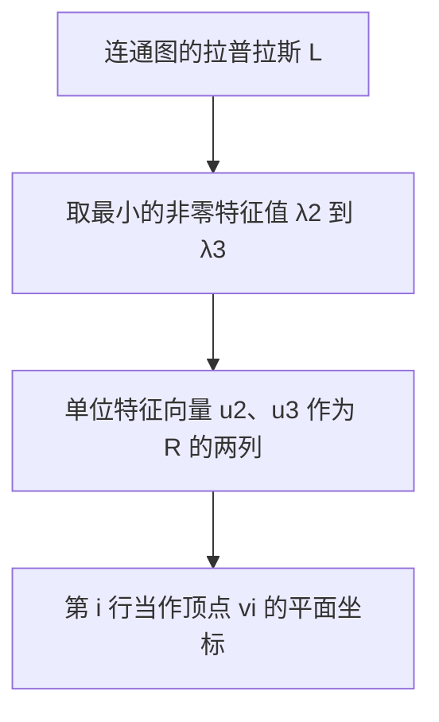
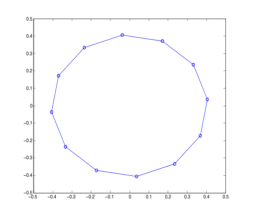
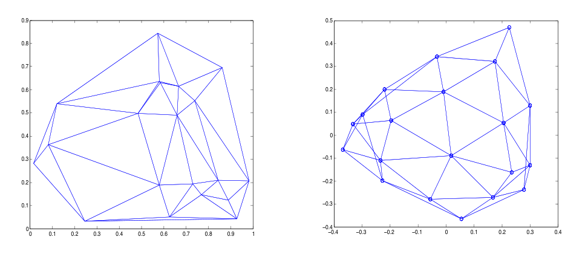
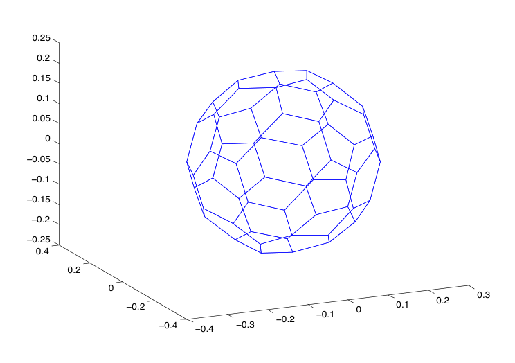

# 第19章 谱图绘制

### 本章总览

本章用图拉普拉斯的特征向量把无向图画进 \(\mathbb{R}^n\)，通常是平面或三维。边被想成弹簧。绘制的 energy（能量）是弹簧伸长量的平方和，它等于 \(\operatorname{tr}(R^\top LR)\)。在平衡而且列规范正交的约束下，最小能量由最小的那些非零特征值相加得到，坐标就是对应的单位特征向量。

第 18 章已经准备好 \(L=D-W\)、\(L\mathbf{1}=0\)，以及二次型

\[
x^\top Lx=\frac12\sum_{i,j=1}^{m} w_{ij}(x_i-x_j)^2.
\]

本章把这个二次型按坐标轴加起来，得到绘制能量。

阅读范围：PDF 第 683–692 页。第 692 页只有页眉。这几页没有习题节。

### 核心知识点

#### 图绘制与平衡

无向图 \(G=(V,E)\)，\(\lvert V\rvert=m\)。graph drawing（图绘制）是函数 \(\rho:V\to\mathbb{R}^n\)，\(n\ge 1\)。有边 \(\{v_i,v_j\}\) 时，在 \(\rho(v_i)\) 与 \(\rho(v_j)\) 之间画线段。

定义 19.1：绘制的矩阵 \(R\) 是 \(m\times n\) 矩阵，第 \(i\) 行是行向量 \(\rho(v_i)\)。有用的绘制满足 \(n\le m\)，而且 \(n\) 应远小于 \(m\)，常见是 \(n=2\) 或 \(n=3\)。

定义 19.2：balanced（平衡）是指 \(R\) 每一列的元素之和为 0，即

\[
\mathbf{1}^\top R=0.
\]

不平衡的绘制可以用一次平移变成平衡的。列若线性相关，换成列空间的一组基，绘制的信息不变，因此下面可以假定 \(n\le m\)。

\(\rho\) 不要求是单射。不同顶点可以画到同一点，绘制可以退化。文献里有时叫 graph embedding（图嵌入）。微分几何里的 embedding 总是单射，所以本章不用这个词，并说 graph immersion（图浸入）更合适。

🔑 关键速记：绘制矩阵的第 \(i\) 行是顶点 \(v_i\) 的坐标；平衡就是 \(\mathbf{1}^\top R=0\)。

#### 能量

Godsil 与 Royle 的物理模型：在 \(\mathbb{R}^n\) 里用相同的弹簧把相邻顶点连起来。弹簧拉得越开，绘制越差。无权能量是

\[
E(R)=\sum_{\{v_i,v_j\}\in E}\lVert\rho(v_i)-\rho(v_j)\rVert^2.
\]

\(\rho(v_i)\) 是 \(R\) 的第 \(i\) 行，范数是两端点欧氏距离的平方。全零矩阵把能量变成 0，所以还要加约束，把这个平凡解排除掉。

弹簧刚度可以不同。用对称的权重（刚度）矩阵 \(W=(w_{ij})\)，\(w_{ij}\ge 0\)。能量改成

\[
E(R)=\sum_{\{v_i,v_j\}\in E} w_{ij}\lVert\rho(v_i)-\rho(v_j)\rVert^2.
\]

命题 19.1：\(G=(V,W)\) 是加权图，\(R\) 是画在 \(\mathbb{R}^n\) 里的 \(m\times n\) 矩阵，\(L=D-W\) 是未归一化拉普拉斯，则

\[
E(R)=\operatorname{tr}(R^\top LR).
\]

结论来自把命题 18.4 用到 \(R\) 的每一列再求和。记第 \(k\) 列是 \(R^k\)，则每一列贡献 \((R^k)^\top LR^k\)，加起来就是迹。

\(R^\top LR\) 对称。\(L\) 半正定，所以 \(R^\top LR\) 也半正定。它的迹等于其特征值之和，这个和就是绘制能量。书中把这句话说成「正特征值之和」；半正定矩阵里其余特征值是 0，不改变这个和。

可逆的 \(n\times n\) 矩阵 \(M\) 把每个点 \(\rho(v_i)\) 变成 \(\rho(v_i)M\)，得到另一张绘制，两者信息量相同。绘制由 \(R\) 的列空间决定。因此可以把列取成两两正交且长度为 1：

\[
R^\top R=I.
\]

定义 19.3：满足 \(R^\top R=I\) 的绘制叫 orthogonal graph drawing（正交图绘制）。这个条件同时排除了全零绘制。

二次型 \(x^\top Lx\) 把一条无向边在双重求和里算了两次，所以命题 18.4 前面有 \(\frac12\)。能量 \(E(R)\) 对每条无向边只加一次。命题 19.1 证明这两边相等。

👉 \(L\) 的定义、\(L\mathbf{1}=0\) 和命题 18.4 见第 18 章。📝待补全

🔑 关键速记：弹簧能量 \(E(R)=\operatorname{tr}(R^\top LR)\)，正交绘制再要求 \(R^\top R=I\)。

#### 最小能量与定理 19.2

在图连通的前提下，可以找出能量最小的平衡正交绘制。已知 \(L\mathbf{1}=0\)。

定理 19.2：加权图有 \(m\) 个顶点，\(L=D-W\) 的特征值是

\[
0=\lambda_1<\lambda_2\le\lambda_3\le\cdots\le\lambda_m.
\]

画进 \(\mathbb{R}^n\) 的平衡正交绘制，最小能量等于 \(\lambda_2+\cdots+\lambda_{n+1}\)。这已经要求 \(n<m\)。取 \(\lambda_2,\ldots,\lambda_{n+1}\) 对应的任意单位特征向量 \(u_2,\ldots,u_{n+1}\) 做成 \(m\times n\) 矩阵 \(R\)，就得到一张最小能量的平衡正交绘制，并且 \(R^\top R=I\)。

证明的结论是：在 \(R^\top R=I\) 时，\(\operatorname{tr}(R^\top LR)\) 的下界是 \(L\) 的最小 \(n\) 个特征值之和，对应的 \(n\) 个特征向量达到这个下界。书中把这个下界归于 Rayleigh 比论证，并指向命题 16.25，即 Poincaré separation theorem（庞加莱分离定理）。因为 \(\lambda_1=0<\lambda_2\)，第一个单位特征向量是 \(u_1=\mathbf{1}/\sqrt{m}\)。后面的 \(u_i\) 与 \(u_1\) 正交，所以它们的分量之和为 0，拿掉 \(u_1\) 之后绘制是平衡的，能量不变，维数降 1。因此 \(\mathbb{R}^n\) 里平衡正交绘制的最小能量，等于 \(\mathbb{R}^{n+1}\) 里正交绘制的最小能量，也就是 \(\lambda_2+\cdots+\lambda_{n+1}\)。

命题 16.25 在这里只被当成这句下界来用：列规范正交时，二次型矩阵的迹至少是最小的那 \(n\) 个特征值之和，特征向量达到等号。分离定理本身的证明不在第 19 章。

👉 完整深度讲解见第 16 章命题 16.25。📝待补全

\(\mathbf{1}\) 张成 \(L\) 的零空间。若把 \(u_1\) 放进 \(R\)，所有顶点的第一坐标相同，图像落在一张超平面里。\(n=2\) 时所有顶点共线。最小能量的平衡正交绘制从 \(u_2\) 开始取，把 \(u_1\) 留在外面。

任意 \(n\times n\) 正交矩阵 \(Q\) 满足 \(\operatorname{tr}(R^\top LR)=\operatorname{tr}(Q^\top R^\top LRQ)\)。因此 \(RQ\) 也是最小能量的正交绘制。作用在行上，这是刚体运动 \(Q^\top\)。

特征值假设里的严格不等式 \(\lambda_1<\lambda_2\) 就是底图连通。有多个连通分支时 \(\lambda_2=0\)，定理 19.2 的这句最小能量不再按「从第二个特征值加到第 \(n+1\) 个」来用。

画进平面的步骤可以收成下面的流程。

图注：平面绘制只用 \(\lambda_2,\lambda_3\) 的单位特征向量。\(\lambda_1=0\) 对应的常向量不放进坐标，否则点会共线。

🔑 关键速记：连通图上，平衡正交绘制的最小能量是 \(\lambda_2+\cdots+\lambda_{n+1}\)，坐标从 \(u_2\) 取到 \(u_{n+1}\)。

#### 平面上的自动画法

若 \(\lambda_2>0\)，画到 \(\mathbb{R}^2\) 的步骤是：

1. 计算 \(L\) 的两个最小非零特征值 \(\lambda_2\le\lambda_3\)。\(\lambda_2\) 若是重特征值，可以有 \(\lambda_3=\lambda_2\)。
2. 计算对应的两个单位特征向量 \(u_2,u_3\)，令 \(R=[u_2\ u_3]\)。
3. 把顶点 \(v_i\) 放在 \(R\) 的第 \(i\) 行 \((R_{i1},R_{i2})\)。

书中说这个方法通常好看。\(R\) 可以有相同的行，不同顶点可能重合。这种退化实际里不常见，但没有保证不会发生。

四种约束可以对照着看。能量最小的那一行要用到连通。

| 名称 | 功能 | 主要条件 | 约束与坑点 |
| --- | --- | --- | --- |
| 图绘制 \(\rho\) | 给顶点派 \(\mathbb{R}^n\) 中的点 | \(n\) 远小于 \(m\)，常为 2 或 3 | 不要求单射，可以退化 |
| 平衡绘制 | 把质心放到原点 | \(\mathbf{1}^\top R=0\) | 不平衡时做一次平移 |
| 正交绘制 | 固定列的尺度和方向 | \(R^\top R=I\) | 排除全零解；刚体 \(Q\) 不改变能量 |
| 最小能量平衡正交绘制 | 能量取到 \(\lambda_2+\cdots+\lambda_{n+1}\) | 连通，\(0=\lambda_1<\lambda_2\) | 列从 \(u_2\) 开始；\(u_1\) 会使 \(n=2\) 的图画成一条直线 |

要点：先连通，再取最小的非零特征值。列的正交规范只去掉缩放和多余方向，剩下的正交矩阵 \(Q\) 仍是刚体自由度。

🔑 关键速记：平面图用 \(\lambda_2,\lambda_3\) 的单位特征向量当两列；重数允许 \(\lambda_3=\lambda_2\)。

#### 绘制例子

例子都用数值线性代数求出特征值和特征向量，再把顶点和边画出来。下面只保留图、特征值和列的选取方式，不抄程序。

例 1 是四个顶点，邻接矩阵

\[
A=
\begin{pmatrix}
0&1&1&0\\
1&0&0&1\\
1&0&0&1\\
0&1&1&0
\end{pmatrix}.
\]

先由行和得到 \(D\)，再 \(L=D-A\)。书中用来算特征值的例程按从大到小给出最大的若干个特征值及特征向量。作图时取的两列要和这个顺序对齐，才能落到 \(\lambda_2,\lambda_3\)。这里 \(\lambda_2=\lambda_3=2\)，是二重特征值。Figure 19.1 把这四个点画成一个四边形。

例 2 用第 18 章 Figure 18.3 的图 \(G_2\)，邻接矩阵就是第 18 章那张 \(5\times 5\) 的 \(A\)。这一次特征值按从小到大排列，作图取第 2 列和第 3 列。顶点 \(v_2\) 被放在 \((0,0)\)。Figure 19.2 与 Figure 18.3 的差别是：19.2 这张绘制不是凸的。

例 3 是 12 个顶点的环：每个顶点只与前后相邻，并且首尾相连。\(\lambda_2=0.2679\) 是二重特征值；后面的特征值也成对出现，最后 \(\lambda_{12}=4\) 除外。

图注：Figure 19.3，例 3 的 12 顶点环。坐标来自 \(\lambda_2\) 与 \(\lambda_3\) 的单位特征向量。环被画成接近正多边形的闭折线。\(\lambda_2=0.2679\) 为二重特征值。

例 4 改编自 Spielman。在单位正方形里取 20 个随机点，做 Delaunay triangulation（德劳内三角剖分），得到一张图的邻接矩阵，再用拉普拉斯的第二、第三特征值把这张图重画一次。左图是这些点原来的三角剖分，右图是谱绘制。书中说右图更好看，但不再是平面图。点是随机的，图中的具体坐标只属于这一次抽样。德劳内三角剖分的定义这几页没有给，只把它当作生成邻接矩阵的一步。

👉 德劳内三角剖分的几何定义，本章未展开。📝待补全

图注：Figure 19.4。左图是 20 个随机点的德劳内三角剖分，坐标还在单位正方形里。右图用同一张图的拉普拉斯特征向量重画，外形更集中，边可以交叉，不再是平面图。

这一例按最小模取三个特征值。作图用到的列顺序必须跟着这个排序走。列号若按「从小到大」的另一种例程去抄，会把别的特征向量当成坐标。

例 5 来自 Spielman，画的是 Buckyball（巴基球）的骨架，一种由 Buckminster Fuller（1895–1983）提出的测地穹顶。蒙特利尔生物圈是这种穹顶的一个实例。\(\lambda_2=0.2434\) 是三重特征值，\(L\) 还有许多重特征值。Figure 19.5 画在平面上，显得被压扁：图本来是三维的，而且 \(\lambda_2\) 的特征空间是三维的。应当用属于 \(\lambda_2\) 的三个规范正交特征向量画到 \(\mathbb{R}^3\)。

图注：Figure 19.6。巴基球骨架用 \(\lambda_2\) 的三个规范正交特征向量画在 \(\mathbb{R}^3\) 里，得到接近球面的多面骨架。\(\lambda_2=0.2434\) 为三重特征值；只取两个特征向量画到平面上会发扁。

邻接矩阵在书中直接取自这个骨架，生成方式没有在这几页里说明。

🔑 关键速记：重特征值要一次取满对应的特征向量；环用二维就接近正多边形，巴基球的三重 \(\lambda_2\) 要画到 \(\mathbb{R}^3\)。

### 🔑 关键速记

- 绘制矩阵 \(R\) 的第 \(i\) 行是 \(\rho(v_i)\)；平衡是 \(\mathbf{1}^\top R=0\)，正交是 \(R^\top R=I\)。
- 弹簧能量 \(E(R)=\operatorname{tr}(R^\top LR)\)，权重 \(w_{ij}\) 是刚度。
- 连通时最小能量是 \(\lambda_2+\cdots+\lambda_{n+1}\)，\(R\) 的列是 \(u_2,\ldots,u_{n+1}\)。
- \(u_1=\mathbf{1}/\sqrt{m}\) 使二维绘制共线；正交矩阵 \(Q\) 只贡献刚体。
- 特征列的选取要跟着所用排序走；重数大于 1 时，少取特征向量会把图画扁。

### 易混淆点与差异对比

平衡约束 \(\mathbf{1}^\top R=0\) 管的是质心。正交约束 \(R^\top R=I\) 管的是列的长度和彼此垂直。两者一起才排除全零矩阵，并让定理 19.2 的能量等于一串特征值之和。只做平衡、列不正交时，能量还可以靠把图整体缩小而变小。

\(u_1\) 属于特征值 0，放进 \(R\) 不增加命题里的那部分正能量，但会占用一个坐标，使图像掉进超平面。从 \(u_2\) 开始取，能量仍是 \(\lambda_2+\cdots+\lambda_{n+1}\)，维度正好是 \(n\)。

同一张最小能量绘制右乘正交矩阵 \(Q\) 之后能量不变，点的相对形状只做刚体运动。可逆矩阵 \(M\) 甚至不要求正交，列空间不变，信息量也相同，但 \(RM\) 一般不再满足 \((RM)^\top(RM)=I\)。

例 1 的特征值例程从大到小排列，例 2、例 3 从小到大排列，例 4 按最小模取三个。三种顺序下，「第 2 列」不是同一个特征向量。\(\lambda_2=\lambda_3\) 时，例 1 的四边形和例 3 的环都用到了这整个二维特征空间。巴基球的 \(\lambda_2\) 是三重的，平面上的 Figure 19.5 只看到其中两个方向。

Figure 19.4 的右图是同一张图的另一种画法。边集没有改，平面嵌入性质可以丢掉：右图允许交叉。它也不是归一化割的聚类结果。归一化割的代价在第 18 章，谱绘制与它的关系章首只说「聚类可以看成某种图绘制」，算法不在第 19 章。

👉 体积、割与 Ncut 见第 18 章。Rayleigh 形式的聚类仍不在这两章正文里。📝待补全

### 本章要点总结

图绘制把顶点送到 \(\mathbb{R}^n\)，边画成线段，矩阵 \(R\) 的行就是这些点。平衡要求列和为 0，正交要求 \(R^\top R=I\)。能量是刚度乘上端点距离平方，等于 \(\operatorname{tr}(R^\top LR)\)。图连通时，平衡正交绘制的最小能量是 \(\lambda_2+\cdots+\lambda_{n+1}\)，坐标取对应的单位特征向量，并且不要放入 \(u_1\)。平面上的环会接近正多边形；20 个随机点的谱重画可以更好看，但可以不再平；巴基球的 \(\lambda_2\) 是三重特征值，要用三个特征向量画到 \(\mathbb{R}^3\)。不同顶点仍可能被画到同一点，定理没有排除这件事。
