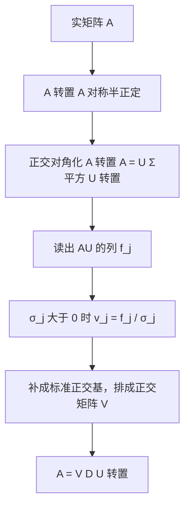
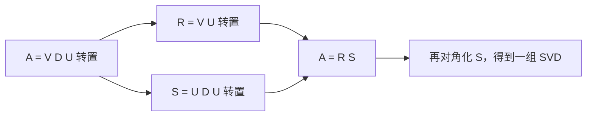

# 第20章 奇异值分解与极分解

### 本章总览

本章在实 Euclidean space（欧氏空间）上说明：任意线性映射都可以相对**两套**标准正交基写成对角形式。这就是 singular value decomposition（奇异值分解，SVD）。与它配套的是 polar form（极分解）：把映射拆成正交因子（旋转，允许再加一次反射）和对称半正定的拉伸因子。

阅读范围：PDF 第 693–714 页。证明只保留结论。习题不展开。

后面用到的谱定理可以先记住一句：实欧氏空间上的 self-adjoint（自伴）线性映射能在某组标准正交基下对角化，特征值全是实数。$f^{*}\circ f$ 与 $f\circ f^{*}$ 都是自伴的，所以这条定理用得上。

👉 谱定理的完整证明见第 16 章定理 16.8。📝待补全

### 核心知识点

#### $f^{*}\circ f$ 与奇异值

设 $f:E\to E$ 是线性映射。一般不能指望 f 自己可对角化。转而看复合

$$
\langle(f^{*}\circ f)(u),v\rangle=\langle f(u),f(v)\rangle=\langle u,(f^{*}\circ f)(v)\rangle.
$$

因此 $f^{*}\circ f$ 自伴，$f\circ f^{*}$ 同样自伴。定理 16.8 推出二者可对角化，特征值实。命题 20.1 进一步说明这些特征值非负：若 $(f^{*}\circ f)(u)=$ $\lambda$ u，则

$$
\lambda\langle u,u\rangle=\langle f(u),f(u)\rangle\ge 0.
$$

同一论证适用于两个欧氏空间之间的 $f:E\to F$。伴随 $f^{*}:F\to E$ 由

$$
\langle f(u),v\rangle_2=\langle u,f^{*}(v)\rangle_1
$$

唯一确定。$f^{*}\circ f$ 与 $f\circ f^{*}$ 仍自伴，特征值仍非负，而且非零特征值相同。一般地，若 $\dim E=n$、$\dim F=m$，则

$$
\lambda^{m}\det(\lambda I_n-g\circ f)=\lambda^{n}\det(\lambda I_m-f\circ g),
$$

所以 $g\circ f$ 与 $f\circ g$ 的非零特征值相同（习题 14.14，本章不证明）。

定义 20.1：$f^{*}\circ f$（以及 $f\circ f^{*}$）的正特征值的正平方根 $\sigma$_i>0 叫做 f 的 **singular values（奇异值）**。SVD 的对角线上，其余位置再写成 0。

🔑 关键速记：奇异值是 $f^{*}\circ f$ 正特征值的正平方根，因此非负。

#### 半正定与正定

定义 20.2：自伴线性映射的特征值都非负时，称为 positive semidefinite（半正定），书中也把这个词说成 positive（正的）。若它还可逆，则称为 positive definite（正定），此时每个特征值都严格为正。

命题 20.2 把特征值条件和二次型对齐。f 自伴时，存在标准正交特征向量基 $(e_1,\ldots,e_n)$，$u=\sum x_i e_i$，于是

$$
\langle f(u),u\rangle=\sum_{i=1}^{n}\lambda_i x_i^2.
\tag{†}
$$

由此得到两条等价：

1. 特征值全严格为正，当且仅当对一切 $u\neq0$ 有 $\langle f(u),u\rangle>0$。
2. 特征值全非负，当且仅当对一切 $u\neq0$ 有 $\langle f(u),u\rangle\ge0$。

复空间上带 Hermitian 内积的自伴映射，命题 20.2 仍然成立。

矩阵版是命题 20.3：实对称 n $\times$ n 矩阵 A，特征值全为正当且仅当 $u^\top Au>0$（$u\neq0$）；全非负当且仅当 $u^\top Au\ge0$。

第 7 章定义 7.4 用二次型 $u^\top Au>0$ 引入正定。命题 20.2 说明：在自伴（对称）的前提下，这与特征值全正是同一件事。

👉 定义 7.4 的原始表述见第 7 章。📝待补全

这个等价依赖对称。非对称矩阵可以特征值全正，二次型却取负；也可以二次型恒正，特征值却是复数。

例 20.1：

$$
A=\begin{pmatrix}1&4\cr0&1\end{pmatrix}
$$

特征值是 1,1，但

$$
\begin{pmatrix}1&-1\end{pmatrix}A\begin{pmatrix}1\cr-1\end{pmatrix}=-2.
$$

它的对称部分

$$
H(A)=\frac12(A+A^\top)=\begin{pmatrix}1&2\cr2&1\end{pmatrix}
$$

特征值是 -1,3，不是正定（例 20.3）。

例 20.2：

$$
A=\begin{pmatrix}1&-2\cr2&1\end{pmatrix}
$$

特征值是 $1\pm2i$，但 $u^\top Au=x^2+y^2>0$（$u\neq0$）。

实方阵恒有 $u^\top Au=u^\top H(A)u$。斜对称矩阵（$A^\top=-A$）上这个量对一切 u 为 0。所以正定这个概念只在对称矩阵上有实质内容。

复斜 Hermite 矩阵（A^{*}=-A）只保证 u^{*}Au 的实部为 0。一般复方阵上 u^{*}Au 与 u^{*}H(A)u 可以不相等，其中 $H(A)=\frac12(A+A^{*})$。

🔑 关键速记：正定、半正定按特征值定义，对称时才等价于二次型的符号；非对称矩阵不能拿 $u^\top Au$ 去读特征值。

#### 核、像与秩

命题 20.4 把 f、f^{*}、$f^{*}\circ f$、$f\circ f^{*}$ 的核和像接在一起。设 $\dim E=n$，$\dim F=m$。

$$
\begin{aligned}
\operatorname{Ker} f&=\operatorname{Ker}(f^{*}\circ f),\cr
\operatorname{Ker} f^{*}&=\operatorname{Ker}(f\circ f^{*}),\cr
\operatorname{Ker} f&=(\operatorname{Im} f^{*})^{\perp},\cr
\operatorname{Ker} f^{*}&=(\operatorname{Im} f)^{\perp}.
\end{aligned}
$$

并且 $\dim(\operatorname{Im} f)=\dim(\operatorname{Im} f^{*})$。四个映射的秩相同。

核相等的理由：f(u)=0 显然推出 $(f^{*}\circ f)(u)=0$；反过来若 $(f^{*}\circ f)(u)=0$，则 $\langle f(u),f(u)\rangle=0$，正定内积迫使 f(u)=0。正交补那两条来自伴随的定义式 $\langle f(u),v\rangle=\langle u,f^{*}(v)\rangle$。

🔑 关键速记：f 与 $f^{*}\circ f$ 核相同，f 与 f^{*} 秩相同，$\operatorname{Ker} f$ 是 $\operatorname{Im} f^{*}$ 的正交补。

#### 方阵的奇异值分解

历史线索书中记为：Beltrami 与 Camille Jordan 在 1873、1874 年独立得到 SVD；Gauss 的最小二乘（1809、1823）是这条线的源头，Legendre 也发表过最小二乘；其后有 Sylvester、Schmidt、Weyl；Autonne（1902、1915）给出极分解；Eckart 与 Young（1936、1939）把 SVD 推广到长方阵。

定理 20.5（方阵 SVD）：每个实 n $\times$ n 矩阵 A 都可写成

$$
A=VDU^{\top},
$$

其中 U、V 正交，$D=\operatorname{diag}($ $\sigma$ $_1,\ldots,$ $\sigma$_n)。$\sigma$ $_1,\ldots,$ $\sigma$_r>0 是奇异值，即 $A^{\top}A$ 与 $AA^{\top}$ 非零特征值的正平方根，$\sigma$ $_{r+1}=\cdots=$ $\sigma$_n=0。U 的列是 $A^{\top}A$ 的特征向量，V 的列是 $AA^{\top}$ 的特征向量。

证明的骨架是：$A^{\top}A$ 对称半正定，故有正交 U 使 $A^{\top}A=UD^{2}U^{\top}$。记 f_j 为 AU 的第 j 列，则 $\langle f_i,f_j\rangle=$ $\sigma$_i^{2}$\delta$_{ij}（$1\le i,j\le r$），且 j>r 时 f_j=0。令 v_j=f_j/$\sigma$_j，再把 $(v_1,\ldots,v_r)$ 补成标准正交基，排成 V，就得到 $V^{\top}AU=D$。

习惯把奇异值排成 $\sigma$ $_1\ge$ $\sigma$ $_2\ge\cdots\ge$ $\sigma$_n。定义 20.3：满足 $A=VDU^{\top}$、U 与 V 正交、D 对角元非负的三元组 (U,D,V) 称为 A 的一组 SVD。

按本书约定，Matlab 的调用写成 $[V,D,U]=\operatorname{svd}(A)$。这是接口名称，不是计算步骤。

两组基还有子空间含义。$(u_1,\ldots,u_r)$ 是 $\operatorname{Im} A^{\top}$ 的标准正交基，$(u_{r+1},\ldots,u_n)$ 是 $\operatorname{Ker} A$ 的标准正交基；$(v_1,\ldots,v_r)$ 是 $\operatorname{Im} A$ 的标准正交基，$(v_{r+1},\ldots,v_n)$ 是 $\operatorname{Ker} A^{\top}$ 的标准正交基。

因此

$$
A=\sigma_1 v_1 u_1^{\top}+\cdots+\sigma_r v_r u_r^{\top}.
$$

$r\ll n$ 时，A 由很少的秩 1 项重建。只保留前 k 个较大奇异值，就得到低秩近似。误差的精确说法在第 21 章。

伪逆把每个正奇异值换成倒数，用来写最小二乘的最小范数解 x^{+}=A^{+}b。它是下一章的主题，这里只需要这个关系。

👉 伪逆的定义、Penrose 四条性质和最小二乘见第 21 章。📝待补全

图注：方阵 SVD 的构造顺序。先对角化 $A^{\top}A$ 得到 U 和奇异值，再用 AU 的列确定 V，保证 $A=VDU^{\top}$ 左右配套。

例 20.4 把这个顺序走一遍。

$$
A=\begin{pmatrix}1&1\cr0&0\end{pmatrix},\quad
A^{\top}A=\begin{pmatrix}1&1\cr1&1\end{pmatrix},\quad
AA^{\top}=\begin{pmatrix}2&0\cr0&0\end{pmatrix}.
$$

$A^{\top}A$ 的特征值是 2 和 0，奇异值 $\sigma$ $_1=\sqrt{2}$、$\sigma$_2=0。对应单位特征向量给出

$$
U=\begin{pmatrix}1/\sqrt{2}&1/\sqrt{2}\cr1/\sqrt{2}&-1/\sqrt{2}\end{pmatrix}=U^{\top}.
$$

$$
AU=\begin{pmatrix}\sqrt{2}&0\cr0&0\end{pmatrix},\quad
v_1=\begin{pmatrix}1\cr0\end{pmatrix}.
$$

$\sigma$_2=0 时 v_2 只要和 v_1 配成标准正交基即可，书中取 v_2=(0,1)，于是 V=I_2，并且

$$
A=V\begin{pmatrix}\sqrt{2}&0\cr0&0\end{pmatrix}U^{\top}.
$$

书中特别提醒：直接去对角化 $AA^{\top}$ 得到的单位特征向量，不一定和已经取定的 U 配套。V 要从 AU 来。

四点补充：

1. Strang 的记号是 U=Q_2、V=Q_1、D= $\Sigma$，写成 A=Q_1 $\Sigma$ $ Q_2^{\top}$。A 把 Q_2 的列（$A^{\top}A$ 的特征向量）送到 Q_1 的列的倍数。
2. 具体算法书中指向 Golub–Van Loan、Demmel、Trefethen–Bau，本章不给出运算过程。
3. 对称矩阵一般不存在 V=U 的 SVD。半正定对称矩阵的非零特征值就是奇异值，此时有 A=V $\Sigma$ $ V^{\top}$。
4. 复方阵同样有 SVD：U、V 酉，A=VDU^{*}，对角元是实奇异值。

🔑 关键速记：方阵 SVD 是 $A=VDU^{\top}$；U 来自 $A^{\top}A$，V 必须和 AU 配套，习惯上奇异值降序。

#### 极分解

定义 20.4：A=RS，其中 R 正交、S 对称半正定，称为 A 的 polar decomposition（极分解）。

定理 20.5 已经保证每个实方阵都有极分解。可逆时 R 与 S 都唯一，证明较难，书中放在习题 20.9。该题还要求证明：A 奇异时 S 仍然唯一，正交因子可以不唯一。这里不写证明。

从 SVD 走到极分解：给定 $A=VDU^{\top}$，令

$$
R=VU^{\top},\qquad S=UDU^{\top}.
$$

则 R 正交，S 对称半正定，且 RS=A。

反方向：若 A=R_1 S，把 S 正交对角化成 $S=R_2DR_2^{\top}$，则

$$
A=R_1R_2DR_2^{\top},
$$

取 V=R_1R_2、U=R_2 就回到一组 SVD。

图注：SVD 与极分解互相转换。正交因子吸收 V 和 U 的差别，对称半正定因子保留奇异值。

例 20.5 用例 20.4 的分解：V=I_2，故 R=U，

$$
S=UDU^{\top}=\begin{pmatrix}1/\sqrt{2}&1/\sqrt{2}\cr1/\sqrt{2}&1/\sqrt{2}\end{pmatrix}=\frac{1}{\sqrt{2}}A^{\top}A.
$$

S 的特征值是 $\sqrt{2}$ 和 0。例 20.6 沿反方向，由这组 (R_1,S) 回到同一组 SVD，并且 V=R_1R_2=I_2。

复矩阵的说法是：存在酉矩阵 U 和半正定 Hermite 矩阵 H，使 A=UH。

书中举了一个既正交又对称的例子，说明极分解里的 S 可以是 I，而 A 自己仍有负特征值：此时 R=A、S=I。负号留在正交因子里。

连续介质力学用极分解把变形拆开：正交部分 Q 对应旋转（可以再带一次反射），对称部分 S 对应拉伸或压缩。S 的正特征值是伸缩因子，把 S 正交对角化就是选取 principal axes（主轴）。书中指向 Marsden–Hughes。

🔑 关键速记：极分解 A=RS 把正交作用和对称半正定拉伸分开；由 SVD 取 $R=VU^{\top}$、$S=UDU^{\top}$，可逆时这组因子唯一。

#### 特征值与奇异值的关系

二者一般没有简单的逐项对应。书中的 n $\times$ n 例子把对角线写成 1、紧邻的上侧次对角线写成 1/2。它的特征值是 1，重数 n；奇异值却可以拉得很开：

$$
\frac{\sigma_1}{\sigma_n}=\operatorname{cond}_2(A)\ge 2^{n-1}.
$$

复方阵上，全部特征值的模之积等于全部奇异值之积，因为

$$
\sigma_1^{2}\cdots\sigma_n^{2}=\det(A^{*}A)=|\det(A)|^{2},\qquad |\lambda_1|\cdots|\lambda_n|=|\det(A)|.
$$

定理 20.6（Weyl 不等式，1949）：把 |$\lambda$ $_1|\ge\cdots\ge|$ $\lambda$_n|、$\sigma$ $_1\ge\cdots\ge$ $\sigma$ $_n\ge0$ 排好之后，

$$
|\lambda_1|\cdots|\lambda_n|=\sigma_1\cdots\sigma_n,
$$

并且对 $k=1,\ldots,n-1$，

$$
|\lambda_1|\cdots|\lambda_k|\le\sigma_1\cdots\sigma_k.
$$

证明不在本章，书中指向 Horn–Johnson 第 3 章。

🔑 关键速记：特征值的模可以和奇异值逐个不同，但前 k 个模的乘积不超过前 k 个奇异值的乘积，全部乘完则相等。

#### 长方矩阵的奇异值分解

定理 20.7：每个实 m $\times$ n 矩阵 A 都有

$$
A=VDU^{\top},
$$

U 为 n $\times$ n 正交，V 为 m $\times$ m 正交，D 为 m $\times$ n。D 只在下降对角线上放数，书中仍称它为对角矩阵。记 $p=\min(m,n)$，$\sigma$ $_1,\ldots,$ $\sigma$_r 为奇异值，$\sigma$ $_{r+1}=\cdots=$ $\sigma$_p=0，且 $r\le\min\{m,n\}$。

$m\ge n$ 时把 n $\times$ n 的 $\Sigma$ $=\operatorname{diag}($ $\sigma$ $_1,\ldots,$ $\sigma$_n) 下面补零：

$$
D=\begin{pmatrix}\Sigma\cr 0_{m-n}\end{pmatrix}.
$$

$n\ge m$ 时，奇异值放在左边 m 列，右边补零列。两种情形都有 $V^{\top}AU=D$。

于是

$$
\begin{aligned}
A^{\top}A&=U\operatorname{diag}(\sigma_1^{2},\ldots,\sigma_r^{2},0,\ldots,0)U^{\top},\cr
AA^{\top}&=V\operatorname{diag}(\sigma_1^{2},\ldots,\sigma_r^{2},0,\ldots,0)V^{\top}.
\end{aligned}
$$

两者的非零特征值相同。零特征值的个数随 n-r 与 m-r 变化。

例 20.7：

$$
A=\begin{pmatrix}1&1\cr0&0\cr0&0\end{pmatrix}.
$$

$A^{\top}A$ 仍是 $\begin{pmatrix}1&1\cr1&1\end{pmatrix}$，$\Sigma$ $^{2}=\operatorname{diag}(2,0)$，U 与例 20.4 相同。AU 的第一列是 $(\sqrt{2},0,0)^{\top}$，故 $v_1=(1,0,0)^{\top}$。把 v_2,v_3 取成 $\mathbb{R}$^{3} 的其余坐标向量，得到 V=I_3，

$$
D=\begin{pmatrix}\sqrt{2}&0\cr0&0\cr0&0\end{pmatrix}.
$$

把 A 看成 $f:E\to F$ 的矩阵时：$(u_1,\ldots,u_r)$ 是 $\operatorname{Im} f^{*}$ 的标准正交基，$(u_{r+1},\ldots,u_n)$ 是 $\operatorname{Ker} f$ 的标准正交基；$(v_1,\ldots,v_r)$ 是 $\operatorname{Im} f$ 的标准正交基，$(v_{r+1},\ldots,v_m)$ 是 $\operatorname{Ker} f^{*}$ 的标准正交基。

Matlab 自身的约定是把 SVD 写成 $A=UDV^{\top}$，对应调用是 $[U,D,V]=\operatorname{svd}(A)$。和本书的 $A=VDU^{\top}$ 左右对调，读输出时要按文档核对哪一边乘在左边。

数值上，对称矩阵可先用 Householder 变换化成对称三对角（定理 17.2），再用基于 Sturm 序列的二分法或 Jacobi 方法求特征值。SVD 通常先找正交 U、V 和双对角矩阵 B，使 $A=VBU^{\top}$（习题 12.8、20.3）。$B^{\top}B$ 是对称三对角，但书中明确说不宜显式把 $B^{\top}B$ 乘出来，最后一步要用更精细的方法（习题 20.1、20.3）。Householder 变换在本章只作为这种正交化简的名字出现，矩阵形式不在本章展开。

👉 Householder 化简与三对角化见第 17 章定理 17.2，相关习题在第 12 章。📝待补全

SVD 还有两个直接用途：图像一类的数据压缩里只保留足够大的奇异值；Gauss 消元出现极小主元时，可用奇异值判断秩。伪逆是优化和最小二乘的主要入口，放在第 21 章。

🔑 关键速记：长方 SVD 仍是 $A=VDU^{\top}$；D 的形状随谁更高而在下方或右方补零，$A^{\top}A$ 与 $AA^{\top}$ 共享非零特征值。

#### Ky Fan 范数与 Schatten 范数

奇异值可以定义矩阵上的一族范数。定义 20.5 取 $A\in M_{m,n}($ $\mathbb{C}$)，$q=\min\{m,n\}$，奇异值 $\sigma$ $_1\ge\cdots\ge$ $\sigma$_q。

下面先列出名称和公式，再指出哪些旧范数是它的特例。

| 名称 | 定义 | 书中指出的特例 |
| --- | --- | --- |
| Ky Fan k-范数 N_k(A) | $\sigma$ $_1+\cdots+$ $\sigma$_k | k=1 时 N_1(A)= $\sigma$_1，即谱范数 |
| Ky Fan p-k-范数 N_{k;p}(A) | ($\sigma$ $_1^{p}+\cdots+$ $\sigma$_k^{p})^{1/p}，$p\ge1$ | k=q 时称为 Schatten p-范数 |
| 迹范数，也称核范数 N_q(A) | $\sigma$ $_1+\cdots+$ $\sigma$ $_q=\operatorname{tr}((A^{*}A)^{1/2})$ | 即 k=q 的 Ky Fan 范数 |
| Frobenius 范数 $\|A\|_F$ | ($\sigma$ $_1^{2}+\cdots+$ $\sigma$ $_q^{2})^{1/2}=\sqrt{\operatorname{tr}(A^{*}A)}$ | 即 N_{q;2} |

谱范数是从属于欧氏向量范数的矩阵范数，第 8 章已经定义。这里的新信息是：它等于最大奇异值。Frobenius 范数等于全体奇异值平方和的平方根。核范数把全体奇异值直接相加。

👉 谱范数作为从属范数的定义见第 8 章。📝待补全

书中说明 N_k 与 N_{k;p} 是 unitarily invariant（酉不变）范数；当 m=n 时它们还是矩阵范数。证明指向 Horn–Johnson 第 3.4 节，本章不给出。

🔑 关键速记：Ky Fan 范数是前 k 个奇异值的 $\ell_p$ 和；取满全部奇异值得到 Schatten 范数，其中 p=2 是 Frobenius，k=1 是谱范数，p=1 且取满是核范数。

### 关键速记

- 奇异值是 $A^{\top}A$ 正特征值的正平方根；方阵与长方阵都写成 $A=VDU^{\top}$，U 的列属于 $A^{\top}A$，V 的列要和 AU 配套。
- 极分解 A=RS 中 $R=VU^{\top}$ 正交，$S=UDU^{\top}$ 对称半正定；A 可逆时二者都唯一。
- $m\ge n$ 时 D 在 $\Sigma$ 下方补零，$n\ge m$ 时在右侧补零；$A^{\top}A$ 与 $AA^{\top}$ 的非零特征值相同。
- Weyl 不等式：|$\lambda$ $_1|\cdots|$ $\lambda$ $_k|\le$ $\sigma$ $_1\cdots$ $\sigma$_k，全部乘完则相等。
- N_1= $\sigma$_1 是谱范数，$N_q=\operatorname{tr}((A^{*}A)^{1/2})$ 是核范数，$N_{q;2}=\|A\|_F$。

### 易混淆点与差异对比

特征值可以是负的或复的。奇异值按定义是非负实数。对称半正定时，非零特征值等于奇异值，并且存在 A=V $\Sigma$ $ V^{\top}$。对称但有负特征值时，奇异值是特征值的绝对值，一般不能要求 SVD 里的 V 等于特征基 U。

本书把左正交因子写成 V、右正交因子写成 U，分解是 $A=VDU^{\top}$。Strang 写成 A=Q_1 $\Sigma$ $ Q_2^{\top}$，Matlab 文档常见的是 $A=UDV^{\top}$。三套名字里，乘在 A 左边的那一个矩阵的列，都是 $AA^{\top}$ 的特征向量。

极分解的 S 半正定，负号和反射留在正交因子 R 里。可逆时 (R,S) 唯一；奇异时习题 20.9 要求证明 S 仍唯一、R 可以不唯一。

$u^{\top}Au>0$ 只在 A 对称时等价于特征值全正。例 20.1 特征值全为正、二次型却取到 -2；例 20.2 二次型恒正、特征值是复数。判断正定时先取对称部分 H(A)。

长方阵的 D 不是方阵，零的个数在 $A^{\top}A$（n $\times$ n）和 $AA^{\top}$（m $\times$ m）里不一样。相同的是非零特征值，也就是正奇异值。

### 本章要点总结

任意线性映射的 $f^{*}\circ f$ 与 $f\circ f^{*}$ 自伴且半正定，正特征值的正平方根是奇异值。方阵定理 20.5 与长方阵定理 20.7 都给出 $A=VDU^{\top}$：先正交对角化 $A^{\top}A$ 得到 U，再用 AU 的列确定 V。秩、核、像由前 r 个奇异向量切开。极分解 A=RS 与 SVD 互相转换，$R=VU^{\top}$，$S=UDU^{\top}$，可逆时唯一。Weyl 不等式约束特征值模与奇异值的前 k 项乘积。Ky Fan 范数、Schatten 范数、核范数、Frobenius 范数和谱范数都是奇异值的 $\ell_p$ 组合。低秩近似、数值求秩和伪逆留到应用，其中伪逆在第 21 章展开。
