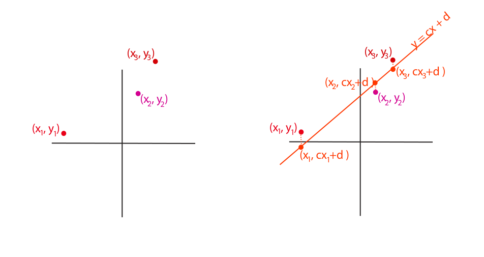
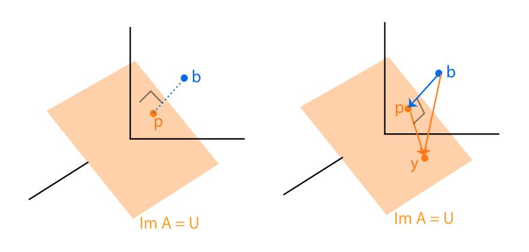
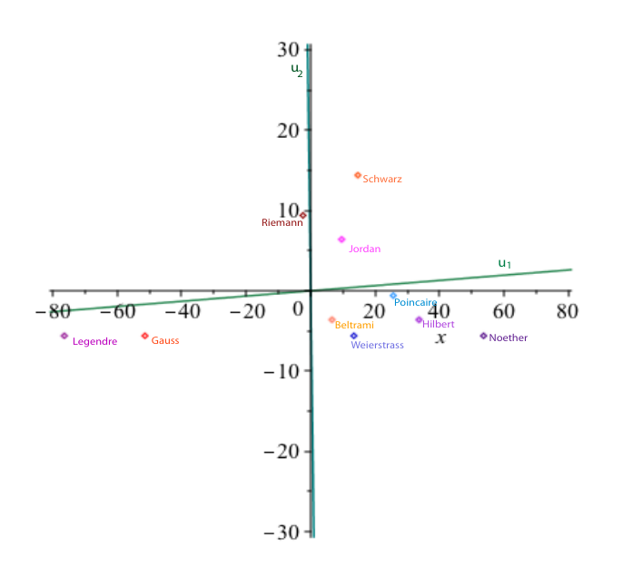

# 第21章 SVD 与伪逆的应用

### 本章总览

本章用第 20 章的 singular value decomposition（奇异值分解，SVD）做四件事：用 pseudo-inverse（伪逆）写最小二乘的最小范数解，用奇异值做矩阵的低秩压缩，用中心化数据的 SVD 做 principal component analysis（主成分分析，PCA），再把同一组主方向解释成最佳仿射近似。

阅读范围：PDF 第 715–748 页。证明只保留结论。习题不展开。

第 20 章已经得到 \(A=VDU^{\top}\)：\(D\) 的对角元是奇异值，\(U\) 的列是 \(A^{\top}A\) 的特征向量，\(V\) 的列是 \(AA^{\top}\) 的特征向量。本章把正奇异值取倒数，并让这个分解去解释投影、方差和低秩误差。

👉 SVD 的存在性、基的含义和极分解见第 20 章。📝待补全

### 核心知识点

#### 最小二乘与法方程

最小二乘处理超定方程组 \(Ax=b\)：\(A\) 是 \(m\times n\)，方程个数多于未知数（\(m>n\)）。历史上 Legendre 在 1805 年发表彗星轨道方法时写出这个原则；Gauss 至迟在 1801 年用它确定小行星 Ceres 的轨道，1810 年在 Pallas 的论文里发表，同一篇论文引入了带主元的 Gauss 消元。Gauss 解过 11 个方程、6 个未知数的系统。多余方程来自重复测量。

例 21.1：平面上一点沿直线 \(y=cx+d\) 运动，观测到 \((x_1,y_1)\)、\((x_2,y_2)\)、\((x_3,y_3)\)。无误差时两个方程就够确定 \(c,d\)；有误差时三个方程可能不相容。最小二乘选择 \((c,d)\)，使

\[
(d+cx_1-y_1)^{2}+(d+cx_2-y_2)^{2}+(d+cx_3-y_3)^{2}
\]

最小。图中的虚线是竖直残差。

图注：Figure 21.1。左图是三个观测点。右图是直线 \(y=cx+d\)，最小二乘让各点到直线的竖直虚线长度的平方和最小。

一般的超定系统要最小化 \(\|Ax-b\|_{2}^{2}\)。Gauss 与 Legendre 发现，解由正规方程给出：

\[
A^{\top}Ax=A^{\top}b.
\]

\(A^{\top}A\) 对称。列线性无关时它可逆，解唯一：

\[
x=(A^{\top}A)^{-1}A^{\top}b.
\]

例 21.1 写成矩阵就是

\[
\begin{pmatrix}1&x_1\\1&x_2\\1&x_3\end{pmatrix}\begin{pmatrix}d\\c\end{pmatrix}
=\begin{pmatrix}y_1\\y_2\\y_3\end{pmatrix},
\]

正规方程为

\[
\begin{pmatrix}3&x_1+x_2+x_3\\ x_1+x_2+x_3& x_1^{2}+x_2^{2}+x_3^{2}\end{pmatrix}
\begin{pmatrix}d\\c\end{pmatrix}
=\begin{pmatrix}y_1+y_2+y_3\\ x_1y_1+x_2y_2+x_3y_3\end{pmatrix}.
\]

列相关时正规方程的解不唯一。下一节说明：在所有使 \(\|Ax-b\|_{2}^{2}\) 最小的 \(x\) 里，仍有唯一的最小范数解。

🔑 关键速记：超定最小二乘的临界点满足正规方程 \(A^{\top}Ax=A^{\top}b\)；列满秩时解是 \((A^{\top}A)^{-1}A^{\top}b\)。

#### 最小范数解与伪逆

定理 21.1：任意 \(m\times n\) 的实线性系统 \(Ax=b\) 都有唯一的最小范数最小二乘解 \(x^{+}\)。

几何结论是：把 \(b\in\mathbb{R}^{m}\) 正交投影到列空间 \(U=\operatorname{Im} A\) 上，得到唯一最近点 \(p\)。\(\|Ax-b\|_{2}^{2}\) 最小当且仅当 \(Ax=p\)。再在 \(\mathbb{R}^{n}=\operatorname{Ker} A\oplus(\operatorname{Ker} A)^{\perp}\) 里看，\(Ax=p\) 的解里范数最小的那一个落在 \((\operatorname{Ker} A)^{\perp}\)，而且唯一，因为 \(A\) 限制在这个正交补上是单射。

正交投影的意思是：\(U\oplus U^{\perp}\) 里的向量唯一地写成 \(u+v\)，投影 \(p_U\) 丢掉 \(U^{\perp}\) 分量、留下 \(u\)。\(b\) 到子空间 \(U\) 的最近点就是 \(p_U(b)\)。对任意 \(y\in U\)，\(y-p\) 在 \(U\) 里，\(p-b\) 在 \(U^{\perp}\) 里，勾股关系是

\[
\|y-b\|_{2}^{2}=\|p-b\|_{2}^{2}+\|y-p\|_{2}^{2}.
\]

👉 正交投影的一般性质见第 12 章 12.1 节。📝待补全

图注：Figure 21.2。\(3\times 2\) 矩阵的列空间 \(U=\operatorname{Im} A\) 画成 \(\mathbb{R}^{3}\) 里的平面。左图中 \(p\) 是 \(b\) 在 \(U\) 上的正交投影。右图中 \(b\)、\(y\)、\(p\) 是直角三角形的三个顶点。

因此 \(x\) 使残差最小，当且仅当 \(b-Ax\) 垂直于 \(A\) 的每一列，也就是

\[
A^{\top}(b-Ax)=0,
\]

即正规方程。最小范数的那一个解还要用伪逆写出来。

定义 21.1：设 \(A\) 为非零 \(m\times n\) 矩阵，秩 \(r\)，\(A=VDU^{\top}\) 是一组 SVD，

\[
D=\begin{pmatrix}\Lambda&0_{r,n-r}\\0_{m-r,r}&0_{m-r,n-r}\end{pmatrix},\quad
\Lambda=\operatorname{diag}(\lambda_1,\ldots,\lambda_r),
\]

其中 \(\lambda_i\) 是非零奇异值。令 \(D^{+}\) 为 \(n\times m\) 矩阵

\[
D^{+}=\begin{pmatrix}\Lambda^{-1}&0_{r,m-r}\\0_{n-r,r}&0_{n-r,m-r}\end{pmatrix},\quad
\Lambda^{-1}=\operatorname{diag}(1/\lambda_1,\ldots,1/\lambda_r).
\]

伪逆定义为

\[
A^{+}=UD^{+}V^{\top}.
\]

零矩阵规定 \(A^{+}=0_{n,m}\)。\(D^{+}\) 的做法是：非零对角元取倒数，零留在原地，再转置形状。这个伪逆也叫 Moore–Penrose pseudo-inverse（Moore–Penrose 伪逆）。

定理 21.2：\(Ax=b\) 的最小范数最小二乘解是

\[
x^{+}=A^{+}b=UD^{+}V^{\top}b.
\]

证明的结论：正交矩阵是等距，\(\|Ax-b\|_{2}\) 最小等价于对 \(y=U^{\top}x\) 最小化 \(\|Dy-V^{\top}b\|_{2}\)，而对角情形的最小范数解是 \(y^{+}=D^{+}V^{\top}b\)，代回去就是 \(x^{+}=A^{+}b\)。结合定理 21.1，\(A^{+}b\) 由 \(b\) 唯一确定，所以 \(A^{+}\) 只依赖于 \(A\)，不依赖于 SVD 里 \(U\)、\(V\) 的具体选法。

书中的 Matlab 接口名称是 \(B=\operatorname{pinv}(A)\)。

例 21.2 取秩 2 的

\[
A=\begin{pmatrix}1&2&3&4\\2&3&4&5\\3&4&5&6\\4&5&6&7\end{pmatrix},
\]

特征值是 \(-1.1652,0,0,17.1652\)。书中给出的奇异值是 \(17.1652\) 与 \(1.1652\)（后者对应那个负特征值的绝对值）。\(D^{+}\) 的两个非零对角元是 \(0.0583\) 与 \(0.8583\)。由此算出的 \(A^{+}\) 与 \(\operatorname{pinv}(A)\) 一致。\(U\)、\(V\) 的数值表在书中，这里不逐项抄录。

列满秩（秩 \(n\)，因而 \(m\ge n\)）时，也可以走 QR，不必先做 SVD。存在 Householder 矩阵或单位矩阵 \(H_1,\ldots,H_n\)，以及秩 \(n\) 的上三角 \(m\times n\) 矩阵 \(R\)，使 \(A=H_1\cdots H_n R\)。每个 \(H_i\) 是等距，所以

\[
\|Ax-b\|_{2}=\|Rx-H_n\cdots H_1 b\|_{2},
\]

最小二乘等价于 \(Rx=H_n\cdots H_1 b\)。写成 \(R=\begin{pmatrix}R_1\\ 0\end{pmatrix}\)、右端 \(\begin{pmatrix}c\\ d\end{pmatrix}\) 后，\(R_1\) 是可逆 \(n\times n\) 上三角（因为 \(A\) 秩为 \(n\)），最小范数解是 \(x^{+}=R_1^{-1}c\)。Householder 矩阵在本章只作为这组等距因子出现。

👉 Householder 与 QR 的构造见第 17 章定理 17.2 及相关的第 12 章习题。📝待补全

🔑 关键速记：最小范数最小二乘解唯一，且 \(x^{+}=A^{+}b\)；\(A^{+}\) 把 SVD 里的正奇异值取倒数并转置形状。

#### 伪逆的性质

命题 21.3 给出满秩时不必先做 SVD 的公式。

| 形状 | 秩条件 | 伪逆 | 哪一侧变成恒等 |
| --- | --- | --- | --- |
| \(m\ge n\) | 秩 \(n\) | \(A^{+}=(A^{\top}A)^{-1}A^{\top}\) | 左逆：\(A^{+}A=I\) |
| \(n\ge m\) | 秩 \(m\) | \(A^{+}=A^{\top}(AA^{\top})^{-1}\) | 右逆：\(AA^{+}=I\) |

满列秩时，这条左逆公式和上一节的 \((A^{\top}A)^{-1}A^{\top}b\) 是同一个解。不满秩时该逆不存在，只能回到定义 21.1。

两个分数例子书中算到底。\(3\times 2\) 满列秩

\[
A=\begin{pmatrix}1&2\\2&3\\0&1\end{pmatrix},\quad
A^{+}=\begin{pmatrix}-1/3&2/3&-4/3\\1/3&-1/6&5/6\end{pmatrix}.
\]

\(2\times 4\) 满行秩

\[
A=\begin{pmatrix}1&2&3&0\\0&1&1&-1\end{pmatrix},\quad
A^{+}=\begin{pmatrix}3/17&-5/17\\1/17&4/17\\4/17&-1/17\\5/17&-14/17\end{pmatrix}.
\]

一般秩时，由 \(A=V\Sigma U^{\top}\) 直接得到

\[
\begin{aligned}
AA^{+}&=V\begin{pmatrix}I_r&0\\0&0\end{pmatrix}V^{\top},\\
A^{+}A&=U\begin{pmatrix}I_r&0\\0&0\end{pmatrix}U^{\top}.
\end{aligned}
\]

二者都对称，并且

\[
AA^{+}A=A,\qquad A^{+}AA^{+}=A^{+},\qquad (AA^{+})^{2}=AA^{+},\qquad (A^{+}A)^{2}=A^{+}A.
\]

所以 \(AA^{+}\) 与 \(A^{+}A\) 都是正交投影。

命题 21.4：\(AA^{+}\) 是到 \(A\) 的列空间的正交投影；\(A^{+}A\) 是到 \(\operatorname{Ker}(A)^{\perp}=\operatorname{Im}(A^{\top})\) 的正交投影。

命题 21.5：\(y\) 在列空间里，当且仅当 \(V^{\top}y=\begin{pmatrix}z\\0\end{pmatrix}\)，\(z\in\mathbb{R}^{r}\)。命题 21.6：\(y\) 在 \(\operatorname{Ker}(A)^{\perp}\) 里，当且仅当 \(U^{\top}y=\begin{pmatrix}z\\0\end{pmatrix}\)。

复矩阵上 \(U\)、\(V\) 改成酉矩阵，\(AA^{+}\) 与 \(A^{+}A\) 是 Hermite 正交投影。

正规矩阵 \(AA^{\top}=A^{\top}A\) 的伪逆可以直接从块对角化读出。实正规矩阵按定理 16.18 可写成 \(A=U\Lambda U^{\top}\)，\(\Lambda\) 由 \(1\times 1\) 块 \((\lambda_k)\) 和 \(2\times 2\) 块

\[
B_j=\begin{pmatrix}\lambda_j&-\mu_j\\\mu_j&\lambda_j\end{pmatrix},\quad \mu_j\neq 0
\]

组成。这种 \(2\times 2\) 块对应一对共轭复特征值 \(\lambda_j\pm i\mu_j\)。

👉 实正规矩阵的块对角化是定理 16.18，见第 16 章。📝待补全

命题 21.7：此时 \(A^{+}=U\Lambda^{+}U^{\top}\)。若 \(\Lambda=\operatorname{diag}(\Lambda_r,0)\) 且 \(\Lambda_r\) 秩为 \(r\)，则

\[
\Lambda^{+}=\begin{pmatrix}\Lambda_r^{-1}&0\\0&0\end{pmatrix}.
\]

证明的结论：每个 \(2\times 2\) 块的奇异值是 \(\sqrt{\lambda_j^{2}+\mu_j^{2}}=\sqrt{\det(B_j)}\)，每个非零纯量块的奇异值是 \(|\lambda_j|\)。把这些因子收成正交矩阵 \(\Theta\) 后，\(\Lambda=\Theta\Sigma\) 给出一组 SVD，再化简就得到 \(\Lambda^{+}\)。

例 21.3 的块是 \(\begin{pmatrix}1&-2\\2&1\end{pmatrix}\)、\(-4\) 和 \(0\)。前一块的行列式是 \(5\)，逆是

\[
\begin{pmatrix}1/5&2/5\\-2/5&1/5\end{pmatrix},
\]

\(-4\) 的倒数是 \(-1/4\)。书中由此算出的 \(A^{+}\) 与 \(\operatorname{pinv}(A)\) 一致。

命题 21.8（Penrose）：\(m\times n\) 矩阵（实或复）的伪逆是唯一满足下面四条的 \(n\times m\) 矩阵

\[
AA^{+}A=A,\quad A^{+}AA^{+}=A^{+},\quad (AA^{+})^{\top}=AA^{+},\quad (A^{+}A)^{\top}=A^{+}A.
\]

本章已经说明定义 21.1 的 \(A^{+}\) 满足这四条。反过来“满足四条的矩阵必是这个伪逆”的证明，书中指向 Kincaid–Cheney，不在这里。

上面满秩公式表的用法可以收成一句：能求 \((A^{\top}A)^{-1}\) 或 \((AA^{\top})^{-1}\) 时用命题 21.3；秩亏时用奇异值倒数，或用 Penrose 四条检验结果。

🔑 关键速记：\(AA^{+}\) 投影到列空间，\(A^{+}A\) 投影到行空间；满列秩时伪逆是左逆，满行秩时是右逆。

#### SVD 数据压缩

要说“矩阵离得近”，需要矩阵范数。第 8 章定义了这些范数。和本章直接有关的两条是：2-范数 \(\|A\|_{2}\) 等于最大奇异值，Frobenius 范数 \(\|A\|_F\) 等于全体奇异值平方和的平方根。低秩近似的误差就用它们来量。

👉 矩阵范数的定义见第 8 章。📝待补全

命题 21.9（Eckart–Young）：\(A\) 为秩 \(r\) 的 \(m\times n\) 矩阵，\(A=VDU^{\top}\)，奇异值 \(\sigma_1\ge\cdots\ge\sigma_p\)，\(p=\min(m,n)\)。对 \(k<r\)，在 2-范数下最接近 \(A\) 的秩 \(k\) 矩阵是

\[
A_k=\sum_{i=1}^{k}\sigma_i v_i u_i^{\top}=V\operatorname{diag}(\sigma_1,\ldots,\sigma_k,0,\ldots,0)U^{\top},
\]

并且

\[
\|A-A_k\|_{2}=\sigma_{k+1}.
\]

证明的后一半用维数：任意秩 \(k\) 矩阵 \(B\) 的核维数是 \(n-k\)，而 \((u_1,\ldots,u_{k+1})\) 张成 \(k+1\) 维子空间，二者必相交于至少一个方向。取这个交里的单位向量，就推出 \(\|A-B\|_{2}\ge\sigma_{k+1}\)。

\(A_k\) 可以用 \((m+n)k\) 个数存放，原矩阵要 \(mn\) 个数。\(k\ll m\) 时这是压缩。

例 21.4 使用第 8.5 节那个病态的对称正定矩阵

\[
A=\begin{pmatrix}10&7&8&7\\7&5&6&5\\8&6&10&9\\7&5&9&10\end{pmatrix}.
\]

因为它对称正定，SVD 取 \(A=UDU^{\top}\)。四个奇异值是 \(30.2887\)、\(3.8581\)、\(0.8431\)、\(0.0102\)。把 \(\sigma_3=\sigma_4=0\) 得到最佳秩 2 近似 \(A_2\)。书中给出的 \(A_2\) 左上角是 \(9.9207\)，对应原矩阵的 \(10\)。按命题 21.9，这个秩 2 近似的 2-范数误差等于下一个奇异值 \(0.8431\)。\(U\) 与 \(A_2\) 的其余数字在书中，不逐项抄录。

图像压缩的数值演示书中指向 Demmel 第 3 章，本章没有另一组图像数据。

命题 21.9 对 Frobenius 范数也成立，证明放在习题 21.4，这里不展开。

计算 SVD 时，书中再次强调：大多数方法把问题化成某个对称矩阵的对角化，但那个矩阵不是把 \(A^{\top}A\) 显式乘出来。显式计算 \(A^{\top}A\) 数值上可以很不稳定。细节指向第 20 章习题 20.1、20.3 和 Demmel 第 5.4 节。

🔑 关键速记：最佳秩 \(k\) 近似保留前 \(k\) 个奇异值，2-范数误差正好等于被丢掉的最大奇异值 \(\sigma_{k+1}\)。

#### 主成分分析

数据是 \(n\) 个点 \(X_1,\ldots,X_n\)，每个 \(X_i\in\mathbb{R}^{d}\) 写成行。\(n\times d\) 矩阵 \(X\) 的第 \(i\) 行是 \(X_i\)，第 \(j\) 列 \(C_j\) 书中称为 feature vector（特征向量，这里指特征列）。计算机视觉里常常把数据点 \(X_i\) 本身叫做特征向量。同一句话在两边指的对象不同，读文献时要看它乘在行上还是列上。

PCA 要看数据的方差–协方差结构，用于两件事：用较少的主成分解释大部分变化；发现原先没料到的方向关系。

样本 \(x=(x_1,\ldots,x_n)\) 的均值是 \(\bar x=(\sum x_i)/n\)。样本方差用 \(n-1\)：

\[
\operatorname{var}(x)=\frac{\sum_{i=1}^{n}(x_i-\bar x)^{2}}{n-1}.
\]

分母取 \(n-1\) 是为了得到方差的无偏估计。书中说找主方向时这个常数因子可以忽略。例 21.6：\(x=(1,3,-1)\) 的均值是 \(1\)，方差是 \(4\)；\(y=(1,2,3)\) 的均值是 \(2\)，方差是 \(1\)。

协方差

\[
\operatorname{cov}(x,y)=\frac{\sum_{i=1}^{n}(x_i-\bar x)(y_i-\bar y)}{n-1}=\frac{(x-\bar x)^{\top}(y-\bar y)}{n-1}.
\]

例 21.7 中 \(\operatorname{cov}(x,y)=-1\)。\(\operatorname{cov}(x,x)=\operatorname{var}(x)\)，并且 \(x\) 与 \(y\) 不相关当且仅当协方差为 0。

质心

\[
\mu=\frac1n(X_1+\cdots+X_n).
\]

\(\mu_j\) 就是第 \(j\) 列的均值。中心化矩阵 \(X-\mu\) 的第 \(i\) 行是 \(X_i-\mu\)。样本协方差矩阵是 \(d\times d\) 对称矩阵

\[
\Sigma=\frac{1}{n-1}(X-\mu)^{\top}(X-\mu)=(\operatorname{cov}(C_i,C_j)).
\]

例 21.8 把上面的 \(x,y\) 合成 \(3\times 2\) 矩阵，得到 \(\mu=(1,2)\)，

\[
\Sigma=\begin{pmatrix}4&-1\\-1&1\end{pmatrix}.
\]

例 21.9 用 10 位数学家的出生年和胡须长度（厘米）作 \(d=2\) 的数据。质心是 \(\mu_1=1828.4\)、\(\mu_2=5.6\)。下表是书中的原始数据，中心化就是各列减去这两个均值。Figure 21.3 画的是中心化后的点；主方向画在后面的 Figure 21.4 里。

| 姓名 | 出生年 | 胡须长度 |
| --- | --- | --- |
| Carl Friedrich Gauss | 1777 | 0 |
| Camille Jordan | 1838 | 12 |
| Adrien-Marie Legendre | 1752 | 0 |
| Bernhard Riemann | 1826 | 15 |
| David Hilbert | 1862 | 2 |
| Henri Poincaré | 1854 | 5 |
| Emmy Noether | 1882 | 0 |
| Karl Weierstrass | 1815 | 0 |
| Eugenio Beltrami | 1835 | 2 |
| Hermann Schwarz | 1843 | 20 |

这张表只说明后面图里的点从哪来。中心化使用 \(\mu_1=1828.4\)、\(\mu_2=5.6\)。

单位向量 \(v\) 上，点 \(x\) 的投影坐标是 \(\langle x,v\rangle\)。全体点的投影坐标组成 \(Y=Xv\)。中心化之后

\[
Y-\bar Y=(X-\mu)v,\qquad \operatorname{var}(Y)=v^{\top}\Sigma v,\qquad \operatorname{cov}(Y,Z)=v^{\top}\Sigma w.
\]

定义 21.2：第一主成分是 \(Y_1=(X-\mu)v_1\)，其中单位向量 \(v_1\) 使 \(\operatorname{var}(Y_1)\) 最大。已有前 \(k\) 个主成分后，第 \(k+1\) 个是在与它们协方差全为 0 的约束下，再把方差最大化。这些单位向量 \(v_h\) 叫做 principal directions（主方向）。

命题 21.10：对称矩阵特征值按 \(\lambda_1\ge\cdots\ge\lambda_d\) 排列，\(u_i\) 是对应的单位特征向量。则

\[
\max_{x\neq 0}\frac{x^{\top}Ax}{x^{\top}x}=\lambda_1,
\]

最大值在 \(x=u_1\) 取到；在 \(\{u_1,\ldots,u_k\}^{\perp}\) 上，同一个比的最大值是 \(\lambda_{k+1}\)，在 \(x=u_{k+1}\) 取到。比值 \(x^{\top}Ax/x^{\top}x\) 称为 Rayleigh ratio（Rayleigh 比），也称 Rayleigh–Ritz ratio。命题对 Hermite 矩阵同样成立，把转置改成共轭转置即可。章末摘要把这条命题称作 Rayleigh–Ritz 定理。

👉 Rayleigh 比的较早讨论在第 16 章 16.6 节。📝待补全

定理 21.11（SVD 给出 PCA）：设 \(X-\mu=VDU^{\top}\)，奇异值 \(\sigma_1\ge\cdots\ge\sigma_d\)。则

\[
Y_k=(X-\mu)u_k
\]

是第 \(k\) 个主成分，而且 \(Y_k\) 就是 \(VD\) 的第 \(k\) 列。方差与协方差是

\[
\operatorname{var}(Y_k)=\frac{\sigma_k^{2}}{n-1},\qquad \operatorname{cov}(Y_h,Y_k)=0\quad(h\neq k).
\]

主方向 \(u_1,\ldots,u_d\) 彼此正交。证明把 \(\operatorname{var}((X-\mu)v)\) 写成

\[
v^{\top}U\frac{1}{n-1}D^{2}U^{\top}v,
\]

再对这个对称矩阵用命题 21.10。

步骤可以收成一条链：排好 \(X\)，减去质心，对 \(X-\mu\) 做 SVD，读 \(U\) 的列作为主方向，读 \(VD\) 的列作为主成分。

例 21.10：胡须数据的两个非零奇异值是 \(\sigma_1=116.9803\)、\(\sigma_2=21.7812\)，

\[
u_1=(0.9995,\ 0.0325),\qquad u_2=(0.0325,\ -0.9995).
\]

\(u_1\) 几乎沿横轴（中心化后的出生年），\(u_2\) 几乎与纵轴反向。\(VD\) 的两列是沿这两条方向的投影坐标，数值表在书中。

图注：Figure 21.4。例 21.9 中心化后的 10 个点，以及例 21.10 的两条主方向。\(u_1\) 几乎水平，\(u_2\) 几乎竖直。书中 Figure 21.5、21.6 再把这些点分别投影到 \(u_1\) 与 \(u_2\) 上。

\(\sigma_k^{2}\) 是 \((X-\mu)^{\top}(X-\mu)\) 的特征值，\(u_k\) 是对应特征向量。数值上应直接对 \(X-\mu\) 做 SVD。把 \((X-\mu)^{\top}(X-\mu)\) 显式乘出来再对角化，可能不稳定。

SVD 不唯一时，主方向也不唯一。数据若有旋转对称，就会出现这种情况，此时 PCA 不太适合分析这组数据。

人脸识别是书中举的视觉应用：Sirovich 与 Kirby（1987）用 PCA 压缩人脸图像，把主方向称为 eigenpicture；Turk 与 Pentland（1991）给出识别算法，并改称为 eigenfaces（特征脸）。手写数字的 PCA 例子指向 Hastie–Tibshirani–Friedman。本章没有这些图像的数值表。

🔑 关键速记：中心化后对 \(X-\mu\) 做 SVD；主方向是 \(U\) 的列，主成分是 \(VD\) 的列，方差等于 \(\sigma_k^{2}/(n-1)\)。

#### 最佳仿射近似

与 PCA 紧挨着的问题是：用 \(d\) 维空间里的 \(p\) 维仿射子空间逼近 \(n\) 个点，\(1\le p\le d-1\)。书中也把余维 \(d-p\) 叫做这组近似的秩。

先看超平面 \(p=d-1\)，方程 \(a_1x_1+\cdots+a_dx_d+c=0\)，约束 \(a^{\top}a=1\)。把原始点的齐次坐标送进最小二乘后，正规方程的最后一行迫使

\[
a_1\mu_1+\cdots+a_d\mu_d+c=0.
\]

所以最佳超平面经过质心。改用中心化数据后 \(c\) 消失，问题变成在 \(a^{\top}a=1\) 下最小化

\[
a^{\top}(X-\mu)^{\top}(X-\mu)a.
\]

对 \(X-\mu=VDU^{\top}\) 而言，这个量是 \(a^{\top}UD^{2}U^{\top}a\)。最小值在 \(U\) 的最后一列取到，对应最小奇异值 \(\sigma_d\)。于是最佳超平面是

\[
A_1=\mu+U_{d-1},
\]

其中 \(U_{d-1}\) 是最后一列的正交补，也就是前 \(d-1\) 个主方向张成的线性子空间。它同时使各点到自身正交投影的距离平方和最小。

一般的余维 \(k\)（\(1\le k\le d-1\)）用 \(k\) 张互相独立的超平面去切。可以要求法向量 \(a_1,\ldots,a_k\) 标准正交。同样每张超平面都过质心。最小二乘解是 \(U\) 的最后 \(k\) 列。因此最佳 \((d-k)\) 维仿射子空间由前 \(d-k\) 个主方向张成。

定理 21.12：\(X-\mu=VDU^{\top}\)，奇异值降序。最佳 \((d-k)\) 维仿射近似是

\[
A_k=\mu+U_{d-k},
\]

\(U_{d-k}\) 由 \(U\) 的前 \(d-k\) 列张成。

例 21.11：胡须数据的最佳一维仿射近似是过质心、方向为 \(u_1=(0.9995,0.0325)\) 的直线。例 21.9 的质心是 \((1828.4,\ 5.6)\)。例 21.11 把通过点写成 \((1824.4,\ 5.6)\)。两处数字不一致，方向向量则与例 21.10 相同。笔记保留原文的两个数，不把其中一个改写成另一个。

例 21.12 给每人加上出生月份。月份列的均值是 \(5.2\)。对这个 \(10\times 3\) 的中心化矩阵做 SVD，三个奇异值是 \(117.0706\)、\(22.0390\)、\(10.1571\)。书中给出

\[
u_1=(0.0394,\ -0.9987,\ -0.0327),\qquad u_2=(0.1717,\ 0.0390,\ -0.9844).
\]

\(u_1\) 基本上与年份轴反向，最显著的特征是出生年；\(u_2\) 接近胡须长度轴的反向，第二显著的特征是胡须长度。最佳仿射平面由 \(u_1,u_2\) 张成。

压缩时只保留前 \(m<d\) 个主成分，也就是 \(VD\) 的前 \(m\) 列，用 \(\mathbb{R}^{m}\) 里的坐标代替原来的 \(\mathbb{R}^{d}\) 点。

🔑 关键速记：最佳仿射子空间过质心，由最大的那些主方向张成；法向是最小的那些奇异向量。

### 关键速记

- 最小范数最小二乘解唯一，且 \(x^{+}=A^{+}b\)；\(A^{+}=UD^{+}V^{\top}\) 只依赖于 \(A\)。
- 满列秩时 \(A^{+}=(A^{\top}A)^{-1}A^{\top}\) 是左逆；满行秩时 \(A^{+}=A^{\top}(AA^{\top})^{-1}\) 是右逆。
- \(AA^{+}\) 正交投影到列空间，\(A^{+}A\) 正交投影到 \(\operatorname{Ker}(A)^{\perp}\)。
- Eckart–Young：秩 \(k\) 截断的 2-范数误差等于 \(\sigma_{k+1}\)。
- PCA 与最佳仿射近似读同一组 SVD：\(U\) 的前几列是主方向，也是仿射子空间的方向；方差是 \(\sigma_k^{2}/(n-1)\)。

### 易混淆点与差异对比

正规方程 \(A^{\top}Ax=A^{\top}b\) 的解都使残差范数最小。其中范数最小的解才是 \(x^{+}=A^{+}b\)，它落在 \((\operatorname{Ker} A)^{\perp}\) 里。列满秩时两者重合，因为解本来就唯一。

\(AA^{+}\) 是 \(m\times m\)，投到列空间。\(A^{+}A\) 是 \(n\times n\)，投到行空间。左逆出现在高矩阵满列秩，右逆出现在宽矩阵满行秩。

例 21.1 最小化的是竖直残差 \((y_i-cx_i-d)^{2}\)。定理 21.12 的最佳仿射近似最小化的是点到子空间的正交距离平方和。直线拟合若改用正交距离，对应的是后者在 \(d=2\)、\(k=1\) 的情形，法向是最小奇异向量，方向是第一主方向。

PCA 的主方向是 \(U\) 的列，主成分是 \(VD\) 的列。\(V\) 的列活在样本个数那一维，不是特征空间里的方向。

最大奇异值方向方差最大，用来当主成分和仿射子空间的方向。最小奇异值方向出现在 Eckart–Young 的误差 \(\sigma_{k+1}\) 里，也出现在最佳超平面的法向量上。

样本方差的分母是 \(n-1\)。书中说明这个因子不改变主方向，只改变 \(\operatorname{var}(Y_k)=\sigma_k^{2}/(n-1)\) 的数值。

本书把特征列 \(C_j\) 叫做特征向量；视觉文献常把样本点 \(X_i\) 叫做特征向量。PCA 公式里被投影的是中心化后的行。

### 本章要点总结

超定系统的最小二乘解是 \(b\) 在列空间上的正交投影拉回来的原像；其中范数最小的原像唯一，由伪逆给出 \(x^{+}=A^{+}b\)。伪逆把 SVD 的正奇异值取倒数，满足 Penrose 四条，并且 \(AA^{+}\)、\(A^{+}A\) 分别是到列空间和到行空间的正交投影。满秩时它退化成左逆或右逆。Eckart–Young 定理把最佳秩 \(k\) 近似写成前 \(k\) 个奇异值之和，2-范数误差是 \(\sigma_{k+1}\)。对中心化数据做 SVD 就得到 PCA：主方向是 \(U\) 的列，主成分是 \(VD\) 的列，彼此不相关，方差为 \(\sigma_k^{2}/(n-1)\)。最佳 \((d-k)\) 维仿射近似过质心，由前 \(d-k\) 个主方向张成。
