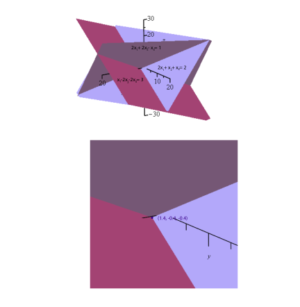
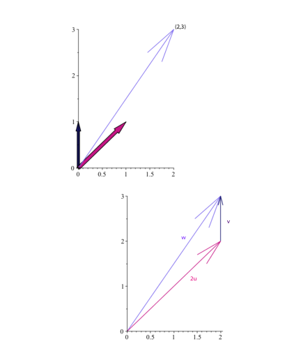
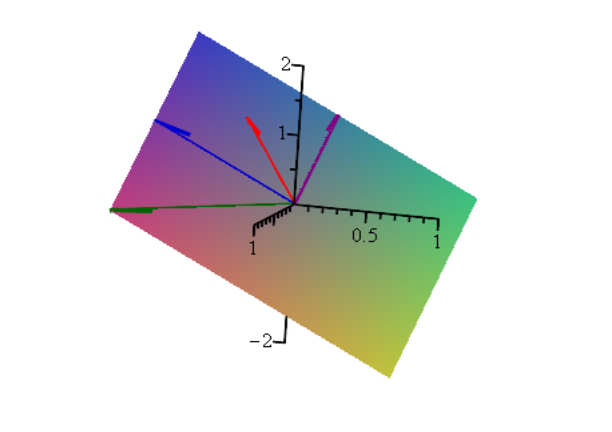

# 第2章 向量空间、基与线性映射

### 本章总览

本章对应 Gallier 与 Quaintance 一书 Chapter 2，阅读范围是 PDF 第 17–96 页，节号 2.1–2.11。

前半章用一个三元方程组说明：解方程就是问右端向量能不能写成列向量的**线性组合**。后半章把这件事公理化。加法先做成交换群，标量来自域，然后才有向量空间、线性无关、子空间、基和维数。矩阵是标量阵列，也带自己的加法和乘法。**线性映射**才是空间之间保结构的变换；有限维时，映射由它在一组基上的取值唯一决定。章末只定义线性形式和对偶基，对偶的进一步理论留到第 10 章。

2.11 节是习题。本章习题不展开。

### 核心知识点

#### 线性组合与秩

##### 列向量上的运算

2.1 节从一个实系数方程组开始：

$$
x_1 + 2x_2 - x_3 = 1, \quad 2x_1 + x_2 + x_3 = 2, \quad x_1 - 2x_2 - 2x_3 = 3.
$$

把系数列和右端写成列向量 u,v,w,b $\in\mathbb{R}$^{3×1}，方程就是

$$
x_1 u + x_2 v + x_3 w = b.
$$

标量 $\lambda$ $\in\mathbb{R}$ 乘向量是逐分量相乘。两个向量相加是逐分量相加。x 的加法逆元 -x 等于 (-1)x。

$\mathbb{R}$^{3×1} 表示三行一列的列向量。$\mathbb{R}^3$ = $\mathbb{R}$ $\times$ $\mathbb{R}$ $\times$ $\mathbb{R}$ 是三元组 (x_1,x_2,x_3)，书中把它看成行向量。两者之间有明显的双射，通常等同。这一节为了分清，列向量的集合写成 $\mathbb{R}$^{n×1}。零向量写成 0_3，习惯上常写成 0，由上下文区分标量零和零向量。

形如 x_1 u + x_2 v + x_3 w 的式子叫做**线性组合**（linear combination）。解方程组，就是判断 b 能否写成 u,v,w 的线性组合。

##### 无关时表示唯一

u,v,w 线性无关（linearly independent），是指不存在 $(x_1,x_2,x_3)\neq(0,0,0)$ 使 x_1 u + x_2 v + x_3 w = 0。

书中说明：此时 $\mathbb{R}$^{3×1} 里每个向量都能**唯一**写成它们的线性组合。若同一个 z 有两套系数，相减得到一组系数不全为零的关系，与无关矛盾。于是 x_1 u + x_2 v + x_3 w = b 有唯一解。书中给出的解是 x_1 = 1.4，x_2 = -0.4，x_3 = -0.4。

判断无关的一条途径是计算数值 $\det(u,v,w)$，称为这三列的行列式（determinant）。书中算出 $\det(u,v,w) = 15\neq0$，用来确认这三列无关。变量很多时，书中建议改算这三列所成矩阵的 LU 分解、QR 分解或 SVD。

行列式在这里只作为「非零则这三列无关」的数值检验。方阵可逆当且仅当行列式非零，本章命题 2.26 把它列为判据之一，并指向命题 6.11。行列式的定义、性质和计算不在本章。

👉 完整讲解见第 6 章。📝待补全

LU、QR 与消元是大规模方程组的实用算法。本章只点名，不给步骤。高斯消元放在第 7 章。

👉 完整讲解见第 7 章。📝待补全

##### 写成 Ax=b

把三列拼成矩阵 $A = (u\ v\ w)$，未知数写成列 x，线性组合就是矩阵乘向量，方程组写成 Ax = b。

一般地，3 $\times$ 3 矩阵 A 的列是 A_1,A_2,A_3 时，

$$
Ax = x_1 A_1 + x_2 A_2 + x_3 A_3.
$$

第 i 个坐标是 A 的第 i 行与 x 的内积。映射 x $\mapsto$ Ax 是线性变换：A($\lambda$ x) = $\lambda$(Ax)，A(u+v) = Au + Av。解 Ax=b 就是问 b 是否落在这个线性映射的像里。

若列线性相关，解的情况会变。书中取

$$
u = \begin{pmatrix}1\cr2\cr1\end{pmatrix},\ 
v = \begin{pmatrix}2\cr1\cr-1\end{pmatrix},\ 
w = \begin{pmatrix}-1\cr1\cr2\end{pmatrix},
$$

有非平凡关系 u - v = w，而 u,v 仍然无关。此时 b 必须能用 u,v 表示，方程才有解。对 $b = (1,2,3)^\top$，书中用 $\det(u,v,b) = -6$ 说明 u,v,b 无关，因此无解。把右端改成 $b = (3,3,0)^\top= u+v$，则有解 x_1=1，x_2=1，x_3=0。代入 w=u-v 后，方程变成 (x_1+x_3)u + (x_2-x_3)v = b。由 u,v 无关，得到 x_1+x_3=1，x_2-x_3=1，于是

$$
x_1 = 1 - x_3,\quad x_2 = 1 + x_3,
$$

x_3 任意，解无穷多。

三元方程组因此可以有唯一解、无解或无穷多解。书中说同样的现象可以推广到任意 n $\times$ n 以及 n 个方程、m 个未知数的方程组，细节在后文。

##### 内积与矩阵乘法

对 x,y $\in\mathbb{R}$^n，内积（inner product）是

$$
x\cdot y = \langle x, y\rangle = \sum_{i=1}^{n} x_i y_i.
$$

欧氏范数（Euclidean norm），也叫 $\ell_2$-范数，是 $\lVert x\rVert_2 =\sqrt{x\cdot x}$。书中陈述不等式 $|x\cdot y|\le\lVert x\rVert\,\lVert y\rVert$，并说明 $x,y\neq0$ 时比值 $(x\cdot y)/(\lVert x\rVert\lVert y\rVert)$ 可以看成夹角余弦。特别地，$x\cdot y = 0$ 表示夹角为 $\pi$/2，两向量正交（orthogonal）。满足 $\langle Qx, Qy\rangle=\langle x, y\rangle$ 的方阵 Q 被说成广义旋转。这条不等式在本章只被陈述，没有证明，也没有标出证明所在章。【信息缺口】

范数与矩阵范数的系统讨论在第 8 章。本章后面用矩阵范数衡量两个矩阵有多近：$\lVert A\rVert$ 是非负实数，行为类似实数的绝对值 |x|。

👉 完整讲解见第 8 章。📝待补全

A 为 m $\times$ n、列为 $A_1,\ldots,A_n$，B 为 n $\times$ p、列为 $B_1,\ldots,B_p$ 时，乘积 AB 是 m $\times$ p 矩阵，第 j 列是 AB_j。元素为

$$
(AB)_{ij} = \sum_{k=1}^{n} a_{ik} b_{kj}.
$$

方阵一般不满足 AB = BA。2.1 节有一处把这个乘积的尺寸写成 m $\times$ n；定义 2.15 写明结果是 m $\times$ p。以定义 2.15 为准。

##### 逆、转置、正交矩阵

若能找到方阵 B 使 BA_i = e_i，其中 e_i 只在第 i 个位置为 1，则 BA = I_n。I_n 是单位矩阵（identity matrix），第 i 列是 e_i。此时由 Ax=b 得 x = Bb，并且 A(Bb)=b。书中强调 BA=I_n 蕴含 AB=I_n 并不显然，但可以证明。这个 B 记为 A^{-1}，称为逆（inverse），并且是唯一满足 AA^{-1}=A^{-1}A=I_n 的矩阵。有逆的方阵称为**可逆**（invertible）或非奇异（nonsingular），否则称为奇异（singular）。

书中预告：方阵可逆，当且仅当列线性无关，当且仅当行列式非零。可逆时 Ax=b 的唯一解是 x=A^{-1}b。实际计算里求逆太贵，实用方法是第 7 章的高斯消元，或用 QR、SVD 做分解。

m $\times$ n 矩阵 A=(a_{kl}) 的转置（transpose）$A^\top$ 是 n $\times$ m 矩阵，$a^\top_{ij}=a_{ji}$。满足 $QQ^\top= Q^\top Q = I_n$ 的方阵 Q 称为正交矩阵（orthogonal matrix），等价于 $Q^{-1}=Q^\top$。几何上，它们对应保长度的线性变换。

##### SVD、最小二乘与低秩

书中陈述一条主要结果：每个 m $\times$ n 矩阵可以写成

$$
A = V\Sigma U^\top.
$$

其中 V 是 m $\times$ m 正交矩阵，U 是 n $\times$ n 正交矩阵，$\Sigma$ 是 m $\times$ n 矩阵，只有对角线上有非负元 $\sigma$ $_1\ge$ $\sigma$ $_2\ge\cdots\ge$ $\sigma$_p，$p=\min(m,n)$，这些数称为奇异值（singular values）。这个分解叫奇异分解，或 SVD。本章只陈述分解的形状和用途，不证明。

👉 完整讲解见第 21 章。📝待补全

方程个数多于未知数（m>n）时系统可能无解，称为超定（overdetermined）。书中说无解就是无解，但可以找使误差 Ax-b 某种大小最小的近似解。Legendre 与 Gauss 用 $\lVert Ax-b\rVert_2^2$。书中结论是：存在唯一的、欧氏范数最小的 x^+，使这个量达到最小，并且 x^+ = A^+ b。A^+ 是伪逆（pseudo-inverse），由 SVD 得到：A^+ = U $\Sigma$ $^+ V^\top$。$\Sigma$^+ 把每个正奇异值 $\sigma$_i 换成 $\sigma$_i^{-1}，零元保持为零，再转置。

在 $\lVert Ax-b\rVert_2^2$ 上再加罚项 $K\lVert x\rVert_2^2$（K>0）是岭回归（ridge regression）。书中给出唯一极小点

$$
x^+ = (A^\top A + K I_n)^{-1} A^\top b,
$$

并写明证明在第二卷。把罚项换成 $K\lVert x\rVert_1$，$\lVert x\rVert_1 = |x_1|+\cdots+|x_n|$，是 lasso。书中说极小点常常是稀疏的，即许多分量为 0，并放在第二卷讨论。第二卷不在本 PDF 里。【信息缺口：证明与算法】

SVD 的另一个应用是主成分分析（principal component analysis，PCA），本章只点名。

👉 完整讲解见第 21 章。📝待补全

##### 三张平面的交

同一方程组也可以看成行的条件。每个方程在 $\mathbb{R}$^3 里定出一张平面。

第一张平面 H_1 过坐标轴上的 (1,0,0)、(0,1/2,0)、(0,0,-1)。第二张 H_2 过 (1,0,0)、(0,2,0)、(0,0,2)。第三张 H_3 过 (3,0,0)、(0,-3/2,0)、(0,0,-3/2)。这是原方程组，对应图 2.1。两张不同平面的交是直线，三张平面的交是单点 (1.4,-0.4,-0.4)，对应图 2.2。

图注：原书图 2.2。三张平面 x_1+2x_2-x_3=1、2x_1+x_2+x_3=2、x_1-2x_2-2x_3=3 的公共点是唯一解 (1.4,-0.4,-0.4)。上图是三平面相交，下图标出这个公共点。

无解的几何例子是方程组

$$
x_1+2x_2-x_3=1,\quad 2x_1+x_2+x_3=2,\quad x_1-x_2+2x_3=3,
$$

图 2.3 与图 2.4：三张平面没有公共点。无穷多解的例子是

$$
x_1+2x_2-x_3=3,\quad 2x_1+x_2+x_3=3,\quad x_1-x_2+2x_3=0,
$$

解为 $(1-x_3,\ 1+x_3,\ x_3)$，几何上是三张平面的公共直线，见图 2.5 与图 2.6。这个看法盯住的是 A 的行，前面的线性组合盯住的是列。

##### 数据压缩里的秩

很大的数据集常常写成 m $\times$ n 矩阵 A，每一行是一个 n 维数据点，通常 $m\ge n$。数据往往不独立，A 的秩（rank）比 $\min\{m,n\}$ 小很多。低秩分解希望 A=BC，其中 B 为 m $\times$ k，C 为 k $\times$ n，$k\ll\min\{m,n\}$。精确分解通常太贵，于是在秩至多 k 的矩阵里找 A'，使 $\lVert A-A'\rVert_2$ 最小。

好处有两条。存储和重建从 mn 个数降到 k(m+n) 个数。分解过程常常把主要数据暴露在若干主方向（principal directions）上。书中说 SVD 给低秩近似一个满意的解，见第 21 章；数据再大时还要随机化，线性代数提供第一步。

映射的秩在定义 2.22 里才定义为像的维数。2.1 节直接使用矩阵的秩，没有给出行秩、列秩或「非零奇异值个数」这类等价刻画。【信息缺口】

🔑 关键速记：Ax=b 是在问 b 是否属于列的线性组合；三列无关时表示唯一，相关时可能无解或有无穷多解。

#### 群、环、域短引

向量空间是集合 E 配上加法 +_E 和标量乘法 $\cdot_E$。加法必须先使 E 成为交换群。这一节用平面上的变换把群、环、域的公理走一遍，并明确说向量空间同时也是几何对象。

##### 平移

例 2.1。平面平移 T_u(x) = x+u。全体平移记为 T($\mathbb{R}$^2)。复合满足 $T_v\circ T_u = T_{u+v}$，并且交换，记为 (Ab)。零向量给出不动的平移 T_{0_2}，它是单位元，记为 (G2)。复合结合，因为向量加法结合，记为 (G1)。T_{-u} 是 T_u 的逆，记为 (G3)。因此 T($\mathbb{R}$^2) 是交换群。u $\mapsto$ T_u 是从加法群 $\mathbb{R}$^2 到 T($\mathbb{R}$^2) 的群同构。群里的元素是变换，$\mathbb{R}$^2 里的元素是向量。推广到 $\mathbb{R}$^n 是直接的。

##### 旋转与 SO(2)

例 2.2。非零点的极坐标 (r,$\alpha$) 在 r>0、$0\le$ $\alpha$<2 $\pi$ 时唯一；也可以把角看成模 2 $\pi$，即 $\alpha$_2-$\alpha$_1=2 $\pi$ k。等价类的集合是 $\mathbb{R}$/(2 $\pi$ $\mathbb{Z}$)，在模 2 $\pi$ 的加法下成群。

旋转 $R_\theta$ 固定原点，并把 (r,$\alpha$) 送到 (r,$\alpha$+$\theta$)。直角坐标下的矩阵是

$$
M_\theta = \begin{pmatrix}\cos\theta & -\sin\theta\cr \sin\theta & \cos\theta\end{pmatrix},
$$

并且 $M_\theta M_\varphi= M_{\theta+\varphi}$。全体这种矩阵记为 SO(2)，在矩阵乘法下是交换群。几何上它是单位圆 S^1，也可写成单位复数 $U(1)=\{\cos$ $\theta$ $+i\sin$ $\theta$ $\}$，而 $\cos$ $\theta$ $+i\sin$ $\theta$ $=e^{i\theta}$。单位元是 M_0=I_2。$R_\theta$ 的逆是 $R_{-\theta}$，对应矩阵是 $M_\theta$ 的转置。这些矩阵相加一般不再是旋转。

##### 伸缩、相似与反射

例 2.3。r>0 时伸缩 $\mu$_r(x)=r x。集合 $\mathrm{Mag}(2)$ 在 $\mu$ $_{r_1}\cdot$ $\mu$_{r_2}= $\mu$_{r_1 r_2} 下是交换群，单位元 $\mu$_1，$\mu$_r 的逆是 $\mu$_{1/r}。

$\mu$ $_r\circ R_\theta$ 的矩阵是 $\begin{pmatrix}r\cos\theta & -r\sin\theta\cr r\sin\theta & r\cos\theta\end{pmatrix}$。它们构成

$$
\mathrm{SIMR}(2)=\left\{\begin{pmatrix}a & -b\cr b & a\end{pmatrix}\ \middle|\ a^2+b^2\neq 0\right\}.
$$

逆矩阵是 $\dfrac{1}{a^2+b^2}\begin{pmatrix}a & b\cr -b & a\end{pmatrix}$。矩阵乘法下它是交换群。

例 2.4。反射矩阵是

$$
\rho_\varphi = \begin{pmatrix}\cos\varphi & \sin\varphi\cr \sin\varphi & -\cos\varphi\end{pmatrix}.
$$

旋转矩阵的行列式是 +1，反射的行列式是 -1。本章假定读者知道行列式；系统理论见第 6 章。特殊情形 $\rho_0=\begin{pmatrix}1&0\cr0&-1\end{pmatrix}$ 是关于 x 轴的反射，并且 $\rho$ $_\varphi=M_\varphi$ $\rho$_0。书中随后得到

$$
\rho_\varphi = M_{\varphi/2}\,\rho_0\, M_{-\varphi/2},
$$

几何含义是：先转 -$\varphi$/2，再关于 x 轴反射，再转 $\varphi$/2。这就是关于与 x 轴夹角为 $\varphi$/2 的直线的反射。计算还说明 $\rho$ $_\varphi^2=I_2$，反射的逆是它自己，以及 $\rho$ $_0 M_\theta$ $\rho$ $_0 = M_{-\theta}$。

$$
O(2)=SO(2)\cup\{\rho_\varphi\mid \varphi\in\mathbb{R}/(2\pi\mathbb{Z})\}.
$$

乘法表是

\begin{align*}
M_$\theta$ M_$\varphi$ &= M_{$\theta$+$\varphi$}, & (RR)$\\$
M_$\theta$ $\rho$_$\varphi$ &= $\rho$_{$\theta$+$\varphi$}, & (R$\rho$)$\\$
$\rho$_$\theta$ M_$\varphi$ &= $\rho$_{$\theta$-$\varphi$}, & ($\rho$ R)$\\$
$\rho$_$\theta$ $\rho$_$\varphi$ &= M_{$\theta$-$\varphi$}. & ($\rho$ $\rho$)
\end{align*}

因此 O(2) 在矩阵乘法下成群，但是不交换：比较 $\rho$ $_0 M_\varphi$ 与 $M_\varphi$ $\rho$_0。书中说 O(2) 是 SO(2) 与 $\{I_2,$ $\rho$ $_0\}$ 的半直积。几何上 O(2) 是两个单位圆的不交并。

由 (ρρ)，$\rho$ $_{\varphi+\theta}$ $\rho$ $_\varphi= M_\theta$。每个旋转都是两次反射的复合，两条反射轴与 x 轴的夹角差是 $\theta$/2。

$\begin{pmatrix}\cos(\varphi/2)\cr \sin(\varphi/2)\end{pmatrix}$ 是 $\rho$ $_\varphi$ 属于特征值 1 的特征向量；$\begin{pmatrix}-\sin(\varphi/2)\cr \cos(\varphi/2)\end{pmatrix}$ 属于特征值 -1。旋转 $M_\theta$ 的复特征值是 $\cos$ $\theta$ $\pm i\sin$ $\theta$，本章写「以后会看到」，没有在这里证明。【信息缺口：特征值章节号本章未标】

##### SE(2) 与 E(2)

例 2.5。先旋转再平移得到 SE(2)。记 $T_u\circ R_\theta=(u,R_\theta)$，乘法是

$$
(v,R_\varphi)\cdot(u,R_\theta)=(v+R_\varphi(u),\ R_{\varphi+\theta}).
$$

注意 $R_\varphi$ 作用在平移向量 u 上。SE(2) 是 $\mathbb{R}$^2 与 SO(2) 的半直积。元素是平面到自身的变换。用 3 $\times$ 3 矩阵表示它们，书中指向 5.5 节。

这些映射在 $u\neq0$ 时是仿射的，仅当 u=0 时是线性的。5.5 节要解决的是：旋转和平移怎样写进同一张矩阵，以及复合时旋转怎样作用到平移向量上。本章先把群乘法 $(v+R_\varphi(u), R_{\varphi+\theta})$ 记牢。

👉 完整讲解见第 5 章。📝待补全

纯平移是 (u,R_0)，纯旋转是 $(0_2,R_\theta)$。单位元是 (0_2,R_0)，$(u,R_\theta)$ 的逆是 $(-R_{-\theta}(u), R_{-\theta})$。群不交换。书中让读者比较 $R_\theta\circ T_{(1,0)}$ 与 $T_{(1,0)}\circ R_\theta$ 在原点上的作用，没有把两个像点的坐标写出来。

u=0 时这些映射才是线性的。几何上 SE(2) 是圆柱 S^1 $\times$ $\mathbb{R}$^2，不是紧空间。把 SO(2) 换成 O(2)，得到平面刚体运动群 E(2)。形如 $T_u\circ$ $\rho$ $_\varphi$ 的映射称为间接运动（indirect motion）。书中说 E(2) 恰好是保欧氏距离的全部映射 f:$\mathbb{R}$ $^2\to$ $\mathbb{R}$^2，见命题 11.13，并注明证明不容易。

保距是说平面上任意两点的欧氏距离在映射前后不变。E(2) 把旋转、反射再配上平移都收进来；命题 11.13 证明反过来每一保距映射都落在这个群里。

👉 完整讲解见第 11 章。📝待补全

SO(2) 与 O(2) 里的矩阵满足 $SS^\top=S^\top S=I_2$，称为正交矩阵。推广到 $n\ge3$ 时要使用正交矩阵。n=3 的工具，书中列举 Euler 角、四元数和指数表示，本章不展开。【信息缺口：这三项在本章没有章节号】

##### 群的定义

定义 2.1。群（group）是集合 G 配上运算 $\cdot:G$ $\times$ $ G\to G$，满足：

| 编号 | 内容 |
| --- | --- |
| (G1) | $a\cdot(b\cdot c)=(a\cdot b)\cdot c$，结合 |
| (G2) | 存在单位元 e，使 $a\cdot e=e\cdot a=a$ |
| (G3) | 每个 a 有逆 a^{-1}，使 $a\cdot a^{-1}=a^{-1}\cdot a=e$ |

再满足 $a\cdot b=b\cdot a$ 时称为交换群，或 Abel 群，记为 (Ab)。只满足 (G1)(G2) 的结构叫幺半群（monoid）。自然数 $\mathbb{N}$ $=\{0,1,2,\ldots\}$ 在加法下是交换幺半群，单位元是 0，但不是群。

上表是定义 2.1 的三条等式。交换性是额外条件，不放进群的最低要求。

例 2.6 列出的群包括：$\mathbb{Z}$、$\mathbb{Q}$、$\mathbb{R}$、$\mathbb{C}$ 的加法；$\mathbb{Q}$ $^\ast$、$\mathbb{R}$ $^\ast$、$\mathbb{C}$ $^\ast$ 的乘法；$\mathbb{R}$^n、$\mathbb{C}$^n 的分量加法；集合 S 上双射在复合下的群，|S|>2 时不交换，复合写成 $g\circ f$；M_n($\mathbb{R}$)、M_n($\mathbb{C}$) 在矩阵加法下的交换群；多项式 $\mathbb{R}$[X] 的加法。可逆 n $\times$ n 矩阵在乘法下是一般线性群（general linear group）$\mathrm{GL}(n,$ $\mathbb{R}$) 或 $\mathrm{GL}(n,$ $\mathbb{C}$)。行列式为 +1 的可逆矩阵是特殊线性群（special linear group）$\mathrm{SL}(n,$ $\mathbb{R}$) 或 $\mathrm{SL}(n,$ $\mathbb{C}$)。满足 $RR^\top=R^\top R=I_n$ 且行列式为 +1 的是特殊正交群（special orthogonal group）SO(n)，对应 $\mathbb{R}$^n 中的旋转。开区间上的连续函数在逐点加法下也是交换群。

$\mathbb{Z}$ $^\ast=$ $\mathbb{Z}$ $\setminus\{0\}$ 在乘法下只是交换幺半群，不是群。交换群的运算常写成 +，逆元写成 -a。

命题 2.1：若 e' 是左单位元、e'' 是右单位元，则 e'=e''。因此幺半群和群的单位元唯一。命题 2.2：幺半群里，左逆和右逆只要都存在就相等，所以群里每个元素的逆唯一。书中备注：只假定右单位元和每个元素的右逆，也能推出 (G2)(G3)，留给读者。命题 2.3：幺半群里两个可逆元的积可逆，(ab)^{-1}=b^{-1}a^{-1}。因此一个幺半群的可逆元全体是群。

##### 环与域

向量空间的标量来自一个域。域是特殊的环。

定义 2.2。环（ring）有加法 + 和乘法 $\ast$：

| 编号 | 内容 |
| --- | --- |
| (R1) | 加法是交换群，零元记为 0，a 的加法逆元记为 -a |
| (R2) | 乘法结合，且有单位元 1 |
| (R3) | 乘法对加法分配 |

展开后的等式编号是 (2.1)–(2.8)：加法结合、交换、零元、加法逆元，乘法结合、乘法单位元，以及左右分配。乘法也交换时称为交换环。由分配得到 (2.9) $a\ast0=0\ast a=0$，以及 (2.10) $a\ast(-b)=(-a)\ast b=-(a\ast b)$。若 1=0，则环只有一个元素，称为平凡环。$1\neq0$ 时称为非平凡环。乘法常写成并列 ab。

$\mathbb{Z}$、多项式环 K[X]、模 m 的剩余 $\mathbb{Z}$/m $\mathbb{Z}$ 是交换环。M_n($\mathbb{R}$) 与 M_n($\mathbb{C}$) 是非交换环。

定义 2.3。域（field）是满足下面三条的环：

| 编号 | 内容 |
| --- | --- |
| (F1) | $0\neq1$ |
| (F2) | 每个非零元对乘法有逆 |
| (F3) | 乘法交换 |

记 $K^\ast=K\setminus\{0\}$。(F1)(F2) 等价于 $K^\ast$ 在乘法下是以 1 为单位元的群。(F1)(F2) 成立但乘法不交换时，称为除环（skew field）。书中把乘法交换写进域的定义，并说明这不是所有文献的约定。

例 2.7：$\mathbb{Q}$、$\mathbb{R}$、$\mathbb{C}$ 是域；p 为素数时 $\mathbb{Z}$/p $\mathbb{Z}$ 是域；系数在 $\mathbb{R}$[X] 里、分母不是零多项式的形式分式也是域。

🔑 关键速记：群要结合、有单位、每个元可逆；标量所在的域还要求非零元可乘除，并且 $0\neq1$。

#### 向量空间

##### 公理

定义 2.4。实向量空间是集合 E 加上加法 +_E 和标量乘法 $\cdot_E:$ $\mathbb{R}$ $\times$ $ E\to E$，对所有 $\alpha$,$\beta$ $\in\mathbb{R}$ 和 $u,v\in E$ 满足：

| 编号 | 内容 |
| --- | --- |
| (V0) | E 对 +_E 是交换群，单位元为 0_E |
| (V1) | $\alpha$ $\cdot_E(u+_E v)=($ $\alpha$ $\cdot_E u)+_E($ $\alpha$ $\cdot_E v)$ |
| (V2) | ($\alpha$+$\beta$ $)\cdot_E u=($ $\alpha$ $\cdot_E u)+_E($ $\beta$ $\cdot_E u)$ |
| (V3) | ($\alpha$ $\ast$ $\beta$ $)\cdot_E u=$ $\alpha$ $\cdot_E($ $\beta$ $\cdot_E u)$ |
| (V4) | $1\cdot_E u=u$ |

正文说 (V1) 里的 + 表示 $\mathbb{R}$ 中的加法，(V3) 里的 $\ast$ 表示 $\mathbb{R}$ 中的乘法。按印出的公式，标量相加出现在 (V2)，向量相加出现在 (V1)。

$\mathbb{R}$ 可以换成 $\mathbb{C}$、$\mathbb{Q}$，或任意域 K，例如素数阶的 $\mathbb{Z}$/p $\mathbb{Z}$。本章结论对任意域上的向量空间都成立。标量域通常取 $\mathbb{R}$。

由 (V0)，空间非空，至少有零向量。由 (V1) 得到 $\alpha$ $\cdot0_E=0_E$，以及 $\alpha$ $\cdot(-v)=-($ $\alpha$ $\cdot v)$。由 (V2) 得到 $0\cdot v=0_E$，以及 (-$\alpha$ $)\cdot v=-($ $\alpha$ $\cdot v)$。

命题 2.4。若 $\lambda$ $\neq0$ 且 $\lambda$ $\cdot u=0_E$，则 u=0_E。直观上，非零标量有乘法逆，把 $\lambda$ u=0 两边乘 $\lambda$^{-1}，再用 (V3)(V4) 得到 u=0。适用场合是：从一条系数非零的线性关系里解出某个向量。

(V4) 不能由其余公理推出。反例：在 E= $\mathbb{R}$^n 上定义 $\lambda$ $\cdot(x_1,\ldots,x_n)=(0,\ldots,0)$，则 (V0)–(V3) 成立而 (V4) 失败。书中说还有不那么平凡的反例，但要用尚未定义的基。

为了减轻记号，后文把 +_E、标量乘法和域运算都写成 + 与并列，零向量与标量零都写成 0，必要时用 $\mathbf{0}$ 表示零向量。标量多用 $\alpha$,$\beta$,$\lambda$，向量多用 u,v,x,y,z。

##### 例子

例 2.8。

1. $\mathbb{R}$ 与 $\mathbb{C}$ 都是 $\mathbb{R}$ 上的向量空间。域本身可以看成自己上的向量空间：向量加法是域加法，标量乘法是域乘法。
2. $\mathbb{R}$^n 与 $\mathbb{C}$^n 是 $\mathbb{R}$ 上的向量空间，标量乘法为 $\lambda$ $(x_1,\ldots,x_n)=($ $\lambda$ $ x_1,\ldots,$ $\lambda$ x_n)。$\mathbb{C}$^n 也是 $\mathbb{C}$ 上的向量空间。
3. 次数至多 n 的实多项式 $\mathbb{R}$[X]_n、复多项式 $\mathbb{C}$[X]_n 分别是 $\mathbb{R}$、$\mathbb{C}$ 上的向量空间。
4. 全体实多项式 $\mathbb{R}$[X]、全体复多项式 $\mathbb{C}$[X] 同样是向量空间。
5. M_n($\mathbb{R}$) 是 $\mathbb{R}$ 上的向量空间。
6. m $\times$ n 矩阵 M_{m,n}($\mathbb{R}$) 也是。
7. 连续函数 C(a,b) 上，($\lambda$ f)(x)= $\lambda$ f(x)。
8. 任意非空集合 X 到向量空间 E 的全部函数，用 (f+g)(x)=f(x)+g(x) 与 ($\lambda$ f)(x)= $\lambda$ f(x) 做成向量空间。这是为 2.8 节的线性映射空间做准备。

🔑 关键速记：向量空间是交换群再加上来自域的标量乘法；(V4) 单独要求 1 乘向量等于自身。

#### 线性无关与子空间

##### 用指标族而不是集合

2.4 节说明：线性组合和线性相关适合用向量的序列，更好是用指标族（indexed family），而不是用集合。序列 $(a_1,\ldots,a_n)$ 允许重复，顺序有意义。有限序列也可以看成 $\{1,\ldots,n\}$ 到集合的函数；可数序列是 $\mathbb{N}$ 上的函数。指标的作用是给每个位置唯一标签，标签本身不必有顺序。

定义 2.5。I-指标族是函数 $a:I\to A$，写成 $(a_i)_{i\in I}$。同一个值可以带两个不同标签。I 全序时，族常称为 I-序列。集合可以看成由恒等函数给出的特殊族。

多重集（multiset）记录每个元素出现的次数，顺序无关，形式上是 $A\to$ $\mathbb{N}$ 的函数。指标族推广序列，多重集推广集合。两者不要混。

有限和 $\sum_{i\in I} a_i$ 需要底层加法既结合又交换，否则分组和顺序会改变结果。命题 2.5：加法结合时，按保持顺序的分段相加，和不变。命题 2.6：再假定交换，则和与指标的排列无关。于是任意有限指标集上的和有定义，不依赖所选的全序。本章约定，除非另说，标量族都是有限的。证明是对指标个数做归纳，笔记只留这条结论。

##### 线性组合与线性无关

定义 2.6。v 是族 $(u_i)_{i\in I}$ 的线性组合，是指存在标量族 ($\lambda$_i) 使 $v=\sum_{i\in I}$ $\lambda$_i u_i。$I=\emptyset$ 时约定 v=0。空族约定为线性无关。

族线性无关，是指 $\sum$ $\lambda$_i u_i=0 蕴含每个 $\lambda$_i=0。线性相关，是指存在不全为零的系数使这个和为零。

用族而不是用集合，是为了允许重复向量。矩阵可以有相同的列，这些列应当算相关；集合的定义做不到这一点。$|I|\ge2$ 时，相关等价于某个向量是其余向量的线性组合。单个向量构成的族相关，当且仅当这个向量是 0。

命题 2.7。$|I|\ge2$ 时，族线性无关当且仅当每个 v_k 都不能写成去掉它之后那一族的线性组合。

无关族里每个向量都不是 0；若至少两个向量，它们还两两不同。因此一条非平凡的无关族，底下的向量集合没有重复。相关仍然必须允许重复，所以书中坚持用族来定义相关。

方阵的列 $A_1,\ldots,A_n$ 线性无关，当且仅当 Ax=0 只有解 x=0。可以消元验证，也可以直接写出逆：若 A^{-1} 存在，则 Ax=0 左乘 A^{-1} 得 x=0。

例 2.9。

1. $\mathbb{R}$ 中任意两个不同的非零标量线性相关。
2. $\mathbb{R}$^3 中 (1,0,0)、(0,1,0)、(0,0,1) 线性无关，见图 2.7。
3. $\mathbb{R}$^4 中 (1,1,1,1)、(0,1,1,1)、(0,0,1,1)、(0,0,0,1) 线性无关。
4. $\mathbb{R}$^2 中 u=(1,1)，v=(0,1)，w=(2,3) 线性相关，因为 w=2u+v，见图 2.8。

图注：原书图 2.8。u=(1,1) 沿粉色方向，v=(0,1) 竖直，w=2u+v 落到点 (2,3)。下图把 2u 与 v 首尾相接，说明相关就是一条向量被其余向量表出。

指标是 $\{1,\ldots,n\}$ 时，族写成 $(u_1,\ldots,u_n)$。

##### 子空间

定义 2.7。E 的子集 F 是**线性子空间**，是指 F 非空，并且对所有 $u,v\in F$ 和所有标量 $\lambda$,$\mu$，$\lambda$ u+$\mu$ $ v\in F$。加法和标量乘法限制到 F 上仍满足向量空间公理。子空间必含零向量：取 $\lambda$= $\mu$=0。零子空间记为 (0_E) 或 (0)。

命题 2.8，证明留作练习。任意一族子空间的交仍是子空间，族可以无穷。子空间对其中向量的有限线性组合封闭。

例 2.10。

1. $\mathbb{R}$^2 中 x+y=0 是过原点、斜率为 -1 的直线，向量都是 $\lambda$(-1,1)，见图 2.9。
2. $\mathbb{R}$^3 中 x+y+z=0 是过原点、法向为 (1,1,1) 的平面，见图 2.10。
3. 次数至多 n 的多项式是 $\mathbb{R}$[X] 的子空间。
4. 上三角 n $\times$ n 矩阵是全体 n $\times$ n 矩阵的子空间。

图注：原书图 2.10。x+y+z=0 是过原点的平面，法向为 (1,1,1)。它含零向量，并且对加法和数乘封闭，所以是线性子空间。

命题 2.9。非空子集 S 所张成的最小子空间 $\langle S\rangle$，也写 $\mathrm{Span}(S)$，就是 S 中元素的全部有限线性组合。组合的集合是子空间；任何含 S 的子空间都含这些组合，后一步留作练习。

##### 系数受限的组合

线性组合的系数可以加限制，得到三种以后常用的组合。指标集仍假定有限。

系数和为 1 的是**仿射组合**（affine combination）。每一条普通线性组合都能改写成仿射组合：多放一个零向量，系数补成 $1-\sum$ $\lambda$_i。新的集合可以不再是线性子空间。$\mathbb{R}$^3 中 e_1,e_2,e_3 的全部仿射组合是过这三点的平面，它不含原点。

本章例 2.5 已把 SE(2) 里的映射称为仿射映射，并写明仅当 u=0 时它们是线性映射。用 3 $\times$ 3 矩阵表示这些映射，书中指向 5.5 节。这里只比较「系数和为 1」与「集合含不含原点」。

👉 完整讲解见第 5 章。📝待补全

全部系数 $\lambda$ $_i\ge0$ 的是正组合，也叫锥组合（conic combination）。这样的集合是锥，出现在凸优化里。既要求和为 1，又要求系数非负，是凸组合（convex combination）。有限个向量的全部凸组合是凸多面体。本章只给这三条限制的定义，凸优化不在本卷展开。【信息缺口】

定义 2.8。标量族有有限支撑（finite support），是指除去某个有限子集外系数全为 0。无穷指标上的线性组合就定义成这个有限子集上的和。书中说，对有限族成立的结论，一般对有限支撑族也成立。

🔑 关键速记：无关表示只有全零系数能组合出零；子空间必须含零且对 $\lambda$ u+$\mu$ v 封闭，仿射组合的集合可以不含零。

#### 基

##### 生成与基

族 $(v_i)_{i\in I}$ 生成子空间 V，是指 V 中每个向量都是它的线性组合，见定义 2.9。这些向量叫生成元。由有限族生成的子空间称为有限生成。既生成又线性无关的族叫做**基**（basis）。

有限基时，每个 v 写成 v= $\lambda$ $_1 e_1+\cdots+$ $\lambda$_n e_n，而且系数唯一。不是每个空间都有有限基。全体实多项式 $\mathbb{R}$[X] 的一组基是无穷族 $1,X,X^2,\ldots$。

例 2.11。

1. (1,0,0)、(0,1,0)、(0,0,1) 是 $\mathbb{R}$^3 的基。正文写「见图 2.9」。图 2.7 画的是这三条坐标向量，图 2.9 画的是直线 x+y=0。
2. (1,1,1,1)、(1,1,-1,-1)、(1,-1,0,0)、(0,0,1,-1) 是 $\mathbb{R}$^4 的 **Haar 基**。书中说它以及到维数 2^n 的推广在小波理论里很关键。本章只列出这四列，没有展开推广。【信息缺口：展开章节本章未标】

3. 次数至多 n 的多项式空间中，$1,X,\ldots,X^n$ 是基。
4. Bernstein 多项式 $\binom{n}{k}(1-X)^{n-k}X^k$，$k=0,\ldots,n$，也是这个空间的基，在样条曲线里很重要。为什么它们构成基，本章没有展开。【信息缺口】

##### 把无关族补成基

引理 2.10。无关族 (u_i) 若再添一个不属于它线性组合的向量 v，新族仍然无关。直观上：新的线性关系里 v 的系数若非零，就能把 v 解出来，与「v 不在张成里」矛盾；系数为零时，又回到原族的无关性。

定理 2.11。有限生成族 S 里任意一个无关子族 L，都可以夹进某一组基 B，使 $L\subseteq B\subseteq S$。本章只对有限生成空间证明。做法是在 L 与 S 之间取一个元素个数最大的无关族；它必须生成整个空间，否则引理 2.10 还能再添 S 里的向量。

非有限生成的情形要用 Zorn 引理保证极大无关族存在，书中指向 Lang 与 Bourbaki，本章不证。一个要用到完整定理的例子是：把 $\mathbb{R}$ 看成 $\mathbb{Q}$ 上的向量空间时，1 与 $\sqrt{2}$ 在 $\mathbb{Q}$ 上无关，因而可以扩张成基。$\mathbb{R}$ 不可数而 $\mathbb{Q}$ 可数，这组基必须不可数。本章没有把这组基具体写出来。

定义 2.10。极大线性无关族是指：自身无关，再添任何一个向量就相关。极小生成族是指：自身生成全空间，去掉任何一个向量就不再生成。

命题 2.12。下面三句等价：这族是基；它是极大无关族；它是极小生成族。直观上，基刚好大到能生成，又刚好小到没有多余向量。证明依赖引理 2.10，笔记不复述。

##### 替换引理与维数

有限维线性代数的第二条主线是：同一个空间的任意两组基，元素个数相同。这个公共个数就是维数。工具是 Steinitz 的替换引理。

命题 2.13（替换引理，版本 1）。设 $(u_1,\ldots,u_m)$ 线性无关，而且每个 u_i 都是 $(v_1,\ldots,v_n)$ 的线性组合。则 $m\le n$，并且可以把 m 个 v_j 换成这些 u，换完后与原来的 v 族张成同一个子空间。证明对 m 归纳：新的 u_{m+1} 用当前生成族表示时，后面那些 v 的系数不能全为零，否则 u 族相关；于是解出其中一个 v，完成一次替换。

书中的数字例子是 u_1=v_4+v_5，u_2=v_3+v_4-v_5，u_3=v_1+v_2+v_3。替换之后，(u_1,u_2,u_3,v_2,v_5) 与 $(v_1,\ldots,v_5)$ 张成同一子空间。命题 2.14 是同一引理的形式版本，用一个单射 $\rho$ 给幸存的指标重新命名，避免与 I 冲突。结论仍是 $m\le n$。

定理 2.15（关于基的基本定理）。设 E 有限生成。

1. 任意生成族都含有一组基。
2. 任意无关族都能扩张成一组基。
3. 任意两组基的指标集大小相同，记这个公共整数为 $n\ge0$。

(1)(2) 是定理 2.11 的两种用法。(3) 把替换引理用两次，得到两个基数互相不大于对方。书中备注：定理对非有限生成空间也成立，本章不证。

定义 2.11。不能有限生成的空间称为无穷维。有限生成空间的**维数** $\dim(E)$ 就是任意一组基的向量个数。把 $\mathbb{R}$ 看成自己上的向量空间时，任意非零的单元素族都是基，所以 $\dim($ $\mathbb{R}$)=1。$\dim(\{0\})=0$。

命题 2.16。设 $\dim(E)=n$。

1. 多于 n 个向量的族一定相关。
2. 少于 n 个向量的族一定不能生成 E。
3. n 个向量若无关，则已是基。
4. n 个向量若生成 E，则已是基。

证明都是反证加上替换引理或定理 2.15。实用上，数对了个数以后，只需再验证无关或生成里的一条。

定义 2.12。$\dim(E)=n\ge1$ 时，一维子空间叫直线（line），二维子空间叫平面（plane），n-1 维子空间叫超平面（hyperplane）。k 维子空间有时叫 k-平面。

##### 坐标唯一

命题 2.17。设 $v=\sum$ $\lambda$_i u_i。这套系数唯一，当且仅当 (u_i) 线性无关。无关时，两套系数相减得到零组合，系数差必须全为零。反过来，若相关，就可以把一条非平凡的零组合加到 v 上，得到另一套系数。

定义 2.13。基 (u_i) 下，唯一的系数 x_i 称为 v 的第 i 个分量，或坐标（coordinate）。

🔑 关键速记：基既生成又无关；有限生成空间里所有基的向量个数相同，这个公共整数就是维数。

#### 矩阵

2.1 节的矩阵在这里正式定义。3.1 节说明矩阵怎样表示一般的线性映射。对 K^n 到 K^m 的特殊情形，本章命题 2.23 已经相对标准基写出 A=VU^{-1}。这里先把矩阵看成标量阵列，把加法、数乘、乘法和可逆判据立住。

👉 完整讲解见第 3 章。📝待补全

##### 定义与运算

定义 2.14。K= $\mathbb{R}$ 或 $\mathbb{C}$ 时，m $\times$ n 矩阵是标量族 $(a_{ij})_{1\le i\le m,\ 1\le j\le n}$。m=1 是行向量，n=1 是列向量。全体记为 M_{m,n}(K)，方阵全体记为 M_n(K)。作为指标偶到 K 的函数，行和列的显示顺序本来可以另选；习惯上用 $1,\ldots,m$ 与 $1,\ldots,n$ 的自然顺序排成阵列。

定义 2.15。同型矩阵相加、矩阵乘标量，都是逐项进行。m $\times$ n 矩阵 A 与 n $\times$ p 矩阵 B 的乘积是 m $\times$ p 矩阵，

$$
c_{ij}=\sum_{k=1}^{n} a_{ik} b_{kj}.
$$

这个元素等于 A 的第 i 行乘 B 的第 j 列。

定义 2.16。I_n 的对角线为 1，其余为 0。定义 2.17。转置 $A^\top$ 是 n $\times$ m 矩阵，$a^\top_{ji}=a_{ij}$。记号也可以是 A^t 或 {}^t A。转置把第 j 列变成第 j 行。书中给了一个 5 $\times$ 6 的数字例子，第 i 行从 i 起连续递增，转置后变成 6 $\times$ 5。

若 $A_1,\ldots,A_n$ 是 A 的列，$B_1,\ldots,B_n$ 是 B 的行，则

$$
AB = A_1 B_1 + \cdots + A_n B_n.
$$

书中说这个写法以后讨论 SVD 时有用。每个方阵满足 AI_n=I_n A=A。列向量 C（n $\times$ 1）与行向量 R（1 $\times$ n）的乘积 CR 是 n $\times$ n 矩阵，有时称为外积（outer product）。

定义 2.18。若存在 B 使 AB=BA=I_n，则 B 唯一，称为 A 的逆，记为 A^{-1}。可逆又叫非奇异，不可逆叫奇异。

##### 单边逆与列无关

命题 2.18。方阵只要有左逆 BA=I_n，或有右逆 AC=I_n，就已经可逆，并且这个单边逆就是 A^{-1}。它是命题 2.25 的矩阵版本，也可以直接证明：左逆迫使列无关；n 个无关列是 K^n 的基，于是每个 e_j 都能写成 Ax_j，这些 x_j 拼成右逆；再由命题 2.2，左右逆相等。

两个可逆方阵的积可逆，(AB)^{-1}=B^{-1}A^{-1}，这是命题 2.3。

命题 2.19。方阵可逆当且仅当它的列线性无关。另一份证明在命题 3.4。

列无关表示这 n 列是 K^n 的基，每个右端都有唯一坐标，从而矩阵可逆。列相关时存在非零 x 使 Ax=0，可逆矩阵不会把非零向量送到零。

👉 完整讲解见第 3 章。📝待补全

命题 2.20。方阵可逆当且仅当 Ax=0 蕴含 x=0。这与列无关是同一句话。

M_{m,n}(K) 在矩阵加法和数乘下是向量空间。定义 2.19 的矩阵 E_{ij} 只在 (i,j) 位置为 1。每张矩阵唯一写成 $A=\sum_{i,j} a_{ij} E_{ij}$，所以 (E_{ij}) 是基，维数是 mn。

定义 2.14 与 2.15 在交换环上仍然有意义。这时向量空间的框架太窄，满足定义 2.4 那些公理、但标量在交换环里的结构叫做模（module）。模不一定有基；有基的模叫做自由模。交换环 A 上，A^n 以标准向量 e_i 为基，M_{m,n}(A) 以 E_{ij} 为基，多项式也构成无穷维自由模。书中说模论比向量空间复杂得多，许多向量空间的性质在模里会失败。本章只停留在这段比较上。【信息缺口：模论正文未展开】

##### 矩阵乘法做成环

命题 2.21。矩阵乘法结合：(AB)C=A(BC)。它也对加法和数乘分配，即乘法

$$
\cdot: M_{m,n}(K)\times M_{n,p}(K)\to M_{m,p}(K)
$$

是双线性的。更概念化的证明在命题 3.1，用线性映射的复合来看乘法。

矩阵乘法对应线性映射的复合，结合律来自复合的结合律，分配来自映射的线性。直接展开求和也能验证，只是更繁。

👉 完整讲解见第 3 章。📝待补全

再加上 AI_n=I_n A=A，方阵全体 M_n(K) 是以 I_n 为单位元的环，并且是结合代数。这个环不交换，还有零因子。

例 2.12。取 $A=\begin{pmatrix}1&0\cr0&0\end{pmatrix}$，$B=\begin{pmatrix}0&0\cr1&0\end{pmatrix}$，则 AB=0，而 $BA=\begin{pmatrix}0&0\cr1&0\end{pmatrix}\neq 0$。两个都不是零矩阵。

🔑 关键速记：方阵有左逆或右逆就已经可逆；可逆等价于列无关，也等价于 Ax=0 只有零解。

#### 线性映射

书中强调：线性映射是空间的变换，通常比空间本身更重要。本节默认实向量空间，结论对任意域都成立。

##### 定义、像与核

定义 2.20。线性映射（linear map）$f:E\to F$ 满足

$$
f(x+_E y)=f(x)+_F f(y), \qquad f(\lambda\cdot_E x)=\lambda\cdot_F f(x).
$$

令 x=y=0 得 f(0_E)=0_F。基本性质是把线性组合送成线性组合：

$$
f\Big(\sum_{i\in I}\lambda_i u_i\Big)=\sum_{i\in I}\lambda_i f(u_i).
$$

对 |I| 归纳即可。后文省略空间下标。

例 2.13。

1. x'=x-y，y'=x+y 是 $\mathbb{R}$^2 到自身的线性映射。书中说它是转角 $\pi$/4 的旋转再乘伸缩比 $\sqrt{2}$，让读者自己核对。
2. 恒等映射 $\mathrm{id}_E(u)=u$ 是线性的。
3. 多项式的求导 D:$\mathbb{R}$ $[X]\to$ $\mathbb{R}$[X]，(DP)(X)=P'(X)，是线性的。按书中的系数写法，$P(X)=a_0 X^n+\cdots+a_n$ 时，导数从 n a_0 X^{n-1} 开始。
4. 连续函数的积分 $\Phi$ $(f)=\int_a^b f(t)\,dt$ 是到 $\mathbb{R}$ 的线性映射。
5. $\langle f,g\rangle=\int_a^b f(t)g(t)\,dt$ 对 f 和 g 分别线性，并且 $\langle f,g\rangle=\langle g,f\rangle$，$\langle f,f\rangle=0$ 当且仅当 f=0。书中称之为内积的一个例子。内积公理的完整展开，本章没有给章节号。【信息缺口】

定义 2.21。像（image，range）是 $\operatorname{Im} f=\{y\in F\mid\exists x\in E,\ y=f(x)\}$。核（kernel，nullspace）是 $\operatorname{Ker} f=\{x\in E\mid f(x)=0_F\}$。

求导的核是常数多项式，书中写成 $\operatorname{Ker} D=$ $\mathbb{R}$。二阶导 $D\circ D$ 的核是次数至多 1 的多项式。在全体多项式上，D 的像仍是 $\mathbb{R}$[X]：次数 n 的多项式是某个次数 n+1 的多项式的导数，系数按 a_0 X^{n+1}/(n+1) 这种形式积分回去。把 D 限制到次数至多 n 的空间 $\mathbb{R}$[X]_n 上，核仍是常数，像变成 $\mathbb{R}$[X]_{n-1}。

命题 2.22。$\operatorname{Im} f$ 是 F 的子空间，$\operatorname{Ker} f$ 是 E 的子空间。f 单射当且仅当 $\operatorname{Ker} f=(0_E)$。后一条的直观是：f(x)=f(y) 等价于 f(x-y)=0，核里只有零时就得到 x=y。

定义 2.22。**秩**（rank）$\operatorname{rk}(f)$ 是像的维数 $\dim(\operatorname{Im} f)$。

##### 基上的值决定映射

命题 2.23。设 $(u_i)_{i\in I}$ 是 E 的基，$(v_i)_{i\in I}$ 是 F 里任意一族同指标的向量。

1. 存在唯一的线性映射 $f:E\to F$ 使 f(u_i)=v_i。
2. f 单射当且仅当 (v_i) 线性无关。
3. f 满射当且仅当 (v_i) 生成 F。

唯一性来自坐标：$x=\sum x_i u_i$ 迫使 $f(x)=\sum x_i v_i$。用这个公式定义 f，再验证线性。单射与无关的等价，是把核条件搬到系数上。满射部分留作练习，即习题 2.18。

E=K^n、F=K^m 时，可以把基向量和像向量排成矩阵 U、V。标准基下表示 f 的矩阵 A 满足 AU=V。列无关使 U 可逆，于是 A=VU^{-1}。

图 2.11 的数据是：E= $\mathbb{R}$^3 的标准基 u_1,u_2,u_3，F= $\mathbb{R}$^2 中 v_1=(1,1)，v_2=(-1,1)，v_3=(1,0)。唯一的线性映射满足 f(u_i)=v_i。它满射，但不是单射，因为

$$
f(u_1-u_2)=f(u_1)-f(u_2)=(2,0)=2f(u_3)=f(2u_3).
$$

该图是矢量绘制，PDF 这一页没有单独的嵌入光栅图，笔记不另造图。

单射把基送成无关族；双射再把这族送成 F 的基。E 与 F 同为有限维 n，且 f 单射时，(f(u_i)) 已是 F 的基。书中这里引用命题 2.12。

命题 2.24 假定 F 不是零空间。族 (u_i) 生成 E，当且仅当对 F 中任意目标 (v_i)，至多有一个线性映射把 u_i 送到 v_i。族线性无关，当且仅当对任意目标，至少存在一个这样的线性映射。图 2.12 用 u_1=(1,0,0)、u_2=(0,1,0) 说明它们不生成 $\mathbb{R}$^3：零映射，以及把 (0,0,1) 送到 (1,0)、把前两个基向量送到 0 的映射 g，在这两个向量上取值相同，但不是同一个映射。

线性映射的复合仍是线性映射。

##### 同构

定义 2.23。$f:E\to F$ 是同构（isomorphism），是指存在线性映射 $g:F\to E$ 使 $g\circ f=\mathrm{id}_E$ 且 $f\circ g=\mathrm{id}_F$。这个 g 唯一，记为 f^{-1}。若 $\dim(E)=n$，命题 2.23 给出 E 与 $\mathbb{R}$^n 的同构。同构把基送到基。双射的线性映射，其作为函数的逆也是线性的，因此是同构；证明放在习题 2.17，本章说可以验证。

命题 2.25。设 $\dim(E)=n\ge1$，$f:E\to E$ 线性。若存在左逆 $g\circ f=\mathrm{id}$，或存在右逆 $f\circ h=\mathrm{id}$，则 f 已是同构，并且这个单边逆等于 f^{-1}。左逆推出单射，单射把基送到 n 个无关向量，再由命题 2.16(3) 成为基，于是双射。右逆推出满射，满射把基送到生成族，再由命题 2.16(4) 成为基。

命题 2.26 把方阵可逆的判据收在一处。$A\in M_n(K)$ 可逆，当且仅当下表任一条成立。

| 编号 | 判据 | 本章是否已证明 |
| --- | --- | --- |
| (1) | Ax=0 只有解 x=0 | 是，命题 2.20 |
| (2) | 每个 b 至少有一个解 x | 列入清单 |
| (3) | 存在左逆，且该左逆就是 A^{-1} | 是，命题 2.18 |
| (4) | 存在右逆，且该右逆就是 A^{-1} | 是，命题 2.18 |
| (5) | x $\mapsto$ Ax 单射 | 与核为 0 同一件事 |
| (6) | x $\mapsto$ Ax 满射 | 与 (2) 同一件事 |
| (7) | 列线性无关 | 是，命题 2.19 |
| (8) | 列张成 K^n | 有限维下与 (7) 等价 |
| (9) | $\det(A)\neq0$ | 指向命题 6.11 |
| (10) | 高斯消元的主元全非零 | 指向定理 7.1 |
| (11) | 行最简形是单位矩阵 | 指向命题 7.18 |
| (12) | $A^\top$ 可逆 | 列入清单 |

(9) 把可逆和行列式非零接上。本章已经证明可逆等价于列无关，命题 6.11 将用一个数 $\det(A)$ 做同一件事的检验。书中在 2.1 节已经说，实际求解不宜靠计算逆，更不宜把行列式当成求解算法。

👉 完整讲解见第 6 章。📝待补全

(10)(11) 把可逆翻译成消元语言。高斯消元用初等行变换处理 A。主元（pivot）是这个过程里每一步用到的非零系数。行最简形（reduced row echelon form，rref）是消元结束后的一种标准矩阵。命题 2.26 的意思是：主元全非零，或行最简形成为 I_n，都与 A 可逆等价。步骤本身不在本章。

👉 完整讲解见第 7 章。📝待补全

##### 线性映射组成的空间

定义 2.24。E 到 F 的全体线性映射记为 $\operatorname{Hom}(E,F)$。记号 $\mathrm{L}(E;F)$ 通常留给赋范空间上的连续线性映射。要标出标量域时写 $\operatorname{Hom}_K(E,F)$。加法和数乘是 (f+g)(x)=f(x)+g(x)，($\lambda$ f)(x)= $\lambda$ f(x)。$\lambda$ f 仍线性，用到域乘法的交换：($\lambda$ f)($\mu$ x)= $\lambda$ $\mu$ f(x)= $\mu$($\lambda$ f)(x)。E,F 都有限维时，$\operatorname{Hom}(E,F)$ 也有限维。书中说「很快就会看到」，本章没有写出维数公式。【信息缺口】

定义 2.25。E 到自身的线性映射叫自同态（endomorphism），空间记为 $\operatorname{End}(E)$，也就是 $\operatorname{Hom}(E,E)$。复合使它成为环：复合结合，单位元是 $\mathrm{id}_E$，并且对加法分配。这个环一般不交换。

定义 2.26。双射的自同态叫自同构（automorphism）。它们在复合下成群，称为一般线性群 $\mathrm{GL}(E)$，也记为 $\operatorname{Aut}(E)$。E= $\mathbb{R}$^n 时记为 $\mathrm{GL}(n,$ $\mathbb{R}$) 或 $\mathrm{GL}(n)$。这与例 2.6 里可逆矩阵的群是同一名字；矩阵形式与映射形式的对应在第 3 章。

🔑 关键速记：线性映射由它在一组基上的像唯一决定；空间有限维时，单边逆已经是同构。

#### 线性形式与对偶空间

本节只定义线性形式，并证明有限维空间有对偶基。更进一步的对偶在第 10 章。

对偶空间 $E^\ast$ 由取值在标量域 K 里的线性映射组成，也叫线性形式或余向量。有限维时它和 E 维数相同，一组基决定一组对偶基，第 i 个对偶基向量读出第 i 个坐标。双对偶 $E^{\ast\ast}$ 在本章只被点名。更细的对偶理论，正文明确放到第 10 章。

👉 完整讲解见第 10 章。📝待补全

##### 线性形式

定义 2.27。$\operatorname{Hom}(E,K)$ 称为 E 的对偶空间（dual space），也记为 $E^\ast$。其中的线性映射称为线性形式（linear form），或余向量（covector）。$E^\ast$ 的对偶 $E^{\ast\ast}$ 称为 E 的双对偶（bidual）。线性形式常写成 $u^\ast$、$x^\ast$。

设 $\dim(E)=n$，基为 $(u_1,\ldots,u_n)$，$x=x_1 u_1+\cdots+x_n u_n$。对 $f^\ast\in E^\ast$，

$$
f^\ast(x)=\lambda_1 x_1+\cdots+\lambda_n x_n, \qquad \lambda_i=f^\ast(u_i).
$$

相对这组基，$f^\ast$ 表示成行向量 ($\lambda$ $_1\$$\cdots\  \lambda _n)。若改用列向量 c= \lambda ^ \top，则 f^ \ast (x)=c^ \top x$。书中说机器学习里常用这后一种写法。于是一条线性形式就是坐标的一次式，也就是一个线性方程。

例 2.14。可微函数 f:$\mathbb{R}$ $^n\to$ $\mathbb{R}$ 在 x 处的全微分 df_x 是线性形式

$$
df_x(u)=\sum_{i=1}^{n}\frac{\partial f}{\partial x_i}(x)\, u_i.
$$

例 2.15。C([0,1]) 上的积分 $I(f)=\int_0^1 f(x)\,dx$ 是线性形式。

例 2.16。迹（trace）$\operatorname{tr}(A)=a_{11}+\cdots+a_{nn}$ 是 M_n($\mathbb{R}$) 上的线性形式。把全部元素求和的 $s(A)=\sum_{i,j} a_{ij}$ 也是线性形式。

##### 坐标形式与对偶基

定义 2.28。给定基 $(u_i)_{i\in I}$，命题 2.23 保证对每个 i 存在唯一线性形式 $u_i^\ast$，使

$$
u_i^\ast(u_j)=\begin{cases}1 & i=j\cr 0 & i\neq j.\end{cases}
$$

$u_i^\ast$ 称为这组基下指标 i 的坐标形式（coordinate form）。Kronecker 符号 $\delta$_{ij} 在 i=j 时为 1，否则为 0，于是 $u_i^\ast(u_j)=$ $\delta$_{ij}。

有限维时，v= $\lambda$ $_1 u_1+\cdots+$ $\lambda$_n u_n 蕴含 $u_i^\ast(v)=$ $\lambda$_i。坐标形式就是读取第 i 个坐标的那个线性函数。

定理 2.27（对偶基的存在）。$\dim(E)=n$ 时，坐标形式 $(u_1^\ast,\ldots,u_n^\ast)$ 是 $E^\ast$ 的基，称为 $(u_1,\ldots,u_n)$ 的**对偶基**（dual basis）。

证明的结论可以这样看。任意 $v^\ast$ 等于 $\sum_i v^\ast(u_i)\,u_i^\ast$，因为两边在每个 u_i 上取值相同，而基上的值决定线性映射。若 $\sum$ $\lambda$ $_i u_i^\ast=0^\ast$，把它作用在 u_i 上得到 $\lambda$_i=0，所以对偶基无关。因此有限维空间与它对偶的维数相同。

例 2.17。$\mathbb{R}$[X]_n 的基可取 e_i=X^i。对偶基由

$$
e_i^\ast(P)=\frac{1}{i!}\big(D^{(i)}P\big)(0)
$$

给出。这里 D^{(i)} 是求导 i 次，D^{(0)} 是恒等。因为 D^{(i)}X^j 在 0 处的值，恰好在 j=i 时为 i!，其余情形为 0。

若 $f^\ast$ 在基 $(u_1,\ldots,u_n)$ 下的行是 $(f^\ast(u_1)\$ $\cdots\  f^ \ast (u_n))，定理 2.27 的证明说明：在对偶基下，同一个 f^ \ast$ 的坐标是这个行的转置，写成列。

2.10 节是清单，不增加新定理：向量空间、族、线性组合与无关、子空间、生成与基、定理 2.11、命题 2.12、替换引理、维数、超平面、坐标、矩阵运算、像与核、秩、命题 2.22、命题 2.23、$\operatorname{Hom}_K(E,F)$、线性形式、坐标形式、对偶基。

#### 习题

本章习题不展开。

### 🔑 关键速记

- Ax=b 有唯一解、无解或无穷多解，取决于列是否无关，以及 b 是否落在列张成的子空间里。
- 向量空间是交换群加上域里的标量乘法；基同时负责生成和无关，有限生成时维数是基的公共个数。
- 方阵可逆等价于列无关，也等价于只有零向量被送到零；左逆或右逆只要出现一个就是逆。
- 线性映射由基上的像唯一确定；它单射当且仅当核只有零向量，秩是像的维数。
- 有限维时对偶空间与原空间维数相同，对偶基里的 $u_i^\ast$ 读出第 i 个坐标。

### 易混淆点与差异对比

列的看法和行的看法回答不同的问题。列的线性组合问 b 在不在像里。每一行定出一张平面，联立问这些平面的交是一点、一条直线，还是空的。图 2.2 是唯一解；图 2.4 是无公共点；图 2.6 是一条公共直线。

$\mathbb{R}$^{n×1} 是列，$\mathbb{R}$^n 在本章开头被说成行三元组。二者有双射，后文常常等同。矩阵乘法把左边的行与右边的列做内积，行和列的角色不能对调着记。

指标族允许同一向量出现多次，所以相同的矩阵列可以称为相关。无关的非平凡族里向量互不相同，底下可以看成集合。多重集只记录重复次数，不带位置标签。

线性组合的系数自由。仿射组合要求和为 1，得到的集合可以不含原点，因此可以不是子空间。正组合要求系数非负。凸组合两条都要。子空间的判别是含零，并且对任意 $\lambda$ u+$\mu$ v 封闭。

SO(2) 是行列式为 +1 的平面旋转，运算交换。O(2) 再并上反射，行列式可以是 -1，运算不交换，反射的逆是它自己。SE(2) 是旋转加平移，$u\neq0$ 时是仿射映射。E(2) 再用 O(2) 代替 SO(2)，包含间接运动。这四个群的单位元和逆，公式不同，见例 2.1–2.5。

群同构是保持群运算的双射，例如 u $\mapsto$ T_u。线性同构还要保持标量乘法。$\mathrm{GL}(n,$ $\mathbb{R}$) 在例 2.6 里是可逆矩阵的乘法群，在定义 2.26 里是自同构群，中间的矩阵表示见第 3 章。

方阵的左逆、右逆、逆是同一个矩阵。两个非零方阵的乘积可以是零，例 2.12，所以不能从 AB=0 推出 A=0 或 B=0。一般的矩形矩阵没有放进命题 2.18 的单边逆结论。

求导算子在全体多项式上的像仍是全体多项式；限制到次数至多 n 之后，像少掉最高次，变成次数至多 n-1。核在两种情形里都是常数。

定义 2.22 的秩是线性映射的像的维数。2.1 节说矩阵的秩远小于 $\min\{m,n\}$，以及在秩至多 k 的矩阵里做近似，没有给出矩阵秩的正式定义。

例 2.11 把 $\mathbb{R}$^3 的标准基指到图 2.9。图 2.7 是这三条坐标向量的箭头，图 2.9 是直线子空间 x+y=0。

2.1 节有一处把 AB 的尺寸写成 m $\times$ n。定义 2.15 规定 A 为 m $\times$ n、B 为 n $\times$ p 时，AB 为 m $\times$ p。

命题 2.26 第 (2) 条写的是「至少有一个解」。在该命题的其余等价条件一起成立时，有限维方阵的解同时是唯一的。清单原文只写了存在性这一条。

### 本章要点总结

解线性方程组有三个等价画面：列的线性组合、矩阵方程 Ax=b、若干超平面的交。唯一解、无解、无穷多解都已经在三元例子里出现。内积用来定义矩阵乘法和欧氏长度；正交矩阵满足 $Q^{-1}=Q^\top$。SVD、伪逆、岭回归和 lasso 在本章只作为动机，证明分别在第 21 章或第二卷。

群、环、域是向量空间的语言。平面上的平移、旋转、反射和刚体运动给出 SO(2)、O(2)、SE(2)、E(2)。向量空间公理是 (V0)–(V4)，其中 (V4) 不能省略。

线性无关用指标族定义，以便容纳重复列。子空间对 $\lambda$ u+$\mu$ v 封闭。基是极大无关族，也是极小生成族。有限生成空间的维数是基的公共个数。多于维数的向量必相关，个数刚好且无关（或刚好且生成）就已经是基。坐标在基下唯一。

矩阵空间 M_{m,n}(K) 的维数是 mn，基是 E_{ij}。方阵环不交换，而且有零因子。可逆的十二条判据里，列无关、核平凡、单边逆在本章已经证明；行列式、主元和行最简形指向第 6、7 章。

线性映射保线性组合，核与像都是子空间，单射等价于核为零，秩是像的维数。给定基上的任意像，存在唯一线性映射实现它。有限维自同态有单边逆时就是同构。线性形式构成对偶空间；有限维时对偶基存在，维数与原空间相同，$u_i^\ast$ 读取第 i 个坐标。
