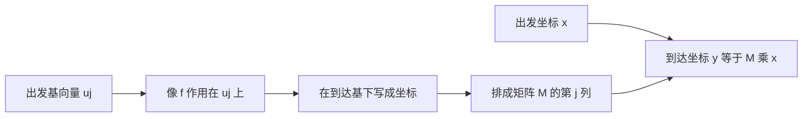
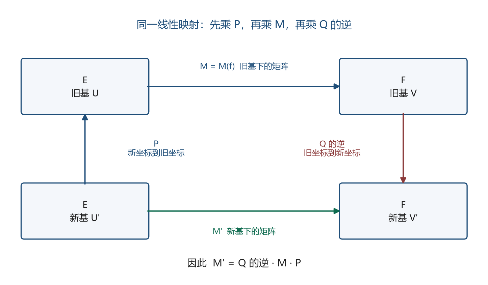

# 第3章 矩阵与线性映射

### 本章总览

本章读的是 Gallier、Quaintance《Linear Algebra for Computer Vision, Robotics, and Machine Learning》Chapter 3 Matrices and Linear Maps，PDF 第 97–124 页。全章向量空间定义在任意域 K 上；为了具体，读者可以把 K 先当成 $\mathbb{R}$。

这一章做一件事：有限基选定之后，linear map（线性映射）可以用矩阵写出来；映射的复合变成矩阵乘法；换一组基，矩阵按确定的方式改变。作者沿 Emil Artin 的讲法，先写映射再写矩阵。

第 3.5 节把全章收成三句话：线性映射的矩阵表示；表示映射 $M:\operatorname{Hom}(E,F)\to M_{n,p}$ 是同构（命题 3.2）；换基矩阵以及换基之后矩阵怎么变（命题 3.5）。章末还强调：线性映射是不依赖基的对象，矩阵只是表示。特殊形状的矩阵，来自选了一组合适的基。证明在本章只留结论和直观含义。

下面四条是后文反复用的关系。先分清「这是映射的矩阵、复合的乘法，还是换基」，再记公式。

| 名称 | 功能 | 书中的主要关系 | 约束与易混处 |
| --- | --- | --- | --- |
| M(f)，也写作 M_{U,V}(f) | 线性映射在出发基、到达基下的矩阵 | 第 j 列是 f(u_j) 的坐标；$y_V=M_{U,V}(f)\,x_U$ | 行指标属于到达基，列指标属于出发基 |
| 矩阵乘积 M(f)M(g) | 先 g 后 f 的复合 | $c_{ij}=\sum_k a_{ik}b_{kj}$，即式 (4) | 本书故意把先做的映射放在乘积右边 |
| P_{V,U} | 从旧基 U 换到新基 V | 列是新基在旧基下的坐标；x_U=P_{V,U}x_V | 坐标与基反向变化；Artin 采用的是这个矩阵的逆 |
| 相似 | 同一个自映射的两个方阵 | B=P^{-1}AP | 只对方阵。一般的 $E\to F$ 换基是 Q^{-1}MP |

要点：四条都依赖基。基换了，矩阵就换；映射本身不动。方阵时，两边用同一个换基矩阵，这才叫相似。

图注：线性映射先作用在基上。每个基向量的像在到达基下的坐标成为矩阵的一列；任意向量的坐标左乘这个矩阵，就得到像的坐标。这是定义 3.1 和式 (1)。换基以后矩阵如何再变，见命题 3.5。

### 核心知识点

#### 线性映射的矩阵表示

选定 E 的一组基以后，线性映射 $f:E\to F$ 由这组基的像完全决定：每个基向量送到哪里定了，任意向量的像就由线性性写出来。再选定 F 的基，每个像向量有唯一的一组坐标，这些坐标就是矩阵的条目。开篇允许基的指标集任意；真正排成通常的 m $\times$ n 矩阵时，两边都取有限基。

👉 命题 2.23 的完整证明见第 2 章。📝待补全

基作为一族向量，不必先规定顺序。一旦要排成坐标和矩阵的行、列，就要约定一个次序。本章按 $1,\ldots,n$ 的自然顺序来排，并说明有的作者因此把这样的基叫做有序基。定义 2.14 后面关于基不必有序的那条注，不在这 28 页里。读者只要记住：本章的矩阵默认基已按这个自然顺序排好。

👉 定义 2.14 的注见第 2 章。📝待补全

##### 列是基向量的像

设 $(u_1,\ldots,u_n)$ 是 E 的基，$(v_1,\ldots,v_m)$ 是 F 的基。定义 3.1 规定

$$
f(u_j)=\sum_{i=1}^{m}a_{ij}v_i.
$$

系数 $a_{1j},\ldots,a_{mj}$ 就是 M(f)=(a_{ij}) 的第 j 列。行号 i 对着到达基，列号 j 对着出发基。书中说明，指标这样分配会和「先写下标」的习惯拧一下，但他们固定用这个约定。

向量 $x=\sum_j x_j u_j$ 的坐标写成列 M(x)。令 $y=f(x)=\sum_i y_i v_i$，则

$$
y_i=\sum_{j=1}^{n}a_{ij}x_j \tag{1}
$$

对一切 $1\le i\le m$ 成立。直观上，式 (1) 就是把 $f(x)=\sum_j x_j f(u_j)$ 再按 v_i 收集系数。矩阵乘列向量，也就是用 x_j 去线性组合 M(f) 的各列。

n=3、m=2 时，书中把这件事写成两条坐标：

$$
\begin{aligned}
y_1&=a_{11}x_1+a_{12}x_2+a_{13}x_3,\cr
y_2&=a_{21}x_1+a_{22}x_2+a_{23}x_3.
\end{aligned}
$$

E=F 并且两边用同一组基时，M(f) 叫做 f 关于这一组基的矩阵。

定义 3.2 把基写进记号：$U=(u_1,\ldots,u_n)$，$V=(v_1,\ldots,v_m)$，矩阵记为 M_{U,V}(f)，坐标记为 x_U、y_V。于是 y=f(x) 写成

$$
y_V=M_{U,V}(f)\,x_U.
$$

两边是同一组基时，简写成 M_U(f)。下标的顺序是「输入基在前，输出基在后」。输入的 x_U 并不紧挨着记号里的 U，书中承认这一点，仍然选用 M_{U,V}，因为 f 是从 U 所在的空间映到 V 所在的空间。

同一矩阵，别的书用别的记号。Meyer 写 [f]_{U,V}，Dummit 与 Foote 写 M^V_U(f)，Lang 写 M^U_V(f)，还有 U[f]V。读别的书时先核对下标谁是输入、谁是输出。

##### 求导矩阵与积分矩阵

书中用多项式上的求导把列的含义算了一遍。E= $\mathbb{R}$[X]_4 是次数不超过 4 的多项式，F= $\mathbb{R}$[X]_3 是次数不超过 3 的多项式。基分别是 (1,x,x^2,x^3,x^4) 和 (1,x,x^2,x^3)。求导 d 满足 d(P+Q)=dP+dQ、d($\lambda$ P)= $\lambda$ $\,dP$。

d(1)=0，d(x)=1，d(x^2)=2x，d(x^3)=3x^2，d(x^4)=4x^3。按到达基写成坐标，得到 4 $\times$ 5 矩阵

$$
D=\begin{pmatrix}
0&1&0&0&0\cr
0&0&2&0&0\cr
0&0&0&3&0\cr
0&0&0&0&4
\end{pmatrix}.
$$

坐标按基的顺序排，**常数项在第一个分量**。多项式 P=3x^4-5x^3+x^2-7x+5 的坐标是 (5,-7,1,-5,3)，dP=12x^3-15x^2+2x-7 的坐标是 (-7,2,-15,12)，并且 D 乘前一个列向量等于后一个列向量。

d 的核是次数为 0 的常数多项式，所以 $\dim(\operatorname{Ker} d)=1$。书中再引用

$$
\dim(E)=\dim(\operatorname{Ker} d)+\dim(\operatorname{Im} d)
$$

（定理 5.11）。这里 $\dim E=5$，因此 $\dim(\operatorname{Im} d)=4$。这条维数公式说的是：有限维空间里，定义域的维数拆成「被映成 0 的那一部分」和「像的那一部分」。本章只用来读求导的像有多高，不证明公式本身。

👉 定理 5.11 见第 5 章。📝待补全

同一组基下，把 x^i（i=0,1,2,3）积成 x^{i+1}/(i+1)、常数项取 0，得到 5 $\times$ 4 矩阵

$$
S=\begin{pmatrix}
0&0&0&0\cr
1&0&0&0\cr
0&1/2&0&0\cr
0&0&1/3&0\cr
0&0&0&1/4
\end{pmatrix}.
$$

书中验证 DS=I_4。这和微积分基本定理一致：先积分再求导，回到原来的函数。S 因此是单射，D 是它的左逆。另一侧 $SD\neq I_5$：常数多项式留在 D 的核里，先求导再按上面的方式积分，常数项回不来。复合的矩阵就是矩阵的乘积；这对矩阵同时给出左逆存在、右侧乘积却不是单位矩阵的例子。

##### 转置映射

从本节起，$\mathbb{R}$^n 以及更一般的 K^n 里的向量都写成列向量。

线性形式是映到标量域 K 的线性映射。在基 $(u_1,\ldots,u_n)$ 和 K 的基 1 下，它由系数排成的行向量表示；换到对偶基上，同一组系数写成列向量，就是那个行向量的转置。这是第 2 章 2.9 节已经出现的特例。一般的 $f:E\to F$ 会诱导 transpose（转置映射）$f^\top:F^\ast\to E^\ast$，方向是从到达空间的对偶回到出发空间的对偶。若 f 在上述基下的矩阵是 A，则 $f^\top$ 在对偶基下的矩阵是 $A^\top$。直观上，到达空间上的线性形式 $\varphi$ 先做 f 再做 $\varphi$，就变成出发空间上的线性形式，矩阵因此转置，定义域和到达域对调。概念上的定义是

$$
f^\top(\varphi)=\varphi\circ f,\qquad \varphi\in F^\ast.
$$

本章只用行向量 $\lambda$ A 以及 ($\lambda$ $ A)^\top=A^\top$ $\lambda$ $^\top$ 说明矩阵确实是 $A^\top$，定义的展开留在后文。

👉 行向量与对偶基见第 2 章 2.9 节；转置映射的定义见第 10 章 10.6 节。📝待补全

🔑 关键速记：M(f) 的第 j 列是 f(u_j) 在到达基下的坐标，坐标关系是式 (1)，即 $y_V=M_{U,V}(f)\,x_U$。

#### 复合与矩阵乘法

设 $g:E\to F$，$f:F\to G$，基分别是 $(u_1,\ldots,u_p)$、$(v_1,\ldots,v_n)$、$(w_1,\ldots,w_m)$。注意字母和上一节对调了：这里出发空间的维数是 p，中间是 n，到达是 m。书中故意写成先 g 后 f，使复合 $f\circ g$ 的矩阵等于乘积 AB，而不是 BA。这样第 i 行第 j 列的公式更好记。

$f(v_k)=\sum_i a_{ik}w_i$，$g(u_j)=\sum_k b_{kj}v_k$。坐标一层层写：

$$
y_k=\sum_{j=1}^{p}b_{kj}x_j \tag{2}
$$

$$
z_i=\sum_{k=1}^{n}a_{ik}y_k \tag{3}
$$

把 (2) 代入 (3)，交换有限和的次序，得到

$$
c_{ij}=\sum_{k=1}^{n}a_{ik}b_{kj},\qquad
z_i=\sum_{j=1}^{p}c_{ij}x_j. \tag{4}
$$

式 (4) 就是复合对应矩阵乘法：$M(f\circ g)=M(f)M(g)$。和式 (1) 合在一起，y=f(x) 就是 M(y)=M(f)M(x)。

命题 3.1 把映射的性质搬回矩阵。任意尺寸匹配的矩阵满足 (AB)C=A(BC)，乘法结合。另外

$$
\begin{aligned}
(A+B)C&=AC+BC,\cr
A(C+D)&=AC+AD,\cr
(\lambda A)C&=\lambda(AC),\cr
A(\lambda C)&=\lambda(AC).
\end{aligned}
$$

所以乘法 M_{m,n}(K)$\times$ $ M_{n,p}(K)\to M_{m,p}(K)$ 是双线性的。直观理由：每个矩阵 A 就是 $K^n\to K^m$ 上、在标准基下矩阵恰好为 A 的那个线性映射；函数复合结合，矩阵乘法就结合。由此 M_n(K) 是有单位元 I_n 的非交换环，并且是结合代数。

命题 3.2 列出表示映射的四条性质：对 $g,h:E\to F$，$f:F\to G$，$\lambda$ $\in K$，$x\in E$，

$$
\begin{aligned}
M(g(x))&=M(g)M(x),\cr
M(g+h)&=M(g)+M(h),\cr
M(\lambda g)&=\lambda M(g),\cr
M(f\circ g)&=M(f)M(g).
\end{aligned}
$$

因此 $M:\operatorname{Hom}(E,F)\to M_{n,p}$ 是向量空间的同构。单射是因为基上的像的坐标唯一；满射是因为每个矩阵都定义一个线性映射。出发与到达用同一组基时，$M:\operatorname{Hom}(E,E)\to M_n$ 还是环同构。这个同构依赖基的选择，所以下一节要问换基之后矩阵变成什么。

🔑 关键速记：先 g 后 f 的矩阵是 M(f)M(g)，条目由式 (4) 给出；M 是 $\operatorname{Hom}$ 与矩阵空间的同构。

#### 换基矩阵

同一个空间里换基，用的是恒等映射的矩阵。命题 3.3：设 $(u_1,\ldots,u_n)$ 是 E 的基，$v_j=\sum_i a_{ij}u_i$，P=(a_{ij})。P 可逆，当且仅当 $(v_1,\ldots,v_n)$ 也是 E 的基。

直观含义：P 就是满足 f(u_i)=v_i 的那个唯一线性映射关于基 $(u_1,\ldots,u_n)$ 的矩阵。维数为 n 时，这组像线性无关、构成基、映射是单射、映射是双射，这几件事连在一起。P 可逆时，Px=0 推出 x=0，核只有零向量，映射是单射，从而是双射，(v_j) 是基。反过来，(v_j) 是基时 f 是同构，$f\circ f^{-1}=\mathrm{id}$。任何基下恒等映射的矩阵都是 I_n，所以 $P\,M(f^{-1})=I_n$，即 M(f^{-1})=P^{-1}。

「核只有零就得到单射」这一步，本章直接引用命题 2.22，不在这几页里证明。有限维、向量个数等于维数时，「单射、线性无关、构成基、双射」的等价，本章归到命题 2.23。

👉 命题 2.22 与命题 2.23 的这一部分见第 2 章。📝待补全

命题 3.4 是方阵版：$A\in M_n(K)$ 可逆，当且仅当它的列线性无关。可逆时，A $\lambda$=0 左乘 A^{-1} 得到 $\lambda$=0。列无关时，这些列是 K^n 的基，再由命题 3.3，A 可逆。书中说明，这条判别在命题 2.19 里已经证明过，命题 3.3 只是把证明变短。

👉 命题 2.19 见第 2 章。📝待补全

##### 旧坐标等于换基矩阵乘新坐标

定义 3.3 与定义 3.4：P=P_{V,U} 的第 j 列，是新基向量 v_j 在旧基 $(u_1,\ldots,u_n)$ 下的坐标。它也是恒等映射关于基 $(v_1,\ldots,v_n)$（输入）和 $(u_1,\ldots,u_n)$（输出）的矩阵。从 V 回到 U 的换基矩阵是 P^{-1}，即 P_{U,V}=P_{V,U}^{-1}。

同一向量的旧坐标 (x_i) 和新坐标 (x'_i) 满足

$$
x_U=P_{V,U}\,x_V,\qquad x_V=P_{V,U}^{-1}\,x_U.
$$

看起来像反了：新基的坐标要先乘 P，才得到旧坐标。书中用 n=2 直接代入说明这是对的。v_1,v_2 写成 u_1,u_2 的组合后代入 x=x'_1 v_1+x'_2 v_2，比较系数，得到的正是旧坐标等于 P 乘新坐标。和 M_{U,V} 的读法一致：P_{V,U} 吃进 V 坐标，吐出 U 坐标。

基向量换成了新的，坐标朝相反方向变。书中说，因此有人把向量叫做 contravariant（逆变）。这句话本身说不通：向量不依赖某一组基。说得通的是，**向量的坐标**按逆变的方式变化。

若两组基都是 K^n 里的列，令 $U=(u_1\$ $\cdots\  u_n)、V=(v_1\ \cdots\  v_n) 为把它们并成的方阵，则 V=UP$，所以

$$
P=U^{-1}V.
$$

Artin 把「从 U 到 V 的换基矩阵」定义成本书的 P_{U,V}=P_{V,U}^{-1}，也就是用新基去表示旧基。本书认为实际计算里更常把新基写成旧基的组合，所以采用 P_{V,U}。两套约定差一个逆。

把基向量堆成 E^n 里的一个列再左乘矩阵，乘上去的是 $P^\top$，不是 P。为了避开这个转置，书中改记

$$
(v_1\ \cdots\ v_n)=(u_1\ \cdots\ u_n)\,P.
$$

行上的向量乘 P 的第 j 列，定义成 $\sum_i p_{ij}u_i$。这个约定是因为通常标量写在向量左边，而这里向量在左、标量在右。由此也可核对 $(A^\top)^{-1}=(A^{-1})^\top$。

三组基 U,V,W 接起来换：若 P_{V,U} 从 U 换到 V，P_{W,V} 从 V 换到 W，则

$$
P_{W,U}=P_{V,U}P_{W,V}.
$$

先换成中间基，再换成最终的基，矩阵按这个顺序相乘。

##### 两个具体换基

例 3.1 在 $\mathbb{R}$^2 里，旧基是 (1,0)、(0,1)，新基是 v_1=(1,1)、v_2=(-1,1)。

$$
P=\begin{pmatrix}1&-1\cr1&1\end{pmatrix},\qquad
P^{-1}=\begin{pmatrix}1/2&1/2\cr-1/2&1/2\end{pmatrix}.
$$

旧坐标等于 P 乘新坐标，新坐标等于 P^{-1} 乘旧坐标。

例 3.2 在次数不超过 3 的多项式空间里，旧基是 (1,x,x^2,x^3)，新基是 3 次 Bernstein 多项式

$$
\begin{aligned}
B^3_0(x)&=(1-x)^3,\cr
B^3_1(x)&=3(1-x)^2 x,\cr
B^3_2(x)&=3(1-x)x^2,\cr
B^3_3(x)&=x^3.
\end{aligned}
$$

展开后，换基矩阵和它的逆是

$$
P_{V,U}=\begin{pmatrix}
1&0&0&0\cr
-3&3&0&0\cr
3&-6&3&0\cr
-1&3&-3&1
\end{pmatrix},\qquad
P_{V,U}^{-1}=\begin{pmatrix}
1&0&0&0\cr
1&1/3&0&0\cr
1&2/3&1/3&0\cr
1&1&1&1
\end{pmatrix}.
$$

因此 2x^3-x+1 在 Bernstein 基下的坐标是 (1,2/3,1/3,2)，也就是

$$
2x^3-x+1=B^3_0(x)+\frac23 B^3_1(x)+\frac13 B^3_2(x)+2B^3_3(x).
$$

单项式坐标仍是 (1,-1,0,2)，常数项在前。用 P^{-1} 去乘它，得到 Bernstein 坐标。

🔑 关键速记：P_{V,U} 的列是新基在旧基下的坐标，旧坐标 x_U=P_{V,U}x_V；Artin 的换基矩阵是这个 P 的逆。

#### 换基对矩阵的影响

命题 3.5：E 上旧基 U、新基 U'，F 上旧基 V、新基 V'。P=P_{U',U} 是 E 上从 U 到 U' 的换基矩阵，Q=P_{V',V} 是 F 上从 V 到 V' 的换基矩阵。同一线性映射 $f:E\to F$ 的两套矩阵满足

$$
M'(f)=Q^{-1}M(f)P,
$$

写全就是

$$
M_{U',V'}(f)=P_{V',V}^{-1}M_{U,V}(f)P_{U',U}=P_{V,V'}M_{U,V}(f)P_{U',U}.
$$

直观含义：把 f 写成 $\mathrm{id}_F\circ f\circ\mathrm{id}_E$。新的出发坐标先用 P 变回旧坐标，乘旧矩阵，再用 Q^{-1} 变到新的到达坐标。这条路径等于直接乘新矩阵。

图注：方框是同一映射 f 的两套坐标。左边向上的 P 把新出发坐标变回旧出发坐标，上面的 M 在旧基里做映射，右边向下的 Q^{-1} 把旧到达坐标变成新到达坐标。下面直接走 M'。两条路径相等，所以 M'=Q^{-1}MP。

推论 3.6 是 $f:E\to E$、两边用同一套换基的情形：

$$
M_{U'}(f)=P_{U',U}^{-1}M_U(f)P_{U',U}=P_{U,U'}M_U(f)P_{U',U}.
$$

自映射换基，就是用同一个 P 做 P^{-1}MP。

##### 两个把矩阵化简的例子

例 3.3：E= $\mathbb{R}$^2，旧基是标准基，v_1=e_1，v_2=e_1-e_2，

$$
A=\begin{pmatrix}2&1\cr0&1\end{pmatrix},\qquad
P=\begin{pmatrix}1&1\cr0&-1\end{pmatrix}.
$$

这里 P^{-1}=P。新基下的矩阵是

$$
A'=PAP=\begin{pmatrix}2&0\cr0&1\end{pmatrix}.
$$

在这组基里，f 沿 v_1 拉伸 2 倍，沿 v_2 是恒等。v_1 与 v_2 并不正交。书中把对角元 2 和 1 称为 A 与 f 的特征值（eigenvalue），v_1,v_2 是对应的特征向量（eigenvector），并说明这就是把 A 对角化。定义和以后的算法，这几页没有写。

👉 特征值与特征向量后文再讲，本章未标章号。📝待补全

例 3.4 讨论关于一条直线的反射。直线与 x 轴的夹角是 $\varphi$/2，矩阵记为 $\rho$ $_\varphi$：

$$
A=\begin{pmatrix}\cos\varphi&\sin\varphi\cr\sin\varphi&-\cos\varphi\end{pmatrix}.
$$

新基取

$$
v_1=\begin{pmatrix}\cos(\varphi/2)\cr\sin(\varphi/2)\end{pmatrix},\qquad
v_2=\begin{pmatrix}-\sin(\varphi/2)\cr\cos(\varphi/2)\end{pmatrix},
$$

换基矩阵 $P=M_{\varphi/2}$ 是转角 $\varphi$/2 的旋转矩阵，并且 $P^{-1}=P^\top$。书中引用已经证明的分解 $\rho$ $_\varphi=M_{\varphi/2}$ $\rho$ $_0 M_{-\varphi/2}$。因为 $M_{\varphi/2}$ 的逆是 $M_{-\varphi/2}$，换到基 V 之后矩阵变成

$$
A'=\rho_0=\begin{pmatrix}1&0\cr0&-1\end{pmatrix},
$$

也就是关于 x 轴的反射。$\varphi$= $\pi$/2 时，$A=\begin{pmatrix}0&1\cr1&0\end{pmatrix}$ 是关于直线 y=x 的反射，夹角为 $\pi$/4，P 的四个条目都是 $\pm\sqrt{2}/2$，主对角线为正。这个分解的证明不在本章。

👉 反射与旋转的那条恒等式见第 2 章例 2.4。📝待补全

##### 相似

定义 3.5：两个 n $\times$ n 矩阵 A,B 相似（similar），是指存在可逆矩阵 P 使 B=P^{-1}AP。相似是等价关系。由推论 3.6，两个方阵相似，当且仅当它们是同一个线性映射在两组不同基下的矩阵。

书中还陈述了一件本章不证明的事：每个方阵都与自己的转置相似。证明需要 Jordan 形，或相似不变量。这几页只给出陈述。

👉 该证明不在本章。📝待补全

第 3.4 节末尾把全章的看法说清楚。线性映射不依赖基，矩阵依赖基。证明映射的性质时，先想映射，往往比先展开矩阵更干净，而且不限于有限维。矩阵分解也宜看成几何分解。书中用 SVD 作例子：每个线性映射可以写成一次旋转、沿正交轴的一次缩放、再一次旋转。合适的基选到了，矩阵才呈现那种形状。本章只给这个图像，不给分解式。初学时仍会先写矩阵；书中建议把矩阵命题翻译回映射命题，作为练习。

👉 SVD 的分解式本章未写。📝待补全

##### 习题

习题只记题目在问什么，不展开计算。

- 习题 3.1：证明所给 A_1 的列线性无关，核对 B_1 的列在这组列基下的坐标就是 P_1 的列，并判断 B_1 是否可逆。
- 习题 3.2：对另一组 A_2,B_2,P_2 做同样的换基核对，并求一个给定旧坐标向量的新坐标。
- 习题 3.3：把 2 次与 3 次 Bernstein 多项式写成单项式基的组合，证明它们各自线性无关，且同一次数的那些多项式加起来等于 1。
- 习题 3.4：讨论一般次数的 Bernstein 多项式与单项式基如何互相表示，并说明平面多项式曲线可以写成控制点的 Bézier 曲线；书中指出 [0,1] 上的曲线段在控制点的凸包里，可用于图形学、几何造型和机器人轨迹。
- 习题 3.5：为书中那类主对角线下方一格是 1、最后一列是 $-a_n,\ldots,-a_1$ 的方阵，找 P 使 $A^\top=P^{-1}AP$，并讨论 a_n=0 以及逆矩阵仍为整数的情形。
- 习题 3.6：验证左乘 L_A(B)=AB、右乘 R_A(B)=BA 以及交换子 [A,B]=AB-BA 是线性映射，并在指定的矩阵单位排序下写出它们的矩阵。

Kronecker product（Kronecker 积，也叫张量积）是把两个矩阵拼成更大分块矩阵的运算。习题 3.6 用它表示右乘映射的矩阵，定义本身不在本章，只点到定义 4.4。标准字典序下，上三角矩阵的右乘矩阵会变成下三角；书中换一种排序，是为了让上三角仍然对应上三角。

👉 定义 4.4 见第 4 章。📝待补全

🔑 关键速记：一般线性映射换基后 M'=Q^{-1}MP；自映射时 M'=P^{-1}MP，这就是相似。

### 🔑 关键速记

- M(f) 的第 j 列是 f(u_j) 的坐标，$y_V=M_{U,V}(f)\,x_U$，即式 (1)。
- 先 g 后 f 对应 M(f)M(g)，条目是式 (4)；这个对应是 $\operatorname{Hom}$ 与矩阵空间的同构。
- P_{V,U} 用新基在旧基下的坐标当列，旧坐标等于 P_{V,U} 乘新坐标。
- 换基公式是 M_{U',V'}(f)=P_{V',V}^{-1}M_{U,V}(f)P_{U',U}；同一个自映射的两个矩阵相似。
- 方阵可逆当且仅当列线性无关；求导与积分满足 DS=I_4，同时 $SD\neq I_5$。

### 易混淆点与差异对比

映射的矩阵和换基矩阵都是「把向量的坐标排成列」，列里装的对象不同。M(f) 的第 j 列是像 f(u_j) 的坐标。P_{V,U} 的第 j 列是新基向量 v_j 自己在旧基下的坐标，对应的映射是恒等映射。

x_U=P_{V,U}x_V 是本章的约定：新坐标乘上换基矩阵，得到旧坐标。Artin 把从旧基到新基的换基矩阵定义成这个 P 的逆，用新基表示旧基。两套公式差一个逆，混用会把新旧坐标乘反。

下标也有两套读法。本书 M_{U,V}(f) 的第一个下标是输入基。Lang 的 M^U_V(f) 把上下标的位置换了另一种放法。换基记号 P_{V,U} 的名字是「从 U 换到 V」，作为矩阵却是把 V 坐标变成 U 坐标。Meyer 的 [I]_{V,U} 与本书的 P_{V,U} 一致。

E 与 F 可以不同。这时新旧矩阵的关系是 Q^{-1}MP，出发空间用 P，到达空间用 Q。相似 P^{-1}AP 只用于同一个空间上的自映射，两边必须是同一个换基矩阵。

DS=I_4 与 $SD\neq I_5$ 同时成立。D 是 S 的左逆，右侧乘积 SD 则把常数项抹掉。常数多项式留在求导的核里。

每个方阵与自己的转置相似，这是陈述，不是本章的计算结论。例 3.3 里的对角元被叫做特征值，定义不在这几页。

### 本章要点总结

有限基选定之后，线性映射与矩阵互相唯一对应。列记下基向量的像，式 (1) 把坐标送过去，式 (4) 把复合变成乘法。命题 3.2 说这个对应是同构；同一个自映射、同一组基时，它还是环同构。

换基矩阵 P_{V,U} 记下新基在旧基下的坐标，并把新坐标变回旧坐标。同一映射在新基下的矩阵是 Q^{-1}MP；自映射则是 P^{-1}MP，也就是相似。求导与积分的一对矩阵说明：复合对应乘法，左逆不必是右逆。反射的例子说明：换到沿镜面的基之后，矩阵变成关于坐标轴的反射。

第 3.5 节只要求记住三件事：矩阵表示、命题 3.2 的同构、命题 3.5 的换基公式。线性映射先于矩阵。基是选出来的，矩阵的简单形状也是选出来的。
