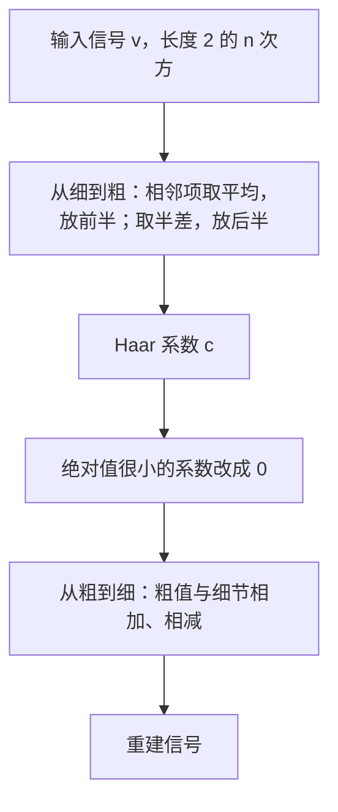
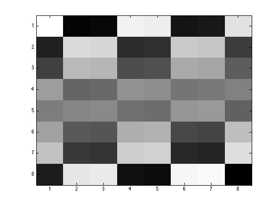
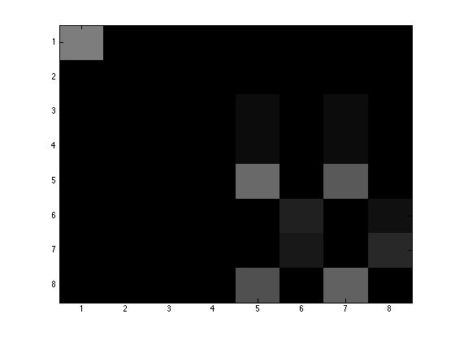
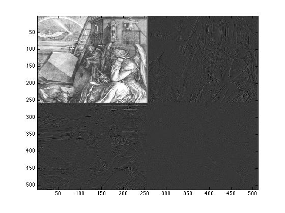

# 第4章 Haar 基、Haar 小波与 Hadamard 矩阵

### 本章总览

本章讨论两类在计算机视觉和信号处理里会碰到的矩阵。一类是 Haar matrix（Haar 矩阵）和对应的 Haar wavelet（Haar 小波），用来把长信号、数字图像压成少量系数。另一类是 Hadamard matrix（Hadamard 矩阵），条目只有 $+1$ 和 $-1$，用在纠错码、信号处理和低秩近似。

阅读范围：PDF 第 125–150 页（Chapter 4）。正文从 4.1 节到 4.6 节，4.7 节是概念清单，4.8 节是习题。第 150 页只有页眉。习题只列题目方向，不写解答。证明只保留结论。

信号长度都取 $2^n$。下标从 1 起。标准基记为 $U=\{e_1,\ldots,e_{2^n}\}$，Haar 基记为 $W$。换到 Haar 基之后，前面的系数是粗结构，后面的系数是越来越细的差别。压缩就是把太小的系数改成 0，再乘回原来的基。

图注：这是 4.1–4.2 节的压缩链路。书中图 4.1–4.3 用向量 $(6,4,5,1)$ 画出两轮平均和半差；那些图是矢量曲线，这里只保留步骤，不另造曲线。

### 核心知识点

#### 信号压缩引言

小波要把很长的声音或图像收成短得多的系数，播放或显示时仍然听不出、看不出差别。本章从 $\mathbb{R}^4$ 上的四个向量讲起：

$$
w_1=\begin{pmatrix}1\\1\\1\\1\end{pmatrix},\;
w_2=\begin{pmatrix}1\\1\\-1\\-1\end{pmatrix},\;
w_3=\begin{pmatrix}1\\-1\\0\\0\end{pmatrix},\;
w_4=\begin{pmatrix}0\\0\\1\\-1\end{pmatrix}.
$$

它们两两正交。正交是指两个向量的内积为 0：对应分量相乘再相加，结果是 0。一组两两正交、且都不是零向量的向量一定线性无关，所以可以当基。$\{w_1,w_2,w_3,w_4\}$ 就是这一维的 **Haar 基**。

👉 内积的定义、例 11.1，以及「正交则线性无关」的命题 11.4，书指向第 11 章。📝待补全

选定基之后，同一个向量才写成一列坐标。标准基 $U$ 下的坐标是 $v$，Haar 基下的坐标是 $c$，两者的关系是 $v=Wc$，所以 $c=W^{-1}v$。这里的 $W$ 就是换基矩阵 $P_{W,U}$，它的列就是 $w_1,w_2,w_3,w_4$：

$$
W=\begin{pmatrix}
1&1&1&0\\
1&1&-1&0\\
1&-1&0&1\\
1&-1&0&-1
\end{pmatrix},\qquad
W^{-1}=\operatorname{diag}\!\left(\tfrac14,\tfrac14,\tfrac12,\tfrac12\right)W^\top.
$$

上面的逆写成「先乘 $W^\top$，再乘对角矩阵」。对角矩阵就是 $(W^\top W)^{-1}$。

👉 换基矩阵 $P_{W,U}$ 的一般性质，本章只使用这个记号，没有再证明。📝待补全

例：$v=(6,4,5,1)$ 变成 $c=(4,1,1,2)$。四个系数分工不同。

$$
c_1=\frac{v_1+v_2+v_3+v_4}{4}
$$

是整段信号的平均，对应图像或声音的背景。$c_2$ 是粗的差别，$c_3$ 是前半段的细节，$c_4$ 是后半段的细节。

重建是 $v=Wc$。压缩时把 $c$ 里的一部分改成 0，得到 $\widehat{c}$，再算 $\widehat{v}=W\widehat{c}$。链路是

$$
v \longrightarrow c=W^{-1}v \longrightarrow \widehat{c} \longrightarrow \widehat{v}=W\widehat{c}.
$$

书中把这种压缩看成视频会议能传得动的原因之一。直接乘 $W^{-1}$ 并不划算。Haar 小波有多层结构，可以用平均和半差逐层算出 $c$。

对 $v=(6,4,5,1)$，第一轮得到半差 $c_3=1$、$c_4=2$（图 4.2）。第二轮得到 $c_1=4$、$c_2=1$（图 4.3）。图 4.2 左半的平均信号，又能由图 4.3 的两个信号还原。还原时把平均和半差一加一减：

$$
\frac{v_1+v_2}{2}+\frac{v_1-v_2}{2}=v_1,\qquad
\frac{v_1+v_2}{2}-\frac{v_1-v_2}{2}=v_2,
$$

后半段 $v_3,v_4$ 同样。

🔑 关键速记：Haar 坐标的第一项是整段平均，后面各项是由粗到细的差别；压缩就是把小系数置零再乘回 $W$。

#### Haar 矩阵与缩放

4.1 节的做法可以放到任意长度 $2^n$。前面的例子是 $n=2$。$n=3$ 时，$8\times 8$ 的 Haar 矩阵各列仍然正交，并且

$$
W^{-1}=\operatorname{diag}\!\left(\tfrac18,\tfrac18,\tfrac14,\tfrac14,\tfrac12,\tfrac12,\tfrac12,\tfrac12\right)W^\top.
$$

除了负责平均的第一列，其余列都从第二条基向量「生出来」。这条母向量是

$$
w_2=(\underbrace{1,\ldots,1}_{2^{n-1}},\underbrace{-1,\ldots,-1}_{2^{n-1}}).
$$

缩放把 $+1$、$-1$ 两块各切成一半，其余位置填 0，得到更细的向量。平移再把这对 $\pm 1$ 块往右挪，左边补 0。尺度指标用 $j$，平移指标用 $k$。书中先把列写成 $w_{2^j+k}$（$k$ 从 1 数到 $2^j$），然后改用下面的定义，让 $k$ 从 0 数起。

**定义 4.1.** 维数 $2^n$ 的 Haar 基向量记为

$$
w_1,\; h^0_0,\; h^1_0,\; h^1_1,\; h^2_0,\; h^2_1,\; h^2_2,\; h^2_3,\;\ldots,\; h^j_k,\;\ldots,\; h^{n-1}_{2^{n-1}-1}.
$$

其中 $w_1$ 是长度 $2^n$ 的全 1 向量，并且

$$
h^j_k(i)=
\begin{cases}
0 & 1\le i\le k\,2^{n-j}\\
1 & k\,2^{n-j}+1\le i\le k\,2^{n-j}+2^{n-j-1}\\
-1 & k\,2^{n-j}+2^{n-j-1}+1\le i\le (k+1)2^{n-j}\\
0 & (k+1)2^{n-j}+1\le i\le 2^n
\end{cases}
$$

这里 $0\le j\le n-1$，$0\le k\le 2^j-1$。按这个顺序排成列，得到的 $2^n\times 2^n$ 矩阵就是 **Haar 矩阵** $W_n$。

尺度 $j$ 上有 $2^j$ 个向量，每个非零块的长度是 $2^{n-j}$。$j$ 越大，$\pm 1$ 的块越短，描述的差别越细。

把向量看成 $[0,1)$ 上的函数，公式会短一截。

**定义 4.2.** 对 $u=(u_1,\ldots,u_m)$，分段函数 $\operatorname{plf}(u)$ 规定

$$
\operatorname{plf}(u)(x)=u_i,\qquad \frac{i-1}{m}\le x<\frac{i}{m},\quad 1\le i\le m.
$$

也就是在 $[0,1/m)$ 上取值 $u_1$，在 $[1/m,2/m)$ 上取值 $u_2$，直到最后一小段取 $u_m$。书中的例子是

$$
u=(2.4,\,2.2,\,2.15,\,2.05,\,6.8,\,2.8,\,-1.1,\,-1.3),
$$

图 4.4 画出这条阶梯。脚注说明：叫 piecewise constant（分段常数）比 piecewise linear（分段线性）更准确。

每个 $h^j_k$ 对应 $\psi^j_k=\operatorname{plf}(h^j_k)$。不管 $n$ 取多少，最粗的那条

$$
h^0_0=w_2=(\underbrace{1,\ldots,1,-1,\ldots,-1}_{2^n})
$$

都对应同一个函数（图 4.5）

$$
\psi(x)=
\begin{cases}
1 & 0\le x<1/2\\
-1 & 1/2\le x<1\\
0 & \text{其他}
\end{cases}.
$$

更细的函数只是把 $\psi$ 压短再平移：

$$
\psi^j_k(x)=\psi(2^j x-k),\qquad 0\le j\le n-1,\; 0\le k\le 2^j-1.
$$

**定义 4.3.** $\varphi^0_0=\operatorname{plf}(w_1)$ 在 $[0,1)$ 上恒为 1。$\varphi^0_0$ 和全体 $\psi^j_k$ 合在一起，称为 **Haar 小波**。

正变换不必真去乘 $W_n^{-1}$。设 $u$ 的长度是 $2^n$，从 $c^n=u$ 出发，对 $j=n-1,\ldots,0$ 和 $i=1,\ldots,2^j$ 做

$$
\begin{aligned}
c^j(i)&=\frac{c^{j+1}(2i-1)+c^{j+1}(2i)}{2},\\
c^j(2^j+i)&=\frac{c^{j+1}(2i-1)-c^{j+1}(2i)}{2}.
\end{aligned}
$$

还没被改写的更细系数留在向量后部。最后 $c=c^0$。

重建从 $u^0=c$ 出发，对 $j=0,\ldots,n-1$ 和 $i=1,\ldots,2^j$ 做

$$
\begin{aligned}
u^{j+1}(2i-1)&=u^j(i)+u^j(2^j+i),\\
u^{j+1}(2i)&=u^j(i)-u^j(2^j+i).
\end{aligned}
$$

结果是 $u=u^n$。正变换里除过 2，重建时就只加不除。

$n=3$ 的书中例子如下。正变换把采样收成系数，重建按同一条链走回去。

| 步 | 向量 |
| --- | --- |
| $c^3=u$ | $(31,\,29,\,23,\,17,\,-6,\,-8,\,-2,\,-4)$ |
| $c^2$ | $(30,\,20,\,-7,\,-3,\,1,\,3,\,1,\,1)$ |
| $c^1$ | $(25,\,-5,\,5,\,-2,\,1,\,3,\,1,\,1)$ |
| $c^0=c$ | $(10,\,15,\,5,\,-2,\,1,\,3,\,1,\,1)$ |

上表只记录书中算出的四个向量。每一行的前半是更粗的平均，后半是这一层新产生的半差，更早留下的细节原样接在后面。从 $c$ 做三轮加、减，回到原来的 $u$。

🔑 关键速记：$W_n$ 的列是全 1 向量，再加上由 $\psi$ 缩放、平移得到的 $\pm 1$ 块；正变换用平均和半差，重建用加和减。

#### Kronecker 积构造

把 $W_n$ 分成左右两块，每块是 $2^n\times 2^{n-1}$。右块的第一列是 $(1,-1,0,\ldots,0)$，后面 $2^{n-1}-1$ 列是它的平移。它可以用单位矩阵 $I_{2^{n-1}}$ 造出来：每个 1 换成列 $\begin{pmatrix}1\\-1\end{pmatrix}$，每个 0 换成列 $\begin{pmatrix}0\\0\end{pmatrix}$。

左块来自 $W_{n-1}$：每个 1 换成 $\begin{pmatrix}1\\1\end{pmatrix}$，每个 $-1$ 换成 $\begin{pmatrix}-1\\-1\end{pmatrix}$，每个 0 换成 $\begin{pmatrix}0\\0\end{pmatrix}$。$n=3$ 时，左块就是这样从 $W_2$ 长出来的。

这种「用一块矩阵替换另一个矩阵的每个条目」就是 Kronecker product（Kronecker 积），也叫 tensor product（张量积）。

**定义 4.4.** $A=(a_{ij})$ 是 $m\times n$，$B=(b_{ij})$ 是 $p\times q$ 时，$A\otimes B$ 是 $mp\times nq$ 的分块矩阵，第 $(i,j)$ 块等于 $a_{ij}B$。

书中给出、此处不证的两条运算律：$\otimes$ 满足结合律；只要 $AC$ 和 $BD$ 有定义，就有

$$
(A\otimes B)(C\otimes D)=AC\otimes BD,\qquad (A\otimes B)^\top=A^\top\otimes B^\top.
$$

于是 Haar 矩阵有递归式。$W_0=(1)$，并且

$$
W_n=\left(
W_{n-1}\otimes\begin{pmatrix}1\\1\end{pmatrix}
\;\middle|\;
I_{2^{n-1}}\otimes\begin{pmatrix}1\\-1\end{pmatrix}
\right).
$$

再定义对角矩阵 $B_n$。$B_1=2I_2=\operatorname{diag}(2,2)$，而

$$
B_{n+1}=2\begin{pmatrix}B_n&0\\0&I_{2^n}\end{pmatrix}.
$$

由 Kronecker 形式可以证明：对一切 $n\ge 1$，

$$
W_n^\top W_n=B_n.
$$

$B_n$ 是对角矩阵，所以 $W_n$ 的列两两正交。这是列正交的依据。右块也说明了重建的最后一层在做什么：$n-1$ 步之后，向量后半的细节系数被加到、减到前半的对应位置上。

🔑 关键速记：$W_n$ 由 $W_{n-1}$ 和单位矩阵各与列 $(1,1)^\top$、$(1,-1)^\top$ 做 Kronecker 积拼成；$W_n^\top W_n=B_n$ 说明列正交。

#### 多分辨分析

Haar 基把信号拆成多层。系数下标小，描述的是粗结构；下标大，描述的是细结构。书中用一场管弦乐作比喻：$c_1$ 像背景，$c_2$ 像低音，再往后像大提琴、中提琴、小提琴。这是帮助记忆的说法，不是严格的编号公式。

压缩就是少留一些系数。书中的 8 点例子是

$$
\begin{aligned}
u&=(2.4,\,2.2,\,2.15,\,2.05,\,6.8,\,2.8,\,-1.1,\,-1.3),\\
c&=(2,\,0.2,\,0.1,\,3,\,0.1,\,0.05,\,2,\,0.1).
\end{aligned}
$$

图 4.6 是 $u$ 和 $c$ 的阶梯图。把绝对值不超过 $0.2$ 的系数改成 0：

$$
c_2=(2,\,0,\,0,\,3,\,0,\,0,\,2,\,0),\qquad
u_2=(2,\,2,\,2,\,2,\,7,\,3,\,-1,\,-1).
$$

图 4.7 是 $u_2$ 和 $c_2$。原信号里 $6.8$ 附近的尖峰还在，很碎的起伏被抹平了。

同一办法可以压音频。书中在 Matlab 里用 `load handel` 得到向量 $y$，长度为 $73113$；先截掉尾巴，留下 $65536=2^{16}$ 个采样。图 4.8 是这段信号和它的 Haar 系数。再把绝对值小于 $0.05$ 的系数置 0，一共置零 $37272$ 个，得到 $c_2$ 和重建信号 $y_2$（图 4.9）。书中说 $y_2$ 听起来和原曲差别不大，只是没那么脆。直接播放系数向量 $c$ 会听到另一段很怪的声音。图 4.6–4.9 是书中的曲线，这里不重画，也不另造听感实验。

下面这张表只汇总书里已经算出的两组阈值，方便对照。两组例子的门槛不同，不能混用。

| 例子 | 长度 | 置零规则 | 书中结果 |
| --- | --- | --- | --- |
| 8 点人工信号 | $2^3$ | 绝对值 $\le 0.2$ 置 0 | 重建为 $(2,2,2,2,7,3,-1,-1)$ |
| handel 音频 | 先截成 $2^{16}$ | 绝对值 $<0.05$ 置 0 | $37272$ 个系数变为 0，听感仍接近，但更闷 |

🔑 关键速记：低序号系数是粗结构，高序号系数是细结构；丢掉小于门槛的系数，再重建，就得到压缩信号。

#### 数字图像的 Haar 变换

$W_n$ 的列正交，但列的长度不是 1，所以 $W_n^\top$ 本身不是逆。逆是

$$
W_n^{-1}=D_n W_n^\top.
$$

$D_n$ 是对角矩阵。对角元按列的顺序是：第一列 $2^{-n}$；对每个尺度 $j=0,\ldots,n-1$，接着有 $2^j$ 个 $2^{-(n-j)}$。因此 $n=2$ 时对角元是 $1/4,1/4,1/2,1/2$，$n=3$ 时是 $1/8,1/8,1/4,1/4,1/2,1/2,1/2,1/2$，与前面两节一致。

**定义 4.5.** 归一化 Haar 变换矩阵是正交矩阵

$$
H_n=W_n D_n^{1/2}.
$$

$D_n^{1/2}$ 表示 $D_n$ 的正平方根：第一列变为 $2^{-n/2}$，尺度 $j$ 上的 $2^j$ 个对角元变为 $2^{-(n-j)/2}$。向量 $u$ 的 **归一化 Haar 系数** 是 $c=H_n^\top u$。因为 $H_n$ 正交，

$$
H_n^{-1}=H_n^\top.
$$

算法只改一个除数。重建时

$$
\begin{aligned}
u^{j+1}(2i-1)&=\frac{u^j(i)+u^j(2^j+i)}{\sqrt{2}},\\
u^{j+1}(2i)&=\frac{u^j(i)-u^j(2^j+i)}{\sqrt{2}}.
\end{aligned}
$$

正变换时

$$
\begin{aligned}
c^j(i)&=\frac{c^{j+1}(2i-1)+c^{j+1}(2i)}{\sqrt{2}},\\
c^j(2^j+i)&=\frac{c^{j+1}(2i-1)-c^{j+1}(2i)}{\sqrt{2}}.
\end{aligned}
$$

正、逆变得对称，代价是每步除以 $\sqrt{2}$。书中说，向量很长时，这套算法数值上更稳。

有的文献（Stollnitz, Derose, Salesin [62]）还会把 $c$ 再乘 $1/\sqrt{2^n}$、把 $u$ 再乘 $\sqrt{2^n}$。原因是：若内积改成 $\langle f,g\rangle=\int_0^1 f(t)g(t)\,dt$，则 $\psi^j_k$ 的范数不是 1，归一化后的基函数是 $\sqrt{2^j}\,\psi^j_k$。这是函数空间里的归一化，和定义 4.5 的矩阵归一化不是同一步。

二维不用另起一套理论。设 $A$ 是 $2^m\times 2^n$。先对每一行做 $W_n^{-1}$。行、列在这一步对调，所以中间结果是

$$
B=A(W_n^{-1})^\top.
$$

再对 $B$ 的每一列做 $W_m^{-1}$：

$$
C=W_m^{-1}B=W_m^{-1}A(W_n^{-1})^\top=D_m W_m^\top A W_n D_n.
$$

重建先对列乘 $W_m$，再对行乘 $W_n^\top$：

$$
A=W_m C W_n^\top.
$$

实际计算仍用平均和半差，不必先把 $W_m,W_n$ 求逆再做大矩阵乘法。若改用归一化矩阵，关系变成

$$
C=H_m^\top A H_n,\qquad A=H_m C H_n^\top.
$$

图注：二维 Haar 变换是先处理行、再处理列。重建反过来，先恢复列、再恢复行。

书中的 $8\times 8$ 例子里，$A$ 的 64 个条目是 $1$ 到 $64$ 各一次。做出的 $C$ 零更多，左上角是 $32.5$。再把 $C$ 里绝对值至多 $0.5$ 的条目置 0，得到 $C_2$，重建出 $A_2$。书中把 $A_2$ 和 $A$ 逐项对照，每个位置都相差 $0.5$，例如首行的 $64$ 变成 $63.5$、$2$ 变成 $1.5$。书中认为 $A_2$ 已经很接近 $A$。

Matlab 的 `image`（以及常常更好看的 `imagesc`）把矩阵画成小方块：数越大越亮，越靠近 0 越暗，负数当 0。图 4.10 是 $A$ 和 $C$，图 4.11 是 $A_2$ 和 $C_2$。书中说压缩前后看起来分不清。下面两张就是图 4.10 的原图和系数图。图 4.11 与它们在书中的观感几乎一样，这里不再重复贴出。

图注：书中图 4.10 的左图，矩阵 $A$。亮块是较大的条目，暗块是较小的条目。它是 $1$ 到 $64$ 的一种排列，不是书外另做的实验。

图注：书中图 4.10 的右图，系数矩阵 $C$。左上角保留整体平均 $32.5$，右下方留下成块的细节，其余位置为 0，所以大片发黑。负数在 `image` 里按 0 画。

系数还可以按列往外送：先送第一列从上到下，再送第二列，接收端拿到足够的粗系数就可以开始重建。这是书中说的、用 Haar 系数逐级传大图的办法。

不必一次做完所有层。只做一轮行、列的平均和半差，图像会分成四块：左上是更粗的一幅，另外三块是最细一层的细节。第二轮只处理左上那一块。一般地，第 $k$ 轮作用在上一轮结果的前 $2^{m+1-k}$ 行、前 $2^{n+1-k}$ 列，$1\le k\le n$。

书中用一幅 $512\times 512$ 的 Dürer 画说明这件事（图 4.12 是原画）。图 4.13 依次是一轮、两轮、三轮、九轮。$512=2^9$，九轮就是完整的 Haar 变换。书中写：做到第九轮时，原画已经看不出来了。重建算法比正变换稍难，书中留作练习。

图注：书中图 4.13 的第一幅。对 $512\times 512$ 原画做一轮行、列平均与半差。左上 $256\times 256$ 仍能看出原画的粗版本，右上、左下、右下是最细细节，数值靠近 0，所以发暗。

同一套列还可以看成矩阵空间的基。对 $2^n\times 2^n$ 的系数矩阵 $C$，图像是

$$
A=\sum_{i=1}^{2^n}\sum_{j=1}^{2^n} c_{ij}\, w_{ij},\qquad w_{ij}=w_i(w_j)^\top.
$$

$w_{ij}$ 是外积。若 $W_n^{-1}$ 的列是 $w'_1,\ldots,w'_{2^n}$，则系数本身也可写成

$$
C=\sum_{i=1}^{2^n}\sum_{j=1}^{2^n} a_{ij}\, h_{ij},\qquad h_{ij}=w'_i(w'_j)^\top.
$$

$n=2$ 时把这些小矩阵用 `imagesc` 画出来，是习题，这里不算。

图像处理里的小波入门，书指向 Stollnitz, Derose, Salesin [62]。Strang and Nguyen [66] 更细，但默认读者已经有信号处理基础。

🔑 关键速记：图像的 Haar 变换是先对行、再对列；未归一化的逆要乘 $D_n$，归一化之后 $H_n^{-1}=H_n^\top$，每步改除 $\sqrt{2}$。

#### Hadamard 矩阵

另一族矩阵和 Haar 矩阵相似，但没有 0，每个条目都是 $+1$ 或 $-1$。

**定义 4.6.** 实的 $n\times n$ 矩阵 $H$ 是 **Hadamard 矩阵**，如果每个 $h_{ij}=\pm 1$，并且

$$
H^\top H=n I_n.
$$

列因此两两正交。$H$ 是方阵，由这个等式可以推出它可逆，并且 $HH^\top=nI_n$。列的长度是 $\sqrt{n}$，不是 1。

书中先给出三个例子。$2\times 2$ 和 $4\times 4$ 是

$$
H_2=\begin{pmatrix}1&1\\1&-1\end{pmatrix},\qquad
H_4=\begin{pmatrix}
1&1&1&1\\
1&-1&1&-1\\
1&1&-1&-1\\
1&-1&-1&1
\end{pmatrix}.
$$

$H_8$ 书中全文印出，它是下面命题再做一次得到的，这里不把 64 个 $\pm 1$ 重抄一遍。

哪些 $n$ 存在 Hadamard 矩阵，书中称为一个出人意料的开放问题。Hadamard conjecture（Hadamard 猜想）说：每个形如 $n=4k$ 的正整数都有 $n$ 阶 Hadamard 矩阵。

**定理 4.1.** 若 $H$ 是 $n\times n$ 的 Hadamard 矩阵，则 $n=1$、$n=2$，或 $n=4k$（$k$ 为正整数）。

这是必要条件。充分条件要靠具体构造。

**命题 4.2.**（Sylvester, 1867）若 $H$ 是 $n$ 阶 Hadamard 矩阵，则 $2n$ 阶分块矩阵

$$
\begin{pmatrix}H&H\\H&-H\end{pmatrix}
$$

仍是 Hadamard 矩阵。证明留在习题 4.3。

从 $H_2$ 出发反复使用这个构造，得到一族对称的 Hadamard 矩阵，称为 Sylvester–Hadamard 矩阵，记为 $H_{2^m}$。书中前一页的 $H_2,H_4,H_8$ 就是这族的前三个。

1893 年 Hadamard 给出了 $n=12$ 和 $n=20$ 的例子。书中记载：在写作时，$n=4k\le 1000$ 的 Hadamard 矩阵除了 $n=668,716,892$ 都已经知道。这句话是书中的现状，不是后来的数学进展。

应用包括纠错码、信号处理和数值线性代数，书指向 Seberry, Wysocki and Wysocki [56] 与 Tropp [69]。一个具体例子：基于 $H_{32}$ 的码，在任意 32 比特的码块里能纠正 7 个错误，并能发现第 8 个错误。这个码在 1969 年被水手号飞船用来把照片传回地球。

对每个 $m\ge 0$，把 $H_{2^m}$ 的 $2^m$ 个行各自做成 $\operatorname{plf}$，得到 $[0,1]$ 上的函数，称为 Walsh function（Walsh 函数）。编号用 $0,1,\ldots,2^m-1$，规则是：$\operatorname{Wal}(k,t)$ 对应那样一行，它里面连续的 $+1$ 段和连续的 $-1$ 段之间，符号一共变了 $k$ 次。

例如 $H_8$ 的第五行是 $(1,-1,-1,1,1,-1,-1,1)$。它有五段连续的同号块，段与段之间符号变了 4 次，所以对应 $\operatorname{Wal}(4,t)$。$H_8$ 从上到下各行对应的是

$$
\operatorname{Wal}(0,t),\;\operatorname{Wal}(7,t),\;\operatorname{Wal}(3,t),\;\operatorname{Wal}(4,t),\;\operatorname{Wal}(1,t),\;\operatorname{Wal}(6,t),\;\operatorname{Wal}(2,t),\;\operatorname{Wal}(5,t).
$$

因为有这层对应，有人把 Sylvester–Hadamard 矩阵叫做 Walsh–Hadamard 矩阵。每个 $m$ 上的 $2^m$ 个 Walsh 函数两两正交。

把所有 $m\ge 0$、所有 $0\le k\le 2^m-1$ 的 $\operatorname{Wal}(k,t)$ 放在一起，可以排成 Hilbert 空间 $L^2([0,1])$ 的一组正交 Hilbert 基。Hilbert 空间是带内积、并且极限仍留在空间里的完备空间；$L^2([0,1])$ 里的对象是这段区间上平方可积的函数，正交仍是内积为 0，只是内积换成积分。本章只陈述这个结论。

👉 这组基怎么排、完备性怎么证，书指向 Seberry, Wysocki and Wysocki [56]，本章没有展开。📝待补全

$H_{2^m}$ 还出现在降维和低秩近似里。一种结构化的降维映射叫 subsampled randomized Hadamard transform（子采样随机 Hadamard 变换），简称 SRHT，见 Tropp [69] 和 Halko, Martinsson and Tropp [32]。设 $\ell\ll n=2^m$，SRHT 矩阵是 $\ell\times n$ 的

$$
\Phi=\sqrt{\frac{n}{\ell}}\,RHD.
$$

三个因子的意思是：

1. $D$ 是随机的 $n\times n$ 对角矩阵，对角元是独立的随机符号 $\pm 1$。
2. $H=n^{-1/2}H_n$ 是 $n$ 阶 Sylvester–Hadamard 矩阵再除以 $\sqrt{n}$。这里的 $H_n$ 不是定义 4.5 的归一化 Haar 矩阵。
3. $R$ 是随机的 $\ell\times n$ 矩阵，它从 $n$ 个坐标里均匀随机留下 $\ell$ 个。

书中转述 Tropp [69]：若 $\lVert x\rVert_2=1$，则某个坐标满足 $|(HDx)_i|\ge \sqrt{n^{-1}\log n}$ 的概率很小。因此 $HD$ 会把输入 $x$「摊平」。SRHT 的主要结论是：它能保住一整段子空间的几何。这个定理的正文不在本章。

👉 定理陈述见 Tropp [69] 的 Theorem 1.3。📝待补全

4.7 节把本章收成四条：Haar 基向量与 Haar 小波的一个入口；矩阵的 Kronecker 积；Hadamard 矩阵与 Sylvester–Hadamard 矩阵；Walsh 函数。

4.8 节共五题，不在这里做。4.1–4.2 把重建拆成矩阵 $W_{n,n},\ldots,W_{n,1}$ 的乘积，并用 Kronecker 积重证 $W_n^\top W_n=B_n$。4.3 证明命题 4.2。4.4 画出 $\operatorname{Wal}(k,t)$，$k=0,\ldots,7$。4.5 用 $m$ 次递归计算 $H_{2^m}x$。

🔑 关键速记：Hadamard 矩阵全是 $\pm 1$ 且 $H^\top H=nI_n$；阶数必须是 1、2 或 4 的倍数，$2^m$ 阶由 Sylvester 构造保证，所有 $4k$ 仍是猜想。

### 🔑 关键速记

- Haar 坐标的第一项是整段平均，后面是由粗到细的差别；小系数置零再乘回基矩阵，就是压缩。
- $W_n$ 的列由全 1 向量和 $\psi(2^j x-k)$ 的采样组成；正变换用平均与半差，重建用加与减。
- Kronecker 递归把 $W_{n-1}$ 和 $I_{2^{n-1}}$ 拼成 $W_n$，并且 $W_n^\top W_n=B_n$，所以列正交。
- 图像变换是先对行、再对列；归一化矩阵 $H_n$ 满足 $H_n^{-1}=H_n^\top$，每步除以 $\sqrt{2}$。
- Hadamard 矩阵只有 $\pm 1$。阶数是 1、2 或 $4k$ 是必要条件；$2^m$ 阶由 Sylvester 加倍构造得到。Walsh 函数的序号看符号变化次数，不看行号。

### 易混淆点与差异对比

三类矩阵都和正交有关，条目和归一化方式不同。读公式时要先看符号指的是哪一个 $H_n$。

| 对象 | 条目 | 正交关系 | 本章里的用途 |
| --- | --- | --- | --- |
| Haar 矩阵 $W_n$ | $1,-1,0$ | 列两两正交，$W_n^\top W_n=B_n$，列长不是 1 | 信号和图像的多分辨系数 |
| 归一化 Haar 矩阵 $H_n=W_n D_n^{1/2}$ | 列被缩放到长度 1 | $H_n^{-1}=H_n^\top$ | 长向量上更稳的正变换和逆变换 |
| Hadamard 矩阵 | 只有 $\pm 1$，没有 0 | $H^\top H=nI_n$，列长是 $\sqrt{n}$ | 纠错码、Walsh 函数、SRHT |

上表里的第三个 $H_n$ 若出现在 SRHT 公式中，指的是 $n$ 阶 Sylvester–Hadamard 矩阵，再写成 $H=n^{-1/2}H_n$。它和定义 4.5 的 Haar 矩阵同名，不是同一个对象。

未归一化的正变换，平均和半差都除以 2，重建只做加和减。归一化之后，正变换和重建的每一步都除以 $\sqrt{2}$。函数内积 $\int_0^1 f g$ 下还要再乘 $\sqrt{2^j}$，那是第三条归一化，书中只作为文献注记。

$\operatorname{plf}$ 在定义 4.2 里叫 piecewise linear，脚注认为 piecewise constant 更准确；讲 Walsh 函数时书中又写成 piecewise affine。三种说法指的是同一个阶梯函数。

列的编号有两套。引入缩放时写成 $w_{2^j+k}$，$k$ 从 1 计到 $2^j$。定义 4.1 改成 $h^j_k$，$k$ 从 0 计到 $2^j-1$。Walsh 函数更不能按行号去读：$H_8$ 第五行是 $\operatorname{Wal}(4,t)$，八行的顺序是 $0,7,3,4,1,6,2,5$。

二维部分轮次也容易看错范围。第 $k$ 轮只改左上角大小为 $2^{m+1-k}\times 2^{n+1-k}$ 的子块。$512\times 512$ 要做满九轮，才是完整的 Haar 变换；做一轮时，左上仍是可辨认的粗图。

三个例子的置零门槛也不相同：8 点信号用绝对值 $\le 0.2$，handel 用绝对值 $<0.05$，$8\times 8$ 图像用绝对值 $\le 0.5$。门槛是各例自己的选择，不是统一常数。

### 本章要点总结

Haar 基把长度 $2^n$ 的信号写成一个整体平均，加上各层的局部差别。差别来自母小波 $\psi$ 的缩放和平移。矩阵 $W_n$ 可以用 Kronecker 积从 $W_0=(1)$ 递归造出，列正交写成 $W_n^\top W_n=B_n$。

计算时用平均和半差，不必显式求逆。丢掉小系数再重建，就是本章的压缩。8 点例子、handel 音频和 $8\times 8$ 图像给出的是三组不同门槛下的结果：重建仍接近原数据，细的起伏被去掉。

图像是先对行、再对列。可以只做前几轮，左上角是越来越粗的图，其余块是细节。归一化矩阵 $H_n$ 是正交矩阵，正逆都除以 $\sqrt{2}$。

Hadamard 矩阵要求全是 $\pm 1$，并且 $H^\top H=nI_n$。存在的必要条件是阶为 1、2 或 $4k$；所有 $4k$ 是否都存在仍是猜想。$2^m$ 阶由 Sylvester 的加倍构造保证，其行对应 Walsh 函数。SRHT 用归一化后的这类矩阵、随机符号和随机抽坐标做降维，定理正文在所引文献里。
