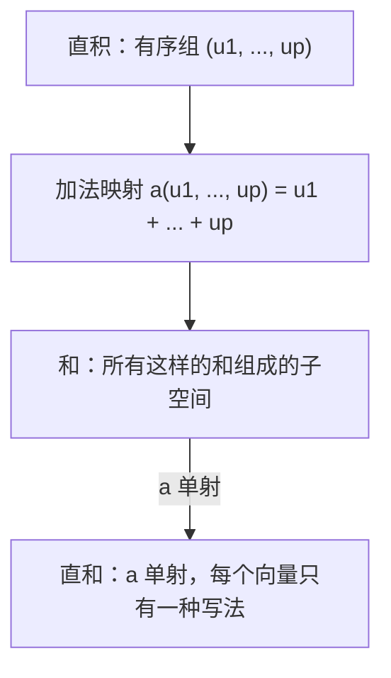
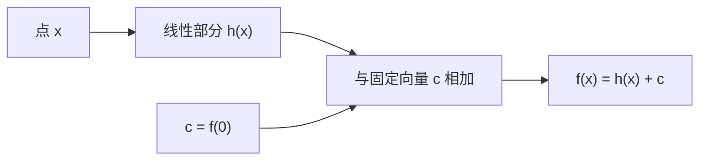
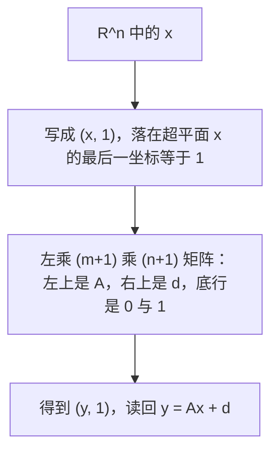

# 第5章 直和、秩–零度定理与仿射映射

### 本章总览

本章对应 Gallier 与 Quaintance，*Linear Algebra for Computer Vision, Robotics, and Machine Learning*（面向计算机视觉、机器人与机器学习的线性代数），PDF 第 151–194 页。章内向量空间都定义在任意域 $K$ 上；正文建议读者为了具体起见取 $K=\mathbb{R}$。

正文分六节，外加习题。5.1 做直积（direct product）。5.2 做和（sum）与直和（direct sum），并由此得到投影与块对角矩阵。5.3 把线性映射写成「线性映射的矩阵」，用来说明分块乘法。5.4 是秩–零度定理（rank-nullity theorem）和 Grassmann 关系。5.5 是仿射映射（affine map），视觉和机器人里的点变换主要落在这里。5.6 是章末清单。5.7 是习题，本题不展开。

原书图 5.1–5.4 是版面里的矢量示意，这一段 PDF 没有可单独抽出的嵌入位图。下面用三张流程图重画直和、仿射组合，以及把平移收进齐次坐标的办法。

图注：直积先把各空间的向量配成有序组，再送进同一个大空间里相加。和总是存在；只有加法映射单射时，这个和才叫直和，分解才唯一。

### 核心知识点

#### 直积

**直积**把若干个已有的向量空间配成一个新空间，各分量不必先坐在同一个大空间里。

定义 5.1。给定 $p\geq2$ 个向量空间 $E_1,\ldots,E_p$，乘积 $F=E_1\times\cdots\times E_p$ 上的加法和数乘按分量做：

$$
(u_1,\ldots,u_p)+(v_1,\ldots,v_p)=(u_1+v_1,\ldots,u_p+v_p),
$$
$$
\lambda(u_1,\ldots,u_p)=(\lambda u_1,\ldots,\lambda u_p).
$$

零向量是 $p$ 元组 $(0,\ldots,0)$，第 $i$ 个 $0$ 是 $E_i$ 的零。定义 5.1 把标量写成 $\lambda$ $\in\mathbb{R}$；章首又说域可以是任意 $K$。按章首约定，下面的例子都把 $K$ 当成 $\mathbb{R}$。

每个 $E_i=\mathbb{R}$ 时，直积就是 $\mathbb{R}^p$。投影 $\mathrm{pr}_i(u_1,\ldots,u_p)=u_i$ 是线性的。嵌入

$$
\mathrm{in}_i(u_i)=(0,\ldots,0,u_i,0,\ldots,0)
$$

是单射线性映射。若 $\dim(E_i)=n_i$，把每个 $E_i$ 的基嵌进直积（其余分量为 $0$），就得到 $E_1\times\cdots\times E_p$ 的一组基，因此

$$
\dim(E_1\times\cdots\times E_p)=\dim(E_1)+\cdots+\dim(E_p).
$$

🔑 关键速记：直积按分量运算，维数相加，投影读出第 $i$ 个分量。

#### 和与直和

设 $U_1,\ldots,U_p$ 是同一个空间 $E$ 的子空间。加法映射

$$
a\colon U_1\times\cdots\times U_p\to E,\qquad a(u_1,\ldots,u_p)=u_1+\cdots+u_p
$$

是线性的。它的像记成 $U_1+\cdots+U_p$，称为这些子空间的**和**：

$$
U_1+\cdots+U_p=\{u_1+\cdots+u_p\mid u_i\in U_i\}.
$$

这个和是包含每个 $U_i$ 的最小子空间，与因子的书写顺序无关，特别是 $U_1+U_2=U_2+U_1$。

定义 5.2。若 $a$ 是单射，这个和称为**直和**，写成 $U_1\oplus\cdots\oplus U_p$。$E$ 是这些子空间的直和，就是 $E=U_1\oplus\cdots\oplus U_p$。

$a$ 单射等价于：$u_i\in U_i$ 且 $u_1+\cdots+u_p=0$ 时，每个 $u_i=0$。这里用到「核只有零向量当且仅当线性映射单射」。

线性映射 $f$ 单射，等价于 $\operatorname{Ker} f=\{0\}$：只有零向量被送到零。这是判断直和、以及后面判断方阵可逆时反复用的判据。

👉 完整深度讲解见第2章命题 2.22。📝待补全

命题 5.1。$a$ 单射时，和里的每个向量都有唯一写法 $u=u_1+\cdots+u_p$，$u_i\in U_i$。

命题 5.2。$a$ 单射时，从每个 $U_i$ 里各取一个非零向量 $u_i$，这 $p$ 个向量线性无关。

$a$ 单射能推出 $i\neq j$ 时 $U_i\cap U_j=(0)$。$p\geq3$ 时，两两交于零**不能**反过来保证直和。图 5.1 的例子：$E=\mathbb{R}^2$，$U_1$ 由 $e_1=(1,0)$ 张成，$U_2$ 由 $d=(1,1)$ 张成，$U_3$ 由 $e_2=(0,1)$ 张成。三条直线两两只交于原点，但

$$
d=(1,1)=e_1+e_2,
$$

所以 $d$ 有两种和式，$U_1+U_2+U_3$ 不是直和。

$a$ 单射时，它是直积 $U_1\times\cdots\times U_p$ 与直和 $U_1\oplus\cdots\oplus U_p$ 之间的线性同构。直积不要求各 $U_i$ 先是某个公共空间的子空间；直和要求它们已经躺在同一个 $E$ 里。

若 $E=U_1\oplus\cdots\oplus U_p$，把每个 $U_j$ 的基拼起来就是 $E$ 的基。反过来，把 $E$ 的一组基的指标集拆成不相交的 $I_1\cup\cdots\cup I_p$，每个子集张成的 $U_j$ 满足 $E=U_1\oplus\cdots\oplus U_p$。

定义 5.3。线性映射 $f\colon E\to E$ 满足 $f(U)\subseteq U$ 时，称子空间 $U$ 在 $f$ 下不变（invariant）。

$E$ 有限维，$E=U_1\oplus\cdots\oplus U_p$，且每个 $U_j$ 都在 $f$ 下不变。按上面拼起来的基，$f$ 的矩阵是块对角的：对角块 $A_j$ 是 $d_j\times d_j$，$d_j=\dim(U_j)$，其余块为 $0$。每个 $d_j=1$ 时，$A$ 就是对角矩阵。

两个子空间时，$\operatorname{Ker} a=\{(u,-u)\mid u\in U_1\cap U_2\}$，所以 $\operatorname{Ker} a$ 与 $U_1\cap U_2$ 同构。

命题 5.3。$U_1+U_2$ 是直和，当且仅当 $U_1\cap U_2=(0)$。

方阵给出一个直接的例子。$A\in M_n$ 对称是指 $A^\top=A$，斜对称是指 $A^\top=-A$。

$$
S(n)=\{A\in M_n\mid A^\top=A\},\qquad \operatorname{Skew}(n)=\{A\in M_n\mid A^\top=-A\}
$$

都是 $M_n$ 的子空间，而且交是 $(0)$。对任意 $A$，

$$
H(A)=\frac{A+A^\top}{2},\qquad S(A)=\frac{A-A^\top}{2}
$$

分别对称、斜对称，且 $A=H(A)+S(A)$。因此

$$
M_n=S(n)\oplus\operatorname{Skew}(n).
$$

正文注明：$\operatorname{Skew}(n)$ 也记成 $\mathfrak{so}(n)$，它是群 $\mathrm{SO}(n)$ 的李代数（Lie algebra）。本章只给这个名称，没有写李括号，也没有写指数映射。

$\mathfrak{so}(n)$ 是 $n\times n$ 实斜对称矩阵做成的向量空间。它作为 $\mathrm{SO}(n)$ 的李代数，以及矩阵指数、Rodrigues 公式，用来把旋转写成「无穷小斜对称矩阵的指数」。本章的直和只说明每张方阵唯一拆成对称部分加斜对称部分。

👉 完整深度讲解见第11章欧氏空间与第15章单位四元数。📝待补全

命题 5.4 把命题 5.3 推广到 $p\geq2$ 个，证明留作习题。下面三条等价：

1. $U_1+\cdots+U_p$ 是直和。
2. 每个 $U_i$ 与「其余所有 $U_j$ 的和」的交是 $(0)$。
3. 对 $i=2,\ldots,p$，$U_i$ 与 $U_1+\cdots+U_{i-1}$ 的交是 $(0)$。

因为直积与直和同构，有命题 5.5：有限维子空间的直和满足

$$
\dim(U_1\oplus\cdots\oplus U_p)=\dim(U_1)+\cdots+\dim(U_p).
$$

$E=U_1\oplus\cdots\oplus U_p$ 时，唯一分解 $u=u_1+\cdots+u_p$ 定义投影 $\pi$ $_i\colon E\to U_i$，$\pi$ $_i(u)=u_i$。它们线性，并且

$$
\pi_j\circ\pi_i=
\begin{cases}
\pi_i & i=j,\cr
0 & i\neq j,
\end{cases}
\qquad
\pi_1+\cdots+\pi_p=\mathrm{id}_E.
$$

对称–斜对称分解里，$\pi$ $_1(A)=H(A)$，$\pi$ $_2(A)=S(A)$。于是 $H(A)+S(A)=A$，$H\circ H=H$，$S\circ S=S$，$H\circ S=S\circ H=0$。

满足 $f\circ f=f$ 的映射称为幂等（idempotent）。上面的 $\pi$ $_i$ 都是幂等的。

命题 5.6。若线性映射 $f_i\colon E\to E$（$p\geq2$）满足 $i=j$ 时 $f_j\circ f_i=f_i$，$i\neq j$ 时 $f_j\circ f_i=0$，并且 $f_1+\cdots+f_p=\mathrm{id}_E$，令 $U_i=f_i(E)$，则 $E=U_1\oplus\cdots\oplus U_p$。

命题 5.7。幂等线性映射 $f\colon E\to E$ 给出直和 $E=\operatorname{Ker} f\oplus\operatorname{Im} f$，而且 $f$ 就是投到像 $\operatorname{Im} f$ 上的投影。证明留作习题 5.2。

🔑 关键速记：两个子空间的和是直和，当且仅当交是零；三个及以上还要每个子空间与其余之和的交是零。

#### 分块矩阵

直和用来说明分块乘法。想法来自 Bourbaki 的处理，本书补了细节。

选定基之后，线性映射 $f\colon E\to F$ 对应一张标量矩阵：第 $t$ 列是 $f(u_t)$ 在 $F$ 的基下的坐标。同一件事可以放大：把 $E$、$F$ 拆成直和，矩阵的「元素」就不再是标量，而是子空间之间的线性映射。

矩阵在第3章是「选定基之后，线性映射的坐标表」：列是基向量的像。本章把基换成直和分解，表里的一项从标量换成子空间之间的线性映射，乘法从数的乘法换成映射的复合。

👉 完整深度讲解见第3章 3.1–3.2 节。📝待补全

设

$$
E=\bigoplus_{j=1}^{n} E_j,\qquad F=\bigoplus_{i=1}^{m} F_i.
$$

定义 5.4。对线性映射 $f\colon E\to F$，令 $f_j$ 是 $f$ 在 $E_j$ 上的限制，$\mathrm{pr}^F_i$ 是 $F$ 投到 $F_i$ 的投影。定义

$$
f_{ij}=\mathrm{pr}^F_i\circ f_j\colon E_j\to F_i.
$$

于是对 $x_j\in E_j$，

$$
f(x_j)=\sum_{i=1}^{m} f_{ij}(x_j),\qquad f_{ij}(x_j)\in F_i.
\tag{†1}
$$

对一般的 $x=x_1+\cdots+x_n$，$x_j\in E_j$，

$$
f(x)=\sum_{i=1}^{m}\sum_{j=1}^{n} f_{ij}(x_j).
$$

反过来，任意一族线性映射 $f_{ij}\colon E_j\to F_i$ 也能按这个双重和拼出唯一的 $f\colon E\to F$。因此有向量空间同构

$$
\operatorname{Hom}(E,F)\;\cong\;\prod_{1\leq i\leq m,\,1\leq j\leq n}\operatorname{Hom}(E_j,F_i).
$$

例 5.1 把 $E=E_1\oplus E_2$、$F=F_1\oplus F_2\oplus F_3$ 写成六块，输出分量是

$$
y_i=f_{i1}(x_1)+f_{i2}(x_2).
$$

一般地，$y=f(x)$ 按 $F$ 的直和唯一分解成 $y=y_1+\cdots+y_m$ 时，

$$
y_i=\sum_{j=1}^{n} f_{ij}(x_j),\qquad 1\leq i\leq m.
\tag{†2}
$$

定义 5.5 把这族 $f_{ij}$ 排成 $m\times n$ 的映射矩阵 $M(f)$，称为 $f$ 关于这两套直和分解的矩阵。$y=f(x)$ 当且仅当这张矩阵乘上 $(x_1,\ldots,x_n)$ 给出 $(y_1,\ldots,y_m)$，也就是 (†2)，正文另记为 (†)。第 $j$ 列 $(f_{1j},\ldots,f_{mj})$ 给出 $f(x_j)$ 在 $F$ 的直和里的各个分量。

每个 $E_j$、$F_i$ 都是一维时，这套写法回到普通标量矩阵：$E_j=Ku_j$，$F_i=Kv_i$，$f_{ij}(x_j u_j)=a_{ij}x_j v_i$。

复合把数的乘法换成映射的复合。为了写下标，命题 5.8 把三个空间写成

$$
E=\bigoplus_{k=1}^{p} E_k,\quad
F=\bigoplus_{j=1}^{n} F_j,\quad
G=\bigoplus_{i=1}^{m} G_i.
$$

$f\colon E\to F$ 对应 $n\times p$ 的映射矩阵 $B=(f_{jk})$，$g\colon F\to G$ 对应 $m\times n$ 的映射矩阵 $A=(g_{ij})$。则 $h=g\circ f$ 的映射矩阵 $C=(h_{ik})$ 满足 $C=AB$，其中

$$
h_{ik}=\sum_{j=1}^{n} g_{ij}\circ f_{jk},\qquad 1\leq i\leq m,\; 1\leq k\leq p.
$$

这就是标量矩阵乘法公式，只是乘法换成复合。正文把它记成 (∗4)。

接下来把映射块落成标量块。$E$ 有有限基 $(u_t)_{t\in T}$，指标集拆成不相交并 $T=T_1\cup\cdots\cup T_n$，$(u_t)_{t\in T_j}$ 是 $E_j$ 的基；$F$ 同样按 $S=S_1\cup\cdots\cup S_m$ 拆。$A=(a_{st})$ 是 $f$ 关于这两套基的普通 $M\times N$ 标量矩阵，$M=\dim F$，$N=\dim E$。

定义 5.6。删掉行指标不在 $S_i$、列指标不在 $T_j$ 的那些项，得到 $s_i\times t_j$ 子矩阵 $A_{S_i,T_j}$。由这些子矩阵排成的 $m\times n$ 矩阵称为 $A$ 关于这两套划分的分块矩阵（block matrix）。块 $A_{S_i,T_j}$ 正是映射 $f_{ij}$ 关于 $E_j$、$F_i$ 的基的矩阵。

本书把这张分块矩阵记成 $[A]$，用来和标量矩阵 $A$ 区分。$[A]$ 是 $m\times n$，元素是矩阵；$A$ 是 $M\times N$，元素是标量。划分若不按原来的顺序取连续指标，把 $[A]$ 再摊回标量数组时，行或列还可能相对 $A$ 被重排。例 5.3：$S_1=\{1,3\}$、$S_2=\{2\}$、$T_1=\{1,3\}$、$T_2=\{2\}$ 时，左上块是 $a_{11},a_{13};a_{31},a_{33}$，已经不是 $A$ 的左上 $2\times2$。

定义 5.7 把指标集从 $\{1,\ldots,m\}$ 放宽成任意有限集：$S\times T$ 矩阵就是 $S\times T\to K$ 的函数。分块矩阵则是 $[m]\times[n]\to$ 各块矩阵空间的函数，第 $(i,j)$ 项落在 $M_{S_i,T_j}(K)$ 里。同一套划分诱导的分块矩阵全体是向量空间，同构于各块矩阵空间的直和，加法和数乘按块做。

划分取连续整数段、并保持基的顺序时，$[A]$ 可以看成 $A$ 本身。例 5.2 是这种切法：$6\times5$ 矩阵按行组大小 $2,1,3$、列组大小 $2,2,1$ 切成 $3\times3$ 个块。分块乘法的结论对一般划分仍然成立。

命题 5.9 把第3章的矩阵乘法放到任意有限指标集 $I,J,K$ 上。若 $A=(a_{ij})$ 表示 $g$，$B=(b_{jk})$ 表示 $f$，则 $g\circ f$ 的矩阵 $C=AB$ 的元素是

$$
c_{ik}=\sum_{j\in J} a_{ij} b_{jk}.
$$

这是第3章 3.2 节式 (4)、以及命题 3.2 第四式，在指标不必是 $\{1,\ldots,n\}$ 时的同一条乘法规则。块乘积要用它，因为块的行列指标是 $S_i$、$T_j$ 这种子集。

👉 完整深度讲解见第3章 3.2 节。📝待补全

命题 5.10。设 $\{1,\ldots,M\}$、$\{1,\ldots,N\}$、$\{1,\ldots,P\}$ 分别拆成非空子集 $R_i$、$S_j$、$T_k$，大小为 $r_i$、$s_j$、$t_k$。$A$ 是 $M\times N$，$[A]$ 是相应的 $m\times n$ 分块矩阵，块 $A_{ij}$ 为 $r_i\times s_j$。$B$ 是 $N\times P$，$[B]$ 是 $n\times p$ 分块矩阵，块 $B_{jk}$ 为 $s_j\times t_k$。则 $C=AB$ 对应的分块矩阵满足 $[C]=[A][B]$，即

$$
C_{ik}=\sum_{j=1}^{n} A_{ij} B_{jk},\qquad 1\leq i\leq m,\; 1\leq k\leq p.
\tag{∗6}
$$

块乘完之后，若中间用的是「从 1 重新编号」的矩阵，写回 $[C]$ 时仍要按 $R_i$、$T_k$ 放回原位置。正文提到 Matlab 有按行、按列写回的命令，本笔记不抄程序。

例 5.4 只核对尺寸：行组 $2,1,3$，中间组 $2,1$，列组 $1,2,3$。其中一个块是

$$
C_{32}=A_{31}B_{12}+A_{32}B_{22}.
$$

例 5.5 用非连续划分 $S_1=\{1,3\}$、$S_2=\{2\}$、$T_1=\{2\}$、$T_2=\{1\}$。分块乘出来的 $[C]$ 相对普通乘积 $C=AB$，是把 $C$ 的两列对调。块公式仍然正确，只是 $[C]$ 按划分重排了列。

例 5.6 用分块乘法说明：可逆的上三角矩阵，其逆也是上三角。对维数做归纳。$1\times1$ 时，$A=(a)$ 可逆当且仅当 $a\neq0$，逆是 $(a^{-1})$。归纳步把 $(n+1)\times(n+1)$ 上三角写成

$$
A=\begin{pmatrix} T & U \cr 0_{1,n} & \alpha \end{pmatrix},
$$

$T$ 为 $n\times n$ 上三角，$U$ 为 $n\times1$，$\alpha$ $\in\mathbb{R}$。设逆的同型分块是 $B$，由 $AB=I_{n+1}$ 得

$$
TC+UW=I_n,\quad TV+\beta U=0,\quad \alpha W=0,\quad \alpha\beta=1.
$$

因此 $\alpha$ $,$ $\beta$ $\neq0$，$\beta$ $=$ $\alpha$ $^{-1}$，再得 $W=0$，于是 $TC=I_n$。$T$ 可逆且 $C=T^{-1}$。由归纳假设，$C$ 上三角。同一论证稍改，可得到：这样的可逆上三角矩阵，对角元非零。

🔑 关键速记：分块乘法与标量乘法同一公式；映射块用复合，标量块用数乘。划分不连续时，$[A]$ 相对 $A$ 会重排行列。

#### 秩–零度定理与 Grassmann 关系

定理 5.11（秩–零度定理）。设线性映射 $f\colon E\to F$ 的像有限维。取 $\operatorname{Im} f$ 的基 $(f_1,\ldots,f_r)$，再取 $u_i\in E$ 使 $f_i=f(u_i)$。由 $s(f_i)=u_i$ 唯一确定的线性映射 $s\colon\operatorname{Im} f\to E$ 满足 $f\circ s=\mathrm{id}$，$s$ 是单射，并且

$$
E=\operatorname{Ker} f\oplus\operatorname{Im} s.
$$

定理正文用示意图把这件事画成：$\operatorname{Ker} f$ 进入 $E=\operatorname{Ker} f\oplus\operatorname{Im} s$，$f$ 再到 $\operatorname{Im} f\subseteq F$，$s$ 从像回到 $E$。

「在一组基上任意指定像，就有唯一的线性映射实现它」是这里构造 $s$ 的依据：像的基 $f_i$ 被送到预先选好的原像 $u_i$。同一条也保证：线性无关的向量被单射送到仍线性无关的向量，从而单射把基送到基。

👉 完整深度讲解见第2章命题 2.23。📝待补全

若 $E$ 有限维，维数对直和可加，且 $s$ 是 $\operatorname{Im} f$ 与 $\operatorname{Im} s$ 的同构，故

$$
\dim(E)=\dim(\operatorname{Ker} f)+\dim(\operatorname{Im} f)=\dim(\operatorname{Ker} f)+\operatorname{rk}(f).
$$

图 5.2 的具体映射：$f\colon\mathbb{R}^3\to\mathbb{R}^2$，$f(x,y,z)=(x,y)$。$s(x,y)=(x,y,x+y)$ 把 $\mathbb{R}^2$ 同构地映成平面 $-x-y+z=0$。定理 5.11 说 $\mathbb{R}^3$ 是这张平面与 $f$ 的核（$z$ 轴）的直和。

备注：直和分解 $E=\operatorname{Ker} f\oplus\operatorname{Im} s$ 在 $E$ 无穷维时仍成立，$\operatorname{Im} f$ 无穷维时也成立。维数公式则要求 $E$ 有限维，如定理所述。正文备注把本定理写成 “Proposition 5.11”，标题却是 Theorem 5.11。后面命题 5.17 的证明也引用 “Proposition 5.11”。笔记以标题定理 5.11 为准。

定义 5.8。$\dim(\operatorname{Ker} f)$ 称为 $f$ 的零度（nullity）。

命题 5.12（Grassmann 关系）。$U,V$ 是 $E$ 的两个有限维子空间时，

$$
\dim(U)+\dim(V)=\dim(U+V)+\dim(U\cap V).
$$

理由是 $U+V$ 为加法映射 $a(u,v)=u+v$ 的像，而 $\operatorname{Ker} a$ 与 $U\cap V$ 同构，再套定理 5.11 和直积的维数公式。

用它看维数大于 3 的交。在 $\mathbb{R}^5$ 里可以有 $\dim U=3$、$\dim V=2$ 且 $U\cap V=(0)$：$U$ 取前三个标准基向量，$V$ 取后两个。但若两边维数都是 3，则

$$
3+3=\dim(U+V)+\dim(U\cap V),\qquad \dim(U+V)\leq 5,
$$

所以 $\dim(U\cap V)\geq1$。

两个超平面再推一步。正文要读者自己验证：维数 $n$ 的空间里，若 $\dim U=\dim V=n-1$，则 $\dim(U\cap V)\geq n-2$；若还有 $U\neq V$，则 $\dim(U\cap V)=n-2$。

命题 5.13。$U_1,\ldots,U_p$ 是有限维空间 $E$ 的子空间时，

$$
\dim(U_1+\cdots+U_p)\leq\dim(U_1)+\cdots+\dim(U_p),
$$

等号成立当且仅当它们做成直和 $U_1\oplus\cdots\oplus U_p$。因为和的维数等于各维数之和再减去 $\dim(\operatorname{Ker} a)$，而 $a$ 单射等价于核是零。

超平面（hyperplane）在这里是余维 1 的子空间：存在一维子空间 $L$，使 $E=H\oplus L$。

「余维 1」就是还能补上一维子空间做成直和。本章用这个说法定义超平面，并马上把它写成某个非零线性形式的核。

👉 余维一词的更早用法见第2章。📝待补全

命题 5.14。非平凡空间 $E$ 的子空间 $H$ 是超平面，当且仅当存在非零线性形式 $\varphi$ $\colon E\to K$ 使 $H=\operatorname{Ker}$ $\varphi$。若两个非零线性形式定义同一个超平面，则存在非零 $\alpha$ $\in K$ 使 $\varphi$ $_2=$ $\alpha$ $\varphi$ $_1$。

非零线性形式一定满射到 $K$，于是定理 5.11 里的 $s$ 给出一维补空间。反过来，$E=H\oplus Ku_0$ 时，把 $u=h+$ $\lambda$ $u_0$ 送到 $\lambda$，就得到以 $H$ 为核的线性形式。

因此，定义同一个 $H$ 的线性形式全体，加上零形式，是对偶空间 $E^\ast$ 里的一条一维子空间：在 $H$ 上为零的那些线性形式。正文称这是对偶的一个实例。

同一张矩阵的行秩与列秩相等，要用对偶才能看出来。本章定义 5.9 只把秩定义成最大无关列数，并写明行的那一侧留到对偶。习题 5.7 也只预告以后会证明 $\operatorname{rank}(A^\top)=\operatorname{rank}(A)$，正文没有证。

👉 完整深度讲解见第10章对偶空间。📝待补全

命题 5.15。设 $\dim E=\dim F=n<\infty$。对线性映射 $f\colon E\to F$，下面四条等价：

| 编号 | 条件 |
| --- | --- |
| (a) | $f$ 双射 |
| (b) | $f$ 满射 |
| (c) | $f$ 单射 |
| (d) | $\operatorname{Ker} f=(0)$ |

表后要点：同维有限维时，四条里只要有一条，另外三条同时成立。证明链是 (a)$\Rightarrow$(b)$\Rightarrow$(c)$\Rightarrow$(d)$\Rightarrow$(a)，中间用定理 5.11 比较维数，并用命题 2.22 把核是零和单射等同。

命题 5.15 在无穷维失败：线性映射可以单射却不满射，也可以满射却不单射。

对方阵的用法都限于 $n\times n$：

- 若有右逆 $AB=I$，则与 $A$ 相应的线性映射满射，由命题 5.15 它双射，故 $B$ 就是逆，并且 $BA=I$。
- 若有左逆 $BA=I$，则该映射单射，同样得到 $B$ 就是逆，并且 $AB=I$。
- 若 $Ax=b$ 对每个 $b$ 都有解，则该映射满射，$A$ 可逆。
- 若 $Ax=b$ 对每个 $b$ 至多一个解，则该映射单射，$A$ 可逆。

命题 5.16。$f\colon E\to F$ 单射时，存在满射的线性收缩（retraction）$r\colon F\to E$，使 $r\circ f=\mathrm{id}_E$。$f$ 满射时，存在单射的线性截面（section）$s\colon F\to E$，使 $f\circ s=\mathrm{id}_F$。图 5.2 是截面的例子；图 5.3 是收缩：$f(x,y)=(x,y,0)$，$r(x,y,z)=(x,y)$，并且 $r$ 把 $(0,0,1)$ 送到 $0$。

收缩的存在用到：线性无关组可以扩成一组基。$f$ 单射把 $E$ 的基送到 $F$ 里仍无关的一组向量，再把这组向量补成 $F$ 的基，才能在补进来的基向量上把 $r$ 定义成 $0$。

👉 完整深度讲解见第2章定理 2.11。📝待补全

命题 5.16 在 $E$ 或 $F$ 无穷维时仍成立。反过来的方向正文称为显然：有收缩则 $f$ 单射，有截面则 $f$ 满射。

命题 5.17。对线性映射 $f\colon E\to F$：

1. $\operatorname{rk}(f)+\dim(\operatorname{Ker} f)=\dim(E)$。
2. $\operatorname{rk}(f)\leq\min(\dim E,\dim F)$。

(i) 来自定理 5.11（正文写作 Proposition 5.11）。(ii) 是因为像是 $F$ 的子空间，所以秩不超过 $\dim F$，再由 (i) 不超过 $\dim E$。

定义 5.9。$m\times n$ 矩阵 $A$ 的秩 $\operatorname{rk}(A)$ 是它的列（看成 $\mathbb{R}^m$ 里的向量）中最大的线性无关个数。按命题 2.12，这就是列张成的子空间的维数。

列空间就是矩阵各列在 $\mathbb{R}^m$ 里张成的子空间，秩是这个子空间的维数。映射的秩是像的维数；像由各基向量的像张成，而这些像的坐标就是矩阵的列，所以映射的秩等于它的矩阵的列秩。

👉 完整深度讲解见第2章命题 2.12。📝待补全

因此，对表示 $f$ 的每一张矩阵 $M(f)$，都有 $\operatorname{rk}(f)=\operatorname{rk}(M(f))$。

下面把这一节的维数关系收成一张表。

| 编号 | 结论 | 使用时的限制 |
| --- | --- | --- |
| 定理 5.11 | $\dim E=\dim(\operatorname{Ker} f)+\operatorname{rk}(f)$ | $E$ 有限维；像有限维才能先写出直和分解 |
| 命题 5.12 | $\dim U+\dim V=\dim(U+V)+\dim(U\cap V)$ | $U,V$ 有限维 |
| 命题 5.13 | 和的维数 $\leq$ 各维数之和，等号即直和 | 各 $U_i$ 在有限维 $E$ 里 |
| 命题 5.15 | 单射、满射、双射、核为零，四条等价 | $\dim E=\dim F=n<\infty$ |
| 命题 5.17 | 秩不超过 $\dim E$ 与 $\dim F$ 的较小者 | 与定理 5.11 同一条维数式 |

表后要点：零度是核的维数，秩是像的维数，两者在有限维定义域上互补。Grassmann 关系是这条互补用在「加法映射」上的特例。

🔑 关键速记：有限维时 $\dim E=\dim(\operatorname{Ker} f)+\operatorname{rk}(f)$；两个子空间则是 $\dim U+\dim V=\dim(U+V)+\dim(U\cap V)$。

#### 仿射映射

线性映射一定把零送到零：$f(0)=0$。固定非零向量 $u$ 的平移 $t_u(x)=x+u$ 在机器人里出现，但 $u\neq0$ 时 $t_u(0)=u\neq0$，所以平移不是线性映射。视觉和机器人里大量点变换是「线性部分再加一个平移」。仿射组合（affine combination）是把这件事说清楚的工具。

第2章已经规定：线性映射保线性组合，因此把零送到零。同一节把仿射组合成定义为系数之和等于 1 的线性组合。本章直接引用这个定义，再用它刻画仿射映射。

👉 完整深度讲解见第2章 2.8 节。📝待补全

##### 仿射组合

一族向量 $(u_i)_{i\in I}$ 的仿射组合是

$$
\sum_{i\in I}\lambda_i u_i,\qquad \sum_{i\in I}\lambda_i=1.
$$

线性组合对系数没有这条限制。任意线性组合都可以改写成带上零向量的仿射组合：

$$
\sum_{i\in I}\lambda_i u_i
=\sum_{i\in I}\lambda_i u_i+\Bigl(1-\sum_{i\in I}\lambda_i\Bigr)0.
$$

仿射组合也叫重心组合（barycentric combination）。系数和为 1 的作用，是让这种组合在平移下保持形状。考虑

$$
f(x)=h(x)+b,
$$

其中 $h\colon E\to F$ 线性，$b\in F$ 固定。正文给的平面例子是

$$
\begin{pmatrix} x_1 \cr x_2 \end{pmatrix}
\mapsto
\begin{pmatrix} 8/5 & -6/5 \cr 3/10 & 2/5 \end{pmatrix}
\begin{pmatrix} x_1 \cr x_2 \end{pmatrix}
+
\begin{pmatrix} 1 \cr 1 \end{pmatrix}.
$$

其中的矩阵分解成伸缩与旋转：

$$
\begin{pmatrix} 8/5 & -6/5 \cr 3/10 & 2/5 \end{pmatrix}
=
\begin{pmatrix} 2 & 0 \cr 0 & 1/2 \end{pmatrix}
\begin{pmatrix} 4/5 & -3/5 \cr 3/5 & 4/5 \end{pmatrix},
$$

第二张矩阵是转角 $\theta$ 的旋转矩阵，$\cos$ $\theta$ $=4/5$，$\sin$ $\theta$ $=3/5$。正文没有把 $\theta$ 换成角度数值。

命题 5.18。这样的 $f$ 保住仿射组合：只要 $\sum$ $\lambda$ $_i=1$，就有

$$
f\Bigl(\sum_{i\in I}\lambda_i u_i\Bigr)=\sum_{i\in I}\lambda_i f(u_i).
$$

系数和必须是 1。证明里正是用它把单独的 $b$ 写成 $\sum$ $\lambda$ $_i b$，从而配进每一项 $h(u_i)+b$。

命题 5.19 是反过来的方向。若 $f\colon E\to F$ 保住一切仿射组合，则对任意 $a\in E$，

$$
h(x)=f(a+x)-f(a)
$$

是线性映射，而且与 $a$ 的选取无关，并且

$$
f(a+x)=h(x)+f(a).
$$

特别取 $a=0$，令 $c=f(0)$，则对一切 $x\in E$，

$$
f(x)=h(x)+c.
$$

应把 $a$ 看成 $E$ 里选定的原点。$f$ 把这个原点送到 $F$ 里的原点 $f(a)$。$h$ 不依赖于选哪一个原点。$f$ 是线性映射 $h$ 再复合上 $F$ 里的平移 $t_c$。这个唯一的 $h$ 称为 $f$ 所伴随的线性映射，有时记成 $\overrightarrow{f}$。

定义 5.10。$f\colon E\to F$ 是仿射映射，是指它保住仿射组合。等价地，存在线性映射 $h\colon E\to F$（也记 $\overrightarrow{f}$）和固定向量 $c\in F$，使

$$
f(x)=h(x)+c,\qquad x\in E.
$$

线性映射把标准原点 $0$ 送到 $0$。仿射映射通常把 $0$ 送到 $c=f(0)$，这就是平移部分。

图注：仿射映射是线性部分加平移。系数和为 1 的仿射组合被整个 $f$ 保住；$c\neq0$ 时，$f$ 不把原点送到原点。

##### 点、向量与仿射空间

处理仿射映射时，宜把 $E$、$F$ 的元素同时看成点。点只用仿射组合来混合；向量可以用任意线性组合。$u+v$ 也可以理解成点 $u$ 经过平移 $t_v$ 之后的点。由此有仿射空间（affine space）。

定义 5.11。仿射空间或者是退化成空集的空间，或者是三元组 $\langle E,\overrightarrow{E},+\rangle$：

- $E$ 是非空点集；
- $\overrightarrow{E}$ 是向量空间，其中的向量看成平移，也叫自由向量；
- 作用 $+\colon E\times\overrightarrow{E}\to E$ 满足三条。

(A1) $a+0=a$。

(A2) $(a+u)+v=a+(u+v)$。

(A3) 对任意两点 $a,b$，存在唯一的 $u\in\overrightarrow{E}$ 使 $a+u=b$。

这个唯一的 $u$ 记成 $\overrightarrow{ab}$，有时写成 $ab$ 或 $b-a$。于是 $b=a+\overrightarrow{ab}$。

点本身不能相加，也不能乘标量。正文把 $\overrightarrow{E}$ 在 $E$ 上的作用称为传递且忠实的，并说据此才能严格定义点的仿射组合；同时声明这条路走远了。后面仍只在向量空间里讨论，也不再区分向量加法与用向量平移一个点。需要记住的是：仿射组合真正作用在点上，点不是向量。

几何教材里的仿射空间会把点集和向量空间分开，并在此之上写仿射标架、仿射子空间，再进入相机所用的射影空间。本章的定义 5.11 只固定 (A1)–(A3)，并明确说不再展开。

👉 完整深度讲解见射影与多视图几何讲义第3章仿射空间。📝待补全

##### 矩阵表示与齐次坐标

$E,F$ 有限维，$\dim E=n$，$\dim F=m$。仿射映射的矩阵要把平移 $c$ 一并写进去，还可以另选原点。

设 $(u_1,\ldots,u_n)$ 是 $E$ 的基，$(v_1,\ldots,v_m)$ 是 $F$ 的基，$a\in E$、$b\in F$ 当作原点。若 $v=f(u)$，则

$$
v-b=f(a)-b+h(u-a).
$$

令 $y=v-b$，$x=u-a$，$d=f(a)-b$，就有 $y=h(x)+d$。$A$ 是 $h$ 关于这两套基的 $m\times n$ 矩阵时，

$$
y_V=Ax_U+d_V.
$$

这里 $x_U=(x_1,\ldots,x_n)^\top$，$y_V=(y_1,\ldots,y_m)^\top$，$d_V=(d_1,\ldots,d_m)^\top$。这就是 $f$ 关于 $(a,(u_1,\ldots,u_n))$ 和 $(b,(v_1,\ldots,v_m))$ 的矩阵表示。

选 $b=f(a)$ 时，$d=0$，$f$ 相对这两个原点表现得像线性映射。若 $E=F$ 且存在不动点 $f(a)=a$，取 $b=a$，则

$$
v-a=h(u-a).
$$

相对新原点 $a$，坐标 $x=u-a$、$y=v-a$ 满足 $y=h(x)$。绕一条不经过标准原点的轴的旋转，就是这种情形：换到不动点之后，它看起来像线性映射。

备注：基再加上一个选定原点，即偶对 $(a,(u_1,\ldots,u_n))$，称为仿射标架（affine frame）。

把平移收进矩阵的办法，是做成 $(m+1)\times(n+1)$ 矩阵：先把 $d$ 接成第 $n+1$ 列，再把底行接成 $(0,\ldots,0,1)$（前 $n$ 个 $0$）：

$$
A'=\begin{pmatrix} A & d \cr 0_n & 1 \end{pmatrix}.
$$

于是

$$
\begin{pmatrix} y \cr 1 \end{pmatrix}
=
\begin{pmatrix} A & d \cr 0_n & 1 \end{pmatrix}
\begin{pmatrix} x \cr 1 \end{pmatrix}
$$

当且仅当 $y=Ax+d$。

这等于把 $\mathbb{R}^n$ 里的点 $x$ 看成 $\mathbb{R}^{n+1}$ 里超平面 $H_{n+1}$ 上的点 $(x,1)$，超平面方程是 $x_{n+1}=1$。仿射映射是某个线性映射 $\widehat{f}\colon\mathbb{R}^{n+1}\to\mathbb{R}^{m+1}$ 在这张超平面上的限制；$\widehat{f}$ 的矩阵是 $A'$，并且 $\widehat{f}(H_{n+1})\subseteq H_{m+1}$。图 5.4 画的是 $n=2$：平面上的 $x=(x_1,x_2)$ 抬到 $(x_1,x_2,1)$，落在 $x_3=1$ 上。

图注：平移不单独放在矩阵外面。把点抬高一维并固定最后一坐标为 1 之后，线性部分和平移合成一次矩阵乘法，结果仍落在「最后一坐标为 1」的超平面上。

正文的例子：

$$
\begin{pmatrix} x_1 \cr x_2 \end{pmatrix}
\mapsto
\begin{pmatrix} 1 & 1 \cr 1 & 3 \end{pmatrix}
\begin{pmatrix} x_1 \cr x_2 \end{pmatrix}
+
\begin{pmatrix} 3 \cr 0 \end{pmatrix}
$$

在 $\mathbb{R}^3$ 里写成

$$
\begin{pmatrix} x_1 \cr x_2 \cr 1 \end{pmatrix}
\mapsto
\begin{pmatrix}
1 & 1 & 3 \cr
1 & 3 & 0 \cr
0 & 0 & 1
\end{pmatrix}
\begin{pmatrix} x_1 \cr x_2 \cr 1 \end{pmatrix}.
$$

正文说点 $a=(6,-3)$ 是不动点：$f(a)=a$。把坐标原点移到 $a$ 之后，这个仿射映射表现得像线性映射。

正文最后一句：把 $\mathbb{R}^n$ 看成 $\mathbb{R}^{n+1}$ 中超平面的想法，可以用来定义射影映射（projective map）。本章没有写射影坐标，也没有写射影变换的矩阵。

射影映射允许最后一坐标不恒为 1，从而把「无穷远」收进来。相机模型里的单应、射影平面，用的就是这一层，而不是只做 $y=Ax+d$。

👉 完整深度讲解见射影与多视图几何讲义第9章射影平面与第10章射影空间。📝待补全

🔑 关键速记：仿射映射是 $f(x)=h(x)+c$，齐次矩阵把 $A$ 与 $c$ 拼在一起，底行是 $0\ldots0\,1$。

### 🔑 关键速记

- 直积按分量运算，维数相加；和是子空间的所有和；直和还要求加法映射单射，分解唯一。
- 两个子空间时，交是零即直和；三个及以上，两两交于零不够。
- 分块乘法与标量乘法同一公式。划分不按连续顺序取时，$[A]$ 相对 $A$ 会重排行列。
- 有限维时 $\dim E=\dim(\operatorname{Ker} f)+\operatorname{rk}(f)$。Grassmann：$\dim U+\dim V=\dim(U+V)+\dim(U\cap V)$。
- 同维有限维时，单射、满射、双射、核为零四条等价；方阵有左逆或右逆就已经可逆。无穷维没有这四条等价。
- 仿射映射保住系数和为 1 的组合，写成线性部分加平移；齐次坐标把平移收进多一行多一列的矩阵。

### 易混淆点与差异对比

直积、和、直和是三件东西。直积的元素是有序组，各空间不必共处一个大空间。和的元素是同一空间里的和式，写法可以有很多种。直和是那种和式恰好只有一种写法的和。$p=2$ 时，交是 $(0)$ 就够了。图 5.1 说明 $p=3$ 时，两两交于零仍可能 $d=e_1+e_2$。

幂等投影 $f\circ f=f$ 给出 $E=\operatorname{Ker} f\oplus\operatorname{Im} f$。这是命题 5.7 的结论，证明在习题 5.2，不要把它和秩–零度定理里的 $\operatorname{Im} s$ 当成同一个补空间。定理 5.11 的补空间是某张截面 $s$ 的像，依赖于为像的基所选的原像 $u_i$，一般不是 $\operatorname{Im} f$ 本身（$f$ 的像在 $F$ 里）。

分块矩阵 $[A]$ 的元素是矩阵。只有划分是连续整数段并且保持顺序时，才可以把 $[A]$ 直接看成 $A$。例 5.3 与例 5.5 里，非连续指标会把行或列重新编组，$[C]=[A][B]$ 仍然成立，但摊开之后相对普通乘积差一个重排。

定理编号：标题是定理 5.11，备注和命题 5.17 写成 Proposition 5.11。维数公式只在 $E$ 有限维时写出；直和分解 $E=\operatorname{Ker} f\oplus\operatorname{Im} s$ 可以留在无穷维。命题 5.15 的四条等价只在两边同为有限维且维数相等时成立。

矩阵的秩在定义 5.9 里是列秩。行秩等于列秩是后文用对偶才得到的结论，本章没有证。

线性映射、平移、仿射映射的差别如下。

| | 线性映射 | 平移 $t_u$ | 仿射映射 |
| --- | --- | --- | --- |
| 公式 | $h(x)$ | $x+u$ | $h(x)+c$ |
| 原点 | $h(0)=0$ | $u\neq0$ 时送到 $u$ | 送到 $c=f(0)$ |
| 保住的组合 | 任意线性组合 | 系数和为 1 的仿射组合 | 系数和为 1 的仿射组合 |
| 齐次矩阵 | 右上平移块为 0 | 左上是单位矩阵 | $\begin{pmatrix} A & d \cr 0 & 1 \end{pmatrix}$ |

表后要点：仿射映射包含线性映射（$c=0$）和平移（$h=\mathrm{id}$）。有不动点时，把原点搬到不动点，矩阵表示里的平移项消失，映射相对新原点是线性的。绕不经过原点的轴的旋转属于这一类。

点与向量：定义 5.11 不允许把点相加或乘标量，只允许用向量去平移点。正文随后声明，后面的计算仍用向量空间里的同一个 $+$。读公式时，$y=Ax+d$ 里的 $x,y$ 在视觉里通常是点的坐标，$d$ 是平移向量。

超平面由非零线性形式的核定义。两个这样的形式若核相同，彼此差一个非零倍数，所以决定超平面的是 $E^\ast$ 里的一条直线，不是某一个具体的 $\varphi$。

### 本章要点总结

5.1–5.2 把新空间的两种拼法分开：直积是有序组，直和是唯一分解的和。不变子空间把线性映射的矩阵变成块对角；两个子空间的直和等价于交是零；幂等映射投到自己的像上，核与像做成直和。方阵唯一拆成对称部分与斜对称部分，斜对称部分另记为 $\mathfrak{so}(n)$。

5.3 说明分块乘法为什么和普通乘法同一公式：直和之间的映射矩阵用复合相乘，选定基之后变成标量块的乘积。可逆上三角矩阵的逆仍是上三角，对角元非零。

5.4 的主公式是 $\dim E=\dim(\operatorname{Ker} f)+\operatorname{rk}(f)$。Grassmann 关系用同一条定理计算两个子空间的交。同维有限维时单射即满射即双射，所以方阵的左逆、右逆都是真正的逆。矩阵的秩按列定义，并等于它所表示的线性映射的秩。

5.5 是视觉里要记住的一节。仿射映射等价于保住仿射组合，也等价于 $f(x)=\overrightarrow{f}(x)+c$。矩阵形状是 $y=Ax+d$；把点写成 $(x,1)$ 后，同一次乘法用

$$
\begin{pmatrix} A & d \cr 0 & 1 \end{pmatrix}
$$

完成。有不动点时，原点移到该点，仿射映射变成相对新原点的线性映射。

5.6 的清单就是：直积、和、直和与投影；秩–零度公式；Grassmann 关系；双射线性映射的几条等价刻画；矩阵的秩；仿射映射。

5.7 的习题不展开。题面涉及子空间的并、幂等与直和的等价条件、对合、上 Hessenberg 矩阵的核、$A^\top A$、平面旋转、平移加旋转、仿射子空间 $a+U$、仿射标架与重心坐标。这些没有在 5.1–5.6 里作为定理证明，笔记不把习题中的待证公式写成正文结论。
