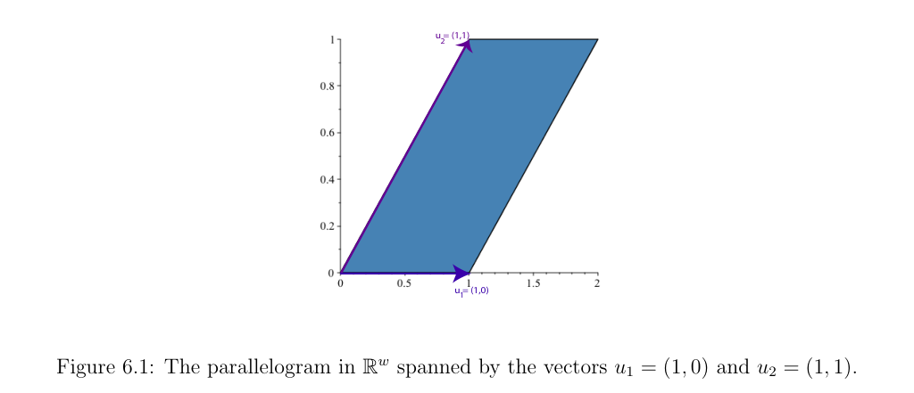
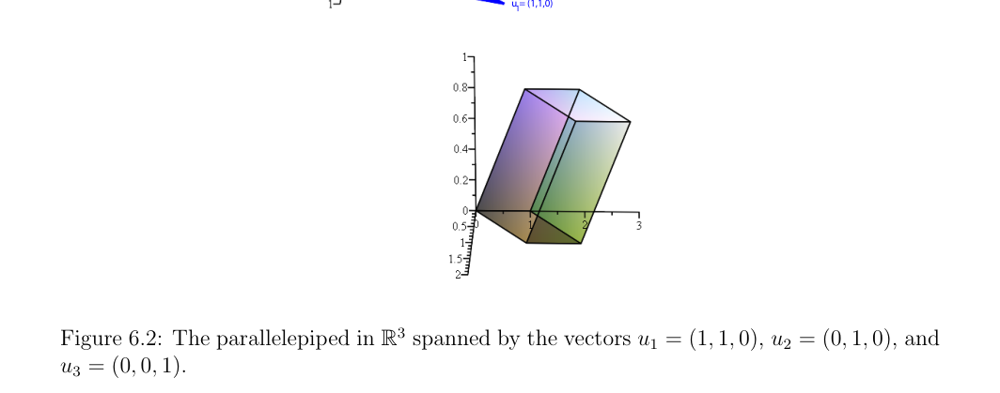

# 第6章 行列式

### 本章总览

本章在任意域 ${K}$ 上复习 determinant（行列式）。具体计算时可以把 ${K}$ 当成 ${\mathbb{R}}$。路线是：置换的符号、交错多重线性映射、按 Artin 的方式定义行列式、Laplace 展开、用行列式求逆和 Cramer 公式、线性映射的行列式、特征多项式与 Cayley–Hamilton 定理。最后用 permanent（积和式）作对照：它丢掉符号，几何意义就没有了。

视觉里行列式首先是有向体积。相机投影、旋转矩阵、基是否可用，都要看一组向量张成的平行体体积是不是零。

阅读范围：PDF 第 195–232 页。习题不展开。

### 核心知识点

#### 置换与符号

permutation（置换）是 ${[n]=\{1,\ldots,n\}}$ 到自身的双射。全体置换构成 symmetric group（对称群）${S_n}$，有 ${n!}$ 个元素。transposition（对换）交换两个元素，对换的复合能生成所有置换（命题 6.1）。

判别式

$$
\Delta(x_1,\ldots,x_n)=\prod_{1\le i<j\le n}(x_i-x_j)
$$

用来固定符号。任意对换都把 ${\Delta}$ 乘上 ${-1}$。因此一个置换写成对换乘积时，对换个数的奇偶是不变量（命题 6.2）。这个奇偶叫做 signature（符号）${\epsilon(\sigma)}$，也记 ${\operatorname{sgn}(\sigma)}$。对换的符号是 ${-1}$，恒等置换的符号是 ${+1}$。

inversion（逆序）是 ${i<j}$ 但 ${\sigma(i)>\sigma(j)}$。符号等于逆序个数的奇偶：${\epsilon(\sigma)=(-1)^{I(\sigma)}}$（命题 6.3）。

🔑 关键速记：符号只看逆序个数的奇偶，和把置换拆成哪一组对换无关。

#### 交错多重线性映射

multilinear map（多重线性映射）对每一个自变量都线性，其余变量固定。alternating（交错）是指某两个自变量相等时函数值为 0。交错多重线性映射在交换两个自变量时变号。

行列式不从展开式硬定义，而从这类映射里挑出来。

🔑 关键速记：行列式对列（以及后来对行）是交错多重线性的，两列相同则为 0。

#### 行列式的定义与展开式

按 Emil Artin 的做法：在 ${n\times n}$ 矩阵上，行列式是唯一满足下面条件的交错多重线性函数 ${D}$：把单位矩阵 ${I_n}$ 的列送进去时 ${D(I_n)=1}$。定理 6.7 说明所有这样的算法算出同一个值，并且

$$
\det(A)=\sum_{\pi\in S_n}\epsilon(\pi)\, a_{\pi(1)1}\cdots a_{\pi(n)n}.
$$

书中列的下标写法是 ${a_{\pi(i)\, i}}$，即按列取元素。几何上，${n}$ 个线性无关向量 ${u_1,\ldots,u_n}$ 张成平行体

$$
P_n=\{\lambda_1 u_1+\cdots+\lambda_n u_n\mid 0\le\lambda_i\le 1\}.
$$

${n=2}$ 是平行四边形，${n=3}$ 是平行六面体。${\det(u_1,\ldots,u_n)}$ 是这个平行体的 **signed volume（有向体积）**，符号记录定向。

推论 6.8：${\det(A)=\det(A^\top)}$。因此行列式对行也是交错多重线性的。上三角矩阵的行列式是对角线乘积。分块上三角矩阵的行列式是各对角块行列式的乘积。

Vandermonde 行列式（例 6.2）

$$
V(x_1,\ldots,x_n)=\prod_{1\le i<j\le n}(x_j-x_i).
$$

它和前面的判别式只差一个符号与变量顺序。插值里判断节点是否互异，就看这个行列式是否为零。

命题 6.10：${\det(AB)=\det(A)\det(B)}$。

🔑 关键速记：行列式是单位矩阵上取 1 的交错多重线性函数，几何上是有向体积，并且对乘法可乘。

#### 伴随矩阵与可逆

${A}$ 的 minor（子式）${A_{ij}}$ 是删掉第 ${i}$ 行第 ${j}$ 列后的行列式。cofactor（余子式）带符号 ${(-1)^{i+j}}$。adjugate（伴随矩阵）${\widetilde{A}=(b_{ij})}$ 定义为

$$
b_{ij}=(-1)^{i+j}\det(A_{ji}).
$$

下标是反的：${\widetilde{A}}$ 是余子式矩阵的转置。命题 6.11：在交换环上

$$
A\widetilde{A}=\widetilde{A}A=\det(A)\, I_n.
$$

因此 ${A}$ 可逆当且仅当 ${\det(A)}$ 在该环里可逆；可逆时

$$
A^{-1}=(\det A)^{-1}\widetilde{A}.
$$

在域上，${\det(A)\neq 0}$ 就等价于可逆。

🔑 关键速记：逆矩阵等于行列式的倒数乘伴随矩阵；伴随矩阵的下标相对余子式是转置过来的。

#### 线性方程组与 Cramer 公式

命题 6.12：域上的方阵，列线性相关当且仅当行列式为 0；等价地，秩等于 ${n}$ 当且仅当行列式非零。

命题 6.13 的三条：

1. ${Ax=b}$ 对每个 ${b}$ 都有唯一解，当且仅当 ${\det(A)\neq 0}$。
2. 若 ${\det(A)\neq 0}$，唯一解的第 ${j}$ 个分量是 Cramer's rule（Cramer 法则）

$$
x_j=\frac{\det(A_1,\ldots,A_{j-1},b,A_{j+1},\ldots,A_n)}{\det(A)}.
$$

分子是把第 ${j}$ 列换成 ${b}$。

3. 齐次方程 ${Ax=0}$ 有非零解，当且仅当 ${\det(A)=0}$。

书中明确写：Cramer 公式看起来整齐，用来实际解方程组通常不划算。数值上应走第 7 章的消元。

🔑 关键速记：行列式非零表示方阵满秩、方程有唯一解；Cramer 公式是理论表达式，不是默认算法。

#### 线性映射的行列式

有限维空间上，线性映射 ${f:E\to E}$ 在任一基下的矩阵记 ${M(f)}$。换基矩阵 ${P}$ 把矩阵变成 ${P^{-1}M(f)P}$。因为行列式对乘法可乘，

$$
\det(P^{-1}M(f)P)=\det(M(f)).
$$

所以 ${\det(f)}$ 与基无关（定义 6.10）。命题 6.14：${f}$ 可逆当且仅当 ${\det(f)\neq 0}$。

行列式等于 1 的可逆线性映射构成 special linear group（特殊线性群）${\mathrm{SL}(E)}$，也记 ${\mathrm{SL}(n,K)}$ 或 ${\mathrm{SL}(n)}$。它是 general linear group（一般线性群）${\mathrm{GL}(E)}$ 的子群。

🔑 关键速记：映射的行列式不随基改变；行列式为 1 的可逆映射组成 ${\mathrm{SL}(n)}$。

#### Cayley–Hamilton 定理

特征多项式定义为 ${P_A(X)=\det(XI-A)}$。${n=2}$、${A=\begin{pmatrix}a&b\cr c&d\end{pmatrix}}$ 时

$$
P_A(X)=X^2-(a+d)X+(ad-bc).
$$

把矩阵代回多项式：若 ${P_A(X)=X^n+c_1 X^{n-1}+\cdots+c_n}$，则

$$
P_A(A)=A^n+c_1 A^{n-1}+\cdots+c_n I.
$$

定理 6.15（Cayley–Hamilton，交换环上的矩阵版）：${P_A(A)=0}$。证明把 ${XI-A}$ 的伴随矩阵按 ${X}$ 的幂展开，再用 ${B\widetilde{B}=\det(B)I}$。

定理 6.16 是有限维向量空间上线性映射的版本。域上，线性映射的特征多项式与基无关，根叫做 eigenvalue（特征值）。特征值的几何与算法在第 14 章及后置的第 17 章。

👉 特征值作为特征多项式的根，这里只需要知道定义。完整的谱性质见第 14 章。📝待补全

🔑 关键速记：方阵代入自己的特征多项式得零矩阵；特征多项式用 ${\det(XI-A)}$，不是 ${\det(A-XI)}$ 的相反写法，本书首项系数是 ${+1}$。

#### 积和式

把行列式求和式里的符号 ${\epsilon(\pi)}$ 去掉，得到

$$
\operatorname{per}(A)=\sum_{\pi\in S_n} a_{\pi(1)1}\cdots a_{\pi(n)n}.
$$

permanent（积和式）对列是多重线性且对称，${\operatorname{per}(A)=\operatorname{per}(A^\top)}$，也有不带符号的 Laplace 展开。它没有有向体积这种几何解释。行列式可以经行化简高效计算，积和式的计算是难的。

组合解释：二部图的 perfect matching（完美匹配）个数，以及一组子集的 SDR（相异代表系）个数。二部图的定义书中指向第 18 章定义 18.5。

👉 无向图与二部图的正式定义在第 18 章。二部图是顶点分成两堆、每条边两端各在一堆的图。📝待补全

🔑 关键速记：积和式是去掉符号的行列式，计数用，不表示体积。

### 易混淆点与差异对比

行列式和积和式的求和范围相同，差在有没有 ${\epsilon(\pi)}$。有符号才有交错性和有向体积；去掉符号就变成匹配计数，并且不再好算。

${\det(XI-A)}$ 与有些教材的 ${\det(A-\lambda I)}$ 差一个 ${(-1)^n}$。本书 ${n=2}$ 的例子首项是 ${X^2}$，trace（迹）${a+d}$ 前面是负号。引用公式时不要把两种首项混用。

Cramer 公式和伴随矩阵求逆都给出精确表达式。书中把它们留在理论侧，实际解 ${Ax=b}$ 用消元。消元、LU 与 Cholesky 在第 7 章。

映射的行列式和某一个矩阵的行列式不是两件独立的事：先选基得到矩阵，再发现换基不改变这个数。

### 本章要点总结

行列式是单位阵上取 1 的交错多重线性函数，等于置换展开式，几何上是平行体的有向体积。它在转置下不变，对矩阵乘法可乘，非零等价于方阵满秩可逆。逆矩阵由伴随矩阵除以行列式得到。Cramer 公式能写唯一解，但不作为算法。线性映射的行列式与基无关，行列式为 1 的可逆映射构成 ${\mathrm{SL}(n)}$。特征多项式 ${P_A(X)=\det(XI-A)}$ 满足 Cayley–Hamilton：${P_A(A)=0}$。积和式去掉符号，用来数完美匹配，没有体积解释。

### 关键速记

- ${\det(A)=\sum_{\pi}\epsilon(\pi)\prod_i a_{\pi(i)i}}$，几何意义是有向体积。
- ${\det(AB)=\det(A)\det(B)}$，${\det(A^\top)=\det(A)}$，可逆当且仅当行列式在标量环里可逆。
- Cramer 公式把第 ${j}$ 列换成 ${b}$ 再除以 ${\det(A)}$；实际求解用消元。
- ${\det(f)}$ 与基无关；${\mathrm{SL}(n)}$ 是行列式为 1 的可逆线性映射。
- ${P_A(X)=\det(XI-A)}$，并且 ${P_A(A)=0}$。
