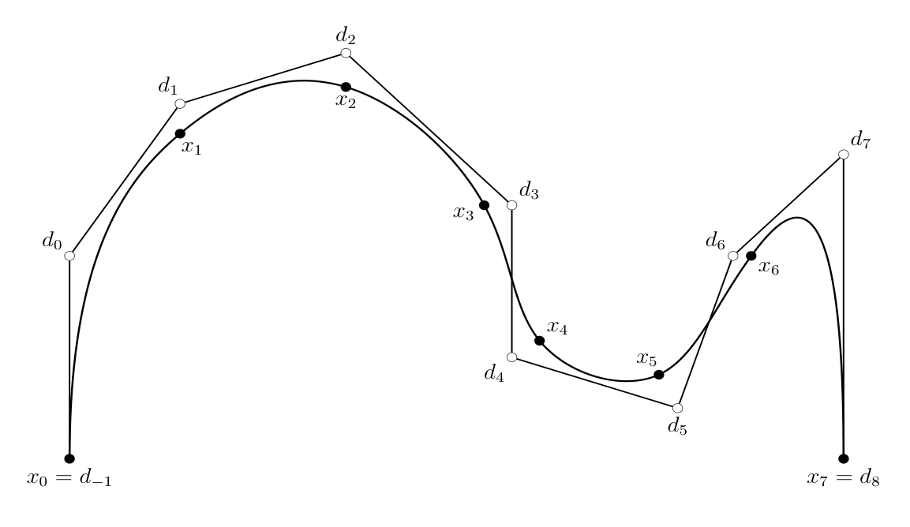
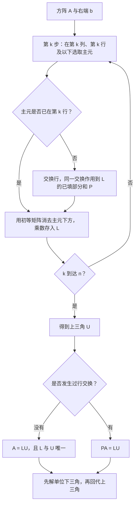
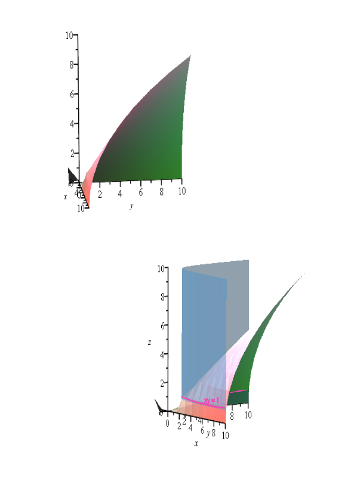

# 第7章 高斯消元、LU、Cholesky 与阶梯形

### 本章总览

本章默认向量空间在实数域 \(\mathbb{R}\) 上。不依赖实数的大小顺序、也不开平方的结论，对一般域仍然成立。Cholesky 分解要用平方根，所以留在实对称正定（以及复 Hermitian 正定）这一侧。

路线从曲线插值引出线性方程组，再讲直接法：把方阵消成上三角，用初等矩阵解释行变换，得到 LU 与 \(PA=LU\)。接着处理小主元、三对角和 SPD 矩阵上的 Cholesky。后半章把消元推广到长方阵，得到行最简阶梯形（reduced row echelon form, RREF），用它判断方程组是否有解，并写出特解加齐次解。最后用列变换得到秩标准形，并把初等矩阵解释成 transvection（平延）和 dilatation（伸缩）。

第 7.6 节是定理 7.5 的下标证明，标了选读星号。下面只保留该定理的三条结论。习题不展开。

阅读范围：PDF 第 233–312 页。

### 核心知识点

#### 曲线插值引例

计算机图形和机器人路径里常要一条曲线穿过给定点。本书用三次 Bézier 曲线拼成 spline（样条）。一条三次 Bézier 曲线由四个控制点 \((b_0,b_1,b_2,b_3)\) 决定：

\[
C(t)=(1-t)^3 b_0+3(1-t)^2 t\, b_1+3(1-t)t^2 b_2+t^3 b_3.
\]

四个系数是 3 次 Bernstein 多项式。\(C(0)=b_0\)，\(C(1)=b_3\)。\(t\in[0,1]\) 时，\(C(t)\) 落在四个控制点的凸包里。控制点一动，曲线可以出现拐点，甚至自交。

Bézier spline \(F\) 由曲线段 \(C_1,\ldots,C_m\)（\(m\ge 2\)）拼成，定义在 \([0,m]\) 上：在第 \(i\) 段，\(F(t)=C_i(t-i+1)\)。衔接点要求 \(C_i(1)=C_{i+1}(0)\)，这是 \(C^0\) 连续。若直到二阶导数都一致，就是 \(C^2\) 连续，切向和曲率都接上。

问题：给定 \(N+1\) 个数据点 \(x_0,\ldots,x_N\)（\(N\ge 2\)），求 \(C^2\) 三次样条，使 \(F(i)=x_i\)。做法是先求辅助的 de Boor 控制点 \(d_{-1},\ldots,d_{N+1}\)。其中 \(d_{-1}=x_0\)，\(d_{N+1}=x_N\)，所以未知的是 \(d_0,\ldots,d_N\)。\(C^2\) 只给出 \(N-1\) 个方程，\(d_0\) 与 \(d_N\) 由端点条件另定（例如两端的速度）。假定它们已经给定，则 \(d_1,\ldots,d_{N-1}\) 满足

\[
\begin{pmatrix}
7/2 & 1 & & & 0 \\
1 & 4 & 1 & & \\
& \ddots & \ddots & \ddots & \\
& & 1 & 4 & 1 \\
0 & & & 1 & 7/2
\end{pmatrix}
\begin{pmatrix}
d_1 \\ d_2 \\ \vdots \\ d_{N-2} \\ d_{N-1}
\end{pmatrix}
=
\begin{pmatrix}
6x_1-\tfrac{3}{2}d_0 \\
6x_2 \\
\vdots \\
6x_{N-2} \\
6x_{N-1}-\tfrac{3}{2}d_N
\end{pmatrix}.
\]

系数矩阵是三对角的，而且严格对角占优，后面会说明它因此可逆。Figure 7.4 画的是 \(N=7\)、共 8 个数据点，\(d_0\) 与 \(d_7\) 任取。

图注：Figure 7.4。黑点 \(x_0,\ldots,x_7\) 是必须穿过的数据点，空心点 \(d_0,\ldots,d_7\) 是 de Boor 控制点。\(C^2\) 约束把中间的 \(d_i\) 收成一个三对角线性方程组。

解出 \(d_i\) 之后，第 \(i\) 段（\(2\le i\le N-1\)）的 Bézier 控制点是

\[
b^i_0=x_{i-1},\quad
b^i_1=\tfrac23 d_{i-1}+\tfrac13 d_i,\quad
b^i_2=\tfrac13 d_{i-1}+\tfrac23 d_i,\quad
b^i_3=x_i.
\]

首段用 \(b^1_0=x_0\)，\(b^1_1=d_0\)，\(b^1_2=\tfrac12 d_0+\tfrac12 d_1\)，\(b^1_3=x_1\)。末段用 \(b^N_0=x_{N-1}\)，\(b^N_1=\tfrac12 d_{N-1}+\tfrac12 d_N\)，\(b^N_2=d_N\)，\(b^N_3=x_N\)。样条矩阵是三对角的，所以后面会有比一般消元更省的算法。

🔑 关键速记：\(C^2\) 三次插值把未知的 de Boor 点收成严格对角占优的三对角方程组，端点 \(d_0,d_N\) 另定。

#### 高斯消元

设 \(A\) 为 \(n\times n\) 可逆矩阵，要求 \(Ax=b\)。可逆保证唯一解 \(x=A^{-1}b\)，但书中强调两件反直觉的事。

第一，**不要显式求逆**。求逆等于解 \(n\) 个方程组 \(Au^{(j)}=e_j\)，再把 \(A^{-1}\) 乘到 \(b\) 上，比解一个方程组更贵。第二，**不要用 Cramer 公式**解大型方程组。那种算法的加法次数与 \((n+1)!\) 成正比，乘法次数与 \((n+2)!\) 成正比。

行列式与 Cramer 公式给出的是理论表达式：方阵可逆当且仅当行列式非零，唯一解的第 \(j\) 个分量是把第 \(j\) 列换成 \(b\) 之后的行列式之比。

👉 展开式、伴随矩阵和 Cramer 公式的完整讲法在第 6 章。本章把它们当作“为什么不拿来做算法”。📝待补全

真正要用的是直接法，和迭代法相对：迭代法求近似，直接法经有限步得到（在精确算术下的）解。若 \(A\) 是上三角（\(a_{ij}=0\) 当 \(j<i\)）或下三角（\(a_{ij}=0\) 当 \(i<j\)），求解是直接的。上三角且可逆时，对角线全非零，从下往上回代（back-substitution）：

\[
\begin{aligned}
x_n&=a_{nn}^{-1}b_n,\\
x_{n-1}&=a_{n-1\,n-1}^{-1}(b_{n-1}-a_{n-1\,n}x_n),\\
&\vdots\\
x_1&=a_{11}^{-1}(b_1-a_{12}x_2-\cdots-a_{1n}x_n).
\end{aligned}
\]

下三角则从上往下前代（forward-substitution）。三角阵可逆当且仅当对角线全非零；这一点可以用归纳直接证明，不必先算行列式。

因此目标是把 \(Ax=b\) 变成等价的上三角系统 \(MAx=Mb\)。允许的操作是把某一行的倍数加到另一行，并且同一套操作作用在 \(b\) 上。这就是 Gaussian elimination（高斯消元）。

书中的第一个例子：

\[
2x+y+z=5,\qquad 4x-6y=-2,\qquad -2x+7y+2z=9.
\]

第二行减两倍第一行，第三行加第一行，再把新的第二行加到第三行，得到上三角，回代得 \(z=2\)，\(y=1\)，\(x=1\)。

只做“某行的倍数加到另一行”不够。第二个例子里，消去 \(x\) 之后第二行没有 \(y\)，必须交换第二行和第三行才能继续。第三个例子的第一行只有 \(z\)，也要先换行。被选中的非零元叫做该步的 pivot（**主元**），记为 \(\pi_k\)；为了把它换到对角位置而做的行交换叫做 pivoting（选主元）。

对可逆的 \(A\)，第 \(k\) 步是：

1. 在第 \(k\) 列、第 \(k\) 行及其下方选一个非零元作为 \(\pi_k\)。可逆保证这样的元存在，否则前 \(k\) 列会落进 \(\mathbb{R}^{k-1}\)，从而线性相关。
2. 把该行换到第 \(k\) 行。
3. 对 \(i=k+1,\ldots,n\)，把第 \(k\) 行的 \(-\alpha_{ik}/\pi_k\) 倍加到第 \(i\) 行，使第 \(k\) 列下方变 0。
4. \(k\) 加 1。\(k=n\) 时停止，否则在右下角的子块上重复。

记 \(A_1=A\)，\(A_k\) 为做完 \(k-1\) 步之后的矩阵。前 \(k-2\) 行在第 \(k\) 步不再改动。而且 \(\det(A_k)=\pm\det(A)\)，所以 \(A_k\) 与 \(A\) 同时可逆。后一点也可以不靠行列式：存在可逆的 \(M_k\) 使 \(A_k=M_k A\)。

定理 7.1（Gaussian elimination）。任意 \(n\times n\) 矩阵 \(A\)（可逆或不可逆）都存在可逆矩阵 \(M\)，使 \(U=MA\) 为上三角。全部主元非零，当且仅当 \(A\) 可逆。

若在第 \(k\) 步从第 \(k\) 行到第 \(n\) 行的第 \(k\) 列全是 0，则 \(A\) 奇异。此时取 \(P_k=E_k=I\)，并且 \(A_{k+1}=A_k\)，消元可以形式上继续。

若每一步在消去下方之后，再用第 \(k\) 行把第 \(k\) 列的上方也消成 0，最后得到的是对角阵。这叫 Gauss–Jordan factorization（Gauss–Jordan 分解）。它比高斯消元贵，实践里少用，但可以用来求逆：对每个基向量 \(e_j\) 解 \(Ax^{(j)}=e_j\)，消成 \(D_j x^{(j)}=M_j e_j\) 后立刻读出第 \(j\) 列。

🔑 关键速记：解一个方程组不要先求逆，也不要走 Cramer；消成上三角再回代，必要时交换行把非零主元换上来。

#### 初等矩阵与行变换

左乘方阵做的是行运算，右乘做的是列运算。原因是 \(A=PB\) 时，\(A\) 的第 \(i\) 行是 \(B\) 各行的线性组合，系数来自 \(P\) 的第 \(i\) 行。

消元里出现三类初等矩阵。下面这张表按书中的左乘（行）与右乘（列）一起列出；列运算的下标和行运算并不相同。

| 名称 | 功能 | 主要参数 | 约束与坑点 |
| --- | --- | --- | --- |
| 换位矩阵 \(P(i,k)\) | 行：交换第 \(i,k\) 行；列：交换第 \(i,k\) 列 | \(i\neq k\) | \(\det=-1\)，对称，且 \(P(i,k)^{-1}=P(i,k)\) |
| \(E_{i,j;\beta}=I+\beta e_{ij}\) | 行：把 \(\beta\) 倍第 \(j\) 行加到第 \(i\) 行；列：把 \(\beta\) 倍第 \(i\) 列加到第 \(j\) 列 | \(i\neq j\) | \(\det=1\)，逆是 \(E_{i,j;-\beta}\)；列运算的下标对调 |
| \(E_{i,\lambda}=I+(\lambda-1)e_{ii}\) | 行或列：第 \(i\) 行（列）乘以 \(\lambda\) | \(\lambda\neq 0\) | 逆是 \(E_{i,\lambda^{-1}}\)；RREF 用它把主元缩成 1 |

要点：消元本身只用前两类。第三类 \(E_{i,\lambda}\) 要到做 RREF 时才把主元缩成 1。\(e_{ij}\) 是仅在 \((i,j)\) 位置为 1 的矩阵。

第 \(k\) 步若需要交换第 \(k\) 行与第 \(i\) 行，左乘 \(P_k=P(i,k)\)，否则 \(P_k=I\)。消去下方则左乘若干 \(E_{i,k;\beta}\)（\(i>k\)）的乘积 \(E_k\)。于是

\[
A_{k+1}=E_k P_k A_k,\qquad A_k=E_{k-1}P_{k-1}\cdots E_1 P_1 A.
\]

消元结束时

\[
A_n=E_{n-1}P_{n-1}\cdots E_1 P_1 A
\]

是上三角。记这个乘积为 \(M\)，则 \(\det(M)=\pm 1\)，并且 \(\det(A)=\pm\det(A_n)\)。书中注明 \(M=E_{n-1}P_{n-1}\cdots E_1 P_1\) 这个写法本身没有用：需要的是 \(M^{-1}\)。不做行交换时，\(M^{-1}\) 可以直接由各个 \(E_k^{-1}\) 装出来，不必再做矩阵乘法。

置换矩阵（permutation matrix，定义 7.3）是每行每列恰好一个 1、其余为 0 的方阵。每个 \(P(i,k)\) 都是置换矩阵。书中指出：每个置换矩阵都是若干换位矩阵的乘积，并且 \(P^{-1}=P^\top\)。

置换是有限集合到自身的双射，全体置换构成对称群；换位的乘积能生成所有置换，符号由逆序的奇偶决定。置换矩阵就是这种双射在标准基下的矩阵。

👉 置换群与符号的完整讲法在第 6 章第 6.1 节。置换矩阵和置换之间的逐条对应，书中放在习题 7.16，这里不展开。📝待补全

🔑 关键速记：行变换是左乘初等矩阵；\(E_{i,j;\beta}\) 的行列式是 1，换位矩阵的行列式是 \(-1\)，所以消元只改变行列式的符号。

#### LU 分解

定义 7.1。可逆矩阵 \(A\) 有 LU-factorization（LU 分解），是指 \(A=LU\)，其中 \(U\) 是可逆上三角，\(L\) 是下三角且 \(L_{ii}=1\)。对角线全是 1 的下三角叫做 unit lower-triangular（**单位下三角**）。

记 \(A(1:k,1:k)\) 为左上角 \(k\times k\) 主子矩阵。这是书中采用的 Matlab 写法。

命题 7.2。可逆的 \(n\times n\) 矩阵 \(A\) 有 LU 分解，当且仅当每个 \(A(1:k,1:k)\)（\(k=1,\ldots,n\)）都可逆。此时

\[
\det\bigl(A(1:k,1:k)\bigr)=\pi_1\pi_2\cdots\pi_k,
\]

因而主元是

\[
\pi_1=a_{11},\qquad
\pi_k=\frac{\det\bigl(A(1:k,1:k)\bigr)}{\det\bigl(A(1:k-1,1:k-1)\bigr)}\ (k\ge 2).
\]

直观上：有 LU 时，左上角主子矩阵拆成单位下三角块乘上三角块，两边都可逆。反过来，主子矩阵可逆迫使第 \(k\) 步的对角元已经非零，不必换行。命题前半用到的行列式，也可以改成“三角阵可逆当且仅当对角线非零”。

推论 7.3（LU-Factorization）。若每个 \(A(1:k,1:k)\) 可逆，则高斯消元不需要 pivoting，并且得到 \(A=LU\)。此时

\[
E_{n-1}\cdots E_1 A=U,\qquad L=E_1^{-1}E_2^{-1}\cdots E_{n-1}^{-1}.
\]

每个 \(E_{i,k;\beta}\) 的对角线是 1，所以 \(L\) 的对角线也是 1。

同一矩阵要解很多个右端时，LU 只做一次。之后每个 \(b\) 只解两个三角系统 \(Lw=b\)，\(Ux=w\)。

\(L\) 的对角线被固定成 1，\(U\) 的对角线一般不是 1，两边不对称。把 \(U\) 的对角线（也就是主元）抽成 \(D=\operatorname{diag}(u_{11},\ldots,u_{nn})\)，令 \(U'=D^{-1}U\)，就得到 \(A=LDU'\)。定义 7.2 把这种写法叫做 LDU-factorization：\(L\) 与 \(U'\) 都是单位三角，\(D\) 是主元对角阵。实对称且已经有 LU 时，\(U'=L^\top\)，这就是下面的命题 7.6。

不做行交换时，第 \(k\) 列主元下方的元素若是 \(\alpha_{jk}\)，乘数是 \(-\alpha_{jk}/\pi_k\)。把符号反过来存进 \(L\)：\(\ell_{jk}=\alpha_{jk}/\pi_k\)。\(L\) 的第 \(k\) 列就是 \(E_k^{-1}\) 的第 \(k\) 列。\(E_k\) 在主元下方放 \(-\ell\)，\(E_k^{-1}\) 放 \(+\ell\)。注意 \(L^{-1}=E_{n-1}\cdots E_1\) 里各个 \(E_k\) 的次序和列号对不上，不能把 \(E_k\) 的第 \(k\) 列直接当成 \(L^{-1}\) 的第 \(k\) 列。

书中还给出一个计数：高斯消元加回代大约要 \(n^3/3+O(n^2)\) 次加法、同样阶的乘法，以及 \(n^2/2+O(n)\) 次除法。

图注：高斯消元装出 \(L\) 和 \(U\) 的流程。不做行交换时得到唯一的 \(A=LU\)；做了行交换时，同一套交换记进置换矩阵，得到 \(PA=LU\)。

🔑 关键速记：LU 存在且消元不必换行，当且仅当所有左上角主子矩阵可逆；\(L\) 的对角线规定为 1，主元落在 \(U\) 或 \(D\) 上。

#### \(PA=LU\)

命题 7.4。可逆矩阵 \(A\) 必有某个置换矩阵 \(P\)，使 \(PA\) 的每个左上角主子矩阵都可逆。证明思路是：前 \(n-1\) 列线性无关，因而可以换行，让左上角 \(n-1\) 阶已经可逆，再对这个主子矩阵用归纳。Trefethen 与 Bau 的讲义里还有一种把消元次序重排的证法。

把消元中穿插的行交换全部挪到右边，得到

\[
E'_{n-1}\cdots E'_1\, P_{n-1}\cdots P_1 A=U,
\]

其中每个 \(E'_j\) 仍是下三角。算法上更直接的做法是：因为 \(L\) 的对角线已经是 1，写成 \(L=I+\Lambda\)。每当 \(A\) 的第 \(k\) 行要和第 \(i\) 行交换，\(\Lambda\) 和正在组装的 \(P\) 也做同一次行交换。\(P\) 从单位阵出发。

定理 7.5。对每个可逆的 \(n\times n\) 矩阵 \(A\)：

1. 存在置换矩阵 \(P\)、上三角 \(U\)、单位下三角 \(L\)，使 \(PA=LU\)。若 \(P=I\)，则 \(L\) 与 \(U\) 唯一，并且就是不做 pivoting 的高斯消元的结果。
2. 不做 pivoting 时，若 \(E_{n-1}\cdots E_1 A=U\)，则 \(\ell_{ik}=a^{(k)}_{ik}/a^{(k)}_{kk}\)（\(k+1\le i\le n\)）。\(L\) 的第 \(k\) 列等于 \(E_k^{-1}\) 的第 \(k\) 列。
3. 有 pivoting 时，把各步的 \(E_j\) 用后续的行交换去共轭，得到仍为下三角的矩阵。令 \(P=P_{n-1}\cdots P_1\)，\(L\) 为这些共轭后的逆的乘积，则 \(PA=LU\)（书中式 \((\dagger_1)\)）。组装 \(L\) 时，只需要在交换 \(A\) 的行的同时交换 \(\Lambda\) 里已经写下的行。

第 7.6 节把 (3) 的下标归纳写全。直观只需要记住：行交换既作用在当前矩阵上，也作用在已经记下的乘数上，否则 \(L\) 的行号会和最终的 \(P\) 对不齐。

\(P=I\) 时的唯一性：若 \(A=L_1 U_1=L_2 U_2\)，则 \(L_2^{-1}L_1=U_2 U_1^{-1}\)。左边是单位下三角，右边是上三角，只能两边都是 \(I\)，所以 \(U_1=U_2\)，\(L_1=L_2\)。有行交换时，定理只保证存在一组 \(P,L,U\)，不声称这组分解对所有可能的 \(P\) 都唯一。

实现上可以把 \(\Lambda\) 直接写进 \(A\) 正在变成 0 的下三角位置，置换也不必存成矩阵，记一个长度 \(n\) 的下标向量即可。Matlab 中 `[L,U,P]=lu(A)` 返回的就是这个 \(PA=LU\)。

命题 7.6。若可逆实对称矩阵已经有 LU 分解，则有唯一分解

\[
A=LDL^\top,
\]

其中 \(L\) 是单位下三角，\(D\) 的对角线是主元。证明把 \(A=LDU\) 转置，再用 \(P=I\) 时 LU 的唯一性，得到 \(U=L^\top\)。

🔑 关键速记：可逆矩阵总可以先换行再做 LU，即 \(PA=LU\)；只有完全不换行时 \(L,U\) 才唯一。

#### 舍入与主元选取

理论上任何一个非零元都能当主元，舍入之后不行。书中的例子是

\[
10^{-4}x+y=1,\qquad x+y=2.
\]

用 \(10^{-4}\) 当主元，消元得到 \((1-10^{4})y=2-10^{4}\)。精确解靠近 \((1,1)\)。若只保留四位有效数字，\(10^{4}-1\) 与 \(10^{4}-2\) 都会被收成同一个数，解变成 \(x=0\)，\(y=1\)。先交换两行，主元变成 1，同样的四位舍入给出 \(x=1\)，\(y=1\)。小主元会把减法误差放大。

partial pivoting（**部分选主元**）：第 \(k\) 步在第 \(k\) 列、第 \(k\) 行到第 \(n\) 行里，取绝对值最大的元当作 \(\pi_k\)。这样避免除以过小的数。

complete pivoting（完全选主元）：在右下角整块子矩阵里取绝对值最大的元。若它不在第 \(k\) 列，还要交换列，也就是右乘置换矩阵。书中认为完全选主元太贵，实践中用部分选主元。

严格列对角占优是指对每个 \(j\)，

\[
|a_{jj}|>\sum_{i\neq j}|a_{ij}|.
\]

严格行对角占优是把求和换成同一行的非对角元。第 7.1 节插值矩阵的对角元是 \(7/2\) 和 \(4\)，非对角元是 \(1\)，所以既是严格列对角占优，也是严格行对角占优。

Hadamard 在 1900 年之前就已经知道：严格列对角占优或严格行对角占优的矩阵可逆。书中还指出，严格列对角占优时，部分选主元实际上不会真的交换行（证明放在习题 7.12）。

🔑 关键速记：主元要取当前列里绝对值大的那个；严格对角占优的矩阵可逆，插值矩阵属于这一类。

#### 三对角方程组

三对角矩阵只在主对角线和两条相邻对角线上非零。书中把它写成对角元 \(b_1,\ldots,b_n\)，下对角 \(a_2,\ldots,a_n\)，上对角 \(c_1,\ldots,c_{n-1}\)。定义

\[
\delta_0=1,\qquad \delta_1=b_1,\qquad \delta_k=b_k\delta_{k-1}-a_k c_{k-1}\delta_{k-2}\ (2\le k\le n).
\]

命题 7.7。\(\delta_k=\det\bigl(A(1:k,1:k)\bigr)\)。对最后一行做展开，再用归纳。

定理 7.8。若每个 \(\delta_k\neq 0\)，则 \(A\) 有唯一的 LU 分解：\(L\) 是单位下三角且只有下对角非零，\(U\) 是上双对角。书中核对了 \((LU)_{k,k+1}=c_k\)，\((LU)_{k,k-1}=a_k\)，以及对角线经递推回到 \(b_k\)。唯一性来自定理 7.5 与命题 7.2。

解 \(Ax=d\) 时，把对角阵 \(\Delta_{kk}=\delta_k/\delta_{k-1}\) 夹进分解，\(A=(L\Delta)(\Delta^{-1}U)\)。实际计算用三条序列。先

\[
z_1=\frac{c_1}{b_1},\quad
z_k=\frac{c_k}{b_k-a_k z_{k-1}}\ (2\le k\le n-1),\quad
z_n=b_n-a_n z_{n-1}.
\]

这里 \(z_k=c_k\delta_{k-1}/\delta_k\)（\(k<n\)），而 \(z_n=\delta_n/\delta_{n-1}\)。再前代

\[
w_1=\frac{d_1}{b_1},\qquad
w_k=\frac{d_k-a_k w_{k-1}}{b_k-a_k z_{k-1}}\ (k=2,\ldots,n),
\]

最后回代 \(x_n=w_n\)，\(x_k=w_k-z_k x_{k+1}\)。

运算量是 \(3(n-1)\) 次加法、\(3(n-1)\) 次乘法、\(2n\) 次除法，合计 \(8n-6\)。一般高斯消元是 \(O(2n^3/3)\)。插值问题就落在这个特殊情形里。

🔑 关键速记：三对角的 LU 只用相邻三条对角线的递推，总运算量是 \(8n-6\)，不是 \(n^3\)。

#### SPD 与 Cholesky

定义 7.4。实方阵 \(A\) 是 symmetric positive definite（对称正定），简称 SPD，是指 \(A\) 对称，并且对所有 \(x\neq 0\) 有 \(x^\top A x>0\)。

由此立刻有五条事实：

1. \(A\) 可逆。因为 \(Ax=0\) 推出 \(x^\top Ax=0\)，从而 \(x=0\)。
2. 对角元 \(a_{ii}>0\)。取 \(x=e_i\) 即可。
3. 对可逆实矩阵 \(Z\)，\(Z^\top AZ\) 是 SPD 当且仅当 \(A\) 是 SPD。
4. \(n\times n\) 的 SPD 矩阵构成凸集：\(0\le\lambda\le 1\) 时 \((1-\lambda)A+\lambda B\) 仍是 SPD。
5. 它们构成锥：\(\lambda>0\) 时 \(\lambda A\) 仍是 SPD。

复矩阵用共轭转置 \(A^\ast=(\overline{A})^\top\)。\(A^\ast=A\) 叫做 Hermitian。定义 7.5：Hermitian 且 \(z^\ast Az>0\)（\(z\neq 0\)）叫做 Hermitian positive definite，简称 HPD。上面五条把转置换成 \(^\ast\) 仍然成立。

\(2\times 2\) 的情形可以写完。设

\[
A=\begin{pmatrix}a&c\\ c&b\end{pmatrix},
\]

则 \(x^\top Ax=ax^2+2cxy+by^2\)。配成平方（书中式 \((\dagger)\)）：

\[
ax^2+2cxy+by^2
=\Bigl(\sqrt{a}\,x+\frac{c}{\sqrt{a}}y\Bigr)^2+\frac{ab-c^2}{a}y^2.
\]

因此 \(A\) 是 SPD 当且仅当（书中式 \((\ast)\)）

\[
a>0,\qquad b>0,\qquad ab>c^2.
\]

其中 \(ab-c^2=\det(A)\)。若已经有 \(a>0\) 且 \(ab>c^2\)，则 \(b>0\) 自动成立，反过来也一样。把 \((a,b,c)\) 看成 \(\mathbb{R}^3\) 的坐标 \((x,y,z)\)，不等式 \((\ast)\) 描述的是锥面 \(xy=z^2\) 不包含原点的那一侧，并且 \(x>0\)、\(y>0\)。固定 \(z=\delta\) 时，\(xy=\delta^2\) 是双曲线。锥面由过原点、且与平面 \(z=1\) 上双曲线 \(xy=1\)（只取 \(x>0,y>0\) 那一支）相切的直线组成。

图注：Figure 7.6。曲面 \(xy=z^2\) 的两个视角。与常值 \(z\) 平面的交线是双曲线；\(2\times 2\) 对称正定矩阵对应绿色一侧、不含原点且 \(x>0,y>0\) 的那片区域。

SPD 的逆仍是 SPD。两个 SPD 矩阵的乘积却不一定是 SPD：第 270 页的例子里，乘积甚至不对称，用一个行向量算出的二次型是负数，尽管该乘积的特征值仍是正实数。所以“特征值全正”不能脱离对称性单独使用。

对称矩阵的特征值是特征多项式的实根。另一条正定判据是这些特征值全部为正。建立它需要对称矩阵的谱定理：存在正交基把对称矩阵对角化，对角元就是特征值。

👉 这条判据的证明在第 20 章命题 20.3，本章只点出等价关系，不证明谱定理。📝待补全

命题 7.9。SPD 矩阵的每个主子矩阵 \(A(1:k,1:k)\) 仍是 SPD，因而可逆。把 \(\mathbb{R}^k\) 里的向量后面补 0，二次型就变成大矩阵的二次型。HPD 同样成立。更强的说法是 Sylvester 准则：实对称（或复 Hermitian）正定，当且仅当所有 \(\det(A(1:k,1:k))>0\)。书中把它放到 Cholesky 之后再证，也就是命题 7.11。

因此 SPD 满足命题 7.2，高斯消元不必 pivoting。还可以更省，做成 \(A=BB^\top\)。

把 \(A\) 写成第一行、第一列与右下角：

\[
A=\begin{pmatrix}a_{11}&W^\top\\ W&C\end{pmatrix}.
\]

因 \(a_{11}>0\)，令 \(\alpha=\sqrt{a_{11}}\)，则有唯一分解 \(A=B_1 A_1 B_1^\top\)，其中 \(B_1\) 下三角且对角为正。右下角

\[
C-\frac{WW^\top}{a_{11}}
\]

叫做 \(1\times 1\) 主子块 \((a_{11})\) 在 \(A\) 中的 Schur complement（Schur 补）。它自己也是 SPD，可以对它归纳。

定理 7.10（Cholesky factorization）。实 SPD 矩阵 \(A\) 可以写成 \(A=BB^\top\)，其中 \(B\) 是实下三角。还可以要求 \(B\) 的对角元**严格为正**，此时 \(B\) **唯一**。

HPD 的对应结论是 \(A=BB^\ast\)，\(B\) 下三角且对角为正，仍然唯一。唯一性也可以从 LU 的唯一性看出：把 \(B\) 的对角抽成 \(\Delta\)，则 \(B\Delta^{-1}\) 是单位下三角，\(\Delta B^\top\) 是上三角，再比较两个 LU。

按列计算 \(B\)（\(j=1,\ldots,n\)）：

\[
b_{jj}=\Biggl(a_{jj}-\sum_{k=1}^{j-1}b_{jk}^2\Biggr)^{1/2},
\]

并且对 \(i=j+1,\ldots,n\)，

\[
b_{ij}=\Biggl(a_{ij}-\sum_{k=1}^{j-1}b_{ik}b_{jk}\Biggr)\Big/b_{jj}.
\]

第 \(j\) 列只用已经算好的前 \(j-1\) 列。书中的 \(6\times 6\) 例子是 \(a_{ij}=\min(i,j)\)，对应的 \(B\) 是下三角全 1。另一个五阶三对角例子（对角为 4、相邻为 1）用来演示同一组公式；具体小数见原书，这里不另造结果。

解 SPD 系统：先 \(Bw=b\)，再 \(B^\top x=w\)。运算量大约是高斯消元的一半：加法与乘法都是 \(n^3/6+O(n^2)\)，除法 \(n^2/2+O(n)\)，外加 \(O(n)\) 次开方。存储也大约一半，因为只保留 \(B\)。书中指出这个方法数值稳定，并引用 Trefethen 与 Bau 的第 23 讲。Matlab 用 `B = chol(A, 'lower')` 得到满足 \(A=BB^\top\) 的下三角。

反过来，只要 \(A=BB^\top\) 且 \(B\) 可逆（不必三角），\(A\) 就是 SPD。因为 \(x^\top Ax=\|B^\top x\|^2\)，而 \(B^\top\) 可逆，\(x\neq 0\) 时这个量大于 0。

命题 7.11。实对称矩阵 \(A\) 的下列四条等价：

| 条件 | 内容 |
| --- | --- |
| (a) | \(A\) 正定 |
| (b) | 所有前主子式为正：\(\det(A(1:k,1:k))>0\)，即 Sylvester 准则 |
| (c) | \(A\) 有 LU 分解，且主元全为正 |
| (d) | \(A\) 有 \(LDL^\top\) 分解，且 \(D\) 的主元全为正 |

(a) 推出 (b)，是因为主子矩阵有 Cholesky 分解 \(Q^\top Q\)，行列式是平方。(b) 推出 (c)，用命题 7.2 的主元公式。(c) 推出 (d)，用命题 7.6。(d) 推出 (a)，令 \(B=L\sqrt{D}\)，其中 \(\sqrt{D}=\operatorname{diag}(\sqrt{\pi_1},\ldots,\sqrt{\pi_n})\)，则 \(A=BB^\top\)。

条件 (c) 给出一个计算检验：对对称矩阵做 LU，看主元是否全正。HPD 的 (d) 把 \(LDL^\top\) 换成 \(LDL^\ast\)。

特征值全正是第五条等价条件，证明不在本章。

🔑 关键速记：SPD 不必换行；在对角为正的要求下 Cholesky 因子 \(B\) 唯一，并且比 LU 大约省一半运算。

#### 行最简阶梯形

高斯消元可以用于 \(m\times n\) 长方阵，用来判断 \(Ax=b\) 有没有解，并在有解时写出全部解。讨论 RREF 时把每个主元缩成 1，这就用到 \(E_{i,\lambda}\)。

若第 \(k\) 列从第 \(k\) 行往下还有非零元，就选主元、必要时换行、把该行除以主元，再把这一列的上方和下方都消成 0。若这一段全是 0，就跳到下一列。每一步的顺序不唯一，例如第二主元可以选不同的非零元。但最终的行最简形与步骤无关，唯一性留到命题 7.19。

定义 7.6。\(m\times n\) 矩阵是 reduced row echelon matrix（行最简阶梯形），简称在 rref 中，是指：

1. 每行第一个非零元是 1，这个位置叫做 pivot。
2. 第 \(i+1\) 行的第一个非零元在第 \(i\) 行第一个非零元的右边。
3. 主元上方全是 0。

条件 (b) 已经迫使主元下方也是 0。全零行只能堆在底部。

命题 7.14。任意 \(m\times n\) 矩阵都能用一串行运算变成 RREF。对行数做归纳：找到最左边的非零列，把主元换到当前第一行并缩成 1，清掉该列其余元，再对右下角归纳。Matlab 的 `rref` 做的就是这件事。

命题 7.12。行运算不改变解集。因为每个初等矩阵可逆，\(P(A,b)=(PA,Pb)\) 与原方程互相推出。

命题 7.13。行运算不改变行空间，因此行秩不变；列秩也不变。列空间本身可以变，但维数相同。列秩不变是因为 \(Ax=0\) 与 \(Bx=0\) 同解，而 \(Ax\) 是列的线性组合。

命题 7.15。矩阵的秩等于它的 RREF 里主元的个数。在 RREF 里，主元列线性无关，其余列是它们的组合，所以列秩等于主元个数；非零行的个数也是主元个数。命题 7.13 把这两个维数传回原矩阵。

书中说行秩等于列秩还将在命题 10.13 再证一次。本章自己的证明是后面的命题 7.21：秩标准形同时露出行秩和列秩。

行空间是行向量张成的子空间，列空间是列向量张成的子空间，秩是这两个子空间的维数。本章证明它们相等；另一套证明用线性映射的维数公式。

👉 命题 10.13 是行秩等于列秩的另一条路线，不在本页范围内。📝待补全

🔑 关键速记：RREF 的主元是 1，主元所在列的其余元是 0，主元个数就是秩。

#### RREF 的唯一性

命题 7.19。设 \(U\) 与 \(V\) 都是由 \(A\) 经行运算得到的 RREF，则 \(U=V\)。也就是说，任意矩阵的行最简形唯一。证明改编自 W. Kahan。

直观是：两个 RREF 相差一个可逆矩阵 \(C\)，即 \(U=CV\)。零列的位置必须一致，否则行运算不可能把非零列变成零列。删掉零列之后，第一列只能是第一个标准基向量。再按主元从左到右归纳：下一个主元出现的列号相同，这一列左边、以及“主元以下已经是 0”的那些列都被迫相同。非零行的行数 \(r\) 就是共同的行秩。

书中附带说明：联系 \(U\) 与 \(V\) 的那个 \(C\) 不一定是单位阵；只有行秩 \(r=m\)、也就是没有零行时，才有 \(C=I_m\)。

步骤可以不同，结果不能不同。所以后面说“这个矩阵的 RREF”是合法的。

🔑 关键速记：化到 RREF 的路径不唯一，结果唯一；这是命题 7.19，不是消元顺序的偶然。

#### 自由变量与齐次系统

把行运算作用在增广矩阵 \((A,b)\) 上，得到 RREF \((A',b')\)，解集与原来相同。

定理 7.16。若 \((A,b)\) 已经是 RREF，则 \(Ax=b\) 有解当且仅当 \(b\) 这一列没有主元。有解时，没有主元的那些变量可以任意赋值。

没有主元却在右端出现非零，就会得到 \(0=1\)。定义 7.7 把非主元变量叫做 free variable（**自由变量**）。编程时可以在扫完 \(A\) 的最后一列就停止：有解的判据是，主元个数为 \(r\) 时，不存在第 \(i>r\) 行使 \(A'\) 该行为 0 而 \(b'_i\neq 0\)。

齐次方程 \(Ax=0\) 永远有零解。

命题 7.17。若齐次方程有 \(m\) 个方程、\(n\) 个未知数，且 \(m<n\)，则必有非零解。因为主元个数 \(r\le m<n\)，自由变量至少有一个，可以取成非零。

方阵的 RREF 只有两种面貌：要么是单位阵，要么最后一行是 0。

命题 7.18。对方阵 \(A\)，下列四条等价：

1. 能用行运算化成单位阵。
2. \(A\) 是初等矩阵的乘积。
3. \(A\) 可逆。
4. \(Ax=0\) 只有零解。

由此得到求逆的做法：把 \(n\times 2n\) 的 \((A,I_n)\) 化成 RREF。若左边变成 \(I_n\)，右边就是 \(A^{-1}\)。这和 Gauss–Jordan 是同一件事。书中还指出，用命题 7.18 可以证明：方阵的左逆或右逆一旦存在，就等于逆矩阵。这是习题，这里只记结论。

命题 7.20。若 \(Ax=b\) 有解，则全部解是

\[
Z=x_0+\operatorname{Ker}(A)=\{x_0+x\mid Ax=0\},
\]

其中 \(x_0\) 是任意一个特解（special solution，也叫 particular solution），\(\operatorname{Ker}(A)\) 是齐次方程的解集。两个特解之差落在核里；特解加核里的向量仍是解。

具体求法：把 \((A,b)\) 化成 \((A',b')\)。\(b'\) 无主元才有解。设有 \(r\) 个主元。把主元列换到左边（同时重排变量）之后，系数变成

\[
R=\begin{pmatrix}I_r&F\\ 0&0\end{pmatrix},\qquad b'=\begin{pmatrix}d\\ 0\end{pmatrix}.
\]

特解是主元变量取 \(d\)、自由变量取 0，即 \(x_0=(d,0)\)。核由

\[
N=\begin{pmatrix}-F\\ I_{n-r}\end{pmatrix}
\]

的列张成。这些列含有一块单位阵，所以线性无关，构成核的基。通解是特解加上自由变量与这些列的线性组合。

主元列和自由列交错时不必先重排：主元变量赋成 \(b'\) 的对应分量，自由变量先设为 0，得到特解。对每个自由列，把主元行上的那些数变号，放到对应的主元位置，自由位置放 1，其余放 0，就得到核的一个基向量。自由位置上的那个 1 保证这些向量线性无关。

🔑 关键速记：有解时通解是一个特解加上齐次方程的核；自由变量的个数是未知数个数减去秩。

#### 列变换与秩标准形

右乘初等矩阵做列运算。和行运算对照时，最容易错的是 \(E_{i,j;\beta}\)：作为行运算，它把 \(\beta\) 倍第 \(j\) 行加到第 \(i\) 行；作为列运算，它把 \(\beta\) 倍第 \(i\) 列加到第 \(j\) 列，**下标对调**。\(P(i,k)\) 与 \(E_{i,\lambda}\) 在行、列两侧的下标则是对称的。它们的逆仍是 \(P(i,k)\)、\(E_{i,j;-\beta}\) 和 \(E_{i,\lambda^{-1}}\)。

同样可以定义列最简形，而且它也唯一。先把 \(A\) 化成行最简形 \(R\)，再用列运算把主元列清成标准基，得到

\[
\begin{pmatrix}I_r&0\\ 0&0\end{pmatrix}.
\]

因此存在两组初等矩阵，使

\[
E_p\cdots E_1\, A\, F_1\cdots F_q
=\begin{pmatrix}I_r&0\\ 0&0\end{pmatrix}.
\]

右边叫做 \(A\) 的 rank normal form（秩标准形），\(r\) 就是秩。

命题 7.21。\(A\) 与 \(A^\top\) 的秩相同。秩标准形转置之后仍是同样形状的标准形，所以行秩与列秩一致。

🔑 关键速记：行最简形再做列消元，就得到只有一块单位阵的秩标准形；因此 \(A\) 与 \(A^\top\) 同秩。

#### transvection 与 dilatation

这一节问：哪些可逆线性映射把某个超平面上的每个向量都固定？答案就是初等矩阵 \(E_{i,j;\beta}\) 与 \(E_{i,\lambda}\) 所代表的两类映射。前者生成 \(\mathrm{SL}(E)\)，后者生成 \(\mathrm{GL}(E)\)。

\(\mathrm{GL}(E)\) 是有限维空间上全体可逆线性映射，\(\mathrm{SL}(E)\) 是其中行列式等于 1 的那些。行列式不随基改变，所以这两个群与基无关。

👉 群的定义和 \(\det(f)\) 与基无关，在第 6 章。这里只用“可逆”和“行列式为 1”这两个性质。📝待补全

设超平面 \(H\) 是非零线性形式的核，并取 \(v\notin H\)，于是 \(E=H\oplus Kv\)。设 \(f\) 可逆、不是恒等，而且 \(f\) 在 \(H\) 上是恒等。则 \(f(v)=h+\alpha v\)，\(\alpha\neq 0\)。在由 \(v\) 和 \(H\) 的基拼成的基下，\(f\) 的矩阵是下三角，对角元除第一元 \(\alpha\) 外全是 1，所以 \(\det(f)=\alpha\)。

若 \(\alpha\neq 1\)，则 \(f\) 在 \(H\) 上是恒等，在某条补线 \(D=Kw\) 上是放大 \(\alpha\) 倍。定义 7.8 把这种映射叫做 dilatation：超平面 \(H\)、方向 \(D\)、缩放因子 \(\alpha\neq 0,1\)。用到 \(H\) 与 \(D\) 的投影时，\(f(x)=\pi_H(x)+\alpha\pi_D(x)\)，逆映射把 \(\alpha\) 换成 \(\alpha^{-1}\)。\(\alpha=-1\) 时 \(f^2=\mathrm{id}\)，这是关于 \(H\) 沿 \(D\) 的对称，其中包括正交反射。

若 \(\alpha=1\)，则 \(f(x)-x\) 永远落在 \(H\) 里。设 \(H=\operatorname{Ker}\varphi\)，可以写成（书中式 \((\ast)\)）

\[
\tau_{\varphi,u}(x)=x+\varphi(x)\,u,\qquad \varphi(u)=0.
\]

定义 7.9 把 \(u\neq 0\) 且 \(u\in H\) 时的 \(\tau_{\varphi,u}\) 叫做 transvection：超平面 \(H\)，方向 \(u\)。它固定 \(H\) 上每个向量，并且 \(f(x)-x\) 与 \(u\) 平行。\(u=0\) 时它是恒等。同一超平面上，

\[
\tau_{\varphi,u}\circ\tau_{\varphi,w}=\tau_{\varphi,u+w},
\]

因此逆映射是 \(\tau_{\varphi,-u}\)。

命题 7.22。设 \(f\) 可逆、不是恒等，且在某个超平面 \(H\) 上是恒等。若存在 \(u\notin H\) 使 \(f(u)-u\in H\)，则 \(f\) 是该超平面的 transvection；否则 \(f\) 是 dilatation。

命题 7.23。在有限维空间上，同样的假设下：\(\det(f)=1\) 时 \(f\) 是 transvection，否则是 dilatation。

dilation 在合适的基下就是 \(E_{1,\alpha}\)（\(\alpha\neq 0,1\)）；每个 \(E_{i,\alpha}\)（\(\alpha\neq 0,1\)）都是 dilatation。transvection 在合适的基下就是 \(E_{2,1;\alpha}\)；每个 \(E_{i,j;\alpha}\)（\(\alpha\neq 0\)）都是 transvection。

命题 7.24。任意可逆矩阵 \(A\) 都有一个由 transvection 复合而成的 \(S\)，使

\[
SA=\begin{pmatrix}I_{n-1}&0\\ 0&\alpha\end{pmatrix}=E_{n,\alpha},\qquad \alpha=\det(A).
\]

证明是习题 7.10 与 7.11，要用熟练的 \(E_{i,j;\beta}\)，这里不展开。

命题 7.25。若域的特征不是 2，则超平面 \(H\) 上的每个 transvection 都能写成同一超平面上两个 dilatation 的复合，而且第一个 dilatation 的方向可以任选。取缩放因子 \(\alpha\neq 0,1\)，令 \(d_2=f\circ d_1^{-1}\)，则 \(\det(d_2)=\alpha^{-1}\neq 1\)，再用命题 7.23。特别可以取 \(\alpha=-1\)：每个 transvection 是关于同一超平面的两个对称的复合。书中注明，只要 \(K\neq\{0,1\}\)，这条命题就成立。

定理 7.26。设 \(E\) 是特征不为 2 的域上的有限维向量空间。则 \(\mathrm{SL}(E)\) 由 transvection 生成，\(\mathrm{GL}(E)\) 由 dilatation 生成。

对行列式为 1 的映射，命题 7.24 里的 \(\alpha=1\)，右边是单位阵，所以映射等于若干 transvection 的复合的逆，而 transvection 的逆仍是 transvection。行列式不是 1 时，剩下一个 dilatation，再把每个 transvection 拆成两个 dilatation。

命题 7.27。对 transvection \(\tau_{\varphi,u}\)（\(u\neq 0\)）和 \(g\in\mathrm{GL}(E)\)，共轭 \(g\circ\tau_{\varphi,u}\circ g^{-1}\) 是超平面 \(g(H)\)、方向 \(g(u)\) 上的 transvection。反过来，任意两个非恒等的 transvection 都在 \(\mathrm{GL}(E)\) 中共轭。若维数 \(n\ge 3\)，这个共轭映射还可以选在 \(\mathrm{SL}(E)\) 里。

🔑 关键速记：固定一个超平面时，行列式为 1 的是 transvection，其余是 dilatation；特征不是 2 时，前者生成 \(\mathrm{SL}\)，后者生成 \(\mathrm{GL}\)。

### 🔑 关键速记

- 解 \(Ax=b\) 用消元，不求逆，也不用 Cramer。主元非零当且仅当方阵可逆。
- 左上角主子矩阵都可逆时 \(A=LU\) 且唯一；否则先换行，得到 \(PA=LU\)。
- SPD 矩阵有唯一的正对角 Cholesky 因子 \(A=BB^\top\)，运算量大约是 LU 的一半。
- RREF 唯一，主元个数等于秩；有解时通解是特解加上自由变量张成的核。
- \(E_{i,j;\beta}\) 是 transvection，\(E_{i,\lambda}\)（\(\lambda\neq 0,1\)）是 dilatation。列运算时前者的下标对调。

### 易混淆点与差异对比

高斯消元、Gauss–Jordan 和 RREF 都在做行运算，停的位置不同。高斯消元停在上三角，主元不必是 1，主元上方可以不是 0。Gauss–Jordan 把主元上下都消掉，得到对角阵，用来求逆。RREF 还把主元缩成 1，并且允许跳过零列，所以适用于长方阵。

\(A=LU\)、\(A=LDU'\)、\(A=LDL^\top\) 和 \(A=BB^\top\) 的对角线约定不同。\(L\) 在前三种里都是单位下三角，主元在 \(U\) 或 \(D\) 上。\(LDL^\top\) 要求矩阵实对称而且已经有 LU。Cholesky 的 \(B\) 不是单位三角，对角元是正平方根，只对 SPD（或 HPD 的 \(BB^\ast\)）成立。\(PA=LU\) 在 \(P\neq I\) 时不享受 \(P=I\) 那种唯一性。

部分选主元只在当前列里比绝对值，只交换行。完全选主元在右下角整块里比，可能还要交换列。严格列对角占优时，部分选主元实际上不会换行；这比“任意 SPD 都不换行”更窄，SPD 靠的是主子式为正，不是对角占优。

行运算的 \(E_{i,j;\beta}\) 把第 \(j\) 行加到第 \(i\) 行。同一个矩阵右乘时，加的是列，而且是把第 \(i\) 列加到第 \(j\) 列。写成“同一个 \(\beta\) 加到同一个下标”就会把列变换做反。

transvection 固定超平面，位移落在超平面内，行列式是 1。dilatation 也固定超平面，但在一条补线上放大，行列式是缩放因子 \(\alpha\neq 0,1\)。\(\alpha=-1\) 的对称是 dilatation 的特例，不是 transvection。两个 SPD 矩阵的乘积可以不对称，也可以有正特征值却不是 SPD；正定要求对称加上二次型严格为正，四条等价条件在命题 7.11 里已经闭环。

自由变量不是“可以随便丢掉的变量”。它是非主元列对应的未知数。特解把它们设为 0，通解再把它们加回去。齐次方程未知数多于方程时必有非零解，是因为主元个数不超过方程个数。

### 本章要点总结

三次 \(C^2\) 插值把 de Boor 点收成严格对角占优的三对角方程组。直接解线性系统的办法是高斯消元：用换位矩阵和 \(E_{i,j;\beta}\) 把矩阵变成上三角再回代。定理 7.1 说主元全非零当且仅当方阵可逆。

LU 存在且不必换行，当且仅当所有左上角主子矩阵可逆（命题 7.2、推论 7.3）。可逆矩阵总能先换行，使 \(PA=LU\)（定理 7.5）；\(P=I\) 时分解唯一。实对称且已有 LU 时，分解收成唯一的 \(LDL^\top\)。小主元会破坏舍入，部分选主元取当前列的最大绝对值。三对角情形的运算量是 \(8n-6\)。

SPD 矩阵的主子矩阵仍是 SPD，Cholesky 给出唯一的正对角因子 \(A=BB^\top\)（定理 7.10），运算量和存储大约是 LU 的一半。Sylvester 准则、LU 主元全正、\(LDL^\top\) 主元全正，与正定等价（命题 7.11）。

长方阵的 RREF 唯一（命题 7.19），主元个数等于秩。方程组有解当且仅当右端没有主元；通解是特解加核。再做列消元得到秩标准形，从而 \(A\) 与 \(A^\top\) 同秩。固定一个超平面的可逆映射，要么是 transvection，要么是 dilatation；特征不为 2 时，它们分别生成 \(\mathrm{SL}(E)\) 和 \(\mathrm{GL}(E)\)。
