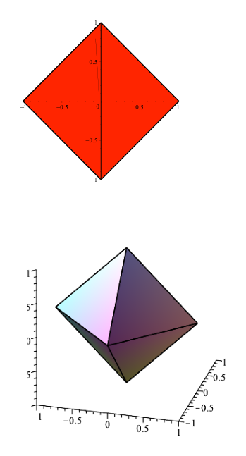
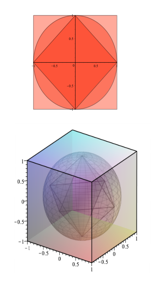
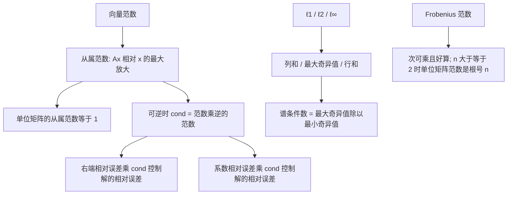

# 第8章 向量范数与矩阵范数

### 本章总览

本章用 norm（范数）回答两件事：两个向量或两块矩阵有多近，以及一列向量或矩阵是否收敛。后半章把范数用到线性方程组的扰动、不相容方程组的近似解，以及 matrix exponential（矩阵指数）。

阅读范围：PDF 第 313–362 页，对应 8.1–8.10。习题不展开。

视觉和机器人里，范数是误差的尺度。标定、位姿和最小二乘拟合都要看数据的微小变动会不会把解放大。二维斜对称矩阵的指数是旋转；三维的 Rodrigues 公式本章只点名，显式公式在第 11.7 节。

### 核心知识点

#### 范数与赋范空间

设 $K$ 为 $\mathbb{R}$ 或 $\mathbb{C}$，$E$ 为 $K$ 上的向量空间。$\mathbb{R}_+=\{x\in\mathbb{R}\mid x\ge0\}$。复数 $z=a+ib$ 的 modulus（模）是 $|z|=\sqrt{z\overline{z}}=\sqrt{a^2+b^2}$。

定义 8.1。norm（范数）是 $E\to\mathbb{R}_+$ 的函数 $\lVert\,\rVert$，对一切 $x,y\in E$ 和 $\lambda$ $\in K$ 满足：

- (N1) $\lVert x\rVert\ge0$，且 $\lVert x\rVert=0$ 当且仅当 $x=0$（positivity，正性）。
- (N2) $\lVert$ $\lambda$ $x\rVert=|$ $\lambda$ $|\,\lVert x\rVert$（homogeneity，齐次性）。
- (N3) $\lVert x+y\rVert\le\lVert x\rVert+\lVert y\rVert$（triangle inequality，三角不等式）。

带范数的 $E$ 叫做 normed vector space（赋范向量空间）。

由 (N2) 得 $\lVert-x\rVert=\lVert x\rVert$。再由三角不等式可得反向估计：对一切 $x,y\in E$，

\[
\bigl|\lVert x\rVert-\lVert y\rVert\bigr|\le\lVert x-y\rVert.
\tag{$*$}
\]

令 (N2) 中 $\lambda$ $=0$，得到 $\lVert0\rVert=0$，不必先假设 (N1)。再令 $(*)$ 中 $y=0$，正性里的 $\lVert x\rVert\ge0$ 已经能从 (N2)、(N3) 推出。因此 (N1) 可以换成更弱的

- (N1') 若 $\lVert x\rVert=0$，则 $x=0$。

只满足 (N2)、(N3) 的函数叫做 seminorm（半范数）。半范数仍有 $\lVert x\rVert\ge0$ 和 $\lVert0\rVert=0$，但允许某个非零向量的范数为 0。

最简单的例子：$\mathbb{R}$ 上 $\lVert x\rVert=|x|$；$\mathbb{C}$ 上 $\lVert z\rVert=|z|$。

🔑 关键速记：范数的核心是齐次性和三角不等式；正性里的“$\ge0$”能由这两条推出，真正要单独保证的是“范数为 0 则向量为 0”。

#### $\ell^p$ 范数与单位球

在 $\mathbb{R}^n$ 或 $\mathbb{C}^n$ 上，例 8.1 给出三条标准范数。对 $x=(x_1,\ldots,x_n)$，

$$
\begin{aligned}
\lVert x\rVert_1&=|x_1|+\cdots+|x_n|,\cr
\lVert x\rVert_2&=\bigl(|x_1|^2+\cdots+|x_n|^2\bigr)^{1/2},\cr
\lVert x\rVert_\infty&=\max\{|x_i|\mid 1\le i\le n\}.
\end{aligned}
$$

$\lVert\,\rVert_2$ 是 Euclidean norm（欧氏范数），$\lVert\,\rVert_\infty$ 是 sup-norm（上确界范数）。更一般地，$p\ge1$ 时 $\ell^p$-norm 为

$$
\lVert x\rVert_p=\bigl(|x_1|^p+\cdots+|x_n|^p\bigr)^{1/p}.
$$

闭单位球 $\{x\mid\lVert x\rVert\le1\}$ 的形状把三条范数分开。Figure 8.1–8.3 分别画 $\ell^1$、欧氏范数和上确界范数在 $\mathbb{R}^2$、$\mathbb{R}^3$ 中的闭单位球：平面上是钻石形、圆盘、正方形；空间中是正八面体、球、立方体。

图注：Figure 8.1。上图是 $\{x\in\mathbb{R}^2\mid\lVert x\rVert_1\le1\}$，菱形顶点在坐标轴 $\pm1$ 处。下图是 $\{x\in\mathbb{R}^3\mid\lVert x\rVert_1\le1\}$，正八面体的六个顶点同样落在坐标轴上。$\ell^1$ 单位球是“对角被削尖”的多面体。

图注：Figure 8.4。上图在 $\mathbb{R}^2$ 中，红色菱形是 $\ell^1$ 闭单位球，圆是欧氏闭单位球，外层正方形是上确界范数闭单位球。下图在 $\mathbb{R}^3$ 中，正八面体套在球内，球再套在立方体内。包含方向与命题 8.3 的不等式一致：$\lVert x\rVert_1$ 最大、$\lVert x\rVert_\infty$ 最小。

书中还举了三条不是标准 $\ell^p$ 的范数，用来说明单位球不必是圆或方：

1. $\mathbb{R}^2$ 上 $\lVert(u_1,u_2)\rVert=|u_1|+2|u_2|$（Figure 8.5）。
2. $\mathbb{R}^2$ 上 $\lVert(u_1,u_2)\rVert=\bigl((u_1+u_2)^2+u_1^2\bigr)^{1/2}$（Figure 8.6）。
3. $\mathbb{C}^2$ 上 $\lVert(u_1,u_2)\rVert=|u_1+iu_2|+|u_1-iu_2|$。

命题 8.1。$p\ge1$ 时，$\mathbb{R}^n$ 与 $\mathbb{C}^n$ 上的 $\ell^p$ 范数确实是范数。$p=1$ 和 $p=\infty$ 直接验证。$p>1$ 时取共轭指标 $q>1$，使

$$
\frac{1}{p}+\frac{1}{q}=1.
$$

证明用到 Young 不等式：$\alpha$ $,$ $\beta$ $\ge0$ 时 $\alpha$ $\beta$ $\le$ $\alpha$ $^p/p+$ $\beta$ $^q/q$。它来自指数函数的凸性。由此先得到

\[
\sum_{i=1}^n |u_i v_i|\le \lVert u\rVert_p\,\lVert v\rVert_q,
\tag{$**$}
\]

再推出三角不等式。$(**)$ 叫做 Hölder 不等式；$p=2$ 时就是 Cauchy–Schwarz 不等式。$\ell^p$ 的三角不等式另有名字：Minkowski 不等式。

推论 8.2（Hölder 不等式）。$p,q\ge1$ 且 $1/p+1/q=1$（$p=1$ 时 $q=+\infty$，反过来同样）时，

$$
\sum_{i=1}^n |u_i v_i|
\le
\Bigl(\sum_{i=1}^n |u_i|^p\Bigr)^{1/p}
\Bigl(\sum_{i=1}^n |v_i|^q\Bigr)^{1/q},
$$

并且 $|\langle u,v\rangle|\le\lVert u\rVert_p\,\lVert v\rVert_q$。

$\mathbb{C}^n$ 上的 Hermitian inner product（埃尔米特内积）是

$$
\langle u,v\rangle=\sum_{i=1}^n u_i\overline{v_i}=v^*u=\overline{u^*v}.
$$

限制到 $\mathbb{R}^n$ 就是欧氏内积 $\langle u,v\rangle=\sum u_i v_i$。列向量写法：实向量 $\langle u,v\rangle=u^\top v=v^\top u$；复向量用上面的 $v^*u$。特别地，

$$
\lVert u\rVert_2^2=u^*u\quad(\text{复}),\qquad
\lVert u\rVert_2^2=u^\top u\quad(\text{实}).
$$

书中提醒：$u^\top v$ 这种写法在无穷维里不再自然，内积记号 $\langle u,v\rangle$ 更稳。

$0<p<1$ 时 $x$ $\mapsto$ $\lVert x\rVert_p$ **不是范数**。反例：$x=(2,0)$，$y=(0,2)$，则 $\lVert x\rVert_p=\lVert y\rVert_p=2$，而

$$
\lVert x+y\rVert_p=2^{(p+1)/p}>4=\lVert x\rVert_p+\lVert y\rVert_p,
$$

三角不等式失败。同一例子还说明它不凸：$\lVert\tfrac12(x+y)\rVert_p=2^{1/p}>2$。

$p=0$ 时书中把 $\lVert x\rVert_0$ 定义成非零分量的个数。它也不是范数，因为 (N2) 失败：$\lVert(1,0)\rVert_0=1$，而 $\lVert(10,0)\rVert_0=1\neq10$。它还不凸。机器学习里仍用它作正则项，用来鼓励稀疏。

命题 8.3。对 $\mathbb{R}^n$ 或 $\mathbb{C}^n$ 中的一切 $x$，

$$
\begin{aligned}
\lVert x\rVert_\infty&\le\lVert x\rVert_1\le n\lVert x\rVert_\infty,\cr
\lVert x\rVert_\infty&\le\lVert x\rVert_2\le\sqrt{n}\,\lVert x\rVert_\infty,\cr
\lVert x\rVert_2&\le\lVert x\rVert_1\le\sqrt{n}\,\lVert x\rVert_2.
\end{aligned}
$$

这三条就是 Figure 8.4 里单位球互相包含的代数形式，也是后面“有限维范数全都等价”的一个特例。

🔑 关键速记：$p\ge1$ 才是范数；$p=2$ 的 Hölder 不等式就是 Cauchy–Schwarz；单位球从内到外是 $\ell^1$、$\ell^2$、$\ell^\infty$。

#### 范数等价

定义 8.2。同一空间上的两个范数 $\lVert\,\rVert_a$、$\lVert\,\rVert_b$ 等价，是指存在 $C_1,C_2>0$，使对一切 $u$，

$$
\lVert u\rVert_a\le C_1\lVert u\rVert_b,\qquad
\lVert u\rVert_b\le C_2\lVert u\rVert_a.
$$

开球语言：$a$-开球 $B_a(x,$ $\rho$ $)=\{z\mid\lVert z-x\rVert_a<$ $\rho$ $\}$ 里总能装进一个 $b$-开球 $B_b(x,$ $\rho$ $/C_1)$，反过来也行。因此两个等价范数诱导**同一套开集**，也就是同一个 topology（拓扑）。开集的定义是：空集，或者每个点都含有一个完全落在该集合里的开球。

任取有限维空间的一组基 $(e_1,\ldots,e_n)$，任意范数都被这组基上的 $\ell^1$ 范数控制：若 $C=\max_i\lVert e_i\rVert$，则 $\lVert x\rVert\le C\lVert x\rVert_1$。于是 $u$ $\mapsto$ $\lVert u\rVert$ 对 $\lVert\,\rVert_1$ 连续（推论 8.4）。

定理 8.5。实或复的有限维向量空间上，任意两个范数都等价。

证明只留路线：只要证明任意范数都与 $\ell^1$ 等价。单位球面 $S^{n-1}_1=\{x\mid\lVert x\rVert_1=1\}$ 紧，连续函数 $x$ $\mapsto$ $\lVert x\rVert$ 在上面取得正的最小值 $m$ 和最大值 $M$，于是 $m\lVert x\rVert_1\le\lVert x\rVert\le M\lVert x\rVert_1$。

有限维里换范数不改变“是否收敛”，只改变常数。无穷维里范数可以不等价，本章不展开。

书中还记了一条二次范数。$P$ 为 $n\times n$ 实对称正定矩阵时，

$$
\lVert x\rVert_P=(x^\top Px)^{1/2}
$$

是 $\mathbb{R}^n$ 上的范数，叫做 quadratic norm（二次范数）。用 Löwner–John 椭球可以证明：任意范数都能被某条二次范数夹住，

$$
\lVert x\rVert_P\le\lVert x\rVert\le\sqrt{n}\,\lVert x\rVert_P.
$$

这一步书中指向 Boyd and Vandenberghe，不在本章证明。

🔑 关键速记：有限维上所有范数等价，开球可以互相嵌套，收敛与否与选哪条范数无关。

#### 矩阵范数、谱与谱半径

8.2 节先讨论方阵空间 $M_n(\mathbb{R})$、$M_n(\mathbb{C})$。多数结论对长方阵 $M_{m,n}$ 也成立。矩阵可以相乘，所以矩阵范数要比向量范数多一条乘法约束。

定义 8.3。$M_n(K)$ 上的 matrix norm（矩阵范数）是向量空间范数，并且 submultiplicative（次可乘）：

$$
\lVert AB\rVert\le\lVert A\rVert\,\lVert B\rVert.
$$

因为 $I^2=I$，每条矩阵范数都有 $\lVert I\rVert\ge1$。

本章顺手复习后面要用的矩阵语言。$A=(a_{ij})$ 的共轭是逐项取共轭。转置 $A^\top$ 把 $a_{ji}$ 放到 $(i,j)$。伴随（共轭转置）$A^*=\overline{A^\top}$。实矩阵上 $A^*=A^\top$。

- Hermitian（埃尔米特）：$A^*=A$。实的情形叫做 symmetric（对称），$A^\top=A$。
- normal（正规）：$AA^*=A^*A$。实矩阵则是 $AA^\top=A^\top A$。
- unitary（酉）：$UU^*=U^*U=I$。实的情形叫做 orthogonal（正交），$QQ^\top=Q^\top Q=I$。

trace（迹）$\operatorname{tr}(A)=a_{11}+\cdots+a_{nn}$，对矩阵线性。$A$ 为 $m\times n$、$B$ 为 $n\times m$ 时 $\operatorname{tr}(AB)=\operatorname{tr}(BA)$。

定义 8.4。$\lambda$ $\in\mathbb{C}$ 是 $A\in M_n(\mathbb{C})$ 的 eigenvalue（特征值），如果存在非零 $u\in\mathbb{C}^n$ 使 $Au=$ $\lambda$ $u$。这样的 $u$ 叫做 eigenvector（特征向量）。特征向量再添上零向量，构成 eigenspace（特征空间）$E_\lambda(A)$。

书中特别规定特征向量非零。因此“全体特征向量”本身不是子空间，零向量被排除在外。若允许零向量当特征向量，则每个标量都满足 $A0=$ $\lambda$ $0$，特征值就失去意义。

实方阵可以没有实特征值。例如

$$
\begin{pmatrix}0&-1\cr1&0\end{pmatrix}
$$

的特征值是 $i$ 和 $-i$。所以即便矩阵是实的，谱也通常放到 $\mathbb{C}$ 里看。

$\lambda$ 是特征值，当且仅当 $\lambda$ $I-A$ 不可逆，当且仅当 $\det($ $\lambda$ $I-A)=0$。这个行列式是 $\lambda$ 的 $n$ 次多项式。

定义 8.5。characteristic polynomial（特征多项式）为

$$
\det(\lambda I-A)=\lambda^n-\operatorname{tr}(A)\,\lambda^{n-1}+\cdots+(-1)^n\det(A).
$$

它的 $n$ 个根 $\lambda$ $_1,\ldots,$ $\lambda$ $_n$（按重数计）构成 spectrum（谱）。spectral radius（谱半径）是

$$
\rho(A)=\max_{1\le i\le n}|\lambda_i|.
$$

由根与系数的关系（细节见第 14.1 节），

$$
\operatorname{tr}(A)=\lambda_1+\cdots+\lambda_n,\qquad
\det(A)=\lambda_1\cdots\lambda_n.
$$

👉 特征值在本章只按方阵定义：非零向量被 $A$ 拉成自己的标量倍，谱是特征多项式的全部根，谱半径是这些根的最大模。一般线性映射的谱、重数和对角化不在本章。完整讲解见第 14 章。📝待补全

命题 8.6。任意矩阵范数都满足 $\rho$ $(A)\le\lVert A\rVert$。

结论的来路：取模最大的特征值 $\lambda$ 和对应特征向量 $u\neq0$，用各列都是 $u$ 的矩阵 $U$，则 $AU=$ $\lambda$ $U$，次可乘给出 $|$ $\lambda$ $|\,\lVert U\rVert\le\lVert A\rVert\,\lVert U\rVert$。实矩阵范数上的同一不等式是命题 8.9，证明要绕开可能为复的特征向量，用到 $\rho$ $(A^k)=($ $\rho$ $(A))^k$ 以及有限维范数等价；幂的特征值用命题 14.7。

👉 命题 14.7 说：若 $\lambda$ $_1,\ldots,$ $\lambda$ $_n$ 是 $A$ 的特征值（计重数），则 $\lambda$ $_1^k,\ldots,$ $\lambda$ $_n^k$ 是 $A^k$ 的特征值。因此谱半径满足 $\rho$ $(A^k)=($ $\rho$ $(A))^k$。本章用它把复矩阵上的 $\rho$ $(A)\le\lVert A\rVert$ 转到实矩阵范数。完整证明见第 14 章。📝待补全

实对称矩阵的特征值全是实数，并且存在正交 $Q$ 使 $A=Q\operatorname{diag}($ $\lambda$ $_1,\ldots,$ $\lambda$ $_n)Q^\top$。复埃尔米特矩阵类似，用酉矩阵 $U$ 和 $A=U\operatorname{diag}($ $\lambda$ $_1,\ldots,$ $\lambda$ $_n)U^*$。

👉 实对称矩阵的特征值全是实数，并且存在正交矩阵把它变成对角阵；复埃尔米特矩阵用酉矩阵，对角元同样是全体实特征值。本章用这个事实说明谱范数和奇异值落在实数上。正交/酉对角化的证明在第 16 章。📝待补全

🔑 关键速记：矩阵范数次可乘，因而 $\lVert I\rVert\ge1$；任何矩阵范数都压住谱半径，$\rho$ $(A)\le\lVert A\rVert$。

#### Frobenius 范数

把 $n\times n$ 矩阵按行或按列拉成 $\mathbb{C}^{n^2}$ 里的向量，再取 $\ell^2$ 范数，就得到 Frobenius 范数。

定义 8.6。

$$
\lVert A\rVert_F
=\Bigl(\sum_{i,j=1}^n |a_{ij}|^2\Bigr)^{1/2}
=\sqrt{\operatorname{tr}(AA^*)}
=\sqrt{\operatorname{tr}(A^*A)}.
$$

命题 8.7。

1. $\lVert\,\rVert_F$ 是矩阵范数：$\lVert AB\rVert_F\le\lVert A\rVert_F\lVert B\rVert_F$。次可乘来自 Cauchy–Schwarz。
2. 酉不变：酉矩阵 $U,V$ 满足 $\lVert A\rVert_F=\lVert UA\rVert_F=\lVert AV\rVert_F=\lVert UAV\rVert_F$。
3. $\sqrt{\rho(A^*A)}\le\lVert A\rVert_F\le\sqrt{n}\,\sqrt{\rho(A^*A)}$。

第 3 条用到：迹等于特征值之和（第 14.1 节），且 $A^*A$ 对称半正定，特征值非负，所以最大特征值 $\rho$ $(A^*A)$ 与迹之间有 $1$ 到 $n$ 倍的关系。

👉 迹等于全体特征值之和，这是特征多项式根与系数的关系，细节在第 14.1 节。$A^*A$ 的特征值非负，所以最大特征值 $\rho$ $(A^*A)$ 与迹之间相差至多 $n$ 倍。本章用这条夹住 Frobenius 范数。半正定谱的完整论证见第 14.1 节。📝待补全

别名：Hilbert–Schmidt 范数，也叫 Schur 范数。长方阵同样可定义

$$
\lVert A\rVert_F=\Bigl(\sum_{i=1}^m\sum_{j=1}^n |a_{ij}|^2\Bigr)^{1/2}.
$$

只要乘法有意义，就仍有 $\lVert AB\rVert\le\lVert A\rVert\lVert B\rVert$。从属范数要求 $\lVert I\rVert=1$，而 $\lVert I\rVert_F=\sqrt{n}$。因此 $n\ge2$ 时 Frobenius 范数留在从属范数之外，这一点放在从属范数一节说明。

🔑 关键速记：Frobenius 范数是把矩阵拉直后的欧氏长度，酉变换不改变它，而且好算；它夹在谱范数和 $\sqrt{n}$ 倍谱范数之间。

#### 从属范数

命题 8.8。有限维上，每个方阵 $A$ 都有常数 $C_A\ge0$，使 $\lVert Au\rVert\le C_A\lVert u\rVert$。也就是每个线性映射都 bounded（有界），从而连续。在任意赋范空间里，线性映射有界当且仅当连续，与维数无关。

因此

$$
\sup_{x\neq 0}\frac{\lVert Ax\rVert}{\lVert x\rVert}
=\sup_{\lVert x\rVert=1}\lVert Ax\rVert
$$

有限。这给出定义 8.7：向量范数 $\lVert\,\rVert$ 在 $M_n(\mathbb{C})$ 上诱导的 subordinate matrix norm（从属矩阵范数），也叫 operator norm（算子范数），

$$
\lVert A\rVert_{\mathrm{op}}
=\sup_{x\neq 0}\frac{\lVert Ax\rVert}{\lVert x\rVert}
=\sup_{\lVert x\rVert=1}\lVert Ax\rVert.
$$

Horn and Johnson 也把它写成 $\Vert\!\vert A\Vert\!\vert$。它确实是范数，并且

$$
\lVert Ax\rVert\le\lVert A\rVert_{\mathrm{op}}\lVert x\rVert,
$$

从而 $\lVert AB\rVert_{\mathrm{op}}\le\lVert A\rVert_{\mathrm{op}}\lVert B\rVert_{\mathrm{op}}$，所以从属范数一定是矩阵范数。等价写法是

$$
\lVert A\rVert_{\mathrm{op}}=\inf\{\lambda\in\mathbb{R}\mid \lVert Ax\rVert\le\lambda\lVert x\rVert,\;\forall x\}.
$$

有限维单位球面紧，$x$ $\mapsto$ $\lVert Ax\rVert$ 连续，所以上确界取得到，$\sup$ 可以写成 $\max$，$\inf$ 可以写成 $\min$。于是存在 $x\neq0$ 使 $\lVert Ax\rVert=\lVert A\rVert_{\mathrm{op}}\lVert x\rVert$。

由定义直接得到 $\lVert I\rVert_{\mathrm{op}}=1$。所以 $n\ge2$ 时 Frobenius 范数不可能是某条向量范数的从属范数。

后文在不致混淆时省略下标 op，向量和矩阵共用 $\lVert\,\rVert$。

定义 8.8 把从属关系推广到长方阵：$M_{m,n}(K)$ 上的范数从属于 $K^n$ 上的 $\lVert\,\rVert_a$ 和 $K^m$ 上的 $\lVert\,\rVert_b$，是指 $\lVert Ax\rVert_b\le\lVert A\rVert\,\lVert x\rVert_a$。

若向量范数定义在 $\mathbb{C}^n$ 上，只对实向量取上确界，得到实矩阵上的 $\lVert A\rVert_R$。一般有 $\lVert A\rVert_R\le\lVert A\rVert$，而且可以严格小于。为避开这种裂缝，书中把从属矩阵范数定义在 $M_n(\mathbb{C})$ 上。对 $\lVert\,\rVert_1$、$\lVert\,\rVert_2$、$\lVert\,\rVert_\infty$，两者恰好相等。

无穷维时，连续线性映射的集合记为 $L(E;F)$，算子范数仍用同一个 $\sup$ 定义，并且 $\lVert g\circ f\rVert\le\lVert g\rVert\,\lVert f\rVert$。此时 $\sup$ 不能改成 $\max$。

命题 8.10 把三条标准向量范数的从属范数算出来。对 $A=(a_{ij})\in M_n(\mathbb{C})$，

$$
\begin{aligned}
\lVert A\rVert_1
&=\max_j\sum_{i=1}^n |a_{ij}|,\cr
\lVert A\rVert_\infty
&=\max_i\sum_{j=1}^n |a_{ij}|,\cr
\lVert A\rVert_2
&=\sqrt{\rho(A^*A)}=\sqrt{\rho(AA^*)}.
\end{aligned}
$$

也就是：$\lVert A\rVert_1$ 是列的 $\ell^1$ 范数的最大值，$\lVert A\rVert_\infty$ 是行的 $\ell^1$ 范数的最大值。

下面先列这三条和 Frobenius 范数的对照，再补谱范数的性质。

| 名称 | 由谁诱导 | 计算公式 | 约束与坑点 |
| --- | --- | --- | --- |
| $\lVert A\rVert_1$ | 向量 $\ell^1$ | 最大列和 $\max_j\sum_i|a_{ij}|$ | 从属范数，$\lVert I\rVert_1=1$ |
| $\lVert A\rVert_\infty$ | 向量 $\ell^\infty$ | 最大行和 $\max_i\sum_j|a_{ij}|$ | 从属范数，$\lVert I\rVert_\infty=1$ |
| $\lVert A\rVert_2$ | 向量 $\ell^2$ | $\sqrt{\rho(A^*A)}=$ $\sigma$ $_1$ | 谱范数；酉不变；正规矩阵上等于 $\rho$ $(A)$ |
| $\lVert A\rVert_F$ | 把矩阵看成向量的 $\ell^2$ | $\bigl(\sum_{i,j}|a_{ij}|^2\bigr)^{1/2}$ | 矩阵范数且酉不变；$n\ge2$ 时不是从属范数 |

表中 $\sigma$ $_1$ 是最大奇异值，见下一节。计算上，行和与列和直接可得；谱范数要最大奇异值；Frobenius 范数只做元素平方和，常用来上界谱范数。

命题 8.10 还给出：$\lVert A^*\rVert_2=\lVert A\rVert_2$；$\lVert\,\rVert_2$ 酉不变，$\lVert A\rVert_2=\lVert UAV\rVert_2$；若 $A$ 正规，则 $\lVert A\rVert_2=$ $\rho$ $(A)$。

定义 8.9。$\lVert A\rVert_2$ 常叫做 spectral norm（谱范数）。

证明里，$\lVert A\rVert_2^2=\sup_{x^*x=1}x^*A^*Ax$ 等于 $A^*A$ 的最大特征值。书中把“二次型在单位球上的最大值就是最大特征值”推迟到讨论二次函数优化时再证，本章先使用这个结论。

👉 $\lVert A\rVert_2^2$ 等于单位球面 $x^*x=1$ 上二次型 $x^*A^*Ax$ 的最大值。书中写 $A^*A$ 对称、特征值全实，并可相对酉矩阵对角化，因此这个最大值就是 $\rho$ $(A^*A)$。该优化步骤推迟到后文讲二次函数时，本章未标章节号，先把 $\lVert A\rVert_2=\sqrt{\rho(A^*A)}$ 当作命题 8.10 的结论使用。📝待补全

由命题 8.7(3) 立刻有

$$
\lVert A\rVert_2\le\lVert A\rVert_F\le\sqrt{n}\,\lVert A\rVert_2.
$$

Frobenius 范数比谱范数容易算，所以常用它给谱范数做上界。长方阵的 $\lVert\,\rVert_1$、$\lVert\,\rVert_2$、$\lVert\,\rVert_\infty$ 公式相同。

另有一条对偶写法：$1/p+1/q=1$ 时，

$$
\lVert A^*\rVert_q=\lVert A\rVert_p
=\sup\bigl\{\operatorname{Re}(y^*Ax)\bigm|\lVert x\rVert_p=1,\lVert y\rVert_q=1\bigr\}.
$$

🔑 关键速记：从属范数是“向量被矩阵放大的最大倍数”；$\ell^1$ 看列和，$\ell^\infty$ 看行和，$\ell^2$ 看 $\sqrt{\rho(A^*A)}$，并且 $\lVert I\rVert=1$。

#### 从属范数的两个技术不等式

8.4 节的两条不等式服务后面的条件数和矩阵幂级数。

命题 8.11。设 $\lVert\,\rVert$ 是矩阵范数，$B\in M_n(\mathbb{C})$。

1. 若它是从属范数且 $\lVert B\rVert<1$，则 $I+B$ 可逆，并且

$$
\lVert(I+B)^{-1}\rVert\le\frac{1}{1-\lVert B\rVert}.
$$

2. 若 $I+B$ 奇异，则对**每一条**矩阵范数都有 $\lVert B\rVert\ge1$。此时 $-1$ 是 $B$ 的特征值，再用 $\rho$ $(B)\le\lVert B\rVert$。

命题 8.12。对任意 $A\in M_n(\mathbb{C})$ 和任意 $\epsilon$ $>0$，存在某条从属矩阵范数使

$$
\lVert A\rVert\le\rho(A)+\epsilon.
$$

证明用定理 14.5：$A=UTU^{-1}$，$T$ 上三角，对角元是特征值。再用对角缩放 $D_\delta=\operatorname{diag}(1,$ $\delta$ $,$ $\delta$ $^2,\ldots,$ $\delta$ $^{n-1})$ 把上三角的非对角元压小，然后取 $\lVert\,\rVert_\infty$ 的一个相似变形作为从属范数。

等号一般达不到。反例

$$
A=\begin{pmatrix}0&1\cr0&0\end{pmatrix},
$$

$\rho$ $(A)=0$，但 $A\neq0$，所以每条范数都有 $\lVert A\rVert>0$。

👉 定理 14.5 是 Schur 三角化：每个复方阵都可写成 $A=UTU^{-1}$，$T$ 上三角，对角元为全部特征值。把上三角的非对角元用对角缩放压小之后，就能造出一条从属范数，使 $\lVert A\rVert$ 落在 $\rho$ $(A)$ 与 $\rho$ $(A)+$ $\epsilon$ 之间。三角化本身的证明在第 14 章。📝待补全

谱半径本身不是范数。它被每条矩阵范数压在上面，又能被某条从属范数从上面任意逼近，但命题 8.12 的反例说明它不必等于某条固定范数。

🔑 关键速记：$\lVert B\rVert<1$ 时 $I+B$ 可逆，逆的范数不超过 $1/(1-\lVert B\rVert)$；从属范数可以比谱半径只大一个任意小的 $\epsilon$。

#### 条件数

存在方程组 $Ax=b$，右端或系数的微小变动会让解大变。书中的例子是

$$
\begin{pmatrix}
10&7&8&7\cr
7&5&6&5\cr
8&6&10&9\cr
7&5&9&10
\end{pmatrix}
\begin{pmatrix}x_1\crx_2\crx_3\crx_4\end{pmatrix}
=
\begin{pmatrix}32\cr23\cr33\cr31\end{pmatrix},
$$

解为 $x=(1,1,1,1)$。把右端扰动为 $b+$ $\Delta$ $b$，

$$
\Delta b=(0.1,\,-0.1,\,0.1,\,-0.1)^\top,
$$

新解是 $(9.2,-12.6,4.5,-1.1)$，故

$$
\Delta x=(8.2,-13.6,3.5,-2.1).
$$

用 $1$-范数，

$$
\frac{\lVert\Delta b\rVert_1}{\lVert b\rVert_1}=\frac{0.4}{119}=\frac{4}{1190}\approx\frac{1}{300},
\qquad
\frac{\lVert\Delta x\rVert_1}{\lVert x\rVert_1}=\frac{27.4}{4}\approx 7.
$$

数据的相对误差大约 $1/300$，解的相对误差大约 $7$，放大约 $2100$ 倍。

再把系数改成

$$
\begin{pmatrix}
10&7&8.1&7.2\cr
7.08&5.04&6&5\cr
8&5.98&9.98&9\cr
6.99&4.99&9&9.98
\end{pmatrix},
$$

右端仍是 $(32,23,33,31)^\top$，解变成 $(-81,137,-34,22)$。原矩阵对称、行列式为 $1$、元素为整数，仍然经不起扰动。原因是它 ill-conditioned（病态）：条件数大。

设 $\lVert\,\rVert$ 是向量范数，矩阵上用它的从属范数。只扰动右端时，$Ax=b$ 与 $A(x+$ $\Delta$ $x)=b+$ $\Delta$ $b$ 给出 $\Delta$ $x=A^{-1}$ $\Delta$ $b$，于是

$$
\frac{\lVert\Delta x\rVert}{\lVert x\rVert}
\le\bigl(\lVert A\rVert\,\lVert A^{-1}\rVert\bigr)
\frac{\lVert\Delta b\rVert}{\lVert b\rVert}.
$$

只扰动系数时，$Ax=b$ 与 $(A+$ $\Delta$ $A)(x+$ $\Delta$ $x)=b$ 给出

$$
\frac{\lVert\Delta x\rVert}{\lVert x+\Delta x\rVert}
\le\bigl(\lVert A\rVert\,\lVert A^{-1}\rVert\bigr)
\frac{\lVert\Delta A\rVert}{\lVert A\rVert}.
$$

两边的放大因子都是 $\lVert A\rVert\,\lVert A^{-1}\rVert$。

定义 8.10。对从属矩阵范数，可逆矩阵 $A$ 的 condition number（条件数）是

$$
\operatorname{cond}(A)=\lVert A\rVert\,\lVert A^{-1}\rVert.
$$

条件数大，就说方程组病态。它度量的是解对数据 $b$ 和 $A$ 的敏感程度。

向量范数、从属范数和条件数的关系可以收成下面这条链。原书没有这张流程图，单位球的形状见 Figure 8.4。

图注：从属范数由向量范数取“最大放大倍数”得到，条件数再用它乘上逆矩阵的范数。谱范数下条件数等于最大、最小奇异值之比。Frobenius 范数可以上界谱范数，但不走这条从属链。

命题 8.13。$b\neq0$ 时

$$
\frac{\lVert\Delta x\rVert}{\lVert x\rVert}
\le\operatorname{cond}(A)\frac{\lVert\Delta b\rVert}{\lVert b\rVert},
$$

而且这是最好的界：对给定的 $A$，存在 $b\neq0$ 和 $\Delta$ $b\neq0$ 使等号成立。等号用到从属范数的最大值取得到。

命题 8.14。$b\neq0$ 时

$$
\frac{\lVert\Delta x\rVert}{\lVert x+\Delta x\rVert}
\le\operatorname{cond}(A)\frac{\lVert\Delta A\rVert}{\lVert A\rVert},
$$

同样是最好的界。若扰动足够小，例如 $\lVert$ $\Delta$ $A\rVert<1/\lVert A^{-1}\rVert$，则

$$
\frac{\lVert\Delta x\rVert}{\lVert x\rVert}
\le\operatorname{cond}(A)\frac{\lVert\Delta A\rVert}{\lVert A\rVert}
\cdot
\frac{1}{1-\lVert A^{-1}\rVert\,\lVert\Delta A\rVert}.
$$

括号里的因子在 $\lVert$ $\Delta$ $A\rVert\to0$ 时趋于 $1$，所以书中也写成 $1+O(\lVert$ $\Delta$ $A\rVert)$。这一步用命题 8.11 保证 $I+A^{-1}$ $\Delta$ $A$ 可逆。

若 $A$ 和 $b$ 同时扰动，且 $\lVert$ $\Delta$ $A\rVert<1/\lVert A^{-1}\rVert$、$b\neq0$，则

$$
\frac{\lVert\Delta x\rVert}{\lVert x\rVert}
\le
\frac{\operatorname{cond}(A)}{1-\lVert A^{-1}\rVert\,\lVert\Delta A\rVert}
\left(
\frac{\lVert\Delta A\rVert}{\lVert A\rVert}
+\frac{\lVert\Delta b\rVert}{\lVert b\rVert}
\right).
$$

证明书中指向 Demmel 与 Horn and Johnson，不在本章。

要算出谱范数下的条件数，需要奇异值。定义 8.11 先给出分解，存在性放在第 20.2 节。

对 $A\in M_n(\mathbb{C})$，存在酉矩阵 $U,V$ 和实对角阵 $\Sigma$ $=\operatorname{diag}($ $\sigma$ $_1,\ldots,$ $\sigma$ $_n)$，$\sigma$ $_1\ge$ $\sigma$ $_2\ge\cdots\ge$ $\sigma$ $_n\ge0$，使

$$
A=V\Sigma U^*.
$$

书中把三元组 $(U,V,$ $\Sigma$ $)$ 叫做 singular decomposition（奇异分解），简写 SVD。实矩阵时 $U,V$ 取正交矩阵。$\sigma$ $_i$ 叫做 singular values（奇异值）。

由此 $A^*A=U$ $\Sigma$ $^2 U^*$，$AA^*=V$ $\Sigma$ $^2 V^*$。所以 $\sigma$ $_i^2$ 是 $A^*A$ 和 $AA^*$ 的特征值，$U$ 的列是 $A^*A$ 的特征向量，$V$ 的列是 $AA^*$ 的特征向量。最大奇异值满足 $\sigma$ $_1=\sqrt{\rho(A^*A)}$。

👉 奇异分解把方阵写成 $A=V$ $\Sigma$ $U^*$：左右是酉矩阵，中间对角元 $\sigma$ $_1\ge\cdots\ge$ $\sigma$ $_n\ge0$ 是奇异值。$\sigma$ $_i^2$ 同时是 $A^*A$ 与 $AA^*$ 的特征值。谱范数等于 $\sigma$ $_1$，谱条件数等于 $\sigma$ $_1/$ $\sigma$ $_n$。存在性证明在第 20.2 节。📝待补全

推论 8.15。谱范数等于最大奇异值，也等于奇异值向量的 $\ell^\infty$ 范数：

$$
\lVert A\rVert_2=\max_i\sigma_i=\lVert(\sigma_1,\ldots,\sigma_n)\rVert_\infty.
$$

推论 8.16。Frobenius 范数等于奇异值向量的 $\ell^2$ 范数：

$$
\lVert A\rVert_F=(\sigma_1^2+\cdots+\sigma_n^2)^{1/2}=\lVert(\sigma_1,\ldots,\sigma_n)\rVert_2.
$$

正规矩阵的奇异值就是特征值的模：$\sigma$ $_i=|$ $\lambda$ $_i|$。

命题 8.17。可逆 $A\in M_n(\mathbb{C})$ 满足：

1. $\operatorname{cond}(A)\ge1$，$\operatorname{cond}(A)=\operatorname{cond}(A^{-1})$，且 $\alpha$ $\neq0$ 时 $\operatorname{cond}($ $\alpha$ $A)=\operatorname{cond}(A)$。
2. 谱范数条件数 $\operatorname{cond}_2(A)=$ $\sigma$ $_1/$ $\sigma$ $_n$。
3. $A$ 正规时 $\operatorname{cond}_2(A)=|$ $\lambda$ $_1|/|$ $\lambda$ $_n|$，其中 $|$ $\lambda$ $_1|\ge\cdots\ge|$ $\lambda$ $_n|$。
4. 酉矩阵或正交矩阵的 $\operatorname{cond}_2=1$。
5. $\operatorname{cond}_2$ 在酉乘法下不变：$\operatorname{cond}_2(A)=\operatorname{cond}_2(UA)=\operatorname{cond}_2(AV)$。

第 1 条来自 $\lVert I\rVert\le\lVert A\rVert\,\lVert A^{-1}\rVert$。第 4、5 条说明正交变换和酉变换非常良态，而且不改变谱条件数。

几何刻画：设 $\theta$ $(A)$ 是 $Au$ 与 $Av$ 之间的最小夹角，其中 $u,v$ 跑遍所有标准正交对。书中指出可以证明

$$
\operatorname{cond}_2(A)=\cot\bigl(\theta(A)/2\bigr).
$$

$A$ 接近奇异时，存在一对标准正交向量被 $A$ 映成几乎平行的向量，$\theta$ $(A)$ 很小，余切就很大。证明指向 Horn and Johnson，不在本章。

特征值全相同，条件数仍可以很大。书中的 $n\times n$ 例子是对角元全为 $1$、紧邻上对角全为 $2$ 的矩阵，并给出 $\operatorname{cond}_2(A)\ge2^{n-1}$。这句话的要点是：非正规矩阵不能用“特征值是否挤在一起”判断病态。

经典病态例子是 Hilbert 矩阵

$$
H^{(n)}_{ij}=\frac{1}{i+j-1}.
$$

$n=5$ 时书中给出 $\operatorname{cond}_2(H^{(5)})\approx4.77\times10^5$。$H^{(n)}$ 对称正定。渐近估计为

$$
\operatorname{cond}_2\bigl(H^{(n)}\bigr)=O\bigl((1+\sqrt{2})^{4n}/\sqrt{n}\bigr).
$$

行列式和逆的封闭公式放在习题 8.15，这里不展开。

回到开头那个 $4\times4$ 矩阵。它对称正定，特征值就是奇异值：

$$
\lambda_1\approx 30.2887>\lambda_2\approx 3.858>\lambda_3\approx 0.8431>\lambda_4\approx 0.01015,
$$

故 $\operatorname{cond}_2(A)=$ $\lambda$ $_1/$ $\lambda$ $_4\approx2984$。前面右端扰动的相对误差比上这个条件数后，接近命题 8.13 的上界。

🔑 关键速记：条件数是 $\lVert A\rVert\,\lVert A^{-1}\rVert$，谱范数下等于 $\sigma$ $_1/$ $\sigma$ $_n$；它是相对误差的最优放大倍数，正交矩阵的谱条件数是 $1$。

#### 不相容线性系统

8.6 节讨论 inconsistent（不相容）方程组 $Ax=b$：$b$ 不在 $A$ 的列空间里，通常方程个数多于未知数，精确解不存在。

拟合里这很常见。空间点 $\{p_1,\ldots,p_n\}$ 近乎共面，平面方程 $\alpha$ $x+$ $\beta$ $y+$ $\gamma$ $z+$ $\delta$ $=0$，$($ $\alpha$ $,$ $\beta$ $,$ $\gamma$ $)\neq0$。若相信平面不平行于 $z$ 轴，可写成

$$
z=ax+by+d.
$$

每个点 $p_i=(x_i,y_i,z_i)$ 给一条方程，$n>3$ 时一般无解。Legendre 和 Gauss 的做法是最小化平方误差

$$
\sum_{i=1}^n (ax_i+by_i+d-z_i)^2,
$$

也就是一般的 least squares（最小二乘）问题：最小化 $\lVert Ax-b\rVert_2^2$。

每个实的 $n\times m$ 矩阵都能写成 $A=VDU^\top$，其中 $U,V$ 正交，$D$ 是非负的矩形对角阵。这就是长方阵的 SVD，见第 20 章。

第 21 章证明：存在范数最小的 $x$ 使 $\lVert Ax-b\rVert_2$ 达到最小，这个 $x$ 由 Penrose pseudo-inverse（伪逆）给出，而伪逆由 SVD 写出。

👉 最小二乘是在 $A$ 的列空间里找离 $b$ 最近的点，目标函数是 $\lVert Ax-b\rVert_2^2$。长方阵的 SVD 把这个最小化化成对角缩放。达到最小距离、同时 $\lVert x\rVert_2$ 最小的那个解，由 Penrose 伪逆给出。存在性和伪逆公式在第 21 章。📝待补全

平方和会过分迁就 outlier（离群点）。这时更合适的是最小化 $\ell^1$ 误差 $\sum_i |ax_i+by_i+d-z_i|$。利用 $|t|=\max\{t,-t\}$，引进松弛变量 $e_i$，问题等价于线性规划

$$
\begin{aligned}
\text{minimize}\quad & e_1+\cdots+e_n\cr
\text{subject to}\quad & ax_i+by_i+d-z_i\le e_i,\cr
& -(ax_i+by_i+d-z_i)\le e_i.
\end{aligned}
$$

约束就是 $e_i\ge|ax_i+by_i+d-z_i|$。最优时等号必须成立，否则还可以把某个 $e_i$ 再减小。这里已经有不等式约束，不再是纯线性代数。书中停在这个动机，不展开线性规划。

若事先猜错了“不平行于哪根轴”，最小二乘解里相应系数会变得很大。这是建模假设失败时的信号，不是另一套范数。

🔑 关键速记：不相容系统没有精确解；$\ell^2$ 最小二乘交给伪逆，$\ell^1$ 则改写成带松弛变量的线性规划，用来压低离群点的权重。

#### 序列、Cauchy 列与级数

标量情形，$|x|<1$ 时 $\sum_{k=0}^\infty x^k=1/(1-x)$，并且 $\sum_{k=0}^n x^k/k!$ 收敛到 $e^x$。把 $x$ 换成方阵之前，先要定义赋范空间里的极限。

定义 8.12。序列 $(u_n)_{n\in\mathbb{N}}$ 收敛到 $v$，是指对每个 $\epsilon$ $>0$ 都存在 $N$，使 $n\ge N$ 时 $\lVert u_n-v\rVert<$ $\epsilon$。

收敛列一定满足：对每个 $\epsilon$ $>0$ 存在 $N$，使 $m,n\ge N$ 时 $\lVert u_m-u_n\rVert<$ $\epsilon$。反过来不必成立。有理数序列可以满足这个条件，极限却不在 $\mathbb{Q}$ 里，例如部分和逼近 $e$ 或 $\pi$ $/4$。

定义 8.13。满足上述 $\epsilon$-$N$ 条件的序列叫做 Cauchy sequence（Cauchy 列）。每个 Cauchy 列都收敛的赋范空间叫做 complete（完备），也叫 Banach space（Banach 空间）。

$\mathbb{R}$ 完备，所以 $\mathbb{C}$ 完备。有限维实或复空间上范数都等价，取 $\ell^\infty$ 后，向量序列收敛当且仅当每个坐标序列收敛。因此有限维实或复赋范空间都是 Banach 空间。$M_n(\mathbb{C})$ 的维数是 $n^2$，后面矩阵指数的收敛就靠这一点。

定义 8.14–8.15。级数 $\sum_{k=0}^\infty u_k$ 的部分和是 $S_n=\sum_{k=0}^n u_k$。部分和收敛到 $v$，就说级数收敛到 $v$。若 $\sum\lVert u_k\rVert$ 收敛，则称 absolutely convergent（绝对收敛）。

收敛时，余项等于尾部：$v-S_n=\sum_{k=n+1}^\infty u_k$。

绝对收敛强于收敛。交错调和级数 $\sum_{k=1}^\infty(-1)^{k-1}/k$ 收敛到 $\ln2$，但 $\sum1/k$ 发散。完备空间里方向反过来。

命题 8.18。完备赋范空间中，绝对收敛的级数一定收敛。部分和是 Cauchy 列，因为尾部被范数级数的尾部控制。

反过来，若一个赋范空间里每个绝对收敛级数都收敛，则空间完备。书中指向 Schwartz，不在本章证明。

命题 8.19。若级数既收敛又绝对收敛，则任意重排 $\sum u_{\sigma(k)}$ 仍绝对收敛，且和不变。完备空间里，绝对收敛已经蕴涵收敛，所以重排定理直接可用。证明同样指向 Schwartz。

🔑 关键速记：有限维实、复赋范空间都是 Banach 空间；在里面，绝对收敛就能保证级数收敛，并且可以重排。

#### 矩阵指数

命题 8.20。对任意实或复的 $n\times n$ 矩阵 $A$，级数

$$
\sum_{k=0}^\infty \frac{A^k}{k!}
$$

对每条算子范数都绝对收敛。

理由：$M_n$ 有限维因而完备。算子范数次可乘，所以

$$
\sum_{k=0}^n\Bigl\lVert\frac{A^k}{k!}\Bigr\rVert
\le\sum_{k=0}^n\frac{\lVert A\rVert^k}{k!}
\le e^{\lVert A\rVert}.
$$

部分和有上界，在 $\mathbb{R}$ 里收敛。再由命题 8.18，矩阵级数本身收敛。

定义 8.16。这个和的极限叫做 $A$ 的 exponential（指数），记作 $e^A$。

标量有 $e^{x+y}=e^x e^y$，所以 $e^x$ 可逆且逆是 $e^{-x}$。矩阵乘法不交换，一般

$$
e^{A+B}=e^A e^B
$$

不成立。能救回来的情形是可交换。

命题 8.21。若 $AB=BA$，则 $e^{A+B}=e^A e^B$。

证明不在本章，书中指向 Gallier 的另一本讲义。$A$ 与 $-A$ 总可交换，因此 $e^A$ 永远可逆，且

$$
(e^A)^{-1}=e^{-A}.
$$

转置也容易：$(e^A)^\top=e^{A^\top}$。

一般没有闭式。二维和三维斜对称矩阵是例外。令

$$
J=\begin{pmatrix}0&-1\cr1&0\end{pmatrix},
\qquad J^2=-I,
$$

并设 $A=$ $\theta$ $J$。

命题 8.22。

$$
e^A=\cos\theta\, I+\sin\theta\, J
=\begin{pmatrix}\cos\theta&-\sin\theta\cr \sin\theta&\cos\theta\end{pmatrix}.
$$

证明是把 $A^k$ 按 $J^2=-I$ 分成四类，重排后认出 $\cos$ $\theta$ 和 $\sin$ $\theta$ 的幂级数。绝对收敛保证重排合法（命题 8.19）。因此 $2\times2$ 斜对称矩阵的指数是旋转矩阵。

这个性质向任意维推广。$n=3$ 的显式公式叫做 Rodrigues 公式，书中写明放在第 11.7 节，本章不给表达式。

👉 Rodrigues 公式是三维斜对称矩阵指数的闭式，用来把角速度那样的斜对称矩阵写成旋转。本章只证明二维情形 $e^{\theta J}$ 是平面旋转，并声明三维有对应公式。显式表达式与推导见第 11.7 节。📝待补全

命题 8.23。若 $B$ 为实斜对称矩阵，$B^\top=-B$，则 $Q=e^B$ 是正交矩阵：$Q^\top Q=QQ^\top=I$。

因为 $Q^\top=e^{B^\top}=e^{-B}$，而 $B$ 与 $-B$ 可交换，所以 $Q^\top Q=e^{0}=I$。

还可以证明 $\det(Q)=\det(e^B)=1$，但要先理解 $e^B$ 的特征值。另外，每个行列式为 $1$ 的正交矩阵 $Q$ 都能写成某个斜对称矩阵的指数。$n=3$ 时这是机器人学里旋转的指数坐标。

👉 $\det(e^B)=1$ 需要 $e^B$ 的特征值，书中放到第 14.5 节。本章已经证明 $e^B$ 正交；“行列式为 1”以及“每个旋转都来自某个斜对称矩阵”在这里只作为结论引用。📝待补全

算子范数下还有两条熟知级数。若 $\lVert A\rVert<1$，则 $\sum_{k=0}^\infty A^k$ 绝对收敛，和为 $(I-A)^{-1}$。

若 $\lVert A\rVert<1$，对数级数也绝对收敛：

$$
\log(I+A)=\sum_{k=1}^\infty (-1)^{k+1}\frac{A^k}{k}.
$$

8.9 节是概念清单，不增加新定理。8.10 节是习题 8.1–8.16，包括严格对角占优矩阵的可逆性、Hilbert 矩阵的行列式与整数逆、零迹 $2\times2$ 矩阵的指数公式。这些证明不在正文里展开。

🔑 关键速记：$e^A=\sum A^k/k!$ 对每个方阵都绝对收敛；可交换时才能把和的指数拆成积；二维斜对称矩阵的指数就是旋转，三维 Rodrigues 公式在第 11.7 节。

### 🔑 关键速记

- 范数是齐次的、满足三角不等式，并且只有零向量的范数为 0。有限维上所有范数等价。
- $\ell^p$ 在 $p\ge1$ 时是范数。Hölder 在 $p=2$ 退化为 Cauchy–Schwarz。闭单位球从内到外是 $\ell^1$、$\ell^2$、$\ell^\infty$。
- 矩阵范数额外要求次可乘，因此 $\lVert I\rVert\ge1$。谱半径不超过任何矩阵范数。
- 从属范数是最大放大倍数，$\lVert I\rVert=1$。列和、行和、最大奇异值分别是 $\lVert\,\rVert_1$、$\lVert\,\rVert_\infty$、$\lVert\,\rVert_2$。
- $\operatorname{cond}(A)=\lVert A\rVert\,\lVert A^{-1}\rVert$，谱条件数是 $\sigma$ $_1/$ $\sigma$ $_n$。它是数据相对误差到解相对误差的最优放大因子。
- 不相容系统用 $\ell^2$ 最小二乘或 $\ell^1$ 线性规划近似。有限维空间完备，绝对收敛的矩阵级数收敛。
- $e^A$ 总可逆，逆是 $e^{-A}$。和的指数公式需要 $AB=BA$。$e^{\theta J}$ 是平面旋转；三维公式见第 11.7 节。

### 易混淆点与差异对比

半范数有齐次性和三角不等式，非零向量仍可能范数为 0。范数多了 (N1')。$0<p<1$ 连三角不等式都没有；$\lVert\,\rVert_0$ 连齐次性都没有。三条都常被叫做“范数”，只有 $p\ge1$ 的 $\ell^p$ 落在定义 8.1 里。

向量范数、矩阵范数、从属范数一层比一层多条件。从属范数先是算子的最大放大，因此自动次可乘，而且 $\lVert I\rVert=1$。Frobenius 范数次可乘、酉不变，$n\ge2$ 时 $\lVert I\rVert_F=\sqrt{n}$，所以它是矩阵范数，不是从属范数。谱半径被一切矩阵范数压住，又能被从属范数任意逼近，但 $\begin{pmatrix}0&1\cr0&0\end{pmatrix}$ 说明它本身不必是范数。

$\lVert A\rVert_1$ 取列和的最大，$\lVert A\rVert_\infty$ 取行和的最大。行、列看反，条件数的估计就会差一个量级。谱范数 $\lVert A\rVert_2=$ $\sigma$ $_1$ 与 Frobenius 范数 $\lVert A\rVert_F=\lVert$ $\sigma$ $\rVert_2$ 都由同一组奇异值决定，一个取最大，一个取平方和再开方。

正规矩阵上 $\lVert A\rVert_2=$ $\rho$ $(A)$，$\operatorname{cond}_2$ 等于最大特征值模与最小特征值模之比。非正规矩阵可以特征值全相同，$\operatorname{cond}_2$ 仍然 $\ge2^{n-1}$。看特征值的散布不够，要看奇异值。

只扰动 $b$ 时，界用 $\lVert$ $\Delta$ $x\rVert/\lVert x\rVert$。只扰动 $A$ 时，精确的最优界用 $\lVert$ $\Delta$ $x\rVert/\lVert x+$ $\Delta$ $x\rVert$；扰动小于 $1/\lVert A^{-1}\rVert$ 之后，才能改写成相对原解 $x$ 的界，分母上多一个 $1-\lVert A^{-1}\rVert\,\lVert$ $\Delta$ $A\rVert$。

$e^{A+B}$ 与 $e^A e^B$ 在 $AB=BA$ 时相等。斜对称矩阵与自己的负矩阵可交换，所以指数是正交矩阵；二维还能写成 $\cos$ $\theta$ $\,I+\sin$ $\theta$ $\,J$。三维的 Rodrigues 闭式不在本章。

本章 SVD 写成 $A=V$ $\Sigma$ $U^*$，奇异值在中间的对角阵上从大到小排列。$U$ 的列配合 $A^*A$，$V$ 的列配合 $AA^*$。引用公式时保持这个左右顺序。

### 本章要点总结

范数使“接近”和“收敛”有定义。有限维上范数全都等价，$\ell^1$、$\ell^2$、$\ell^\infty$ 的单位球依次变大。矩阵范数在此之上要求次可乘，谱半径不超过范数。从属范数专门度量线性映射把向量放大多少：列和、行和、最大奇异值是三条可计算的公式，Frobenius 范数则是容易计算的上界。

条件数 $\lVert A\rVert\,\lVert A^{-1}\rVert$ 是方程组相对误差的最优放大因子。谱范数下它等于最大奇异值除以最小奇异值；正交矩阵达到最好的值 $1$。Hilbert 矩阵和书中那个行列式为 $1$ 的整数矩阵说明，整数系数也可以把大约 $1/300$ 的相对扰动放大到解的数倍，谱条件数约 $2984$。

不相容方程组没有精确解。$\ell^2$ 意义下的最小二乘由第 21 章的伪逆完成，$\ell^1$ 则化成线性规划以减弱离群点。有限维赋范空间完备，所以 $\sum A^k/k!$ 绝对收敛，定义出 $e^A$。指数在可交换时保持加法变乘法；斜对称矩阵的指数是正交矩阵，二维就是旋转，三维的 Rodrigues 公式留在第 11.7 节。
