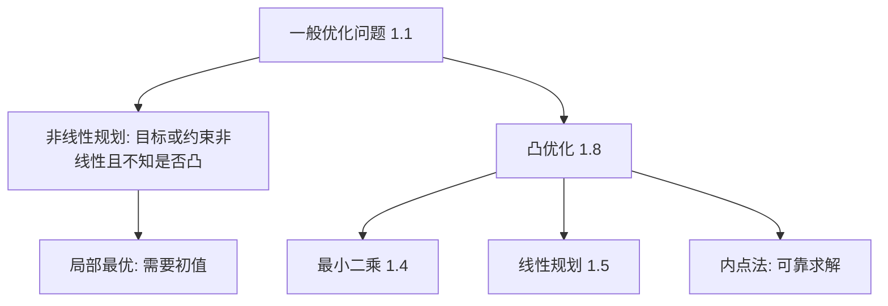

# 第1章 引言

### 来源说明

- 作者：Stephen Boyd, Lieven Vandenberghe
- 书名：*Convex Optimization*（凸优化）
- 官方来源：https://web.stanford.edu/~boyd/cvxbook/bv_cvxbook.pdf （Stanford 作者页公开的全书 PDF）
- 纸书由 Cambridge University Press 出版。本笔记仅供个人学习使用。本地 PDF 不是可再分发的授权副本。

阅读范围：前言 PDF 第 11–14 页，Chapter 1 Introduction（引言）PDF 第 15–34 页。本章概念是非正式的，严格定义在后面各章。

### 本章总览

这本书讲一类特殊的优化问题：convex optimization（凸优化）。它包含 least-squares（最小二乘）和 linear programming（线性规划）。这两类问题理论完整、应用广、数值上能高效求解。作者的基本判断是：更大的凸优化类也有同样的性质。

前言写给电气工程与计算机科学的研究生。目标不是把一般非线性问题硬解出来，而是学会辨认、改写并求解凸问题。数值计算和最优化不必预先学过。没学过分析与概率，仍能抓住主要思想。

视觉里的拟合、估计和几何约束，很多先要写成凸问题。写成之后，求解接近现成技术；认不认得出来，才是难点。

图注：最小二乘和线性规划都是凸优化的特例。一般非线性规划没有可靠的全局算法，常常退到局部最优。凸问题可以用内点法求解，本书第 9–11 章才展开算法，本批笔记停在第 8 章。

### 核心知识点

#### 一般优化问题

数学优化问题写成

$$
\begin{align*}
\operatorname{minimize}\quad & f_0(x) \\
\operatorname{subject\ to}\quad & f_i(x)\le b_i,\quad i=1,\ldots,m.
\end{align*}
\tag{1.1}
$$

$x=(x_1,\ldots,x_n)$ 是 optimization variable（优化变量），$f_0$ 是 objective（目标函数），$f_i$ 是不等式约束，$b_i$ 是上界。可行且目标值最小的 $x^\star$ 叫做 optimal（最优解）：任何别的可行 $z$ 都满足 $f_0(z)\ge f_0(x^\star)$。

可以把 $-f_0(x)$ 看成选择 $x$ 的效用。约束是必须满足的硬条件。书中用资产组合说明：$x_i$ 是第 $i$ 项资产的投资，约束可以是预算、非负持仓和最低期望收益。

除极少数例外，问题 (1.1) 没有有效算法能可靠地解很大规模的实例。最小二乘、线性规划和凸优化是例外。

🔑 关键速记：优化就是在硬约束下把目标压到最小；一般形式并不保证能算。

#### 最小二乘与线性规划

least-squares problem（最小二乘）没有约束，目标是残差平方和：

$$
\operatorname{minimize}\quad f_0(x)=\|Ax-b\|_2^2=\sum_{i=1}^{k}(a_i^\top x-b_i)^2.
\tag{1.4}
$$

其中 $A\in\mathbb{R}^{k\times n}$，$k\ge n$，$a_i^\top$ 是 $A$ 的行。书中指出它有解析解，完整技术处理放在第 4 章。

👉 正规方程的具体形式本章没有展开，第 4 章会写成凸问题的特例。📝待补全

linear programming（线性规划）要求目标和约束都是线性的：

$$
\begin{align*}
\operatorname{minimize}\quad & c^\top x \\
\operatorname{subject\ to}\quad & a_i^\top x\le b_i,\quad i=1,\ldots,m.
\end{align*}
\tag{1.5}
$$

线性规划没有像最小二乘那样简单的解析式，但有可靠算法，包括 Dantzig 的 simplex method（单纯形法）。本章只点名，不展开步骤。

Chebyshev approximation（切比雪夫逼近）把残差的最大绝对值压到最小，目标不可微。它可以改写成线性规划：增加变量 $t$，约束 $a_i^\top x-t\le b_i$ 和 $-a_i^\top x-t\le -b_i$（式 1.7）。细节在第 6 章。认得出「能化成线性规划」，是使用这本书的基本功。

🔑 关键速记：最小二乘有解析解；线性规划没有简单公式，但可以可靠地算；切比雪夫逼近能化成线性规划。

#### 凸优化问题

convex optimization problem（凸优化问题）是

$$
\begin{align*}
\operatorname{minimize}\quad & f_0(x) \\
\operatorname{subject\ to}\quad & f_i(x)\le b_i,\quad i=1,\ldots,m,
\end{align*}
\tag{1.8}
$$

其中 $f_0,\ldots,f_m$ 都是 convex function（凸函数）：对所有 $x,y$ 以及 $\alpha+\beta=1$、$\alpha\ge 0$、$\beta\ge 0$，

$$
f_i(\alpha x+\beta y)\le \alpha f_i(x)+\beta f_i(y).
$$

最小二乘 (1.4) 和线性规划 (1.5) 都是 (1.8) 的特例。

一般没有解析解。interior-point method（内点法）在实践中很有效，步数通常在 10 到 100 之间。若不利用稀疏等结构，每步运算量大约是 $\max\{n^3,n^2 m,F\}$，$F$ 是计算目标和约束的一阶、二阶导数的代价。桌面机器上，几百个变量、几千个约束，通常几十秒内可解。利用结构可以更大。

作者把话说满一点：如果把一个实际问题写成了凸优化问题，原问题就算解了。难点在辨认和改写，不在按下求解按钮。凸函数比最小二乘更难一眼认出，改写技巧也比线性规划更多。

🔑 关键速记：凸问题是目标和不等式约束都凸的最小化；写成凸形式之后，求解接近最小二乘和线性规划那种可靠技术。

#### 非线性优化与局部最优

目标或约束不是线性、又不能确定是凸的，叫做 nonlinear optimization（非线性优化）或 nonlinear programming（非线性规划）。一般非线性规划没有有效的全局方法。十个变量的问题就可以很难，几百个变量可能算不动。

local optimization（局部优化）放弃全局最优，只找局部最优：在该点附近的可行点里目标最小。这需要初值，而且结果依赖起点。

凸优化的一个用法，是先解一个凸的近似，得到不需要初值的解，再拿它当局部方法的起点。另一条是用凸松弛做启发式。稀疏向量（非零元很少）在约束下求解是组合难题，第 6 章会给出基于凸优化、常常能找到较稀疏解的启发式。

🔑 关键速记：不知道是不是凸，就不要指望全局可靠算法；凸近似可以给局部方法一个起点。

#### 全书三段

Part I Theory（理论）：凸集、凸函数、凸优化问题、对偶。本批会写。

Part II Applications（应用）：逼近与拟合、统计估计、几何问题。这三章和视觉最直接。本批会写。

Part III Algorithms（算法）：无约束极小化、等式约束极小化、内点法。层次是：线性方程解最小二乘；Newton 法把无约束或等式约束问题化成一串二次问题；内点法把不等式约束化成一串无约束或等式约束问题。本书只选少数简单、可靠、够快的算法，不讲拟 Newton、共轭梯度、bundle、割平面的最新版本。第 9–11 章不在本批笔记里。

👉 内点法是求解凸问题的主要数值工具，步数通常很少，每步要算一阶和二阶导数。算法步骤留在后置章节。📝待补全

练习混合了补证明、判断凸性、建模，以及少量编程。本笔记不展开习题。

🔑 关键速记：本批只走理论和应用（第 1–8 章）；算法三章后置。

### 易混淆点与差异对比

凸优化不是「所有非线性优化」。非线性只表示不是线性。凸是更强的结构：函数落在弦的下方。有这个结构才有可靠的全局算法。

最小二乘是无约束的平方和。切比雪夫逼近压的是最大残差，目标不可微，但能改写成带辅助变量 $t$ 的线性规划。两者都在拟合，目标不一样。

线性规划的单纯形法和内点法都能解线性规划。本章只说两者都有效，不比较实现。内点法还能推广到一般凸问题，那是第 11 章的内容。

这本书的对偶是优化里的 Lagrange 对偶，和第 01 领域里向量空间的对偶空间不是同一件事。前者在第 5 章，后者已在线性代数第 10 章的计划里。

### 本章要点总结

优化问题是在不等式约束下最小化目标。一般形式很难。最小二乘和线性规划是能可靠求解的特例，也都是凸问题。凸函数的定义是弦在函数图像上方。把问题写成凸形式，是这本书的主要技能；求解则接近现成技术。非凸问题可以先解凸近似再做局部优化，或用凸启发式。本批读到第 8 章的应用为止，内点法只保留上面的规模与步数结论。

### 关键速记

- 标准形式是最小化 $f_0(x)$，约束 $f_i(x)\le b_i$。
- 凸函数满足 $f(\alpha x+\beta y)\le\alpha f(x)+\beta f(y)$，其中 $\alpha+\beta=1$ 且 $\alpha,\beta\ge 0$。
- 最小二乘 (1.4) 和线性规划 (1.5) 都是凸问题 (1.8) 的特例。
- 难点是辨认和改写。写成凸问题之后，求解是可靠的数值技术。
- 非凸问题可先用凸近似给出起点，再交给局部方法。
