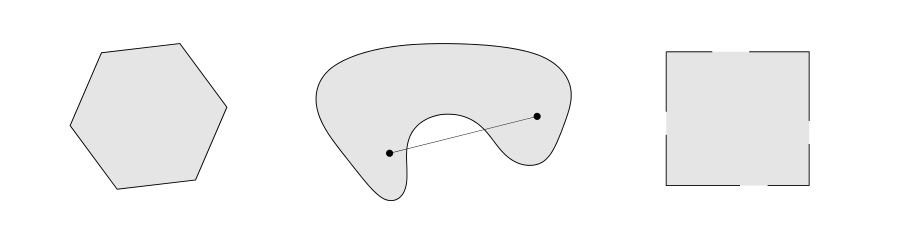
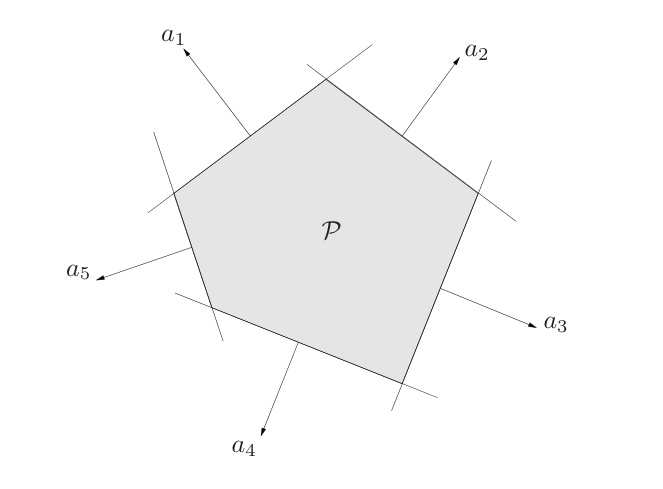
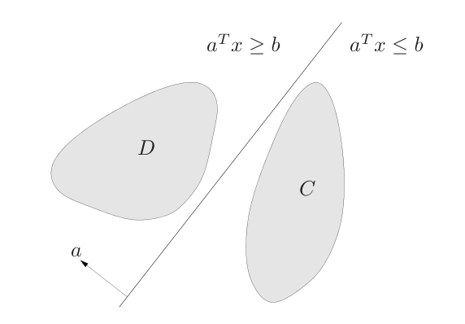

# 第2章 凸集

### 来源说明

- 作者：Stephen Boyd, Lieven Vandenberghe
- 书名：*Convex Optimization*（凸优化）
- 阅读范围：Chapter 2 Convex sets（凸集），PDF 第 35–80 页（书页约 21–66）。参考文献在 PDF 第 73 页，习题自 PDF 第 74 页起，本笔记不展开习题。

第 1 章用弦位于图像上方定义了凸函数，并指出凸优化是最小二乘和线性规划的推广。这一章只谈集合：什么样的点集叫仿射、凸、锥，以及哪些运算能保住凸性。

### 本章总览

凸优化的可行域必须是凸集。判断一个集合凸不凸，常用两条路：直接看任意两点的线段是否留在集合里；或者把它写成半空间、球、椭球、多面体、正半定锥的交或仿射像。

仿射集比凸集更强：它含整条直线，而不只是线段。凸锥再要求对原点作非负缩放封闭。超平面是仿射的；闭半空间凸但不是仿射。欧氏球、椭球、多面体都凸。正半定锥既是凸锥，也是后面矩阵不等式的序。

本章后半把凸集和广义不等式、分离超平面、对偶锥接上。分离定理的结论是：两个不相交的非空凸集，可以被一张超平面隔开。闭凸集因此可以写成所有包含它的半空间的交。

### 核心知识点

#### 直线、线段与仿射集

设 \(x_1\neq x_2\)。直线上的点写成

\[
y=\theta x_1+(1-\theta)x_2,\qquad \theta\in\mathbb{R}.
\]

\(\theta=1\) 是 \(x_1\)，\(\theta=0\) 是 \(x_2\)，\(\theta\in[0,1]\) 是两端点之间的闭线段。另一写法 \(y=x_2+\theta(x_1-x_2)\) 把 \(x_2\) 当起点、\(x_1-x_2\) 当方向。\(\theta>1\) 落到 \(x_1\) 外侧。原书 Figure 2.1 画的就是这条参数直线，本笔记不另作图。

集合 \(C\subseteq\mathbb{R}^n\) 是 **仿射集**（affine set），如果过 \(C\) 中任意两点的整条直线仍在 \(C\) 里：对任意 \(x_1,x_2\in C\) 和任意 \(\theta\in\mathbb{R}\)，

\[
\theta x_1+(1-\theta)x_2\in C.
\]

系数和为 1 的线性组合叫仿射组合（affine combination）。仿射集含有其中任意有限个点的仿射组合，系数和为 1，不要求非负。

若 \(C\) 仿射且 \(x_0\in C\)，则 \(V=C-x_0=\{x-x_0\mid x\in C\}\) 是子空间，与 \(x_0\) 的选取无关。于是 \(C=V+x_0\)。仿射集的维数定义为这个子空间的维数。

线性方程组的解集 \(C=\{x\mid Ax=b\}\) 是仿射集，对应的子空间是 \(A\) 的零空间。反过来，每个仿射集都可以写成某个线性方程组的解集。

空集、单点、全空间 \(\mathbb{R}^n\) 都是仿射集，因而都凸。任意直线仿射；过原点时它是子空间，也是凸锥。线段凸，但除非退化成一点，否则不是仿射集。射线 \(\{x_0+\theta v\mid \theta\ge 0\}\)（\(v\neq 0\)）凸而非仿射；起点 \(x_0=0\) 时它是凸锥。任意子空间既仿射又是凸锥。

某个集合的全部仿射组合构成它的仿射包（affine hull），记为 \(\operatorname{aff} C\)。它是包含 \(C\) 的最小仿射集。

🔑 关键速记：仿射集含整条直线；它等于某个子空间再平移，也等于线性方程 \(Ax=b\) 的解集。

#### 仿射维数与相对内部

集合的仿射维数是其仿射包的维数。它和别的维数定义不一定一致。\(\mathbb{R}^2\) 上的单位圆 \(\{x\mid x_1^2+x_2^2=1\}\) 的仿射包是整个平面，仿射维数是 2；按常见的曲线维数，它是 1 维。

若仿射维数小于 \(n\)，集合躺在一张更低维的仿射集里，在 \(\mathbb{R}^n\) 中的内部可能是空的。相对内部（relative interior）是相对于仿射包来看的内部：

\[
\operatorname{relint} C=\{x\in C\mid B(x,r)\cap\operatorname{aff} C\subseteq C\text{ 对某个 }r>0\},
\]

其中 \(B(x,r)=\{y\mid \|y-x\|\le r\}\)。用哪一种范数都得到同一个相对内部。相对边界是 \(\operatorname{cl} C\setminus\operatorname{relint} C\)。

书中的例子：\(\mathbb{R}^3\) 里 \(x_3=0\) 平面上的正方形，在 \(\mathbb{R}^3\) 中内部为空，相对内部是该平面上的开正方形，相对边界是线框。

凸函数在定义域的相对内部上连续，间断只可能出现在相对边界上。这句话的函数版本在第 3 章，几何定义在这里。

🔑 关键速记：低维集合在大空间里往往没有内部；相对内部是贴着仿射包看的内部。

#### 凸集与凸包

集合 \(C\) 是 **凸集**（convex set），如果任意两点的线段都在 \(C\) 里：对任意 \(x_1,x_2\in C\) 和 \(0\le\theta\le 1\)，

\[
\theta x_1+(1-\theta)x_2\in C.
\]

直观说，集合里任意两点能沿直线互相看见，而且这条线段不出集合。仿射集一定凸，因为整条直线都在里面，线段只是其中一段。

图注：原书 Figure 2.2。左图含边界，是凸集（书中称为六边形，边界画得更深）。中图肾形不是凸集，两点连线穿出集合。右图正方形只保留一部分边界，不是凸集。

系数和为 1 且每个系数非负的组合叫凸组合（convex combination）。集合凸，当且仅当它含有自己点的每一个凸组合。凸组合可以看成混合：\(\theta_i\) 是 \(x_i\) 所占的比例。

凸包（convex hull）\(\operatorname{conv} C\) 是 \(C\) 中点的全部凸组合。它本身凸，并且是包含 \(C\) 的最小凸集。原书 Figure 2.3 中，十五个点的凸包是一个五边形；肾形的凸包是把它的凹陷补满后的阴影区域。本笔记不重画该图。

凸组合可以推广到无穷和、积分和概率。最一般的形式是：若 \(C\) 凸，随机向量以概率 1 落在 \(C\) 里，则期望 \(\mathbb{E} x\in C\)（期望存在时）。两点的凸组合就是只取 \(x_1,x_2\) 的特例。

习题 2.2 要求证明：集合与任意直线的交为凸（或仿射），当且仅当原集合为凸（或仿射）。正文的定义只使用线段和整条直线，这道习题不展开。

🔑 关键速记：凸集保线段；凸包是包含原集合的最小凸集；凸集里的随机点，期望仍在集合里。

#### 凸锥

集合 \(C\) 是锥（cone），或称非负齐次，如果 \(x\in C\)、\(\theta\ge 0\) 时 \(\theta x\in C\)。既凸又是锥，就是凸锥（convex cone）：对 \(x_1,x_2\in C\) 和 \(\theta_1,\theta_2\ge 0\)，

\[
\theta_1 x_1+\theta_2 x_2\in C.
\]

几何上，这些点填满以原点为顶、边经过 \(x_1,x_2\) 的二维扇形。原书 Figure 2.4 画的就是这个扇形。

系数都非负的线性组合叫锥组合（conic combination），不要求和为 1。集合是凸锥，当且仅当它含有自己元素的全部锥组合。锥包是包含原集合的最小凸锥。原书 Figure 2.5 把 Figure 2.3 那两个集合的锥包画成从原点张开的阴影，本笔记不重画。

🔑 关键速记：凸组合要求和为 1；锥组合只要求系数非负，顶点在原点。

#### 超平面与半空间

超平面（hyperplane）是

\[
\{x\mid a^\top x=b\},\qquad a\neq 0.
\]

它是一个非平凡线性方程的解集，所以是仿射集。几何上，它是与法向量 \(a\) 的内积等于常数 \(b\) 的点。取超平面上任意一点 \(x_0\)（即 \(a^\top x_0=b\)），可写成

\[
\{x\mid a^\top(x-x_0)=0\}=x_0+a^\perp,
\]

其中 \(a^\perp=\{v\mid a^\top v=0\}\)。超平面等于偏移 \(x_0\) 再加上所有与法向正交的向量。原书 Figure 2.6 在 \(\mathbb{R}^2\) 里画出 \(a\)、\(x_0\) 以及与 \(a\) 正交的 \(x-x_0\)。

一张超平面把空间分成两个半空间。闭半空间（halfspace）是

\[
\{x\mid a^\top x\le b\},\qquad a\neq 0.
\tag{2.1}
\]

半空间凸，但不是仿射集。它的边界就是超平面 \(\{x\mid a^\top x=b\}\)。开半空间 \(\{x\mid a^\top x<b\}\) 是闭半空间的内部。

取边界上的 \(x_0\)，(2.1) 等价于

\[
\{x\mid a^\top(x-x_0)\le 0\}.
\tag{2.2}
\]

也就是 \(x_0\) 加上所有与外法向 \(a\) 成直角或钝角的向量。\(a\) 指向不等式 \(\le b\) 这一侧的外侧。原书 Figure 2.7、2.8 分别画了两侧半空间，以及锐角点在外、钝角点在内。

🔑 关键速记：超平面是 \(a^\top x=b\)，仿射；闭半空间是 \(a^\top x\le b\)，凸而非仿射，\(a\) 是外法向。

#### 欧氏球与椭球

欧氏球（Euclidean ball）是

\[
B(x_c,r)=\{x\mid \|x-x_c\|_2\le r\}=\{x_c+ru\mid \|u\|_2\le 1\},
\]

其中 \(r>0\)，\(\|u\|_2=(u^\top u)^{1/2}\)。\(x_c\) 是球心，\(r\) 是半径。

球是凸集。证明只用范数的齐次性和三角不等式：若两点都在半径 \(r\) 内，\(0\le\theta\le 1\)，则凸组合到球心的距离不超过 \(\theta r+(1-\theta)r=r\)。范数公理的完整列表在附录 A.1.2。

👉 附录只被正文点名引用，范数公理与等价范数的展开本批未读。📝待补全

椭球（ellipsoid）是

\[
\mathcal{E}=\{x\mid (x-x_c)^\top P^{-1}(x-x_c)\le 1\},
\tag{2.3}
\]

其中 \(P=P^\top\succ 0\)，即对称正定。\(x_c\) 是中心。半轴长度是 \(P\) 的特征值的平方根 \(\sqrt{\lambda_i}\)。球是 \(P=r^2 I\) 的特例。原书 Figure 2.9 在 \(\mathbb{R}^2\) 里画出中心和两条半轴，本笔记不另造这条椭圆曲线。

另一写法是

\[
\mathcal{E}=\{x_c+Au\mid \|u\|_2\le 1\},
\tag{2.4}
\]

\(A\) 可逆。取 \(A=P^{1/2}\) 就回到 (2.3)。若 \(A\) 对称半正定但奇异，(2.4) 叫退化椭球，仿射维数等于 \(A\) 的秩，仍然凸。

🔑 关键速记：球是到中心的欧氏距离不超过半径；椭球用正定矩阵 \(P\) 把各方向拉开，半轴长是 \(\sqrt{\lambda_i(P)}\)。

#### 范数球与二次锥

任意范数的球 \(\{x\mid \|x-x_c\|\le r\}\) 都凸。该范数的范数锥（norm cone）是

\[
C=\{(x,t)\mid \|x\|\le t\}\subseteq\mathbb{R}^{n+1},
\]

它是凸锥。

二次锥（second-order cone）是欧氏范数对应的范数锥：

\[
C=\{(x,t)\in\mathbb{R}^{n+1}\mid \|x\|_2\le t\}.
\]

它也叫二次锥、Lorentz 锥或冰淇淋锥。原书 Figure 2.10 画的是 \(\mathbb{R}^3\) 中 \(\sqrt{x_1^2+x_2^2}\le t\) 的边界，本笔记不重绘这条锥面。

双曲锥 \(\{x\mid x^\top Px\le (c^\top x)^2,\; c^\top x\ge 0\}\)（\(P\succeq 0\)）是二次锥在仿射映射 \(f(x)=(P^{1/2}x,\, c^\top x)\) 下的原像，因此凸。

🔑 关键速记：范数球凸；范数锥把「范数不超过高度 \(t\)」收成凸锥；二次锥就是欧氏范数的这只锥。

#### 多面体

多面体（polyhedron）是有限个线性等式和不等式的解集：

\[
P=\{x\mid a_j^\top x\le b_j,\; j=1,\ldots,m,\; c_j^\top x=d_j,\; j=1,\ldots,p\}.
\tag{2.5}
\]

紧凑写法是

\[
P=\{x\mid Ax\preceq b,\; Cx=d\},
\tag{2.6}
\]

其中 \(\preceq\) 是分量不等式：\(u\preceq v\) 表示每个分量 \(u_i\le v_i\)。多面体是有限个半空间和超平面的交，因此凸。仿射集、射线、线段、半空间都是多面体。

有界多面体有时叫 polytope（多胞形）。有的作者把这两个词的含义对调：用 polytope 表示 (2.5) 这种集合，用 polyhedron 表示其中有界的那一类。读别的书时要先看定义。

图注：原书 Figure 2.11。阴影区域 \(P\) 是五个半空间的交。\(a_1,\ldots,a_5\) 是各半空间的外法向，直线是对应的边界超平面。

非负卦限 \(\mathbb{R}^n_+=\{x\mid x\succeq 0\}\) 既是多面体也是锥，叫多面体锥。

单纯形（simplex）：若 \(v_0,\ldots,v_k\) 仿射无关，即 \(v_1-v_0,\ldots,v_k-v_0\) 线性无关，则

\[
C=\operatorname{conv}\{v_0,\ldots,v_k\}=\{\theta_0 v_0+\cdots+\theta_k v_k\mid \theta\succeq 0,\; \mathbf{1}^\top\theta=1\}.
\tag{2.7}
\]

它的仿射维数是 \(k\)。一维单纯形是线段，二维是含内部的三角形，三维是四面体。

单位单纯形由 \(0,e_1,\ldots,e_n\) 确定，即 \(x\succeq 0\)、\(\mathbf{1}^\top x\le 1\)。概率单纯形由 \(e_1,\ldots,e_n\) 确定，维数 \(n-1\)，即 \(x\succeq 0\)、\(\mathbf{1}^\top x=1\)。上面的 \(x_i\) 可看成 \(n\) 个结果的概率。

有限点集的凸包是有界多面体。除单纯形等特殊情形外，把它写成 (2.5) 的不等式并不简单。更一般的表示是

\[
\{\theta_1 v_1+\cdots+\theta_k v_k\mid \theta_1+\cdots+\theta_m=1,\; \theta_i\ge 0\},
\tag{2.9}
\]

其中 \(m\le k\)。前 \(m\) 个点作凸包，其余点作锥包。这种形式定义多面体，而且每个多面体都能这么写；正文没有给出后一方向的证明。

两种描述的规模可以差很多。\(\ell_\infty\) 单位球 \(\{x\mid |x_i|\le 1\}\) 用 \(2n\) 个线性不等式就够；写成顶点凸包至少要 \(2^n\) 个顶点，即所有分量为 \(\pm 1\) 的向量。

多面体也可以看成仿射映射的原像：\(\{x\mid Ax\preceq b,\, Cx=d\}\) 是 \(f(x)=(b-Ax,\, d-Cx)\) 把非负卦限与原点的乘积拉回来的原像。

🔑 关键速记：多面体是有限个半空间与超平面的交；不等式描述和顶点描述的规模可以指数地不同。

#### 正半定锥

\(\mathbb{S}^n\) 是 \(n\times n\) 对称矩阵，维数 \(n(n+1)/2\)。正半定锥与正定锥是

\[
\mathbb{S}^n_+=\{X\in\mathbb{S}^n\mid X\succeq 0\},\qquad \mathbb{S}^n_{++}=\{X\in\mathbb{S}^n\mid X\succ 0\}.
\]

记号与 \(\mathbb{R}_+\)、\(\mathbb{R}_{++}\) 平行。\(\mathbb{S}^n_+\) 是凸锥：若 \(A,B\succeq 0\)，\(\theta_1,\theta_2\ge 0\)，则对任意 \(x\)，

\[
x^\top(\theta_1 A+\theta_2 B)x=\theta_1 x^\top Ax+\theta_2 x^\top Bx\ge 0.
\]

在 \(\mathbb{S}^2\) 里，

\[
\begin{bmatrix} x & y \\ y & z \end{bmatrix}\in\mathbb{S}^2_+
\quad\Longleftrightarrow\quad
x\ge 0,\; z\ge 0,\; xz\ge y^2.
\]

原书 Figure 2.12 把这个锥的边界画在 \((x,y,z)\) 坐标里。边界由上述等式与不等式共同决定，本笔记不另造曲面。

正半定锥还是无穷多个半空间的交：对每个 \(z\neq 0\)，\(\{X\in\mathbb{S}^n\mid z^\top Xz\ge 0\}\) 是 \(\mathbb{S}^n\) 里的半空间。这同时说明它凸。

线性矩阵不等式（linear matrix inequality, LMI）

\[
A(x)=x_1 A_1+\cdots+x_n A_n\preceq B
\tag{2.11}
\]

的解集，是正半定锥在仿射映射 \(f(x)=B-A(x)\) 下的原像，因此凸。它和普通线性不等式 \(a^\top x\le b\) 的形式平行，只是数值不等式换成了矩阵序。

第 1 章的线性规划用的是分量不等式。矩阵不等式把同一套「半空间的原像」推广到 \(\mathbb{S}^m\)。怎样把 LMI 写成第 4 章那种凸优化标准形式，本批还没有读到。

👉 线性矩阵不等式的建模与求解留在凸优化问题那一章。📝待补全

🔑 关键速记：\(\mathbb{S}^n_+\) 是凸锥；\(\mathbb{S}^2\) 的条件是对角线非负且行列式 \(xz-y^2\ge 0\)；LMI 的解集凸。

#### 保凸运算

这一节是凸集的演算：从第 2.2 节的例子出发，用下面的运算仍得到凸集。

任意多个凸集的交仍凸，无穷个也可以。子空间、仿射集、凸锥对任意交也封闭。多面体是半空间与超平面的有限交，所以凸。

正文还用一个三角多项式例子说明无穷交：系数 \(x\in\mathbb{R}^m\) 使 \(|p(t)|\le 1\) 对所有 \(|t|\le\pi/3\) 成立，其中 \(p(t)=\sum_{k=1}^m x_k\cos kt\)。这是无穷多片「平板」

\[
S_t=\{x\mid -1\le (\cos t,\ldots,\cos mt)^\top x\le 1\}
\]

的交，记为 (2.10)，因此凸。原书 Figure 2.13、2.14 对 \(m=2\) 画了三条三角多项式和这些平板切出的白色区域。

后面用分离定理可以得到反过来的描述：每个闭凸集等于所有包含它的半空间的交。

仿射映射 \(f(x)=Ax+b\) 把凸集送到凸集，原像也把凸集拉回凸集。因此缩放 \(\alpha S\)、平移 \(S+a\)、向部分坐标的投影都保凸。两个凸集的 Minkowski 和 \(S_1+S_2=\{x+y\mid x\in S_1,\, y\in S_2\}\) 凸，因为它是乘积集合在 \((x_1,x_2)\mapsto x_1+x_2\) 下的像。部分和

\[
S=\{(x,y_1+y_2)\mid (x,y_1)\in S_1,\, (x,y_2)\in S_2\}
\]

在 \(m=0\) 时就是交，在 \(n=0\) 时就是集合加法；正文断言凸集的部分和仍凸，证明放在习题 2.16。

椭球 (2.3) 是单位欧氏球在 \(u\mapsto P^{1/2}u+x_c\) 下的像，也是该仿射映射之逆的原像。

透视函数（perspective function）\(P:\mathbb{R}^{n+1}\to\mathbb{R}^n\) 的定义域是 \(\mathbb{R}^n\times\mathbb{R}_{++}\)，\(P(z,t)=z/t\)。它把向量缩放到最后一维为 1，再丢掉最后一维。

书中用针孔相机解释：不透明平面 \(x_3=0\) 只在原点开孔，成像面是 \(x_3=-1\)。点 \(x\)（\(x_3>0\)）的像在 \(-(x_1/x_3,x_2/x_3)\)，也就是 \(-P(x)\)。原书 Figure 2.15 画了这两张水平面，本笔记不重画。

定义域里的凸集，透视像仍凸；凸集的透视原像也凸。原因是线段映成线段：参数 \(\theta\in[0,1]\) 与像线段上的参数 \(\mu\in[0,1]\) 单调对应。凸物体经针孔看过去，像仍然凸。

线性分式函数（linear-fractional function）是透视再复合一个仿射映射。设

\[
g(x)=\begin{bmatrix} A\\ c^\top\end{bmatrix}x+\begin{bmatrix} b\\ d\end{bmatrix},
\tag{2.12}
\]

则

\[
f(x)=\frac{Ax+b}{c^\top x+d},\qquad \operatorname{dom} f=\{x\mid c^\top x+d>0\}.
\tag{2.13}
\]

若 \(c=0\) 且 \(d>0\)，定义域是全空间，\(f\) 就是仿射函数。所以仿射函数是线性分式的特例。

它也可以写成 \((m+1)\times(n+1)\) 矩阵

\[
Q=\begin{bmatrix} A & b\\ c^\top & d\end{bmatrix}
\tag{2.14}
\]

作用在齐次坐标 \((x,1)\) 上，再把最后一维归一成 1。几何上，\(\mathbb{R}^n\) 里的点对应 \(\mathbb{R}^{n+1}\) 里最后一维为正的开射线；\(f\) 是「升到射线、用 \(Q\) 线性变换、再投回来」。

定义域中的凸集，线性分式像仍凸；凸集的原像也凸。条件概率是联合分布的线性分式：若联合概率的集合凸，则条件概率的集合也凸。原书 Figure 2.16 给了一个 \(\mathbb{R}^2\) 上的具体分式 \(f(x)=x/(x_1+x_2+1)\) 及其像，本笔记不重画。

🔑 关键速记：交、仿射像与仿射原像、透视和线性分式都保凸；用它们可以把球、半空间、正半定锥组装成新的凸集。

#### 广义不等式与极小元

正常锥（proper cone）\(K\) 要满足四条：凸、闭、有非空内部（solid）、不含整条直线（pointed，即 \(x\in K\) 且 \(-x\in K\) 推出 \(x=0\)）。

它诱导广义不等式（generalized inequality）

\[
x\preceq_K y \iff y-x\in K,\qquad x\prec_K y \iff y-x\in\operatorname{int} K.
\]

\(K=\mathbb{R}_+\) 时，这就是普通的 \(\le\) 和 \(<\)。

非负卦限 \(\mathbb{R}^n_+\) 是正常锥，\(\preceq_K\) 就是分量不等式。正半定锥在 \(\mathbb{S}^n\) 里是正常锥，\(\preceq_K\) 就是矩阵不等式；严格不等式对应正定。这两种用得太多，书中省略下标，向量之间的 \(\preceq\) 指分量，对称矩阵之间的 \(\preceq\) 指半正定序。

\([0,1]\) 上非负的 \(n-1\) 次多项式，其系数构成 \(\mathbb{R}^n\) 中的正常锥，即 (2.15)。\(c\preceq_K d\) 表示 \(d-c\) 对应的多项式在 \([0,1]\) 上非负。

广义不等式保加法、保非负缩放、传递、自反、反对称，并且对极限封闭。严格版满足：严格推出非严格；严格加非严格仍严格；正数缩放保持严格；没有 \(x\prec_K x\)；严格不等式在小扰动下仍成立。这些都从正常锥的定义继承，证明放在习题 2.30。

和实数序不同，广义不等式一般不是全序：两个点可以不可比。因此最小值要分成两个概念。

\(x\in S\) 是 \(S\) 关于 \(\preceq_K\) 的最小元（minimum element），如果每个 \(y\in S\) 都满足 \(x\preceq_K y\)。这等价于 \(S\subseteq x+K\)。最小元若存在则唯一。

\(x\in S\) 是极小元（minimal element），如果 \(y\in S\) 且 \(y\preceq_K x\) 只能是 \(y=x\)。这等价于 \((x-K)\cap S=\{x\}\)。极小元可以有许多个。

在 \(\mathbb{R}\) 上，最小和极小是同一件事。在分量序下，\(x\preceq y\) 表示 \(y\) 在 \(x\) 的右上方。最小元要求其余点都在右上方；极小元只要求没有别的点落在左下方。原书 Figure 2.17 分开画了这两种情形。

对正定矩阵，\(A\preceq B\) 当且仅当椭球 \(\{x\mid x^\top A^{-1}x\le 1\}\) 含于 \(\{x\mid x^\top B^{-1}x\le 1\}\)。包含若干给定点的正定椭球集合没有最小元，但可以有极小元：没有更小的椭球仍能套住这些点。原书 Figure 2.18 用三个中心在原点的椭圆说明哪一个是极小的。

🔑 关键速记：正常锥给出偏序；最小元比集合里每个点都小且唯一，极小元只是没有比它更小的点。

#### 分离超平面与支撑超平面

分离超平面定理：若 \(C,D\) 非空、凸、互不相交，则存在 \(a\neq 0\) 和 \(b\)，使 \(a^\top x\le b\) 对所有 \(x\in C\) 成立，\(a^\top x\ge b\) 对所有 \(x\in D\) 成立。超平面 \(\{x\mid a^\top x=b\}\) 分离 \(C\) 与 \(D\)。仿射函数 \(a^\top x-b\) 在 \(C\) 上非正、在 \(D\) 上非负。

图注：原书 Figure 2.19。超平面 \(\{x\mid a^\top x=b\}\) 分开不相交的凸集 \(C\) 和 \(D\)。\(a^\top x-b\) 在 \(C\) 上非正、在 \(D\) 上非负；\(a\) 指向 \(D\) 所在的一侧。

正文只完整证明了一个特殊情形，一般情形留作习题 2.22。特殊情形假设两集合的欧氏距离为正，并且最近点 \(c\in C\)、\(d\in D\) 取到这个距离（例如两者都闭且其中一个有界）。结论是：分离超平面垂直平分线段 \(cd\)。取 \(a=d-c\) 即可。证明的要点是：若 \(D\) 中还有点使该仿射函数为负，就能沿线段走到比 \(d\) 更靠近 \(c\) 的点，与 \(d\) 最近矛盾。

这种构造实际上给出严格分离：\(a^\top x<b\) 在 \(C\) 上，\(a^\top x>b\) 在 \(D\) 上。一般的不相交凸集不一定能严格分离，即使两者都闭。正文说有简单反例，具体集合放在习题 2.23，这里不编造。

闭凸集 \(C\) 与其外一点 \(x_0\) 可以严格分离。推论：闭凸集等于所有包含它的半空间的交。若外面还有一点，严格分离就会给出一个含 \(C\) 但不含该点的半空间。

分离定理的逆不对：存在分离超平面不能推出两集合不相交。反例是 \(C=D=\{0\}\)，超平面 \(x=0\) 按定义把两边都分开了，但集合相交。若两个集合都凸，且至少一个是开集，则它们不相交当且仅当存在分离超平面。

这个等价用来得到严格线性不等式的择一定理（theorem of alternatives）。\(Ax\prec b\) 即 (2.17) 无解，当且仅当存在 \(\lambda\) 满足

\[
\lambda\neq 0,\qquad \lambda\succeq 0,\qquad A^\top\lambda=0,\qquad \lambda^\top b\le 0,
\tag{2.18}
\]

而且对任意数据，(2.17) 与 (2.18) 恰好有一个可解。

若凸集 \(C\) 与仿射集 \(D=\{Fu+g\}\) 不相交，则存在 \(a\neq 0\) 使 \(F^\top a=0\)，并且 \(a^\top x\le a^\top g\) 对所有 \(x\in C\) 成立。线性函数在全空间上下有界只能是零函数，所以法向必须落在 \(F\) 的左零空间里。

\(x_0\) 在 \(C\) 的边界上时，若 \(a\neq 0\) 且 \(a^\top x\le a^\top x_0\) 对所有 \(x\in C\) 成立，则 \(\{x\mid a^\top x=a^\top x_0\}\) 是 \(C\) 在 \(x_0\) 处的支撑超平面（supporting hyperplane）。它在 \(x_0\) 处与集合相切，半空间 \(\{x\mid a^\top x\le a^\top x_0\}\) 含有 \(C\)。原书 Figure 2.21 画的就是这种切触，本笔记用分离图代替，不另裁支撑图。

支撑超平面定理：非空凸集在任意边界点都有支撑超平面。内部非空时，对 \(\{x_0\}\) 和 \(\operatorname{int} C\) 用分离定理；内部为空时，集合躺在更低维仿射集里，任意含该仿射集的超平面都是支撑超平面。

部分逆定理：若集合闭、内部非空，且每个边界点都有支撑超平面，则它凸。证明是习题 2.27。

第 3 章把可微凸函数的一阶条件，说成上境图在 \((x,f(x))\) 处的支撑超平面，法向是 \((\nabla f(x),-1)\)。支撑的定义就是这里这一段：超平面过边界点，集合全部落在一侧。

👉 上境图和梯度如何拼成这条法向，在第 3 章展开；本章只提供支撑超平面的集合结论。

🔑 关键速记：非空不交凸集必能被超平面分开；闭凸集是含它的所有半空间之交；凸集的每个边界点都有支撑超平面。

#### 对偶锥

锥 \(K\) 的对偶锥（dual cone）是

\[
K^*=\{y\mid x^\top y\ge 0\text{ 对所有 }x\in K\}.
\tag{2.19}
\]

\(K^*\) 一定是凸锥，哪怕 \(K\) 本身不凸。几何上，\(y\in K^*\) 当且仅当 \(-y\) 是一张在原点支撑 \(K\) 的超平面的法向。原书 Figure 2.22 对比了含住锥的半空间与没有含住锥的半空间。

子空间的对偶锥是它的正交补。非负卦限自对偶：\(x^\top y\ge 0\) 对所有 \(x\succeq 0\) 成立，当且仅当 \(y\succeq 0\)。正半定锥在迹内积 \(\operatorname{tr}(XY)=\sum_{ij} X_{ij}Y_{ij}\) 下也自对偶：

\[
\operatorname{tr}(XY)\ge 0\text{ 对所有 }X\succeq 0 \quad\Longleftrightarrow\quad Y\succeq 0.
\]

书中的论证是：若 \(Y\) 不正半定，则有 \(q^\top Yq<0\)，取 \(X=qq^\top\) 就破坏不等式；若两者都半正定，把 \(X\) 写成特征值分解 \(X=\sum_i\lambda_i q_i q_i^\top\)（\(\lambda_i\ge 0\)），则 \(\operatorname{tr}(YX)=\sum_i\lambda_i q_i^\top Y q_i\ge 0\)。

范数锥的对偶，是对偶范数的范数锥。对偶范数 \(\|u\|_*=\sup\{u^\top x\mid \|x\|\le 1\}\) 即 (A.1.6)。于是 \(\{(x,t)\mid \|x\|\le t\}\) 的对偶是 \(\{(u,v)\mid \|u\|_*\le v\}\)。

对偶锥还有这些结论：\(K^*\) 闭且凸；\(K_1\subseteq K_2\) 推出 \(K_2^*\subseteq K_1^*\)；\(K\) 内部非空则 \(K^*\) 是 pointed；\(K\) 的闭包是 pointed 则 \(K^*\) 内部非空；\(K^{**}\) 是 \(K\) 的凸包的闭包。因此正常锥的对偶仍是正常锥，而且 \(K^{**}=K\)。

正常锥 \(K\) 的对偶 \(K^*\) 给出对偶广义不等式 \(\preceq_{K^*}\)。两者的关系是：

- \(x\preceq_K y\) 当且仅当对所有 \(\lambda\succeq_{K^*} 0\) 有 \(\lambda^\top x\le\lambda^\top y\)；
- \(x\prec_K y\) 当且仅当对所有 \(\lambda\succeq_{K^*} 0\)、\(\lambda\neq 0\) 有 \(\lambda^\top x<\lambda^\top y\)。

严格广义不等式 \(Ax\prec_K b\) 即 (2.21)，与

\[
\lambda\neq 0,\quad \lambda\succeq_{K^*} 0,\quad A^\top\lambda=0,\quad \lambda^\top b\le 0
\tag{2.22}
\]

构成择一：恰好一个可解。(2.17)、(2.18) 是 \(K=\mathbb{R}^m_+\) 的特例。

最小元可以用对偶不等式刻画，而且不要求 \(S\) 凸：\(x\) 是 \(S\) 的最小元，当且仅当对每个 \(\lambda\succ_{K^*} 0\)，\(x\) 是 \(\lambda^\top z\) 在 \(S\) 上的唯一最小点。几何上，每张法向为 \(\lambda\succ_{K^*} 0\) 的超平面都严格支撑 \(S\)，只在 \(x\) 处碰到集合。原书 Figure 2.23 画的是分量序下的这种严格支撑。

极小元只有单向结论：若 \(\lambda\succ_{K^*} 0\) 且 \(x\) 最小化 \(\lambda^\top z\)，则 \(x\) 极小。逆一般不成立，原书 Figure 2.25 给了一个极小点，它不是任何线性函数在 \(S\) 上的最小点。

若 \(S\) 凸，则每个极小元 \(x\) 至少对应某个非零 \(\lambda\succeq_{K^*} 0\)，使 \(x\) 最小化 \(\lambda^\top z\)。不能加强成 \(\lambda\succ_{K^*} 0\)。原书 Figure 2.26 说明两头都会失败：有的极小点只能被 \(\lambda\succeq 0\) 但并非 \(\lambda\succ 0\) 的价格找到；有的 \(\lambda\succeq 0\) 的最小点并不是极小元。

生产集的例子把极小元叫 Pareto 最优或有效生产：没有另一种方法在每种资源上都不更多、而且至少一种严格更少。用任意 \(\lambda\succ 0\) 最小化 \(\lambda^\top x\)，得到的就是有效方法；\(\lambda_i\) 可看成资源价格。有的有效点并不能由任何 \(\lambda\succeq 0\) 的总费用最小化找到。原书 Figure 2.27 用劳动和燃料两条曲线标出有效前沿。

对偶锥和对偶广义不等式是第 5 章 Lagrange 对偶的几何准备。本章只给出锥的对偶、择一，以及最小元与线性函数最小化的关系，没有写 Lagrange 函数。

👉 对偶问题如何由 Lagrange 函数得到，本批未读。📝待补全

🔑 关键速记：对偶锥总是凸锥；非负卦限和正半定锥自对偶；最小元等于所有严格正对偶价格下的唯一最小点。

### 🔑 关键速记

- 仿射集含整条直线，凸集只含线段；仿射集一定凸。
- 闭半空间、欧氏球、椭球、范数锥、多面体、正半定锥都是后面反复使用的凸集。
- 交、仿射像与原像、透视和线性分式保持凸性。
- 非空不交凸集可以被超平面分开；闭凸集是含它的半空间的交。
- 正常锥定义广义不等式；对偶锥给出「对所有非负价格都更小」这句等价说法。

### 易混淆点与差异对比

仿射、凸、凸锥三层不要叠在一起。仿射要求系数和为 1 的组合，系数可以为负，所以整条直线都在。凸要求系数和为 1 且非负，只保留线段。凸锥要求系数非负，不要求和为 1，顶点钉在原点。过原点的直线三者都是；不过原点的线段只是凸集。

半空间凸，超平面仿射。多面体可以同时含等式和不等式；只有等式时它是仿射集。有界多面体是否叫 polytope，取决于作者，本书把有界的那种有时叫 polytope，并明确说存在相反约定。

最小元和极小元只在全序里重合。分量序和矩阵序里，极小可以有很多，最小最多一个。正价格 \(\lambda\succ 0\) 的线性最小化一定得到极小元；凸集上的极小元只保证某个 \(\lambda\succeq 0\)、\(\lambda\neq 0\)。把「极小」说成「某个严格正价格的最优」会漏掉边界上的有效点。

分离和严格分离不是一回事。不相交凸集一定能分离；闭且不相交仍可能不能严格分离。一个开、一个凸时，不相交与存在分离超平面才等价。\(\{0\}\) 与自己可以被 \(x=0\) 分离，所以「有分离超平面」不能反推「不相交」。

第 2 章的对偶锥是集合。第 5 章的对偶是优化问题的 Lagrange 对偶。第 1 章已经提醒：后者也不是线性代数里向量空间的对偶空间。三个「对偶」不要互换。

本章的线性分式函数是集合到集合的映射，保凸集的像和原像。第 3 章还有一个标量线性分式 \( (a^\top x+b)/(c^\top x+d) \)，它是拟凸也是拟凹。一个保集合，一个是函数的水平集性质，名字相近。

### 本章要点总结

仿射集是线性方程的解，凸集是对线段封闭的集合。超平面、半空间、球、椭球、二次锥、多面体和正半定锥是基本例子。交、仿射映射、透视和线性分式用来从这些例子组装新凸集。

正常锥把实数不等式推广成分量序和矩阵序。最小元唯一，极小元可以很多。分离超平面定理保证不交凸集能被超平面隔开，并推出闭凸集是半空间的交、凸集的边界点有支撑超平面。对偶锥总是凸的；非负卦限和正半定锥自对偶。这些几何结论是第 3 章上境图、以及后面对偶理论的基础。习题不展开。
