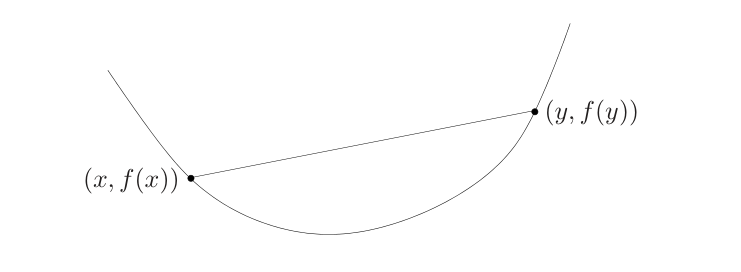
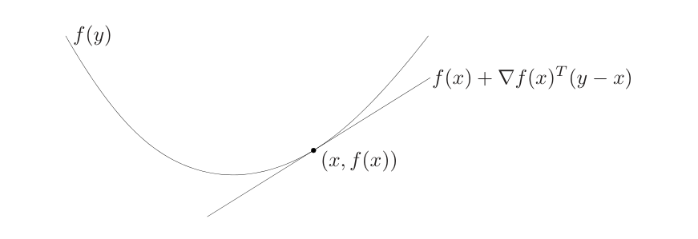
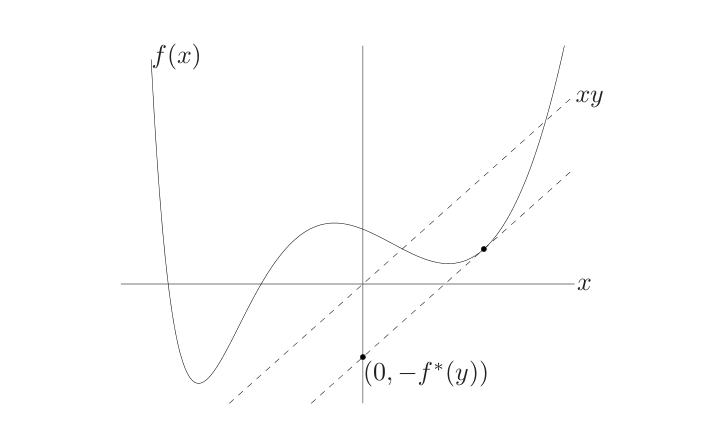

# 第3章 凸函数

### 来源说明

- 作者：Stephen Boyd, Lieven Vandenberghe
- 书名：*Convex Optimization*（凸优化）
- 阅读范围：Chapter 3 Convex functions（凸函数），PDF 第 81–140 页（书页约 67–126）。参考文献在 PDF 第 126 页，习题自 PDF 第 127 页起，本笔记不展开习题。

第 2 章给出凸集、支撑超平面和对偶锥。这一章把同一套几何用到函数上：函数凸，当且仅当它的上境图是凸集。

### 本章总览

凸函数的定义是定义域凸，并且弦在图像上方。可微时，一阶泰勒展开是全局下估计；二阶可微时，Hessian 处处半正定。常见例子包括指数、范数、最大值、二次比线性、log-sum-exp、几何平均和对数行列式。

函数凸，它的每个下水平集都凸，上境图也凸。反过来，下水平集全凸只能得到拟凸，推不出凸。共轭函数把 \(y^\top x-f(x)\) 的上确界记成 \(f^*\)，它总是凸的。对数凸函数一定凸；对数凹函数的乘积、边缘分布和若干积分仍对数凹。

关于正常锥，还可以谈矩阵单调和矩阵凸。标量凸函数是 \(K=\mathbb{R}_+\) 的特例。

### 核心知识点

#### 凸函数的定义

函数 \(f:\mathbb{R}^n\to\mathbb{R}\) 是 **凸函数**（convex function），如果 \(\operatorname{dom} f\) 是凸集，并且对所有 \(x,y\in\operatorname{dom} f\) 和 \(0\le\theta\le 1\)，

\[
f(\theta x+(1-\theta)y)\le \theta f(x)+(1-\theta)f(y).
\tag{3.1}
\]

几何上，\((x,f(x))\) 与 \((y,f(y))\) 之间的弦位于图像上方。

图注：原书 Figure 3.1。凸函数图像上任意两点的弦在图像上方，对应不等式 (3.1)。图中的曲线是原书示意图，不是另行拟合的数据。

\(x\neq y\) 且 \(0<\theta<1\) 时若总是严格不等式，则 \(f\) 严格凸。\(-f\) 凸则 \(f\) 凹（concave），\(-f\) 严格凸则 \(f\) 严格凹。仿射函数在 (3.1) 里永远取等号，所以既凸又凹。既凸又凹的函数一定仿射。

函数凸，当且仅当它限制到任意一条与定义域相交的直线上仍然凸。检查凸性时，常常固定 \(x\) 和方向 \(v\)，看一元函数 \(g(t)=f(x+tv)\)。

凸函数在定义域的相对内部上连续，间断只可能出现在相对边界。相对内部的定义在第 2 章：它是相对于仿射包、而不是相对于全空间的内部。低维定义域在大空间里可以没有普通内部，但相对内部上仍然连续。

👉 相对内部与仿射包的定义见第 2 章。本章直接使用该结论。

书中常把凸函数延拓到全空间：定义域外取值 \(+\infty\)，记为扩展值延拓 \(\tilde f\)。这样 (3.1) 对所有 \(x,y\) 和 \(0<\theta<1\) 都成立，只要按扩展算术理解 \(\infty\)。两个凸函数之和的定义域自动变成交集，因为任一个取 \(\infty\) 时和就是 \(\infty\)。后文在不引起混淆时，用同一个符号表示函数和它的延拓。凹函数则在定义域外延拓为 \(-\infty\)。

凸集 \(C\) 的示性函数（indicator）\(I_C\) 在 \(C\) 上为 0。其延拓在 \(C\) 外为 \(\infty\)。在 \(C\) 上最小化 \(f\)，等于在全空间上最小化 \(f+\tilde I_C\)。

🔑 关键速记：凸函数的定义域凸，弦在图像上方；定义域外记成 \(\infty\) 后，约束可以收进示性函数。

#### 一阶条件

设 \(f\) 可微，定义域开。则 \(f\) 凸当且仅当定义域凸，并且对所有 \(x,y\in\operatorname{dom} f\)，

\[
f(y)\ge f(x)+\nabla f(x)^\top(y-x).
\tag{3.2}
\]

右边是 \(f\) 在 \(x\) 附近的一阶泰勒仿射函数。凸函数的这个仿射函数是全局下估计；反过来，若一阶泰勒展开总是全局下估计，则函数凸。

图注：原书 Figure 3.2。可微凸函数在 \(x\) 处的一阶近似 \(f(x)+\nabla f(x)^\top(y-x)\) 位于图像下方，对应 (3.2)。

因此局部信息（一点的函数值和梯度）能给出全局下估计。若 \(\nabla f(x)=0\)，则对所有 \(y\in\operatorname{dom} f\) 有 \(f(y)\ge f(x)\)，\(x\) 是全局最小点。

严格凸的一阶刻画是：\(x\neq y\) 时 (3.2) 为严格不等式，即 (3.3)。凹函数则把 (3.2) 的不等号反过来。

正文先证一元情形 (3.4)，再把多元函数限制到直线上。证明细节不重复，结论就是 (3.2) 与凸性等价。

第 2 章的支撑超平面是：过边界点的超平面把凸集挡在一侧。把 (3.2) 写成上境图的语言，法向 \((\nabla f(x),-1)\) 就在点 \((x,f(x))\) 支撑上境图。原书 Figure 3.6 画的是这条法向。支撑超平面的存在性来自第 2 章；这里多出来的信息是法向的最后一维为 \(-1\)，所以超平面不竖直。

👉 分离与支撑的集合定理见第 2 章。上境图的定义在本节后面。

🔑 关键速记：可微凸函数的一阶泰勒展开是全局下估计；梯度为零就是全局最小。

#### 二阶条件

设 \(f\) 二阶可微，定义域开。则 \(f\) 凸当且仅当定义域凸，并且 Hessian 处处半正定：对所有 \(x\in\operatorname{dom} f\)，

\[
\nabla^2 f(x)\succeq 0.
\]

一元时这就是 \(f''(x)\ge 0\)，导数不减。几何上，图像在每一点向上弯。证明留作习题 3.8，正文没有写出，本笔记不补证明。

凹当且仅当定义域凸且 \(\nabla^2 f(x)\preceq 0\)。若处处 \(\nabla^2 f(x)\succ 0\)，则严格凸。逆命题不成立：\(f(x)=x^4\) 严格凸，但 \(f''(0)=0\)。

二次函数 \(f(x)=\frac12 x^\top Px+q^\top x+r\)（\(P\in\mathbb{S}^n\)）的 Hessian 就是 \(P\)，所以它凸当且仅当 \(P\succeq 0\)，凹当且仅当 \(P\preceq 0\)。二次函数的严格凸更容易：严格凸当且仅当 \(P\succ 0\)。

定义域必须单独要求是凸集，不能从 Hessian 里省掉。\(f(x)=1/x^2\) 在 \(\{x\mid x\neq 0\}\) 上二阶导数为正，但定义域不是区间，函数并不凸。

🔑 关键速记：二阶条件是 Hessian 半正定加上定义域凸；处处正定推出严格凸，\(x^4\) 说明反过来不必成立。

#### 基本例子

下面这些例子的凸性或凹性，可以用 (3.1)、二阶导数，或限制到直线来核对。

一元函数：

| 函数 | 定义域 | 凸或凹 |
| --- | --- | --- |
| \(e^{ax}\) | \(\mathbb{R}\) | 对任意 \(a\) 都凸 |
| \(x^a\) | \(\mathbb{R}_{++}\) | \(a\ge 1\) 或 \(a\le 0\) 时凸；\(0\le a\le 1\) 时凹 |
| \(\|x\|^p\) | \(\mathbb{R}\) | \(p\ge 1\) 时凸 |
| \(\log x\) | \(\mathbb{R}_{++}\) | 凹 |
| \(x\log x\)（\(x=0\) 处可定义为 0） | \(\mathbb{R}_{++}\) 或 \(\mathbb{R}_+\) | 凸；\(f''(x)=1/x>0\)，故在正实数上严格凸 |

负熵 \(x\log x\) 的一阶导数是 \(\log x+1\)。表中「严格凸」来自二阶导数为正，不是额外假设。

多元与矩阵例子：

| 函数 | 定义域 | 结论 |
| --- | --- | --- |
| 任意范数 \(\|x\|\) | \(\mathbb{R}^n\) | 凸；用三角不等式和齐次性 |
| \(\max\{x_1,\ldots,x_n\}\) | \(\mathbb{R}^n\) | 凸 |
| \(x^2/y\) | \(\mathbb{R}\times\mathbb{R}_{++}\) | 凸 |
| \(\log(e^{x_1}+\cdots+e^{x_n})\) | \(\mathbb{R}^n\) | 凸 |
| \((\prod_i x_i)^{1/n}\) | \(\mathbb{R}^n_{++}\) | 凹 |
| \(\log\det X\) | \(\mathbb{S}^n_{++}\) | 凹 |

要点：范数、最大值和 log-sum-exp 凸；几何平均与对数行列式凹。log-sum-exp 是最大值的光滑近似，

\[
\max_i x_i \le f(x) \le \max_i x_i+\log n,
\]

第二段不等式在各分量相等时取等。

二次比线性函数的 Hessian 是

\[
\nabla^2 f(x,y)=\frac{2}{y^3}\begin{bmatrix} y\\ -x\end{bmatrix}\begin{bmatrix} y\\ -x\end{bmatrix}^\top\succeq 0
\qquad (y>0).
\]

原书 Figure 3.3 画了 \(x^2/y\) 的图像。log-sum-exp 在 \(n=2\) 时的图像是原书 Figure 3.4。两张都是具体函数的图像，本笔记不重绘，以免改动原书曲线。

对数行列式限制到直线 \(X=Z+tV\)（\(Z\succ 0\)）后，

\[
g(t)=\sum_{i=1}^n\log(1+t\lambda_i)+\log\det Z,
\]

其中 \(\lambda_i\) 是 \(Z^{-1/2}VZ^{-1/2}\) 的特征值。于是 \(g''(t)=-\sum_i \lambda_i^2/(1+t\lambda_i)^2\le 0\)，所以 \(\log\det\) 凹。几何平均和 log-sum-exp 的 Hessian 半正定或半负定，正文用 Cauchy–Schwarz 核对，这里只保留结论。

矩阵分式函数 \(f(x,Y)=x^\top Y^{-1}x\) 在 \(\mathbb{R}^n\times\mathbb{S}^n_{++}\) 上凸。它是 \(x^2/y\) 的矩阵推广。上境图等价于线性矩阵不等式

\[
\begin{bmatrix} Y & x\\ x^\top & t\end{bmatrix}\succeq 0,\qquad Y\succ 0,
\]

用的是分块矩阵半正定的 Schur 补条件。\(n=1\) 时就是 \(x^2/y\)。

👉 Schur 补的证明在附录 A.5.5，正文直接引用等价关系，附录本批未读。📝待补全

🔑 关键速记：指数、范数、最大值、\(x^2/y\)、log-sum-exp 凸；对数、几何平均、\(\log\det\) 凹。

#### 凸性对集合的含义

函数的 \(\alpha\)-下水平集（sublevel set）是

\[
C_\alpha=\{x\in\operatorname{dom} f\mid f(x)\le\alpha\}.
\]

凸函数的每个下水平集都凸。证明就是 (3.1)：两端都不超过 \(\alpha\)，线段上也不超过 \(\alpha\)。逆命题不成立。\(f(x)=-e^x\) 在 \(\mathbb{R}\) 上严格凹，不是凸函数，但它的下水平集都是区间，因而凸。

凹函数的 \(\alpha\)-上水平集 \(\{x\mid f(x)\ge\alpha\}\) 是凸集。要证明一个集合凸，可以把它写成凸函数的下水平集，或凹函数的上水平集。

几何平均 \(G\) 与算术平均 \(A\) 满足 \(G(x)\le A(x)\)。集合 \(\{x\in\mathbb{R}^n_+\mid G(x)\ge\alpha A(x)\}\)（\(0\le\alpha\le 1\)）是凹函数 \(G-\alpha A\) 的 0-上水平集，因此凸；它还正齐次，所以是凸锥。

图像是 \(\{(x,f(x))\mid x\in\operatorname{dom} f\}\)。上境图（epigraph）是图像及其上方：

\[
\operatorname{epi} f=\{(x,t)\mid x\in\operatorname{dom} f,\; f(x)\le t\}.
\]

函数凸当且仅当上境图是凸集。函数凹当且仅当下境图 \(\operatorname{hypo} f=\{(x,t)\mid t\le f(x)\}\) 是凸集。原书 Figure 3.5 把上境图涂成阴影，下边界就是图像。这是函数凸与集合凸之间的正面联系：第 2 章的凸集演算可以整段搬到上境图上。

下水平集凸只是凸函数的推论，挡不住 \(-e^x\) 这种凹函数。上境图凸才与函数凸等价。拟凸函数后来又把「下水平集凸」单独拿出来当定义，比凸函数宽。

可微时，(3.2) 就是法向 \((\nabla f(x),-1)\) 在 \((x,f(x))\) 支撑 \(\operatorname{epi} f\)。因为法向的高度分量是 \(-1\)，这张支撑超平面不会竖直。

🔑 关键速记：凸函数等价于上境图为凸集；下水平集凸更弱，凹函数也可以有凸的下水平集。

#### Jensen 不等式

(3.1) 也叫 Jensen 不等式。它推广到任意凸组合：\(\theta_i\ge 0\)、\(\sum\theta_i=1\) 时，

\[
f(\theta_1 x_1+\cdots+\theta_k x_k)\le \theta_1 f(x_1)+\cdots+\theta_k f(x_k).
\]

积分形式：若 \(p\ge 0\) 且在 \(S\subseteq\operatorname{dom} f\) 上积分为 1，则 \(f\) 在重心处的值不超过 \(f\) 的加权积分。最常用的是

\[
f(\mathbb{E} x)\le \mathbb{E} f(x),
\tag{3.5}
\]

其中 \(x\) 以概率 1 落在定义域里，期望存在。两点分布能把 (3.5) 退回 (3.1)。因此 (3.5) 也刻画凸性：若 \(f\) 不凸，就存在这样的随机向量使不等号反过来。

Jensen 原来写的是中点形式 \(f((x+y)/2)\le (f(x)+f(y))/2\)。现在这些推广都叫 Jensen 不等式。

若 \(z\) 是零均值随机向量，则 \(\mathbb{E} f(x+z)\ge f(x)\)。给凸函数的自变量加零均值扰动，平均值不会下降。

\(-\log\) 凸，中点 Jensen 再取指数，得到 \(\sqrt{ab}\le (a+b)/2\)（\(a,b\ge 0\)），即 (3.6)。带权形式是 \(a^\theta b^{1-\theta}\le \theta a+(1-\theta)b\)。Hölder 不等式

\[
\sum_i x_i y_i \le \Bigl(\sum_i |x_i|^p\Bigr)^{1/p}\Bigl(\sum_i |y_i|^q\Bigr)^{1/q},
\]

其中 \(p>1\)、\(1/p+1/q=1\)，由这个带权不等式对归一化的 \(|x_i|^p\)、\(|y_i|^q\) 求和得到。这里只保留不等式本身。

🔑 关键速记：凸函数把平均的函数值压在函数值的平均之下；\(f(\mathbb{E} x)\le\mathbb{E} f(x)\) 与凸性等价。

#### 保持凸性的运算

非负加权和 \(f=w_1 f_1+\cdots+w_m f_m\)（\(w_i\ge 0\)）仍凸。凸函数本身构成一个凸锥。严格凸函数的非负且不全为零的加权和仍严格凸。积分 \(\int w(y)f(x,y)\,dy\) 在 \(w(y)\ge 0\)、\(f\) 对 \(x\) 凸时仍对 \(x\) 凸。用上境图看，\(w\ge 0\) 时 \(\operatorname{epi}(wf)\) 是 \(\operatorname{epi} f\) 的线性像。

与仿射映射复合：若 \(f\) 凸或凹，则 \(g(x)=f(Ax+b)\) 同样凸或凹，定义域是 \(\{x\mid Ax+b\in\operatorname{dom} f\}\)。

有限个凸函数的逐点最大仍凸，定义域是交集。因此分段线性函数

\[
f(x)=\max\{a_1^\top x+b_1,\ldots,a_L^\top x+b_L\}
\]

凸。反过来，至多 \(L\) 段的凸分段线性函数都能写成这种最大值，证明在习题 3.29。

\(x\) 的前 \(r\) 个最大分量之和是凸的，因为它是所有 \(r\) 个不同分量之和的最大值。若权重 \(w_1\ge\cdots\ge w_r\ge 0\)，加权和 \(\sum_{i=1}^r w_i x_{[i]}\) 也凸，证明在习题 3.19。

逐点上确界仍凸。若每个 \(f(x,y)\) 对 \(x\) 凸，则

\[
g(x)=\sup_{y\in A} f(x,y)
\tag{3.7}
\]

对 \(x\) 凸。上境图是这族上境图的交。凹函数的逐点下确界是凹函数。

由此得到一批凸函数。集合 \(C\neq\emptyset\) 的支撑函数 \(S_C(x)=\sup\{x^\top y\mid y\in C\}\) 凸。到集合中最远点的距离 \(\sup_{y\in C}\|x-y\|\) 凸。对称矩阵的最大特征值 \(\lambda_{\max}(X)=\sup\{\,y^\top Xy\mid \|y\|_2=1\,\}\) 凸。矩阵的谱范数，以及更一般的诱导范数，都是线性函数的上确界，因而凸。

加权最小二乘的最优值作为权 \(w\) 的函数是凹的：它是一族关于 \(w\) 的线性函数的下确界。当 \(A^\top WA\succ 0\) 时，正文给出用矩阵分式写的显式，凹性从那一表达式并不一眼看出，但已由下确界规则保证。

定义域为全空间的凸函数，等于它的全部仿射全局下估计的逐点上确界。证明用上境图在 \((x,f(x))\) 的支撑超平面，并说明法向的高度分量 \(b>0\)，超平面不竖直。定义域不是全空间时留作习题 3.28。

标量复合先看二阶导数。若 \(h,g\) 都定义在 \(\mathbb{R}\) 上且二阶可微，

\[
f''(x)=h''(g(x))\,g'(x)^2+h'(g(x))\,g''(x).
\tag{3.9}
\]

由此读出四条：\(h\) 凸且不减、\(g\) 凸，则 \(f\) 凸；\(h\) 凸且不增、\(g\) 凹，则 \(f\) 凸；\(h\) 凹且不减、\(g\) 凹，则 \(f\) 凹；\(h\) 凹且不增、\(g\) 凸，则 \(f\) 凹。这是 (3.10)。

不假设可微、定义域也可以不是全空间时，单调性必须对扩展值延拓 \(\tilde h\) 成立，即 (3.11)。\(\tilde h\) 不减意味着定义域向 \(-\infty\) 延伸：要么是 \(\mathbb{R}\)，要么是 \((-\infty,a)\) 或 \((-\infty,a]\)。只在定义域上看单调不够。原书 Figure 3.7 左图：\(x^2\) 在 \(\mathbb{R}_+\) 上凸且不减，但延拓在负数处是 \(\infty\)，并不是整个 \(\mathbb{R}\) 上的不减函数。右图 \(\max\{x,0\}^2\) 的延拓才是不减的。

因此：\(g\) 凸则 \(e^{g}\) 凸；\(g\) 凹且为正则 \(\log g\) 凹、\(1/g\) 凸；\(g\) 凸且非负、\(p\ge 1\) 则 \(g^p\) 凸；\(g\) 凸则 \(-\log(-g)\) 在 \(\{g<0\}\) 上凸。

反例：\(g(x)=x^2\)，\(h\) 在 \([1,2]\) 上恒为 0。\(h\) 在自己的定义域上凸且不减，但 \(\tilde h\) 不减不成立，复合后的定义域是两段不相连的区间，不凸。

向量复合的可微线索是

\[
f''(x)=g'(x)^\top\nabla^2 h(g(x))\,g'(x)+\nabla h(g(x))^\top g''(x).
\tag{3.15}
\]

一般规则仍要求单调性对 \(\tilde h\) 成立。\(h\) 凸且 \(\tilde h\) 不减时，定义域满足 \(\operatorname{dom} h-\mathbb{R}^k_+=\operatorname{dom} h\)。例如前 \(r\) 个最大分量之和、log-sum-exp，都是不减的凸函数，与凸的 \(g_i\) 复合后仍凸。几何平均与 \(0<p\le 1\) 的 \(\ell_p\)「范数」(在非负卦限上) 是不减的凹函数，与非负凹函数复合后仍凹。\(p\ge 1\) 时 \((\sum_i g_i^p)^{1/p}\) 在 \(g_i\) 凸且非负时凸。

最小化也能保凸，但比最大化窄。若 \(f(x,y)\) 对 \((x,y)\) 联合凸，\(C\) 是非空凸集，且

\[
g(x)=\inf_{y\in C} f(x,y)>-\infty,
\tag{3.16}
\]

则 \(g\) 对 \(x\) 凸。定义域是 \(\operatorname{dom} f\) 在 \(x\) 坐标上的投影。到凸集的距离 \(\operatorname{dist}(x,S)=\inf_{y\in S}\|x-y\|\) 因此凸。

若二次型 \(f(x,y)=x^\top Ax+2x^\top By+y^\top Cy\) 联合凸，即相应分块矩阵半正定，则对 \(y\) 取下确界得到 \(g(x)=x^\top(A-BC^{\dagger}B^\top)x\)，因而 Schur 补 \(A-BC^{\dagger}B^\top\succeq 0\)。\(C\succ 0\) 时 \(C^{\dagger}\) 就是 \(C^{-1}\)。

函数的透视是 \(g(x,t)=tf(x/t)\)，定义域为 \(t>0\) 且 \(x/t\in\operatorname{dom} f\)。\(f\) 凸则 \(g\) 凸，\(f\) 凹则 \(g\) 凹。上境图是 \(\operatorname{epi} f\) 在第 2 章那个透视映射下的原像。\(f(x)=x^\top x\) 的透视是 \(x^\top x/t\)（\(t>0\)），也就是各分量 \(x_i^2/t\) 的和。\(f(x)=-\log x\) 的透视是相对熵 \(t\log(t/x)\)。向量相对熵 \(\sum_i u_i\log(u_i/v_i)\) 因此在 \(\mathbb{R}^n_{++}\times\mathbb{R}^n_{++}\) 上凸。Kullback–Leibler 散度

\[
D_{\mathrm{kl}}(u,v)=\sum_{i=1}^n\bigl(u_i\log(u_i/v_i)-u_i+v_i\bigr)
\tag{3.17}
\]

是相对熵加线性项，故凸。正文陈述 \(D_{\mathrm{kl}}(u,v)\ge 0\)，且等于 0 当且仅当 \(u=v\)；证明放在习题 3.13。当 \(u,v\) 都是概率向量时，相对熵与 \(D_{\mathrm{kl}}\) 一致。

更一般地，\((c^\top x+d)\,f((Ax+b)/(c^\top x+d))\) 在分母为正且分子分母的比值落在 \(\operatorname{dom} f\) 时，保持 \(f\) 的凸性。

🔑 关键速记：非负组合、仿射复合、逐点上确界保凸；复合要看外层延拓是否单调；对一部分变量求下确界，在联合凸时仍凸。

#### 共轭函数

\(f\) 的共轭（conjugate）是

\[
f^*(y)=\sup_{x\in\operatorname{dom} f}\bigl(y^\top x-f(x)\bigr).
\tag{3.18}
\]

定义域是使这个上确界有限的那些 \(y\)。

图注：原书 Figure 3.8。\(f^*(y)\) 是直线 \(yx\) 与 \(f(x)\) 之间的最大竖直间隙。可微时，间隙最大发生在 \(f'(x)=y\)。纵轴上的截距标为 \((0,-f^*(y))\)。曲线形状以原书图为准。

\(f^*\) 是一族仿射函数的逐点上确界，所以总是凸的，不管 \(f\) 凸不凸。\(f\) 凸时，定义域外 \(y^\top x-f(x)=-\infty\)，上确界可以不写 \(x\in\operatorname{dom} f\)。

若干闭式结果如下。

| \(f\) | \(f^*\) |
| --- | --- |
| \(ax+b\) | 定义域为单点 \(\{a\}\)，\(f^*(a)=-b\) |
| \(-\log x\)，\(x>0\) | \(-\log(-y)-1\)，定义域 \(- \mathbb{R}_{++}\) |
| \(e^x\) | \(y\log y-y\)，定义域 \(\mathbb{R}_+\)，约定 \(0\log 0=0\) |
| \(x\log x\)，\(x\ge 0\)，\(f(0)=0\) | \(e^{y-1}\)，定义域 \(\mathbb{R}\) |
| \(1/x\)，\(x>0\) | \(-2(-y)^{1/2}\)，定义域 \(-\mathbb{R}_+\) |
| \(\frac12 x^\top Qx\)，\(Q\succ 0\) | \(\frac12 y^\top Q^{-1}y\) |
| \(\log\det X^{-1}\)，\(X\succ 0\) | \(\log\det(-Y)^{-1}-n\)，定义域 \(-\mathbb{S}^n_{++}\) |
| 集合 \(S\) 的示性函数 | \(S\) 的支撑函数 |
| \(\log\sum_i e^{x_i}\) | \(y\succeq 0\)、\(\mathbf{1}^\top y=1\) 时为 \(\sum_i y_i\log y_i\)，否则 \(\infty\) |
| 范数 \(\|x\|\) | 对偶范数单位球的示性函数 |
| \(\frac12\|x\|^2\) | \(\frac12\|y\|_*^2\) |

表的读法：log-sum-exp 的共轭是限制在概率单纯形上的负熵；范数的共轭是对偶单位球的示性函数。最大利润作为资源价格的函数，是销售额函数变号后的共轭：\(M(p)=(-S)^*(-p)\)。

由定义立刻得到 Fenchel 不等式：对所有 \(x,y\)，

\[
f(x)+f^*(y)\ge x^\top y.
\]

\(f\) 可微时也叫 Young 不等式。二次函数的特例是 \(x^\top y\le \frac12 x^\top Qx+\frac12 y^\top Q^{-1}y\)。

若 \(f\) 凸且闭（上境图是闭集），则 \(f^{**}=f\)。定义域为全空间时这一条件满足。可微凸函数的共轭也叫 Legendre 变换；一般情形有时叫 Fenchel 共轭，以示区别。若 \(y=\nabla f(x^*)\)，则 \(f^*(y)=x^{*\top}\nabla f(x^*)-f(x^*)\)。

运算规则：\(a>0\) 时，\(af+b\) 的共轭是 \(a f^*(y/a)-b\)。\(A\) 可逆时，\(f(Ax+b)\) 的共轭是 \(f^*(A^{-\top} y)-b^\top A^{-\top} y\)，定义域是 \(A^\top\operatorname{dom} f^*\)。自变量分开的和 \(f_1(u)+f_2(v)\)，共轭是两个共轭的和。

共轭在后面的对偶理论里会再出现。本章只给出定义、例子和 \(f^{**}=f\) 的闭凸条件，没有写 Lagrange 对偶函数。

👉 共轭怎样进入对偶问题，按第 1 章的结构留在对偶那一章，本批未读。📝待补全

🔑 关键速记：共轭是 \(y^\top x-f(x)\) 的上确界，永远凸；闭凸函数满足 \(f^{**}=f\)；Fenchel 不等式是 \(f(x)+f^*(y)\ge x^\top y\)。

#### 拟凸函数

函数 \(f\) 是拟凸（quasiconvex，也叫准凸或 unimodal），如果定义域和所有下水平集

\[
S_\alpha=\{x\in\operatorname{dom} f\mid f(x)\le\alpha\}
\]

都凸。\(-f\) 拟凸则 \(f\) 拟凹（quasiconcave）。既拟凸又拟凹则拟线性（quasilinear），此时每个水平集 \(\{x\mid f(x)=\alpha\}\) 也凸。

凸函数的下水平集都凸，所以凸函数必拟凸。反过来不对。原书 Figure 3.9 是一条先降后升、但并不凸的一元函数，每个下水平集仍是区间。

一元连续函数拟凸，当且仅当它不减，或不增，或存在一点 \(c\)，左边不增、右边不减。\(c\) 可以取成任意全局最小点。原书 Figure 3.11 画的就是这第三种。

例子：

- \(\log x\) 在正实数上拟线性。上取整函数 \(\operatorname{ceil}(x)\) 也拟线性。拟凸函数可以是凹的，也可以不连续。
- 向量的「长度」定义为最后一个非零分量的下标（零向量长度为 0）。它在 \(\mathbb{R}^n\) 上拟凸，下水平集是坐标子空间。
- \(f(x_1,x_2)=x_1 x_2\) 在 \(\mathbb{R}^2_+\) 上拟凹，因为上水平集 \(\{x_1 x_2\ge\alpha\}\) 凸。Hessian 不定，所以既不凸也不凹。把它的定义域改成整个 \(\mathbb{R}^2\) 后，不再拟凹。
- 标量线性分式 \((a^\top x+b)/(c^\top x+d)\) 在分母为正的半空间上拟线性。它的下水平集是一个开半空间和一个闭半空间的交。
- 距离比 \(\|x-a\|_2/\|x-b\|_2\) 在 \(\{\|x-a\|_2\le\|x-b\|_2\}\) 上拟凸。\(\alpha\le 1\) 的下水平集是欧氏球。
- 满足 \(x_0<0\)、\(\sum_i x_i>0\) 的现金流，其内部收益率是拟凹函数。上水平集是一族开半空间的交。

拟凸的 Jensen 形式是：定义域凸，并且

\[
f(\theta x+(1-\theta)y)\le\max\{f(x),f(y)\}.
\tag{3.19}
\]

非负向量的基数 \(\operatorname{card}(x)\) 在 \(\mathbb{R}^n_+\) 上拟凹，依据是 \(\operatorname{card}(x+y)\ge\min\{\operatorname{card}(x),\operatorname{card}(y)\}\)。正半定矩阵的秩在 \(\mathbb{S}^n_+\) 上拟凹，因为 \(\operatorname{rank}(X+Y)\ge\min\{\operatorname{rank} X,\operatorname{rank} Y\}\)。二者都不是凹函数。

可微时，拟凸当且仅当定义域凸，并且

\[
f(y)\le f(x)\implies \nabla f(x)^\top(y-x)\le 0.
\tag{3.20}
\]

证明是习题 3.43。若 \(\nabla f(x)\neq 0\)，梯度在 \(x\) 处支撑下水平集 \(\{z\mid f(z)\le f(x)\}\)。原书 Figure 3.12 画了三条水平曲线和这个支撑。

(3.2) 与 (3.20) 外形相近，结论差一截：凸函数梯度为零就是全局最小；拟凸函数梯度为零，不一定是全局最小。

二阶必要条件：若拟凸且二阶可微，则

\[
y^\top\nabla f(x)=0\implies y^\top\nabla^2 f(x)y\ge 0.
\tag{3.21}
\]

梯度为零时 Hessian 必须半正定。梯度不为零时，Hessian 只需在 \(\nabla f(x)\) 的正交补上半正定，因此最多一个负特征值。一元时，斜率为零的点必须 \(f''\ge 0\)。

部分逆：若 \(y\neq 0\) 且 \(y^\top\nabla f(x)=0\) 时总有 \(y^\top\nabla^2 f(x)y>0\)，即 (3.22)，则 \(f\) 拟凸。一元证明的结论是：导数最多穿越 0 一次，而且穿越时导数严格增加，于是函数先减后增。

保拟凸的运算比保凸少。非负系数的逐点最大、以及 \(w(y)\ge 0\) 的上确界，仍拟凸。拟凸函数与不减函数复合后拟凸。与仿射映射或线性分式复合后拟凸。对 \(y\in C\)（\(C\) 凸）求下确界，若 \(f(x,y)\) 对 \((x,y)\) 联合拟凸，则结果对 \(x\) 拟凸。

\(Y\succ 0\) 时，广义最大特征值

\[
\lambda_{\max}(X,Y)=\sup_{u\neq 0}\frac{u^\top Xu}{u^\top Yu}
\]

是一族线性分式的上确界，因此在 \(\mathbb{S}^n\times\mathbb{S}^n_{++}\) 上拟凸。

下水平集可以用一族凸函数表示：存在凸函数 \(\phi_t\)，使

\[
f(x)\le t\iff \phi_t(x)\le 0,
\tag{3.23}
\]

并且 \(t\) 增大时 \(\phi_t(x)\) 不增。最直接的 \(\phi_t\) 是下水平集的示性函数；下水平集闭时也可以用到该集合的距离。若 \(p\) 凸、\(q\) 凹，在凸集 \(C\) 上 \(p\ge 0\)、\(q>0\)，则 \(p/q\) 拟凸，可取 \(\phi_t=p-tq\)（\(t\ge 0\)）。

这种表示是后文处理拟凸优化的入口。本章没有把「最小化拟凸函数」写成算法或标准问题。

👉 用 \(\phi_t(x)\le 0\) 求解拟凸问题的形式，本批未读。📝待补全

🔑 关键速记：拟凸等于所有下水平集凸；它比凸宽，梯度为零不必是全局最小，Hessian 可以有一个负特征值。

#### 对数凸与对数凹

\(f\) 在定义域上为正，且 \(\log f\) 凹，则 \(f\) 对数凹（log-concave）。\(\log f\) 凸则对数凸（log-convex）。因此 \(f\) 对数凸当且仅当 \(1/f\) 对数凹。允许 \(f\) 取 0，此时令 \(\log f=-\infty\)；对数凹是指这个扩展函数为凹。

不写对数的形式：定义域凸且 \(f>0\) 时，对数凹等价于

\[
f(\theta x+(1-\theta)y)\ge f(x)^\theta f(y)^{1-\theta}.
\]

两点平均值处的函数值，至少是两端函数值的几何平均。

复合规则说明凸函数的指数仍凸，所以对数凸函数一定凸。非负凹函数一定对数凹。对数单调上升，所以对数凸推出拟凸，对数凹推出拟凹。

例子：

- 仿射函数在 \(\{a^\top x+b>0\}\) 上对数凹。
- \(x^a\) 在 \(\mathbb{R}_{++}\) 上，\(a\le 0\) 时对数凸，\(a\ge 0\) 时对数凹。
- \(e^{ax}\) 既对数凸又对数凹。
- 标准正态的分布函数 \(\Phi\) 对数凹（习题 3.54）。
- Gamma 函数在 \(x\ge 1\) 时对数凸（习题 3.52）。
- \(\det X\) 在 \(\mathbb{S}^n_{++}\) 上对数凹；\(\det X/\operatorname{tr} X\) 也对数凹（习题 3.49）。

常见密度里，多元正态、\(\mathbb{R}^n_+\) 上的指数分布、凸集上的均匀分布都对数凹。均匀分布的对数在集合外是 \(-\infty\)，在集合上是常数。Wishart 密度的对数是 \(\log\det\) 的正倍数减去迹的线性项，在 \(p>n\) 的设定下也对数凹。

二阶可微且定义域凸时，

\[
\nabla^2\log f=\frac{1}{f}\nabla^2 f-\frac{1}{f^2}\nabla f\nabla f^\top.
\]

因此对数凸等价于 \(f\nabla^2 f\succeq\nabla f\nabla f^\top\)，对数凹等价于不等号反过来。

对数凸和对数凹都对乘积与正数缩放封闭。对数凹函数的和一般不再对数凹。对数凸对加法封闭：\(\log(e^F+e^G)\) 由复合规则仍凸。更一般地，对参数积分保持对数凸。非负函数的 Laplace 变换

\[
P(z)=\int p(x)e^{-z^\top x}\,dx
\]

在其有限域上对数凸。密度的矩母函数是 \(M(z)=P(-z)\)，\(\nabla M(0)=\mathbb{E} v\)，\(\nabla^2 M(0)=\mathbb{E} vv^\top\)。累积量母函数 \(\log M\) 凸，在 0 处的梯度和 Hessian 分别是均值和协方差。

对数凹的积分只在特殊结构下保持。若 \(f(x,y)\) 对 \((x,y)\) 对数凹，则 \(g(x)=\int f(x,y)\,dy\) 对 \(x\) 对数凹。证明正文没有给出。由此，对数凹密度的边缘分布仍对数凹，对数凹函数的卷积仍对数凹。

若 \(C\) 凸，\(w\) 的密度对数凹，则 \(f(x)=\operatorname{prob}(x+w\in C)\) 对 \(x\) 对数凹。对数凹密度的分布函数因此对数凹。制造参数的合格域 \(S\) 若凸，制造误差密度若对数凹（例如高斯），则良率 \(Y(x)=\operatorname{prob}(x+w\in S)\) 对数凹，超过任意水平 \(\alpha\) 的名义参数集合是凸集。多面体 \(P_u=\{x\mid Ax\preceq u\}\) 的体积作为 \(u\) 的函数对数凹。

🔑 关键速记：对数凸一定凸，对数凹不一定凹；对数凸对加法封闭，对数凹对乘积、卷积和「凸集上的概率」封闭。

#### 关于广义不等式的单调与凸

第 2 章用正常锥 \(K\) 定义了 \(\preceq_K\)。函数 \(f:\mathbb{R}^n\to\mathbb{R}\) 是 \(K\)-不减的，如果 \(x\preceq_K y\) 推出 \(f(x)\le f(y)\)；\(x\neq y\) 时还推出严格不等式，则是 \(K\)-增的。不增和减按同样方式定义。

对非负卦限，\(K\)-不减就是每个分量单独看都不减。对正半定锥，这叫矩阵单调。\(\operatorname{tr}(WX)\) 在 \(W\succeq 0\) 时矩阵不减，\(W\succ 0\) 时矩阵增。\(\operatorname{tr}(X^{-1})\) 在 \(\mathbb{S}^n_{++}\) 上矩阵减。\(\det X\) 在 \(\mathbb{S}^n_{++}\) 上矩阵增，在 \(\mathbb{S}^n_+\) 上矩阵不减。

可微且定义域凸时，\(K\)-不减当且仅当

\[
\nabla f(x)\succeq_{K^*} 0
\tag{3.24}
\]

处处成立。梯度要按对偶锥的序非负，不是按 \(K\) 本身。若处处 \(\nabla f(x)\succ_{K^*} 0\)，即 (3.25)，则 \(f\) 是 \(K\)-增的；逆命题不成立，和一元里 \(f'>0\) 与严格增加的关系一样。

\(f:\mathbb{R}^n\to\mathbb{R}^m\) 关于正常锥 \(K\subseteq\mathbb{R}^m\) 是 \(K\)-凸的，如果

\[
f(\theta x+(1-\theta)y)\preceq_K \theta f(x)+(1-\theta)f(y).
\]

\(m=1\)、\(K=\mathbb{R}_+\) 时就是普通凸。对分量序，\(K\)-凸就是每个分量都凸。

矩阵值函数 \(f:\mathbb{R}^n\to\mathbb{S}^m\) 矩阵凸，是指上面的不等式按矩阵序成立。等价说法：对每个 \(z\)，标量 \(z^\top f(x)z\) 凸；严格矩阵凸则要求每个 \(z\neq 0\) 都使它严格凸。\(XX^\top\) 矩阵凸，因为 \(z^\top XX^\top z=\|X^\top z\|_2^2\) 是凸二次。\(X^2\) 在 \(\mathbb{S}^n\) 上矩阵凸。\(X^p\) 在 \(\mathbb{S}^n_{++}\) 上，\(1\le p\le 2\) 或 \(-1\le p\le 0\) 时矩阵凸，\(0\le p\le 1\) 时矩阵凹。\(e^X\) 在 \(n\ge 2\) 时不是 \(\mathbb{S}^n\) 上的矩阵凸函数。

\(f\) 是 \(K\)-凸当且仅当对每个 \(w\succeq_{K^*} 0\)，标量函数 \(w^\top f\) 凸；严格 \(K\)-凸当且仅当每个非零 \(w\succeq_{K^*} 0\) 都使 \(w^\top f\) 严格凸。限制到任意直线上 \(K\)-凸，也与 \(K\)-凸等价。

可微时，\(K\)-凸等价于定义域凸，并且

\[
f(y)\succeq_K f(x)+Df(x)(y-x),
\]

其中 \(Df(x)\) 是 Jacobi 矩阵。严格版把 \(\succeq_K\) 换成 \(\succ_K\)，并要求 \(x\neq y\)。

复合：若 \(g\) 是 \(K\)-凸，\(h\) 凸，且 \(h\) 的扩展 \(\tilde h\) 是 \(K\)-不减的，则 \(h\circ g\) 凸。\(K\)-不减的延拓意味着 \(\operatorname{dom} h-K=\operatorname{dom} h\)。因此当 \(A\succeq 0\) 时，

\[
f(X)=-\log\det\bigl(-(X^\top AX+B^\top X+X^\top B+C)\bigr)
\]

在花括号里的矩阵负定的集合上凸。它是一元函数 \(-\log(-(ax^2+bx+c))\)（\(a\ge 0\)）的矩阵版。

🔑 关键速记：\(K\)-凸就是对每个对偶锥里的非负权，\(w^\top f\) 是普通凸函数；矩阵凸看的是 \(z^\top f(x)z\)。

### 🔑 关键速记

- 凸函数等价于上境图为凸集；可微时一阶泰勒展开是全局下估计，二阶时 Hessian 半正定。
- 下水平集凸只说明拟凸。拟凸函数的梯度可以为零而仍不是全局最小。
- 共轭总是凸的；闭凸函数的共轭的共轭回到自己。
- 对数凸一定凸，并且对加法封闭；对数凹对乘积和凸集上的概率封闭。
- 非负组合、逐点上确界、仿射复合保凸；外层复合还必须看扩展函数的单调性。

### 易混淆点与差异对比

凸、拟凸、对数凸不是一层套一层的同一件事。对数凸推出凸，凸推出拟凸，拟凸推不出凸。对数凹推出拟凹，但推不出凹：\(e^{ax}\) 既对数凸又对数凹，作为函数它凸，一般并不凹。\(x^a\) 在 \(a>1\) 时对数凹并且凸。

下水平集和上境图都在谈集合，强度不同。每个下水平集凸是拟凸。上境图凸才是凸。\(-e^x\) 用来把这两句话拆开。

一阶条件 (3.2) 是全局下估计，梯度为零即全局最小。(3.20) 只说：函数值更小的点必须落在梯度的负半空间里。拟凸函数可以在梯度为零的地方不是最小点。二阶上也不同：凸要求 Hessian 处处半正定；拟凸允许一个负特征值，只要它落在梯度方向上。

复合时，外层在定义域上单调，和扩展值延拓在全空间上单调，不是同一条件。\(x^2\) 在 \(\mathbb{R}_+\) 上不减，延拓后负数处是 \(\infty\)，不能拿去套「凸且不减的外层」这条规则。

共轭不要求原函数凸，但 \(f^{**}=f\) 要求原函数凸且上境图闭。示性函数的共轭是支撑函数，和第 2 章支撑函数的定义一致；范数的共轭不是对偶范数本身，而是对偶范数单位球的示性函数。\(\frac12\|x\|^2\) 的共轭才是 \(\frac12\|y\|_*^2\)。

第 2 章的线性分式映射作用在集合上，保凸集。本章例 3.32 的标量线性分式是拟线性函数。函数的透视 \(tf(x/t)\) 则是第 2 章集合透视作用在上境图上的结果。三处「分式」或「透视」不要当成同一个对象。

矩阵凸不是「把矩阵当向量后按分量凸」。\(e^X\) 的每个元素怎样变化，正文没有拿来代替矩阵凸；正文明确说 \(n\ge 2\) 时 \(e^X\) 不是矩阵凸。矩阵凸的检验是 \(z^\top f(x)z\) 对每个 \(z\) 为凸。

\(K\)-不减的梯度条件用的是对偶锥 \(K^*\)，不是 \(K\)。非负卦限和正半定锥自对偶，这时两者重合；换一个不正自对偶的锥，写错锥就会判错单调性。

### 本章要点总结

凸函数是定义域凸、弦在图像上方的函数，也就是上境图为凸集的函数。可微时用一阶下估计检验，二阶可微时用 Hessian 半正定检验，并且定义域的凸性不能省略。范数、最大值、log-sum-exp、矩阵分式凸，几何平均和对数行列式凹。

非负组合、仿射复合和逐点上确界保凸。复合的单调性要加在扩展函数上。对部分变量求下确界，在联合凸时得到凸函数。共轭是线性函数与 \(f\) 的最大间隙，闭凸函数满足 \(f^{**}=f\)。

拟凸只要求下水平集凸，比凸函数宽，一阶、二阶条件都弱于凸函数。对数凸夹在「比凸更强」的一侧，对数凹则保密度的边缘、卷积和凸合格域上的概率。广义不等式下的凸性，最后都化成对偶锥里非负权所对应的普通凸函数。习题不展开。
