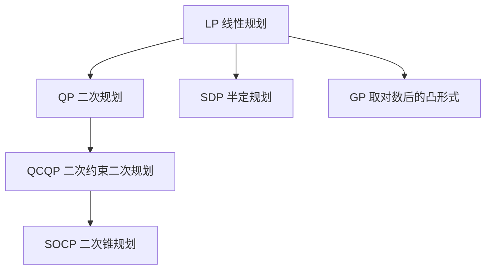
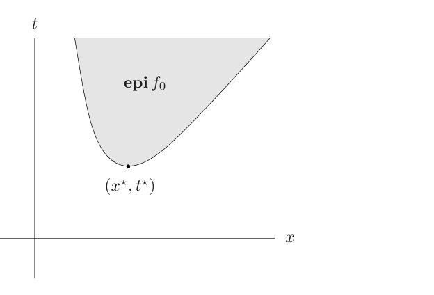
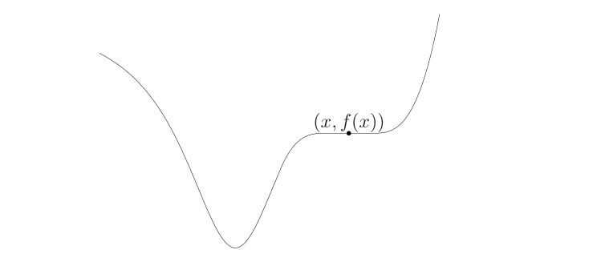
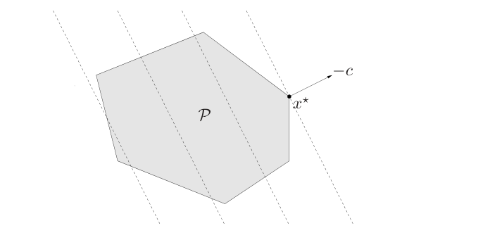

# 第4章 凸优化问题

### 来源说明

- 作者：Stephen Boyd, Lieven Vandenberghe
- 书名：*Convex Optimization*（凸优化）
- 官方来源：https://web.stanford.edu/~boyd/cvxbook/bv_cvxbook.pdf （Stanford 作者页公开的全书 PDF）
- 纸书由 Cambridge University Press 出版。本笔记仅供个人学习使用。本地 PDF 不是可再分发的授权副本。

阅读范围：Chapter 4 Convex optimization problems（凸优化问题），PDF 第 141–228 页。正文在 PDF 第 141–201 页，参考文献在第 202 页，习题在第 203–228 页。习题不展开。

第 1 章把凸优化说成「目标和不等式约束都凸」。本章给出可核对的标准形，并列出线性规划、二次锥规划、半定规划、几何规划这几类能直接拿去求解的形式。

### 本章总览

一般优化先写成标准形 (4.1)。两个问题称为等价，是指从一个解能直接得到另一个解。等价改写包括正数缩放、可逆换元、单调变换目标、松弛变量、消掉或引入线性等式、对一部分变量先求极小，以及上境图（epigraph）形式。

凸优化标准形 (4.15) 比「在凸集上最小化凸函数」更严：不等式约束函数必须是凸函数，等式必须是仿射函数。满足这个写法时，局部最优就是全局最优。目标只是拟凸时，局部最优可以不是全局最优；最优值可以用一串凸可行性问题做二分。

后面的问题类是 (4.15) 的子类，或能改写成它。线性规划的目标和约束都是仿射的。二次规划的目标是凸二次函数、约束仍是仿射的。二次约束二次规划把不等式也改成凸二次。二次锥规划用二阶锥约束，比二次约束二次规划更宽。半定规划把不等式换成半正定锥上的线性矩阵不等式。几何规划的自然形式一般不凸，取对数换元后成为凸问题。

图注：箭头表示「是后一类的特例」。线性规划同时是二次规划、半定规划和几何规划凸形式的特例。二次锥规划比二次约束二次规划更一般：把锥约束两边平方，只在右端系数为零时回到二次约束二次规划。

向量优化把目标换成锥序下的向量。多数问题没有能压过所有可行点的最优值，只有 Pareto 最优。用正权把向量目标收成标量，是第 5 章对偶的直观前身。

### 核心知识点

#### 标准形与基本术语

本书的优化标准形是

\[
\begin{align*}
\operatorname{minimize}\quad & f_0(x) \\
\operatorname{subject\ to}\quad & f_i(x)\le 0,\quad i=1,\ldots,m \\
& h_i(x)=0,\quad i=1,\ldots,p.
\end{align*}
\tag{4.1}
\]

\(x\in\mathbb{R}^n\) 是 optimization variable（优化变量），\(f_0\) 是 objective（目标）或 cost（代价）。\(f_i\) 是不等式约束函数，\(h_i\) 是等式约束函数。\(m=p=0\) 时问题无约束。

问题的 domain（定义域）是目标和全部约束函数定义域的交集

\[
\mathcal{D}=\bigcap_{i=0}^{m}\operatorname{dom} f_i\cap\bigcap_{i=1}^{p}\operatorname{dom} h_i.
\]

\(x\in\mathcal{D}\) 且满足全部约束时称为 feasible（可行）。至少有一个可行点则问题可行，否则不可行。全体可行点是 feasible set（可行集），也叫约束集。

最优值允许取 \(\pm\infty\)：

\[
p^\star=\inf\{f_0(x)\mid f_i(x)\le 0,\ h_i(x)=0\}.
\]

不可行时按空集下确界的约定，\(p^\star=\infty\)。若有一串可行点使目标趋于 \(-\infty\)，则 \(p^\star=-\infty\)，问题 unbounded below（下方无界）。

\(x^\star\) 是 optimal（最优）点，是指它可行且 \(f_0(x^\star)=p^\star\)。最优集记为 \(X_{\mathrm{opt}}\)。最优集非空时说最优值 attained（取到），问题 solvable（可解）。下方无界时最优值一定取不到。

可行点满足 \(f_0(x)\le p^\star+\epsilon\)（\(\epsilon>0\)）时，称为 \(\epsilon\)-suboptimal（\(\epsilon\)-次优）。

可行点 \(x\) 是 locally optimal（局部最优），是指存在 \(R>0\)，使 \(x\) 在额外约束 \(\|z-x\|_2\le R\) 下仍是最优。全书里 optimal 都指全局最优。

\(f_i(x)=0\) 时第 \(i\) 个不等式在 \(x\) 处 active（有效、起作用）；\(f_i(x)<0\) 时 inactive（不起作用）。等式约束在每个可行点上都有效。删掉某条约束不改变可行集，这条约束就是 redundant（冗余）。

例 4.1 在 \(x\in\mathbb{R}\)、\(\operatorname{dom} f_0=\mathbb{R}_{++}\) 上比较三个无约束问题。\(f_0(x)=1/x\) 时 \(p^\star=0\)，但取不到。\(f_0(x)=-\log x\) 时 \(p^\star=-\infty\)。\(f_0(x)=x\log x\) 时 \(p^\star=-1/e\)，唯一最优点是 \(x^\star=1/e\)。

目标恒为 0 时，可行则 \(p^\star=0\)，不可行则 \(p^\star=\infty\)。这叫 feasibility problem（可行性问题），写成 find \(x\) subject to 那些约束。它只问约束是否一致，并在一致时找出一个可行点。

🔑 关键速记：标准形 (4.1) 把不等式右边收成 0；不可行对应 \(p^\star=\infty\)，下方无界对应 \(p^\star=-\infty\)。

#### 写成标准形，以及最大化

右边不是 0 时，把非零项移到左边。\(f_i(x)\ge 0\) 写成 \(-f_i(x)\le 0\)。

例 4.2 的 box constraints（箱约束）是 \(l_i\le x_i\le u_i\)。标准形用 \(2n\) 条不等式：\(l_i-x_i\le 0\) 与 \(x_i-u_i\le 0\)。

约定只讨论最小化。最大化问题 (4.2) 改成最小化 \(-f_0\)。最大化的最优值是约束下的上确界；\(\epsilon\)-次优改成 \(f_0(x)\ge p^\star-\epsilon\)。这时目标有时叫 utility（效用），不叫代价。

🔑 关键速记：箱约束拆成上下界两条不等式；最大化就是最小化目标的相反数。

#### 等价改写

等价是非正式说法：从一个问题的解能直接得到另一个问题的解，并且反过来也行。两个等价问题的函数可以不同，所以它们不是同一个问题。

正数缩放 (4.3)：目标与不等式乘 \(\alpha_i>0\)，等式乘 \(\beta_i\neq 0\)。可行集不变，最优点不变。

换元要求 \(\phi:\mathbb{R}^n\to\mathbb{R}^n\) 是一对一，且像盖住 \(\mathcal{D}\)。令 \(\tilde f_i(z)=f_i(\phi(z))\)，得到以 \(z\) 为变量的问题 (4.4)。\(x\) 最优当且仅当 \(z=\phi^{-1}(x)\) 最优。

也可以改造函数值。\(\psi_0\) 单调增；对不等式，\(\psi_i(u)\le 0\) 当且仅当 \(u\le 0\)；对等式，\(\psi(u)=0\) 当且仅当 \(u=0\)。复合后可行集与最优点都不变。(4.3) 是 \(\psi_i\) 全为线性的特例。

例 4.3 比较无约束的最小欧氏范数 (4.5) 与最小平方范数 (4.6)：

\[
\operatorname{minimize}\quad \|Ax-b\|_2,
\tag{4.5}
\]

\[
\operatorname{minimize}\quad \|Ax-b\|_2^2=(Ax-b)^\top(Ax-b).
\tag{4.6}
\]

范数非负，所以最优点相同。两者不是同一个问题：\(Ax-b=0\) 时 (4.5) 的目标不可微，(4.6) 的目标是处处可微的二次函数。

松弛变量利用 \(f_i(x)\le 0\) 当且仅当存在 \(s_i\ge 0\) 使 \(f_i(x)+s_i=0\)。问题 (4.7) 的变量是 \((x,s)\)，每条不等式换成一条等式加一条非负约束。\(s_i=-f_i(x)\) 把两边的可行点与最优点对应起来。

若等式 \(h_i(x)=0\) 的解都能写成 \(x=\phi(z)\)，代入后得到只有不等式、变量为 \(z\) 的等价问题。

线性等式 \(Ax=b\) 可以数值上消掉。\(b\notin\mathcal{R}(A)\) 时原问题不可行。否则取一个特解 \(x_0\)，再取值域等于 \(\mathcal{N}(A)\) 的矩阵 \(F\)。通解是 \(x=Fz+x_0\)。\(F\) 列满秩时，新变量维数是 \(n-\operatorname{rank} A\)。代入后没有等式约束。

也可以反过来引入等式。目标或约束若是 \(f_i(A_ix+b_i)\)，可设新变量 \(y_i=A_ix+b_i\)。新问题里目标和各条不等式依赖不同的变量。

对一部分变量先求极小，不改变最优值：\(\inf_{x,y}f(x,y)=\inf_x\tilde f(x)\)，其中 \(\tilde f(x)=\inf_y f(x,y)\)。约束若分成只含 \(x_1\) 的一组和只含 \(x_2\) 的一组，问题 (4.9) 等价于先对 \(x_2\) 求 inf，再解 (4.10)。

例 4.4 的目标是严格凸二次型，一部分变量无约束。对 \(x_2\) 的解析极小是

\[
x_1^\top\big(P_{11}-P_{12}P_{22}^{-1}P_{12}^\top\big)x_1.
\]

书中指向附录 A.5.5。这里 \(P_{11}\)、\(P_{22}\) 对称，公式按书中写法使用 \(P_{22}^{-1}\)。

上境图形式 (4.11) 增加变量 \(t\)，最小化 \(t\)，并加上 \(f_0(x)-t\le 0\) 以及原来的约束。\((x,t)\) 对 (4.11) 最优，当且仅当 \(x\) 对原问题最优且 \(t=f_0(x)\)。新目标对 \((x,t)\) 是线性的。几何上，这是在 \(f_0\) 的上境图里找最低的点。

图注：图 4.1 画的是无约束情形。阴影是 \(\operatorname{epi} f_0\)。问题是在这张图里最小化纵坐标 \(t\)，最低点记为 \((x^\star,t^\star)\)，其中 \(t^\star=f_0(x^\star)\)。

约束也可以藏进目标的定义域。把 \(F\) 定义成可行集上等于 \(f_0\)、可行集外为 \(\infty\)，则无约束问题 (4.12) 与 (4.1) 等价。这只是记号：若 \(f_0\) 可微、定义域开，限制后的 \(F\) 往往不可微，因为新定义域常常不是开集。

反过来，(4.13) 的目标在 \(Ax=b\) 上等于 \(x^\top x\)，其余地方为 \(\infty\)。把它写成显式等式约束 (4.14) 后，目标和约束都可微。两个问题等价，函数性质不同。

问题数据也有两种给法。parameter description（参数描述）给出公式里的系数，例如二次目标 \(f_0(x)=(1/2)x^\top Px+q^\top x+r\) 由 \(P\in\mathbf{S}^n\)、\(q\)、\(r\) 决定。oracle（谕示、黑箱）不给出公式，只在询问的 \(x\) 上返回函数值，通常还返回导数，并事先知道凸性等性质。第三部分的算法按谕示来写；限制到某一参数族时可以更快。

内点法把带不等式的凸问题化成一串无约束或只有等式的子问题，每一步都要用目标和约束的导数。整条算法链是：线性方程解最小二乘，Newton 法处理无约束或等式，内点法再处理不等式。本章不写障碍参数和搜索步，只用到写成凸形式之后可以可靠求解这一结论。

👉 迭代格式见第 11 章。📝待补全

🔑 关键速记：等价只保证解能互相翻译；最小范数与最小平方范数最优点相同，可微性不同。上境图形式把任何问题改成线性目标。

#### 凸优化的标准形

凸优化标准形是

\[
\begin{align*}
\operatorname{minimize}\quad & f_0(x) \\
\operatorname{subject\ to}\quad & f_i(x)\le 0,\quad i=1,\ldots,m \\
& a_i^\top x=b_i,\quad i=1,\ldots,p,
\end{align*}
\tag{4.15}
\]

其中 \(f_0,\ldots,f_m\) 都是凸函数。和 (4.1) 相比，多三条要求：目标凸，不等式约束函数凸，等式约束函数 \(h_i(x)=a_i^\top x-b_i\) 是仿射函数。

可行集因此是凸集：它是凸定义域 \(\mathcal{D}\)、\(m\) 个凸的 0-下水平集和 \(p\) 张超平面的交集。\(a_i=0\) 且 \(b_i=0\) 的等式可以删掉；\(a_i=0\) 且 \(b_i\neq 0\) 时问题不可行。所以凸优化是在凸集上最小化凸目标，而且这个凸集必须用凸不等式和线性等式写出来。

\(f_0\) 改为拟凸、不等式仍凸、等式仍仿射时，(4.15) 称为标准形拟凸优化。凸函数和拟凸函数的下水平集都是凸集，所以 \(\epsilon\)-次优集是凸集，最优集也是凸集。目标严格凸时，最优点至多一个。

凹目标的最大化 (4.16)，在不等式约束函数仍凸、等式仍仿射时，本书也把它叫成凸优化问题。做法是最小化 \(-f_0\)。\(f_0\) 拟凹时，这个最大化称为拟凸问题。

凸函数是弦落在函数图像上方。下水平集凸、沿仿射映射复合后仍凸，是后面「改写保持凸性」的根据。

👉 凸函数与拟凸函数的定义、判定和 0-下水平集，在第 3 章。本章直接使用这些性质。📝待补全

定义比「凸集上的凸目标」更严。例 (4.17) 中 \(f_0(x)=x_1^2+x_2^2\) 凸，可行集 \(\{x\mid x_1\le 0,\ x_1+x_2=0\}\) 也凸，但不等式函数 \(x_1/(1+x_2^2)\) 不凸，等式函数 \((x_1+x_2)^2\) 不是仿射，所以 (4.17) 不是标准形凸优化。改写成 (4.18) 的 \(\tilde f_1(x)=x_1\le 0\)、\(\tilde h_1(x)=x_1+x_2=0\) 之后才是。有些作者把「凸函数在凸集上求最小」叫 abstract convex optimization problem（抽象凸优化）。本书不用这个术语。实践中要先把凸集写成凸不等式加线性等式；上面这个例子说明改写通常直接。

🔑 关键速记：凸优化标准形要求目标凸、不等式函数凸、等式仿射；只在凸集上最小化凸函数，还不算本书的凸优化。

#### 局部最优就是全局最优

凸优化的基本性质是：局部最优点一定是全局最优点。

结论来自反证。设 \(x\) 在某个半径 \(R\) 内最优，却存在可行 \(y\) 使 \(f_0(y)<f_0(x)\)。则 \(y\) 落在该邻域外。在 \(x\) 与 \(y\) 的线段上取距 \(x\) 为 \(R/2\) 的点 \(z\)。可行集凸，所以 \(z\) 可行；\(f_0\) 凸，所以 \(f_0(z)<f_0(x)\)，与局部最优矛盾。

拟凸问题没有这条性质，见 §4.2.5 和图 4.3。

🔑 关键速记：凸问题里，局部最优就是全局最优；拟凸问题可以有只在邻域里最好的点。

#### 可微目标的最优性条件

\(f_0\) 可微且凸时，一阶下界是

\[
f_0(y)\ge f_0(x)+\nabla f_0(x)^\top(y-x).
\tag{4.20}
\]

设 \(X\) 为可行集。\(x\) 最优当且仅当 \(x\in X\)，并且

\[
\nabla f_0(x)^\top(y-x)\ge 0\quad\text{对所有 }y\in X.
\tag{4.21}
\]

\(\nabla f_0(x)\neq 0\) 时，\(-\nabla f_0(x)\) 给出 \(X\) 在 \(x\) 处的一张支撑超平面。图 4.2 画的是这个几何：等高线，以及过最优点、法向为 \(-\nabla f_0(x)\) 的支撑线。本章配图用了上境图、拟凸和线性规划三张，这张支撑超平面留在文字里。

无约束时，(4.21) 收成

\[
\nabla f_0(x)=0.
\tag{4.22}
\]

这是充要条件。方程无解则没有最优点：要么下方无界，要么最优值有限但取不到。每个解都是 \(f_0\) 的最小点。

例 4.5 最小化 \(f_0(x)=(1/2)x^\top Px+q^\top x+r\)，\(P\in\mathbf{S}^n_+\)，所以 \(f_0\) 凸。充要条件是 \(Px+q=0\)。

- \(q\notin\mathcal{R}(P)\) 时无解，\(f_0\) 下方无界。
- \(P\succ 0\) 时 \(f_0\) 严格凸，唯一最小点 \(x^\star=-P^{-1}q\)。
- \(P\) 奇异但 \(q\in\mathcal{R}(P)\) 时，最优集是仿射集 \(X_{\mathrm{opt}}=-P^\dagger q+\mathcal{N}(P)\)。\(P^\dagger\) 是伪逆。

伪逆给出 \(Px+q=0\) 的一个特解 \(-P^\dagger q\)。系数矩阵奇异时，零空间里的任何向量加到这个特解上，仍然满足方程，所以最优集是仿射集，而不是单点。\(P\succ 0\) 时零空间只有原点，特解就是唯一最小点。本章只使用这个通解结构，不构造 \(P^\dagger\) 的分解。

👉 伪逆的构造见附录 A.5.4。📝待补全

例 4.6 的 analytic center（解析中心）是

\[
f_0(x)=-\sum_{i=1}^{m}\log(b_i-a_i^\top x),\qquad \operatorname{dom} f_0=\{x\mid Ax\prec b\}.
\]

充要条件 (4.23) 是 \(Ax\prec b\)，以及

\[
\sum_{i=1}^{m}\frac{1}{b_i-a_i^\top x}a_i=0.
\]

\(Ax\prec b\) 不可行则定义域为空。可行时：方程无解当且仅当 \(f_0\) 下方无界；多解时解构成仿射集；开多面体 \(\{x\mid Ax\prec b\}\) 非空且有界时，最小点唯一。多解的细节书中放在习题 4.2，这里不展开。

只有等式 \(Ax=b\)、且可行集非空时，(4.21) 等价于 \(\nabla f_0(x)\) 垂直于 \(\mathcal{N}(A)\)。因为 \(\mathcal{N}(A)^\perp=\mathcal{R}(A^\top)\)，存在 \(\nu\) 使

\[
\nabla f_0(x)+A^\top\nu=0,
\]

再加上 \(Ax=b\)。这是古典的 Lagrange multiplier（Lagrange 乘子）条件。

乘子 \(\nu\) 的每个分量对应一条等式。后面会看到，强对偶成立时，这些乘子等于最优值对等式右端的变化率：把 \(b\) 扰动一点点，\(p^\star\) 的一阶变化由 \(\nu\) 线性给出。不等式乘子则只在约束有效时可能非零。本章先把条件写出来，灵敏度公式放到对偶理论里。

👉 乘子作为灵敏度见第 5 章。📝待补全

只要求 \(x\succeq 0\) 时，(4.21) 收成互补条件

\[
x\succeq 0,\qquad \nabla f_0(x)\succeq 0,\qquad x_i\big(\nabla f_0(x)\big)_i=0.
\]

\(x\) 与 \(\nabla f_0(x)\) 的非零指标集不相交。这种 complementarity（互补）在第 5 章的 KKT 条件里再次出现。

🔑 关键速记：可微凸问题里，(4.21) 是最优的充要条件；无约束时就是梯度为零，非负约束时还要互补。

#### 哪些改写保持凸性

线性等式 \(Ax=b\) 消掉之后，新目标和新约束都是凸函数与仿射映射的复合，所以仍凸。消元只用线性代数。原则上可以只讨论没有等式的凸问题。变量很多、问题稀疏时，消元可能毁掉稀疏，这时保留等式更合适。

引入的等式必须是线性的，新问题才仍是凸的。例如把 \(f_i(A_ix+b_i)\) 换成 \(f_i(y_i)\)，并加上 \(y_i=A_ix+b_i\)。

松弛变量给出等式 \(f_i(x)+s_i=0\)。凸问题的等式必须仿射，所以只有 \(f_i\) 仿射时，引入松弛才保持凸性。

凸问题的上境图形式仍凸：目标线性，新约束 \(f_0(x)-t\) 对 \((x,t)\) 凸。因此线性目标对凸优化是通用的：任何凸问题都能改成线性目标。理论分析可以假设目标线性；能处理 \(f_0(x)-t\le 0\) 的算法，就能处理一般凸目标。

对一部分变量求极小也保持凸性。\(f_0\) 对 \((x_1,x_2)\) 联合凸、两组约束函数都凸时，(4.10) 仍是凸问题。

🔑 关键速记：消线性等式、引入线性等式、仿射不等式的松弛、上境图、对部分变量求极小，都保持凸性；松弛不能用在非线性不等式上。

#### 拟凸优化

拟凸问题 (4.24) 是：最小化拟凸的 \(f_0\)，不等式约束函数凸，等式 \(Ax=b\)。

拟凸函数的每个下水平集都是凸集，但函数本身可以不是凸的。因此一条拟凸不等式描述的集合，可以改写成某条凸不等式，两边的 0-下水平集相同，可行集不变。目标若仍只是拟凸，问题还不是凸优化。求解时改用一族凸函数 \(\phi_t\)：\(f_0(x)\le t\) 当且仅当 \(\phi_t(x)\le 0\)，并且 \(t\) 增大时 \(\phi_t(x)\) 不增。

👉 0-下水平集的凸代表见第 3 章 §3.4.5。📝待补全

和凸问题的主要差别是：局部最优可以不是全局最优。图 4.3 在 \(\mathbb{R}\) 上就能看到。

图注：图 4.3 的 \(f\) 是 \(\mathbb{R}\) 上的拟凸函数。标出的 \((x,f(x))\) 是局部最低点，左边还有更低的谷。凸函数上常用的 \(f'(x)=0\) 不能拿来判断拟凸问题的全局最优。

可微拟凸问题仍有一条变体。\(x\) 最优，如果 \(x\) 可行，并且

\[
\nabla f_0(x)^\top(y-x)>0\quad\text{对所有可行 }y\neq x.
\tag{4.25}
\]

它只是充分条件，最优时可以不成立。它还要求梯度非零。凸问题的 (4.21) 是充要条件，梯度为零时自动成立，该点就是最优。

求解靠下水平集。设凸函数族 \(\phi_t\) 满足 \(f_0(x)\le t\iff\phi_t(x)\le 0\)，并且对固定 \(x\)，\(s\ge t\) 时 \(\phi_s(x)\le\phi_t(x)\)。凸可行性问题 (4.26) 是

\[
\begin{align*}
\operatorname{find}\quad & x \\
\operatorname{subject\ to}\quad & \phi_t(x)\le 0 \\
& f_i(x)\le 0,\quad Ax=b.
\end{align*}
\tag{4.26}
\]

(4.26) 可行则 \(p^\star\le t\)，任一可行点对原问题也可行且 \(f_0(x)\le t\)。(4.26) 不可行则 \(p^\star\ge t\)。

算法 4.1 是二分。假定原问题可行，并已知 \(l\le p^\star\le u\)，容差 \(\epsilon>0\)。

1. 取中点 \(t=(l+u)/2\)。
2. 解凸可行性问题 (4.26)。
3. 可行则令 \(u=t\)，否则令 \(l=t\)。

重复直到 \(u-l\le\epsilon\)。每一步区间仍含 \(p^\star\)，宽度减半。恰好需要 \(\lceil\log_2((u-l)/\epsilon)\rceil\) 次，每次解一个凸可行性问题。

🔑 关键速记：拟凸问题用凸可行性问题二分 \(p^\star\)；(4.25) 只是充分条件，不能代替凸问题的 (4.21)。

#### 线性规划

目标和约束都仿射时，问题是 linear program（线性规划，LP）：

\[
\begin{align*}
\operatorname{minimize}\quad & c^\top x+d \\
\operatorname{subject\ to}\quad & Gx\preceq h \\
& Ax=b.
\end{align*}
\tag{4.27}
\]

\(G\in\mathbb{R}^{m\times n}\)，\(A\in\mathbb{R}^{p\times n}\)。常数 \(d\) 不影响可行集和最优集。最大化仿射目标也叫 LP，因为最小化 \(-c^\top x-d\) 仍是 LP。几何上，可行集是多面体 \(\mathcal{P}\)，要在 \(\mathcal{P}\) 上最小化线性函数 \(c^\top x\)。

图注：图 4.4 中阴影多面体是可行集 \(\mathcal{P}\)。虚线是 \(c^\top x\) 的等高线，与 \(c\) 垂直。最优点 \(x^\star\) 是 \(\mathcal{P}\) 里沿 \(-c\) 走得最远的点。

两种常用特例有专门名字。standard form（标准形）LP 只有非负不等式：

\[
\begin{align*}
\operatorname{minimize}\quad & c^\top x \\
\operatorname{subject\ to}\quad & Ax=b,\quad x\succeq 0.
\end{align*}
\tag{4.28}
\]

没有等式时叫 inequality form（不等式形）LP：\(\operatorname{minimize}\ c^\top x\) subject to \(Ax\preceq b\)，即 (4.29)。

一般 LP (4.27) 可以改成 (4.28)。先给 \(Gx\preceq h\) 加松弛 \(s\succeq 0\)，得到 \(Gx+s=h\)。再写 \(x=x^+-x^-\)，并要求 \(x^+,x^-,s\succeq 0\)。等价性的细节在习题 4.10，不展开。能改写成 LP 的问题，习惯上也叫 LP。

下面几个例子说明「认得出线性结构」。

饮食问题：食物量 \(x\succeq 0\)，营养约束 \(Ax\succeq b\)，最小化花费 \(c^\top x\)。营养也可以写成等式，或同时有上下界。

多面体的 Chebyshev center（切比雪夫中心）是含于多面体的最大欧氏球的球心。球 \(B=\{x_c+u\mid \|u\|_2\le r\}\) 落在半空间 \(a_i^\top x\le b_i\) 里，当且仅当

\[
a_i^\top x_c+r\|a_i\|_2\le b_i.
\tag{4.31}
\]

对全部 \(i\) 最大化 \(r\)，变量是 \(r\) 和 \(x_c\)，这是 LP。球心是多面体里离边界最远的点，半径是这个最大内切球的半径。半空间上的包含关系之所以变成线性不等式，是因为线性函数在欧氏球上的最大值等于半径乘法向量的欧氏范数。多面体由半空间相交而成，所以每条边界各写一条 (4.31) 即可。

👉 同一中心在第 8 章 §8.5.1 还有几何讨论。📝待补全

分段线性凸函数 \(f(x)=\max_i(a_i^\top x+b_i)\) 的无约束最小化，先写成上境图，再把 \(\max_i(a_i^\top x+b_i)\le t\) 拆成 \(m\) 条线性不等式。变量是 \(x\) 和 \(t\)，结果是不等式形 LP。

动态活动规划、离散分布上的 Chebyshev 不等式，也是 LP。离散分布由概率向量 \(p\succeq 0\)、\(1^\top p=1\) 表示。期望和事件概率对 \(p\) 都是线性的，先验的上下界也是线性不等式。在这些约束下最小化或最大化 \(a_0^\top p\)，得到的最优值就是该期望在一切符合先验的分布上的最紧下界或上界，而且最优 \(p\) 是一个达到这个界的分布。

👉 这类界放进统计估计的写法见第 7 章 §7.4.1。📝待补全

🔑 关键速记：LP 是在多面体上最小化线性函数；标准形只有 \(x\succeq 0\) 和等式，不等式形只有 \(Ax\preceq b\)。

#### 线性分式规划

在多面体上最小化仿射函数之比，是 linear-fractional program（线性分式规划）(4.32)：

\[
f_0(x)=\frac{c^\top x+d}{e^\top x+f},\qquad \operatorname{dom} f_0=\{x\mid e^\top x+f>0\}.
\]

目标是拟凸的，其实是拟线性的，所以这是拟凸问题。

可行集非空时，可以改成等价 LP (4.33)，变量 \(y,z\)：

\[
\begin{align*}
\operatorname{minimize}\quad & c^\top y+dz \\
\operatorname{subject\ to}\quad & Gy-hz\preceq 0 \\
& Ay-bz=0 \\
& e^\top y+fz=1,\quad z\ge 0.
\end{align*}
\tag{4.33}
\]

可行 \(x\) 对应 \(y=x/(e^\top x+f)\)、\(z=1/(e^\top x+f)\)，目标值相同。反过来，\(z\neq 0\) 时 \(x=y/z\) 可行且目标相同。\(z=0\) 时，从原问题的一个可行点 \(x_0\) 出发，\(x_0+ty\)（\(t\ge 0\)）的目标可以任意接近 \(c^\top y+dz\)。因此两边最优值相等。

广义线性分式把目标改成 \(r\) 个仿射比的最大值，定义域要求每个分母为正。逐点最大保持拟凸。\(r=1\) 时回到 (4.32)。

例 4.7 是 von Neumann 增长问题：最大化各部门最小增长率 \(\min_i x_i^+/x_i\)，约束 \(Bx^+\preceq Ax\)、\(x^+\succeq 0\)，定义域 \(x\succ 0\)。问题对 \((x,x^+)\) 齐次，隐式约束 \(x\succ 0\) 可换成显式 \(x\succeq 1\)。

🔑 关键速记：线性分式目标拟凸；用 \(y=x/(\text{分母})\)、\(z=1/(\text{分母})\) 可化成 LP，并要单独处理 \(z=0\)。

#### 二次规划与二次约束二次规划

目标是凸二次函数、约束仿射时，(4.15) 称为 quadratic program（二次规划，QP）：

\[
\begin{align*}
\operatorname{minimize}\quad & (1/2)x^\top Px+q^\top x+r \\
\operatorname{subject\ to}\quad & Gx\preceq h,\quad Ax=b,
\end{align*}
\tag{4.34}
\]

其中 \(P\in\mathbf{S}^n_+\)。几何上是在多面体上最小化凸二次函数。图 4.5 用弯曲等高线表示这一点：最优点处 \(-\nabla f_0(x^\star)\) 支撑多面体。本章已用图 4.4 说明多面体上的线性目标，二次等高线不再另配图。

目标和不等式都是凸二次时，称为 quadratically constrained quadratic program（二次约束二次规划，QCQP）(4.35)，其中每个 \(P_i\in\mathbf{S}^n_+\)。\(P_i\succ 0\) 时，可行集是若干椭球的交集。

\(P=0\) 时 QP 退化为 LP。约束里的 \(P_i=0\) 时，QCQP 退化为 QP，因而也包含 LP。

无约束最小二乘 \(\|Ax-b\|_2^2\) 是 QP，解析解 \(x=A^\dagger b\)。残差平方和的梯度是线性的，令梯度为零就得到这个伪逆解。加上变量上下界后，可行集不再是整个空间，最优性要改用 (4.21)，一般没有同样的闭式。回归里的非负系数、预算或形状限制，写成线性不等式后仍是 QP。

👉 拟合与统计估计的展开见第 6、7 章。📝待补全

两个多面体的欧氏距离是它们之间最近点对的距离。多面体相交时距离为零；有一个为空时，对应的 QP 不可行。把两个点分别放进各自的线性不等式，最小化 \(\|x_1-x_2\|_2^2\)，就得到一只 QP。最优的 \(x_1,x_2\) 是一对最近点。包含、分离和最小体积这一类几何量，后面收成同一组凸模型。

👉 距离类几何问题见第 8 章。📝待补全

随机代价的 LP 里，代价 \(c\) 的均值是 \(\bar c\)、协方差是 \(\Sigma\) 时，\(c^\top x\) 的均值是 \(\bar c^\top x\)，方差是 \(x^\top\Sigma x\)。风险敏感代价 \(\bar c^\top x+\gamma x^\top\Sigma x\)（\(\gamma\ge 0\)）的最小化是 QP。

Markowitz 组合是另一只 QP：在 \(p^\top x\ge r_{\min}\)、\(1^\top x=1\)、\(x\succeq 0\) 下最小化收益方差 \(x^\top\Sigma x\)。这里 \(p\) 是价格相对变化的均值，\(\Sigma\) 是协方差。允许有限卖空、或加上线性交易费，仍可写成 QP。

🔑 关键速记：QP 的 \(P\) 半正定，约束是多面体；QCQP 的不等式也是凸二次。LP 是 \(P=0\) 的 QP。

#### 二次锥规划

与二次规划相邻的是 second-order cone program（二次锥规划，SOCP）(4.36)：

\[
\begin{align*}
\operatorname{minimize}\quad & f^\top x \\
\operatorname{subject\ to}\quad & \|A_ix+b_i\|_2\le c_i^\top x+d_i,\quad i=1,\ldots,m \\
& Fx=g.
\end{align*}
\tag{4.36}
\]

\(\|Ax+b\|_2\le c^\top x+d\) 叫做 second-order cone constraint（二阶锥约束）：仿射映射 \((Ax+b,\ c^\top x+d)\) 落在 \(\mathbb{R}^{k+1}\) 的二阶锥里。

\(c_i=0\) 时，把约束两边平方，SOCP 等价于 QCQP。\(A_i=0\) 时，SOCP 退化为一般 LP。SOCP 比 QCQP 更一般。

鲁棒线性规划说明多出来的那一块是什么。不等式形 LP 的 \(a_i\) 落在椭球 \(\mathcal{E}_i=\{\bar a_i+P_iu\mid \|u\|_2\le 1\}\) 中，要求约束对椭球里每一个 \(a_i\) 都成立。该条件等价于

\[
\bar a_i^\top x+\|P_i^\top x\|_2\le b_i,
\]

因而是 SOCP。范数项阻止 \(x\) 在参数很不确定的方向上变得很大。\(P_i\) 奇异时椭球是扁的；\(P_i=0\) 表示 \(a_i\) 完全已知。

同一约束也可以按概率写。\(a_i\) 独立、高斯、均值 \(\bar a_i\)、协方差 \(\Sigma_i\)，要求

\[
\operatorname{prob}(a_i^\top x\le b_i)\ge\eta,\qquad \eta\ge 1/2.
\tag{4.38}
\]

设 \(u=a_i^\top x\)，标准差为 \(\sigma\)。\((u-\bar u)/\sigma\) 是标准正态，概率等于 \(\Phi((b_i-\bar u)/\sigma)\)。这里 \(\Phi\) 是标准正态的累积分布函数。约束变成

\[
\bar a_i^\top x+\Phi^{-1}(\eta)\|\Sigma_i^{1/2}x\|_2\le b_i.
\]

\(\eta\ge 1/2\) 保证 \(\Phi^{-1}(\eta)\ge 0\)，所以这是二阶锥约束。

👉 鲁棒凸优化在第 6 章还有更一般的说法。本章的结论是：椭球不确定的线性不等式，以及置信水平至少 \(1/2\) 的高斯线性不等式，都是二阶锥约束。📝待补全

例 4.8 把损失风险 \(\operatorname{prob}(r\le\alpha)\le\beta\) 写成

\[
p^\top x+\Phi^{-1}(\beta)\|\Sigma^{1/2}x\|_2\ge\alpha.
\tag{4.39}
\]

收益 \(r\) 的均值是 \(p^\top x\)，方差是 \(x^\top\Sigma x\)。\(\beta\le 1/2\) 时这是二阶锥约束；\(\beta>1/2\) 时对 \(x\) 非凸。在 \(\beta\le 1/2\)、\(x\succeq 0\)、\(1^\top x=1\) 下最大化期望收益，是只带一条二阶锥约束的 SOCP。

离散极小曲面把面积近似成若干 \(\|(K(f_{i+1,j}-f_{ij}),\ K(f_{i,j+1}-f_{ij}),\ 1)\|_2\) 之和。引入上界变量 \(t_{ij}\) 后，边界值固定的极小曲面近似也是 SOCP。

🔑 关键速记：SOCP 的不等式是 \(\|A_ix+b_i\|_2\le c_i^\top x+d_i\)。右端系数全为零时等价于 QCQP，矩阵 \(A_i\) 全为零时退化为 LP。

#### 几何规划

geometric program（几何规划，GP）的自然形式一般不凸。换元并变换目标、约束之后，它变成凸问题。

单项式（monomial）定义在 \(\mathbb{R}^n_{++}\) 上：

\[
f(x)=c\,x_1^{a_1}x_2^{a_2}\cdots x_n^{a_n},
\tag{4.41}
\]

其中 \(c>0\)，指数 \(a_i\) 可以是任意实数，包括分数和负数。这和代数里「非负整数指数」的单项式不是同一个词，本书明确说不会混淆。

正项式（posynomial）是 \(K\) 个单项式之和 (4.42)，每个系数 \(c_k>0\)。正项式对加法、乘法和非负缩放封闭。单项式对乘法和除法封闭。正项式乘或除以单项式，结果仍是正项式。

标准 GP (4.43) 是

\[
\begin{align*}
\operatorname{minimize}\quad & f_0(x) \\
\operatorname{subject\ to}\quad & f_i(x)\le 1,\quad i=1,\ldots,m \\
& h_i(x)=1,\quad i=1,\ldots,p,
\end{align*}
\tag{4.43}
\]

其中 \(f_i\) 是正项式，\(h_i\) 是单项式。定义域是 \(\mathbb{R}^n_{++}\)，\(x\succ 0\) 是隐式约束。

\(f\) 为正项式、\(h\) 为单项式时，\(f(x)\le h(x)\) 写成 \(f(x)/h(x)\le 1\)。两个非零单项式相等，写成它们的比等于 1。最大化非零单项式，就是最小化它的倒数。能这样化成 (4.43) 的问题，也叫 GP。

凸形式用 \(y_i=\log x_i\)，即 \(x_i=e^{y_i}\)。单项式变成仿射函数的指数 \(e^{a^\top y+b}\)，\(b=\log c\)。正项式变成若干这种指数之和。再对目标和约束取对数，得到

\[
\begin{align*}
\operatorname{minimize}\quad & \tilde f_0(y)=\log\Big(\sum_{k=1}^{K_0}e^{a_{0k}^\top y+b_{0k}}\Big) \\
\operatorname{subject\ to}\quad & \tilde f_i(y)=\log\Big(\sum_{k=1}^{K_i}e^{a_{ik}^\top y+b_{ik}}\Big)\le 0 \\
& \tilde h_i(y)=g_i^\top y+h_i=0.
\end{align*}
\tag{4.44}
\]

\(\tilde f_i\) 凸，\(\tilde h_i\) 仿射，所以 (4.44) 是凸优化。(4.43) 叫正项式形式，(4.44) 叫凸形式。两组问题数据相同，变的是函数写法，中间没有额外计算。

若目标和约束都只有一项，也就是全是单项式，则 (4.44) 退化为一般 LP。因此几何规划是线性规划的推广。

例子只保留形式，不展开设计参数。Frobenius 范数对角缩放 \(\sum_{i,j}M_{ij}^2 d_i^2/d_j^2\) 是无约束 GP，指数只有 \(0,2,-2\)。分段悬臂梁的体积、应力和端点挠度约束可以写成 GP；挠度 \(y_1\) 是正项式，段数 \(N\) 大时单项个数大约按 \(N^2\) 增长。非负不可约矩阵的 Perron–Frobenius 特征值满足 \(\lambda_{\mathrm{pf}}=\inf\{\lambda\mid Av\preceq\lambda v,\ v\succ 0\}\)。\(Av\preceq\lambda v\) 是关于 \(A_{ij}\)、\(v_i\)、\(\lambda\) 的正项式不等式，所以在正项式约束下最小化谱半径可以写成 GP。

🔑 关键速记：GP 的自然形式一般不凸；\(y=\log x\) 再取对数，得到凸问题 (4.44)。全是单项式时，凸形式就是 LP。

#### 广义不等式与锥规划

标准形的一个推广是允许向量值约束，并用广义不等式：

\[
\begin{align*}
\operatorname{minimize}\quad & f_0(x) \\
\operatorname{subject\ to}\quad & f_i(x)\preceq_{K_i}0,\quad i=1,\ldots,m \\
& Ax=b.
\end{align*}
\tag{4.48}
\]

\(K_i\subseteq\mathbb{R}^{k_i}\) 是正常锥，\(f_i\) 是 \(K_i\)-凸。(4.15) 是每个 \(K_i=\mathbb{R}_+\) 的特例。

正常锥要凸、闭、内部非空，并且不含整条直线。它定义广义不等式：\(x\preceq_K y\) 就是 \(y-x\in K\)。非负象限给出分量不等式，半正定锥给出矩阵不等式。\(K\)-凸是指线段上的函数值，在这个锥序下不超过两端的组合。本章把锥序当成已经给定，只讨论约束写成 \(\preceq_{K_i}\) 之后，可行集是否仍凸、局部最优是否仍是全局最优。

普通凸问题的几条结论仍然成立：可行集、任意下水平集和最优集都凸；局部最优就是全局最优；可微目标的最优性条件 (4.21) 一字不改。第 11 章还会说明，带广义不等式的凸问题常常可以和普通凸问题一样求解。

👉 正常锥与 \(K\)-凸的定义见第 2、3 章。📝待补全

最简单的一类是 conic form problem（锥形式问题，锥规划）(4.49)：目标线性，只有一条仿射的广义不等式 \(Fx+g\preceq_K 0\)，再加上 \(Ax=b\)。\(K\) 是非负象限时，锥规划就是 LP。它把分量不等式换成广义线性不等式。

标准形锥规划是 \(\operatorname{minimize}\ c^\top x\) subject to \(x\succeq_K 0\)、\(Ax=b\)。不等式形是只有 \(Fx+g\preceq_K 0\)、没有等式。

🔑 关键速记：锥规划用一条仿射的广义不等式代替分量不等式；非负象限上的锥规划就是 LP。

#### 半定规划

\(K=\mathbf{S}^k_+\) 时，锥规划称为 semidefinite program（半定规划，SDP）(4.50)：

\[
\begin{align*}
\operatorname{minimize}\quad & c^\top x \\
\operatorname{subject\ to}\quad & x_1F_1+\cdots+x_nF_n+G\preceq 0 \\
& Ax=b,
\end{align*}
\tag{4.50}
\]

其中 \(G,F_1,\ldots,F_n\in\mathbf{S}^k\)。这条不等式是 linear matrix inequality（线性矩阵不等式，LMI）。这些矩阵全部对角时，书中写明 LMI 等价于一组 \(n\) 条线性不等式，SDP 退化为 LP。

标准形 SDP 与标准形 LP (4.28) 平行：最小化变量的线性函数，有 \(p\) 条线性等式，再加上变量的「非负」约束。变量换成 \(X\in\mathbf{S}^n\)：

\[
\begin{align*}
\operatorname{minimize}\quad & \operatorname{tr}(CX) \\
\operatorname{subject\ to}\quad & \operatorname{tr}(A_iX)=b_i,\quad i=1,\ldots,p \\
& X\succeq 0.
\end{align*}
\tag{4.51}
\]

\(\operatorname{tr}(CX)=\sum_{i,j}C_{ij}X_{ij}\) 是 \(\mathbf{S}^n\) 上一般的实值线性函数。

不等式形 SDP 没有等式，只有一条 LMI：最小化 \(c^\top x\)，约束 \(x_1A_1+\cdots+x_nA_n\preceq B\)。

线性目标、线性等式、线性不等式和若干条 LMI 放在一起，也叫 SDP。把线性不等式和各条 LMI 收成一块对角矩阵，就回到一条 LMI：

\[
\operatorname{diag}\big(Gx-h,\ F^{(1)}(x),\ldots,F^{(K)}(x)\big)\preceq 0.
\]

SOCP (4.36) 本身就是锥规划：第 \(i\) 个锥是

\[
K_i=\{(y,t)\in\mathbb{R}^{n_i+1}\mid \|y\|_2\le t\}.
\]

这解释了 second-order cone 这个名字。

谱范数 \(\|A(x)\|_2\) 的最小化可以写成 SDP。\(A(x)=A_0+x_1A_1+\cdots+x_nA_n\)。\(\|A\|_2\le t\) 且 \(t\ge 0\) 等价于 \(A^\top A\preceq t^2 I\)，也等价于

\[
\begin{bmatrix} tI & A \\ A^\top & tI \end{bmatrix}\succeq 0.
\]

后一个形式对 \((x,t)\) 是一条线性矩阵不等式。谱范数不超过 \(t\)（\(t\ge 0\)）意味着 \(A^\top A\) 的最大特征值不超过 \(t^2\)。把这个矩阵不等式写成更大的块矩阵 \(\succeq 0\)，约束对 \((x,t)\) 变成线性的，问题就成为 SDP。块矩阵与 \(A^\top A\preceq t^2 I\) 为什么等价，正文只引用、不证明。

👉 等价关系的证明见附录 A.5.5。📝待补全

矩问题用 Hankel 矩阵 (4.52)：\(x_0=1\) 且 \(H(x_0,\ldots,x_{2n})\succeq 0\)，刻画某分布（或一列分布的极限）的矩。在矩的上下界下，多项式期望的上下界因此是 SDP。不完全协方差信息下，组合的最坏方差也是 SDP：在元素上下界和 \(\Sigma\succeq 0\) 下最大化 \(x^\top\Sigma x\)。

图上最快混合 Markov 链把混合率写成 \(\|P-(1/n)11^\top\|_2\)，再用 \(-tI\preceq P-(1/n)11^\top\preceq tI\) 收成 SDP (4.55)，并带上随机矩阵与图的支撑约束。

🔑 关键速记：SDP 的核心约束是线性矩阵不等式 \( \sum x_i F_i+G\preceq 0\)，或标准形里的 \(X\succeq 0\)。对角情形退化为 LP；二阶锥约束是另一类锥约束，谱范数上界可以写成更大的 LMI。

#### 向量优化、Pareto 与标量化

约束可以是向量，目标也可以是向量。(4.56) 在正常锥 \(K\subseteq\mathbb{R}^q\) 的广义序下最小化 \(f_0:\mathbb{R}^n\to\mathbb{R}^q\)。普通问题 (4.1) 这时叫标量优化。\(f_0\) 为 \(K\)-凸、不等式函数凸、等式仿射时，(4.56) 是凸向量优化。

两个可行点的目标值未必能用 \(\preceq_K\) 比较。谁也不比谁好，这在标量问题里不会发生。

可达目标值的集合记为 \(\mathcal{O}\)。若存在可行 \(x\)，使对每个可行 \(y\) 都有 \(f_0(x)\preceq_K f_0(y)\)，则 \(x\) 最优，\(f_0(x)\) 是最优值；这时最优值唯一。充要条件是 \(x\) 可行且

\[
\mathcal{O}\subseteq f_0(x^\star)+K.
\tag{4.57}
\]

\(f_0(x^\star)+K\) 是比 \(f_0(x^\star)\) 更差或同样好的值。图 4.7 在 \(K=\mathbb{R}^2_+\) 上画出这一点。多数向量问题没有这种最优值。

一个确实有最优值的例子是最佳线性无偏估计 (4.58)：在 \(FA=I\) 下，相对 \(\mathbf{S}^n_+\) 最小化误差协方差 \(FF^\top\)。最优解是伪逆 \(F^\star=A^\dagger=(A^\top A)^{-1}A^\top\)，最优值是 \((A^\top A)^{-1}\)。

没有最小元时，看最小元。可行点 \(x\) 是 Pareto optimal（Pareto 最优，有效点），是指 \(f_0(x)\) 是 \(\mathcal{O}\) 的最小元：任何可行 \(y\) 若 \(f_0(y)\preceq_K f_0(x)\)，则两个目标值相等。充要条件是

\[
\big(f_0(x)-K\big)\cap\mathcal{O}=\{f_0(x)\}.
\tag{4.59}
\]

Pareto 最优值的集合 \(\mathcal{P}\) 满足 \(\mathcal{P}\subseteq\mathcal{O}\cap\operatorname{bd}\mathcal{O}\)。图 4.8 把它们画在可达集的左下边界上。

标量化任取 \(\lambda\succ_{K^*}0\)，解标量问题 (4.60)：最小化 \(\lambda^\top f_0(x)\)，约束与原问题相同。它的最优点对 (4.56) 是 Pareto 最优。几何上，\(\{u\mid \lambda^\top(u-f_0(x))=0\}\) 是 \(\mathcal{O}\) 在 \(f_0(x)\) 处的支撑超平面。图 4.9 也画出：有的 Pareto 点不能由任何 \(\lambda\succ_{K^*}0\) 得到。

凸向量问题里，(4.60) 仍凸。每个 Pareto 点都是某个非零 \(\lambda\succeq_{K^*}0\) 的标量化问题的解。反过来要小心：\(\lambda\succ_{K^*}0\) 的每个解都是 Pareto 点；仅仅 \(\lambda\succeq_{K^*}0\) 且 \(\lambda\neq 0\) 时，标量化的解不一定是 Pareto 点。

\(K=\mathbb{R}^q_+\) 时称为 multicriterion（多目标）优化。分量 \(F_1,\ldots,F_q\) 是 \(q\) 个都想变小的标量目标。\(x\) 支配 \(y\)，是指每个 \(F_i(x)\le F_i(y)\)，且至少有一个严格小于。存在最优解时，各目标互不竞争：每个目标都能达到「不管其他目标时」的最小值。Pareto 点的实用说法是：可行，且没有更好的可行点。

两个不同的 Pareto 点比较时，必然各在至少一个目标上更好。这种交换的图像叫 optimal trade-off surface（最优折中曲面）；两个目标时是 trade-off curve（折中曲线）。曲线陡的地方，一个目标的小变化伴随另一个目标的大变化。曲率大的「膝点」常被当作折中解。

标量化 \(\sum\lambda_i F_i\) 里，\(\lambda_i/\lambda_j\) 是两个目标的相对权重，也是交换率：\(F_i\) 减小 \(\alpha\)，在加权和里相当于 \(F_j\) 增加 \((\lambda_i/\lambda_j)\alpha\)。曲面光滑处，\(\lambda\) 是该点的内法向。书中说，加权求和再调整权重，本质上就是第 5 章的对偶。

正则最小二乘把 \(F_1=\|Ax-b\|_2^2\) 和 \(F_2=\|x\|_2^2\) 当成双目标。\(\mu=\lambda_2/\lambda_1>0\) 时

\[
x(\mu)=(A^\top A+\mu I)^{-1}A^\top b
\]

是 Pareto 点。\(\mu\to\infty\) 对应 \(x=0\)，权重 \(\lambda=(0,1)\)；\(\mu\to 0\) 的极限是 \(A^\dagger b\)。图 4.11 的数据是 \(A\in\mathbb{R}^{100\times 10}\)。

组合的双目标是 \((-p^\top x,\ x^\top\Sigma x)\)，约束 \(1^\top x=1\)、\(x\succeq 0\)。取 \(\lambda_1=1\)、\(\lambda_2=\mu>0\)，标量化是 QP。书中的 4 资产例子里，折中曲线左端把资金放在无风险资产，右端集中在均值收益最高的资产。图 4.12 同时画出配置向量。具体百分比在原书表中，这里不抄表。

🔑 关键速记：向量问题通常只有 Pareto 点，没有能击败一切可行点的最优值；\(\lambda\succ_{K^*}0\) 的标量化给出 Pareto 点，凸问题时再放宽到非零 \(\lambda\succeq_{K^*}0\) 才能覆盖全部 Pareto 点。

### 关键速记

- 凸优化标准形 (4.15)：目标凸，不等式函数凸，等式仿射。局部最优就是全局最优。
- 上境图、消线性等式、仿射不等式的松弛，都给出等价凸问题；非线性不等式不能随意加松弛。
- LP、QP、QCQP、SOCP、SDP 按约束逐级变宽。\(c_i=0\) 的 SOCP 等价于 QCQP；对角 LMI 的 SDP 退化为 LP。
- 几何规划的正项式形式一般不凸。\(y=\log x\) 再取对数，得到凸形式 (4.44)。
- 拟凸问题用算法 4.1 二分最优值，每步解一个凸可行性问题。

### 易混淆点与差异对比

标准形凸优化和「凸集上的凸目标」不是同一份清单。(4.17) 属于后者，等式不是仿射，所以不算 (4.15)。改成 (4.18) 之后才算。求解抽象问题的实际步骤，就是找出这样一份凸不等式加线性等式的描述。

凸与拟凸的分界在最优性。(4.21) 对可微凸问题充要。(4.25) 对可微拟凸问题只充分，而且要求梯度非零。图 4.3 的局部谷底可以满足导数为零，却不是全局最优。

问题类的包含要按书中的条件读。QP 含 LP，QCQP 含 QP。SOCP 含 LP，也在 \(c_i=0\) 时等价于 QCQP，但一般 SOCP 比 QCQP 宽。SDP 在矩阵全对角时退化为 LP。把 SOCP 说成 SDP 的一个锥形式可以，那是二阶锥，不是半正定锥；谱范数上界才需要写成 LMI。

几何规划容易看成「已经是凸的工程设计问题」。正项式形式 (4.43) 一般不凸，凸的是对数形式 (4.44)。单项式的系数必须为正，指数却可以是任意实数。

等价也不等于函数相同。(4.5) 与 (4.6) 最优点相同，可微性不同。上境图问题的目标是线性的，原目标的弯曲被挪进约束 \(f_0(x)-t\le 0\)。把约束藏进定义域后，问题名义上无约束，函数却可能不可微。

线性分式规划是拟凸问题，能化成 LP。广义线性分式仍拟凸，目标是若干比值的最大值。它们都不是 (4.15) 那种目标本身凸的问题，除非再做变换。

第 5 章的 Lagrange 对偶，也不是线性代数里的对偶空间。前者给约束优化配一个下界最大化问题；后者是线性泛函组成的向量空间。

👉 对偶空间在线性代数第 10 章，笔记已写明它不讨论最优值和对偶间隙。本章的 Pareto 标量化会在第 5 章变成 Lagrange 函数。📝待补全

### 本章要点总结

优化先写成标准形 (4.1)。凸优化再要求目标与不等式函数凸、等式仿射。这个写法保证可行集凸，局部最优就是全局最优，可微时 (4.21) 是充要条件。

等价改写是使用本章的主要技术。线性目标通过上境图变成通用形式。松弛只保持仿射不等式的凸性。消元保持凸性，也可能毁掉稀疏。

LP、QP、QCQP、SOCP、SDP 是按目标线性和约束锥逐步放宽的凸问题。椭球不确定或高置信高斯约束把 LP 抬成 SOCP。几何规划先按正项式书写，再取对数成为凸问题，并在全单项式时回到 LP。拟凸问题没有局部即全局，但最优值可由凸可行性问题二分。向量优化一般只产生 Pareto 点；正权标量化是下一章对偶的前身。
