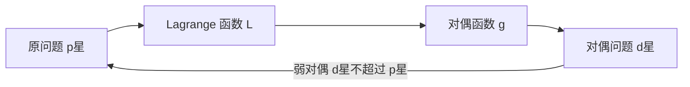
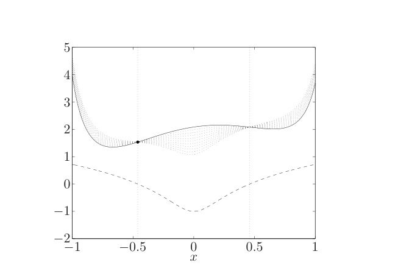
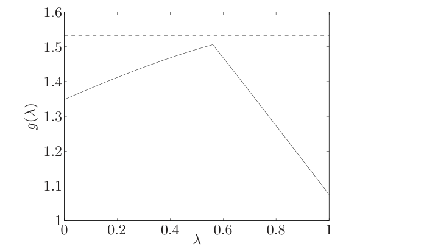
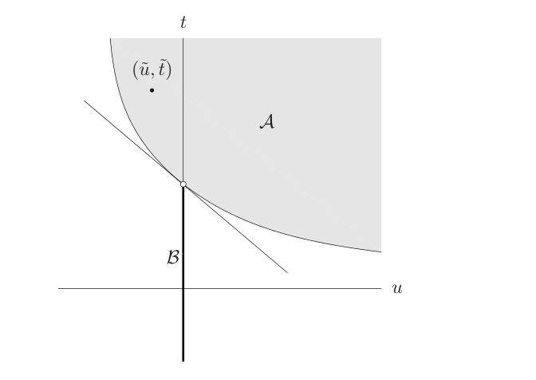

# 第5章 对偶

### 来源说明

- 作者：Stephen Boyd, Lieven Vandenberghe
- 书名：*Convex Optimization*（凸优化）
- 官方来源：https://web.stanford.edu/~boyd/cvxbook/bv_cvxbook.pdf （Stanford 作者页公开的全书 PDF）
- 纸书由 Cambridge University Press 出版。本笔记仅供个人学习使用。本地 PDF 不是可再分发的授权副本。

阅读范围：Chapter 5 Duality（对偶），PDF 第 229–304 页。对偶正文在 PDF 第 229–285 页，参考文献在第 286 页，习题在第 287–302 页。PDF 第 303–304 页是第二部分 Applications（应用）的隔页，第 6 章从第 305 页开始。习题不展开。

本章的 duality（对偶）是 Lagrange duality（Lagrange 对偶）。它给第 4 章的标准形问题配一个下界函数，再最大化这个下界。原问题不必凸；对偶问题却总是凸的。

这不是线性代数里的 dual space（对偶空间）。对偶空间是线性泛函组成的向量空间：一个向量和一个线性形式做标量配对，转置、零化子和四个基本子空间都从这里来。本章不构造那个空间。本章的对偶变量 \(\lambda,\nu\) 是约束的权重，对偶函数 \(g(\lambda,\nu)\) 是 Lagrange 函数对原变量求下确界，对偶问题是在 \(\lambda\succeq 0\) 下最大化 \(g\)。两边都叫 dual，数学对象不同。

👉 对偶空间、对偶基和对偶定理在线性代数第 10 章，该章开篇已经写明不讨论最优值、对偶间隙和 KKT。两套笔记只互相指认，不把公式混用。📝待补全

### 本章总览

从标准形问题 (5.1) 写出 Lagrangian（Lagrange 函数）\(L(x,\lambda,\nu)\)。对偶函数 \(g\) 是 \(L\) 对 \(x\) 的下确界。只要 \(\lambda\succeq 0\)，就有 \(g(\lambda,\nu)\le p^\star\)。对偶问题把这个下界尽量抬高。其最优值 \(d^\star\) 永远不超过 \(p^\star\)，这是弱对偶。\(d^\star=p^\star\) 称为强对偶。凸问题加上 Slater 条件时，强对偶成立，对偶最优值还能取到。

零间隙并且两边都取到最优时，原变量和对偶变量满足互补松弛；函数可微时再加上梯度条件，就是 KKT 条件。凸且可微时 KKT 充分；再加 Slater，则充要。最优乘子还是约束右端扰动的灵敏度，经济解释里叫影子价格。

同一问题的等价改写，对偶可以完全不同。可行性也可以写成一对择一系统：一个系统可行，就给另一个系统的不可行提供证书。广义不等式把 \(\lambda\succeq 0\) 换成对偶锥上的非负。

图注：对偶函数先对原变量求下确界，再对乘子求上确界。弱对偶说后一个最优值不会超过前一个。强对偶是两边相等，需要额外条件，凸性本身不够。

### 核心知识点

#### Lagrange 函数

考虑标准形 (4.1)，这里编号为 (5.1)：

\[
\begin{align*}
\operatorname{minimize}\quad & f_0(x) \\
\operatorname{subject\ to}\quad & f_i(x)\le 0,\quad i=1,\ldots,m \\
& h_i(x)=0,\quad i=1,\ldots,p.
\end{align*}
\tag{5.1}
\]

定义域 \(\mathcal{D}\) 非空。最优值仍记为 \(p^\star\)。本节不假设问题凸。

Lagrange 函数把约束以加权和加进目标：

\[
L(x,\lambda,\nu)=f_0(x)+\sum_{i=1}^{m}\lambda_i f_i(x)+\sum_{i=1}^{p}\nu_i h_i(x),
\]

定义域是 \(\mathcal{D}\times\mathbb{R}^m\times\mathbb{R}^p\)。\(\lambda_i\) 是第 \(i\) 条不等式的 Lagrange multiplier（Lagrange 乘子），\(\nu_i\) 是第 \(i\) 条等式的乘子。向量 \(\lambda,\nu\) 叫 dual variables（对偶变量）。

🔑 关键速记：\(L\) 是目标加上约束函数的加权和；构造它时不需要凸性。

#### 对偶函数

Lagrange dual function（Lagrange 对偶函数）是 \(L\) 对 \(x\) 的下确界：

\[
g(\lambda,\nu)=\inf_{x\in\mathcal{D}}L(x,\lambda,\nu).
\]

\(L\) 对 \(x\) 下方无界时，\(g=-\infty\)。\(g\) 是一族关于 \((\lambda,\nu)\) 的仿射函数的逐点下确界，所以 \(g\) 总是凹的。原问题不凸时也一样。

🔑 关键速记：对偶函数是 \(L\) 对原变量的下确界；它凹，与原问题凸不凸无关。

#### 下界

对任意 \(\lambda\succeq 0\) 和任意 \(\nu\)，

\[
g(\lambda,\nu)\le p^\star.
\tag{5.2}
\]

原因可以收成一句话。可行点 \(\tilde x\) 上，\(\lambda_i f_i(\tilde x)\le 0\) 且 \(\nu_i h_i(\tilde x)=0\)，所以 \(L(\tilde x,\lambda,\nu)\le f_0(\tilde x)\)。下确界更小，因而 \(g\) 不超过每一个可行目标值。\(g=-\infty\) 时不等式成立但没有信息。非平凡下界要求 \(\lambda\succeq 0\) 且 \(g(\lambda,\nu)>-\infty\)。这样的 \((\lambda,\nu)\) 称为 dual feasible（对偶可行）。

图 5.1 用一个 \(x\in\mathbb{R}\)、只有一条不等式的例子画出这件事实。图 5.2 是对应的 \(g\)。

图注：图 5.1 的实线是目标 \(f_0\)，虚线是约束 \(f_1\)。可行区间约为 \([-0.46,0.46]\)，最优点 \(x^\star=-0.46\)，\(p^\star=1.54\)。点线是 \(\lambda=0.1,0.2,\ldots,1.0\) 的 Lagrange 函数。每条点线的最小值都低于 \(p^\star\)，因为可行集上 \(\lambda\ge 0\) 时 \(L(x,\lambda)\le f_0(x)\)。

图注：图 5.2 是图 5.1 那个问题的对偶函数 \(g(\lambda)\)。\(f_0\) 和 \(f_1\) 都不是凸函数，\(g\) 仍然凹。水平虚线是原问题最优值 \(p^\star\)，整条 \(g\) 都在它下面。

另一种看法是把硬约束换成线性下估。原问题可写成无约束形式 (5.3)：目标加上不等式的指示函数 \(I_-\) 和等式的指示函数 \(I_0\)。\(I_-(u)\) 在 \(u\le 0\) 时为 0，在 \(u>0\) 时为 \(\infty\)。用 \(\lambda_i u\)（\(\lambda_i\ge 0\)）和 \(\nu_i u\) 替换它们，目标就变成 \(L\)，最优值变成 \(g(\lambda,\nu)\)。线性函数低估指示函数，所以 \(g\) 是原最优值的下界。

对数障碍是后一种软约束：在可行域内部，靠近边界时惩罚变得很大，再让惩罚的权重逐步减小。每一步仍是光滑的无约束或等式约束问题，极限才回到原来的硬约束。这和线性下估一样，都是用有限的惩罚代替无限陡的指示函数。障碍参数和牛顿步这里不写。

👉 步骤见第 11 章 §11.2.1。📝待补全

🔑 关键速记：\(\lambda\succeq 0\) 时 \(g(\lambda,\nu)\le p^\star\)；对偶可行还要求这个下界不是 \(-\infty\)。

#### 能写出解析式的对偶函数

最小范数解线性方程 (5.5)：最小化 \(x^\top x\)，约束 \(Ax=b\)。\(L(x,\nu)=x^\top x+\nu^\top(Ax-b)\)。对 \(x\) 的梯度 \(2x+A^\top\nu=0\) 给出 \(x=-(1/2)A^\top\nu\)，于是

\[
g(\nu)=-\frac14\nu^\top AA^\top\nu-b^\top\nu.
\]

(5.2) 说：对每个 \(\nu\)，这个凹二次函数不超过 \(\inf\{x^\top x\mid Ax=b\}\)。

标准形 LP (5.6)：最小化 \(c^\top x\)，约束 \(Ax=b\)、\(x\succeq 0\)。不等式函数是 \(f_i(x)=-x_i\)。

\[
L(x,\lambda,\nu)=-b^\top\nu+(c+A^\top\nu-\lambda)^\top x.
\]

线性函数有下界当且仅当系数为零，所以

\[
g(\lambda,\nu)=
\begin{cases}
-b^\top\nu, & A^\top\nu-\lambda+c=0,\\
-\infty, & \text{其他}.
\end{cases}
\]

非平凡下界还要 \(\lambda\succeq 0\)。这时 \(-b^\top\nu\) 是 LP 最优值的下界。\(g\) 只在一个仿射子集上有限，这是常见情形。

双向划分 (5.7) 是非凸问题：最小化 \(x^\top Wx\)，约束 \(x_i^2=1\)。可行点只有 \(2^n\) 个。Lagrange 函数是 \(x^\top(W+\operatorname{diag}(\nu))x-1^\top\nu\)。二次型的下确界要么是 0（矩阵半正定时），要么是 \(-\infty\)。因此 \(W+\operatorname{diag}(\nu)\succeq 0\) 时 \(g(\nu)=-1^\top\nu\)，否则 \(g=-\infty\)。

取 \(\nu=-\lambda_{\min}(W)\,1\)，则 \(W+\operatorname{diag}(\nu)\succeq 0\)，得到

\[
p^\star\ge n\lambda_{\min}(W).
\tag{5.8}
\]

同一下界也可以不经过对偶函数：把 \(x_i^2=1\) 放宽成 \(\sum x_i^2=n\)，最优值是 \(n\lambda_{\min}(W)\)，而且原约束蕴含这条放宽，所以它是下界。

对偶函数和共轭函数连在一起。函数 \(f\) 的共轭是 \(f^*(y)=\sup_x(y^\top x-f(x))\)。最小化 \(f_0\)、约束为 \(Ax\preceq b\) 与 \(Cx=d\) 时，

\[
g(\lambda,\nu)=-b^\top\lambda-d^\top\nu-f_0^*(-A^\top\lambda-C^\top\nu).
\tag{5.11}
\]

\(g\) 的定义域由 \(f_0^*\) 的定义域决定：\(-A^\top\lambda-C^\top\nu\) 必须落在 \(\operatorname{dom} f_0^*\) 里。

由此可以直接写出几条对偶函数。任意范数的等式约束问题 (5.12)：\(g(\nu)=-b^\top\nu\) 当 \(\|A^\top\nu\|_*\le 1\)，否则 \(-\infty\)。这里 \(\|\cdot\|_*\) 是对偶范数。熵最大化 (5.13) 的目标是 \(\sum x_i\log x_i\)，定义域在 §5.1 写成 \(\mathbb{R}^n_{++}\)。其共轭由 \(e^{v-1}\) 逐坐标相加得到，对偶函数是

\[
g(\lambda,\nu)=-b^\top\lambda-\nu-e^{-\nu-1}\sum_{i=1}^{n}e^{-a_i^\top\lambda},
\]

\(a_i\) 是 \(A\) 的第 \(i\) 列。

最小体积覆盖椭球 (5.14) 在 \(\mathbf{S}^n_{++}\) 上最小化 \(\log\det X^{-1}\)，约束 \(a_i^\top X a_i\le 1\)。椭球 \(\mathcal{E}_X=\{z\mid z^\top Xz\le 1\}\) 的体积正比于 \((\det X^{-1})^{1/2}\)，约束表示 \(a_i\) 落在椭球内。对偶函数 (5.15) 在 \(\sum\lambda_i a_i a_i^\top\succ 0\) 时为

\[
g(\lambda)=\log\det\Big(\sum_{i=1}^{m}\lambda_i a_i a_i^\top\Big)^{-1}-1^\top\lambda+n,
\]

否则为 \(-\infty\)。

共轭 \(f^*(y)\) 是 \(y^\top x-f(x)\) 对 \(x\) 的上确界，所以总是凸的。它把「对原变量求下确界」换成一个函数值，这就是 (5.11) 能写成闭式的原因。范数的共轭是对偶范数单位球的指示函数，负熵 \(u\log u\) 的共轭是 \(e^{v-1}\)，\(\log\det X^{-1}\) 的共轭定义在负定矩阵上。本章遇到线性约束时直接套这些结果，不再重推共轭。

👉 定义和上述例子见第 3 章 §3.3。📝待补全

🔑 关键速记：线性目标或二次目标常常让 \(g\) 只在对偶等式成立时有限；一般线性约束的问题可以用 (5.11) 把 \(g\) 写成共轭。

#### 对偶问题

每个对偶可行的 \((\lambda,\nu)\) 都给出 \(p^\star\) 的一个下界。最好的下界是优化问题

\[
\begin{align*}
\operatorname{maximize}\quad & g(\lambda,\nu) \\
\operatorname{subject\ to}\quad & \lambda\succeq 0.
\end{align*}
\tag{5.16}
\]

这就是 (5.1) 的 Lagrange dual problem（Lagrange 对偶问题）。(5.1) 这时叫 primal problem（原问题）。(5.16) 的最优点 \((\lambda^\star,\nu^\star)\) 叫 dual optimal（对偶最优），或最优 Lagrange 乘子。

(5.16) 总是凸优化问题：被最大化的目标是凹的，约束是凸的。原问题凸不凸都如此。

\(g\) 的定义域常常比 \(\mathbb{R}^{m+p}\) 更瘦，落在一个仿射集合上。把这些隐藏等式写成显式约束，得到等价但对偶函数写法不同的问题。

标准形 LP (5.17) 的对偶函数只在 \(A^\top\nu-\lambda+c=0\) 上等于 \(-b^\top\nu\)。严格的对偶问题是在 \(\lambda\succeq 0\) 下最大化这个可能为 \(-\infty\) 的 \(g\)，即 (5.18)。把等式写出来是 (5.19)。再消掉 \(\lambda\)，得到不等式形 LP

\[
\begin{align*}
\operatorname{maximize}\quad & -b^\top\nu \\
\operatorname{subject\ to}\quad & A^\top\nu+c\succeq 0.
\end{align*}
\tag{5.20}
\]

(5.18)、(5.19)、(5.20) 等价，但不是同一个问题。习惯上把后两个都叫成标准形 LP 的 Lagrange 对偶。

不等式形 LP (5.21) 的对偶函数在 \(A^\top\lambda+c=0\) 时为 \(-b^\top\lambda\)。显式对偶是标准形 LP (5.22)：最大化 \(-b^\top\lambda\)，约束 \(A^\top\lambda+c=0\)、\(\lambda\succeq 0\)。对称关系是：标准形 LP 的对偶是只有不等式的 LP，不等式形 LP 的对偶是标准形 LP。(5.22) 的 Lagrange 对偶又等价于原问题 (5.21)。

🔑 关键速记：对偶问题是在 \(\lambda\succeq 0\) 下最大化 \(g\)，它永远是凸问题。标准形 LP 与不等式形 LP 的对偶互换这两种形状。

#### 弱对偶

对偶问题的最优值记为 \(d^\star\)。它是从 \(g\) 能得到的最好下界，因此

\[
d^\star\le p^\star.
\tag{5.23}
\]

这叫 weak duality（弱对偶）。原问题不凸时也成立。\(p^\star=-\infty\) 时必有 \(d^\star=-\infty\)，对偶不可行。\(d^\star=\infty\) 时必有 \(p^\star=\infty\)，原问题不可行。

\(p^\star-d^\star\) 叫 optimal duality gap（最优对偶间隙），总是非负。难问题的对偶往往是可高效求解的凸问题，\(d^\star\) 就是一个可计算的下界。双向划分的对偶是 SDP：最大化 \(-1^\top\nu\)，约束 \(W+\operatorname{diag}(\nu)\succeq 0\)。它的最优值至少和 (5.8) 一样好，\(n=1000\) 一类的规模仍然可以算。

🔑 关键速记：弱对偶是 \(d^\star\le p^\star\)，不需要凸性。原问题下方无界则对偶不可行；对偶上方无界则原问题不可行。

#### 强对偶与 Slater 条件

\(d^\star=p^\star\) 时，最优对偶间隙为零，称为 strong duality（强对偶）。最好的 Lagrange 下界是紧的。

强对偶并不总成立。原问题是凸的，也就是 (5.25) 那种目标与不等式凸、等式为 \(Ax=b\) 的形式时，通常成立，但不是永远成立。凸性之外还要 constraint qualification（约束规格）。

一条简单的约束规格是 Slater 条件：存在 \(x\in\operatorname{relint}\mathcal{D}\)，使

\[
f_i(x)<0,\quad i=1,\ldots,m,\qquad Ax=b.
\tag{5.26}
\]

这样的点叫 strictly feasible（严格可行）。Slater 定理说：凸问题加上 Slater 条件，强对偶成立。

前 \(k\) 条不等式是仿射时，可以放宽成 (5.27)：仿射不等式只需 \(f_i(x)\le 0\)，其余不等式仍要严格小于 0，等式照旧，\(x\) 仍在相对内部。约束全是线性等式和线性不等式、且 \(\operatorname{dom} f_0\) 为开集时，这条放宽就变成「问题可行」。

Slater 条件及其放宽还保证：\(d^\star>-\infty\) 时对偶最优值取得到，即存在对偶可行 \((\lambda^\star,\nu^\star)\) 使 \(g(\lambda^\star,\nu^\star)=d^\star=p^\star\)。证明在 §5.3.2，下面只留几何结论。

几个可以直接核对的例子：

等式约束的最小范数 (5.5)，Slater 条件就是原问题可行。\(b\in\mathcal{R}(A)\) 时 \(p^\star=d^\star\)。\(b\notin\mathcal{R}(A)\) 时两边都是 \(\infty\)：存在 \(z\) 使 \(A^\top z=0\) 且 \(b^\top z\neq 0\)，对偶沿 \(\{tz\}\) 上方无界。所以这个例子上强对偶总成立。

LP 上，较弱的 Slater 条件说：原问题可行就有强对偶。用到对偶问题上，对偶可行也有强对偶。唯一可能失败的情形是原问题和对偶同时不可行。这种病态确实存在，例子在习题 5.23，不展开。

QCQP (5.28) 假定 \(P_0\succ 0\)、\(P_i\succeq 0\)。\(\lambda\succeq 0\) 时 \(P(\lambda)=P_0+\sum\lambda_i P_i\succ 0\)，对偶函数是

\[
g(\lambda)=-\frac12 q(\lambda)^\top P(\lambda)^{-1}q(\lambda)+r(\lambda).
\]

对偶问题是在 \(\lambda\succeq 0\) 下最大化它，即 (5.29)。二次不等式严格可行时，Slater 条件给出强对偶。

熵最大化在 §5.2.4 把定义域写成 \(\mathcal{D}=\mathbb{R}^n_+\)。与 §5.1 的 \(\mathbb{R}^n_{++}\) 并列表述，Slater 用的是存在 \(x\succ 0\) 使 \(Ax\preceq b\) 且 \(1^\top x=1\)。对 \(\nu\) 求解析最大后，对偶化成带非负约束的凸形式几何规划：最大化 \(-b^\top\lambda-\log(\sum_i e^{-a_i^\top\lambda})\)，约束 \(\lambda\succeq 0\)。

最小体积椭球的较弱 Slater 条件总成立，所以 (5.14) 与对偶 (5.31) 永远强对偶。对偶里约定矩阵不正定时 \(\log\det=-\infty\)。

非凸问题偶尔也强对偶。信赖域问题 (5.32) 在单位球 \(x^\top x\le 1\) 上最小化非凸二次 \(x^\top Ax+2b^\top x\)，\(A\not\succeq 0\)。可行集是凸的，目标不是凸函数，所以不是凸问题。它与只有一个对偶变量的问题 (5.33) 最优值总相等。书中把这件事推广成：目标是二次函数、只有一条二次不等式、并且 Slater 条件成立时，强对偶成立。推广的证明不在本章正文。

👉 证明见附录 B.1。📝待补全

混合策略矩阵对策用强对偶得到一个先看起来反常的等式。支付矩阵 \(P\) 下，选手 1 选分布 \(u\)，选手 2 选分布 \(v\)，期望支付是 \(u^\top Pv\)。若选手 2 知道 \(u\)，选手 1 的最优最坏支付是分段线性凸问题 (5.34) 的最优值 \(p_1^\star\)。反过来，选手 2 在对手知道自己策略时能保证的支付是 (5.35) 的最优值 \(p_2^\star\)。显然 \(p_1^\star\ge p_2^\star\)。把 (5.34) 写成 LP 再取 Lagrange 对偶，得到的正是 (5.35)。两个 LP 都可行，强对偶给出 \(p_1^\star=p_2^\star\)。混合策略下，事先知道对手的策略没有额外好处。

🔑 关键速记：凸问题加上严格可行的 Slater 条件就有强对偶，仿射不等式不必严格。LP 只要原问题或对偶有一边可行即可；两边都不可行时可以失败。

#### 值集上的几何

约束值和目标值的集合是

\[
\mathcal{G}=\{(f_1(x),\ldots,f_m(x),h_1(x),\ldots,h_p(x),f_0(x))\mid x\in\mathcal{D}\}.
\tag{5.36}
\]

\(p^\star\) 是 \(\mathcal{G}\) 里 \(u\preceq 0\)、\(v=0\) 那些点的纵坐标下确界。\(g(\lambda,\nu)\) 是线性函数 \((\lambda,\nu,1)^\top(u,v,t)\) 在 \(\mathcal{G}\) 上的下确界。下确界有限时，这张超平面支撑 \(\mathcal{G}\)，法向的最后一个分量是 1，所以叫非竖直支撑超平面。\(\lambda\succeq 0\) 时，在 \(u\preceq 0\)、\(v=0\) 上比较纵坐标和这个线性函数，就再次得到弱对偶。图 5.3、图 5.4 画的是一条不等式时的支撑线：斜率为 \(-\lambda\)，与 \(u=0\) 轴的交点是 \(g(\lambda)\)。图 5.4 里最上面那张支撑线给出 \(d^\star\)，它仍低于 \(p^\star\)，间隙为正。

把 \(\mathcal{G}\) 沿「更差」的方向加厚，得到

\[
\mathcal{A}=\mathcal{G}+\big(\mathbb{R}^m_+\times\{0\}\times\mathbb{R}_+\big).
\tag{5.37}
\]

\(\mathcal{A}\) 里的点允许不等式约束值和目标值变大，等式值不变。\(p^\star=\inf\{t\mid (0,0,t)\in\mathcal{A}\}\)。\(\lambda\succeq 0\) 时，\(g\) 也等于那个线性函数在 \(\mathcal{A}\) 上的下确界。强对偶等价于：存在对偶可行 \((\lambda,\nu)\)，使非竖直支撑超平面在边界点 \((0,0,p^\star)\) 处碰到 \(\mathcal{A}\)。图 5.5 是加厚之后的画法。

凸问题里 \(\mathcal{A}\) 是凸集。Slater 条件下强对偶的证明，结论是下面这件事。书中为了简化，还假设 \(\mathcal{D}\) 有非空内部、\(A\) 行满秩、\(p^\star\) 有限。集合 \(\mathcal{B}=\{(0,0,s)\mid s<p^\star\}\) 与 \(\mathcal{A}\) 不相交，都凸，因而能被超平面分开。若分离超平面竖直，严格可行点会让乘子和等式乘子同时被逼成零，与超平面非平凡矛盾。所以法向可以写成 \((\lambda^\star,1)\) 这种非竖直形式，支撑点给出 \(g(\lambda^\star,\nu^\star)=p^\star\)，并且对偶最优值取到。图 5.6 把严格可行点放在分离线的左侧。一个凸但强对偶失败的单约束例子在习题 5.21，不展开。

图注：图 5.6 中阴影是凸集 \(\mathcal{A}\)，粗线段 \(\mathcal{B}\) 是 \(t<p^\star\) 的那一截，不包含空心点 \((0,p^\star)\)。两集不相交，故有分离超平面。严格可行点 \((\tilde u,\tilde t)\) 落在 \(\mathcal{A}\) 内部偏左的位置，迫使这张超平面不能竖直，从而强对偶成立。

没有等式约束时，Lagrange 对偶和多目标标量化是同一件事。标量化最小化 \((\lambda,1)^\top(f_1(x),\ldots,f_m(x),f_0(x))\)，这正是 (5.43) 的 Lagrange 函数。第 4 章用来找 Pareto 点的集合 \(\mathcal{A}\)，就是这里的 (5.37)。那里的权是目标之间的相对重要性；把最后一个权固定为 1 之后，其余的权就是相对 \(f_0\) 的代价。

👉 标量化、Pareto 点和权向量在第 4 章 §4.7。这里只说明：最后一个分量为 1 的权，就是不等式乘子。📝待补全

🔑 关键速记：弱对偶是值集上的支撑超平面；强对偶是 \(\mathcal{A}\) 在 \((0,0,p^\star)\) 处有一张非竖直支撑超平面。Slater 条件用来排除竖直的那一种。

#### 鞍点、对策与影子价格

§5.4 的材料后面不再使用，这里只留和强弱对偶直接对应的结论。没有等式时，

\[
p^\star=\inf_x\sup_{\lambda\succeq 0}L(x,\lambda),\qquad d^\star=\sup_{\lambda\succeq 0}\inf_x L(x,\lambda).
\]

不可行的 \(x\) 让内层上确界变成 \(\infty\)；可行的 \(x\) 让最优乘子为 0，上确界回到 \(f_0(x)\)。弱对偶就是先求上确界再求下确界，不低于先求下确界再求上确界。这个 max-min inequality（极大极小不等式）(5.46) 对任意函数都成立。两边相等时，称函数有 strong max-min property（强极大极小性质）或 saddle-point property（鞍点性质）。

\((\tilde w,\tilde z)\) 是鞍点，是指对一切可行的 \(w,z\) 有 \(f(\tilde w,z)\le f(\tilde w,\tilde z)\le f(w,\tilde z)\)。强对偶且两边都取到最优时，\((x^\star,\lambda^\star)\) 是 \(L\) 的鞍点。反过来，\(L\) 的鞍点给出原最优、对偶最优和零间隙。

连续零和对策里，后手知道对手的选择。后手的优势正好是最优对偶间隙。强对偶时，知道对手的选择没有优势。原问题选手选 \(x\)，对偶选手选 \(\lambda\succeq 0\)。

价格解释：\(f_0(x)\) 是运行成本，\(f_i(x)\le 0\) 是资源或监管限额。允许按单价 \(\lambda_i\ge 0\) 买卖违约量，总账单是 \(L(x,\lambda)\)，企业会把它压到 \(g(\lambda)\)。\(d^\star\) 是最不利价格下的最优成本。弱对偶说：就算价格最不利，能买卖违约量时的成本也不会高于硬约束下的成本。强对偶且对偶最优取到时，\(\lambda^\star\) 是一组 shadow price（影子价格）：按这个价格，买卖违约量没有额外好处。

🔑 关键速记：弱对偶是极大极小不等式；零间隙时原最优点和对偶最优点组成 \(L\) 的鞍点，\(\lambda^\star\) 是影子价格。

#### 次优证书与停止准则

对偶可行的 \((\lambda,\nu)\) 是一张证书：它证明 \(p^\star\ge g(\lambda,\nu)\)。强对偶意味着可以做出任意好的证书。

\(x\) 原可行、\((\lambda,\nu)\) 对偶可行时，不必知道 \(p^\star\) 也能 bound 次优程度：

\[
f_0(x)-p^\star\le f_0(x)-g(\lambda,\nu).
\]

右边叫这一对点的 duality gap（对偶间隙）。\(x\) 是 \(\epsilon\)-次优，\(\epsilon\) 就等于这个间隙。同时 \(p^\star\) 和 \(d^\star\) 都被夹在区间 \([g(\lambda,\nu),f_0(x)]\) 里。间隙为零时，两边都最优，每边都是另一边最优的证书。

算法若产生原可行 \(x^{(k)}\) 和对偶可行 \((\lambda^{(k)},\nu^{(k)})\)，绝对精度停止准则是

\[
f_0(x^{(k)})-g(\lambda^{(k)},\nu^{(k)})\le\epsilon_{\mathrm{abs}}.
\]

停下来时，\(x^{(k)}\) 是 \(\epsilon_{\mathrm{abs}}\)-次优。相对精度 \(\epsilon_{\mathrm{rel}}\) 用两条之一：\(g>0\) 时 \((f_0-g)/g\le\epsilon_{\mathrm{rel}}\)，或 \(f_0<0\) 时 \((f_0-g)/(-f_0)\le\epsilon_{\mathrm{rel}}\)。这时 \(p^\star\neq 0\)，而且 \(|f_0(x^{(k)})-p^\star|/|p^\star|\le\epsilon_{\mathrm{rel}}\)。要让任意小的容差都可靠，需要强对偶。

🔑 关键速记：一对原、对偶可行点把 \(p^\star\) 夹在 \([g,f_0]\) 里；间隙就是次优程度的证书。

#### 互补松弛

设原最优和对偶最优都取到，而且相等。则 \(x^\star\) 最小化 \(L(x,\lambda^\star,\nu^\star)\)，并且

\[
\lambda_i^\star f_i(x^\star)=0,\qquad i=1,\ldots,m.
\tag{5.48}
\]

这叫 complementary slackness（互补松弛）。因为和式里每一项都非正，和为零就要求项项为零。它等价于：\(\lambda_i^\star>0\) 则 \(f_i(x^\star)=0\)；\(f_i(x^\star)<0\) 则 \(\lambda_i^\star=0\)。最优乘子为正，对应的约束就在最优点上有效。

🔑 关键速记：零间隙时，正的最优乘子只配有效约束，松的约束乘子为零。

#### KKT 条件

现在假定 \(f_0,\ldots,f_m,h_1,\ldots,h_p\) 可微，定义域因而为开集。先不假设凸。

零间隙的原最优 \(x^\star\) 和对偶最优 \((\lambda^\star,\nu^\star)\) 必须满足 Karush–Kuhn–Tucker（KKT）条件 (5.49)：

\[
\begin{align*}
f_i(x^\star)&\le 0,\\
h_i(x^\star)&=0,\\
\lambda_i^\star&\ge 0,\\
\lambda_i^\star f_i(x^\star)&=0,\\
\nabla f_0(x^\star)+\sum_{i=1}^{m}\lambda_i^\star\nabla f_i(x^\star)+\sum_{i=1}^{p}\nu_i^\star\nabla h_i(x^\star)&=0.
\end{align*}
\tag{5.49}
\]

最后一行是因为 \(x^\star\) 最小化 \(L(\cdot,\lambda^\star,\nu^\star)\)，梯度必须为零。所以：可微，并且强对偶、两边最优都取到时，KKT 是必要的。

原问题凸、\(f_i\) 凸、\(h_i\) 仿射时，KKT 也充分。前两行说明 \(\tilde x\) 原可行。\(\tilde\lambda\succeq 0\) 使 \(L\) 对 \(x\) 凸，梯度为零说明 \(\tilde x\) 最小化 \(L\)。互补和等式再把 \(L(\tilde x,\tilde\lambda,\tilde\nu)\) 收成 \(f_0(\tilde x)\)，故 \(g(\tilde\lambda,\tilde\nu)=f_0(\tilde x)\)，间隙为零，两边都最优。

凸、可微、再加 Slater 条件时，KKT 是充要的：Slater 保证零间隙且对偶最优取到，所以 \(x\) 最优当且仅当存在 \((\lambda,\nu)\) 与 \(x\) 一起满足 (5.49)。许多凸优化算法可以看成在解这组条件。少数问题能解析地解出来。

例 5.1 是等式约束凸二次问题 (5.50)，\(P\in\mathbf{S}^n_+\)。KKT 条件是 \(Ax^\star=b\) 与 \(Px^\star+q+A^\top\nu^\star=0\)，写成

\[
\begin{bmatrix} P & A^\top \\ A & 0 \end{bmatrix}
\begin{bmatrix} x^\star \\ \nu^\star \end{bmatrix}
=
\begin{bmatrix} -q \\ b \end{bmatrix}.
\]

书中把这组方程的规模记成 \(m+n\) 个方程、\(m+n\) 个未知量。解出它就同时得到原最优和对偶最优。

例 5.2 是注水（water-filling）：

\[
\begin{align*}
\operatorname{minimize}\quad & -\sum_{i=1}^{n}\log(\alpha_i+x_i) \\
\operatorname{subject\ to}\quad & x\succeq 0,\quad 1^\top x=1,
\end{align*}
\]

\(\alpha_i>0\)。\(x_i\) 是第 \(i\) 个信道的功率，\(\log(\alpha_i+x_i)\) 是速率，总功率为 1。KKT 条件消掉松弛乘子后得到

\[
x_i^\star=\max\{0,\ 1/\nu^\star-\alpha_i\},
\]

其中 \(\nu^\star\) 由 \(\sum_i\max\{0,\ 1/\nu^\star-\alpha_i\}=1\) 唯一确定。左边对 \(1/\nu^\star\) 是分段线性增函数，折点在各个 \(\alpha_i\)。几何图像是：\(\alpha_i\) 为地面高度，水位 \(1/\nu^\star\) 使总水量等于 1，水面高出地面的部分就是 \(x_i^\star\)。图 5.7 画的是这个水位，本章不再另附。

力学解释用图 5.8 的两滑块三弹簧。平衡位置最小化弹性能，约束是滑块宽度 \(w\) 造成的不穿透条件 (5.51)。这是 QP (5.52)。KKT 的梯度方程 (5.54) 是两个滑块的力平衡，乘子是墙与滑块之间的接触力。接触力指向离开接触面的方向，只在真正接触时非零，后一句就是互补松弛 (5.53)。势能和约束都凸；\(2w\le l\) 时放宽的 Slater 条件成立，能量极小和力平衡给出同一结果。图 5.9 把弹簧力和接触力画在滑块上。

若强对偶成立且已知 \((\lambda^\star,\nu^\star)\)，原最优点是 \(L(x,\lambda^\star,\nu^\star)\) 的最小点。若这个无约束（对 \(x\)）问题的最小点唯一，则：该点原可行时就是原最优；不原可行时，原最优值取不到。凸问题里，\(L\) 对 \(x\) 严格凸就能保证唯一。对偶比原问题好解时，这条路有用。

例 5.3 在熵问题上假定较弱的 Slater 条件，因而存在对偶最优。\(L(x,\lambda^\star,\nu^\star)\) 在定义域上严格凸，唯一最小点是

\[
x_i^\star=\frac{1}{\exp(a_i^\top\lambda^\star+\nu^\star+1)}.
\]

它原可行则是原最优；否则原最优取不到。

例 5.4 最小化可分严格凸目标 \(\sum f_i(x_i)\)，只有一条等式 \(a^\top x=b\)。对偶变量是标量 \(\nu\)，\(g(\nu)=-b\nu-\sum f_i^*(-\nu a_i)\)。求得 \(\nu^\star\) 后，\(x^\star\) 由 \(f_i'(x_i^\star)=-\nu^\star a_i\) 解出。

🔑 关键速记：可微且零间隙时 KKT 必要；凸且可微时 KKT 充分；再加 Slater 则充要。最后一行是 \(L\) 对 \(x\) 的梯度为零。

#### 扰动与灵敏度

扰动问题 (5.56) 把不等式改成 \(f_i(x)\le u_i\)，等式改成 \(h_i(x)=v_i\)。\(u=0\)、\(v=0\) 时回到原问题。\(u_i>0\) 是放宽，\(u_i<0\) 是收紧。最优值 \(p^\star(u,v)\) 可以是 \(\infty\)，表示扰动后不可行。\(p^\star(0,0)=p^\star\)。

原问题凸时，\(p^\star(u,v)\) 对 \((u,v)\) 凸。它的上境图是 (5.37) 里集合 \(\mathcal{A}\) 的闭包。

强对偶成立且对偶最优取到时，对一切扰动有全局下界

\[
p^\star(u,v)\ge p^\star(0,0)-\lambda^{\star\top}u-\nu^{\star\top}v.
\tag{5.57}
\]

这只是下界，没有匹配的上界，所以收紧和放宽不对称。\(\lambda_i^\star\) 很大时，收紧第 \(i\) 条约束（\(u_i<0\)）保证最优值大幅上升。\(\lambda_i^\star\) 很小时，略微放宽不会让最优值降得太多。\(\lambda_i^\star\) 很大却只略微放宽时，(5.57) 给不出「最优值会大幅下降」的结论。图 5.10 把 \(p^\star(0)-\lambda^\star u\) 画成凸函数 \(p^\star(u)\) 的一条下支撑线。

若 \(p^\star(u,v)\) 在原点可微，则

\[
\lambda_i^\star=-\frac{\partial p^\star(0,0)}{\partial u_i},\qquad
\nu_i^\star=-\frac{\partial p^\star(0,0)}{\partial v_i}.
\tag{5.58}
\]

这时局部解释是对称的：略微收紧使 \(p^\star\) 大约增加 \(-\lambda_i^\star u_i\)，略微放宽使 \(p^\star\) 大约减少 \(\lambda_i^\star u_i\)。约束在 \(x^\star\) 处不起作用时，乘子必为 0，微小收紧或放宽不影响最优值。约束有效时，\(\lambda_i^\star\) 的大小表示这条约束有多「紧」。

影子价格的经济说法与此一致。\(-p^\star(u)\) 是资源限额扰动后的利润。可微时，\(\lambda_i^\star\) 大约是多给一点第 \(i\) 种资源所能增加的利润。价格低于 \(\lambda_i^\star\) 时企业会买进该资源，高于 \(\lambda_i^\star\) 时会卖出。

🔑 关键速记：(5.57) 是乘子给出的全局下界，只控制收紧的坏处；原点可微时，(5.58) 说乘子就是 \(-p^\star\) 对右端的偏导。

#### 等价改写会改变对偶

简单的等价改写可以让对偶从无用变成有用，或变成另一个凸问题。

无约束问题 (5.59) 最小化 \(f_0(Ax+b)\)，对偶函数是常数 \(p^\star\)。强对偶成立，但对偶没有信息。引入 \(y\) 和等式 \(Ax+b=y\)，得到等价问题 (5.60)。它的对偶是

\[
\begin{align*}
\operatorname{maximize}\quad & b^\top\nu-f_0^*(\nu) \\
\operatorname{subject\ to}\quad & A^\top\nu=0.
\end{align*}
\tag{5.61}
\]

无约束几何规划 \(\log(\sum_i\exp(a_i^\top x+b_i))\) 经过这一步，对偶变成熵最大化 (5.62)：最大化 \(b^\top\nu-\sum\nu_i\log\nu_i\)，约束 \(1^\top\nu=1\)、\(A^\top\nu=0\)、\(\nu\succeq 0\)。这里用了 log-sum-exp 的共轭。

范数逼近 (5.63) 同样先引入 \(y=Ax-b\)。对偶 (5.64) 是最大化 \(b^\top\nu\)，约束 \(\|\nu\|_*\le 1\)、\(A^\top\nu=0\)。

约束函数也可以拆开。(5.65) 的 \(f_i(A_ix+b_i)\) 引入 \(y_i\) 后，对偶目标含共轭的透视 \(\lambda_i f_i^*(\nu_i/\lambda_i)\)，即 (5.67)。约定：\(\lambda_i=0\) 且 \(\nu_i=0\) 时该项为 0；\(\lambda_i=0\) 且 \(\nu_i\neq 0\) 时该项为 \(\infty\)。不等式约束的几何规划因此能直接写成熵形式的对偶。

把目标换成它的增函数，等价问题的对偶也可以不同。最小范数改成最小化 \((1/2)\|y\|_2^2\) 并加上 \(y=Ax-b\) 后，对偶是最大化 \(-(1/2)\|\nu\|_*^2+b^\top\nu\)，约束 \(A^\top\nu=0\)。它和 (5.64) 不是同一个问题。共轭用的是例 3.27：\((1/2)\|\cdot\|^2\) 的共轭是 \((1/2)\|\cdot\|_*^2\)。

箱约束 LP (5.68) 的显式对偶 (5.69) 有乘子 \(\nu,\lambda_1,\lambda_2\)。把箱子藏进目标定义域后，对偶函数有解析式

\[
g(\nu)=-b^\top\nu-u^\top(A^\top\nu+c)_-+l^\top(A^\top\nu+c)_+,
\]

其中 \(y_+=\max\{y_i,0\}\)，\(y_-=\max\{-y_i,0\}\)。对偶 (5.71) 无约束，形式和 (5.69) 不同。习题 5.8 说明两者等价，这里不展开。

🔑 关键速记：等价问题的对偶可以差很多。引入线性等式，常常把常数对偶函数变成带共轭的有用对偶。

#### 择一定理

可行性系统 (5.72) 可以看成目标恒为 0 的优化。可行则 \(p^\star=0\)，不可行则 \(p^\star=\infty\)。对应的对偶函数 \(g\) 对 \((\lambda,\nu)\) 正齐次。弱对偶把两个系统配成 weak alternatives（弱择一）：(5.72) 与

\[
\lambda\succeq 0,\qquad g(\lambda,\nu)>0
\tag{5.76}
\]

至多一个可行。满足 (5.76) 的 \((\lambda,\nu)\) 是 (5.72) 不可行的证书。这件事不需要凸性，而且 (5.76) 这边总是凸的。

严格不等式系统 (5.77) 的弱择一是 \(\lambda\succeq 0\)、\(\lambda\neq 0\)、\(g(\lambda,\nu)\ge 0\)，即 (5.78)。

原系统凸，即 \(f_i\) 凸、\(h_i\) 仿射，再加上约束规格时，弱择一升级为 strong alternatives（强择一）：恰好一个可行。严格系统 (5.79) 需要存在 \(x\in\operatorname{relint}\mathcal{D}\) 使 \(Ax=b\)。非严格系统还要求辅助问题 (5.81) 的最优值取得到。辅助问题是最小化 \(s\)，约束 \(f_i(x)-s\le 0\) 与 \(Ax=b\)。它的最优值为负，当且仅当严格系统可行。Slater 条件对这个辅助问题成立，所以 \(p^\star=d^\star\) 且对偶最优取到。

线性不等式 \(Ax\preceq b\) 的强择一是 \(\lambda\succeq 0\)、\(A^\top\lambda=0\)、\(b^\top\lambda<0\)。严格系统 \(Ax\prec b\) 的强择一是 \(\lambda\succeq 0\)、\(\lambda\neq 0\)、\(A^\top\lambda=0\)、\(b^\top\lambda\le 0\)。后者就是第 2 章 (2.17)、(2.18)。

两张不相交的非空凸集可以被一张超平面分开：存在非零法向，使它们落在超平面的两侧。严格线性不等式不可行时，就能造出非负、非零的 \(\lambda\)，使 \(A^\top\lambda=0\) 且 \(b^\top\lambda\le 0\)。这是分离定理在多面体上的一种写法。本章用对偶函数把同一现象从线性不等式推广到凸的非线性不等式：不可行证书就是使 \(g(\lambda,\nu)\) 为正的乘子。

👉 分离定理和 (2.17)、(2.18) 见第 2 章 §2.5.1。📝待补全

椭球交的内部非空，等价于一组严格凸二次不等式可行。强择一 (5.86) 说：存在非零 \(\lambda\succeq 0\)，使加权椭球 \(\mathcal{E}_\lambda\) 内部为空。弱对偶的方向很直接：\(\mathcal{E}_\lambda\) 包住交集，它内部空则交集内部空。强择一的方向才是实质内容：交集内部空时，确实能做出一个仍包住交集、内部也空的椭球。

Farkas 引理是混合了严格与非严格线性不等式的强择一。(5.87) \(Ax\preceq 0\)、\(c^\top x<0\)，与 (5.88) \(A^\top y+c=0\)、\(y\succeq 0\)，恰好一个可行。证明走 LP 对偶：齐次 LP (5.89) 在 (5.87) 可行时最优值为 \(-\infty\)，否则为 0。\(x=0\) 对 (5.89) 可行，排除了 LP 强对偶唯一会失败的「两边都不可行」。

例 5.10 用它写无套利。\(m\) 种情景下的期末价值排成 \(V\)，价格为 \(p\)。存在 \(x\) 使 \(Vx\succeq 0\) 且 \(p^\top x<0\)，就是套利。无套利当且仅当存在 \(y\succeq 0\) 使 \(V^\top y=p\)。只缺最后一项价格时，该项无套利价格区间由一对 LP 的最优值给出。两端相等时，市场完备。

🔑 关键速记：弱择一给不可行证书，不需要凸性。凸系统加上相对内部里的等式可行点后，严格不等式系统与它的择一恰好有一个可行。

#### 广义不等式上的对偶

问题 (5.91) 的不等式是 \(f_i(x)\preceq_{K_i}0\)，\(K_i\) 为正常锥。先不假设凸。乘子 \(\lambda_i\in\mathbb{R}^{k_i}\)，Lagrange 函数仍是 \(f_0(x)+\sum\lambda_i^\top f_i(x)+\sum\nu_i h_i(x)\)。\(g\) 的定义不变，仍然凹。

下界要求的「非负」换成对偶锥：

\[
\lambda_i\succeq_{K_i^*}0.
\]

这是因为 \(f_i(\tilde x)\preceq_{K_i}0\) 且 \(\lambda_i\) 在对偶锥里时，\(\lambda_i^\top f_i(\tilde x)\le 0\)。对偶问题 (5.92) 是最大化 \(g\)，约束就是这些对偶锥不等式。弱对偶 \(d^\star\le p^\star\) 仍然不必凸性。

锥 \(K\) 的对偶锥 \(K^*\) 由所有与 \(K\) 夹成锐角或直角的向量组成：\(y\in K^*\) 当且仅当每个 \(x\in K\) 都满足 \(y^\top x\ge 0\)。非负象限在这个定义下等于自己的对偶，所以标量问题的 \(\lambda\succeq 0\) 是特例。半正定锥在迹内积下也自对偶，因此 SDP 的乘子直接写成 \(Z\succeq 0\)。本章只用这条配对来保证可行点上的 Lagrange 项非正。

凸问题的广义 Slater 条件是：存在 \(x\in\operatorname{relint}\mathcal{D}\)，使 \(Ax=b\) 且 \(f_i(x)\prec_{K_i}0\)。它推出强对偶，并且对偶最优值取到。

👉 对偶锥的定义和自对偶例子见第 2 章 §2.6。📝待补全

例 5.11 是不等式形 SDP (5.93)：最小化 \(c^\top x\)，约束 \(\sum x_i F_i+G\preceq 0\)。乘子是 \(Z\in\mathbf{S}^k\)。半正定锥自对偶，所以 \(Z\succeq 0\)。对偶是

\[
\begin{align*}
\operatorname{maximize}\quad & \operatorname{tr}(GZ) \\
\operatorname{subject\ to}\quad & \operatorname{tr}(F_i Z)+c_i=0,\quad Z\succeq 0.
\end{align*}
\]

存在 \(x\) 使 \(\sum x_i F_i+G\prec 0\) 时，强对偶成立。

标准形锥规划最小化 \(c^\top x\)，约束 \(Ax=b\)、\(x\succeq_K 0\)。消去不等式乘子并令 \(y=-\nu\) 后，对偶是不等式形锥规划：最大化 \(b^\top y\)，约束 \(A^\top y\preceq_{K^*}c\)。存在 \(x\succ_K 0\) 且 \(Ax=b\) 时，强对偶成立。

互补松弛推广为

\[
\lambda_i^{\star\top}f_i(x^\star)=0.
\tag{5.94}
\]

由此仍有：\(\lambda_i^\star\succ_{K_i^*}0\) 则 \(f_i(x^\star)=0\)；\(f_i(x^\star)\prec_{K_i}0\) 则 \(\lambda_i^\star=0\)。和标量情形不同的是，(5.94) 可以在 \(\lambda_i^\star\neq 0\) 且 \(f_i(x^\star)\neq 0\) 时成立。

可微时的 KKT 条件 (5.95) 把标量梯度换成导数 \(Df_i(x^\star)^\top\lambda_i^\star\)，不等式和乘子非负都换成相应的锥序，互补用 (5.94)。强对偶时，原最优和对偶最优必须满足它。原问题凸时，(5.95) 也充分。

扰动下界变成 \(p^\star(u,v)\ge p^\star-\sum\lambda_i^{\star\top}u_i-\nu^{\star\top}v\)。原点可微时 \(\lambda_i^\star=-\nabla_{u_i}p^\star(0,0)\)。

SDP 上，零间隙的互补是 \(\operatorname{tr}(F(x^\star)Z^\star)=0\)。再由 \(F(x^\star)\preceq 0\)、\(Z^\star\succeq 0\) 得到 \(F(x^\star)Z^\star=0\)，即两个矩阵的值域正交。扰动 \(F(x)\preceq U\) 的最优值满足 \(p^\star(U)\ge p^\star-\operatorname{tr}(Z^\star U)\)。在 \(U=0\) 可微时，\(\nabla p^\star(0)=-Z^\star\)。

广义不等式也有择一。严格系统在「相对内部里等式可行」时与它的择一构成强择一。非严格系统还要辅助问题的最优值取到。LMI 的严格可行性 \(F(x)\prec 0\)，与 \(Z\succeq 0\)、\(Z\neq 0\)、\(\operatorname{tr}(GZ)\ge 0\)、\(\operatorname{tr}(F_i Z)=0\) 是强择一。非严格的 \(F(x)\preceq 0\) 还需要关于 \(F_i\) 的额外条件，例如 \(\sum v_i F_i\succeq 0\) 蕴含 \(\sum v_i F_i=0\)。

🔑 关键速记：广义不等式的乘子落在对偶锥里。SDP 的对偶变量是半正定矩阵 \(Z\)，互补变成 \(F(x^\star)Z^\star=0\)，而不只是迹为零。

### 关键速记

- 对偶函数 \(g=\inf_x L\) 总是凹的。\(\lambda\succeq 0\) 时 \(g\le p^\star\)。对偶问题是最大化这个下界，永远是凸问题。
- 弱对偶 \(d^\star\le p^\star\) 不需要凸性。强对偶是间隙为零；凸问题的常用充分条件是 Slater 严格可行。
- 零间隙且可微时 KKT 必要。凸且可微时 KKT 充分。再加上 Slater，则充要。
- 互补松弛把正乘子配给有效约束。可微时，乘子是最优值对约束右端的局部灵敏度。
- 本章的对偶是下界最大化。它不是线性泛函组成的对偶空间。

### 易混淆点与差异对比

线性代数的对偶空间 \(E^*\) 收集线性形式。配对是 \(x\) 与线性形式的标量积，转置把方程搬到对偶空间。本章的对偶变量不是「\(x\) 的对偶向量」这种身份。\(\lambda\) 的每个分量对应一条不等式，\(\nu\) 的每个分量对应一条等式。对象是函数 \(g\) 和最大化问题 (5.16)，比较的是最优值 \(p^\star\) 与 \(d^\star\)。

弱对偶和强对偶差在间隙。弱对偶永远有，包括两边都是无穷。强对偶是额外定理。凸性不够：习题里有凸但间隙为正的例子。Slater 条件是给凸问题用的充分条件，不是定义。非凸的信赖域问题 (5.32) 反而总是零间隙，所以「非凸就一定有间隙」也不成立。

KKT 的必要和充分不要换边。没有凸性时，零间隙推出 KKT。有凸性、函数可微时，KKT 推出零间隙和两边最优。Slater 把「存在乘子」补成最优的充要条件。只写出梯度为零，漏掉可行性、乘子非负或互补，就不是 KKT。

标量互补是 \(\lambda_i f_i(x)=0\)，所以至少一个因子为零。矩阵互补 \(\operatorname{tr}(FZ)=0\) 加上两个锥约束，推出 \(FZ=0\)。广义不等式的 (5.94) 允许乘子和约束函数同时非零。

等价改写不保持「哪一个对偶」。最小范数的对偶 (5.64) 是对偶范数球上的线性最大化；改成最小平方范数后，对偶变成无约束方向上的二次凹函数。箱约束写在约束里还是写进定义域，显式乘子的个数也不同。

LP 的对偶仍是 LP，标准形和不等式形互换。这是 §5.2.1 的对称，不是「任何问题的对偶都和原问题同一类型」。QCQP 的对偶 (5.29) 就不再是 QCQP 的原写法。

第 4 章的标量化权，和本章的不等式乘子在没有等式时是同一组数，只是最后一个目标的权被固定成 1。那不是对偶空间的基。

### 本章要点总结

Lagrange 对偶从标准形 (5.1) 出发，不假设凸性。对偶函数是 Lagrange 函数对原变量的下确界，因而总是凹的，并在 \(\lambda\succeq 0\) 时低于 \(p^\star\)。对偶问题最大化这个下界，本身永远是凸优化。弱对偶 \(d^\star\le p^\star\) 由此而来，难的非凸问题也能拿 \(d^\star\) 当可计算下界。

强对偶需要更多结构。凸问题的 Slater 条件足以让间隙为零，并让对偶最优值取到。几何上，这是值集的上境图在 \((0,0,p^\star)\) 处有非竖直支撑超平面。LP 只要原问题或对偶有一边可行即可。

零间隙给出互补松弛。函数可微时，原最优点是带最优乘子的 Lagrange 函数的驻点，合起来就是 KKT。凸且可微时条件充分；Slater 把它变成充要。乘子的全局作用是 (5.57) 的下界，局部可微时就是最优值对约束右端的负梯度，也就是影子价格。广义不等式只把乘子非负改成对偶锥非负；半定规划的互补则是 \(F(x^\star)Z^\star=0\)。

这套对偶比较的是原问题最优值和对偶下界。它不是线性代数第 10 章那个由线性形式构成的对偶空间。
