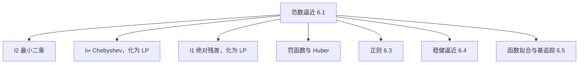
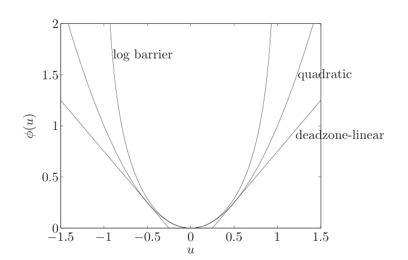
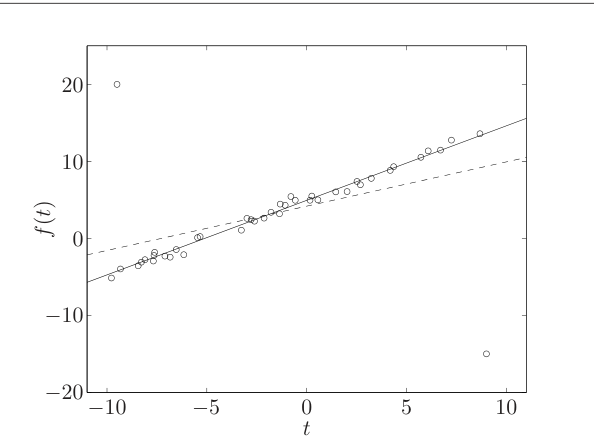
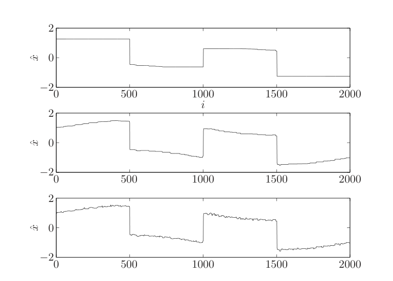

# 第6章 逼近与拟合

### 来源说明

- 作者：Stephen Boyd, Lieven Vandenberghe
- 书名：*Convex Optimization*（凸优化）
- 官方来源：https://web.stanford.edu/~boyd/cvxbook/bv_cvxbook.pdf
- 纸书由 Cambridge University Press 出版。本笔记仅供个人学习使用。

阅读范围：Chapter 6 Approximation and fitting（逼近与拟合），PDF 第 305–364 页（书页约 291–350）。习题不展开。

### 本章总览

这一章把「用一组向量去贴近另一个向量」写成凸优化。基本问题是范数逼近（norm approximation）：在某种范数下让残差 $Ax-b$ 尽量小。最小二乘、Chebyshev 逼近和 $\ell_1$ 绝对残差，都是换一种范数。

同一套写法还能加上约束、换成罚函数、在残差和变量大小之间做正则，以及在矩阵 $A$ 不确定时做稳健逼近。后半章把变量解释成函数系数，用来拟合、插值和挑一组稀疏基。

视觉里，直线拟合、带离群点的回归、一维信号去噪，都落在这套框架里。书中明确说，平滑和去噪的想法可以从一维信号推广到图像和视频。

图注：范数逼近是本章的公共形式。换范数、加罚、加正则或考虑 $A$ 的不确定性，得到不同的凸问题；函数拟合是把系数向量放进同一形式。

### 核心知识点

#### 基本范数逼近

最简单的形式没有约束：

$$
\operatorname{minimize}\quad \|Ax-b\|
\tag{6.1}
$$

$A\in\mathbb{R}^{m\times n}$，$b\in\mathbb{R}^{m}$，变量 $x\in\mathbb{R}^{n}$。残差 $r=Ax-b$。问题总是凸的，而且总有最优解。最优值为 0 当且仅当 $b$ 落在 $A$ 的值域里。列可以假设线性无关，因此有意思的情形是 $m>n$。$m=n$ 时最优解就是 $A^{-1}b$。

四种读法是同一件事。

逼近：把 $b$ 写成 $A$ 各列的线性组合，偏差用选定的范数量。这又叫回归（regression），各列叫回归量（regressor）。

估计：测量模型 $y=Ax+v$，误差 $v$ 未知但按范数看应当小。最说得通的估计是 $\hat x=\operatorname{argmin}_z\|Az-y\|$。严格的统计说法在第 7 章。

几何：在子空间 $\mathcal{R}(A)$ 上找离 $b$ 最近的点，也就是把 $b$ 投影到列空间。

设计：$x$ 是设计变量，$Ax$ 是结果，$b$ 是目标，残差是没对准的部分。

加权形式是 $\|W(Ax-b)\|$。对角的 $W$ 给各残差分量不同的重视。它等价于把数据换成 $WA$、$Wb$，或改用范数 $\|z\|_W=\|Wz\|$（$W$ 非奇异时）。

🔑 关键速记：范数逼近就是在选定范数下让 $Ax\approx b$；它同时是回归、线性估计、向列空间投影和线性设计。

#### 最小二乘、Chebyshev 与 $\ell_1$

三种范数决定残差怎么分配。下表只列本章给出的等价问题，不比较算法实现。

| 名称 | 要压小的量 | 本章给出的解法 | 残差倾向 |
| --- | --- | --- | --- |
| 最小二乘（least squares） | $\|Ax-b\|_2^2=\sum r_i^2$ | 正规方程 $A^\top Ax=A^\top b$；列满秩时 $x=(A^\top A)^{-1}A^\top b$ | 中等残差多，很大的残差少 |
| Chebyshev / 极小化极大 | $\|Ax-b\|_\infty=\max\|r_i\|$ | 线性规划：最小化 $t$，约束 $-t\mathbf{1}\preceq Ax-b\preceq t\mathbf{1}$ | 最大绝对值被压住 |
| 绝对残差和 | $\|Ax-b\|_1=\sum\|r_i\|$ | 线性规划：最小化 $\mathbf{1}^\top t$，约束 $-t\preceq Ax-b\preceq t$ | 很多残差接近 0，大残差相对更能留下 |

表后要点：$\ell_2$ 把大残差罚得很重，$\ell_1$ 对大残差只线性增长，所以 $\ell_1$ 更不怕离群点，也更容易把一部分方程正好配上，即许多 $a_i^\top x=b_i$。

最小二乘把目标写成二次函数 $f(x)=x^\top A^\top Ax-2b^\top Ax+b^\top b$，梯度为零就是正规方程。列满秩时解唯一。

👉 正规方程为什么是最优性条件、以及伪逆写法，第 4 章和附录把最小二乘当作完整技术来讲。这里只保留「梯度为零即 $A^\top Ax=A^\top b$」这一结论。📝待补全

🔑 关键速记：$\ell_2$ 有正规方程；$\ell_\infty$ 和 $\ell_1$ 都加辅助变量化成线性规划，前者管最大残差，后者管残差绝对值之和。

#### 罚函数与 Huber 稳健罚

$\ell_p$ 范数只看残差的幅度分布。罚函数逼近把它推广成

$$
\begin{align*}
\operatorname{minimize}\quad & \phi(r_1)+\cdots+\phi(r_m) \\
\operatorname{subject\ to}\quad & r=Ax-b,
\end{align*}
\tag{6.2}
$$

$\phi$ 凸，则问题凸。正的常数倍不改变解，形状才改变解。$\phi(u)$ 小，表示这种残差不太在意；涨得快或在区间外变成无穷，表示大残差不能接受。

常见例子（例 6.1）：

- $\phi(u)=|u|^p$（$p\ge 1$）回到 $\ell_p$。$\phi(u)=u^2$ 是最小二乘，$\phi(u)=|u|$ 是 $\ell_1$。
- 死区线性（deadzone-linear），死区宽度 $a>0$：$|u|\le a$ 时罚 0，否则罚 $|u|-a$。
- 对数障碍（log barrier），界限 $a>0$：$|u|<a$ 时罚 $-a^2\log(1-(u/a)^2)$，$|u|\ge a$ 时罚无穷。

图注：图 6.1。二次罚 $\phi(u)=u^2$、死区宽度 $a=1/4$ 的死区线性罚，以及界限 $a=1$ 的对数障碍。小残差附近对数障碍接近二次；残差一靠近界限，障碍就陡升。

书中用 $A\in\mathbb{R}^{100\times 30}$ 的例子比较四种罚的残差直方图（图 6.2，此处不另贴）：$\ell_1$ 的小残差最多、大残差也相对多；$\ell_2$ 以中等残差为主；死区线性有不少残差正好卡在 $\pm 0.5$；对数障碍不允许 $|r_i|>1$。

离群点是噪声特别大的测量。理想的罚在阈值 $M$ 以内像 $u^2$，超过后变成常数（式 6.3）。这个函数不凸，对应问题变成组合难题。凸的替代是 Huber 罚

$$
\phi_{\mathrm{hub}}(u)=
\begin{cases}
u^2 & |u|\le M,\\
M(2|u|-M) & |u|>M.
\end{cases}
\tag{6.4}
$$

$|u|\le M$ 时它和最小二乘一致；更大时线性增长，并且是式 (6.3) 在 $|u|>M$ 一侧最贴近的凸函数。线性增长的凸罚称为稳健（robust）。$\ell_1$ 是其中最典型的一个，所以 $\ell_1$ 逼近也叫稳健估计。

例 6.2 用 42 个点拟合直线 $f(t)=\alpha+\beta t$。最小二乘被左上、右下两个离群点拽偏；$M=1$ 的 Huber 罚贴住主体点。

图注：图 6.5。圆点是 42 个数据，虚线是最小二乘直线，实线是 $M=1$ 的 Huber 拟合。两条离群点把虚线转离主趋势，实线几乎不受它们影响。

$\ell_1$ 还有另一面：它对小残差的相对权重高，最优残差里往往有很多正好为 0。死区罚则相反，小残差没有动力再被压得更小。

🔑 关键速记：罚函数的形状决定残差分布；Huber 在小残差处像最小二乘，大残差处像 $\ell_1$，用来降低离群点的拉力。

#### 带约束的逼近

在 (6.1) 上加凸约束，问题仍凸。估计里，约束是对 $x$ 或误差的先验。几何上，是把 $b$ 投影到比子空间更复杂的集合。

- $x\succeq 0$：估计功率、强度等非负量；也是用列的锥组合逼近 $b$。
- $l\preceq x\preceq u$：各分量落在已知区间；几何上是把盒子经 $A$ 映射后的像。
- $x\succeq 0$ 且 $\mathbf{1}^\top x=1$：估计比例。这是用列的凸组合逼近 $b$。概率分布的估计在第 7.2 节展开。
- $\|x-x_0\|\le d$：$x_0$ 是先验猜测，$d$ 是允许偏离；也可以是信赖域，表示线性模型 $y=Ax$ 只在 $x_0$ 附近可信。

🔑 关键速记：非负、盒子、概率单纯形和范数球，都是给范数逼近加上凸的先验或可信范围。

#### 最小范数问题与稀疏启发式

最小范数问题是约束正好配上、变量尽量小：

$$
\begin{align*}
\operatorname{minimize}\quad & \|x\| \\
\operatorname{subject\ to}\quad & Ax=b.
\end{align*}
\tag{6.5}
$$

有解的前提是 $Ax=b$ 相容。行可假设无关，有意思的是 $m<n$，方程欠定。

任取一个特解 $x_0$，再取零空间的基组成 $Z$，一般解是 $x_0+Zu$。于是 (6.5) 变成对 $u$ 的范数逼近。

设计读法：$m$ 个规格、$n-m$ 个自由度，在满足 $Ax=b$ 的设计里选范数最小的。估计读法：测量无噪声但不够，先验是「小的 $x$ 更可信」。几何读法：在仿射集 $\{x\mid Ax=b\}$ 上找离原点最近的点。

欧氏范数下，对偶变量 $\nu$ 给出唯一解 $x^\star=A^\top(AA^\top)^{-1}b$。这里用了 $\operatorname{rank} A=m<n$，所以 $AA^\top$ 可逆。

最小罚问题把范数换成可分凸罚：

$$
\begin{align*}
\operatorname{minimize}\quad & \phi(x_1)+\cdots+\phi(x_n) \\
\operatorname{subject\ to}\quad & Ax=b,
\end{align*}
\tag{6.6}
$$

$\phi$ 凸、非负，且 $\phi(0)=0$。残差幅度分布上的讨论，可以原样搬到 $x$ 的幅度分布上。

稀疏启发式在这里出现。恰好有 $m$ 个非零元的解可以枚举：选定 $m$ 列，若对应子矩阵可逆就解出来。组合数是 $n!/(m!(n-m)!)$。最小 $\ell_1$ 范数

$$
\begin{align*}
\operatorname{minimize}\quad & \|x\|_1 \\
\operatorname{subject\ to}\quad & Ax=b
\end{align*}
$$

往往给出稀疏解，非零元个数常常只有 $m$ 个左右。它是找小而稀疏解的启发式，不是枚举意义上的全局保证。

🔑 关键速记：欠定方程用最小范数挑选解；最小 $\ell_1$ 是稀疏解的凸启发式，真要证最少非零元仍是组合问题。

#### 双目标与正则

既想残差小，又想 $x$ 小，写成关于正象限的向量优化

$$
\operatorname{minimize}\ (\text{w.r.t. }\mathbb{R}^2_+)\quad \bigl(\|Ax-b\|,\ \|x\|\bigr).
\tag{6.7}
$$

两个范数可以不同。一端是 $x=0$，残差为 $\|b\|$。另一端是 $\|Ax-b\|$ 的最小范数极小点。两端都是欧氏范数时，这一点唯一，且为 $x=A^\dagger b$。

👉 伪逆 $A^\dagger$ 的构造在第 4.7.6 节和附录 A.5.4。它是列空间上的最小二乘解里范数最小的那个。📝待补全

正则（regularization）是标量化。(6.8) 最小化 $\|Ax-b\|+\gamma\|x\|$，$\gamma>0$ 扫出折中曲线。(6.9) 在欧氏范数下最小化平方和 $\|Ax-b\|^2+\delta\|x\|^2$。

Tikhonov 正则是 (6.9) 的欧氏情形：

$$
\operatorname{minimize}\quad \|Ax-b\|_2^2+\delta\|x\|_2^2
=x^\top(A^\top A+\delta I)x-2b^\top Ax+b^\top b.
\tag{6.10}
$$

解是 $x=(A^\top A+\delta I)^{-1}A^\top b$。只要 $\delta>0$，$A^\top A+\delta I\succ 0$，不再要求 $A$ 满秩。病态或奇异的方阵方程，用它在「配平方程」和「$x$ 不要太大」之间妥协。

平滑正则把 $\|x\|$ 换成 $\|Dx\|$。$D$ 常是差分或二阶差分，$\|Dx\|$ 量变化有多猛。书中用三对角矩阵 $\Delta$ 近似区间上的二阶导数，用 $\delta\|\Delta x\|_2^2$ 换拟合与曲率。也可以同时惩罚平滑和大小。

例 6.3 是卷积系统的输入设计：输出跟踪、输入能量、输入差分三项加权。增大能量权重会牺牲跟踪；再加上差分权重，输入变平滑，跟踪误差增加不多（图 6.6）。

$\ell_1$ 正则用来启发式地逼近稀疏：

$$
\operatorname{minimize}\quad \|Ax-b\|_2+\gamma\|x\|_1.
\tag{6.11}
$$

它可写成二阶锥规划。$\gamma$ 扫的是残差与 $\|x\|_1$ 的折中，用来近似残差与基数 $\operatorname{card}(x)$ 的折中。例 6.4 的回归量选择里，$A\in\mathbb{R}^{10\times 20}$，$\ell_1$ 启发式在 $\operatorname{card}(x)=1$ 时碰到全局最优，其余点数接近枚举得到的 Pareto 点，但不保证每一点都是。书目把最小二乘再加上 $\ell_1$ 正则（残差用平方和，而不是 (6.11) 里未平方的 $\ell_2$）称为 lasso；Tikhonov 也叫 ridge regression。

🔑 关键速记：Tikhonov 用 $\delta\|x\|_2^2$ 换一个始终可逆的正规方程；$\ell_1$ 正则是让 $x$ 变稀疏的凸启发式。

#### 重构、二次平滑与全变分

信号 $x\in\mathbb{R}^{n}$ 被加性噪声污染，$x_{\mathrm{cor}}=x+v$。噪声未知、偏小，而且比信号变化快。估计 $\hat x$ 叫做重构、去噪或平滑。书中先讲一维，并写明同样的想法用于图像和视频。

双目标是

$$
\operatorname{minimize}\ (\text{w.r.t. }\mathbb{R}^2_+)\quad \bigl(\|\hat x-x_{\mathrm{cor}}\|_2,\ \phi(\hat x)\bigr).
\tag{6.12}
$$

$\phi$ 凸，用来惩罚不平滑。

二次平滑取一阶差分的平方和 $\phi_{\mathrm{quad}}(x)=\|Dx\|_2^2$。标量化 $\|\hat x-x_{\mathrm{cor}}\|_2^2+\delta\|D\hat x\|_2^2$ 的解是

$$
\hat x=(I+\delta D^\top D)^{-1}x_{\mathrm{cor}}.
$$

$I+\delta D^\top D$ 三对角，可以很快解。书中 $n=4000$ 的例子：$\|Dx_{\mathrm{cor}}\|_2=4.4$，$\|x_{\mathrm{cor}}\|_2=16.2$，折中曲线在 $\|\hat x-x_{\mathrm{cor}}\|_2\approx 3$ 附近有膝点；膝点附近的重构最接近原信号，更大则过平滑，更小则噪声还在。

二次平滑会把原信号里真正的陡变一起抹掉。全变分（total variation）改罚一阶差分的绝对值：

$$
\phi_{\mathrm{tv}}(\hat x)=\sum_{i=1}^{n-1}|\hat x_{i+1}-\hat x_i|=\|D\hat x\|_1.
$$

它对很大的相邻差分惩罚相对较轻，所以能留住偶尔的跳变。书目指出，全变分去噪最早就是为图像重构提出的。

图注：图 6.14。$n=2000$ 的跳变信号经全变分重构。上、中、下分别对应 $\|D\hat x\|_1=5$、$8$、$10$。上图过平滑，下图噪声偏多；和二次平滑不同，三幅都保住了陡边。

🔑 关键速记：二次平滑解三对角线性方程，但会抹掉跳变；全变分罚差分的绝对值，去噪时更能留下边缘。

#### 稳健逼近：随机与最坏情况

除了加性误差 $v$，矩阵 $A$ 本身也可以不确定。这叫乘性误差。

随机模型写 $A=\bar A+U$，$U$ 零均值。自然的目标是 $\mathbb{E}\|Ax-b\|$（式 6.13）。它总是凸的，但一般难算。$A$ 只取有限个值时，变成加权的范数和，欧氏范数下是二阶锥规划，$\ell_1$ 或 $\ell_\infty$ 下是线性规划。

随机稳健最小二乘可以算完：目标等于 $\|\bar Ax-b\|_2^2+x^\top Px$，$P=\mathbb{E} U^\top U$，解为

$$
x=(\bar A^\top\bar A+P)^{-1}\bar A^\top b.
$$

$x$ 越大，$A$ 的抖动对 $Ax$ 的影响越大，所以又回到正则。若 $U_{ij}$ 零均值、不相关、方差为 $\delta/m$，Tikhonov 问题 (6.10) 正是这个随机稳健最小二乘。

最坏情况用有界集合 $\mathcal{A}$ 描述可能的 $A$。最坏残差 $e_{\mathrm{wc}}(x)=\sup\{\|Ax-b\|\mid A\in\mathcal{A}\}$ 对 $x$ 凸。问题是

$$
\operatorname{minimize}\quad e_{\mathrm{wc}}(x).
\tag{6.14}
$$

$\mathcal{A}$ 只有一个矩阵时，退回 (6.1)。

例 6.5 里 $A(u)=A_0+uA_1$，$u\in[-1,1]$，扰动大约一成。名义最小二乘在 $u=0$ 残差最小，但 $u$ 靠近 $\pm 1$ 时残差明显变大。最坏情况解在 $u=0$ 差一点，整段区间上更平。随机解（$u$ 在 $[-1,1]$ 上均匀）夹在中间（图 6.15）。

几种可算的 $\mathcal{A}$：

- 有限集或它们的凸包：极小化最大范数，欧氏范数是二阶锥规划，$\ell_1$、$\ell_\infty$ 是线性规划。
- 谱范数球 $\|\bar A+U\|$ 的扰动不超过 $a$：最坏误差是 $\|\bar Ax-b\|_2+a\|x\|_2$，又可看成某个 $\delta$ 的 Tikhonov 问题。
- 每一行在椭球 $E_i=\{\bar a_i+P_i u\mid \|u\|_2\le 1\}$ 里：第 $i$ 个残差的最坏绝对值是 $|\bar a_i^\top x-b_i|+\|P_i^\top x\|_2$。最坏 $\ell_2$ 误差可写成二阶锥规划。
- 结构化扰动 $\bar A+u_1A_1+\cdots+u_pA_p$，$\|u\|\le 1$。$\ell_\infty$ 对 $\|u\|_\infty\le 1$ 的稳健 Chebyshev 问题是线性规划。$\ell_2$ 对 $\|u\|_2\le 1$ 的稳健最小二乘等价于半定规划 (6.15)。

👉 (6.15) 用 Lagrange 对偶把非凸的最坏残差写成半定约束，强对偶的根据在第 5.2 节和附录 B。这里只保留结论：对 $x,\lambda,t$ 联合优化那个半定约束，就是稳健最小二乘。📝待补全

例 6.6 在单位圆盘上抽 $10^5$ 个 $u$。名义最小二乘的残差大约从 0.52 散到 4.9；稳健解的残差挤在约 2.0 到 2.6；$\delta=1$ 的 Tikhonov 解也比较集中，但不是按最坏情况设计的（图 6.16）。

🔑 关键速记：$A$ 有随机抖动时，稳健最小二乘就是带 $P$ 的 Tikhonov；$A$ 落在已知集合里时，最小化的是这个集合上的最大残差。

#### 函数拟合与插值

拟合是在有限维函数族里选一个最贴数据的成员。基函数 $f_1,\ldots,f_n$ 张成

$$
f(u)=x_1f_1(u)+\cdots+x_nf_n(u),
\tag{6.17}
$$

变量是系数 $x$。常见族：幂基、正交多项式、Lagrange 基、三角多项式；三角剖分上的分片仿射函数；以及导数连续到指定阶的样条。三次样条的例子里，三段三次多项式有 12 个系数、6 个连续条件（函数值、一阶、二阶在两个接点各一组），函数族维数是 6（图 6.18）。

在指定点的函数值、Lipschitz 条件、分片线性函数的非负性和单调性，都变成 $x$ 的线性约束。偶次多项式在全实轴非负，可写成半定约束：最高次数 $2k$ 时，$p(u)=x_1+x_2u+\cdots+x_{2k+1}u^{2k}\ge 0$ 对一切实数 $u$ 成立，当且仅当存在 $Y\in\mathbf{S}^{k+1}$、$Y\succeq 0$，使 $x_i=\sum_{m+n=i+1} Y_{mn}$。本章直接引用练习 2.37 的这一等价，不重写证明。梯度上界是凸约束；Hessian 的特征值界是线性矩阵不等式。积分和矩约束是线性等式 $c^\top x=a$。

最小范数拟合：给定 $(u_i,y_i)$，例如最小化 $\sum(f(u_i)-y_i)^2$，这是关于 $x$ 的普通最小二乘。例 6.7 用 40 个点拟合最高 5 次的多项式（维数 6），分别最小化误差的 $\ell_2$ 和 $\ell_\infty$（图 6.19）。例 6.8 用同样维数的三次样条做同一件事（图 6.20）。数据远多于系数时，光滑性来自函数族本身。

数据少于维数时，先强制 $f(u_i)=y_i$，再在插值函数里选最平滑或最小的，这是最小范数问题。在新点 $v$ 上求 $f(v)$ 的最大和最小，得到取值区间。$\ell_1$ 拟合留下的大误差，可用来找坏数据。$v$ 在数据点凸包里或附近叫插值，否则叫外推。

🔑 关键速记：拟合是选系数；点值、单调、非负和矩约束在合适的函数族里仍是凸约束。数据少就改成带插值等式的最小范数。

#### 基追踪

基函数很多且线性相关时，叫过完备字典。基追踪（basis pursuit）要找拟合好、同时 $\operatorname{card}(x)$ 小的系数。数学上和回归量选择相同，规模和解释不同：非零系数是一份稀疏描述，收发双方共用字典时，只传非零系数就能近似重建信号。

常用做法和前面的 $\ell_1$ 启发式一样。先解

$$
\operatorname{minimize}\quad \sum_{i=1}^{m}\bigl(f(u_i)-y_i\bigr)^2+\gamma\|x\|_1,
\tag{6.18}
$$

再用得到的非零模式做一次最小二乘精修。Chen、Donoho 和 Saunders 把 (6.18) 称为 basis pursuit denoising。字典常常到 $10^4$ 以上，算法必须利用字典结构。

书中的时频例子用宽度 $\sigma=0.05$ 的高斯正弦脉冲（Gabor 函数）。时间 501 个、频率加相位一共 61 种，字典有 $501\times 61=30561$ 个基。对 $y(t)=a(t)\sin\theta(t)$ 的 501 个样本，$\gamma=1$ 得到 42 个非零系数，精修后相对误差为 $2.6\times 10^{-4}$。非零基的时间–频率位置贴着瞬时频率 $\omega(t)=150|\cos(5t)|$（图 6.22、图 6.23）。

🔑 关键速记：基追踪用 $\ell_1$ 正则从过完备字典里挑少量基；先解 (6.18)，再按非零模式做最小二乘。

#### 用凸函数插值

有时函数不限制在有限维子空间里，只要它凸。存在定义在全空间、满足 $f(u_i)=y_i$ 的凸函数，当且仅当存在次梯度 $g_i$ 使

$$
y_j\ge y_i+g_i^\top(u_j-u_i),\qquad i,j=1,\ldots,m.
\tag{6.19}
$$

证明只留结论：凸函数在每点有支撑超平面，代进去得 (6.19)；反过来，$f(z)=\max_i\bigl(y_i+g_i^\top(z-u_i)\bigr)$ 是凸的分片线性函数，且在 $u_i$ 处取值 $y_i$。

因此，对数据做凸函数的最小二乘拟合，是关于 $\hat y$ 和 $g_i$ 的二次规划。最优值为 0 当且仅当数据能被凸函数插值（图 6.24）。给定已能插值的数据，新点 $u_0$ 上凸插值函数的最小、最大可能值，各是一个线性规划。

还要求单调不减时，在 (6.19) 上加 $g_i\succeq 0$（式 6.21）。消费者偏好的例子把效用看成凹且单调不减，已知的偏好写成线性规划可行性问题 (6.25)。不可行就说明没有任何这样的效用能解释这些偏好；对未知的一对篮子，可以再加一条弱偏好，看是否把问题变成不可行，从而推出必然的偏好方向。

🔑 关键速记：凸插值不必枚举函数，等价于次梯度不等式 (6.19)；拟合、定界和单调都变成有限维凸问题。

### 关键速记

- 范数逼近 (6.1) 用 $\|Ax-b\|$ 衡量线性组合有多贴。
- 最小二乘走正规方程；Chebyshev 和 $\ell_1$ 加辅助变量后是线性规划。
- Huber 罚 (6.4) 和最小 $\ell_1$ 用来压低离群点；最小 $\ell_1$ 和 (6.11)、(6.18) 是稀疏启发式。
- Tikhonov 解是 $(A^\top A+\delta I)^{-1}A^\top b$；全变分去噪能留下跳变。
- $A$ 不确定时，随机稳健最小二乘回到正则，最坏情况则最小化集合上的最大残差。

### 易混淆点与差异对比

最小二乘、Chebyshev、$\ell_1$ 都在解 $Ax\approx b$，差别只在残差怎么汇总。$\ell_2$ 讨厌大残差，$\ell_\infty$ 只看最大的一个，$\ell_1$ 让很多残差变成 0，并较能放过离群点。

式 (6.3) 那种「大残差只罚一个常数」更像理想的离群点模型，但它不凸。Huber 是它的凸替代，不是同一个函数。

范数逼近 (6.1) 是残差小、$x$ 自由，通常 $m>n$。最小范数 (6.5) 是方程配平、$x$ 小，通常 $m<n$。正则 (6.7) 把两头合在一条折中曲线上。Tikhonov 的 $\delta$ 不是测量噪声的方差本身，除非按第 6.4.1 节那种不相关扰动去解释。

全变分和二次平滑都罚相邻差分。二次平滑对大跳变罚平方，边缘被抹平；全变分罚绝对值，大跳变的额外代价是线性的，边缘更容易留下。

基追踪和回归量选择用的是同一个 $\ell_1$ 启发式。基追踪的字典过完备，非零系数是压缩后的描述；回归量选择是从候选列里挑 $k$ 列。两者都不等于直接最小化 $\operatorname{card}(x)$。

稳健逼近里的「稳健」和第 6.1 节对离群点的稳健不是同一层。前者是矩阵 $A$ 不确定，后者是残差里有特别大的加性误差。名义最小二乘、随机稳健和最坏情况，在不确定参数的中心和端点上表现相反，不能用一个残差数字概括。

### 本章要点总结

逼近问题的骨架是最小化残差范数。最小二乘有闭式解，Chebyshev 和 $\ell_1$ 化成线性规划。罚函数用形状表达对残差的态度，Huber 是离群点模型的凸替代。欠定方程用最小范数，最小 $\ell_1$ 用来找稀疏解。正则把残差和变量大小合成一个凸目标，Tikhonov 始终可解，全变分适合保留跳变。矩阵不确定时，随机模型回到正则，最坏情况模型最小化最大残差。函数拟合把同一套凸约束用到系数上；基追踪用 $\ell_1$ 从大字典里挑基；凸函数插值用次梯度不等式收成有限维凸问题。
