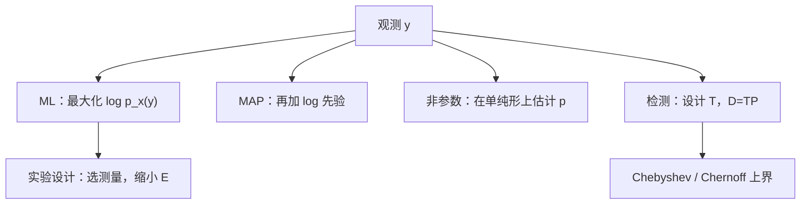
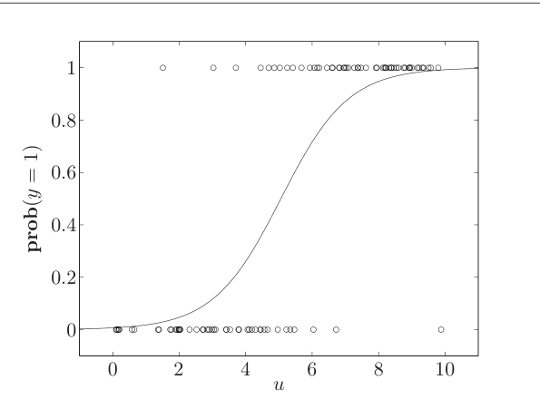
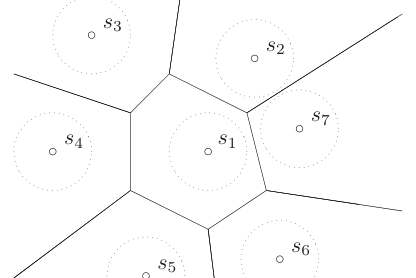
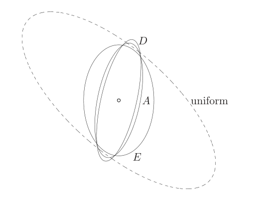

# 第7章 统计估计

### 来源说明

- 作者：Stephen Boyd, Lieven Vandenberghe
- 书名：*Convex Optimization*（凸优化）
- 官方来源：https://web.stanford.edu/~boyd/cvxbook/bv_cvxbook.pdf
- 纸书由 Cambridge University Press 出版。本笔记仅供个人学习使用。

阅读范围：Chapter 7 Statistical estimation（统计估计），PDF 第 365–410 页（书页约 351–396）。只记本书写成凸问题的估计、检测、概率界和实验设计。习题不展开。

### 本章总览

这一章问的是：哪些估计和检测可以写成凸优化。参数分布用最大似然（maximum likelihood, ML）和最大后验（maximum a posteriori, MAP）。有限支撑上的分布用先验约束、最大熵和 Kullback–Leibler 散度。检测把猜测写成矩阵，很多设计目标是线性规划。Chebyshev 界和 Chernoff 界把概率上界写成凸问题。实验设计选择测量，使误差协方差在半定序下变小。

和第 6 章的衔接是直接的。对数凹的噪声密度让线性测量的 ML 变成罚函数逼近；对数凹的先验让 MAP 变成最小罚问题。不要把本章读成概率论教程，书里没有展开的分布性质就不补。

图注：本章五块都从观测或候选测量出发，收成凸问题。ML/MAP 估计参数，非参数估计分布本身，检测估计离散假设，概率界不求分布只求上界，实验设计在测量之前选实验。

### 核心知识点

#### 最大似然

分布族 $p_x$ 以参数 $x\in\mathbb{R}^{n}$ 为指标，样本 $y\in\mathbb{R}^{m}$ 固定时，$p_x(y)$ 是似然，$l(x)=\log p_x(y)$ 是对数似然。先验或定义域用 $x\in C$ 表示；不满足时把密度写成 0，对数似然写成 $-\infty$。

ML 估计是

$$
\begin{align*}
\operatorname{maximize}\quad & l(x)=\log p_x(y) \\
\operatorname{subject\ to}\quad & x\in C.
\end{align*}
\tag{7.1}
$$

每个 $y$ 上 $l$ 都凹，并且 $C$ 由线性等式和凸不等式描述时，(7.1) 是凸问题。

线性测量 $y_i=a_i^\top x+v_i$，噪声独立同分布、密度为 $p$。对数似然是 $\sum\log p(y_i-a_i^\top x)$，ML 为

$$
\operatorname{maximize}\quad \sum_{i=1}^{m}\log p(y_i-a_i^\top x).
\tag{7.2}
$$

$p$ 对数凹时这是凸的，并且就是第 6 章罚函数问题 (6.2)，罚函数为 $-\log p$。

例 7.1 只给三种噪声，不要外推到别的密度：

- 零均值、方差 $\sigma^2$ 的 Gauss 噪声：ML 就是最小二乘 $\operatorname{argmin}\|Ax-y\|_2^2$。
- Laplace 密度 $p(z)=(1/(2a))e^{-|z|/a}$：ML 是 $\ell_1$ 逼近。
- $[-a,a]$ 上的均匀噪声：任一满足 $\|Ax-y\|_\infty\le a$ 的 $x$ 都是 ML 估计。

反过来，任何一个罚函数逼近都可以看成 ML：噪声密度正比于 $e^{-\phi(z)}$，测量是 $b$。$\phi$ 对大残差涨得很快，对应密度尾很薄，估计会尽量避免大残差。$\ell_1$ 对应 Laplace，$\ell_2$ 对应 Gauss。Laplace 的尾更重，所以 ML 更预期看到大残差。这就是第 6 章说的 $\ell_1$ 稳健性的统计读法。

Poisson 计数：$\operatorname{prob}(y=k)=e^{-\mu}\mu^k/k!$，均值 $\mu=a^\top u+b$。观测对 $(u_i,y_i)$ 的对数似然去掉不含参数的项后，ML 是最大化 $\sum(y_i\log(a^\top u_i+b)-(a^\top u_i+b))$，变量 $a,b$，问题凸。

逻辑回归（logistic regression）里 $y\in\{0,1\}$，

$$
p=\frac{\exp(a^\top u+b)}{1+\exp(a^\top u+b)}.
\tag{7.3}
$$

把结果为 1 的样本放前 $q$ 个，对数似然化成

$$
l(a,b)=\sum_{i=1}^{q}(a^\top u_i+b)-\sum_{i=1}^{m}\log\bigl(1+\exp(a^\top u_i+b)\bigr).
$$

$l$ 对 $a,b$ 凹，所以 ML 是凸问题。

图注：图 7.1。50 个点 $(u_i,y_i)$，$y_i$ 只取 0 或 1。实线是 ML 参数下的 $\operatorname{prob}(y=1)$。$u$ 小则更像 0，$u$ 大则更像 1，曲线和这个观察一致。

零均值 Gauss 向量的协方差 $R$ 用 $N$ 个样本估计。对数似然对 $R$ 不总是凹的，换成信息矩阵 $S=R^{-1}$ 后，

$$
l(S)=-(Nn/2)\log(2\pi)+(N/2)\log\det S-(N/2)\operatorname{tr}(SY)
$$

对 $S$ 凹。$Y$ 是样本协方差。ML 为

$$
\begin{align*}
\operatorname{maximize}\quad & \log\det S-\operatorname{tr}(SY) \\
\operatorname{subject\ to}\quad & S\in\mathcal{S},
\end{align*}
\tag{7.4}
$$

$\mathcal{S}$ 是对 $S$ 的先验，并隐含 $S\succ 0$。没有任何别的先验、且 $Y\succ 0$ 时，梯度条件给出 $S^{-1}=Y$，也就是 $\hat R_{\mathrm{ml}}=Y$。$Y$ 不正定时对数似然无上界。

能写成 $S$ 的凸约束的先验包括：$L\preceq R\preceq U$ 变成 $U^{-1}\preceq S\preceq L^{-1}$；条件数 $\lambda_{\max}(R)\le\kappa_{\max}\lambda_{\min}(R)$ 变成存在 $u>0$ 使 $uI\preceq S\preceq\kappa_{\max}uI$（式 7.5）；以及 $\mathbb{E}(c_i^\top y)^2\le\alpha_i$，因为 $c_i^\top S^{-1}c_i$ 在 $S\succ 0$ 上凸。

🔑 关键速记：对数似然凹时 ML 是凸问题；Gauss 噪声给出最小二乘，Laplace 给出 $\ell_1$，无先验的协方差 ML 就是样本协方差。

#### 最大后验

MAP 把参数 $x$ 也当成随机向量，和观测 $y$ 有联合密度 $p(x,y)$。先验是 $p_x$，条件密度 $p_{y|x}$ 扮演 ML 里的 $p_x$。后验密度是看到 $y$ 之后对 $x$ 的描述。估计取后验最大的 $x$：

$$
\hat x_{\mathrm{map}}=\operatorname{argmax}_x\bigl(\log p_{y|x}(x,y)+\log p_x(x)\bigr).
\tag{7.6}
$$

和 ML 的差别就是多了 $\log p_x(x)$。先验在集合 $C$ 上均匀时，MAP 退回带约束的 ML。对数似然凹、先验对数凹，则 MAP 仍凸。

线性测量、噪声密度 $p_v$、先验 $p_x$ 时，

$$
\operatorname{maximize}\quad \log p_x(x)+\sum_{i=1}^{m}\log p_v(y_i-a_i^\top x).
\tag{7.7}
$$

比 (7.2) 多一项先验。例如噪声在 $[-a,a]$ 上均匀、先验是均值 $\bar x$、协方差 $\Sigma$ 的 Gauss，则 MAP 是二次规划：最小化 $(x-\bar x)^\top\Sigma^{-1}(x-\bar x)$，约束 $\|Ax-y\|_\infty\le a$。

测量无噪声、$y=Ax$ 时，MAP 是在 $Ax=y$ 上最大化 $\log p_x(x)$。各分量独立同分布时，这就是第 6 章最小罚问题 (6.6)，罚函数 $-\log p$。反过来，每个最小罚问题都可看成这种完美线性测量下的 MAP。

正则在统计里的位置就在这里：MAP 比 ML 多的那一项，和第 6.3 节惩罚大的 $x$ 是同一类附加项。

🔑 关键速记：MAP 是 ML 加上对数先验；先验对数凹就保持凸，均匀先验则回到带约束的 ML。

#### 非参数分布估计

$X$ 只取有限个值 $\alpha_1,\ldots,\alpha_n$，分布就是 $p$，$p_k=\operatorname{prob}(X=\alpha_k)$。概率单纯形 $\{p\mid p\succeq 0,\ \mathbf{1}^\top p=1\}$ 和全体这种分布一一对应。

期望 $\mathbb{E} f(X)=\sum p_i f(\alpha_i)$ 对 $p$ 线性，所以已知的矩和集合概率是线性等式或不等式。方差对 $p$ 凹，方差的下界是凸二次不等式。条件概率是 $p$ 的线性分式，上下界可以改写成线性不等式。熵 $-\sum p_i\log p_i$ 凹，所以熵的下界是凸约束。相对已知分布 $q$ 的 Kullback–Leibler 散度 $\sum p_i\log(p_i/q_i)$ 对 $p$ 凸，上界也是凸约束。

先验写成 $p\in\mathcal{P}$，并总带上单纯形。在 $\mathcal{P}$ 上最小化或最大化 $\sum f(\alpha_i)p_i$，得到 $\mathbb{E} f(X)$ 的上下界。

$N$ 个独立样本里取值 $\alpha_i$ 出现 $k_i$ 次时，对数似然 $l(p)=\sum k_i\log p_i$ 凹。ML 是在 $p\in\mathcal{P}$ 上最大化它。

最大熵是在 $\mathcal{P}$ 上最小化 $\sum p_i\log p_i$。书中的说法是：在符合先验的分布里，它最含糊。最小 Kullback–Leibler 散度是在 $\mathcal{P}$ 上最小化 $\sum p_i\log(p_i/q_i)$。$q$ 均匀时，它就是最大熵。

例 7.2 在 $[-1,1]$ 的 100 个等距点上给出均值、二阶矩、一个三阶组合矩和 $\operatorname{prob}(X<0)$ 的区间（式 7.8）。最大熵分布把这些不等式都推到边界上。对每个 $\alpha_i$ 解两个线性规划，得到累积分布函数的上下界；最大熵分布的累积曲线夹在中间（图 7.3）。

例 7.3 只知两个收益的边缘分布，联合分布未知。损失概率 $\operatorname{prob}(X+Y<\gamma)$ 的最坏上界是一个线性规划，最优解是把概率尽量堆到损失区域、同时配上给定边缘的联合分布。导数收益 $R(X,Y)$ 同样处理。

🔑 关键速记：有限支撑上，矩和概率是 $p$ 的线性约束；ML、最大熵和 Kullback–Leibler 投影都是单纯形上的凸问题。

#### 检测与假设检验

$X\in\{1,\ldots,n\}$ 的分布依赖假设 $\theta\in\{1,\ldots,m\}$。矩阵 $P$ 的第 $j$ 列是 $\theta=j$ 时 $X$ 的分布，$p_{kj}=\operatorname{prob}(X=k\mid\theta=j)$。根据一次 $X$ 猜测 $\theta$，叫做假设检验或检测。

确定性检测是函数 $\psi$。最大似然检测是

$$
\hat\theta=\psi_{\mathrm{ml}}(k)=\operatorname{argmax}_j p_{kj}.
\tag{7.10}
$$

随机检测用矩阵 $T\in\mathbb{R}^{m\times n}$，$t_{ik}=\operatorname{prob}(\hat\theta=i\mid X=k)$。每列 $t_k$ 在单纯形上：$t_k\succeq 0$，$\mathbf{1}^\top t_k=1$（式 7.11）。列都是单位向量时，随机检测退回确定性检测。

检测概率矩阵 $D=TP$，$D_{ij}=\operatorname{prob}(\hat\theta=i\mid\theta=j)$。对角元 $P^d_i=D_{ii}$ 是检测对的概率，误差概率 $P^e_i=1-D_{ii}$。$D=I$ 表示从不猜错。

很多设计要求对 $D$ 是线性或分片线性凸的，因而对 $T$ 也是，所以能写成线性规划。例如 $D_{jj}\ge L_j$、$D_{ij}\le U_{ij}$、最小化最大误差 $\max_j P^e_j$（极小化极大检测）、以及 Bayes 检测：先验 $q_i=\operatorname{prob}(\theta=i)$，最小化平均误差 $q^\top P^e$。

多准则形式把所有非对角 $D_{ij}$ 当成要同时压小的目标（式 7.12）。用损失矩阵 $W$（对角为 0，非对角为正）加权后，问题 (7.13) 按列分开，每列的最优是单位向量。因此这个加权和的最优检测可以取成确定性的：

$$
\hat\theta=\operatorname{argmin}_j (WP^\top)_{jk}.
\tag{7.14}
$$

Pareto 面是分片线性的，(7.14) 对应顶点。随机检测不在这些顶点上，但可以落在棱上，所以并不是永远多余。

Bayes 先验 $q$ 对应的权重给出 MAP 检测：看到 $X=k$ 时 $\hat\theta=\operatorname{argmax}_j(p_{kj}q_j)$。先验均匀时回到 ML 检测 (7.10)，它最小化各假设上等权的平均误差。

$\theta$ 的编号有大小意义时，高估概率、偏差、均方误差和平均绝对误差都是 $D$ 的线性函数，上界仍是线性约束。

二元假设检验 $m=2$ 时，两个分布记为 $p,q$。习惯把 $\theta=1$ 当正常、$\theta=2$ 当异常。假阴性 $P_{\mathrm{fn}}$ 和假阳性（虚警）$P_{\mathrm{fp}}$ 构成检测矩阵。二者的最优折中曲线叫接收机工作特性（receiver operating characteristic, ROC）。

加权后的最优检测是似然比阈值检验：$p_k/q_k$ 大于阈值 $W_{12}/W_{21}$ 则判负，否则判正。不同阈值给出 ROC 上的确定性顶点。这就是 Neyman–Pearson 引理在本章的用法。顶点之间的 Pareto 点要靠随机检测。

例 7.4 里 $n=4$。极小化极大检测是随机的，假阳性和假阴性都等于 $1/6$。每个确定性检测至少有一个误差概率超过 $1/6$（图 7.4）。矩阵 $P$ 的具体数字在书中排成阵列，笔记不逐格抄录。

$P$ 不完全知道、只知 $P\in\mathcal{P}$ 时，用最坏检测概率：非对角取上确界，对角取下确界。稳健极小化极大检测最小化各假设上的最坏误差概率。$\mathcal{P}$ 有限，或是由矩约束描述的多面体 (7.16) 时，用线性规划对偶把内层下确界换成对偶变量，整个设计仍是线性规划。例 7.5 是只知两组均值和二阶矩的二元稳健检测。

图注：图 7.5。七个信号 $s_1,\ldots,s_7$。折线是 Voronoi 边界，最小距离检测把接收点判给最近的信号。各点外的圆半径为 1，只用来看尺度。概率界在第 7.4.3 节用这组星座计算，不在这张图上。

🔑 关键速记：检测矩阵 $T$ 的列在单纯形上，$D=TP$；加权误差的最优可以取确定性检测，但极小化极大点可以必须随机。

#### Chebyshev 界与 Chernoff 界

两种经典界的简单情形有解析解；一般情形写成凸问题后，能处理更复杂的集合。

Chebyshev 型上界用已知期望控制 $\operatorname{prob}(X\in C)$。Markov：$X$ 非负、$\mathbb{E} X=\mu\le 1$ 时，$\operatorname{prob}(X\ge 1)\le\mu$。Chebyshev：均值 $\mu$、方差 $\sigma^2$ 时，$\operatorname{prob}(|X-\mu|\ge 1)\le\sigma^2$。

一般地，已知 $\mathbb{E} f_i(X)=a_i$，$f_0\equiv 1$。若线性组合 $f=\sum x_i f_i$ 在 $C$ 上至少为 1、在支撑的其余部分至少为 0，则 $a^\top x$ 是概率上界。最好的这种上界是

$$
\begin{align*}
\operatorname{minimize}\quad & x_0+a_1x_1+\cdots+a_nx_n \\
\operatorname{subject\ to}\quad & f(z)\ge 1\ (z\in C),\quad f(z)\ge 0\ (z\notin C).
\end{align*}
\tag{7.17}
$$

约束对 $x$ 凸。Markov 界就是这个线性规划的最优值。它形式上是「在所有满足矩约束的分布里，最大化落在 $C$ 的质量」的对偶（式 7.18）；书中只作形式对偶，不展开无穷维理论。

已知均值 $a$ 和二阶矩 $\Sigma$ 时，$f$ 取一般二次函数。非负性和「多面体外部上 $f\ge 1$」都写成线性矩阵不等式，得到半定规划 (7.19)。最优值 $\alpha$ 是 $\operatorname{prob}(X\in C)$ 的上界，$1-\alpha$ 是落在开多面体里的下界。

Chernoff 界：对实值 $X$，

$$
\log\operatorname{prob}(X\ge u)\le\inf_{\lambda\ge 0}\bigl\{-\lambda u+\log\mathbb{E} e^{\lambda X}\bigr\}.
\tag{7.20}
$$

$\log\mathbb{E} e^{\lambda X}$ 是累积量生成函数。

👉 它总是凸，例 3.41 用凸函数的例子说明这一点。本章只用「对 $\lambda$ 的最小化是凸的」这一结论。📝待补全

标准正态、$u\ge 0$ 时，界是 $e^{-u^2/2}$。推广到 $\mathbb{R}^{m}$ 中的集合 $C$ 时，上界是支撑函数加累积量生成函数的下确界，仍是凸问题。零均值、协方差 $I$ 的 Gauss 向量、$C=\{x\mid Ax\preceq b\}$ 非空时，这个界等于二次规划 (7.21) 最优值的指数，几何上是

$$
\operatorname{prob}(X\in C)\le\exp\bigl(-\operatorname{dist}(0,C)^2/2\bigr).
\tag{7.22}
$$

用包含 $C$ 的半空间还能得到更紧的 $\Phi(-d)$，因为 $\Phi(-d)\le e^{-d^2/2}$。这是注 7.3 的比较，不是新的优化问题。

第 7.4.3 节用图 7.5 的星座说明两种界。噪声零均值、协方差 $\sigma^2 I$。最小距离检测在 Gauss 噪声下就是最大似然检测。正确检测 $s_k$ 等价于噪声落在 Voronoi 区域 $V_k$。半定规划 (7.19) 给出正确检测概率的下界，对任何具有这个均值和协方差的噪声都成立，而且是紧的（图 7.6、图 7.7）。Gauss 噪声下，Chernoff 下界来自 (7.21)，并与 Monte Carlo 估计对照（图 7.8）。笔记不另造这些曲线。

🔑 关键速记：Chebyshev 界用矩找指示函数的凸上估计；Chernoff 界用指数函数，Gauss 情形收成到集合的距离。

#### 实验设计

估计 $x\in\mathbb{R}^{n}$，测量 $y_i=a_i^\top x+w_i$，$w_i$ 独立、标准正态，诸 $a_i$ 张成全空间。ML 估计就是最小二乘，也是最小方差估计。误差 $e=\hat x-x$ 零均值，协方差

$$
E=\Bigl(\sum_{i=1}^{m}a_ia_i^\top\Bigr)^{-1}.
$$

置信椭球是 $\{z\mid (z-\hat x)^\top E^{-1}(z-\hat x)\le\beta\}$，$\beta$ 依赖维数和置信水平。

每个 $a_i$ 只能从菜单 $v_1,\ldots,v_p$ 里选。设 $v_j$ 被选 $m_j$ 次，$\sum m_j=m$。基本问题是整数向量优化

$$
\begin{align*}
\operatorname{minimize}\ (\text{w.r.t. }\mathbf{S}^n_+)\quad
& E=\Bigl(\sum_j m_j v_jv_j^\top\Bigr)^{-1} \\
\operatorname{subject\ to}\quad
& m_i\ge 0,\ \sum m_i=m,\ m_i\in\mathbb{Z}.
\end{align*}
\tag{7.23}
$$

$E\preceq\tilde E$ 表示第一种设计的置信椭球（平移到原点后）含在第二种里，而且对任意 $q$，$q^\top x$ 的估计方差更小。

$m$ 相对 $p$ 很大时，令 $\lambda_i=m_i/m$，放松「$\lambda_i$ 是 $1/m$ 的整数倍」，得到

$$
E=\frac1m\Bigl(\sum_{i=1}^{p}\lambda_i v_iv_i^\top\Bigr)^{-1},
\tag{7.24}
$$

以及凸的放松问题 (7.25)：在单纯形上最小化这个 $E$（半定序）。把 $\lambda$ 四舍五入再归一，大 $m$ 时接近。$\lambda$ 也可读成在菜单上的随机实验。

三种标量化都凸：

| 名称 | 目标 | 几何含义 | 可写成 |
| --- | --- | --- | --- |
| D-最优 | $\log\det E$，即式 (7.26) | 固定置信水平下置信椭球体积最小 | 直接是凸问题 |
| E-最优 | $\|E\|_2$，即式 (7.27) | 置信椭球直径最小；也是单位向量方向上方差的最大值最小 | 半定规划 |
| A-最优 | $\operatorname{tr} E$，即式 (7.28) | $\mathbb{E}\|e\|_2^2$ | 半定规划 |

表后要点：三者都在单纯形上选 $\lambda$。D 看体积，E 看最长轴，A 看误差平方的平均。

👉 D-最优的 Lagrange 对偶是：最大化 $\log\det W+n\log n$，约束 $v_i^\top Wv_i\le 1$。最优 $W^\star$ 给出包含全部 $v_i$、中心在原点的最小体积椭球。互补松弛说，只用落在椭球面上的实验。对偶推导在第 5 章练习，椭球本身的体积问题在第 8.4 节。📝待补全

E-最优和 A-最优的对偶 (7.30)、(7.31) 同样是「最小的某种椭球包住 $v_i$」，并且同样只使用面上的实验。

书中 $n=2$、$p=20$ 的例子：D-最优只用两个测量，权重各 $0.5$；E-最优两个测量，权重 $0.2$ 与 $0.8$；A-最优三个测量，权重 $0.30$、$0.38$、$0.32$（图 7.9–7.11）。

图注：图 7.12。同一批候选测量下，D-最优、A-最优、E-最优和均匀设计（$\lambda_i=1/p$）的 90% 置信椭球。均匀设计的椭球明显更大，三种最优设计把不确定性压在不同形状里。

扩展仍保持凸。每个实验有代价 $c_i$ 时，加上预算 $mc^\top\lambda\le B$，也可以加多条资源不等式。一次实验同时给出 $k_i$ 个标量测量时，把 $v_i$ 看成 $\mathbb{R}^{n\times k_i}$ 的矩阵，误差协方差的形式不变。把「两个测量一起做」写成菜单上的第三项，并单独标价，就可以表示一起测比分开测更便宜。

🔑 关键速记：实验设计用 $\lambda$ 分配测量次数，使误差协方差 $E$ 在半定序下变小；D、E、A 分别压体积、直径和误差平方和。

### 关键速记

- ML (7.1) 在对数似然凹时是凸的；Gauss、Laplace、均匀噪声分别给出最小二乘、$\ell_1$ 和 $\ell_\infty$ 球。
- MAP (7.6) 比 ML 多对数先验；这就是正则的统计读法。
- 有限支撑上，最大熵和 ML 都在概率单纯形的凸子集上做。
- 检测用 $D=TP$；似然比阈值给出 ROC 顶点，极小化极大点可以是随机检测。
- Chebyshev 界是 (7.17) 或半定规划 (7.19)；实验设计的 D/E/A 都在缩小协方差椭球。

### 易混淆点与差异对比

ML 把 $x$ 当未知常数，MAP 把 $x$ 当随机向量。公式上只差 $\log p_x(x)$。先验均匀时两者相同。不要把 MAP 的先验项写成测量噪声。

Gauss 噪声的 ML 是最小二乘，Laplace 的 ML 是 $\ell_1$。这和第 6 章的罚函数一致，但第 6 章还可以用 Huber、死区这些没有写成标准密度的罚。那些罚仍可配一个密度 $e^{-\phi}$，只是本章例 7.1 没有逐个命名。

无约束协方差的 ML 是样本协方差 $Y$。一旦加上条件数或方差上界，估计就不再是 $Y$，而是 (7.4) 的解。对数似然对 $R$ 本身不保证凹，凸的变量是 $S=R^{-1}$。

最大似然检测 (7.10) 是各假设等先验时的 Bayes 检测。MAP 检测才乘上 $q_j$。二者都确定性。极小化极大检测可以随机，例 7.4 的 $1/6$ 就是反例：它比每个确定性检测的最坏误差更小。

Chebyshev 界不假设分布族，只用矩，所以对星座给出的是任何零均值、协方差 $\sigma^2 I$ 噪声都成立的下界。Chernoff 界在第 7.4.3 节另外假设了 Gauss 噪声。两条曲线不能叠在同一张图里比较成「谁更准」，输入假设不同。

D-最优的对偶椭球包住的是候选测量 $v_i$，中心在原点。图 7.12 的置信椭球包住的是参数估计误差，中心在估计附近。两个椭球都叫椭球，对象不同。

### 本章要点总结

对数似然凹、约束凸时，ML 可以算。线性测量把 ML 拉回第 6 章的罚函数：Gauss 对最小二乘，Laplace 对 $\ell_1$。MAP 只多一个对数先验。有限支撑上，矩约束保持凸，最大熵、ML 和散度投影都在单纯形上。检测的性能由 $D=TP$ 完全描述，常见目标是线性规划；二元情形的 ROC 顶点是似然比检验。Chebyshev 用矩拟合指示函数，Chernoff 用指数矩，Gauss 多面体上收成到集合的欧氏距离。实验设计在测量菜单上分配比例，D、E、A 三种标量化分别对应置信椭球的体积、直径和误差平方和。
