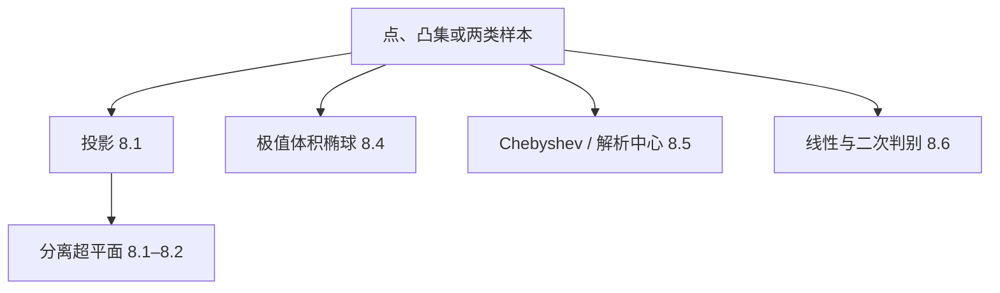
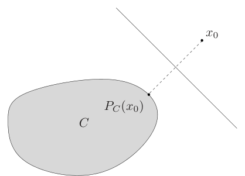
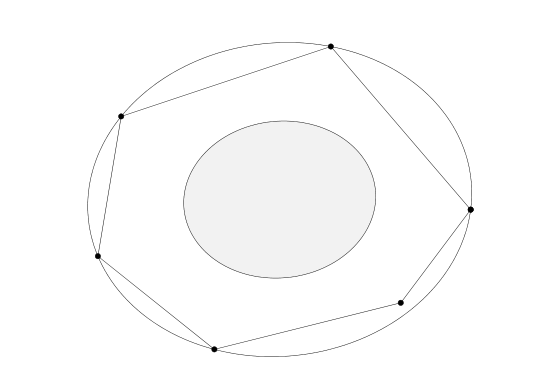
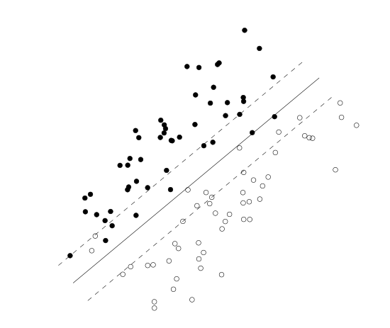

# 第8章 几何问题

### 来源说明

- 作者：Stephen Boyd, Lieven Vandenberghe
- 书名：*Convex Optimization*（凸优化）
- 官方来源：https://web.stanford.edu/~boyd/cvxbook/bv_cvxbook.pdf
- 纸书由 Cambridge University Press 出版。本笔记仅供个人学习使用。

阅读范围：Chapter 8 Geometric problems（几何问题），PDF 第 411–470 页（书页约 397–456）。习题不展开。投影、分离、极值体积椭球和分类与视觉里的点集、区域和两类标记直接对应，下面按书中的问题写，不另造检测实验。

### 本章总览

几何问题在这里都收成凸优化：点到集合的投影、两个集合的距离、由距离或夹角实现一组向量、最小外包椭球和最大内接椭球、几种中心、两类点的分类，以及布点和平面布置。

视觉里常用的几件事就在这张清单上。特征点或区域到凸约束的最近点，是投影。两类样本能不能用超平面切开，是分离。一堆点的最小外包椭圆，是 Löwner–John 椭球。最大内切圆的圆心，是 Chebyshev 中心。分错最少或间隔最大的线性分类器，是第 8.6 节的判别。

图注：投影和分离是对偶的两面。椭球和中心描述一个凸区域有多「圆」、最深的点在哪。判别用超平面或二次曲面切开两类点。

### 核心知识点

#### 投影

闭集 \(C\) 上，点 \(x_0\) 的距离是

\[
\operatorname{dist}(x_0,C)=\inf\{\|x_0-x\|\mid x\in C\}.
\]

下确界总能达到。达到的点叫 \(x_0\) 在 \(C\) 上的投影。一般可以有多个。\(C\) 闭凸且范数严格凸（例如欧氏范数）时，投影唯一。反过来，若每个点的欧氏投影都唯一，则 \(C\) 闭凸（练习 8.2，不证明）。记 \(P_C(x_0)\) 为任一投影。

例 8.1：单位正方形边界、\(x_0=0\)。\(\ell_1\) 和 \(\ell_2\) 下四个轴上的顶点距离都是 1；\(\ell_\infty\) 下边界上每个点距离都是 1。

例 8.2：秩不超过 \(k\) 的矩阵集合。在谱范数下，若 \(X_0=\sum_{i=1}^{r}\sigma_i u_iv_i^\top\)，则保留前 \(\min\{k,r\}\) 项得到的矩阵就是一个投影。本章把奇异值分解当作已知工具，不证明分解本身。

\(C\) 由线性等式和凸不等式 (8.1) 描述时，投影是凸问题

\[
\begin{align*}
\operatorname{minimize}\quad & \|x-x_0\| \\
\operatorname{subject\ to}\quad & f_i(x)\le 0,\quad Ax=b.
\end{align*}
\tag{8.2}
\]

可行当且仅当 \(C\) 非空；最优值就是距离，最优解就是投影。

多面体 \(Ax\preceq b\) 上的欧氏投影是二次规划。三个闭式：

- 超平面 \(a^\top x=b\)：\(P_C(x_0)=x_0+(b-a^\top x_0)a/\|a\|_2^2\)。
- 半空间 \(a^\top x\le b\)：已经在内则不动；否则用上面的超平面公式。
- 矩形 \(l\preceq x\preceq u\)：每个坐标夹到 \([l_k,u_k]\)。

真锥上的欧氏投影满足分解 \(x_0=x_+-x_-\)，\(x_+\) 在锥里，\(x_-\) 在对偶锥里，二者正交。非负象限：负分量改成 0。半正定锥（Frobenius 范数，谱范数下结果相同）：特征值分解后丢掉负特征值对应的项。

强度、权重这类必须非负的量，投影就是把负的分量清零。对称矩阵要回到半正定，就丢掉负特征值。盒子约束是把每个坐标夹进区间。这些都是 (8.2) 的特例，不必再写成一般规划。

🔑 关键速记：闭凸集上的欧氏投影唯一，多面体上是二次规划；半空间、盒子、非负象限和半正定锥有闭式。

#### 分离超平面

\(x_0\notin C\) 时，欧氏投影 \(P_C(x_0)\) 给出严格分离超平面

\[
\bigl(P_C(x_0)-x_0\bigr)^\top\Bigl(x-\tfrac12\bigl(x_0+P_C(x_0)\bigr)\Bigr)=0.
\]

法向是从 \(x_0\) 指向投影的向量，超平面在两点中点。这个「中点法」只对欧氏范数成立。

图注：图 8.1。\(P_C(x_0)\) 是 \(x_0\) 在凸集 \(C\) 上的欧氏投影。中点处、法向为 \(P_C(x_0)-x_0\) 的超平面把点和集合严格分开。别的范数不能照搬这张图。

任意范数要用对偶。把 (8.2) 写成最小化 \(\|y\|\)，约束 \(x_0-x=y\) 且 \(x\in C\)。对偶可行且目标为正时，乘子 \(\mu\) 就是严格分离的法向：\(\mu^\top x_0>\mu^\top x\) 对一切 \(x\in C\)。问题严格可行因而强对偶时，\(x_0\notin C\) 的任一最优对偶解都给出这样的超平面。

👉 分离超平面定理的存在性证明在第 2.5.1 节，用的就是欧氏距离。强对偶的条件在第 5 章。这里只保留「投影点的中垂面分离」和「对偶乘子给出法向」两个可直接用的结论。📝待补全

多面体 \(Ax\preceq b\) 的对偶可化成：最大化 \((Ax_0-b)^\top\lambda\)，约束 \(\|A^\top\lambda\|_*\le 1\)、\(\lambda\succeq 0\)。目标为正时，\(A^\top\lambda\) 就是分离法向。

用指示函数 \(I_C\) 和支撑函数 \(S_C(x)=\sup_{y\in C}x^\top y\) 可以把同一件事写短。投影的对偶是最大化 \(z^\top x_0-S_C(z)\)，约束 \(\|z\|_*\le 1\)。目标为正的最优 \(z\) 就是分离法向。支撑函数在某方向的值，是集合在这个方向上最远的投影。

两个集合的距离是 \(\operatorname{dist}(C,D)=\inf\{\|x-y\|\mid x\in C,\,y\in D\}\)。它等于 \(\operatorname{dist}(0,D-C)\)。凸不等式描述的两个集合，距离是

\[
\begin{align*}
\operatorname{minimize}\quad & \|x-y\| \\
\operatorname{subject\ to}\quad & x\in C,\ y\in D.
\end{align*}
\tag{8.3}
\]

两个多面体的欧氏距离是二次规划 (8.4)：各自的线性不等式，目标 \(\|x-y\|_2\)。

对偶 (8.6) 的解释：目标为正的对偶可行解给出严格分离 \(C\) 和 \(D\) 的法向 \(z\)。严格可行因而强对偶时，距离为正就一定能严格分离。多面体的对偶是带对偶范数约束的线性规划，最优 \(z\) 仍是分离法向。支撑函数形式是最大化 \(-S_C(-z)-S_D(z)\)，约束 \(\|z\|_*\le 1\)。

两类特征点的凸包若距离为正，就存在把它们严格切开的超平面。这和下一节判别里「凸包相交则不能线性分开」是同一几何事实。

🔑 关键速记：欧氏投影的中点超平面只在 \(\ell_2\) 下成立；一般范数靠对偶乘子。两凸集距离为正且强对偶成立时，必可严格分离。

#### 长度、夹角与欧氏距离矩阵

向量 \(a_1,\ldots,a_n\) 的长度已知时，距离和夹角都由 Gram 矩阵 \(G=A^\top A\) 决定。\(G_{ij}=a_i^\top a_j\)，对角是长度平方。距离 \(d_{ij}=(l_i^2+l_j^2-2G_{ij})^{1/2}\)，所以 \(G_{ij}\) 是 \(d_{ij}^2\) 的仿射函数。相关系数 \(\rho_{ij}=G_{ij}/(l_il_j)\)，夹角 \(\theta_{ij}=\cos^{-1}\rho_{ij}\in[0,\pi]\)。正交变换不改变 \(G\)。

\(G\) 是某个构型的 Gram 矩阵，当且仅当 \(G\succeq 0\)。一个实现是对称平方根或 Cholesky 因子，其余实现差一个正交变换。因此「给定一些距离和夹角的范围，求另一个夹角或距离的最大最小」是两个半定规划。最大奇异值的平方对 \(G\) 凸，最小奇异值的平方凹，条件数拟凸。要求基不太病态，就是这些凸约束。对偶基的 Gram 矩阵是 \(G^{-1}\)，对偶基向量长度平方 \(e_i^\top G^{-1}e_i\) 凸。椭球 \(\{Au\mid\|u\|_2\le 1\}\) 和单形 \(\operatorname{conv}\{0,a_1,\ldots,a_n\}\) 的体积都正比于 \((\det G)^{1/2}\)，最大化体积就是最大化 \(\log\det G\)。

只关心夹角时，可以令长度全为 1。一组夹角可实现当且仅当相关矩阵 \(C\succeq 0\)。例 8.3 在 \(\mathbb{R}^4\) 里给定四对相关系数的区间（式 8.7），两个半定规划给出 \(\rho_{14}\) 约在 \(-0.39\) 到 \(0.23\)。

只关心距离时，平移不变，可令质心为 0。令 \(D_{ij}=d_{ij}^2\)，\(D\) 是欧氏距离矩阵当且仅当对角为 0、非对角非负，并且

\[
\bigl(I-\tfrac1n\mathbf{1}\mathbf{1}^\top\bigr)D\bigl(I-\tfrac1n\mathbf{1}\mathbf{1}^\top\bigr)\preceq 0.
\]

对平方距离凸的目标，就成了关于 \(D\) 的凸问题。由最优 \(D\) 和长度平方可以因子分解出一组点。视觉里由两两距离恢复点的位置，用的就是这个可实现条件，本章不讨论相机模型。

🔑 关键速记：夹角和距离的范围写成 Gram 矩阵的半定约束；只看距离时，变量是欧氏距离矩阵 \(D\)。

#### 极值体积椭球

\(C\) 有界且内部非空。最小体积外包椭球叫 Löwner–John 椭球 \(\mathcal{E}_{\mathrm{lj}}\)。椭球写成单位球的仿射原像

\[
\mathcal{E}=\{v\mid \|Av+b\|_2\le 1\},
\tag{8.9}
\]

\(A\succ 0\) 时体积正比于 \(\det A^{-1}\)。问题

\[
\begin{align*}
\operatorname{minimize}\quad & \log\det A^{-1} \\
\operatorname{subject\ to}\quad & \sup_{v\in C}\|Av+b\|_2\le 1
\end{align*}
\tag{8.10}
\]

是凸的，但约束里的最大化只在特殊 \(C\) 上好算。

有限点集 \(C=\{x_1,\ldots,x_m\}\) 的最小外包椭球，就是凸包的最小外包椭球：

\[
\begin{align*}
\operatorname{minimize}\quad & \log\det A^{-1} \\
\operatorname{subject\ to}\quad & \|Ax_i+b\|_2\le 1,\quad i=1,\ldots,m,
\end{align*}
\tag{8.11}
\]

\(A\succ 0\)。平方后是凸二次约束。一组点的最小外包椭圆就是 (8.11)：点可以是轮廓样本或凸包顶点，书中的结论是椭球盖住这些点当且仅当盖住凸包。

多个椭球的并（因而它们凸包）的最小外包椭球，用附录 B.2 的包含准则写成线性矩阵不等式，变量换成 \(A^2\) 和 \(Ab\) 后仍凸。

效率：中心 \(x_0\)，把 \(\mathcal{E}_{\mathrm{lj}}\) 关于中心缩小 \(n\) 倍，得到的椭球含在 \(C\) 里，

\[
x_0+\tfrac1n(\mathcal{E}_{\mathrm{lj}}-x_0)\subseteq C\subseteq\mathcal{E}_{\mathrm{lj}}.
\]

因子 \(1/n\) 不能再改进，单形就要用满 \(n\)。\(C\) 关于一点对称时，因子改成 \(1/\sqrt{n}\)，立方体的外包球半径 \(\sqrt{n}\) 说明这个因子也紧。因此任意范数的单位球都能用一个二次范数在 \(\sqrt{n}\) 倍以内近似。

图注：图 8.3。外椭圆是六个点（也是它们的凸包）的最小体积外包椭球。内部灰色椭圆是关于中心缩小 \(n=2\) 倍的结果，保证落在多边形内。

最大体积内接椭球写成单位球的像 \(\mathcal{E}=\{Bu+d\mid\|u\|_2\le 1\}\)，体积正比于 \(\det B\)。问题 (8.14) 最大化 \(\log\det B\)，要求整个椭球落在 \(C\) 里。

多面体 \(a_i^\top x\le b_i\) 时，这等价于

\[
\begin{align*}
\operatorname{minimize}\quad & \log\det B^{-1} \\
\operatorname{subject\ to}\quad & \|Ba_i\|_2+a_i^\top d\le b_i.
\end{align*}
\tag{8.15}
\]

最优的 \(d\) 就是下一节的最大体积椭球中心。多个椭球的交里的最大内接椭球，同样写成半定约束。

内接椭球关于中心放大 \(n\) 倍就盖住 \(C\)；集合对称时因子是 \(\sqrt{n}\)（图 8.4）。Löwner–John 椭球和最大内接椭球都仿射不变：集合经可逆线性变换 \(T\) 后，极值椭球就是原来的像 \(T\mathcal{E}\)。

对一堆图像点先做仿射归一化，不改变「谁是最小外包椭球、谁是最大内接椭球」这件事。体积比在变换前后差同一个 \(|\det T|\)。

🔑 关键速记：有限点的最小外包椭球是 (8.11)，多面体的最大内接椭球是 (8.15)；一般凸集上，缩小或放大 \(n\) 倍（对称时 \(\sqrt{n}\)）就能夹住集合。

#### 几种中心

点 \(x\in C\) 的深度是它到外部的距离，也就是以它为心、仍含在 \(C\) 内的最大球半径。Chebyshev 中心 \(x_{\mathrm{cheb}}\) 是深度最大的点，也是 \(C\) 内最大内切球的球心。

\(C\) 凸时深度凹，求中心是凸问题。一般形式 (8.16) 最大化半径 \(R\)，约束每个 \(f_i\) 在球上的最大值不超过 0。这个最大值往往难算，只有 \(g_i\) 有闭式时才实用。

多面体 \(a_i^\top x\le b_i\)：最大化 \(R\)，约束

\[
a_i^\top x+R\|a_i\|_*\le b_i,\qquad R\ge 0.
\]

这是线性规划。范数是内切球所用的范数，对偶范数出现在半径项上。欧氏球用 \(\|a_i\|_2\)。一块多边形区域里最大的内切圆，圆心就是这个线性规划的 \(x\)。

若干椭球的交的欧氏 Chebyshev 中心是半定规划，准则是矩阵不等式 (8.17)。

最大体积椭球中心 \(x_{\mathrm{mve}}\) 是最大内接椭球的中心，多面体上直接读 (8.15) 的 \(d\)。它仿射不变。Chebyshev 中心依赖所选用的范数，换仿射坐标会变；二者不要当成同一个点（图 8.5 与图 8.6 是同一多面体上的两个中心）。

解析中心 \(x_{\mathrm{ac}}\) 不是集合的函数，而是一组不等式的函数。它最小化对数障碍

\[
\begin{align*}
\operatorname{minimize}\quad & -\sum_{i=1}^{m}\log(-f_i(x)) \\
\operatorname{subject\ to}\quad & Fx=g,
\end{align*}
\tag{8.18}
\]

要求严格可行。它最大化各不等式松弛的乘积。正的倍数、等式的重新参数化和仿射坐标变换都不改变它。两套不等式可以描述同一集合，解析中心却不同。

线性不等式 \(a_i^\top x\le b_i\) 时，问题是无约束的 (8.19)。多面体有界则障碍严格凸，中心唯一。把 \(\|a_i\|_2\) 归一后，松弛就是到第 \(i\) 个超平面的距离，解析中心最大化这些距离的乘积。

在解析中心处，障碍的 Hessian 是 \(H=\sum d_i^2 a_ia_i^\top\)，\(d_i=1/(b_i-a_i^\top x_{\mathrm{ac}})\)。内椭球 \((x-x_{\mathrm{ac}})^\top H(x-x_{\mathrm{ac}})\le 1\) 含于多面体；外椭球把右端换成 \(m(m-1)\) 就盖住多面体。尺度因子 \(\sqrt{m(m-1)}\) 至少是 \(n\)，比最大内接椭球放大 \(n\) 倍的保证弱。书目把这个内椭球也叫 Dikin 椭球。线性矩阵不等式的解析中心是同一想法的推广，本章只点到定义。

内点法用的就是这类对数障碍，算法步骤不在本章。

👉 障碍函数怎样变成求解算法，在第 11 章。本章只说明解析中心最大化松弛的乘积，并由 Hessian 给出一对内外椭球。📝待补全

🔑 关键速记：Chebyshev 中心是最大内切球心，多面体上是线性规划；解析中心最大化松弛乘积，依赖的是不等式写法而不是集合本身。

#### 分类

两类点 \(x_1,\ldots,x_N\) 和 \(y_1,\ldots,y_M\)。线性判别找仿射函数 \(f(x)=a^\top x-b\)，使

\[
a^\top x_i-b>0,\qquad a^\top y_i-b<0.
\tag{8.20}
\]

几何上是一张分离超平面。因为正倍数不变，它可行当且仅当非严格系统

\[
a^\top x_i-b\ge 1,\qquad a^\top y_i-b\le -1
\tag{8.21}
\]

可行。

强择一是存在不全为零的非负 \(\lambda,\tilde\lambda\)，使两组点的加权和相等且权重和相等（式 8.22）。归一后就是：两堆点的凸包相交。因此能线性分开，当且仅当凸包不相交。

👉 强择一的一般形式在第 5.8.3 节。这里的几何结论可以直接用：凸包碰上就没有分离超平面。📝待补全

能分开时，分离函数有很多。稳健线性判别最大化间隙：

\[
\begin{align*}
\operatorname{maximize}\quad & t \\
\operatorname{subject\ to}\quad
& a^\top x_i-b\ge t,\quad a^\top y_i-b\le -t,\quad \|a\|_2\le 1.
\end{align*}
\tag{8.23}
\]

最优 \(t^\star>0\) 当且仅当能线性分开，此时 \(\|a^\star\|_2=1\)。\(a^\top x_i-b\) 就是点到超平面的欧氏距离，所以 (8.23) 找的是最厚的分离平板。\(t^\star\) 等于两凸包距离的一半。对偶明确是在两个凸包里各找一点，最小化它们的距离。

不能完美分开时，直接最小化错分个数是组合问题。一种启发式把 (8.21) 放松成

\[
a^\top x_i-b\ge 1-u_i,\qquad a^\top y_i-b\le -(1-v_i),
\tag{8.24}
\]

\(u,v\succeq 0\)。线性规划 (8.25) 最小化 \(\mathbf{1}^\top u+\mathbf{1}^\top v\)。图 8.10 的 100 个点里，这条直线错分 1 个；\(0<u_i<1\) 的点其实被分对，只是落在平板 \(-1<a^\top z-b<1\) 里。目标是「错分个数加上落在平板里的正确点」的凸放松，不是错分个数本身。

支持向量分类器再权衡平板宽度。宽度是 \(2/\|a\|_2\)，标准形式是

\[
\begin{align*}
\operatorname{minimize}\quad & \|a\|_2+\gamma(\mathbf{1}^\top u+\mathbf{1}^\top v) \\
\operatorname{subject\ to}\quad & (8.24),\quad u\succeq 0,\ v\succeq 0.
\end{align*}
\]

\(\gamma>0\) 越大，越在意错分和落入平板的点，越不在意把平板变厚。

图注：图 8.11，\(\gamma=0.1\)。实线是分类器，虚线是 \(a^\top z-b=\pm 1\)。这一例错分 3 个点，另有 15 个点被分对但落在虚线之间的平板里。

另一条近似途径用第 7 章的逻辑模型。把两类点当成 \(z=1\) 和 \(z=0\) 的样本，

\[
\operatorname{prob}(z=1)=\frac{\exp(a^\top u-b)}{1+\exp(a^\top u-b)}.
\tag{8.26}
\]

\(a,b\) 由最大似然估计，即最小化 \(-l(a,b)\)（式 8.27）。对数似然与第 7.1.1 节相同。两类若能线性分开，这个最大化无上界。超平面 \(a^\top u=b\) 是两类后验相等的地方。图 8.12 里这条线错分 2 个点；\(a^\top u-b=\pm 1\) 对应后验约 73%。注 8.1：若两类条件密度之比是 \(e^{a^\top x-b}\)（等协方差的正态、或某些指数分布都满足），逻辑模型就是后验。

非线性判别只要对参数仿射，就和线性情形同一套不等式。二次判别 \(f(x)=x^\top Px+q^\top x+r\) 的严格分离可收成非严格线性不等式。加上 \(P\preceq -I\)，分离面是椭球：椭球包住全部 \(x_i\)、不包住任何 \(y_i\)，可行性是半定规划（图 8.13）。次数不超过 \(d\) 的多项式分离是线性不等式；最小次数对系数拟凸，对 \(d\) 二分、每步解可行性线性规划（图 8.14 的例子里三次不行、四次可以）。

🔑 关键速记：能线性分开当且仅当凸包不相交；最厚平板是 (8.23)，不能分开时用 (8.24) 的 \(\ell_1\) 松弛或逻辑似然，都不要当成错分个数的精确最小。

#### 布点与平面布置

图的一部分节点位置固定，其余自由。最小化 \(\sum_{(i,j)\in\mathcal{A}} f_{ij}(x_i,x_j)\)。\(f_{ij}\) 凸则问题凸。电路布线里，\(f_{ij}\) 可以是连线长度。

线性设施选址用距离 \(\|x_i-x_j\|\)。曼哈顿布线用 \(\ell_1\)，因为走线只有横竖两向。加权形式 (8.28) 仍凸。只有一个自由点时：\(\ell_1\) 的最优是各坐标上固定点的中位数；欧氏距离之和的极小点叫 Weber 点，一般没有本章给出的更简闭式。

凸约束可以保留：点落在凸集里、两点距离上界、相对位置的线性不等式。非线性费用例如平方距离，极小化 \(\sum_{i<j} w_{ij}\|x_i-x_j\|_2^2\) 仍凸；全部权重为正、只有一个自由点时，最优是固定点的加权重心。更高偶次的距离幂同样凸。路径时延用最长路，递推 (8.30) 把「最小化最大时延」写成凸不等式，不必枚举全部源–汇对。

平面布置把 \(N\) 个矩形放进宽 \(W\)、高 \(H\) 的大矩形。小矩形由左下角 \((x_i,y_i)\) 和宽高 \(w_i,h_i\) 描述。互不重叠等价于每对至少满足左、右、下、上四个不等式之一（式 8.32）。这是组合约束。

相对位置事先指定后，组合性消失。水平有向无环图 \(H\) 的边表示「在左侧」，垂直图 \(V\) 表示「在下侧」。每对单元必须在其中一个图里有一条有向路径。于是只保留边对应的线性不等式 (8.34)，传递性自动带出其余不等式。贴边的边界约束收成 (8.35)。

凸形式里变量是 \(W,H\) 和各单元的位置、宽高，目标可以是周长 \(2(W+H)\)。可加的凸约束包括最小间距、对齐、对称、宽高比区间、面积下界。例 8.7 五个单元、宽高比在 \(1/5\) 和 \(5\) 之间，四组不同的最小面积，最小面积之和相同，最优周长布置不同（图 8.20）。

几何规划形式能处理的目标不同。边界和相对位置是正项式不等式。可以最小化面积 \(WH\)，也可以用单项式等式规定每个单元面积 \(w_i h_i=A_i\)。对齐、对称和距离约束进不了这个形式；相似可以，缩放比当成额外变量。

🔑 关键速记：布点在费用凸时是凸问题，\(\ell_1\) 单点选址取中位数；平面布置先用两张有向图固定左右上下，重叠约束才变成线性不等式。

### 关键速记

- 欧氏投影到多面体是二次规划；半空间、盒子、非负象限、半正定锥有闭式。
- 分离超平面在 \(\ell_2\) 下由投影中点给出，一般范数由对偶乘子给出。
- 有限点的最小外包椭球是 (8.11)，缩小 \(n\) 倍后落在凸包内。
- Chebyshev 中心是最大内切球心；解析中心最大化松弛乘积，依赖不等式的写法。
- 线性可分等价于凸包不相交；不可分时的支持向量分类器是间隔和松弛的凸权衡，不是最小错分个数。

### 易混淆点与差异对比

投影和分离不是两个独立算法。点在集合外时，欧氏投影直接造出分离超平面。范数不是欧氏范数时，这张中点图失效，必须看对偶。

最小外包椭球 (8.11) 包住点或凸包。最大内接椭球 (8.15) 被多面体包住。Chebyshev 球是内接椭球里限定为球的那一个，所以半径最大，体积一般不是最大。解析中心的内椭球更不是最大体积内接椭球，外扩因子 \(\sqrt{m(m-1)}\) 通常比 \(n\) 差。

第 7 章 D-最优对偶包住的是候选测量向量，中心在原点。本章 Löwner–John 椭球包住的是给定点集，中心是优化变量 \(b\)，一般不在原点。实验设计里的椭球不要套到轮廓点的外包椭圆上。

稳健判别 (8.23) 要求完全分开，最优是最厚平板。支持向量分类器允许 \(u_i,v_i>0\)，平板里可以有点，目标也不是错分个数。逻辑似然在已经可分时会无界，因为把 \(a,b\) 放大可以让似然任意大；这时应回到 (8.21) 或 (8.23)，而不是继续解 (8.27)。

\(\ell_1\) 布线和欧氏布线的单点解不同：前者是坐标中位数，后者是 Weber 点。正方形边界的例子也说明，\(\ell_1\)、\(\ell_2\)、\(\ell_\infty\) 的投影集合可以完全不同。

平面布置的不重叠条件 (8.32) 是「四个不等式至少成立一个」，本身不凸。指定相对位置图之后，(8.34) 才是线性不等式。几何规划能最小化面积并固定单元面积，但不能表达对齐和最小间距；凸形式能表达间距和对齐，目标往往是周长而不是面积。

### 本章要点总结

投影把点拉到凸集上的最近点，分离超平面是它的对偶读法。欧氏情形用中点法，其他范数用对偶范数球上的乘子。距离、夹角和欧氏距离矩阵把几何约束写成 Gram 矩阵或 \(D\) 的半定条件。有限点的最小外包椭球和多面体的最大内接椭球都是凸问题，并且用只依赖维数的因子夹住一般凸集。Chebyshev 中心是最大内切球的球心，解析中心最大化松弛乘积并给出一对 Hessian 椭球。两类点能被超平面分开当且仅当凸包不相交；不能分开时，松弛线性规划和逻辑似然给出两种凸的近似分类器。布点和指定相对位置之后的平面布置同样是凸问题。
