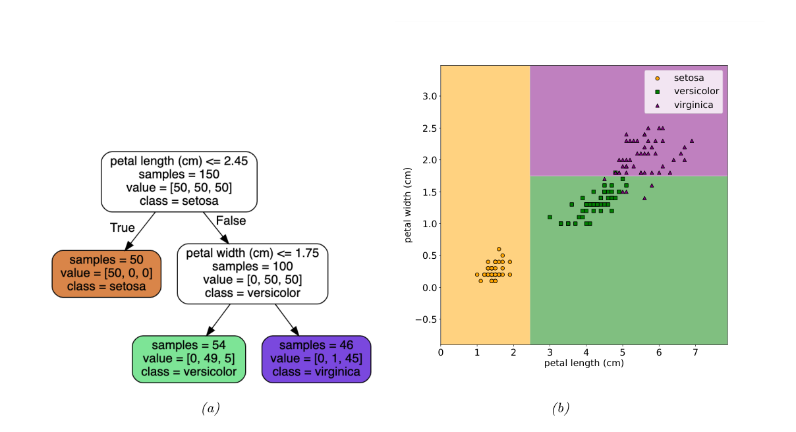
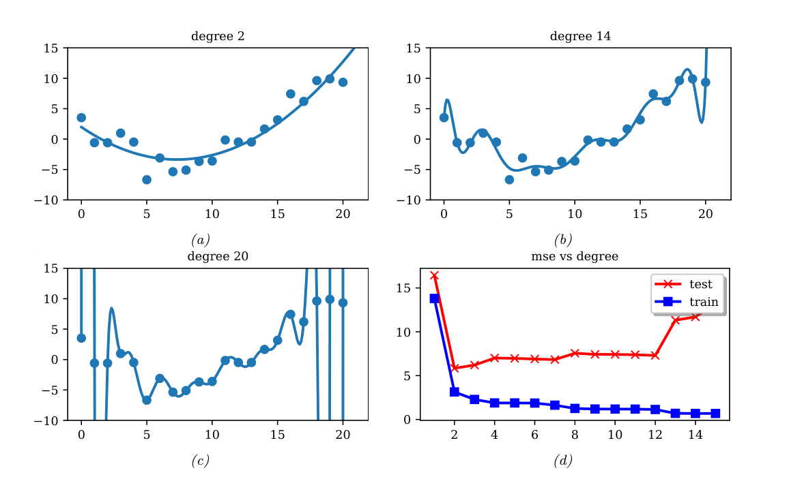
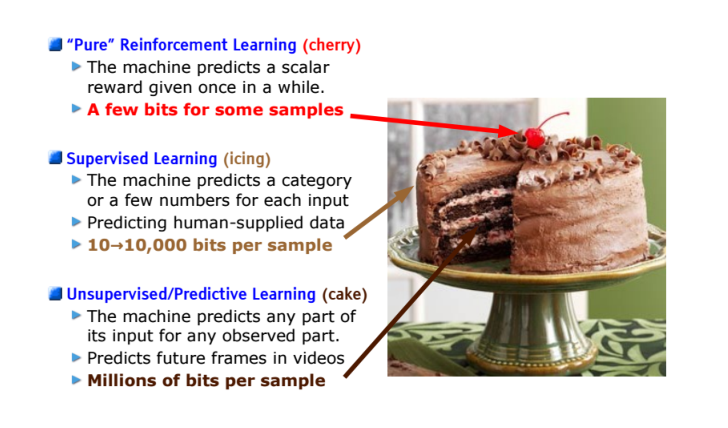

# 第1章 引言

### 来源说明

- 作者：Kevin P. Murphy
- 书名：Probabilistic Machine Learning: An Introduction（概率机器学习：导论）
- 官方来源：https://github.com/probml/pml-book/releases/latest/download/book1.pdf
- 本笔记仅供个人学习使用。

阅读范围：前言 PDF 27–30，第1章 PDF 31–60。PDF 30 与 PDF 60 在这份文件里是空白页。页脚写明在线版日期为 2025-04-18；更新记录列出 2022 年 3 月第一版、2023 年 4 月第二版、2025 年 1 月第三版。页脚版权为 MIT Press，许可是 CC-BY-NC-ND。

### 本章总览

这本导论用 **probabilistic modeling（概率建模）** 和 **Bayesian decision theory（贝叶斯决策理论）** 把机器学习串起来。它接在 2012 年那本 *Machine Learning: A Probabilistic Perspective* 之后，把约 2021 年的领域拆成两卷：本卷是导论，续篇是 *Probabilistic Machine Learning: Advanced Topics*（[Mur23]）。前言把 2012 年看成 deep learning（深度学习）加速的起点，并说明本卷补进了 2012 年版因篇幅删掉的背景，其中包括 linear algebra（线性代数）和 optimization（优化）。带星号的节或章可以在导论课里跳过。

机器学习在本章被分成三条经验来源不同的路线：supervised learning（监督学习）学输入到输出的映射，unsupervised learning（非监督学习）只解释输入本身，reinforcement learning（强化学习）靠偶尔到来的奖励学习如何行动。概率视角把未知量都看成带分布的 random variable（随机变量）。本章只固定任务、损失、数据和三类学习的边界，具体算法放到后面各部分。

图注若写某个 notebook 的名字，对应代码在 `probml.github.io` 的笔记本列表里。实现语言是 Python，用到 NumPy、Scikit-learn、JAX、PyTorch、TensorFlow、PyMC 等库。封面用神经网络把一张手写数字分成 10 类，右侧直方图是条件分布 \(p(y|x)\)。前言指出封面插图有一处错误：画成了 11 个箱子而不是 10 个；第三版及以后改成 10 个。

### 核心知识点

#### 机器学习是什么

Tom Mitchell 的定义把学习拆成三件事：任务类别 \(T\)，性能度量 \(P\)，以及经验 \(E\)。程序在 \(T\) 上的表现若随 \(E\) 按 \(P\) 变好，就说它在学习。不同的 \(T\)、\(P\)、\(E\) 给出不同的学习问题。

本书把未知量都配上概率分布，用来描述它可能取哪些值、各自权重多大。未知量可以是对未来的预测，例如明天的温度，也可以是模型参数。这样做有两个理由。第一，不确定条件下的决策以概率方式为最优，细节在第 5.1 节。第二，科学和工程的其他分支也用这套语言，因此机器学习可以和随机优化、控制、运筹、计量经济、信息论、统计物理、生物统计接在同一张图上。

🔑 关键速记：学习就是经验让任务成绩变好；本书把未知量一律写成随机变量。

#### 监督学习

最常见的形式是 supervised learning（监督学习）。任务是学一个映射 \(f\)，把输入 \(x\in\mathcal{X}\) 送到输出 \(y\in\mathcal{Y}\)。输入也叫 feature（特征）、covariate（协变量）或 predictor（预测变量）。输出也叫 label（标签）、target（目标）或 response（响应）。在 `statsmodels` 里，\(x\) 叫 exogenous variable（外生变量），\(y\) 叫 endogenous variable（内生变量）。

经验 \(E\) 是训练集

\[
\mathcal{D}=\{(x_n,y_n)\}_{n=1}^{N},
\]

\(N\) 是 sample size（样本量）。性能 \(P\) 取决于要预测的输出类型，分类和回归用的损失不一样。

🔑 关键速记：监督学习用成对的 \((x,y)\) 学映射 \(f:\mathcal{X}\to\mathcal{Y}\)。

#### 分类

classification（分类）的输出空间是 \(C\) 个无序、互斥的类，\(\mathcal{Y}=\{1,2,\ldots,C\}\)。给定输入预测类别也叫 pattern recognition（模式识别）。只有两类时，常写成 \(y\in\{0,1\}\) 或 \(y\in\{-1,+1\}\)，称为 binary classification（二分类）。

鸢尾花例子把花分成 Setosa、Versicolor、Virginica 三个亚种。图像本身是极高维的输入：彩色图有 \(C=3\) 个通道（如 RGB），空间尺寸 \(D_1\times D_2\)，则 \(\mathcal{X}=\mathbb{R}^{D}\)，\(D=C\times D_1\times D_2\)。像素强度实践中通常是 \(\{0,1,\ldots,255\}\) 里的整数，公式里为了记号简单仍写成实数。从图像直接映到标签很难，convolutional neural network（卷积神经网络，CNN）是后面第 14.1 节要讲的一类函数。

植物学家已经抽出 4 个数值特征：sepal length（萼片长）、sepal width（萼片宽）、petal length（花瓣长）、petal width（花瓣宽），于是 \(\mathcal{X}=\mathbb{R}^{4}\)。Iris 数据集有 150 个带标签样本，每类 50 个。小的表格数据通常存成 \(N\times D\) 的 design matrix（设计矩阵）：一行一个样本，一列一个特征。这个矩阵是 \(150\times 4\)，因为 \(N\gg D\)，形状瘦高。基因组一类数据则是 \(D\gg N\)，矩阵矮胖。书中的用语是：big data（大数据）通常指 \(N\) 大，wide data（宽数据）指 \(D\) 相对 \(N\) 大。

变长输入，例如词序列或社交网络，往往不直接放进设计矩阵，而是先做 featurization（特征化），变成固定长度向量。词袋表示在第 1.5.4.1 节，下面文本预处理会再写。

动手拟合之前，书建议先做 exploratory data analysis（探索性数据分析），看有没有明显模式、标签噪声或离群点。特征不多时用 pair plot（成对图）：对角线是每个特征的边缘分布，非对角线是两两散点，并可按类别着色。维度再高时，先做 dimensionality reduction（降维）再画到二维或三维。

👉 降维的具体方法本章只点出用途：把高维样本压到可以观看的低维。完整讲解见第 20 章。

从成对图可以看出 Setosa 容易和其他两类分开。书中给出一条一维规则：

\[
f(x;\theta)=
\begin{cases}
\text{Setosa} & \text{if petal length}<2.45\\
\text{Versicolor or Virginica} & \text{otherwise}
\end{cases}
\tag{1.1}
\]

这是一个 classifier（分类器）。输入空间被花瓣长度 \(2.45\) 处的决策边界切成两块。它能把 Setosa 分对，却分不开 Versicolor 和 Virginica。于是对没通过第一条的样本再查花瓣宽度是否低于 \(1.75\,\mathrm{cm}\)：低于则预测 Versicolor，高于则预测 Virginica。嵌套规则排成 decision tree（决策树）。图中每个内部节点记下所用特征的下标和阈值，全部参数记为 \(\theta\)。

图注：左图是深度 2 的决策树。根节点用花瓣长度 \(2.45\,\mathrm{cm}\) 把 Setosa 分出去；右侧再用花瓣宽度 \(1.75\,\mathrm{cm}\) 区分后两类。框内计数可以归一化成该节点上的类别分布，预测取多数类。右图是这组规则在二维特征平面上的分块。后两类的叶子仍混有少数另一类样本，所以这条规则并不是在后两类上完全分对。原书图 1.4。

👉 树的参数如何从数据里学出来，本章没有展开。完整讲解见第 18.1 节。

监督学习希望自动得到这类模型，并且对任意输入都能预测标签。训练集上常用的性能是 misclassification rate（误分率）：

\[
\mathcal{L}(\theta)\triangleq\frac{1}{N}\sum_{n=1}^{N}I\big(y_n\neq f(x_n;\theta)\big).
\tag{1.2}
\]

\(I(e)\) 是 binary indicator（二值指示函数）：条件 \(e\) 为真时返回 1，否则返回 0。

\[
I(e)=
\begin{cases}
1 & \text{if } e \text{ is true}\\
0 & \text{if } e \text{ is false}
\end{cases}
\tag{1.3}
\]

式 (1.2) 把所有错误看成一样贵。实际里有的错误更贵。书中设想野外采花：Setosa 和 Versicolor 可食，Virginica 有毒。此时使用不对称损失 \(\ell(y,\hat{y})\)。下表的行是真实类别，列是预测类别，数字是书中的假设代价。

| 真实 \ 预测 | Setosa | Versicolor | Virginica |
| --- | --- | --- | --- |
| Setosa | 0 | 1 | 1 |
| Versicolor | 1 | 0 | 1 |
| Virginica | 10 | 10 | 0 |

把有毒的 Virginica 预测成两种可食花，代价是 10；其余错分代价是 1；预测正确代价是 0。因此模型若以高概率认为一朵花是 Virginica，就不该吃它；也可以先做诊断试验，用信息收集来降低不确定性。

经验风险是训练集上损失的平均：

\[
\mathcal{L}(\theta)\triangleq\frac{1}{N}\sum_{n=1}^{N}\ell\big(y_n,f(x_n;\theta)\big).
\tag{1.4}
\]

zero-one loss（0-1 损失）\(\ell_{01}(y,\hat{y})=I(y\neq\hat{y})\) 时，经验风险就回到误分率 (1.2)。编号是 (1.5)。

model fitting（模型拟合）或 training（训练）的一种写法，是找到使经验风险最小的参数：

\[
\hat{\theta}=\operatorname{argmin}_{\theta}\mathcal{L}(\theta)
=\operatorname{argmin}_{\theta}\frac{1}{N}\sum_{n=1}^{N}\ell\big(y_n,f(x_n;\theta)\big).
\tag{1.6}
\]

这叫做 empirical risk minimization（经验风险最小化）。真正要小的是未来未见数据上的期望损失，也就是要 generalization（泛化），而不只是在训练集上表现好。这一点在过拟合一节展开。

很多时候输入并不能唯一决定输出。原因有两类。epistemic uncertainty（认识不确定性）也叫 model uncertainty（模型不确定性），来自对输入输出映射还不够了解。aleatoric uncertainty（偶然不确定性）也叫 data uncertainty（数据不确定性），来自映射本身减不掉的随机性。预测若能带上不确定性，就可以配合上面的不对称损失做决策，例如高概率有毒就不吃。

👉 不确定条件下怎样做最优决策，本章只点明动机。完整讲解见第 5.1 节。

不确定性写成条件分布

\[
p(y=c|x;\theta)=f_c(x;\theta),
\tag{1.7}
\]

其中 \(f:\mathcal{X}\to[0,1]^{C}\)，并且 \(0\le f_c\le 1\)、\(\sum_{c=1}^{C}f_c=1\)。为了避开这些约束，模型常常先输出未归一化的对数概率，再用 softmax 变成概率：

\[
\operatorname{softmax}(a)\triangleq
\left[
\frac{e^{a_1}}{\sum_{c'=1}^{C}e^{a_{c'}}},
\ldots,
\frac{e^{a_C}}{\sum_{c'=1}^{C}e^{a_{c'}}}
\right].
\tag{1.8}
\]

它把 \(\mathbb{R}^{C}\) 映到 \([0,1]^{C}\)，每个分量都在 0 和 1 之间，且总和为 1。softmax 的输入 \(a=f(x;\theta)\) 叫做 logit（对数几率）。整个模型是

\[
p(y=c|x;\theta)=\operatorname{softmax}_c\big(f(x;\theta)\big).
\tag{1.9}
\]

👉 softmax 的进一步性质本章没有展开。完整讲解见第 2.5.2 节。

常见特例是仿射函数

\[
f(x;\theta)=b+w^{\mathsf{T}}x=b+w_1x_1+\cdots+w_Dx_D,
\tag{1.10}
\]

参数 \(\theta=(b,w)\)。这个模型叫 logistic regression（逻辑回归），正文放在第 10 章。统计学里 \(w\) 常叫 regression coefficient（回归系数），记号多用 \(\beta\)，\(b\) 叫 intercept（截距）。机器学习里 \(w\) 叫 weight（权重），\(b\) 叫 bias（偏置）。后一个词来自把 \(f\) 看成电路：每根输入线有权重，电路做加权和，再加一个常数偏移。它和第 4.7.6.1 节的统计偏置不是同一个概念。

为了少写一个符号，常把截距吸进权重。令 \(\tilde{w}=[b,w_1,\ldots,w_D]\)，\(\tilde{x}=[1,x_1,\ldots,x_D]\)，则

\[
\tilde{w}^{\mathsf{T}}\tilde{x}=b+w^{\mathsf{T}}x.
\tag{1.11}
\]

仿射函数就写成线性函数。后文默认已经这样做过，预测写成

\[
f(x;w)=w^{\mathsf{T}}x.
\tag{1.12}
\]

拟合概率模型时，常用负对数概率当损失：

\[
\ell\big(y,f(x;\theta)\big)=-\log p\big(y|f(x;\theta)\big).
\tag{1.13}
\]

直觉是：好模型应对每个输入的真实输出赋予高概率。训练集上的平均负对数概率是 negative log likelihood（负对数似然）

\[
\operatorname{NLL}(\theta)=-\frac{1}{N}\sum_{n=1}^{N}\log p\big(y_n|f(x_n;\theta)\big).
\tag{1.14}
\]

把它最小化，就得到 maximum likelihood estimate（最大似然估计）

\[
\hat{\theta}_{\mathrm{mle}}=\operatorname{argmin}_{\theta}\operatorname{NLL}(\theta).
\tag{1.15}
\]

👉 为什么用负对数概率当损失，理由在第 5.1.6.1 节；逻辑回归的估计在第 10 章。本章把 (1.15) 当作拟合概率模型的标准入口。

🔑 关键速记：分类输出互斥类别；训练可以是最小化误分率或负对数似然，预测可以是 softmax 后的条件分布。

#### 回归

regression（回归）预测的是实数 \(y\in\mathbb{R}\)，不是类别。鸢尾花的例子里，\(y\) 可以是毒性程度，或植株的平均高度。形式和分类相近，损失要换。最常见的是 quadratic loss（平方损失），也叫 \(\ell_2\) 损失：

\[
\ell_2(y,\hat{y})=(y-\hat{y})^2.
\tag{1.16}
\]

它让大残差 \(y-\hat{y}\) 比小残差更贵。对应的经验风险是 mean squared error（均方误差）

\[
\operatorname{MSE}(\theta)=\frac{1}{N}\sum_{n=1}^{N}\big(y_n-f(x_n;\theta)\big)^2.
\tag{1.17}
\]

若数据有离群点，平方惩罚会过重。此时 \(\ell_1\) 损失更稳健。

👉 \(\ell_1\) 回归的具体做法本章没有展开。完整讲解见第 11.6 节。

回归里也要表示预测的不确定性。常见假设是输出服从 Gaussian（高斯）也叫 normal（正态）分布。第 2.6 节的定义是

\[
\mathcal{N}(y|\mu,\sigma^2)
\triangleq
\frac{1}{\sqrt{2\pi\sigma^2}}
\exp\left(-\frac{1}{2\sigma^2}(y-\mu)^2\right),
\tag{1.18}
\]

\(\mu\) 是均值，\(\sigma^2\) 是方差，分母上的根号是让密度积分为 1 的归一化常数。令均值依赖输入，\(\mu=f(x_n;\theta)\)，就得到

\[
p(y_n|x_n;\theta)=\mathcal{N}\big(y_n|f(x_n;\theta),\sigma^2\big).
\tag{1.19}
\]

若把方差 \(\sigma^2\) 当成固定常数，平均到每个样本上的负对数似然满足

\[
\operatorname{NLL}(\theta)=\frac{1}{2\sigma^2}\operatorname{MSE}(\theta)+\mathrm{const}.
\tag{1.21}
\]

结论是：方差固定时，负对数似然和均方误差只差一个正比例系数与常数，最大似然估计就是最小化平方误差。式 (1.20) 是把高斯密度代进对数之后的中间形式，这里只保留这个结论。

一维线性回归写成

\[
f(x;\theta)=b+wx,
\tag{1.22}
\]

\(w\) 是斜率，\(b\) 是偏移，\(\theta=(w,b)\)。调整 \(\theta\) 使垂直残差的平方和最小，就得到 least squares（最小二乘）解

\[
\hat{\theta}=\operatorname{argmin}_{\theta}\operatorname{MSE}(\theta).
\tag{1.23}
\]

多个输入特征时，

\[
f(x;\theta)=b+w^{\mathsf{T}}x,
\tag{1.24}
\]

称为 multiple linear regression（多元线性回归）。书中用房间里的二维位置预测温度，模型是 \(f(x;\theta)=b+w_1x_1+w_2x_2\)，编号 (1.25)。特征再多就难画出来。

直线常常拟合不好。polynomial regression（多项式回归）用次数 \(D\) 的模型 \(f(x;w)=w^{\mathsf{T}}\phi(x)\)，特征变换为

\[
\phi(x)=[1,x,x^2,\ldots,x^D].
\tag{1.26}
\]

这是 feature preprocessing（特征预处理），也叫 feature engineering（特征工程）。\(D=2\) 往往已经比直线好。次数可以一直加到 \(D=N-1\)：参数个数和样本一样多，训练误差可以降到 0，函数却会剧烈振荡，对未来输入并不可靠。

二维输入同样可以做多项式展开。温度例子的二次模型是

\[
f(x;w)=w_0+w_1x_1+w_2x_2+w_3x_1^2+w_4x_2^2.
\tag{1.27}
\]

二次曲面能表达房间中央更热，比平面更贴这组数据。还可以加入 \(x_1x_2\) 这类交叉项，用来表示交互。上面这些预测对原始输入 \(x\) 是非线性的，对参数 \(w\) 仍然是线性的。书中的结论是：对参数线性的模型，其均方误差有唯一的全局最优。

👉 这个唯一最优为什么成立，以及最小二乘的具体求法，本章只给结论。完整讲解见第 11.2.2.1 节。交叉项的预处理见第 1.5.3.2 节，下面离散特征一节会写到。

手工指定 \(\phi\) 只是一种做法。若特征提取器自己也有参数 \(V\)，模型变成

\[
f(x;w,V)=w^{\mathsf{T}}\phi(x;V).
\tag{1.28}
\]

把 \(\phi\) 再拆成更简单的函数，就得到 \(L\) 层嵌套：

\[
f(x;\theta)=f_L\big(f_{L-1}(\cdots f_1(x)\cdots)\big),
\tag{1.29}
\]

第 \(\ell\) 层是 \(f_\ell(x)=f(x;\theta_\ell)\)。最后一层是线性的，\(f_L(x)=w_L^{\mathsf{T}}x\)，于是 \(f(x;\theta)=w_L^{\mathsf{T}}f_{1:L-1}(x)\)，前面几层是学出来的特征提取器。这就是 deep neural network（深度神经网络，DNN）的核心想法。图像常用 CNN，序列常用 recurrent neural network（循环神经网络，RNN）。

👉 这些网络的结构与训练在第 III 部分展开。本章只说明：非线性特征可以学，而不必事先写成多项式。

🔑 关键速记：回归用平方损失；高斯方差固定时，最大似然等价于最小二乘；对参数线性的模型有唯一全局最优。

#### 过拟合、泛化与没有免费的午餐

把经验风险写明它用的是哪一份数据：

\[
\mathcal{L}(\theta;\mathcal{D}_{\mathrm{train}})
=\frac{1}{|\mathcal{D}_{\mathrm{train}}|}
\sum_{(x,y)\in\mathcal{D}_{\mathrm{train}}}\ell\big(y,f(x;\theta)\big).
\tag{1.30}
\]

模型足够灵活、又没有标签噪声时，只要记住每个输入的正确输出，训练损失就能到 0。这种完美贴住训练集、却过于复杂的模型，叫做 **overfitting（过拟合）**。

若暂时假定生成训练数据的真实分布 \(p^\star(x,y)\) 已知，总体风险是

\[
\mathcal{L}(\theta;p^\star)\triangleq\mathbb{E}_{p^\star(x,y)}\big[\ell\big(y,f(x;\theta)\big)\big].
\tag{1.31}
\]

差 \(\mathcal{L}(\theta;p^\star)-\mathcal{L}(\theta;\mathcal{D}_{\mathrm{train}})\) 叫做 **generalization gap（泛化间隙）**。经验风险低、总体风险高，就是过拟合的迹象。实践中不知道 \(p^\star\)，就把已有数据分成训练集和测试集，用测试风险近似总体风险：

\[
\mathcal{L}(\theta;\mathcal{D}_{\mathrm{test}})
\triangleq\frac{1}{|\mathcal{D}_{\mathrm{test}}|}
\sum_{(x,y)\in\mathcal{D}_{\mathrm{test}}}\ell\big(y,f(x;\theta)\big).
\tag{1.32}
\]

多项式回归把这一点画清楚了。训练误差随次数上升趋向 0。测试误差呈 U 形：次数太低是 underfitting（欠拟合），书中用 \(D=1\) 作这一端的例子；次数远大于 1 是过拟合；这组数据上 \(D=2\) 复杂度刚好。图中画出的拟合曲线是次数 2、14 和 20。21 个点时 \(D=N-1=20\)，训练误差可以到 0，但曲线过“扭”，右侧端点附近书中也说明并未毫无保留地插值。

图注：上排与左下是同一组 21 个点上的多项式。次数 2 平滑，次数 14 开始跟着局部波动走，次数 20 出现剧烈振荡。右下比较训练误差和测试误差：训练误差随次数下降，测试误差先降后升。原书图 1.7。用训练集挑模型，总会挑最复杂的那个，因为它的自由度最多、训练损失最小。所以应按测试损失来挑。

实际要把数据分成三份。training set（训练集）用来拟合。validation set（验证集）用来做 model selection（模型选择）。test set（测试集）只用来估计未来的总体风险，拟合和选择都不用它。

👉 三份数据如何划分、交叉验证怎么做，本章只定用途。完整讲解见第 4.5.4 节。

模型很多，并不存在对所有问题都最优的一个。这就是 **no free lunch theorem（没有免费的午餐定理）**，书中引用 [Wol96]。一组 inductive bias（归纳偏置）在一个领域有效，换一个领域可能很差。George Box 的说法被书用来概括：模型都是错的，但有些有用。挑选靠领域知识，也靠试错，例如交叉验证，或第 5.2.2 节和第 5.2.6 节的贝叶斯方法。因此工具箱里要有多种模型。

🔑 关键速记：训练误差可以靠记数据降到 0；要看的是测试误差的 U 形，验证集选模型，测试集只做最终估计。

#### 非监督学习

监督学习给每个 \(x\) 配上目标 \(y\)。书中转述的一种看法是，这本质上仍是“加了装饰的曲线拟合”。更进一步的任务是弄懂数据本身：只有输入 \(\mathcal{D}=\{x_n:n=1:N\}\)，没有 \(y_n\)。这就是 unsupervised learning（非监督学习）。

概率上看，非监督学习拟合的是无条件模型 \(p(x)\)，它还能生成新的 \(x\)；监督学习拟合的是条件模型 \(p(y|x)\)。统计文献里，\(x\) 常专指不建模、直接给定的外生变量，因此无条件模型会写成 \(p(y)\) 而不是 \(p(x)\)。读本书时要按本章的记号：被建模的观测是 \(x\)。

非监督学习省掉大规模标注。医学图像要医生逐张标，又慢又贵。它也避开把世界硬切成类别。视频里“喝”这个动作从何时算起，拿起杯子、杯子碰到嘴、液体倒出，标注者经常不一致。任务本身含糊时，不应指望机器学出一个唯一映射。更合理的做法是去拟合一群标注者给出的标签分布。

它还迫使模型解释高维输入，而不只是低维输出，从而学到更丰富的“世界如何运作”。Geoffrey Hinton 1996 年的量级对比被书引来支持这一点：视觉系统的连接数是 \(O(10^{14})\)，人的一生大约 \(O(10^9)\) 秒，靠旁人偶尔说“那是狗”远远不够每秒一个比特的信息；需要的量级接近 \(O(10^5)\) 比特每秒，这么多信息只能来自输入本身。

##### 聚类

clustering（聚类）把输入分成包含“相似”点的区域。鸢尾花只取花瓣长和花瓣宽、去掉标签后，左下和右上至少有两团；若还希望每一团比较紧，右上可以再拆。用 \(K=3\) 得到的划分只是一种选择。正确的簇数并不存在，要在模型复杂度和拟合之间权衡。

👉 这个权衡怎么做，本章没有展开。完整讲解见第 21.3.7 节。

##### 潜在变化因子

高维数据常被投影到能抓住“要点”的低维子空间。做法是假定每个观测 \(x_n\in\mathbb{R}^{D}\) 由隐藏的低维 latent factor（潜在因子）\(z_n\in\mathbb{R}^{K}\) 生成。图示是 \(z_n\to x_n\)，箭头表示因果。\(z_n\) 看不到，所以给它一个简单的先验，例如高斯：每个因子是随机的 \(K\) 维向量。数据是实数时，似然也可以用高斯。

最简单的线性模型是 \(p(x_n|z_n;\theta)=\mathcal{N}(x_n|Wz_n+\mu,\Sigma)\)，叫做 factor analysis（因子分析，FA）。它和线性回归类似，但只看得到输出 \(x_n\)，看不到输入 \(z_n\)。当 \(\Sigma=\sigma^2 I\) 时，退化为 probabilistic principal components analysis（概率主成分分析，PCA）。书中的图把鸢尾花前三个特征的三维散点，用 PCA 配一个二维线性子空间；类别标签不参与拟合。红点是原数据，黑点是由 \(\hat{x}=Wz+\mu\) 生成的点，\(z\) 落在推断出的二维线性流形上。

线性映射 \(z\to x\) 很受限。非线性推广是 \(p(x_n|z_n;\theta)=\mathcal{N}(x_n|f(z_n;\theta),\sigma^2 I)\)，\(f\) 可以是深度网络。拟合变难，因为网络的输入 \(z\) 和参数 \(\theta\) 都要推断。variational autoencoder（变分自编码器）是一种近似办法。

👉 PCA 的展开在第 20.1 节，变分自编码器在第 20.3.5 节。本章只区分：潜在因子是未观测的低维原因，观测是它生成的高维结果。

##### 自监督学习

self-supervised learning（自监督学习）从无标签数据造出代理的监督任务。例如从灰度图预测彩色图，或把句子里的词遮住、用上下文预测。得到的预测器 \(\hat{x}_1=f(x_2;\theta)\) 里，\(x_2\) 是看得到的部分，\(\hat{x}_1\) 是要预测的部分。希望它学到的特征能接到下游的标准监督任务上。这样不必去推断“真正的”潜在因子 \(z\)，可以直接用监督算法。

👉 自监督的具体做法在第 19.2 节。本章的要点是：标签来自数据自身的遮挡或变换，不是外加的类别。

##### 如何评价非监督学习

非监督方法没有可对照的 ground truth（真实标签），质量很难评 [TOB16]。一种常用办法是看模型给未见测试样本的概率，也就是无条件负对数似然

\[
\mathcal{L}(\theta;\mathcal{D})
=-\frac{1}{|\mathcal{D}|}\sum_{x\in\mathcal{D}}\log p(x|\theta).
\tag{1.33}
\]

这把非监督学习看成 density estimation（密度估计）。好模型不应对真实样本感到“惊讶”。概率总和必须是 1，所以在数据出现的区域给高概率，就意味着在数据不出现的区域给低概率。这样的模型抓住了典型模式，也可以放进数据压缩。

密度估计在高维很难。而且给数据高概率的模型未必学到了高层模式，它也可能只是记住了训练样本。另一条评价是把学到的表示交给下游监督学习当特征。表示若有用，达到同样成绩所需的标注可以少很多，也就是 sample efficiency（样本效率）更高。鸢尾花的 4 个手工特征只用 150 个样本就能把分类做得很准；若输入是原始像素，要达到相近成绩就需要多得多的样本。

在科学应用里，目标常常是理解，而不是把某个预测成绩做高。这需要既能解释大部分观测模式、又可解释的模型。书中用柏拉图的说法概括：要沿着自然的关节切开。判断是否真的切开，往往还得做实验、与世界交互，这就接到下一节的强化学习。

🔑 关键速记：非监督学习拟合 \(p(x)\) 而不是 \(p(y|x)\)；簇数没有标准答案，评价要么看测试似然，要么看下游要多少标签。

#### 强化学习

第三类是 reinforcement learning（强化学习，RL）。系统或 agent（智能体）要学会与 environment（环境）交互。策略 \(a=\pi(x)\) 规定：每个由环境状态得来的输入 \(x\)，采取哪个 action（动作）\(a\)。

玩 Atari 的 Space Invaders 时，\(x\) 是当前图像或过去若干帧，\(a\) 是向左、向右，以及是否发射。机器人学走路时，\(x\) 是各关节的位置和角度，\(a\) 是一组电机控制信号。

和监督学习的差别在于：没有人在每一步指出哪个动作最好。系统只偶尔收到 reward（奖励）或惩罚。这是带评论家的学习：偶尔竖起大拇指或大拇指朝下。监督学习则是带教师的学习：每一步都告诉你该输出什么。

奖励可以是任何关心的指标，所以 RL 适用面广。它也更难做成。奖励可能很稀，例如直到进入目标状态才给一次；即便给了，也不清楚漫长动作序列里哪几步导致了它。国际象棋只有终局的胜负，就是这种情形。

奖励信息太少时，常用别的来源补上：专家演示可以按监督方式用，无标签数据可以让非监督系统先发现环境结构。这样才有可能用有限次与环境的交互学会策略。Yann LeCun 在 2016 年 NIPS 邀请报告里的比喻是：若智能是一块蛋糕，非监督学习是巧克力海绵，监督学习是糖霜，强化学习是顶上的樱桃。印刷的图把蛋糕本体标成 Unsupervised/Predictive Learning（非监督 / 预测式学习）。NIPS 即 Neural Information Processing Systems，现已改名 NeurIPS。

图注：樱桃是“纯”强化学习，只在部分样本上偶尔给一个标量奖励，信息量是少量比特。糖霜是监督学习，每个输入预测一个类别或几个数，数据由人提供，大约每个样本 \(10\) 到 \(10{,}000\) 比特。蛋糕本体是非监督或预测式学习，模型预测观测中的任意一块，例如视频的未来帧，每个样本可达百万比特量级。原书图 1.11。图中的比特量级是这张示意图上的标注，用来比较三种经验各自携带多少信息。

RL 的系统讲解在续篇 [Mur23]，不在本卷本章。

🔑 关键速记：强化学习学的是策略 \(a=\pi(x)\)，教师不给正确动作，只偶尔给奖励。

#### 数据：图像与文本

机器学习是用算法把模型拟合到数据上。数据和数据质量对结果同样关键。本章后半列出书中会反复用到的图像、文本数据，以及如何把它们变成向量。

##### 图像数据

MNIST 是修改过的国家标准技术研究所手写数字：训练集 6 万张，测试集 1 万张，灰度 \(28\times 28\)，10 个类别。“修改”是指数字已经大致被放到图像中央。像素是 \(\{0,1,\ldots,255\}\) 的整数，通常缩放到 \([0,1]\) 表示强度，也可以阈值化成二值图。Geoff Hinton 把它称作机器学习的果蝇：一个方法若在 MNIST 上都做不好，更难的数据上多半也不好。如今它又被认为太容易，因为很多数字对只用一个像素就能分开。

EMNIST 加上大小写字母，共 62 类。图注给出的规模是训练 697,932 张、测试 116,323 张，仍是 \(28\times 28\)。它更难，因为有些类很像，例如数字 1 和小写 l。

Fashion-MNIST 的张数和尺寸与 MNIST 相同，内容换成衣服。10 类是：T-shirt/top、Trouser、Pullover、Dress、Coat、Sandal、Shirt、Sneaker、Bag、Ankle-boot。

小彩色图常用 CIFAR。全库 6 万张，每张 \(32\times 32\times 3\)，类别是 10 类或 100 类。CIFAR-10 的划分是训练 5 万、测试 1 万，10 类为 plane、car、bird、cat、deer、dog、frog、horse、ship、truck。书中同时记下两个数据问题：CIFAR-100 因错标带来的基础误差是 5.85%，因此准确率高于 94.15% 的结果值得怀疑；CIFAR-100 训练集里有 10% 的图像与测试集重复。名称来自资助标注的 Canadian Institute For Advanced Research，图像源自 TinyImages。

更大的基准是 ImageNet：约 1400 万张 \(256\times 256\times 3\) 的图，约 2 万个类。ImageNet Large Scale Visual Recognition Challenge（ILSVRC）从 2010 年办到 2018 年，用其中 130 万张、1000 类的子集，指标是 top-5 error（前 5 错误率），也就是正确类要落在 5 个最高概率预测之内。2015 年是 CNN 第一次在这项任务上超过人类的年份；书中说的人类指 Andrej Karpathy 这一位标注者。这并不等于 CNN 的视觉整体强于人类。数据集里有很多细类，例如 tiger 和 tiger cat，人很难分；足够灵活的 CNN 则能记住任意模式，包括随机标签。ImageNet 作为分类基准也已接近饱和，但方法在它上面的相对名次，常常能预测在其他图像分类任务上的表现，所以仍被广泛使用。图中的预测例子来自名为 AlexNet 的 CNN。

👉 AlexNet 的结构在第 14.3.2 节，用 CNN 做图像分类的主线在第 14.1 节。本章只用这些数据说明：输入可以是像素，标签可以是上千类，评价指标可以是 top-5 而不是只看第一名。

##### 文本数据

把机器学习用到文本上，就是 natural language processing（自然语言处理，NLP）。

text classification（文本分类）包括邮件垃圾判断和 sentiment analysis（情感分析）。IMDB 影评数据集有 2.5 万条训练、2.5 万条测试，标签是二元的正评或负评。表中的 `<UNK>` 表示未知词元。

machine translation（机器翻译）把一种语言的句子 \(x\) 映到另一种语言里语义相当的句子 \(y\)，训练需要对齐的句子对。来源包括加拿大议会的英–法句对，以及欧盟的 Europarl。后者的子集 WMT（Workshop on Machine Translation）是英–德句对，常用作基准。

seq2seq（序列到序列）把任意序列 \(x\) 映到任意序列 \(y\)，可以看成高维分类。文档摘要、问答都放得进这个框架。SQuAD 的例子把问答做成 sentence pair tagging（句对标注）：输入是段落 \(T\) 和问题 \(Q\)，输出是段落中回答问题的那一段文字。书中样例的三个答案是 gravity、graupel、within a cloud，都是段落里的片段。

language modeling（语言建模）建立文本序列的无条件生成模型 \(p(x_1,\ldots,x_T)\)。它只要句子 \(x\)，不要标签 \(y\)，因此属于非监督学习。若像 seq2seq 那样按输入生成输出，则是条件生成模型。

👉 序列到序列作为高维分类的写法在第 15.2.3 节。本章只把它看成：输入输出都是长度可变的词序列。

🔑 关键速记：图像基准从 \(28\times 28\) 的数字走到 1000 类的 ImageNet；文本既可以做带标签的分类，也可以做无标签的语言建模。

#### 离散输入、文本向量与缺失数据

许多模型假定 \(x\in\mathbb{R}^{D}\)。类别变量（如颜色）或词表里的词是离散的，要先变成向量。下面几种预处理对很多模型是共用的。

##### 独热编码与特征交叉

categorical feature（类别特征）要变成数值，加权求和才有意义。标准做法是 one-hot encoding（独热编码），也叫 dummy encoding（哑变量编码）。变量 \(x\) 有 \(K\) 个取值时，

\[
\operatorname{one\text{-}hot}(x)=\big[I(x=1),\ldots,I(x=K)\big].
\]

三种颜色的例子是：红 \([1,0,0]\)，绿 \([0,1,0]\)，蓝 \([0,0,1]\)。

每个类别变量各做一次独热，线性模型只能表示 main effect（主效应），不能表示 interaction effect（交互效应）。书中的例子是用车型（SUV、Truck、Family car）和产地（USA、Japan）预测燃油效率。把三值特征和二值特征的独热拼起来，并加上常数项：

\[
\phi(x)=\big[1,I(x_1=\mathrm{S}),I(x_1=\mathrm{T}),I(x_1=\mathrm{F}),I(x_2=\mathrm{U}),I(x_2=\mathrm{J})\big].
\tag{1.34}
\]

产地的贡献与车型无关，因此“美国卡车比日本卡车更费油”这种依赖表达不出来。feature cross（特征交叉）造出一个有 \(3\times 2\) 个取值的组合特征。模型仍是 \(f(x;w)=w^{\mathsf{T}}\phi(x)\)，编号 (1.35)，展开后除了主效应，还有六项同时检查车型和产地的指示函数，权重下标从 \(w_6\) 排到 \(w_{11}\)，编号 (1.36)。特征交叉把数据变成列数更多的 wide format（宽表）。

##### 词袋、TF-IDF 与词嵌入

文本有三个障碍。文档长度不固定，不是定长向量。词是取值极多的类别变量，独热又高维，又没有自然的相似度。测试时还会遇到训练没见过的词，即 out-of-vocabulary（词表外，OOV）。

bag of words（词袋）忽略词序。先把词映到词表中的 token（词元）。减少词元的常见预处理有：去掉标点、全部小写、去掉 and、the 这类信息量低的 stop word（停用词）、把 running 和 runs 换成 run 这种 word stemming（词干提取）。设 \(x_{nt}\) 是第 \(n\) 篇文档位置 \(t\) 上的词元，词表有 \(D\) 个不同词元，则文档变成 \(D\) 维计数向量

\[
\tilde{x}_{nv}=\sum_{t=1}^{T}I(x_{nt}=v),
\tag{1.37}
\]

\(T\) 是该文档长度。文档于是是 \(\mathbb{R}^{D}\) 里的向量，这就是 vector space model（向量空间模型）。一般输入矩阵是 \(N\times D\) 的设计矩阵。向量空间模型里更常把同一份计数写成 \(D\times N\) 的 term frequency matrix（词项频率矩阵），\(TF_{ij}\) 是词项 \(i\) 在文档 \(j\) 里的频率。原书图 1.15 把原始计数换成 TF-IDF 之后画成格子，颜色越深数值越大。

原始计数的问题是：一个词只因为在一篇文档里出现很多次，影响就会过大。先取对数，压低单篇文档内部的重复。再压低在所有文档里都常见的词，用 inverse document frequency（逆文档频率）

\[
\mathrm{IDF}_i\triangleq\log\frac{N}{1+\mathrm{DF}_i},
\]

\(\mathrm{DF}_i\) 是含有词项 \(i\) 的文档数。合在一起是

\[
\mathrm{TFIDF}_{ij}=\log(\mathrm{TF}_{ij}+1)\times\mathrm{IDF}_i.
\tag{1.38}
\]

行也常常再做归一化。这样得到的表示可以送进许多机器学习算法。

TF-IDF 仍解决不了独热的根本问题：语义相近的词，例如 man 和 woman，在向量空间里不一定比 man 和 banana 更近。多数预测模型隐含假定输入空间里相近的点应有相近的输出，这个假定在独热计数上不成立。

word embedding（词嵌入）把稀疏的独热向量 \(x_{nt}\in\{0,1\}^{V}\) 映到低维稠密向量 \(e_{nt}\in\mathbb{R}^{K}\)，\(e_{nt}=Ex_{nt}\)。矩阵 \(E\in\mathbb{R}^{K\times V}\) 要学成让语义相近的词靠在一起。有了 \(E\)，变长文档可以看成一袋嵌入，再求和或平均，得到定长向量

\[
e_n=\sum_{t=1}^{T}e_{nt}=E\tilde{x}_n.
\tag{1.39}
\]

接上前面的逻辑回归，就是

\[
p(y=c|x_n,\theta)=\operatorname{softmax}_c(WE\tilde{x}_n).
\tag{1.40}
\]

\(E\) 若是预先训练好的，模型对 \(W\) 是线性的，估计会简单一些。

👉 嵌入怎么学在第 20.5 节，随上下文变化的嵌入在第 15.7 节，对 \(W\) 的线性估计在第 10 章。本章给出的是 (1.39) 和 (1.40) 这一条：先把词变成稠密向量，再求和，再做 softmax 分类。

测试时仍会遇到全新的词，因为词是开放类，专名没有上界。简单办法是把新词都换成符号 UNK，表示 unknown（未知）。这会丢掉信息。例如 athazagoraphobia 可以从词缀 phobia 猜到“对某事的恐惧”，整词替换成 UNK 之后这条线索就没了。全用字符则要求模型自己把字母组合成词。更好的做法是输入 subword unit（子词单元）或 wordpiece（词片）。它们常用 byte-pair encoding（字节对编码）产生：这是一种数据压缩，用新符号代表常见的子串。

##### 缺失数据

输入 \(x\) 或输出 \(y\) 都可能有缺失。训练时输出未知，样本就是无标签的，属于 semi-supervised learning（半监督学习）。本章只处理输入特征的缺失，缺失可以发生在训练、测试或两边。

👉 输出缺失时如何同时用有标签和无标签样本，本章没有展开。完整讲解见第 19.3 节。

用 \(N\times D\) 的二值矩阵 \(M\) 记录缺失：\(M_{nd}=1\) 表示第 \(n\) 个样本的第 \(d\) 个特征缺失，否则为 0。\(X_v\) 是 \(M_{nd}=0\) 的可见部分，\(X_h\) 是缺失部分。输出矩阵 \(Y\) 在这里假定完全观测到。

三种假设按缺失是否依赖特征来区分。

\[
p(M|X_v,X_h,Y)=p(M)
\]

时，缺失与隐藏特征和可见特征都无关，叫做 missing completely at random（完全随机缺失，MCAR）。

\[
p(M|X_v,X_h,Y)=p(M|X_v,Y)
\]

时，缺失可以依赖可见特征和标签，但不依赖隐藏特征，叫做 **missing at random（随机缺失，MAR）**。两条都不成立，就是 not missing at random（非随机缺失，NMAR）。

MCAR 和 MAR 下，缺失机制可以忽略，因为它不提供隐藏特征的信息。NMAR 下必须建模这个机制，因为“没填”本身可能有信息。问卷里敏感问题空着，例如是否感染，就可能和真实取值有关。本书始终采用 MAR。即便如此，DNN 这类判别模型也不能直接吃进含未知分量的 \(x\)。

常见启发式是 mean value imputation（均值填补）：用该特征的经验均值替换缺失值。更一般的做法是给输入拟合一个生成模型，再用它填空。

👉 适合填补的生成模型，本章只指向第 20 章和续篇 [Mur23]。填补的原则在这里已经明确：MAR 下可以忽略缺失机制，但判别模型仍需要一个填好的输入向量。

🔑 关键速记：类别先独热，交互靠特征交叉；文本用计数或 TF-IDF，语义相近要靠嵌入；本书默认缺失是 MAR。

#### 讨论：相邻领域、全书位置与使用边界

##### 和统计、人工智能的关系

几个相邻名字差别主要在用语。predictive analytics（预测分析）接近监督学习里的分类和回归，更偏商业应用。data mining（数据挖掘）同时覆盖监督和非监督，更偏大型商业数据库里的结构化数据。data science（数据科学）使用机器学习和统计，同时强调数据集成、可视化和与领域专家的迭代。

机器学习与 statistics（统计学）关系很近。Jerry Friedman 的看法被书引来：若统计学从一开始就把计算当成基本工具，而不只是使用既有工具的方便手段，那么机器学习这类数据领域本来可以是统计学的一部分。

和 artificial intelligence（人工智能，AI）的关系是另一条历史。早期 AI 试图把智能用手写规则编进去，难以显式写下系统需要的全部知识，因而没有达到预期。于是重新用机器学习让系统自己获得知识。ML 和 AI 有时被当成同义词，书中认为这种混用会造成误导。

##### 线性代数与优化：这两章不单开笔记

本章把一条样本写成向量 \(x\in\mathbb{R}^{D}\)，把 \(N\) 条样本收成 \(N\times D\) 的设计矩阵，并把许多预测写成权重与特征的内积。矩阵、线性映射和特征展开是后面所有模型的书写语言。书签确认第 7 章标题为 Linear Algebra（线性代数），起于 PDF 259。前言说明它是为了让这本导论自洽而补进的背景，由 Zico Kolter 参与撰写，本章没有展开。

👉 本书第 7 章线性代数不单开笔记，完整讲解见已写的 [01 线性代数（Gallier, Quaintance）](../01_线性代数/第1章_引言与全书路线.md)。📝待补全

训练在本章被定义成对参数做最小化：经验风险或负对数似然的 argmin。正文给出的结论是，预测函数若对参数是线性的，均方误差就有唯一的全局最优；如何辨认并求解这类问题，本章没有讲。书签确认第 8 章标题为 Optimization（优化），起于 PDF 305。前言说明它同样是背景章，由 Frederik Kunstner、Si Yi Meng、Aaron Mishkin、Sharan Vaswani 与 Mark Schmidt 参与撰写。

👉 本书第 8 章优化不单开笔记，完整讲解见已写的 [02 凸优化（Boyd, Vandenberghe）](../02_凸优化/第1章_引言.md)。📝待补全

##### 全书怎么排

书中选择的路径以概率为主线。第 I 部分是统计基础，第 II 部分到第 IV 部分是监督学习，第 V 部分是非监督学习。目录里这五部分的标题依次是 Foundations、Linear Models、Deep Neural Networks、Nonparametric Models、Beyond Supervised Learning。更多主题，包括强化学习的系统内容，在续篇 [Mur23]。配套笔记本见 `probml.github.io/book1`。

##### 损失、对齐与人在回路中

学到的预测可以用来选择动作，以减小期望损失。损失若没把偏好和约束写全，机器会去优化你写下的那个函数，同时漏掉你忘记写的部分。这叫 **reward hacking（奖励投机）**。多个目标要权衡时尤其容易发生。

奖励投机是 alignment problem（对齐问题）的一个例子：算法被要求优化的东西，和人真正想要的东西可能不一致。由此引出 AI ethics（人工智能伦理）和 AI safety（人工智能安全）方面的担忧。Stuart Russell 的建议是不要显式写下奖励，而让机器从人的行为里推断奖励，这叫 inverse reinforcement learning（逆强化学习，IRL）。把当前或过去的人类行为模仿得太紧，又会继承训练数据里的偏差。

一种观点把能独自决策、没有人在回路里的系统，看成通向 artificial general intelligence（通用人工智能，AGI）的路。另一种把它看成 augmented intelligence（增强智能），有时也叫 intelligence augmentation（智能增强，IA）。目标是做聪明的工具，例如自适应巡航或搜索框的自动补全，决策回路里仍有人。在这个框架里，带机器学习部件的系统和自动驾驶仪的飞机、在线交易平台、医疗诊断系统是同一类半自主人工物。工具变强之后会自己做更多事，表面上又靠近 AGI。增强智能的目标是帮人把事情做容易，而不是在某项任务上模仿或超过人。

IRL 被用来把这一点形式化。人和机器都是智能体，构成一个合作的双人游戏，叫做 assistance game（协助博弈）。机器要最大化的是用户的效用，而这个效用是从人的行为推断出来的。机器若不确定某件事是否该做，就会谨慎行事，例如先问用户的偏好，而不是把一个错误问题解到底。强化学习及相关内容的展开仍在续篇。

🔑 关键速记：概率是全书主线；线性代数和优化只借用已有笔记；写下的损失和人真正想要的可以不一致。

### 🔑 关键速记

- 学习由任务 \(T\)、性能 \(P\)、经验 \(E\) 定义；未知量都带概率分布。
- 监督学习学 \(p(y|x)\)，分类用误分率或负对数似然，回归在方差固定时把最大似然收成最小二乘。
- 过拟合是训练损失低、总体风险高；验证集选模型，测试集只估计未来表现。
- 没有免费的午餐：归纳偏置换一个领域就可能失效。
- 非监督学习学 \(p(x)\)，用聚类、潜在因子或自监督；评价看测试似然或下游样本效率。
- 强化学习学策略，只有偶尔的奖励，系统内容在续篇。
- 数据要先变成向量：独热、特征交叉、TF-IDF、词嵌入；缺失在本书按 MAR 处理。
- 第 7 章线性代数、第 8 章优化不单开笔记，分别见 Gallier 与 Boyd 的已有笔记。

### 易混淆点与差异对比

下表把本章里最容易缠在一起的几对概念分开。每一行的两边都是书中明确区分过的对象。

| 对比 | 一边 | 另一边 |
| --- | --- | --- |
| 经验风险与总体风险 | \(\mathcal{L}(\theta;\mathcal{D}_{\mathrm{train}})\) 是训练集上的平均损失 | \(\mathcal{L}(\theta;p^\star)\) 是对真实分布的期望；二者之差是泛化间隙 |
| 三份数据 | 训练集拟合，验证集做模型选择 | 测试集只估计未来表现，不参与拟合或选择 |
| 两种不确定性 | 认识不确定性：映射还不知道 | 偶然不确定性：映射本身随机，减不掉 |
| 两个 bias | 式 (1.10) 里的 \(b\) 是截距、电路偏移 | 第 4.7.6.1 节的统计偏置是另一个概念 |
| 监督与非监督 | 拟合条件模型 \(p(y|x)\)，每个样本有 \(y\) | 拟合 \(p(x)\)，没有 \(y\)；统计文献有时把无条件模型写成 \(p(y)\) |
| 自监督 | 仍用监督算法训练 | 标签来自遮挡、上色等代理任务，不是外加类别 |
| 教师与评论家 | 监督学习每一步给出应有的输出 | 强化学习只偶尔给奖励，不指出哪一步是对的 |
| 三种缺失 | MCAR：缺失与特征、标签都无关 | MAR：可依赖可见特征和标签；NMAR：缺失本身有信息 |
| 大与宽 | 大数据指样本量 \(N\) 大 | 宽数据指特征数 \(D\) 相对 \(N\) 大 |
| 两种矩阵朝向 | 设计矩阵是 \(N\times D\)，行是样本 | 词项频率矩阵是 \(D\times N\)，行是词 |
| 对谁线性 | 多项式对原始 \(x\) 可以是非线性的 | 对参数 \(w\) 仍线性时，均方误差有唯一全局最优 |
| 逻辑回归的位置 | 名字里有 regression | 本章把它放在分类里：仿射打分再 softmax，输出是类别概率 |

表中的分界可以直接用来检查后面章节的记号。逻辑回归的估计细节、统计偏置的定义、交叉验证的步骤都不在本章，表里只保留本章已经给出的区分。

还有三处名称上的邻近关系。预测分析、数据挖掘、数据科学与机器学习的差别，书中认为常常只是用语不同，侧重点分别在商业预测、库内结构化数据，以及集成、可视化和领域专家。ML 与 AI 被当成同义词时，书中认为这种说法会造成误导：AI 曾试图手写知识，机器学习是让系统从数据获得知识。AGI 强调系统独自决策；增强智能强调人留在回路里，机器在不确定时先询问。

### 本章要点总结

本章用 Mitchell 的 \(T\)、\(P\)、\(E\) 定义学习，并把概率分布当作未知量的表示。监督学习、非监督学习、强化学习的差别在经验：成对标签、只有输入、偶尔奖励。LeCun 的蛋糕图把这三种信息量放在一起比较。

分类的输出是互斥类别，训练可以最小化误分率，也可以最小化负对数似然。回归的输出是实数，方差固定的高斯模型把最大似然收成最小二乘。对参数线性的预测函数，均方误差有唯一全局最优；深度网络则把非线性特征也变成可学习的层。

过拟合是记住训练集。训练误差可以到 0，测试误差呈 U 形。模型选择用验证集，测试集留到最后。没有任何模型在所有问题上都最优，选择依赖归纳偏置。

非监督学习拟合 \(p(x)\)。聚类没有唯一的正确簇数。因子分析与概率 PCA 用低维潜在因子生成高维观测。自监督把无标签数据改写成代理监督任务。评价要么看测试数据的负对数似然，要么看下游任务能省下多少标签。

数据部分把图像和文本基准的规模、类别数和已知问题记清，并给出独热、特征交叉、词袋、TF-IDF、词嵌入和子词这几条预处理。缺失数据在全书按 MAR 处理；判别模型仍需要填补后的输入。

使用这些系统时，写下的损失可能漏掉真实偏好，从而出现奖励投机和对齐问题。逆强化学习和协助博弈是书中给出的一种形式化：机器推断用户效用，不确定时先问。线性代数与优化是导论的背景章，不在本知识库单开笔记，分别接 Gallier 与 Boyd 的已有章节。
