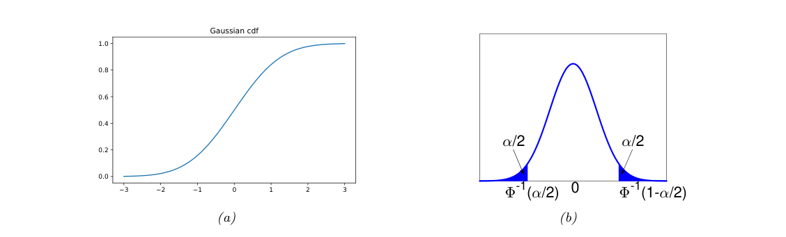
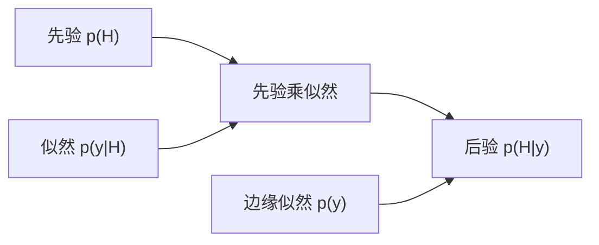
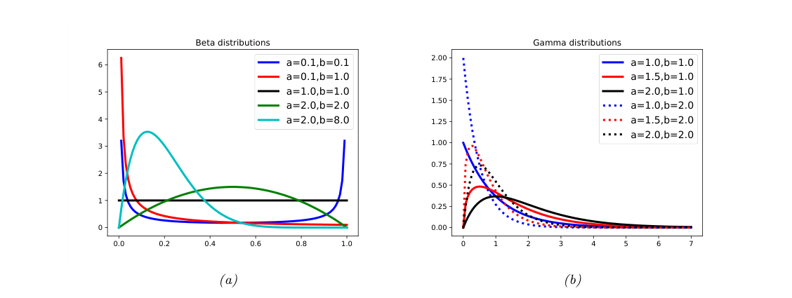
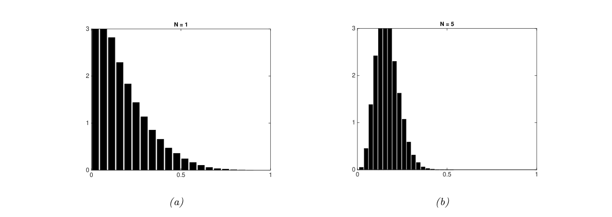

# 第2章 单变量概率模型

### 来源说明

- 作者：Kevin P. Murphy
- 书名：*Probabilistic Machine Learning: An Introduction*（概率机器学习导论）
- 阅读范围：Chapter 2 Probability: Univariate Models（概率：单变量模型），PDF 第 63–106 页（书页约 33–76）。在线稿日期 April 18, 2025。
- 习题自 PDF 第 103 页起，本笔记不展开证明。书中标 \* 的小节是选读，结论仍收录。

第 2 章建立单个随机变量上的概率语言：事件规则、质量函数与密度、贝叶斯更新，以及伯努利、类别、高斯和若干常用单变量族。变量替换、卷积与中心极限定理放在章末。指数族的正式定义在第 3 章；共轭先验的一般讨论指向第 4 章。

### 本章总览

概率在本书里采用贝叶斯读法：它量化对一次事件的不确定，不要求事件能重复试验。计算规则与频率派相同。不确定再分成两类：模型没认清的认知不确定，以及数据本身的随机性。

连续变量用累积分布函数（cumulative distribution function, cdf）和概率密度函数（probability density function, pdf）描述。密度可以大于 1，概率是密度在区间上的积分。均值、方差、众数是摘要；安斯库姆四重奏说明同一种摘要可以对应完全不同的数据形状。

贝叶斯规则把先验和似然合成后验。二元结果用伯努利分布（Bernoulli distribution）和 sigmoid；多类用类别分布（categorical distribution）和 softmax。实值噪声的默认模型是一元高斯。高斯之和仍是高斯，独立同分布之和在样本量增大时趋近高斯，这就是中心极限定理（central limit theorem, CLT）。

### 核心知识点

#### 概率的两种读法与两类不确定

概率可以读成长期频率，也可以读成对不确定程度的度量。公平硬币“正面约一半”在频率派里是多次投掷的比例，在贝叶斯读法里是下一次投掷的信念。本书采用贝叶斯读法，以便谈论只发生零次或一次的事件，例如某年之前极地冰盖是否融化。行动如何跟着这个信念走，属于决策论。

决策论把信念变成行动：给定损失，选择期望损失最小的决定。诊断、检测阈值和“要不要再采样”都落在这一层。本章只用它说明为何需要给一次性事件赋概率。

👉 完整讨论见第 5 章。📝待补全

不确定有两个来源。**认知不确定**（epistemic uncertainty）来自没看清数据背后的机制，也叫模型不确定；数据变多有望把它压小。**偶然不确定**（aleatoric uncertainty）来自过程本身，也叫数据不确定。已知公平硬币 $p=0.5$ 时没有认知不确定，单次正反面仍然猜不准。

主动学习里常去查询条件熵 $H(p(y|x,\mathcal{D}))$ 大的样本。这个熵大，既可能是参数后验 $H(p(\theta|\mathcal{D}))$ 大，也可能是给定参数后结果本身就散。后一种情形再采样帮助不大。熵把一个分布的不确定压成一个数。

👉 熵的定义见第 6 章 6.1。📝待补全

🔑 关键速记：本书把概率当信念；认知不确定能靠数据减小，偶然不确定不能。

#### 事件上的概率规则

事件 $A$ 要么成立要么不成立，$0\le\Pr(A)\le 1$。不发生的概率是 $\Pr(\bar A)=1-\Pr(A)$。

合取、独立时的分解、并集，以及互斥时的加法：

$$
\Pr(A\land B)=\Pr(A,B)
\tag{2.1}
$$

$$
\Pr(A,B)=\Pr(A)\Pr(B)
\tag{2.2}
$$

$$
\Pr(A\lor B)=\Pr(A)+\Pr(B)-\Pr(A\land B)
\tag{2.3}
$$

$$
\Pr(A\lor B)=\Pr(A)+\Pr(B)
\tag{2.4}
$$

(2.2) 只在独立时成立；(2.4) 只在互斥时成立。条件概率与条件独立：

$$
\Pr(B|A)\triangleq\frac{\Pr(A,B)}{\Pr(A)}
\tag{2.5}
$$

$$
\Pr(A,B|C)=\Pr(A|C)\Pr(B|C)
\tag{2.7}
$$

(2.5) 在 $\Pr(A)=0$ 时没有定义。条件独立写成 $A\perp B\mid C$。两个事件可以相依，但在条件于中间事件之后变成独立。

🔑 关键速记：并集要减交集；只有互斥才能直接相加；条件概率是联合除以条件事件的概率。

#### 随机变量、质量、密度与分位数

取值未知或会变的量是随机变量（random variable）。可能值的集合是样本空间。事件是样本空间的一个子集。

样本空间有限或可数时，变量是离散的。概率质量函数（probability mass function, pmf）是

$$
p(x)\triangleq\Pr(X=x).
\tag{2.8}
$$

它满足 $0\le p(x)\le 1$，并且对全部状态求和为 1。有限状态可以把 pmf 画成直方图。原书 Figure 2.1 在 $\mathcal{X}=\{1,2,3,4\}$ 上对比均匀分布 $p(x)=1/4$ 和退化分布 $p(x)=\mathbb{I}(x=1)$。退化分布说明随机变量也可以是常数。本笔记不重画该图。

实值变量是连续随机变量。cdf 与区间概率为

$$
P(x)\triangleq\Pr(X\le x),
\tag{2.11}
$$

$$
\Pr(a<X\le b)=P(b)-P(a).
\tag{2.12}
$$

cdf 单调不减。pdf 是 cdf 的导数；导数不存在时 pdf 就没有定义：

$$
p(x)\triangleq\frac{d}{dx}P(x).
\tag{2.13}
$$

$$
\Pr(a<X\le b)=\int_a^b p(x)\,dx=P(b)-P(a).
\tag{2.14}
$$

区间缩小时 $\Pr(x<X\le x+dx)\approx p(x)\,dx$。概率是密度乘上宽度，所以单点处的密度可以大于 1。后文给出例子 $\mathcal{N}(0|0,0.1)=3.99$。

图注：原书 Figure 2.2。左图是标准正态 $\mathcal{N}(0,1)$ 的 cdf，从 0 升到 1。右图是对应 pdf；两侧阴影各占概率质量 $\alpha/2$，中间未涂色部分占 $1-\alpha$。左截断点是 $\Phi^{-1}(\alpha/2)$，由对称性右截断点是 $\Phi^{-1}(1-\alpha/2)=-\Phi^{-1}(\alpha/2)$。

cdf 严格递增时有逆，叫逆 cdf、百分点函数或分位函数。$P^{-1}(q)$ 是满足 $\Pr(X\le x_q)=q$ 的 $x_q$。$P^{-1}(0.5)$ 是中位数，$P^{-1}(0.25)$ 与 $P^{-1}(0.75)$ 是下、上四分位数。

设 $\Phi$ 为 $\mathcal{N}(0,1)$ 的 cdf。$\alpha=0.05$ 时中央 95% 区间是

$$
\bigl(\Phi^{-1}(0.025),\Phi^{-1}(0.975)\bigr)=(-1.96,1.96).
\tag{2.16}
$$

若分布是 $\mathcal{N}(\mu,\sigma^2)$，区间变成 $(\mu-1.96\sigma,\mu+1.96\sigma)$，常近似写成 $\mu\pm 2\sigma$。

🔑 关键速记：离散用质量，连续用密度；概率是区间上的积分；标准正态中央 95% 大约是 $\pm 1.96$。

#### 联合、边缘、条件与独立

两个变量的联合是 $p(x,y)=p(X=x,Y=y)$。两者都有限时，联合是一张和为 1 的表。书中的二元例子：

| $p(X,Y)$ | $Y=0$ | $Y=1$ |
| --- | --- | --- |
| $X=0$ | 0.2 | 0.3 |
| $X=1$ | 0.3 | 0.2 |

边缘分布把另一个变量加掉，这叫求和规则或全概率规则：

$$
p(X=x)=\sum_y p(X=x,Y=y).
\tag{2.17}
$$

上表给出 $p(X=0)=0.5$，$p(Y=0)=0.5$。“边缘”来自把行和、列和写在表的边上。

条件分布与乘积规则：

$$
p(Y=y|X=x)=\frac{p(X=x,Y=y)}{p(X=x)},
\tag{2.18}
$$

$$
p(x,y)=p(x)\,p(y|x).
\tag{2.19}
$$

推广到 $D$ 个变量是链式法则：

$$
p(x_{1:D})=p(x_1)p(x_2|x_1)\cdots p(x_D|x_{1:D-1}).
\tag{2.20}
$$

用一组条件分布搭高维联合的做法，第 3 章会接到图模型。

无条件独立 $X\perp Y$ 意味着联合等于两个边缘的乘积。原书 Figure 2.3：$X$ 有 6 个状态、$Y$ 有 5 个状态时，一般联合要 $(6\times 5)-1=29$ 个自由参数；独立后只需 $(6-1)+(5-1)=9$ 个。多个变量相互独立，要求每一个子集的联合都分解成边缘之积，而不只是全体一起分解。

条件独立是

$$
X\perp Y\mid Z\iff p(X,Y|Z)=p(X|Z)\,p(Y|Z).
\tag{2.23}
$$

可以画成 $X-Z-Y$：$X$ 与 $Y$ 的联系都经过 $Z$。更大的图就是第 3 章的图模型。

两两独立是每一对都满足 $p(X_i,X_j)=p(X_i)p(X_j)$。相互独立要求任意子集都分解。习题 2.2 指出两两独立推不出相互独立，正文没有给出具体反例，这里不编造。

🔑 关键速记：边缘是把其余变量加掉；链式法则用一串条件分布写出联合；条件独立是在给定 $Z$ 之后联合拆成两个条件边缘。

#### 矩：均值、方差与条件分解

连续与离散的均值是

$$
\mathbb{E}[X]\triangleq\int x\,p(x)\,dx,
\tag{2.24}
$$

$$
\mathbb{E}[X]\triangleq\sum_{x\in\mathcal{X}} x\,p(x).
\tag{2.25}
$$

积分不有限时均值没有定义。离散均值只在取值有序时有意义，例如整数计数。期望是线性的：

$$
\mathbb{E}[aX+b]=a\mathbb{E}[X]+b.
\tag{2.26}
$$

和的期望等于期望的和，**不需要独立**。积的期望等于期望的积，需要独立，即 (2.27) 与 (2.28)。

方差是离差平方的期望，并等于二阶矩减去均值平方：

$$
\mathbb{V}[X]=\mathbb{E}[(X-\mu)^2]=\mathbb{E}[X^2]-\mu^2.
\tag{2.30}
$$

因此 $\mathbb{E}[X^2]=\sigma^2+\mu^2$，即 (2.31)。标准差 $\mathrm{std}[X]=\sqrt{\mathbb{V}[X]}$ 与 $X$ 同单位。缩放和平移给出

$$
\mathbb{V}[aX+b]=a^2\mathbb{V}[X].
\tag{2.33}
$$

$n$ 个**独立**随机变量之和的方差等于方差之和，即 (2.34)。有协方差时不能这样拆，见后文 (2.167)。独立时积的方差可以写成

$$
\mathbb{V}\Bigl[\prod_i X_i\Bigr]=\prod_i(\sigma_i^2+\mu_i^2)-\prod_i\mu_i^2.
\tag{2.39}
$$

众数是 $x^\star=\arg\max_x p(x)$，即 (2.40)。多峰时众数不唯一。原书 Figure 2.4 是 $p(x)=0.5\mathcal{N}(x|0,0.5)+0.5\mathcal{N}(x|2,0.5)$，两个峰都是众数，单独一个众数概括不了这个分布。

全期望公式与全方差公式：

$$
\mathbb{E}[X]=\mathbb{E}_Y[\mathbb{E}[X|Y]],
\tag{2.41}
$$

$$
\mathbb{V}[X]=\mathbb{E}_Y[\mathbb{V}[X|Y]]+\mathbb{V}_Y[\mathbb{E}[X|Y]].
\tag{2.45}
$$

灯泡例子：工厂 1 的条件期望寿命 5000、工厂 2 为 4000，供货比例 0.6 与 0.4，则总期望是 $5000\times 0.6+4000\times 0.4=4600$，即 (2.44)。

把 Figure 2.4 的混合放进全方差公式：$\mathbb{E}[\mathbb{V}[X|Y]]=0.25$，$\mathbb{V}[\mathbb{E}[X|Y]]=1$。总方差主要来自两个中心差得远，而不是每个峰内部的宽度。

🔑 关键速记：和的期望永远可加；和的方差只在独立（或另写协方差）时才可加；总方差等于条件方差的平均再加上条件均值的方差。

#### 低阶摘要会丢掉形状

均值、方差和相关系数可以相同，联合形状却完全不同。安斯库姆四重奏（Anscombe’s quartet）有 4 组各 10 个点，书中给出 $\mathbb{E}[x]=9$，$\mathbb{V}[x]=11$，$\mathbb{E}[y]=7.50$，$\mathbb{V}[y]=4.12$，$\rho=0.816$。原书 Figure 2.5 里四组点分别像直线加噪声、曲线、有一个离群点的直线，以及一条竖线加一个离群点。

这里的方差 11 与 4.12 对应无偏估计。书中注明最大似然方差公式 (4.36) 会得到 $\mathbb{V}[x]=10.00$、$\mathbb{V}[y]=3.75$，无偏公式 (4.38) 才是 11 与 4.12。两套公式的差别本章没有展开。

👉 两套方差估计的公式见第 4 章。📝待补全

数据龙十二变（Datasaurus Dozen）更极端：恐龙形点云和其他形状共享同一套低阶统计。原书 Figure 2.6 改编自 Matejka 与 Fitzmaurice，正文说明全集实际有 13 组（含恐龙），图中为了清楚省略了 “away” 那一组。点的坐标由模拟退火生成，目标是贴近恐龙数据的摘要统计并靠近指定形状。精确坐标在书中给的外部链接里，本笔记不抄坐标。

一维版本是原书 Figure 2.7：七组数据的中位数和四分位距可以一样，箱线图分不开，小提琴图把一维核密度估计画在纵轴上才能分开。核密度估计是用平滑核把样本摊成一条密度曲线。

👉 核密度估计见第 16 章 16.3。📝待补全

🔑 关键速记：均值和方差相同，联合形状仍可以完全不同；看分布要看图，不能只看低阶数字。

#### 贝叶斯规则

贝叶斯规则计算观测 $Y=y$ 之后隐藏量 $H$ 的分布：

$$
p(H=h|Y=y)=\frac{p(H=h)\,p(Y=y|H=h)}{p(Y=y)}.
\tag{2.51}
$$

它来自乘积规则 $p(h|y)p(y)=p(h)p(y|h)$。$p(H)$ 是先验。$p(Y|H=h)$ 是观测分布；把真实观测 $y$ 代进去得到的 $p(Y=y|H=h)$ 叫似然。似然是 $h$ 的函数，不是概率分布，一般和不等于 1。分母是边缘似然，把 $H$ 加掉：

$$
p(Y=y)=\sum_{h'}p(H=h')\,p(Y=y|H=h').
\tag{2.53}
$$

口头形式是

$$
\text{posterior}\propto\text{prior}\times\text{likelihood}.
\tag{2.54}
$$

用它更新信念叫贝叶斯推断或后验推断。

图注：贝叶斯更新的数据流。未归一化的联合是先验乘似然，再除以与 $H$ 无关的边缘似然，得到后验。

新冠检测例子把 $H=1$ 当作感染，$Y=1$ 当作阳性。灵敏度（真阳性率）是 $p(Y=1|H=1)$，假阴性率是 1 减灵敏度。特异度（真阴性率）是 $p(Y=0|H=0)$，假阳性率是 1 减特异度。书中取灵敏度 87.5%、特异度 97.5%，所以假阳性率 0.025、假阴性率 0.125。原书 Table 2.1 的每一行对应该隐藏状态下观测分布，行和为 1。

先验患病率取纽约 2020 年春的 $p(H=1)=0.1$。阳性后验是

$$
p(H=1|Y=1)=\frac{0.875\times 0.1}{0.875\times 0.1+0.025\times 0.9}=0.795,
\tag{2.57}
$$

阴性后验是

$$
p(H=1|Y=0)=\frac{0.125\times 0.1}{0.125\times 0.1+0.975\times 0.9}=0.014.
\tag{2.60}
$$

患病率改成 1% 时，两个后验变成 26% 与 0.13%。10 万人里 1000 人感染：真阳性 $0.875\times 1000=875$，未感染者中的假阳性 $0.025\times 99000=2475$，阳性共 3350 人，$875/3350=0.26$。稀有事件下，一次阳性更可能是假阳性。若灵敏度和特异度本身也不确定，本章没有展开，只指向文献。

蒙提霍尔问题：三扇门先验各 $1/3$。选手先选门 1。奖在门 1 时，主持人在门 2 和门 3 之间均匀开一扇空门；奖在别处时，主持人只能开剩下那扇空门。观测到打开门 3 时，

$$
P(Y=3)=\frac16+\frac13=\frac12,
$$

于是 $P(H_1|Y=3)=1/3$，$P(H_2|Y=3)=2/3$，$P(H_3|Y=3)=0$，即 (2.65)。换到门 2 的胜率是留下门 1 的两倍。原书 Table 2.2 用三种奖品位置列出“换”与“留”的输赢，换赢两次、留赢一次。百万扇门的思想实验是同一结构：主持人关掉几乎所有空门后，剩下的另一扇门集中了原先那些门的概率。

逆问题是从结果 $y$ 反推世界状态 $h$。从二维图像恢复三维形状是欠定的：同一张线画可以对应无穷多个立体，原书 Figure 2.8。自然语言里从句子反推说话意图也类似。贝叶斯后验 $p(h|y)$ 需要前向模型 $p(y|h)$ 和用来压低不合理状态的先验 $p(h)$。细节在续作，不在本章。

🔑 关键速记：后验正比于先验乘似然；稀有病的一次阳性不能直接当成高后验；蒙提霍尔里主持人的开门动作携带了奖品位置的信息。

#### 伯努利、二项与 sigmoid

硬币正面概率 $0\le\theta\le 1$，$Y=1$ 为正面。$Y\sim\mathrm{Ber}(\theta)$ 的质量函数是

$$
\mathrm{Ber}(y|\theta)\triangleq\theta^y(1-\theta)^{1-y}.
\tag{2.68}
$$

$N$ 次独立试验里正面次数 $s$ 服从二项分布

$$
\mathrm{Bin}(s|N,\theta)\triangleq\binom{N}{s}\theta^s(1-\theta)^{N-s},
\tag{2.69}
$$

其中 $\binom{N}{k}=N!/( (N-k)!k! )$。$N=1$ 时二项退回伯努利。原书 Figure 2.9 画了 $N=10$、$\theta=0.25$ 与 $\theta=0.9$ 的两张质量图：前者质量偏左，后者偏右。本笔记不重画。

要用输入 $x$ 预测二元 $y$，写成 $p(y|x,\theta)=\mathrm{Ber}(y|f(x;\theta))$。为了不强迫 $f$ 直接落在 $[0,1]$，把无约束输出送进 sigmoid（也叫 logistic）：

$$
\sigma(a)\triangleq\frac{1}{1+e^{-a}}.
\tag{2.79}
$$

原书 Table 2.3 列出常用性质：导数 $\sigma(x)(1-\sigma(x))$；$1-\sigma(x)=\sigma(-x)$；逆函数是 logit

$$
\sigma^{-1}(p)=\log\frac{p}{1-p},
\tag{2.75}
$$

定义域是 $[0,1]$。softplus $\sigma_+(x)=\log(1+e^x)$ 的导数就是 $\sigma(x)$。Heaviside 阶跃 $\mathbb{I}(a>0)$ 是 sigmoid 的硬版本，原书 Figure 2.10 把两者画在一起。

$a=\log(p/(1-p))$ 是对数几率。sigmoid 把对数几率映回概率。线性预测 $f(x;\theta)=w^\top x+b$ 得到逻辑回归

$$
p(y|x;\theta)=\mathrm{Ber}\bigl(y\big|\sigma(w^\top x+b)\bigr).
\tag{2.86}
$$

一维鸢尾花例子里正类是 Virginica，特征是花瓣宽度。决策边界是 $p(y=1|x)=0.5$ 的位置，书中读图约为 $x^\star\approx 1.7$。离边界越远，预测越有把握。线性回归直接输出实数，往右会超过 1、往左会低于 0，不能当作二元概率。

逻辑回归的训练、正则和多特征推广是分类模型的主体，本章只给出条件伯努利这一层。

👉 完整讨论见第 10 章。📝待补全

🔑 关键速记：伯努利是一次二元试验，二项是成功次数；sigmoid 把实数压进 $(0,1)$，logit 是它的逆。

#### 类别分布、多项分布与 softmax

有限标签 $y\in\{1,\ldots,C\}$ 用类别分布，它是伯努利在 $C>2$ 时的推广：

$$
\mathrm{Cat}(y|\theta)\triangleq\prod_{c=1}^C \theta_c^{\mathbb{I}(y=c)}.
\tag{2.88}
$$

即 $p(y=c|\theta)=\theta_c$，约束 $0\le\theta_c\le 1$ 且 $\sum_c\theta_c=1$，自由参数是 $C-1$ 个。把类别写成 one-hot 向量后，指数里的指示函数换成该维坐标，即 (2.89)。

$N$ 次独立类别试验的计数向量服从多项分布

$$
\mathcal{M}(y|N,\theta)\triangleq\binom{N}{N_1\ldots N_C}\prod_{c=1}^C\theta_c^{N_c}.
\tag{2.90}
$$

$N=1$ 时多项退回类别。条件模型要求 $f(x;\theta)$ 本身是概率向量。更常见的是先让 $f$ 输出无约束的 logit，再送进 softmax：

$$
\mathrm{softmax}(a)\triangleq\Biggl[\frac{e^{a_1}}{\sum_{c'}e^{a_{c'}}},\ldots,\frac{e^{a_C}}{\sum_{c'}e^{a_{c'}}}\Biggr].
\tag{2.94}
$$

它把 $\mathbb{R}^C$ 映到单纯形。把每个 $a_c$ 除以温度 $T$，$T\to 0$ 时质量集中到 $\arg\max$ 那一维，这叫赢者通吃；$T$ 很大时接近均匀。原书 Figure 2.12 用 $a=(3,0,1)$ 对比 $T=100$、$T=2$、$T=1$。名称来自它像 argmax 的软版本；统计物理里的玻尔兹曼分布是同一形式。

线性预测 $f(x;\theta)=Wx+b$（$W$ 为 $C\times D$）给出多项逻辑回归

$$
p(y=c|x;\theta)=\frac{e^{a_c}}{\sum_{c'}e^{a_{c'}}},\qquad a=Wx+b.
\tag{2.97}
$$

两类时 $\mathrm{softmax}(a)_0=\sigma(a_0-a_1)$，可以只学一个差向量 $w$。多类参数化会多出一个权重向量，预测相同，但解释性变差。原书 Figure 2.13 在两特征、三类鸢尾花上得到分段线性的决策边界。非线性边界要先变换特征。

👉 多类逻辑回归的细节见第 10 章 10.3。📝待补全

计算归一化常数 $Z(a)=\sum_c e^{a_c}$ 会溢出或下溢。书中例子：$a=(0,1,0)$ 时 $Z=e^0+e^1+e^0=4.71$；$a=(1000,1001,1000)$ 在 64 位浮点下指数变成无穷；$a=(-1000,-999,-1000)$ 时指数变成 0，$Z=0$。对任意 $m$，

$$
\log\sum_{c=1}^C\exp(a_c)=m+\log\sum_{c=1}^C\exp(a_c-m).
\tag{2.100}
$$

取 $m=\max_c a_c$ 后，最大的指数项是 $e^0=1$。这个技巧叫 log-sum-exp。概率写成 $p(y=c|x)=\exp(a_c-\mathrm{lse}(a))$。交叉熵若直接吃概率，仍可能不稳；实践里常让损失直接吃 logit。二元情形书中把 $\log p_1$ 写成 $-\mathrm{lse}([0,-a])$。

交叉熵是分类损失的标准形式：用真实类别给预测对数概率加权求和再取负。本章只说明它吃的是概率或 logit，不展开一般定义。

👉 交叉熵见第 5 章 (5.41)。📝待补全

🔑 关键速记：类别分布描述一次多类结果，多项分布描述计数；softmax 把 logit 变成概率，数值上要用减去最大值的 log-sum-exp。

#### 一元高斯

高斯也叫正态分布。本书更愿意叫高斯：Laplace 与 de Moivre 更早讨论过它，Gauss 在 19 世纪把它用开；“正态”容易暗示别的分布不正常，这个名字又和线性回归的正规方程缠在一起。

cdf 记为

$$
\Phi(y;\mu,\sigma^2)\triangleq\int_{-\infty}^y\mathcal{N}(z|\mu,\sigma^2)\,dz.
\tag{2.108}
$$

实现上常用 $\Phi(y;\mu,\sigma^2)=\frac12\bigl(1+\mathrm{erf}(z/\sqrt{2})\bigr)$，其中 $z=(y-\mu)/\sigma$，误差函数是 (2.109)。$\mu$ 既是均值也是众数。精度是方差的倒数 $\lambda=1/\sigma^2$。$\mu=0$、$\sigma=1$ 是标准正态。标准正态的逆 cdf 也叫 probit。95% 区间与 2.2 节相同，见 (2.110)。

pdf 是

$$
\mathcal{N}(y|\mu,\sigma^2)\triangleq\frac{1}{\sqrt{2\pi\sigma^2}}\exp\Bigl(-\frac{1}{2\sigma^2}(y-\mu)^2\Bigr).
\tag{2.112}
$$

$\sqrt{2\pi\sigma^2}$ 是归一化常数，习题 2.12 要求用极坐标证明它，正文不给过程。标准正态的密度记为 $\phi(y)$。高斯的均值是 $\mu$，标准差是 $\sigma$。

高斯被用得广，书中给了四条理由：均值和方差好解释；中心极限定理让独立变量之和接近高斯，适合当残差；在只约束均值和方差时，它是假设最少的分布；数学形式简单。最后一条里的“假设最少”就是最大熵，论证在第 3 章。

只规定均值和方差时，最大熵分布就是高斯：在这些矩约束下，它的熵不低于其他分布。指数族的一般写法把这个结论和伯努利等模型放进同一框架。

👉 最大熵推导见第 3 章 3.4.4。

条件高斯让参数依赖输入：

$$
p(y|x;\theta)=\mathcal{N}\bigl(y|f_\mu(x;\theta),f_\sigma(x;\theta)^2\bigr).
\tag{2.120}
$$

方差与输入无关叫同方差回归（homoscedastic regression）。均值再取线性，就是线性回归

$$
p(y|x;\theta)=\mathcal{N}(y|w^\top x+b,\sigma^2).
\tag{2.121}
$$

方差也随输入变，叫异方差回归（heteroskedastic regression）。线性情形用 softplus 把实数映到正数，保证标准差非负：

$$
p(y|x;\theta)=\mathcal{N}\bigl(y|w_\mu^\top x+b,\sigma_+(w_\sigma^\top x)\bigr),\qquad\sigma_+(a)=\log(1+e^a).
\tag{2.122}
$$

原书 Figure 2.14 画的是 95% 预测区间 $[\mu(x)-2\sigma(x),\mu(x)+2\sigma(x)]$。它描述的是观测 $y$ 在给定 $x$ 时的散布，也就是蓝点的上下波动。无噪声函数本身的不确定是 $\sqrt{\mathbb{V}[f_\mu(x;\theta)]}$，里面没有 $\sigma$，不确定的是参数而不是观测噪声。

👉 线性回归见第 11 章 11.2；参数不确定见 11.7。📝待补全

方差趋于 0 时高斯变成位于均值处的尖峰：

$$
\lim_{\sigma\to 0}\mathcal{N}(y|\mu,\sigma^2)\to\delta(y-\mu).
\tag{2.124}
$$

狄拉克 $\delta$ 在 0 处为无穷、别处为 0，且积分为 1。筛选性质是 $\int f(y)\delta(x-y)\,dy=f(x)$，即 (2.129)。

把高斯限制并重新归一化到区间 $(a,b)$，得到截断高斯。书中公式未编号：

$$
\mathcal{N}(x|\mu,\sigma^2,a,b)
=\frac{\frac1\sigma\phi\bigl(\frac{x-\mu}{\sigma}\bigr)}{\Phi\bigl(\frac{b-\mu}{\sigma}\bigr)-\Phi\bigl(\frac{a-\mu}{\sigma}\bigr)}\,\mathbb{I}(a<x<b).
$$

$a=0$ 时支撑落在正实数。

🔑 关键速记：一元高斯由均值和方差定死；密度在峰顶可以大于 1；同方差线性回归的噪声宽度不随 $x$ 变。

#### 其他常用单变量分布

下面几个分布后文会反复用到。Student t 比高斯更耐离群点，因为它的尾按距离的多项式衰减，而不是指数衰减。

$$
\mathcal{T}(y|\mu,\sigma^2,\nu)\propto\Biggl[1+\frac1\nu\Bigl(\frac{y-\mu}{\sigma}\Bigr)^2\Biggr]^{-(\nu+1)/2}.
\tag{2.130}
$$

$\mu$ 是位置，$\sigma>0$ 是尺度而不是标准差，$\nu>0$ 是自由度。书中认为把它理解成“接近正态的程度”更贴切：$\nu$ 很大时才像高斯。在 $\nu>1$ 时均值是 $\mu$，众数也是 $\mu$；在 $\nu>2$ 时

$$
\mathrm{var}=\frac{\nu\sigma^2}{\nu-2}.
\tag{2.131}
$$

$\nu\gg 5$ 时稳健性很快消失。常用 $\nu=4$。原书 Figure 2.16：没有离群点时高斯和 Student 几乎重合；加上离群点后高斯被拉动，Student 与拉普拉斯几乎不动。用 Student 做稳健线性回归见第 11 章。

👉 稳健线性回归见第 11 章 11.6.2。📝待补全

$\nu=1$ 的 Student 是柯西分布（Cauchy distribution），也叫洛伦兹分布：

$$
\mathcal{C}(x|\mu,\gamma)=\frac{1}{\gamma\pi}\Biggl[1+\Bigl(\frac{x-\mu}{\gamma}\Bigr)^2\Biggr]^{-1}.
\tag{2.132}
$$

标准正态的 95% 区间约在 $-1.96$ 到 $1.96$，标准柯西约在 $-12.7$ 到 $12.7$。尾重到均值的积分不收敛。半柯西把 $\mu=0$ 的密度对折到正实数，原点处密度有限，见 (2.133)，常用来当正实数上的重尾先验。

拉普拉斯分布（Laplace distribution）是双边指数：

$$
\mathrm{Laplace}(y|\mu,b)\triangleq\frac{1}{2b}\exp\Bigl(-\frac{|y-\mu|}{b}\Bigr).
\tag{2.134}
$$

均值和众数是 $\mu$，方差是 $2b^2$。原书 Figure 2.15 在均值 0、方差 1 下比较 $\mathcal{N}(0,1)$、$\mathcal{T}(\nu=1)$、$\mathcal{T}(\nu=2)$ 和 $\mathrm{Laplace}(0,1/\sqrt{2})$。对数密度图上，Student 对任何参数都不是对数凹的，拉普拉斯是对数凹的，两者都是单峰。拉普拉斯既用于稳健回归，也用于稀疏线性回归。

👉 稀疏线性回归见第 11 章 11.4。📝待补全

图注：原书 Figure 2.17。左图是 Beta：$a=b=1$ 为均匀；$a$ 或 $b$ 小于 1 时在 0 或 1 端竖起尖峰；两者都大于 1 时单峰。右图是 Gamma：$a\le 1$ 时众数在 0；速率 $b$ 变大时分布被挤向左边并抬高。

Beta 分布支撑在 $[0,1]$：

$$
\mathrm{Beta}(x|a,b)=\frac{1}{B(a,b)}x^{a-1}(1-x)^{b-1},\qquad B(a,b)=\frac{\Gamma(a)\Gamma(b)}{\Gamma(a+b)}.
\tag{2.136}
$$

需要 $a,b>0$ 才可积。$a=b=1$ 是均匀。$a,b$ 都小于 1 时在 0 和 1 两端尖起；都大于 1 时单峰。矩为

$$
\mathrm{mean}=\frac{a}{a+b},\quad
\mathrm{mode}=\frac{a-1}{a+b-2},\quad
\mathrm{var}=\frac{ab}{(a+b)^2(a+b+1)}.
\tag{2.139}
$$

众数公式要求 $a>1$ 且 $b>1$。$a<1$ 且 $b\ge 1$ 时众数在 0；$a\ge 1$ 且 $b<1$ 时众数在 1。

Gamma 分布描述正实数，形状 $a>0$、速率 $b>0$：

$$
\mathrm{Ga}(x|\mathrm{shape}=a,\mathrm{rate}=b)\triangleq\frac{b^a}{\Gamma(a)}x^{a-1}e^{-xb}.
\tag{2.140}
$$

尺度参数写法是 $s=1/b$，见 (2.141)。矩为

$$
\mathrm{mean}=\frac{a}{b},\quad
\mathrm{mode}=\max\Bigl(\frac{a-1}{b},0\Bigr),\quad
\mathrm{var}=\frac{a}{b^2}.
\tag{2.142}
$$

三个特例：

- 指数分布 $\mathrm{Expon}(x|\lambda)=\mathrm{Ga}(x|\mathrm{shape}=1,\mathrm{rate}=\lambda)$，描述速率为 $\lambda$ 的泊松过程里事件的间隔。
- 卡方 $\chi^2_\nu(x)=\mathrm{Ga}(x|\mathrm{shape}=\nu/2,\mathrm{rate}=1/2)$。若 $Z_i\sim\mathcal{N}(0,1)$ 且 $S=\sum_{i=1}^\nu Z_i^2$，则 $S\sim\chi^2_\nu$。
- 逆伽马 $\mathrm{IG}(x|\mathrm{shape}=a,\mathrm{scale}=b)$ 见 (2.145)。均值 $b/(a-1)$ 要 $a>1$，方差要 $a>2$。若 $X\sim\mathrm{Ga}(\mathrm{shape}=a,\mathrm{rate}=b)$，则 $1/X\sim\mathrm{IG}(\mathrm{shape}=a,\mathrm{scale}=b)$。这里的 $b$ 在两套参数化里角色不同。

下表只汇总书中已经写出的矩。Student 的密度书中用正比号，表中不补归一化常数。

| 分布 | 支撑与主要参数 | 书中给出的均值 / 方差 | 约束 |
| --- | --- | --- | --- |
| 伯努利 $\mathrm{Ber}(\theta)$ | $\{0,1\}$，$\theta\in[0,1]$ | 本章未单列矩 | $N=1$ 的二项 |
| 高斯 $\mathcal{N}(\mu,\sigma^2)$ | $\mathbb{R}$ | $\mu$，$\sigma^2$ | 精度 $\lambda=1/\sigma^2$ |
| Student $\mathcal{T}(\mu,\sigma^2,\nu)$ | $\mathbb{R}$ | 均值 $\mu$（$\nu>1$）；方差 $\nu\sigma^2/(\nu-2)$（$\nu>2$） | $\sigma$ 是尺度不是标准差 |
| 柯西 | $\mathbb{R}$ | 均值积分不收敛 | $\nu=1$ 的 Student |
| 拉普拉斯 | $\mathbb{R}$，尺度 $b>0$ | $\mu$，$2b^2$ | 对数凹、单峰 |
| Beta($a,b$) | $[0,1]$ | $a/(a+b)$，$ab/((a+b)^2(a+b+1))$ | 众数公式要 $a,b>1$ |
| Gamma($a,b$) 速率 | $x>0$ | $a/b$，$a/b^2$ | 众数 $\max((a-1)/b,0)$ |
| 逆伽马 | $x>0$ | $b/(a-1)$，$b^2/((a-1)^2(a-2))$ | 均值要 $a>1$，方差要 $a>2$ |

表中矩都来自本章已经写出的公式。伯努利这一节只定义了 $p(Y=1)=\theta$，没有单独列出矩，所以表内留空。由离散期望 (2.25)，$\mathbb{E}[Y]=\theta$。

样本 $x^{(1)},\ldots,x^{(N)}$ 的经验分布把质量均匀放在样本点上：

$$
\hat p_N(x)=\frac1N\sum_{n=1}^N\delta_{x^{(n)}}(x).
\tag{2.147}
$$

对应的经验 cdf 是阶梯，每一跳高度 $1/N$，见 (2.148)。原书 Figure 2.18 用 $N=5$ 同时画出尖峰 pdf 和阶梯 cdf。

🔑 关键速记：Student 与拉普拉斯尾更重，耐离群点；Beta 在 $[0,1]$，Gamma 在正实数；经验分布就是样本上的均匀尖峰。

#### 随机变量的变换

离散时，把映到同一个 $y$ 的质量加起来：

$$
p_y(y)=\sum_{x:f(x)=y}p_x(x).
\tag{2.150}
$$

例如 $X$ 在 $\{1,\ldots,10\}$ 上均匀，$f$ 只看奇偶，则 $p_y(1)=p_y(0)=0.5$。多对一不能靠“密度相加”，因为密度不是质量。

连续且 $f$ 可逆时走 cdf。标量单调映射 $y=f(x)$、$x=g(y)$ 的变量替换公式是

$$
p_y(y)=p_x\bigl(g(y)\bigr)\Bigl|\frac{d}{dy}g(y)\Bigr|.
\tag{2.155}
$$

书中的直观例子：$x\sim\mathrm{Unif}(0,1)$，$y=2x+1$，区间被拉长，密度按 $|dx/dy|$ 变矮，概率质量 $p(x)\,dx=p(y)\,dy$ 保持不变。原书 Figure 2.19 画的是这件事。不可逆时本章建议数值积分或蒙特卡洛，不给闭式。

多元可逆映射要乘雅可比行列式的绝对值：

$$
p_y(y)=p_x\bigl(g(y)\bigr)\bigl|\det J_g(y)\bigr|.
\tag{2.156}
$$

仿射 $f(x)=Ax+b$ 把单位正方形变成平行四边形，面积比是 $\det(A)=ad-bc$。原书 Figure 2.20。极坐标 $g(r,\theta)=(r\cos\theta,r\sin\theta)$ 的结论是 $|\det J_g|=|r|$，所以 $p_{r,\theta}(r,\theta)=p_{x_1,x_2}(r\cos\theta,r\sin\theta)\,r$。阴影扇环的面积是 $r\,dr\,d\theta$，原书 Figure 2.21。

雅可比是变换对每个输入坐标的偏导排成的矩阵，它的行列式绝对值就是局部体积的缩放倍数。标量公式里的 $|dg/dy|$ 就是 $1\times 1$ 的情形。

👉 雅可比的一般讨论见第 7 章 7.8.5。📝待补全

仿射变换的矩不需要整条密度：

$$
\mathbb{E}[Ax+b]=A\mu+b,
\tag{2.162}
$$

$$
\mathrm{Cov}[Ax+b]=A\Sigma A^\top.
\tag{2.164}
$$

标量 $y=a^\top x+b$ 时 $\mathbb{V}[y]=a^\top\Sigma a$。取 $a=(1,1)$ 得到

$$
\mathbb{V}[x_1+x_2]=\mathbb{V}[x_1]+\mathbb{V}[x_2]+2\mathrm{Cov}[x_1,x_2].
\tag{2.167}
$$

协方差的证明留作习题。只有高斯这种由均值和协方差定死的分布，知道这两样就知道整条 $p(y)$。

🔑 关键速记：可逆变换的密度要乘上体积缩放；仿射变换的均值跟着线性走，协方差是 $A\Sigma A^\top$。

#### 卷积与中心极限定理

独立变量之和 $y=x_1+x_2$ 的分布是卷积。离散时

$$
p(y=j)=\sum_k p(x_1=k)\,p(x_2=j-k).
\tag{2.168}
$$

连续时

$$
p(y)=\int p_1(x_1)\,p_2(y-x_1)\,dx_1,\qquad p=p_1\circledast p_2.
\tag{2.170}
$$

有限向量上的卷积是把其中一个序列翻转再滑过另一个，逐项相乘后求和。原书 Table 2.4 用 $x=[1,2,3,4]$、$y=[5,6,7]$ 得到 $z=[5,16,34,52,45,28]$。

两枚公平骰子的点数和：$p(y=2)=1/36$，$p(y=3)=2/36$，一路增加到 $p(y=7)=6/36$，再对称下降到 $p(y=12)=1/36$。原书 Figure 2.22 已经像一座钟形。两个独立高斯的卷积仍是高斯：

$$
\mathcal{N}(\mu_1,\sigma_1^2)\otimes\mathcal{N}(\mu_2,\sigma_2^2)=\mathcal{N}(\mu_1+\mu_2,\sigma_1^2+\sigma_2^2).
\tag{2.176}
$$

证明是习题 2.4。

设 $X_n$ 独立同分布，均值 $\mu$、方差 $\sigma^2$，$S_N=\sum_{n=1}^N X_n$，样本均值 $\bar X=S_N/N$。$N$ 增大时，和的分布趋近于

$$
p(S_N=u)=\frac{1}{\sqrt{2\pi N\sigma^2}}\exp\Bigl(-\frac{(u-N\mu)^2}{2N\sigma^2}\Bigr),
\tag{2.177}
$$

标准化

$$
Z_N=\frac{S_N-N\mu}{\sigma\sqrt{N}}=\frac{\bar X-\mu}{\sigma/\sqrt{N}}
\tag{2.178}
$$

收敛到标准正态。证明不在本章，书中指向 Jaynes 与 Rice。

图注：原书 Figure 2.23。每个直方图来自 $s=1:10000$ 次重复，$\hat\mu^s_N=\frac1N\sum_{n=1}^N x_{ns}$，$x_{ns}\sim\mathrm{Beta}(1,5)$。$N=1$ 时还是右偏的 Beta 形状；$N=5$ 时已经向中间收拢。书中的结论是 $N\to\infty$ 时趋向高斯，图本身没有另画一条高斯曲线。

闭式难求时，从 $p(x)$ 抽很多样本再看 $y=f(x)$ 的经验分布，这是蒙特卡洛近似。书中例子 $x\sim\mathrm{Unif}(-1,1)$、$y=x^2$：原书 Figure 2.24 中间是解析结果，右边是样本尖峰。正文没有写出 $p(y)$ 的闭式，这里不补。名称来自摩纳哥的赌场。更细的抽样方法在续作。

🔑 关键速记：独立和的密度是卷积；独立高斯相加仍是高斯，均值相加、方差相加；独立同分布之和标准化后趋向标准正态。

### 🔑 关键速记

- 条件概率是联合除以边缘；后验正比于先验乘似然，分母是把假设加掉的边缘似然。
- 离散用 pmf，连续用 pdf；标准正态中央 95% 区间是 $(-1.96,1.96)$，密度本身可以大于 1。
- 伯努利配 sigmoid，类别分布配 softmax；数值上对 logit 用 log-sum-exp。
- 和的期望不要求独立，和的方差要加上两倍协方差；独立高斯卷积后方差相加。
- Student、柯西、拉普拉斯尾比高斯重；中心极限定理把独立同分布的样本均值推向高斯。

### 易混淆点与差异对比

频率和信念用的是同一套计算规则。本书默认信念读法，所以一次性事件也有概率。认知不确定和偶然不确定都可以让预测熵变大，只有前者会随更多数据下降。

pmf 的高度就是概率，pdf 的高度不是概率。$\mathcal{N}(0|0,0.1)=3.99$ 仍然合法，因为要乘上区间宽度。cdf 用大写 $P$，密度用小写 $p$。分位数是 cdf 的逆，中位数是 0.5 分位，不是众数，也不自动等于均值。

无条件独立要求联合拆成边缘。条件独立允许无条件时相依。相互独立强于两两独立。和的期望永远拆得开；积的期望和独立变量之和的方差才按独立来拆。有相关时，两变量之和的方差还要加上 $2\mathrm{Cov}$。

似然 $p(y|h)$ 把 $y$ 固定、让 $h$ 变化，一般不是分布。先验和后验才对 $h$ 归一化。边缘似然 $p(y)$ 是标量正常化常数，不是似然的同义词。

灵敏度是患病时检出的概率，特异度是未患病时判阴的概率。患病率很低时，假阳性率不大也会淹没真阳性。蒙提霍尔里“门是对称的”只对先验成立；主持人开门之后后验不再对称。

伯努利对一次试验，二项对成功次数，类别分布对一次多类标签，多项分布对各类计数。$N=1$ 时后两者分别退回前两者。sigmoid 是两类 softmax 的差：$\sigma(a_0-a_1)$。温度高的 softmax 更平，温度趋于 0 才像 argmax。

高斯的 $\sigma^2$ 是方差。Student 公式里的 $\sigma$ 是尺度，方差还要乘 $\nu/(\nu-2)$。柯西连均值都没有。拉普拉斯方差是 $2b^2$，尺度 $b$ 不是标准差。Gamma 的速率 $b$ 和尺度 $s=1/b$ 互为倒数；逆伽马里同名的 $b$ 是尺度。Beta 的众数公式不能用到 $a\le 1$ 或 $b\le 1$。

同方差回归的 $\sigma$ 不随 $x$ 变。Figure 2.14 的色带是观测噪声的 95% 区间，不是参数后验把回归直线晃动的宽度。截断高斯要在区间上重新归一化，不是把密度直接截掉。

经验分布是一堆 $\delta$，不是核密度。小提琴图里的平滑曲线来自第 16 章的核密度，箱线图只保留中位数和四分位距。

共轭先验的一般定义不在本章。第 3 章只在高斯先验配高斯似然时说后验仍是高斯，并指向第 4 章。指数族的定义也在第 3 章，不在本章的分布清单里。

### 本章要点总结

第 2 章用事件规则、随机变量和贝叶斯规则搭起后验推断。离散分布从伯努利、二项走到类别与多项；连续分布以高斯为中心，再用 Student、拉普拉斯、Beta 和 Gamma 覆盖重尾、区间和正实数。

sigmoid 与 softmax 把无约束预测变成概率，log-sum-exp 负责数值稳定。变量替换用雅可比补偿体积，卷积描述独立和。中心极限定理说明很多独立扰动的平均值会接近高斯，这也是高斯作为噪声模型的理由之一。习题里的证明不在本笔记展开。
