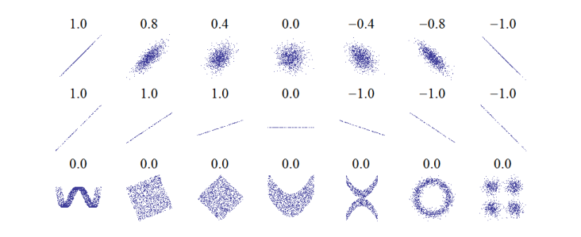
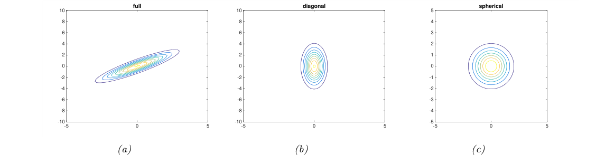
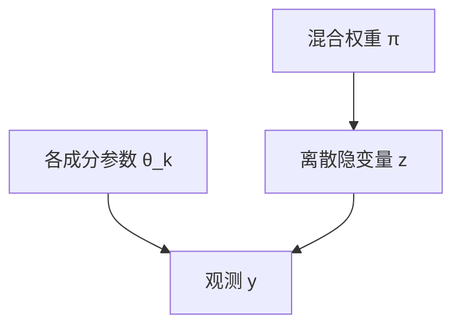
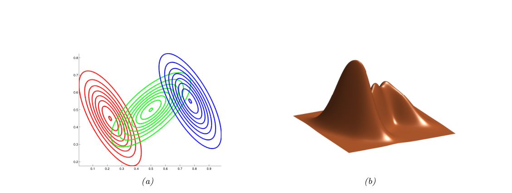

# 第3章 多变量概率模型

### 来源说明

- 作者：Kevin P. Murphy
- 书名：*Probabilistic Machine Learning: An Introduction*（概率机器学习导论）
- 阅读范围：Chapter 3 Probability: Multivariate Models（概率：多变量模型），PDF 第 107–136 页（书页约 77–105）。PDF 第 136 页无正文。在线稿日期 April 18, 2025。
- 习题自 PDF 第 133 页起，本笔记不展开证明。书中标 \* 的小节是选读，结论仍收录。

第 2 章处理单个随机变量的分布、贝叶斯规则和变量替换。这一章把多个变量放进同一个联合：协方差与相关、多元高斯、带噪声的线性高斯系统、指数族、混合模型，以及用图表示条件独立。多项分布的定义在第 2 章 2.5；本章的离散结构是类别分布、混合权重和条件概率表。

### 本章总览

联合分布 $p(x,y)$ 同时描述多个量。协方差和皮尔逊相关只抓住线性关系的强度和方向。独立可以推出不相关；反过来，不相关的变量仍可以沿曲线绑在一起。相关本身也不等于因果。

连续向量的默认联合是多元高斯（multivariate Gaussian）。它的等高线是椭圆。边缘仍是高斯，条件也是高斯，而且条件均值是观测的线性函数。再加上线性的高斯噪声，就得到线性高斯系统，后验有闭式。高斯先验配高斯似然时后验仍是高斯，这是共轭的一个例子。

指数族把伯努利、高斯等写成同一套自然参数。混合模型用若干简单分布的凸组合做出多峰，高斯混合常用来聚类。概率图模型则把条件独立画成图，从而把高维联合拆成局部条件分布。

### 核心知识点

#### 协方差与相关

两个随机变量的协方差是

$$
\mathrm{Cov}[X,Y]\triangleq\mathbb{E}[(X-\mathbb{E}[X])(Y-\mathbb{E}[Y])]=\mathbb{E}[XY]-\mathbb{E}[X]\mathbb{E}[Y].
\tag{3.1}
$$

$D$ 维随机向量的协方差矩阵 $\Sigma=\mathrm{Cov}[x]$ 对称、半正定。对角线是各分量方差，非对角线是分量之间的协方差，展开式即 (3.3)。由此

$$
\mathbb{E}[xx^\top]=\Sigma+\mu\mu^\top.
\tag{3.4}
$$

线性变换的协方差是

$$
\mathrm{Cov}[Ax+b]=A\,\mathrm{Cov}[x]\,A^\top,
\tag{3.5}
$$

与第 2 章 (2.164) 相同，证明放在习题 3.4。两个随机向量之间的互协方差是 $\mathrm{Cov}[x,y]=\mathbb{E}[(x-\mathbb{E}[x])(y-\mathbb{E}[y])^\top]$，即 (3.6)。

协方差没有有限上下界。皮尔逊相关系数把它归一化：

$$
\rho\triangleq\mathrm{corr}[X,Y]\triangleq\frac{\mathrm{Cov}[X,Y]}{\sqrt{\mathbb{V}[X]\mathbb{V}[Y]}}.
\tag{3.7}
$$

习题 3.2 要求证明 $-1\le\rho\le 1$。$\mathrm{corr}[X,Y]=1$ 当且仅当存在 $a>0$ 和 $b$ 使 $Y=aX+b$；$a<0$ 时相关为 $-1$，这是习题 3.3 的结论方向。相关容易被当成回归斜率。斜率其实是 $a=\mathrm{Cov}[X,Y]/\mathbb{V}[X]$，见后文 (11.27)，和 $\rho$ 不是同一个数。

回归斜率把协方差再除以 $X$ 的方差，单位和 $Y$ 对 $X$ 的变化一致。相关系数还额外除以两个标准差，所以被限制在 $[-1,1]$，斜率变了而噪声比例不变时，$\rho$ 可以仍然相同。

👉 回归系数见第 11 章 (11.27)。📝待补全

图注：原书 Figure 3.1。上排相关从 1 降到 $-1$，反映线性关系的方向和噪声大小。中排斜率不同，完美直线的相关仍是 $\pm 1$；正中那格斜率为 0 且 $Y$ 的方差为 0，相关系数没有定义。下排都是非线性关系，相关系数都是 0。

随机向量的相关矩阵对角线为 1，非对角线是两两的 $\rho$。紧凑写法是

$$
\mathrm{corr}(x)=(\mathrm{diag}(K_{xx}))^{-1/2}K_{xx}(\mathrm{diag}(K_{xx}))^{-1/2},
\tag{3.9}
$$

其中自协方差 $K_{xx}=\Sigma=R_{xx}-\mu\mu^\top$，$R_{xx}=\mathbb{E}[xx^\top]$ 叫自相关矩阵。

🔑 关键速记：协方差是未归一化的线性共变；相关 $\rho$ 落在 $[-1,1]$，度量的是线性程度，不是回归斜率。

#### 不相关、因果与辛普森悖论

独立 $p(X,Y)=p(X)p(Y)$ 可以推出 $\mathrm{Cov}[X,Y]=0$，因而相关为 0。反过来不成立。书中的反例是 $X\sim U(-1,1)$、$Y=X^2$：$Y$ 由 $X$ 唯一决定，但习题 3.1 要求验证相关为 0。Figure 3.1 下排是同一现象的散点：正弦、方块、二次曲线、圆和四团点的相关都是 0，依赖却很强。

更一般的依赖度量是互信息。它只在两个变量真正独立时才为 0，线性相关为 0 时互信息仍可以是正的。本章用它说明“不相关”弱于“独立”。

👉 互信息见第 6 章 6.3；书中让读者对照 Figure 6.6。📝待补全

联合高斯里，相关为 0 才和独立重合。3.2.4 节写明：$\rho=0$ 时 $p(y_1|y_2)=\mathcal{N}(y_1|\mu_1,\sigma_1^2)$，因为在这个联合里不相关就是独立。习题 3.5 另外构造了边缘都像高斯、协方差为 0、但并不独立的例子：$X\sim\mathcal{N}(0,1)$，$Y=WX$，$W$ 以 $1/2$ 的概率取 $\pm 1$。正文只断言 $Y$ 是 $X$ 的函数所以两者不独立，并要求读者证明 $Y$ 的边缘仍是标准正态且协方差为 0。证明不在正文，这里不补。

相关也不等于因果。原书 Figure 3.2 把冰淇淋销量和暴力犯罪率画在一起，两条曲线一起起伏，中间的共同原因是天气，不是“冰淇淋导致犯罪”。鹳鸟与出生率的相关也类似，书中归到生活水平等隐藏因素。$x$ 能预测 $y$，只说明统计依赖，不说明 $x$ 引起 $y$。

辛普森悖论（Simpson’s paradox）说：分组里都成立的趋势，合并后可以消失或改号。原书 Figure 3.3 用鸢尾花的萼片长度 $x$ 和萼片宽度 $y$：全体的相关 $R=-0.12$，宽度随长度下降；分组后 setosa、versicolor、virginica 的相关分别是 $0.74$、$0.53$、$0.46$，组内宽度随长度上升。

新冠的例子是病死率。原书 Figure 3.4(a) 里，每个年龄组意大利的病死率都低于中国，合计却更高。Figure 3.4(b) 显示意大利确诊里老年人比例更高。若 $F=1$ 表示死亡，$A$ 是年龄，$C$ 是国家，则 (a) 是 $p(F=1|A,C)$，(b) 是 $p(A|C)$，合起来 $p(F=1|C=\mathrm{Italy})>p(F=1|C=\mathrm{China})$。把统计依赖直接读成因果，就会得到和分组相反的结论。

🔑 关键速记：独立推出不相关；不相关可以仍强依赖；分组趋势在合并后可以反向，这是辛普森悖论。

#### 多元高斯的定义与形状

多元正态的密度是

$$
\mathcal{N}(y|\mu,\Sigma)\triangleq\frac{1}{(2\pi)^{D/2}|\Sigma|^{1/2}}\exp\Bigl[-\frac12(y-\mu)^\top\Sigma^{-1}(y-\mu)\Bigr].
\tag{3.11}
$$

$\mu=\mathbb{E}[y]\in\mathbb{R}^D$，$\Sigma=\mathrm{Cov}[y]$ 为 $D\times D$。归一化常数 $Z=(2\pi)^{D/2}|\Sigma|^{1/2}$ 保证积分为 1，习题 3.6 要求用特征值把联合拆成 $D$ 个一元高斯来证明，正文不写过程。二阶矩仍是 $\mathbb{E}[yy^\top]=\Sigma+\mu\mu^\top$，即 (3.15)。

二维时叫二元高斯。协方差写成

$$
\Sigma=\begin{pmatrix}\sigma_1^2 & \rho\sigma_1\sigma_2\\ \rho\sigma_1\sigma_2 & \sigma_2^2\end{pmatrix},
\tag{3.16}
$$

其中 $\rho=\sigma_{12}/(\sigma_1\sigma_2)$。把 (3.11) 展开就是较长的 (3.18)，本笔记不重复展开式。

三种协方差的参数个数不同。满协方差对称，自由参数 $D(D+1)/2$。对角协方差非对角线为 0，有 $D$ 个参数。球形协方差 $\Sigma=\sigma^2 I_D$ 也叫各向同性，只有 $\sigma^2$ 一个参数。

图注：原书 Figure 3.6。满协方差的等高线是可旋转的椭圆；对角协方差必须与坐标轴对齐；球形协方差的等高线是圆。原书 Figure 3.5 是同一组协方差的曲面图，本笔记不另存。

等高线是常数对数概率的集合。对数密度里依赖 $y$ 的部分是马氏距离（Mahalanobis distance）的平方

$$
\Delta^2\triangleq(y-\mu)^\top\Sigma^{-1}(y-\mu).
\tag{3.20}
$$

因为 $\Sigma$ 正定，可作特征分解 $\Sigma=\sum_d\lambda_d u_d u_d^\top$。令 $z_d=u_d^\top(y-\mu)$，则

$$
\Delta^2=\sum_{d=1}^D\frac{z_d^2}{\lambda_d}.
\tag{3.24}
$$

新坐标先用 $U$ 旋转，再按特征值缩放。二维上等马氏距离的点满足 $z_1^2/\lambda_1+z_2^2/\lambda_2=r$，所以等高线是椭圆。特征向量决定朝向，特征值决定拉长的程度。原书把这张椭圆图画在 Figure 7.6。

特征分解把对称矩阵写成相互正交的方向和沿该方向的缩放。马氏距离就是在这些主轴上用特征值当比例尺量欧氏距离。椭圆的长轴对应大特征值。

👉 二次型的几何见第 7 章 7.4.4，特征分解见 7.4。📝待补全

🔑 关键速记：多元高斯由 $\mu$ 和 $\Sigma$ 决定；等高线是马氏距离的等值面；满、对角、球形协方差分别对应斜椭圆、轴对齐椭圆和圆。

#### 多元高斯的边缘、条件与缺失填补

把联合高斯 $y=(y_1,y_2)$ 的均值、协方差和精度 $\Lambda=\Sigma^{-1}$ 按块切开，如 (3.26)。边缘仍是高斯，直接取出对应块：

$$
p(y_1)=\mathcal{N}(y_1|\mu_1,\Sigma_{11}),\qquad p(y_2)=\mathcal{N}(y_2|\mu_2,\Sigma_{22}).
\tag{3.27}
$$

条件分布也是高斯。书中把下面这组式子框了起来：

$$
\begin{aligned}
p(y_1|y_2)&=\mathcal{N}(y_1|\mu_{1|2},\Sigma_{1|2}),\\
\mu_{1|2}&=\mu_1+\Sigma_{12}\Sigma_{22}^{-1}(y_2-\mu_2)\\
&=\mu_1-\Lambda_{11}^{-1}\Lambda_{12}(y_2-\mu_2)\\
&=\Sigma_{1|2}\bigl(\Lambda_{11}\mu_1-\Lambda_{12}(y_2-\mu_2)\bigr),\\
\Sigma_{1|2}&=\Sigma_{11}-\Sigma_{12}\Sigma_{22}^{-1}\Sigma_{21}=\Lambda_{11}^{-1}.
\end{aligned}
\tag{3.28}
$$

条件均值是 $y_2$ 的线性函数。条件协方差是常数，不随 $y_2$ 的具体数值改变。推导用到舒尔补 $\Sigma/\Sigma_{22}=\Sigma_{11}-\Sigma_{12}\Sigma_{22}^{-1}\Sigma_{21}$。

舒尔补是分块矩阵里“消掉一块之后剩下的有效矩阵”。这里它正好是条件协方差：观测了 $y_2$ 之后，$y_1$ 还剩多少不确定。

👉 推导见第 7 章 7.3.5。📝待补全

二维例子里 $\Sigma$ 用 $\rho,\sigma_1,\sigma_2$ 写成 (3.29)。边缘 $p(y_1)=\mathcal{N}(y_1|\mu_1,\sigma_1^2)$ 是联合往 $y_1$ 轴上的投影。观测到 $Y_2=y_2$ 相当于沿这条水平线把联合切开：

$$
p(y_1|y_2)=\mathcal{N}\Biggl(y_1\Bigm|\mu_1+\frac{\rho\sigma_1\sigma_2}{\sigma_2^2}(y_2-\mu_2),\;\sigma_1^2-\frac{(\rho\sigma_1\sigma_2)^2}{\sigma_2^2}\Biggr).
\tag{3.31}
$$

若 $\sigma_1=\sigma_2=\sigma$，条件方差变成 $\sigma^2(1-\rho^2)$。数值例子：$\rho=0.8$，$\sigma_1=\sigma_2=1$，$\mu_1=\mu_2=0$，$y_2=1$。条件均值是 $0.8$，因为 $y_2$ 比均值高 1 时，$y_1$ 预期高 $0.8$。条件方差是 $1-0.8^2=0.36$，比边缘方差 1 小。$\rho=0$ 时条件分布退回边缘，观测没有带来信息。

利用分量之间的相关去猜没观测到的坐标，叫缺失值填补。原书 Figure 3.7 从 $D=8$ 的高斯里抽了 $N=10$ 个向量，故意藏起 50% 的条目，再用真实参数 $\theta=(\mu,\Sigma)$ 做填补。图是辛顿图（Hinton diagram）：行是特征、列是样本，与正文“行是样本”的习惯相反；空白是缺失，蓝正绿负，方块面积正比于数值。

对每个样本计算 $p(y_{n,h}|y_{n,v},\theta)$，$v$ 是看见的下标，$h$ 是隐藏下标。再取每个缺失坐标的边缘，用后验均值 $\bar y_{n,i}=\mathbb{E}[y_{n,i}|y_{n,v},\theta]$ 当点估计。条件方差可以当置信度，图中没有画。从条件联合里多次抽样叫多重填补，下游若还要使用填好的表，这样比只交一个均值更稳。

后验均值是平方误差意义下的最优猜测：在所有用观测能算出来的估计里，它的期望平方损失最小。这是决策论把后验变成一个数的标准步骤。

👉 平方误差决策见第 5 章。📝待补全

图中用的是真实参数。实际要从残缺数据估计参数时，第 4 章 4.2.6 的完整数据最大似然不再直接适用。书中说可以用 EM 得到近似最大似然，并把缺失数据下的细节放到续作。

👉 完整数据最大似然见第 4 章 4.2.6。📝待补全

🔑 关键速记：联合高斯的边缘是对应的子块；条件均值线性依赖于观测，条件协方差与观测值无关，并且不会比边缘方差更大。

#### 线性高斯系统

3.2 节条件于没有噪声的坐标。这一节让观测带噪声。未知向量 $z\in\mathbb{R}^L$，观测 $y\in\mathbb{R}^D$：

$$
p(z)=\mathcal{N}(z|\mu_z,\Sigma_z),
\tag{3.33}
$$

$$
p(y|z)=\mathcal{N}(y|Wz+b,\Sigma_y).
\tag{3.34}
$$

$W$ 是 $D\times L$。这叫线性高斯系统。联合 $p(z,y)$ 是 $L+D$ 维高斯，

$$
\mu=\begin{pmatrix}\mu_z\\ W\mu_z+b\end{pmatrix},
\tag{3.35}
$$

$$
\Sigma=\begin{pmatrix}\Sigma_z & \Sigma_z W^\top\\ W\Sigma_z & \Sigma_y+W\Sigma_z W^\top\end{pmatrix}.
\tag{3.36}
$$

对这个联合使用 (3.28)，得到后验 $p(z|y)$。生成方向是 $z\to y$，推断是把箭头倒过来。

高斯的贝叶斯规则：

$$
\begin{aligned}
p(z|y)&=\mathcal{N}(z|\mu_{z|y},\Sigma_{z|y}),\\
\Sigma_{z|y}^{-1}&=\Sigma_z^{-1}+W^\top\Sigma_y^{-1}W,\\
\mu_{z|y}&=\Sigma_{z|y}\bigl[W^\top\Sigma_y^{-1}(y-b)+\Sigma_z^{-1}\mu_z\bigr].
\end{aligned}
\tag{3.37}
$$

边缘 $p(y)=\mathcal{N}(y|W\mu_z+b,\Sigma_y+W\Sigma_z W^\top)$，即 (3.38)。先验是高斯、似然是高斯，后验仍是高斯，所以高斯在贝叶斯条件下封闭。书中把这叫作：高斯先验是高斯似然的共轭先验（conjugate prior），因为后验和先验属于同一族。

共轭的一般含义是：先验族乘上似然之后，后验还留在这个族里，只是参数被数据更新。这样归一化常数和后验参数可以闭式写出，不必对假设空间重新数值积分。高斯对高斯是本章的实例，别的似然对应哪一族先验，本章没有列表。

👉 一般定义见第 4 章 4.6.1。📝待补全

推导只保留骨架。对数联合是两段二次型，见 (3.39)，所以联合是高斯。展开后联合精度是

$$
\Sigma^{-1}=\begin{pmatrix}\Sigma_z^{-1}+W^\top\Sigma_y^{-1}W & -W^\top\Sigma_y^{-1}\\ -\Sigma_y^{-1}W & \Sigma_y^{-1}\end{pmatrix}.
\tag{3.43}
$$

再代回 (3.28)，并利用 $\mu_y=W\mu_z+b$，就得到 (3.37)。中间代数在 3.3.2，这里不复写。

配方法把二次函数收成已完成的平方。标量 $ax^2+bx+c=a(x-h)^2+k$，其中 $h=-b/(2a)$，$k=c-b^2/(4a)$。向量 $x^\top Ax+x^\top b+c=(x-h)^\top A(x-h)+k$，其中 $h=-\frac12 A^{-1}b$，$k=c-\frac14 b^\top A^{-1}b$。后面更长的推导会用到这个恒等，本章例子不必展开。

🔑 关键速记：线性高斯的后验精度等于先验精度加上 $W^\top\Sigma_y^{-1}W$；观测越准、$W$ 越能看见 $z$，后验越窄。

#### 标量、向量与传感器融合

用固定精度 $\lambda_y=1/\sigma^2$ 对标量 $z$ 做 $N$ 次测量，$p(y_i|z)=\mathcal{N}(y_i|z,\lambda_y^{-1})$。先验 $p(z)=\mathcal{N}(z|\mu_0,\lambda_0^{-1})$。把测量堆成向量、$W$ 取全 1 列，套进 (3.37) 得到

$$
\lambda_N=\lambda_0+N\lambda_y,
\tag{3.53}
$$

$$
\mu_N=\frac{N\lambda_y}{N\lambda_y+\lambda_0}\bar y+\frac{\lambda_0}{N\lambda_y+\lambda_0}\mu_0.
\tag{3.54}
$$

后验精度是先验精度加上 $N$ 份测量精度。后验均值是最大似然 $\bar y$ 与先验均值的凸组合。先验相对弱（$\lambda_0$ 比 $\lambda_y$ 小）时更靠近数据；先验相对强时更靠近 $\mu_0$。$N$ 次精度为 $\lambda_y$ 的测量，等价于一次值为 $\bar y$、精度为 $N\lambda_y$ 的测量。

用方差写是 (3.55)–(3.57)：$\tau_0^2=1/\lambda_0$，后验方差 $\tau_N^2=\sigma^2\tau_0^2/(N\tau_0^2+\sigma^2)$。只看一个观测时，后验均值可以写成三种等价形式：先验与数据的凸组合、先验往数据方向挪、数据往先验方向缩。最后一种叫收缩（shrinkage），即 (3.61)–(3.63)。

原书 Figure 3.8 的观测是 $y=3$。先验 $\mathcal{N}(0,1)$ 较强，后验均值被拉向 0；先验 $\mathcal{N}(0,5)$ 较弱，后验均值靠近最大似然。信噪比定义为

$$
\mathrm{SNR}\triangleq\frac{\mathbb{E}[Z^2]}{\mathbb{E}[\epsilon^2]}=\frac{\Sigma_0+\mu_0^2}{\Sigma_y},
\tag{3.64}
$$

其中 $y=z+\epsilon$，$\epsilon\sim\mathcal{N}(0,\Sigma_y)$。

未知向量 $z\in\mathbb{R}^D$ 的先验是 $p(z)=\mathcal{N}(\mu_z,\Sigma_z)$。完全不知道时书中写 $\Sigma_z=\infty I$，实践里用很大的有限协方差，并由对称性取 $\mu_z=0$。$N$ 次独立测量 $y_n\sim\mathcal{N}(z,\Sigma_y)$ 的似然，正比于在平均值 $\bar y$ 处、协方差缩小为 $\Sigma_y/N$ 的一个高斯，即 (3.65)。因此

$$
\widehat\Sigma^{-1}=\Sigma_z^{-1}+N\Sigma_y^{-1},
\tag{3.67}
$$

$$
\widehat\mu=\widehat\Sigma\bigl(\Sigma_y^{-1}(N\bar y)+\Sigma_z^{-1}\mu_z\bigr).
\tag{3.68}
$$

原书 Figure 3.9 把 $z$ 想成平面上的未知位置，$y_n$ 是雷达回波。数据来自 $z=[0.5,0.5]^\top$、$\Sigma_y=0.1\begin{pmatrix}2&1\\1&1\end{pmatrix}$，先验是 $\mathcal{N}(z|0,0.1I_2)$，图中画了 10 个点之后的后验。测量在第 1 维更吵，所以后验在水平方向更宽。沿时间序列做同一件事是卡尔曼滤波，书中放在续作，不在本章。

传感器融合把多台不同可靠性的仪器合到同一个 $p(z|y)$。模型是 (3.69)：$M$ 台仪器，第 $m$ 台有 $N_m$ 个观测，噪声协方差 $\Sigma_m$。两台时可以画成 $y_1\leftarrow z\rightarrow y_2$，再堆成 $W=[I;I]$、块对角的 $\Sigma_y$，然后用高斯贝叶斯规则。

原书 Figure 3.10 观测 $y_1=(0,-1)$、$y_2=(1,0)$。三组噪声是：

- $\Sigma_1=\Sigma_2=0.01I_2$：后验均值在两个观测正中间。
- $\Sigma_1=0.05I_2$，$\Sigma_2=0.01I_2$：第 2 台更可靠，均值靠近 $y_2$。
- $\Sigma_1=0.01\begin{pmatrix}10&1\\1&1\end{pmatrix}$，$\Sigma_2=0.01\begin{pmatrix}1&1\\1&10\end{pmatrix}$：第 1 台在竖直方向更准，第 2 台在水平方向更准，后验均值分别采纳两者更准的那一维。

习题 3.7 是一维、已知但互不相同的方差、无信息先验（精度取 0）下的融合，正文没有给出答案，这里不补。

🔑 关键速记：标量高斯后验的精度相加、均值按精度加权；多传感器时，后验均值靠向噪声更小的那一侧。

#### 指数族

许多常见分布都属于指数族（exponential family）。本书主要在第 12 章的广义线性模型里用它。

广义线性模型用指数族当观测分布，再用链接函数把线性预测接到均值参数上。逻辑回归就是伯努利加 logit 链接的特例。本章只定义指数族本身。

👉 广义线性模型见第 12 章。📝待补全

支撑固定在 $\mathcal{Y}_D\subseteq\mathbb{R}^D$、自然参数 $\eta\in\mathbb{R}^K$ 时，若密度能写成

$$
p(y|\eta)\triangleq\frac{1}{Z(\eta)}h(y)\exp[\eta^\top\mathcal{T}(y)]=h(y)\exp[\eta^\top\mathcal{T}(y)-A(\eta)],
\tag{3.71}
$$

就说它在指数族里。$h(y)$ 是基测度，常常为 1。$\mathcal{T}(y)$ 是充分统计量。$\eta$ 是自然参数或典范参数。$Z(\eta)$ 是配分函数，$A(\eta)=\log Z(\eta)$ 是对数配分函数。$A$ 在 $\Omega=\{\eta:A(\eta)<\infty\}$ 上凸。

若除了 $\eta=0$ 之外，没有任何 $\eta$ 使 $\eta^\top\mathcal{T}(y)$ 恒为 0，这个指数族是最小的。多项分布因为概率和为 1，原始参数线性相关，不最小；改成 $K-1$ 个自由参数后可以变成最小表示。若 $\eta=f(\phi)$ 且 $f$ 非线性，叫弯曲指数族。$f$ 是恒等映射时叫典范形式。再要求 $\mathcal{T}(y)=y$，就是自然指数族

$$
p(y|\eta)=h(y)\exp[\eta^\top y-A(\eta)].
\tag{3.73}
$$

伯努利的例子从 $\mathrm{Ber}(y|\mu)=\mu^y(1-\mu)^{1-y}$ 出发。用 $\mathcal{T}(y)=[\mathbb{I}(y=1),\mathbb{I}(y=0)]$ 和 $\eta=[\log\mu,\log(1-\mu)]$ 可以写成指数族，但 $1^\top\mathcal{T}(y)=1$，表示过完备，$\eta$ 不唯一。最小表示为

$$
\mathrm{Ber}(y|\mu)=\exp\Biggl[y\log\frac{\mu}{1-\mu}+\log(1-\mu)\Biggr].
\tag{3.78}
$$

对应

$$
\eta=\log\frac{\mu}{1-\mu},\quad\mathcal{T}(y)=y,\quad A(\eta)=\log(1+e^\eta),\quad h(y)=1,
$$

分别对应 (3.79)–(3.82)。

从 $\eta$ 回到均值要用 sigmoid：$\mu=\sigma(\eta)=1/(1+e^{-\eta})$。这就是第 2 章的 logit 与 logistic。更多分布的指数族写法在续作，本章没有逐个改写。

对数配分函数的导数生成充分统计量的累积量。一、二阶累积量是均值和方差，一、二阶矩是 $\mathbb{E}[Y]$ 和 $\mathbb{E}[Y^2]$。指数族里

$$
\nabla A(\eta)=\mathbb{E}[\mathcal{T}(y)],\qquad\nabla^2 A(\eta)=\mathrm{Cov}[\mathcal{T}(y)].
\tag{3.84}
$$

海森正定，所以 $A$ 对 $\eta$ 凸。对数似然 $\eta^\top\mathcal{T}(y)-A(\eta)$ 因此凹，最大似然有唯一全局最大值。

只知道某些特征的期望 $\int p(x)f_k(x)\,dx=F_k$，又希望分布尽量接近先验 $q$，就最小化 $D_{\mathrm{KL}}(p\|q)$。$q$ 均匀时，这等价于在约束下最大化熵，得到最大熵模型。

KL 散度衡量两个分布的差别，熵衡量单个分布的不确定。均匀先验下“靠近 $q$”和“熵最大”是同一件事。高斯成为默认噪声模型，就是因为它在固定均值和方差时熵最大。

👉 KL 见第 6 章 6.2，熵见 6.1。📝待补全

书中用拉格朗日乘子处理归一化约束和矩约束。离散情形对每个格点求导，得到

$$
p(x)=\frac{q(x)}{Z}\exp\Bigl(-\sum_k\lambda_k f_k(x)\Bigr).
\tag{3.91}
$$

这就是指数族：$f(x)$ 是充分统计量，$-\lambda$ 是自然参数，$q(x)$ 是基测度。若 $f_1(x)=x$、$f_2(x)=x^2$，用来匹配一阶和二阶矩，得到的就是高斯。乘子方法本身在优化章。

👉 拉格朗日乘子见第 8 章 8.5.1。📝待补全

🔑 关键速记：指数族是 $h(y)\exp(\eta^\top\mathcal{T}(y)-A(\eta))$；$A$ 的梯度是充分统计量的均值，海森是它的协方差；固定均值和二阶矩的最大熵分布是高斯。

#### 混合模型

把简单分布做凸组合，得到混合模型

$$
p(y|\theta)=\sum_{k=1}^K\pi_k p_k(y),
\tag{3.94}
$$

$0\le\pi_k\le 1$ 且 $\sum_k\pi_k=1$。引入离散隐变量 $z\in\{1,\ldots,K\}$ 后，

$$
p(z|\theta)=\mathrm{Cat}(z|\pi),\qquad p(y|z=k,\theta)=p(y|\theta_k).
\tag{3.95}
$$

生成过程是先抽成分 $z$，再用 $\theta_z$ 抽 $y$。把 $z$ 加掉就回到 (3.94)。

图注：混合模型的生成顺序。先按 $\pi$ 抽成分编号，再按该成分的分布抽观测。边缘 $p(y)$ 是把 $z$ 加掉之后的加权和。

高斯混合（Gaussian mixture model, GMM）是

$$
p(y|\theta)=\sum_{k=1}^K\pi_k\mathcal{N}(y|\mu_k,\Sigma_k).
\tag{3.98}
$$

成分足够多时，GMM 可以逼近 $\mathbb{R}^D$ 上任何光滑分布。

图注：原书 Figure 3.11，改编自 Bishop。左图是三个成分各自的等概率轮廓，椭圆方向不同。右图是混合之后的密度曲面，对应三个峰。正文没有给出这张图的数值参数。

用来聚类时先拟合参数，例如最大似然 $\hat\theta=\arg\max\log p(\mathcal{D}|\theta)$。书中把算法放在 8.7.3。然后对每个点计算它来自第 $k$ 个成分的后验，叫责任度

$$
r_{nk}\triangleq p(z_n=k|y_n,\theta)=\frac{p(z_n=k|\theta)\,p(y_n|z_n=k,\theta)}{\sum_{k'}p(z_n=k'|\theta)\,p(y_n|z_n=k',\theta)}.
\tag{3.99}
$$

取 $\hat z_n=\arg\max_k r_{nk}$ 是硬聚类。用责任度把点按比例分给各类是软聚类。原书 Figure 3.12 是二维数据上 $K=5$ 的一种 GMM 聚类，本笔记不另存。

若 $z_n$ 的先验均匀，且 $\Sigma_k=I$，硬聚类变成把点派到欧氏距离最近的中心，即 (3.101)。这是 K 均值的基础。K 均值把每个点分给最近中心，再按类更新中心，适合球形、等权的高斯混合这一特例。

👉 K 均值见第 21 章 21.3；如何选 $K$ 见 21.3.7。📝待补全

👉 GMM 的最大似然算法见第 8 章 8.7.3。📝待补全

数据是二元向量时用伯努利混合。给定成分后各维独立：

$$
p(y|z=k,\theta)=\prod_{d=1}^D\mathrm{Ber}(y_d|\mu_{dk}).
\tag{3.102}
$$

$\mu_{dk}$ 是第 $k$ 类里第 $d$ 位为 1 的概率。书中用 $K=20$ 拟合二值化的 MNIST，训练时不用标签。拟合可用与 GMM 类似的 EM，大数据上也可以用随机梯度。原书 Figure 3.13 把每个 $\hat\mu_k$ 画成图像，上面的数是 $\hat\pi_k$。模型自己分出了各种数字的样子；有的数字出现多次，因为 $K$ 并不等于真实类别数。

Student 分布还可以写成精度上的无限高斯混合：精度 $\alpha$ 服从伽马，观测在给定精度时是高斯。习题 3.8 把这个积分写成 (3.118)，证明留给读者。

🔑 关键速记：混合是先抽离散成分再抽观测；GMM 的责任度是成分的后验；球形且等权时，硬分配退化为最近中心。

#### 概率图模型

图模型（probabilistic graphical model, PGM）用图编码条件独立，从而把联合写成局部因子。有向无环图（directed acyclic graph, DAG）上的模型有时叫贝叶斯网络，这不表示推断必须用贝叶斯方法。结点是随机变量，缺一条边表示条件独立，而不是“有边才叫相关”这么简单。

按拓扑序让父结点排在子结点前面。有序马尔可夫性质是：给定父结点后，结点与排在它前面、又不是父结点的变量条件独立，

$$
Y_i\perp Y_{\mathrm{pred}(i)\setminus\mathrm{pa}(i)}\mid Y_{\mathrm{pa}(i)}.
\tag{3.103}
$$

联合因此是

$$
p(Y_{1:N_G})=\prod_{i=1}^{N_G}p(Y_i|Y_{\mathrm{pa}(i)}).
\tag{3.104}
$$

洒水器网络有四个二元变量：是否阴天 $C$、是否下雨 $R$、洒水器是否打开 $S$、草地是否湿 $W$。阴天指向雨和洒水器，雨和洒水器指向草地。联合里被条件独立划掉的依赖是：给定 $C$ 后 $R$ 不再直接依赖 $S$，给定 $S$ 和 $R$ 后 $W$ 不再直接依赖 $C$。留下的分解是

$$
p(C,S,R,W)=p(C)\,p(S|C)\,p(R|C)\,p(W|S,R).
\tag{3.105}
$$

每个 $p(Y_i|Y_{\mathrm{pa}(i)})$ 是条件概率分布。原书 Figure 3.14 里它们都是条件类别分布，画成条件概率表。记 $\theta_{ijk}=p(Y_i=k|Y_{\mathrm{pa}(i)}=j)$，每行和为 1。下标 $i$ 是结点，$k$ 是该结点的状态，$j$ 是父结点状态的组合。湿草地有两个二元父结点，所以有 4 行。

图中的数值是：$p(C)$ 为真、假各 $0.5$。阴天时洒水器打开的概率是 $0.1$，否则是 $0.5$。阴天时下雨的概率是 $0.8$，否则是 $0.2$。草地变湿的概率：雨和洒水器都关时为 $0$，只有一个原因时为 $0.9$，两个原因都在时为 $0.99$。

序列上的一阶马尔可夫条件是：给定现在 $y_t$，未来与过去独立。联合变成

$$
p(y_{1:T})=p(y_1)\prod_{t=2}^T p(y_t|y_{t-1}).
\tag{3.108}
$$

$p(y_t|y_{t-1})$ 是转移核。状态有限时它是行和为 1 的随机矩阵 $A_{jk}=p(y_t=k|y_{t-1}=j)$。矩阵不随时间变，模型就是齐次的，也叫平稳或时不变。同一个参数服务多个时间步，叫参数绑定，因此任意长度的序列只用固定多个参数。

只依赖上一个词是二元语法（bigram）。依赖上两个词是三元语法（trigram），即 $M=2$ 的 $M$ 阶马尔可夫模型 (3.109)。原书 Figure 3.15 画出一阶链和二阶链。词表很大时，高阶条件表的参数数量会压垮估计。进一步把条件分布写成低秩矩阵或神经网络，就是神经语言模型。

👉 神经语言模型见第 15 章。📝待补全

图模型定义了联合，所以边缘化和条件化都能算 $p(Y_i|Y_j=y_j)$。高效算法在续作。洒水器的数值推断是：先验 $p(R=1)=0.5$；看见草地湿之后 $p(R=1|W=1)=0.7079$；再发现洒水器开着，降到 $p(R=1|W=1,S=1)=0.3204$。两个原因互相抢功，叫解释消除（explaining away），也叫伯克森悖论。

参数未知时，把参数也画成结点，当成要推断的隐变量。$N$ 个独立同分布观测共享 $\theta$ 时，生成故事是 $\theta\sim p(\theta)$，$y_n\sim p(y|\theta)$。联合 $p(\mathcal{D},\theta)=p(\theta)\prod_n p(y_n|\theta)$。交换数据下标不改变这个似然，书中称数据是可交换的。

重复结点可以用盘子（plate）收起来：方框里的结点重复，右下角写重复次数 $N$。原书 Figure 3.16 左边是展开的 $y_1,\ldots,y_N$，右边是盘子。Figure 3.17 把 GMM 画成图，联合是 (3.114)：混合权重、各成分的均值和协方差、每个样本的 $z_n$ 与 $y_n$。空心结点是 $\pi,\mu_k,\Sigma_k,z_n$，阴影结点是观测 $y_n$。

🔑 关键速记：有向图的联合是每个结点对其父结点的条件概率之积；一阶马尔可夫链只保留相邻转移；解释消除是两个原因在共同结果被观测后互相压低。

### 🔑 关键速记

- 相关度量线性程度，范围是 $[-1,1]$；独立推出不相关，不相关推不出独立，相关也推不出因果。
- 多元高斯的边缘和条件仍是高斯；条件均值线性，条件协方差不随观测值变化。
- 线性高斯后验的精度是先验精度加上 $W^\top\Sigma_y^{-1}W$；高斯先验对高斯似然是共轭的。
- 指数族由基测度、充分统计量和对数配分函数写成；匹配均值和二阶矩的最大熵分布是高斯。
- 混合模型先抽成分再抽观测；图模型用缺边表示条件独立，联合拆成局部条件分布。

### 易混淆点与差异对比

协方差可以任意大，相关系数被压进 $[-1,1]$。斜率 $a=\mathrm{Cov}[X,Y]/\mathbb{V}[X]$ 还可以随着 $X$ 的尺度变化。Figure 3.1 中排说明斜率变了、相关可以不变；下排说明相关为 0 仍可以有确定的曲线关系。$Y$ 的方差为 0 时 (3.7) 的分母为 0，相关没有定义。

联合高斯内部，不相关等于独立，条件分布不再依赖被条件的变量。两个变量各自边缘是高斯、而且协方差为 0，仍然可以不独立，习题 3.5 就是这个缝隙。第 2 章的无条件独立是联合拆成边缘；本章补充的是“只看二阶矩不够”。

边缘协方差 $\Sigma_{11}$ 是没看 $y_2$ 时 $y_1$ 的不确定。条件协方差 $\Sigma_{11}-\Sigma_{12}\Sigma_{22}^{-1}\Sigma_{21}$ 是看过之后剩下的不确定，它更小或相等，而且不依赖于 $y_2$ 落在哪里。条件均值才跟着 $y_2$ 移动。精度形式 $\Sigma_{1|2}=\Lambda_{11}^{-1}$ 与协方差形式是同一件事的两种写法。

线性高斯 (3.37) 比无噪声条件 (3.28) 多了观测噪声 $\Sigma_y$ 和观测矩阵 $W$。$W=I$、$b=0$、$\Sigma_y\to 0$ 时，观测几乎直接等于 $z$，后验收缩到数据上。缺失填补是在同一次向量内部条件化；传感器融合是多个带噪测量指向同一个 $z$。

后验均值靠近先验还是靠近数据，看的是精度之比，不是样本数值的表面大小。Figure 3.8 里同样观测到 3，强先验 $\mathcal{N}(0,1)$ 收缩得多，弱先验 $\mathcal{N}(0,5)$ 收缩得少。$N$ 次独立测量抬高的是精度 $N\lambda_y$，不是把方差乘上 $N$。

指数族的自然参数 $\eta$ 和均值参数不是同一套坐标。伯努利里 $\eta=\mathrm{logit}(\mu)$，$\mu=\sigma(\eta)$。过完备表示里 $\eta$ 不唯一，最小表示才把参数和分布一一对应。对数配分函数 $A(\eta)$ 对 $\eta$ 凸，所以对数似然对自然参数 $\eta$ 凹，最大似然有唯一全局最大值。

混合分布的 $\pi_k$ 是成分先验，责任度 $r_{nk}$ 是看到 $y_n$ 之后的成分后验。硬聚类只保留最大责任度，软聚类保留整行。只有 $z_n$ 的先验均匀且 $\Sigma_k=I$ 时，硬聚类才变成欧氏距离下的最近中心，这是 K 均值的出发点。

图上的边是直接依赖，缺边才是条件独立声明。洒水器里 $S$ 和 $R$ 在给定 $C$ 后独立，但在看到 $W$ 之后不再独立，这就是解释消除。贝叶斯网络这个名字不表示必须放先验：图只是联合的分解。盘子是重复结点的简写，展开后与左边那张独立同分布图是同一个模型。

第 2 章的多项分布是计数向量的分布。本章条件概率表的每一行是一个类别分布，混合权重 $\pi$ 也是一个类别分布。不要把“多项逻辑回归”和第 3 章的混合模型当成同一个东西：前者是第 2 章的条件类别模型，后者是若干成分的凸组合。

### 本章要点总结

第 3 章从协方差和相关开始，强调二阶矩看不出非线性依赖，也看不出因果。多元高斯把线性依赖收进 $\Sigma$，边缘、条件和带噪线性观测都仍留在高斯族里，因此标量推断、向量定位和传感器融合都有闭式后验。

指数族用对数配分函数统一了归一化与矩。混合模型用离散隐变量制造多峰，图模型用条件独立把联合拆开。洒水器例子里的解释消除，是“看见结果之后，两个原因互相抢功”。共轭先验的一般理论和图上的高效推断，本章只点到位置，没有展开。习题不展开。
