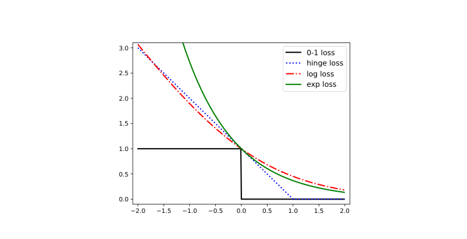
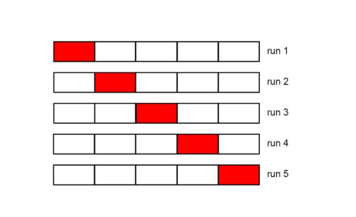
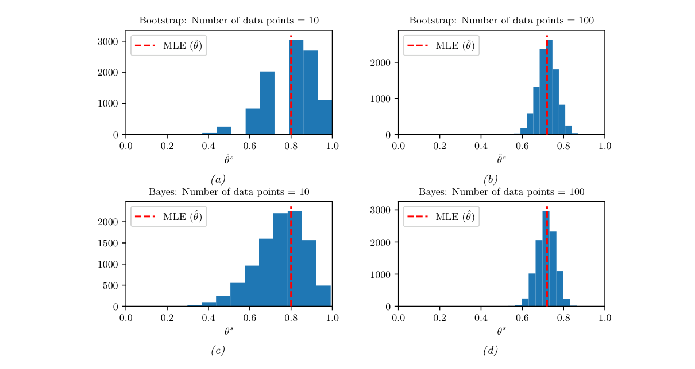

# 第4章 统计

### 来源说明

- 作者：Kevin P. Murphy
- 书名：*Probabilistic Machine Learning: An Introduction*
- 版本：在线版，2025-04-18
- 阅读范围：Chapter 4 Statistics（统计），PDF 第 137–196 页（含）。书眉印刷页约 107–166。下一章 Decision Theory 从 PDF 第 197 页起。

本章只整理目录中的 4.1–4.8。决策理论是第 5 章，这里只在被引用处写清含义。非参数密度估计不在本章目录；自助法脚注里的「非参数 / 参数」两种抽样，写在第 4.7.3 节。

目录中带 \* 的进阶小节是 4.4、4.5.2、4.6、4.7。

## 本章总览

第 2–3 章把概率模型的参数 $\theta$ 当成已知。本章讨论怎样用数据 $\mathcal{D}$ 学习 $\theta$。

学习分成两层。第一层是拟合，也叫训练：算出一个点估计。多数方法都收成

$$
\hat\theta=\arg\min_\theta L(\theta)
\tag{4.1}
$$

$L(\theta)$ 是某种损失或目标。少数模型有闭式解，一般情形要靠通用优化。

第二层是推断（inference）：用有限样本量化估计的不确定性。统计学里的推断指这件事。脚注说明，深度学习社区常把「推断」用来称呼预测 $p(y\mid x,\hat\theta)$，本书把后者叫预测。

频率派把不确定性看成「换一批数据，估计会怎么变」。贝叶斯把不确定性写成后验 $p(\theta\mid\mathcal{D})$。

本章主线如下。

1. **最大似然（maximum likelihood estimation, MLE）**：让训练数据的概率最大；负对数似然（negative log likelihood, NLL）是常用目标。
2. **经验风险最小化（empirical risk minimization, ERM）**：把对数损失换成任意损失，仍对经验分布取平均。
3. **其他估计**：矩方法（method of moments, MOM），以及数据流式到达时的递推更新。
4. **正则**：在训练损失上加复杂度惩罚。用事先（prior）的负对数当惩罚时，点估计就是最大后验（maximum a posteriori, MAP）。强度用验证集或交叉验证来选；早停和更多数据是另外两条路。
5. **贝叶斯统计**：共轭事先给出闭式后验；预测要把参数积分掉。可信区间摘要后验。高维时用网格、拉普拉斯、变分或马尔可夫链蒙特卡洛做近似。
6. **频率派统计**：抽样分布、Fisher 信息、自助法、置信区间，以及平方误差下的偏差–方差分解。

## 核心知识点

### 4.1 引言

模型拟合回答「$\theta$ 取哪一个点」。推断回答「这个点有多不可靠」。主动学习、科学量的误差范围、以及避免把噪声当成规律，都依赖第二层。

闭式解只覆盖伯努利、类别、高斯和线性回归等例子。其余目标的算法本书放到第 8 章：那里讨论如何最小化一般的光滑或非光滑目标，以及带约束时怎样引入乘子。本章只使用「梯度为零的平稳点」和「拉格朗日乘子吸收等式约束」这两个结论。

👉 通用优化见第 8 章。📝待补全

### 4.2 最大似然估计

#### 4.2.1 定义

MLE 选取使训练数据概率最大的参数：

$$
\hat\theta_{\mathrm{mle}}\triangleq\arg\max_\theta p(\mathcal{D}\mid\theta)
\tag{4.2}
$$

训练样本若独立同分布（independent and identically distributed, iid），条件似然与对数似然为

$$
p(\mathcal{D}\mid\theta)=\prod_{n=1}^{N}p(y_n\mid x_n,\theta)
\tag{4.3}
$$

$$
\ell(\theta)\triangleq\log p(\mathcal{D}\mid\theta)=\sum_{n=1}^{N}\log p(y_n\mid x_n,\theta)
\tag{4.4}
$$

$$
\hat\theta_{\mathrm{mle}}=\arg\max_\theta\sum_{n=1}^{N}\log p(y_n\mid x_n,\theta)
\tag{4.5}
$$

优化器通常做最小化，因此改用 NLL。最小化 NLL 与最大化似然给出同一个 $\hat\theta_{\mathrm{mle}}$：

$$
\mathrm{NLL}(\theta)\triangleq-\log p(\mathcal{D}\mid\theta)=-\sum_{n=1}^{N}\log p(y_n\mid x_n,\theta)
\tag{4.6}
$$

无条件模型没有输入 $x_n$，目标换成 $-\sum_n\log p(y_n\mid\theta)$，即 (4.7)。若对输入和输出的联合分布建模，则最小化 $-\sum_n\log p(y_n,x_n\mid\theta)$，即 (4.8)。

符号约定：统计学里 $y$ 是打算建模的量，$x$ 是给定的外生输入。监督学习拟合 $p(y\mid x)$；无监督是 $x$ 为空、只拟合 $p(y)$。机器学习文献在无监督时常常改用 $x$ 表示被生成的变量。

#### 4.2.2 为何使用 MLE

第一条理由是后验的点近似。把后验收成模式 $\hat\theta_{\mathrm{map}}$ 处的狄拉克尖峰 $\delta(\theta-\hat\theta_{\mathrm{map}})$，模式满足

$$
\hat\theta_{\mathrm{map}}=\arg\max_\theta\big[\log p(\mathcal{D}\mid\theta)+\log p(\theta)\big]
\tag{4.9}
$$

均匀事先 $p(\theta)\propto 1$ 时，$\log p(\theta)$ 不改变最大值的位置，于是 $\hat\theta_{\mathrm{map}}=\hat\theta_{\mathrm{mle}}$。这条理由的展开见第 4.6.7.1 节。

第二条理由是：MLE 让模型分布尽量靠近数据的经验分布。无条件时，经验分布是训练点上的尖峰，

$$
p_{\mathcal{D}}(y)\triangleq\frac1N\sum_{n=1}^{N}\delta(y-y_n)
\tag{4.10}
$$

两个分布的差异用 Kullback–Leibler 散度（KL divergence）衡量。本章把它拆成熵减去交叉熵：

$$
D_{\mathrm{KL}}(p\parallel q)=\sum_y p(y)\log\frac{p(y)}{q(y)}=-H(p)+H_{\mathrm{ce}}(p,q)
\tag{4.11–4.12}
$$

结论是 $D_{\mathrm{KL}}(p\parallel q)\ge 0$，且仅当 $p=q$ 时取等。把 $q(y)=p(y\mid\theta)$、$p=p_{\mathcal{D}}$ 代入后，熵项不依赖 $\theta$，剩下的就是 NLL：

$$
D_{\mathrm{KL}}(p_{\mathcal{D}}\parallel p(\cdot\mid\theta))=\mathrm{const}+\mathrm{NLL}(\theta)
\tag{4.15}
$$

因此最小化 KL、最小化 NLL、计算 MLE，在无条件模型里是同一件事，对应 (4.7)。

有监督时，经验分布是输入输出联合尖峰 (4.16)。对 $x$ 取期望后的条件 KL，同样差一个常数就等于条件 NLL (4.6)。监督 MLE 是在让 $p(y\mid x,\theta)$ 靠近经验条件分布。

熵只依赖参照分布，交叉熵才带着模型。经验分布当参照时，换参数不会改变熵，所以优化时可以丢掉它。KL 的非负性和熵的定义，本章直接当结论用。

👉 熵、交叉熵与 KL 的完整定义在第 6 章。📝待补全

#### 4.2.3 伯努利分布

硬币 $Y\in\{0,1\}$，$\theta=p(Y=1)$。伯努利（Bernoulli）描述单次成败；二项分布（binomial）描述固定次数中的成功次数。二者的 NLL 只差一个与 $\theta$ 无关的组合数，所以对 $\theta$ 的推断相同。

正面次数 $N_1$、反面次数 $N_0$ 是充分统计量（sufficient statistics）：推断 $\theta$ 不再需要原始序列。样本量 $N=N_0+N_1$。

令 NLL 对 $\theta$ 的导数为零，得到

$$
\hat\theta_{\mathrm{mle}}=\frac{N_1}{N_0+N_1}
\tag{4.25}
$$

这就是正面的经验频率。$N_1=N$ 时估计为 1，$N_1=0$ 时估计为 0。后面用这个极端结果说明过拟合。

#### 4.2.4 类别分布

$K$ 面骰子，$Y_n\sim\mathrm{Cat}(\theta)$。NLL 为 $-\sum_k N_k\log\theta_k$，见 (4.26)。多项分布与类别分布同样只差与 $\theta$ 无关的系数。

约束是 $\sum_k\theta_k=1$。拉格朗日函数 (4.27) 把该等式收进目标。对乘子求导还原约束；对 $\theta_k$ 求导得到 $N_k=\lambda\theta_k$。再由计数总和 $N=\lambda$，得到

$$
\hat\theta_k=\frac{N_k}{N}
\tag{4.31}
$$

书中说明不必另加强制 $\theta_k\ge 0$：拉格朗日函数对 $\theta_k$ 的梯度形如 $-N_k/\theta_k+\lambda$，负的 $\theta_k$ 会使目标变大。$N_k=0$ 时最优就是 $\theta_k=0$。

拉格朗日乘子的一般写法是：等式约束 $h(\theta)=0$ 时，平稳点同时满足对参数和乘子的导数为零。本章只用它解「概率和为 1」。

👉 乘子法见第 8.5.1 节。📝待补全

#### 4.2.5 一元高斯

$Y\sim\mathcal{N}(\mu,\sigma^2)$，参数 $\theta=(\mu,\sigma^2)$。NLL 是 (4.33)：残差平方和除以 $2\sigma^2$，加上 $\frac N2\log(2\pi\sigma^2)$。

内部极小要求两个偏导同时为零，即 (4.34)。结论是

$$
\hat\mu_{\mathrm{mle}}=\bar y=\frac1N\sum_{n=1}^{N}y_n
\tag{4.35}
$$

$$
\hat\sigma^2_{\mathrm{mle}}=\frac1N\sum_{n=1}^{N}(y_n-\hat\mu_{\mathrm{mle}})^2=s^2-\bar y^2
\tag{4.36}
$$

其中 $s^2=\frac1N\sum_n y_n^2$，见 (4.37)。$\bar y$ 与 $s^2$ 是充分统计量。

除以 $N-1$ 的方差

$$
\hat\sigma^2_{\mathrm{unb}}=\frac1{N-1}\sum_{n=1}^{N}(y_n-\hat\mu_{\mathrm{mle}})^2
\tag{4.38}
$$

是无偏估计，不是 MLE。无偏的含义留到第 4.7.6.1 节。实现上的坑：NumPy 的标准差默认除以 $N$，对应 MLE；Pandas 默认除以 $N-1$，对应无偏估计。

#### 4.2.6 多元高斯

精度矩阵 $\Lambda=\Sigma^{-1}$。丢掉与参数无关的常数后，对数似然是 (4.39)。

均值的 MLE 仍是经验均值 $\hat\mu=\bar y$，见 (4.43)。推导用二次型导数和链式法则，平稳条件要求精度矩阵乘上中心化残差之和为零；精度矩阵可逆时，残差之和必须为零。

协方差用散布矩阵（scatter matrix）

$$
S_y=\sum_{n=1}^{N}(y_n-\bar y)(y_n-\bar y)^\top
=\Big(\sum_n y_ny_n^\top\Big)-N\bar y\bar y^\top
\tag{4.46}
$$

中心化矩阵 $C_N=I_N-\frac1N\mathbf{1}\mathbf{1}^\top$，见 (4.48)，从数据矩阵每一行减去 $\bar y$。迹技巧把对数似然写成 $\frac N2\log|\Lambda|-\frac12\mathrm{tr}(S_y\Lambda)$。对 $\Lambda$ 求导并令其为零，得到

$$
\hat\Sigma=\frac1N\sum_{n=1}^{N}(y_n-\bar y)(y_n-\bar y)^\top=\frac1N Y^\top C_N Y
\tag{4.51}
$$

即经验协方差。图 4.1(a) 是鸢尾花特征的协方差，图 4.1(b) 是相关矩阵；矩阵对称，图只画下三角，相关矩阵对角线为 1。

相关矩阵由 (3.8) 定义，计算式为

$$
\mathrm{corr}(Y)=(\mathrm{diag}(\Sigma))^{-1/2}\,\Sigma\,(\mathrm{diag}(\Sigma))^{-1/2}
\tag{4.52}
$$

$\mathrm{diag}(\Sigma)^{-1/2}$ 的对角元是 $1/\sigma_i$。协方差保留尺度，相关矩阵把每个变量先除以自身标准差，只留下线性依赖的强弱。

满协方差有 $O(D^2)$ 个参数。由 (4.51)，$N<D$ 时 MLE 奇异；$N>D$ 时仍可能病态、接近奇异。处理见第 4.5.2 节。

二次型对向量求导、迹技巧，以及「条件数很大表示接近奇异」，是这段计算的线性代数原料。条件数会在图 4.4 里用来比较 MLE 与 MAP。

👉 求导与迹技巧见第 7 章，条件数见第 7.1.4.4 节。📝待补全

#### 4.2.7 线性回归

模型是

$$
p(y\mid x;\theta)=\mathcal{N}(y\mid w^\top x,\sigma^2),\qquad\theta=(w,\sigma^2)
\tag{4.53}
$$

先把 $\sigma^2$ 固定，只估 $w$。NLL 去掉与 $w$ 无关的项后，成为残差平方和（residual sum of squares, RSS）

$$
\mathrm{RSS}(w)=\sum_{n=1}^{N}(y_n-w^\top x_n)^2=\lVert Xw-y\rVert_2^2
\tag{4.55、4.58}
$$

除以 $N$ 得均方误差（mean squared error, MSE），再开方得均方根误差（root mean squared error, RMSE），即 (4.56)、(4.57)。这四个目标只差与 $w$ 无关的单调变换，最小化它们得到同一个 $w$。

$\nabla_w\mathrm{RSS}(w)=0$ 的解是普通最小二乘（ordinary least squares, OLS）

$$
\hat w_{\mathrm{mle}}=(X^\top X)^{-1}X^\top y
\tag{4.59}
$$

它就是该模型的 MLE。展开 RSS 得到二次函数 $(Xw-y)^\top(Xw-y)$。梯度为零等价于正规方程 $X^\top Xw=X^\top y$。$X^\top X$ 可逆时，解就是 (4.59)。

👉 该平稳点的证明在第 11.2.2.1 节。📝待补全

下面把本节闭式 MLE 收成一张表。

| 模型 | MLE | 约束与坑 |
| --- | --- | --- |
| 伯努利 / 二项 | $N_1/N$ | 全正或全负时估计为 1 或 0 |
| 类别 / 多项 | $N_k/N$ | 分量和为 1；$N_k=0$ 时该类概率为 0 |
| 一元高斯均值 | $\bar y$ | 无偏 |
| 一元高斯方差 | $\frac1N\sum(y_n-\bar y)^2$ | 有偏；无偏版本除以 $N-1$ |
| 多元高斯 | 均值 $\bar y$，协方差 $\frac1N S_y$ | $N<D$ 时协方差奇异 |
| 线性回归权重 | $(X^\top X)^{-1}X^\top y$ | 本节先固定 $\sigma^2$ |

表的用法：充分统计量够用时不必回看原始样本；方差除以 $N$ 还是 $N-1$，以及协方差在小样本下是否可逆，不能从「取平均」直接看出来。

### 4.3 经验风险最小化

把 (4.6) 里的对数损失换成任意损失 $\ell$，再对样本平均：

$$
L(\theta)=\frac1N\sum_{n=1}^{N}\ell(y_n,\theta;x_n)
\tag{4.60}
$$

这叫 ERM：期望是对经验分布取得的。估计器是把数据映射成行动的规则，行动可以是类标签、下一时刻的观测，或参数值。总体风险是损失在真实分布 $p^\star(x,y)$ 下的期望。(4.60) 用样本平均代替这个期望。

👉 估计器的决策论定义和 ERM 的展开在第 5 章，尤其第 5.1 与 5.4 节。📝待补全

#### 4.3.1 误分率

分类可用 0-1 损失：预测 $f(x_n;\theta)$ 等于标签时损失为 0，否则为 1，即 (4.61)。经验风险就是训练集误分率。

二分类把标签和预测都写成 $\tilde y,\hat y\in\{-1,+1\}$ 时，

$$
\ell_{01}(\tilde y,\hat y)=\mathbb{I}(\tilde y\hat y<0)
\tag{4.63}
$$

#### 4.3.2 代理损失

0-1 损失是不光滑的台阶，优化是 NP 难的。代理损失（surrogate loss）取它的凸上界，并且尽量紧。

概率二分类器写成 $p(\tilde y\mid x,\theta)=\sigma(\tilde y\,\eta)$，其中 $\eta=f(x;\theta)$ 是对数几率，$\sigma$ 是 sigmoid。对数损失为

$$
\ell_{\mathrm{ll}}(\tilde y,\eta)=\log(1+e^{-\tilde y\eta})
\tag{4.66}
$$

合页损失（hinge loss）为

$$
\ell_{\mathrm{hinge}}(\tilde y,\eta)=\max(0,1-\tilde y\eta)
\tag{4.67}
$$

横轴用间隔（margin）$z=\tilde y\eta$。$z>0$ 表示预测落在正确一侧，离 0 越远越安全。最小化 NLL 就是在最小化 0-1 损失的一个较紧的光滑上界。合页损失也是凸上界，但只是分段可微。

图 4.2 的图注把对数损失画成 $\log_2(1+e^{-z})$，指数损失（exp loss）为 $e^{-z}$。(4.66) 的 $\log$ 与图中的 $\log_2$ 差一个常数因子；用底数 2 时，间隔为 0 的对数损失等于 1，才能和 0-1、合页在该点对齐。换底不改变单独最小化对数损失时的最优参数。

图注：横轴是间隔 $z=\tilde y\eta$，纵轴是损失。0-1 损失在 $z<0$ 为 1、在 $z>0$ 为 0。合页损失在 $z=1$ 处降到 0。对数损失和指数损失是光滑上界；间隔为负时指数损失升得最快。原书图 4.2。

### 4.4 其他估计方法

#### 4.4.1 矩方法

MLE 要求解 $\nabla_\theta\mathrm{NLL}(\theta)=0$。这个方程难解时，可以把理论矩 $\mu_k=\mathbb{E}[Y^k]$ 配到经验矩

$$
\hat\mu_k=\frac1N\sum_{n=1}^{N}y_n^k,\qquad k=1:K
\tag{4.68}
$$

$K$ 等于参数个数。MOM 简单，但理论上不如 MLE 充分使用数据，有时还会给出非法参数。它的合理估计可以用来初始化 NLL 的迭代优化。

一元高斯的前两矩给出 $\hat\mu=\bar y$、$\hat\sigma^2=s^2-\bar y^2$，与 MLE 相同。这不是普遍现象。

均匀分布 $Y\sim\mathrm{Unif}(\theta_1,\theta_2)$ 提供反例。密度在区间内是 $1/(\theta_2-\theta_1)$。前两矩反解为

$$
(\theta_1,\theta_2)=\Big(\mu_1-\sqrt{3(\mu_2-\mu_1^2)},\,2\mu_1-\theta_1\Big)
\tag{4.74}
$$

数据 $\{0,0,0,0,1\}$ 的经验矩都是 $1/5$，于是 $\hat\theta_1=-0.493$、$\hat\theta_2=0.893$。$\hat\theta_2$ 小于观测值 1，这个参数根本不能生成该样本。

同一数据的 MLE 用次序统计量：$\hat\theta_1=y_{(1)}=0$，$\hat\theta_2=y_{(N)}=1$。在盖住全部样本的前提下，对数似然对区间长度 $\theta=\theta_2-\theta_1$ 的导数是 $-N/\theta<0$，所以应取能盖住数据的最短区间。

#### 4.4.2 在线递推估计

开训前就有全部数据，叫批量学习。数据以无界流 $y_1,y_2,\ldots$ 到达时，要在线学习。为了每次更新都是常数时间，更新必须写成

$$
\hat\theta_t=f(\hat\theta_{t-1},y_t)
\tag{4.78}
$$

一元高斯均值的批量 MLE 是到时刻 $t$ 为止的平均。它等价于

$$
\hat\mu_t=\hat\mu_{t-1}+\frac1t(y_t-\hat\mu_{t-1})
\tag{4.81}
$$

新估计等于旧估计加一个校正，校正幅度随 $t$ 变小。分布若在变化，就不应让旧数据的权重这样衰减到可忽略。

指数加权移动平均（exponentially weighted moving average, EWMA / EMA）为

$$
\hat\mu_t=\beta\hat\mu_{t-1}+(1-\beta)y_t,\qquad 0<\beta<1
\tag{4.82}
$$

往前第 $k$ 步的数据权重是 $\beta^k(1-\beta)$。几何级数求和给出 $(1-\beta)\sum_{k=0}^{t}\beta^k=1-\beta^{t+1}$。$t\to\infty$ 时该项趋于 1。$\beta$ 越小，忘记过去越快。图 4.3(a) 是短记忆 $\beta=0.9$，(b) 是长记忆 $\beta=0.99$。书内图注把第二幅也标成 (a)，图中分面本身是 (a)(b)。

若 $\hat\mu_0=0$，初期有偏差。校正是 $\tilde\mu_t=\hat\mu_t/(1-\beta^t)$，见 (4.88)。递推 (4.82) 仍作用在未校正的 $\hat\mu_{t-1}$ 上，校正只用于当前时刻的输出。

### 4.5 正则化

MLE 和 ERM 最小化的是训练集损失。训练损失低，不保证未来数据损失低。这就是过拟合（overfitting）。

硬币抛 3 次全是正面，(4.25) 给出 $\hat\theta_{\mathrm{mle}}=1$。用这个伯努利去预测，会认为以后永远是正面。模型有足够参数去贴合经验分布，而经验分布并不等于真实分布，于是没有概率质量留给没见过的结果，也就是不能泛化。

第 1 章用过高次多项式说明同一现象：训练曲线可以扭得跟噪声一样，换一批点就失效。本章沿用这个现象，讨论惩罚、验证和样本量。

👉 过拟合的现象图在第 1.2 节。📝待补全

正则是在 NLL 或经验风险上加惩罚：

$$
L(\theta;\lambda)=\frac1N\sum_{n=1}^{N}\ell(y_n,\theta;x_n)+\lambda C(\theta),\qquad\lambda\ge 0
\tag{4.89}
$$

常用 $C(\theta)=-\log p(\theta)$。对数损失配上这个惩罚，并取 $\lambda=1$、同时按这个约定重标定事先，就得到

$$
\hat\theta=\arg\max_\theta\log p(\theta\mid\mathcal{D})
\tag{4.92}
$$

这就是 MAP。注意 (4.89) 的平均与 (4.91) 的求和差一个 $1/N$，所以「$\lambda=1$ 的求和形式」才直接等于对数后验。

#### 4.5.1 伯努利的 MAP

Beta 事先 $p(\theta)=\mathrm{Beta}(\theta\mid a,b)$，$a,b>1$ 把 $\theta$ 拉向 $a/(a+b)$，从而离开 0 和 1。对数似然加对数事先后，

$$
\hat\theta_{\mathrm{map}}=\frac{N_1+a-1}{N_1+N_0+a+b-2}
\tag{4.95}
$$

$a=b=2$ 时成为加一平滑（add-one smoothing）

$$
\hat\theta_{\mathrm{map}}=\frac{N_1+1}{N_1+N_0+2}
\tag{4.96}
$$

它用来对付零计数：没见过的结果不再被估成概率 0。

书中把零计数和过拟合比作黑天鹅悖论与归纳问题：过去的有限观察不能逻辑地推出未来的普遍规律。可用的做法是把经验数据和事先知识合成一个关于未来的猜测。

#### 4.5.2 多元高斯协方差的 MAP

高维时 $\hat\Sigma_{\mathrm{mle}}=\frac1N S_y$ 容易奇异。书中用逆 Wishart 事先，由事先散布矩阵 $\overset{\smile}{S}$ 和事先强度 $\overset{\smile}{N}$ 描述。MAP 为

$$
\hat\Sigma_{\mathrm{map}}=\frac{\overset{\smile}{S}+S_y}{\overset{\smile}{N}+N}
=\lambda\Sigma_0+(1-\lambda)\hat\Sigma_{\mathrm{mle}}
\tag{4.97}
$$

其中 $\lambda=\overset{\smile}{N}/(\overset{\smile}{N}+N)$，$\Sigma_0=\overset{\smile}{S}/\overset{\smile}{N}$。

常用 $\overset{\smile}{S}=\overset{\smile}{N}\,\mathrm{diag}(\hat\Sigma_{\mathrm{mle}})$。这时对角元保持 MLE，非对角元乘上 $(1-\lambda)$，向 0 收缩，称为收缩估计（shrinkage），见 (4.98)。特征向量不受这个对角收缩的影响，变的是特征值谱。

$\lambda$ 可用交叉验证选择，也可以用 Ledoit–Wolf 一类针对平方损失的闭式频率派估计。图 4.4 在 $D=50$、$\lambda=0.9$ 下比较特征值：真实协方差条件数约为 10。$N=100$ 时 MLE 条件数约为 71，MAP 约为 8.62；$N=50$ 时 MLE 约为 $1.7\times 10^{17}$，MAP 约为 8.85；$N=25$ 时 MLE 约为 $2.2\times 10^{18}$，MAP 约为 21.09。MAP 的谱更接近真实矩阵。

#### 4.5.3 权重衰减

高斯事先 $p(w)$ 以 0 为中心时，MAP 为

$$
\hat w_{\mathrm{map}}=\arg\min_w\mathrm{NLL}(w)+\lambda\lVert w\rVert_2^2
\tag{4.99}
$$

这叫 $\ell_2$ 正则或权重衰减（weight decay）。$\lambda$ 越大，参数越不敢偏离 0，模型越不灵活。书中说明，惩罚对象是权重；偏置项和噪声方差并不按同一方式惩罚。

线性回归里这就是岭回归（ridge regression）。次数 $D=14$、样本 $N=21$ 时，MLE 可以把多项式扭得很厉害。图 4.5(a–c) 展示惩罚从弱到强时曲线变平滑，(d) 是训练与测试 MSE 随正则强度的变化。

岭回归还会在第 4.7.6.5 节从偏差和方差再看一次。权重的高斯事先、惩罚 $\lambda\lVert w\rVert_2^2$，以及可逆时的闭式收缩，那里和第 11 章会写成完整的估计问题。

👉 岭回归的展开在第 11.3 节。📝待补全

#### 4.5.4 用验证集选正则强度

$\lambda$ 小会贴训练数据，$\lambda$ 大会贴事先，后者造成欠拟合（underfitting）。

把数据拆成训练集 $\mathcal{D}_{\mathrm{train}}$ 和验证集 $\mathcal{D}_{\mathrm{valid}}$（development set）。书中说常用约 80% 训练、20% 验证。带惩罚的经验风险是

$$
R_\lambda(\theta,\mathcal{D})=\frac1{|\mathcal{D}|}\sum_{(x,y)\in\mathcal{D}}\ell(y,f(x;\theta))+\lambda C(\theta)
\tag{4.101}
$$

对每个 $\lambda$ 在训练集上求 $\hat\theta_\lambda$，再在验证集上计算 **不带惩罚** 的风险

$$
R^{\mathrm{val}}_\lambda\triangleq R_0\big(\hat\theta_\lambda(\mathcal{D}_{\mathrm{train}}),\mathcal{D}_{\mathrm{valid}}\big)
\tag{4.103}
$$

它估计的是总体风险。然后 $\lambda^\star=\arg\min_{\lambda\in S}R^{\mathrm{val}}_\lambda$。选定后再在 $\mathcal{D}_{\mathrm{train}}\cup\mathcal{D}_{\mathrm{valid}}$ 上用 $\lambda^\star$ 重拟合，见 (4.105)。

在一组候选 $\lambda$ 上重复训练，是一维的网格搜索。每个候选都要拟合一次，个别模型可以做得更省。

👉 网格搜索见第 8.8 节。📝待补全

#### 4.5.5 交叉验证

训练集很小时，留出 20% 会使参数估计不稳。交叉验证（cross-validation, CV）把训练数据分成 $K$ 折。第 $k$ 轮用除去第 $k$ 折的数据训练，在第 $k$ 折上评估，再对 $K$ 轮平均：

$$
R^{\mathrm{cv}}_\lambda\triangleq\frac1K\sum_{k=1}^{K}R_0\big(\hat\theta_\lambda(\mathcal{D}_{-k}),\mathcal{D}_k\big)
\tag{4.106}
$$

$K=N$ 时是留一交叉验证（leave-one-out cross-validation）：每次用 $N-1$ 个样本训练。选出 $\hat\lambda$ 后，仍用全部数据重估参数。

图注：每一行是一轮。红色一格是当轮的验证折，其余格用于训练。五轮之后，每个样本恰好被验证一次。原书图 4.6。

CV 给出风险估计，本身不带不确定性。频率派用均值的标准误（standard error）：先算每个样本在「没把它放进训练折」时的损失 $L_n$，再令 $\hat\mu$ 为这些损失的均值、$\hat\sigma^2$ 为用 $1/N$ 计算的经验方差。标准误是 $\mathrm{se}(\hat\mu)=\hat\sigma/\sqrt{N}$。$\sigma$ 描述 $L_n$ 本身的波动，$\mathrm{se}$ 描述对均值 $\hat\mu$ 的不确定程度。

一倍标准误规则（one-standard error rule）：在噪声估计里，选择最简单、且风险不超过「最佳模型风险加一倍标准误」的那个模型。

图 4.7 把岭回归用在与图 4.5 相同的 14 次多项式、21 个点上。(a) 训练 MSE 随 $\log\lambda$ 上升，测试 MSE 呈 U 形。(b) 五折 CV 估计测试 MSE，误差棒是标准误，竖线是一倍标准误规则选中的位置。样本少时，CV 会低估很大 $\lambda$ 处测试误差的尖峰。

#### 4.5.6 早停

复杂模型的优化从初始参数走很多步才会记住训练集。若验证集性能开始变差，就停止，这叫早停（early stopping）。

图 4.8 是 IMDB 影评情感分类：词嵌入的词袋做平均池化，再送入神经网络。交叉熵在大约第 25 个 epoch 触发早停；另一幅画的是训练与验证准确率。蓝线是训练，红线是验证。

#### 4.5.7 用更多数据

模型复杂度固定时，数据变多，过拟合的机会下降。前提是新样本提供信息，而不是简单重复。

误差对训练样本量的图叫学习曲线（learning curve）。图 4.9 的真实函数是 2 次多项式，高斯噪声方差 $\sigma^2=4$。水平黑线是贝叶斯误差（Bayes error），也就是最优预测器因噪声而无法再降低的误差，书中称为噪声底（noise floor）。

次数为 1 的模型在 $N$ 增大后测试误差仍然高，这是欠拟合。更复杂的模型也能降到噪声底，但参数多，下降更慢。复杂模型的训练–测试间隙更大，随 $N$ 增大而缩小。

灵活模型的训练误差起初会随 $N$ 上升：样本种类变多，拟合变难。最终训练集变得像测试集，两条曲线会合拢，并反映该模型能达到的水平。

### 4.6 贝叶斯统计

点估计不表示参数的不确定。主动学习、控制过拟合、以及报告一个科学量的可信范围，都需要分布而不是一个点。贝叶斯用后验表示这种不确定。

事先 $p(\theta)$ 是看数据之前的知识，似然 $p(\mathcal{D}\mid\theta)$ 是每个参数设定下预期看到的数据。贝叶斯公式给出

$$
p(\theta\mid\mathcal{D})=\frac{p(\theta)\,p(\mathcal{D}\mid\theta)}{p(\mathcal{D})}
=\frac{p(\theta)\,p(\mathcal{D}\mid\theta)}{\int p(\theta')\,p(\mathcal{D}\mid\theta')\,\mathrm{d}\theta'}
\tag{4.107}
$$

分母 $p(\mathcal{D})$ 是边际似然（marginal likelihood）：事先下数据的平均概率。它不依赖 $\theta$，只比较不同 $\theta$ 的相对后验时可以丢掉。

这与用贝叶斯规则更新一个二元未知状态是同一条乘法，只是未知量换成了模型参数，观测也从单次检验换成数据集 $\mathcal{D}$。监督数据是 $\{(x_n,y_n)\}$，无监督数据是 $\{y_n\}$。

👉 二元检验的贝叶斯更新例子在第 2.3.1 节。📝待补全

后验预测把参数积分掉。监督情形是

$$
p(y\mid x,\mathcal{D})=\int p(y\mid x,\theta)\,p(\theta\mid\mathcal{D})\,\mathrm{d}\theta
\tag{4.108}
$$

这是贝叶斯模型平均（Bayes model averaging, BMA）：每个参数值是一个模型，权重是它的后验。平均降低了只押一个最佳模型而过拟合的机会。

#### 4.6.1 共轭事先

事先 $p(\theta)$ 属于族 $\mathcal{F}$，若后验仍属于 $\mathcal{F}$，就称它是该似然的共轭事先（conjugate prior）。$\mathcal{F}$ 对贝叶斯更新封闭。

指数族（exponential family）把分布写成自然参数与充分统计量的内积，再减去对数配分函数。充分统计量把样本压成少数几个计数或矩。共轭更新只改这些数，因此可以闭式计算。下面的例子先做无条件模型，条件模型放到第 4.6.7 节。

👉 指数族的定义与对数配分函数见第 3.4 节。📝待补全

#### 4.6.2 Beta–二项模型

##### 似然、事先与后验

数据 $y_n\sim\mathrm{Ber}(\theta)$。似然是 $\theta^{N_1}(1-\theta)^{N_0}$，见 (4.109)。二项似然 (4.110) 多一个组合数，对 $\theta$ 的推断相同。

共轭事先是 Beta 分布

$$
p(\theta)\propto\theta^{\overset{\smile}{\alpha}-1}(1-\theta)^{\overset{\smile}{\beta}-1}
\tag{4.111}
$$

后验仍是 Beta：

$$
p(\theta\mid\mathcal{D})=\mathrm{Beta}(\theta\mid\overset{\smile}{\alpha}+N_1,\overset{\smile}{\beta}+N_0)
\tag{4.113}
$$

事先参数叫超参数（hyper-parameters），在这里扮演伪计数（pseudo counts）。后验就是伪计数加上观测计数。事先强度 $\overset{\smile}{N}=\overset{\smile}{\alpha}+\overset{\smile}{\beta}$ 叫等效样本量。

$\overset{\smile}{\alpha}=\overset{\smile}{\beta}=2$ 像是事先看过两次正面、两次反面，对 $\theta=0.5$ 只有很弱的偏好。图 4.10(a) 中 $N_1=4,N_0=1$，事先 $\mathrm{Beta}(2,2)$ 更新为 $\mathrm{Beta}(6,3)$，后验落在事先和似然之间。

$\overset{\smile}{\alpha}=\overset{\smile}{\beta}=1$ 是均匀分布 $\mathrm{Unif}(0,1)$。图 4.10(b) 的后验是 $\mathrm{Beta}(5,2)$，形状与似然一致。

##### 众数、均值与方差

后验众数是 MAP：

$$
\hat\theta_{\mathrm{map}}=\frac{\overset{\smile}{\alpha}+N_1-1}{\overset{\smile}{\alpha}+N_1+\overset{\smile}{\beta}+N_0-2}
\tag{4.119}
$$

$\mathrm{Beta}(2,2)$ 再次得到加一平滑 $(N_1+1)/(N+2)$。均匀事先 $\overset{\smile}{\alpha}=\overset{\smile}{\beta}=1$ 时，MAP 退回 MLE $N_1/N$。$N_1=0$ 则 MLE 为 0，这是数据太少造成的极端值。

众数只是一个点。后验均值把整个分布积分进去：

$$
\mathbb{E}[\theta\mid\mathcal{D}]=\frac{\overset{\frown}{\alpha}}{\overset{\frown}{\alpha}+\overset{\frown}{\beta}}
=\lambda m+(1-\lambda)\hat\theta_{\mathrm{mle}}
\tag{4.123、4.124}
$$

$m=\overset{\smile}{\alpha}/\overset{\smile}{N}$ 是事先均值，$\lambda=\overset{\smile}{N}/\overset{\frown}{N}$ 是事先强度占后验强度的比例。事先越弱，后验均值越靠近 MLE。

注意和 MAP 的数字不同：$\mathrm{Beta}(2,2)$ 的后验均值是 $(N_1+2)/(N+4)$，加一平滑 $(N_1+1)/(N+2)$ 是这个事先下的众数。

贝叶斯这里的标准误是后验标准差 $\mathrm{se}(\theta)=\sqrt{\mathbb{V}[\theta\mid\mathcal{D}]}$。Beta 方差是 (4.126)。$N\gg\overset{\smile}{\alpha}+\overset{\smile}{\beta}$ 时

$$
\mathbb{V}[\theta\mid\mathcal{D}]\approx\frac{\hat\theta(1-\hat\theta)}{N},\qquad
\sigma\approx\sqrt{\frac{\hat\theta(1-\hat\theta)}{N}}
\tag{4.127、4.128}
$$

不确定度按 $1/\sqrt{N}$ 下降。方差在 $\hat\theta=0.5$ 最大，在靠近 0 或 1 时最小：确认一枚硬币有偏，比确认它公平更容易。

##### 后验预测与边际似然

插件近似（plug-in approximation）先取 $\hat\theta(\mathcal{D})$，再使用 $p(y\mid\hat\theta)$。连看 3 次正面时 MLE 为 1，插件预测会认为反面不可能。MAP 插件是一种缓解；贝叶斯做法是把 $\theta$ 积分掉。

伯努利的后验预测等于后验均值。均匀事先 $\mathrm{Beta}(1,1)$ 给出

$$
p(y=1\mid\mathcal{D})=\frac{N_1+1}{N_1+N_0+2}
\tag{4.131}
$$

这是拉普拉斯接续法则（Laplace's rule of succession）。它和 $\mathrm{Beta}(2,2)$ 的 MAP 数值相同，但来源是均匀事先下的预测均值。图 4.11 按历史计数 $(N_1,N_0)$ 逐步更新，正面预测概率是 $(N_{t,1}+1)/(t+2)$。

未来 $M$ 次试验中的正面次数服从复合 Beta–二项分布

$$
\mathrm{Bb}(x\mid M,\overset{\frown}{\alpha},\overset{\frown}{\beta})
=\binom{M}{x}\frac{B(x+\overset{\frown}{\alpha},\,M-x+\overset{\frown}{\beta})}{B(\overset{\frown}{\alpha},\overset{\frown}{\beta})}
\tag{4.135}
$$

图 4.12 在 $N_1=4,N_0=1$、均匀事先、$M=10$ 下比较后验预测和 MAP 插件。两边用的是同一个均匀事先。贝叶斯预测尾巴更长。差别来自把未知参数积分出去，而不是来自一个更强的事先。

边际似然在固定模型、只推断 $\theta$ 时是常数。它用于模型比较，也用于从数据估计超参数（经验贝叶斯，见第 4.6.5.3 节）。Beta–二项的边际似然是

$$
p(\mathcal{D})=\binom{N}{N_1}\frac{B(a+N_1,b+N_0)}{B(a,b)}
\tag{4.143}
$$

Beta–伯努利模型少掉那个组合数。后验归一化常数与事先归一化常数之比，就是这条公式的来源。

模型比较要用边际似然在不同模型之间做平均似然。经验贝叶斯则把它对超参数最大化。二者都不是「再对 $\theta$ 求一次 MAP」。

👉 用边际似然做模型选择的展开在第 5.2.2 节。📝待补全

##### 共轭事先的混合

单个 Beta 不能表示「硬币或许公平，或许偏向正面」这种双峰事先。混合可以：

$$
p(\theta)=0.5\,\mathrm{Beta}(\theta\mid 20,20)+0.5\,\mathrm{Beta}(\theta\mid 30,10)
\tag{4.144}
$$

引入指示变量 $h$，后验仍是共轭分量的混合，混合权重按各分量的边际似然更新，见 (4.146)、(4.147)。观测 $N_1=20,N_0=10$ 后，

$$
p(\theta\mid\mathcal{D})=0.346\,\mathrm{Beta}(\theta\mid 40,30)+0.654\,\mathrm{Beta}(\theta\mid 50,20)
\tag{4.148}
$$

由此 $\Pr(\theta>0.5\mid\mathcal{D})=0.9604$。若只用单个 $\mathrm{Beta}(20,20)$，同一概率是 $0.8858$。事先若已经怀疑赌场使用有偏硬币，数据会更快确认这件事。图 4.13 画出该混合的事先与后验。习题 4.6 要求证明：共轭分量的混合事先仍然共轭。

#### 4.6.3 Dirichlet–多项模型

$K$ 元类别分布的共轭事先是 Dirichlet 分布，支撑在概率单纯形上：$\theta_k\ge 0$ 且 $\sum_k\theta_k=1$，见 (4.151)。密度是

$$
\mathrm{Dir}(\theta\mid\overset{\smile}{\alpha})
=\frac1{B(\overset{\smile}{\alpha})}\prod_{k=1}^{K}\theta_k^{\overset{\smile}{\alpha}_k-1}
\tag{4.152}
$$

多元 Beta 函数 $B(\overset{\smile}{\alpha})=\prod_k\Gamma(\overset{\smile}{\alpha}_k)/\Gamma(\sum_k\overset{\smile}{\alpha}_k)$。

$\overset{\smile}{\alpha}_0=\sum_k\overset{\smile}{\alpha}_k$ 控制峰有多尖，各个 $\overset{\smile}{\alpha}_k$ 控制峰的位置。$K=3$ 时，$\mathrm{Dir}(1,1,1)$ 均匀，$\mathrm{Dir}(2,2,2)$ 在中心 $(1/3,1/3,1/3)$ 处较宽，$\mathrm{Dir}(20,20,20)$ 在同一中心处较窄，$\mathrm{Dir}(3,3,20)$ 把质量推向一个角。所有 $\overset{\smile}{\alpha}_k<1$ 时，质量在角上成尖峰，抽出的分布稀疏。图 4.14 是单纯形上的这些密度，图 4.15 是 5 维对称 Dirichlet：$\alpha=0.1$ 的样本很多分量为 0，$\alpha=1$ 更均匀、更密。

后验把经验计数加到事先计数上：$\mathrm{Dir}(\theta\mid\overset{\smile}{\alpha}+N)$。后验均值与众数为

$$
\bar\theta_k=\frac{\overset{\frown}{\alpha}_k}{\sum_{k'}\overset{\frown}{\alpha}_{k'}},\qquad
\hat\theta_k=\frac{\overset{\frown}{\alpha}_k-1}{\sum_{k'}(\overset{\frown}{\alpha}_{k'}-1)}
\tag{4.158、4.159}
$$

$\overset{\smile}{\alpha}_k=1$ 的均匀事先使 MAP 等于 MLE $N_k/N$。

单次未来事件的后验预测是 $p(y=k\mid\mathcal{D})=\bar\theta_k$，即类别分布取后验均值。插件 MAP 会遇到零计数。要让 MAP 插件得到加一平滑的效果，需要 $\overset{\smile}{\alpha}_c=2$。

一批未来数据 $\tilde y$ 的概率是 $p(\tilde y,y)/p(y)$，分子分母都是边际似然。Dirichlet–类别模型的边际似然是 $B(N+\alpha)/B(\alpha)$，展开即 (4.167)：

$$
p(\mathcal{D})=\frac{\Gamma(\sum_k\alpha_k)}{\Gamma(N+\sum_k\alpha_k)}\prod_k\frac{\Gamma(N_k+\alpha_k)}{\Gamma(\alpha_k)}
\tag{4.167}
$$

#### 4.6.4 高斯–高斯模型

本节假设方差已知。方差也未知时的共轭分析，书中明确放到续作，本章不推导。

##### 一元，方差已知

似然 (4.168) 的共轭事先是另一个高斯 $\mathcal{N}(\mu\mid\overset{\smile}{m},\overset{\smile}{\tau}^2)$。后验 $\mathcal{N}(\mu\mid\overset{\frown}{m},\overset{\frown}{\tau}^2)$ 的方差与均值为

$$
\overset{\frown}{\tau}^2=\frac{\sigma^2\overset{\smile}{\tau}^2}{N\overset{\smile}{\tau}^2+\sigma^2}
\tag{4.170}
$$

$$
\overset{\frown}{m}
=\frac{\sigma^2}{N\overset{\smile}{\tau}^2+\sigma^2}\,\overset{\smile}{m}
+\frac{N\overset{\smile}{\tau}^2}{N\overset{\smile}{\tau}^2+\sigma^2}\,\bar y
\tag{4.171}
$$

用精度更直观。观测精度 $\kappa=1/\sigma^2$，事先精度 $\overset{\smile}{\lambda}=1/\overset{\smile}{\tau}^2$。后验精度是事先精度加上 $N$ 份观测精度，后验均值是经验均值和事先均值的凸组合：

$$
\overset{\frown}{\lambda}=\overset{\smile}{\lambda}+N\kappa,\qquad
\overset{\frown}{m}
=\frac{N\kappa}{N\kappa+\overset{\smile}{\lambda}}\bar y
+\frac{\overset{\smile}{\lambda}}{N\kappa+\overset{\smile}{\lambda}}\overset{\smile}{m}
\tag{4.173、4.174}
$$

$N$ 次精度为 $\kappa$ 的测量，相当于一次值为 $\bar y$、精度为 $N\kappa$ 的测量。事先相对信号越弱，权重越偏向 $\bar y$。图 4.16 观测 $y=3$：(a) 强事先 $\mathcal{N}(0,1)$，(b) 弱事先 $\mathcal{N}(0,5)$。

只看到一个点时，后验均值可以写成三种等价形式：事先均值与数据的凸组合、把事先均值向数据挪、或把数据向事先均值收缩。令 $w=\overset{\smile}{\lambda}/\overset{\frown}{\lambda}$，则

$$
\overset{\frown}{m}=(1-w)y+w\,\overset{\smile}{m}
\tag{4.178}
$$

高斯的后验均值与后验众数相同，所以上式也是 MAP。

把事先精度设为 0，后验均值等于 MLE $\bar y$。再用 MLE 型样本方差 $s^2=\frac1N\sum(y_n-\bar y)^2$ 近似 $\sigma^2$，标准误为 $s/\sqrt{N}$，见 (4.181)。不确定度仍按 $1/\sqrt{N}$ 下降。高斯约 95% 的质量落在均值两侧两个标准差内，因此 95% 可信区间近似为

$$
I_{.95}(\mu\mid\mathcal{D})=\bar y\pm 2\frac{s}{\sqrt{N}}
\tag{4.182}
$$

这里的 2 是 1.96 的近似，$s$ 用的是除以 $N$ 的样本标准差。

##### 多元，协方差已知

$D$ 维似然在丢掉与 $\mu$ 无关的项之后，等价于把数据集换成均值，并把协方差缩小 $N$ 倍：

$$
p(\mathcal{D}\mid\mu)\propto\mathcal{N}\Big(\bar y\Bigm|\mu,\frac1N\Sigma\Big)
\tag{4.185}
$$

共轭事先 $\mathcal{N}(\mu\mid\overset{\smile}{m},\overset{\smile}{V})$ 的后验精度与均值为

$$
\overset{\frown}{V}^{-1}=\overset{\smile}{V}^{-1}+N\Sigma^{-1}
\tag{4.188}
$$

$$
\overset{\frown}{m}=\overset{\frown}{V}\big(\Sigma^{-1}(N\bar y)+\overset{\smile}{V}^{-1}\overset{\smile}{m}\big)
\tag{4.189}
$$

图 4.17 的数据来自 $\mu=[0.5,0.5]^\top$、$\Sigma=0.1\begin{bmatrix}2&1\\1&1\end{bmatrix}$，事先是 $\mathcal{N}(0,0.1I_2)$，第三幅是 10 个观测之后的后验。

(4.185) 把 $N$ 个高斯观测乘成一个关于 $\bar y$ 的高斯。均值不变，协方差除以 $N$，因为独立观测的精度相加。

👉 该乘积的证明写在 (3.65) 之后，见第 3 章。📝待补全

#### 4.6.5 共轭以外的事先

共轭事先好解释，也像一批虚拟数据的充分统计量。多数模型没有指数族共轭事先；即便有，共轭也可能太窄。

无信息、非信息或客观事先想「让数据自己说话」。位置参数 $\mu\in\mathbb{R}$ 可以用平坦事先 $p(\mu)\propto 1$，看成无限宽的高斯。这种事先并不唯一，每一种都仍编码了某种知识。书中更倾向于称它们为弥散事先、最少信息事先或默认事先。进一步的构造本章没有写。

分层贝叶斯（hierarchical Bayes）给超参数 $\xi$ 再放一个事先，结构是 $\xi\to\theta\to\mathcal{D}$：

$$
p(\xi,\theta,\mathcal{D})=p(\xi)\,p(\theta\mid\xi)\,p(\mathcal{D}\mid\theta)
\tag{4.190}
$$

多个相关参数，例如不同子总体或多项任务，可以让顶层学到超参数。本章只给出这个图示，推断细节指向续作。

经验事先是分层模型的便宜近似：先点估计 $\hat\xi$，再算条件后验 $p(\theta\mid\hat\xi,\mathcal{D})$，而不是联合后验 $p(\theta,\xi\mid\mathcal{D})$。估计超参数的办法是最大化边际似然

$$
\hat\xi_{\mathrm{mml}}(\mathcal{D})=\arg\max_\xi\int p(\mathcal{D}\mid\theta)\,p(\theta\mid\xi)\,\mathrm{d}\theta
\tag{4.191}
$$

这叫二型最大似然（type II maximum likelihood）。因为事先参数是从数据估的，所以也叫经验贝叶斯（empirical Bayes）。它违背「事先应独立于数据」；书中把它看成分层模型的近似，正如 MAP 是单层模型 $\theta\to\mathcal{D}$ 的近似。

积分做掉的层次越多，就越接近完全贝叶斯。书中的对照表如下。表前先分清：每一行最大化或归一化的对象不同。

| 方法 | 定义 |
| --- | --- |
| 最大似然 | $\hat\theta=\arg\max_\theta p(\mathcal{D}\mid\theta)$ |
| MAP | $\hat\theta(\xi)=\arg\max_\theta p(\mathcal{D}\mid\theta)\,p(\theta\mid\xi)$ |
| ML-II（经验贝叶斯） | $\hat\xi=\arg\max_\xi\int p(\mathcal{D}\mid\theta)\,p(\theta\mid\xi)\,\mathrm{d}\theta$ |
| MAP-II | $\hat\xi=\arg\max_\xi\int p(\mathcal{D}\mid\theta)\,p(\theta\mid\xi)\,p(\xi)\,\mathrm{d}\theta$ |
| 完全贝叶斯 | $p(\theta,\xi\mid\mathcal{D})\propto p(\mathcal{D}\mid\theta)\,p(\theta\mid\xi)\,p(\xi)$ |

超参数 $\xi$ 通常比参数 $\theta$ 少，所以 ML-II 比直接对 $\theta$ 做最大似然更不容易过拟合。

分层模型的具体后验、无信息事先的不唯一性，以及方差未知时的高斯共轭，本章都只点到名字。变分推断里的证据下界公式、MCMC 与 HMC 的转移方式也同样留在续作。

👉 这些构造原书本章未完整抽出，完整讨论见续作及第 3 章的指数族。📝待补全

#### 4.6.6 可信区间

后验往往是高维对象。常用一个点估计（均值或众数）再加可信区间（credible interval）来摘要。它和下一节的置信区间不是同一个对象。

$100(1-\alpha)\%$ 可信区间是后验质量为 $1-\alpha$ 的连续区域 $C=(\ell,u)$：

$$
P(\ell\le\theta\le u\mid\mathcal{D})=1-\alpha
\tag{4.192}
$$

满足该式的区间很多。中心区间让两侧尾部各有 $(1-\alpha)/2$。后验分布函数为 $F$ 时，$\ell=F^{-1}(\alpha/2)$，$u=F^{-1}(1-\alpha/2)$。标准正态、$\alpha=0.05$ 时，端点是 $\pm 1.96$。因此常写成后验均值 $\pm 2$ 个后验标准差，2 是 1.96 的近似。

逆分布函数难算时，可从后验抽样，把样本排序，用 $\alpha/S$ 位置上的次序统计量近似分位数。样本量 $S\to\infty$ 时收敛到真实分位数。

中心区间外面可能有密度更高的点。最高后验密度区域（highest posterior density, HPD）收集密度不低于某阈值 $p^\star$ 的参数，阈值选成区域质量为 $1-\alpha$，见 (4.193)、(4.194)。一维时也叫最高密度区间（highest density interval, HDI）。

图 4.18 的后验是 $\mathrm{Beta}(3,9)$。95% 中心区间是 $(0.06,0.52)$，95% HPD 是 $(0.04,0.48)$。HPD 更窄，并且内部每一点的密度都高于外部。单峰时，HPD 是围住众数、含 95% 质量的最窄区间。算法形象是把水位往下降，直到露出 95% 的质量。多峰时 HPD 可以不连通，图 4.19(b) 是一个示意；多峰后验本身就难用一个区间摘要。

#### 4.6.7 贝叶斯机器学习

监督模型是 $p(y\mid x,\theta)$，后验是 $p(\theta\mid\mathcal{D})$，$\mathcal{D}=\{(x_n,y_n)\}$。预测积分就是 (4.108) 的条件版本 (4.195)。

积分常常难算。最粗的近似是后验变成点估计处的尖峰 $p(\theta\mid\mathcal{D})=\delta(\theta-\hat\theta)$。由狄拉克函数的筛选性质，

$$
p(y\mid x,\mathcal{D})\approx p(y\mid x,\hat\theta)
\tag{4.197}
$$

这就是插件近似，也是多数机器学习「先拟合再预测」的做法。它会过拟合，也会过于自信。对若干个还算可信的参数取平均，就已经能改善预测。

##### 标量输入、二元输出

逻辑回归（logistic regression）

$$
p(y=1\mid x;\theta)=\sigma(w^\top x+b)=\frac{1}{1+e^{-(w^\top x+b)}}
\tag{4.200}
$$

sigmoid 把线性分数映射到 $(0,1)$。用萼片长度区分鸢尾花 versicolor（$y=1$）和 setosa（$y=0$）。一维模型 $p(y=1\mid x)=\sigma(b+wx)$ 的 MLE 插件是一条 sigmoid。决策边界是概率等于 $1/2$ 的输入，也就是线性分数为 0：

$$
x^\star=-b/w
\tag{4.204}
$$

图 4.20(a) 中 $x^\star\approx 5.5\,\mathrm{cm}$。

贝叶斯版本对后验样本 $\theta_s$ 做蒙特卡洛平均，近似 $p(y=1\mid x,\mathcal{D})$，见 (4.205)。决策边界的分布是 $-b_s/w_s$ 的样本，见 (4.206)。图 4.20(b) 给出预测概率的均值和 95% 可信区间，以及一条变粗的决策边界。医疗和金融这类在意风险的决策，需要这层输出不确定性。

sigmoid、伯努利均值参数，以及「概率 1/2 对应线性分数为 0」，是逻辑回归的全部局部定义。参数怎样从数据解出，本章没有再推导。

👉 MLE 的算法在第 10.2.3 节，后验近似在第 10.5 节。风险敏感的行动选择在第 5 章。📝待补全

##### 二元输入、标量输出

用公司 A 或 B 运送包裹，预测到达时间 $y$。$x\in\{0,1\}$ 表示公司，

$$
p(y\mid x,\theta)=\mathcal{N}(y\mid\mu_x,\sigma_x^2)
\tag{4.207}
$$

若每家公司只有一次记录，$\mathcal{D}=\{(0,15),(1,20)\}$，均值的 MLE 是 15 和 20，标准差的 MLE 是 0。插件预测不带任何不确定性。

图 4.21 中 A 的期望到达时间更早，方差也更大。若必须在截止日期前到达，A 可能更冒险。数据只要在新的词组合或类别组合上形成长尾，就会出现同类的「某一类只有很少样本、插件方差塌成 0」。

##### 规模

上面两个例子只有一维输入输出和 2–4 个参数。高维输入输出使 $p(\theta\mid\mathcal{D})$ 和 $p(y\mid x,\mathcal{D})$ 都难算，见下一节。

#### 4.6.8 计算问题

除了共轭模型，或潜变量只取很少几个离散值的模型，后验归一化通常不可解，必须近似。下面用一个可以精确计算的例子对照近似质量：10 次正面、1 次反面，均匀 $\mathrm{Beta}(1,1)$，后验高度偏斜。书中把每次试验写成 $\mathrm{Bin}(y_n\mid\theta)$。

网格近似把参数分成有限个 $\theta_1,\ldots,\theta_K$，按未归一化的事先乘似然枚举，再除以这些格子的总和，见 (4.210)。图 4.22(a) 用 20 个格子就能抓住偏斜。格子数随维数指数增长，超过 2 或 3 维就不实用。

拉普拉斯近似（Laplace approximation）也叫二次近似。把后验写成 $p(\theta\mid\mathcal{D})=\frac1Z e^{-\mathcal{E}(\theta)}$，能量 $\mathcal{E}(\theta)=-\log p(\theta,\mathcal{D})$，$Z=p(\mathcal{D})$。在众数 $\hat\theta$ 处做泰勒展开，梯度项为零，于是

$$
\hat p(\theta\mid\mathcal{D})=\mathcal{N}(\theta\mid\hat\theta,H^{-1})
\tag{4.214}
$$

$$
Z=e^{-\mathcal{E}(\hat\theta)}(2\pi)^{D/2}|H|^{-1/2}
\tag{4.215}
$$

$H$ 是众数处的 Hessian。做法是先求 MAP，再算这一点的 Hessian；高维可用对角近似。图 4.22(b) 显示它对偏斜后验拟合不好：高斯对称，而后验不对称；高斯支撑在全体实数，$\theta$ 却限制在 $[0,1]$。后一个问题可用变量替换缓解，例如对 $\alpha=\mathrm{logit}(\theta)$ 做拉普拉斯近似。

变分推断（variational inference, VI）在易处理的分布族 $\mathcal{Q}$ 里找 $q(\theta)$，使它与 $p(\theta\mid\mathcal{D})$ 的某种差异最小。差异取 KL 时，可以得到对数边际似然的下界，称为证据下界（evidence lower bound, ELBO）。最大化 ELBO 会改进近似。本章没有写出 ELBO 的表达式。

马尔可夫链蒙特卡洛（Markov chain Monte Carlo, MCMC）用样本表示 $q(\theta)\approx\frac1S\sum_s\delta(\theta-\theta_s)$，从而不必直接计算 $p(\mathcal{D})$。书中称这种样本表示为非参数近似。加入 $\nabla\log p(\theta,\mathcal{D})$ 的方法叫哈密顿蒙特卡洛（Hamiltonian Monte Carlo, HMC）。转移核与 ELBO 的公式都不在本章。

这里的「非参数」指用一堆尖峰逼近后验，不是核密度估计。本章目录没有单列非参数密度估计。

### 4.7 频率派统计

贝叶斯把参数当成未知随机变量，用概率规则更新。频率派、经典统计或正统统计避免这样做，因而不使用事先和贝叶斯公式。

它的不确定性来自：若数据换一批，从数据算出的量会怎样变化。重复试验中的变异是频率派概率的基础。贝叶斯把概率理解成信息，因此可以谈论只发生一次的事件。

👉 概率的这两种读法在第 2.1.1 节。📝待补全

书中引用 Box 的观点：用似然和贝叶斯定理解释推断，比当时的频率派做法更容易向一个明白人说清楚。尽管如此，频率派仍广泛使用，其中一些概念对贝叶斯也有用。书中同时指出，第 4.7.5 节和后面的 p 值讨论会暴露频率派程序被误读的方式。p 值本章没有定义。

👉 p 值的讨论在第 5.5.4 节。📝待补全

#### 4.7.1 抽样分布

估计量（estimator）$\hat\Theta$ 是数据到估计值的函数，例如 MLE 或矩估计。写 $\hat\theta=\hat\Theta(\mathcal{D})$ 时，$\hat\theta$ 是这个函数在一份具体数据上的输出。决策论里估计器记为 $\delta:\mathcal{D}\to\mathcal{A}$，本章先把「行动」理解成给出参数、标签或下一个观测。

频率派把数据 $\mathcal{D}$ 当随机、真参数 $\theta^\star$ 当固定未知常数。于是 $\hat\theta$ 随机，它的分布叫该估计量的抽样分布（sampling distribution）。

从 $p(x\mid\theta^\star)$ 抽取 $S$ 份大小为 $N$ 的数据集，见 (4.217)，再对每份计算 $\hat\theta(\mathcal{D}^{(s)})$。$S\to\infty$ 时，这些估计值的分布就是抽样分布。形式上是把数据分布经估计函数推过去，见 (4.218)。少数情形能解析计算，一般用下一节的正态近似或第 4.7.3 节的蒙特卡洛。

#### 4.7.2 MLE 抽样分布的高斯近似

样本量大时，某些模型的 MLE 抽样分布趋于高斯，称为渐近正态。

**定理 4.7.1 的结论。** 参数可识别时，

$$
\mathrm{SamplingDist}(\hat\Theta_{\mathrm{mle}},\theta^\star)
\to\mathcal{N}\big(\cdot\mid\theta^\star,(NF(\theta^\star))^{-1}\big)
\tag{4.219}
$$

等价地，$\sqrt{NF(\theta^\star)}\,(\hat\theta-\theta^\star)$ 的分布趋于 $\mathcal{N}(0,I)$。可识别（identifiable）是定理前提，本章没有再定义这个词。

Fisher 信息矩阵（Fisher information matrix, FIM）是得分函数的协方差。得分是对数似然的梯度：

$$
F(\theta)\triangleq\mathbb{E}_{x\sim p(x\mid\theta)}\big[\nabla\log p(x\mid\theta)\,\nabla\log p(x\mid\theta)^\top\big]
\tag{4.220}
$$

**定理 4.7.2 的结论。** 对数似然二阶可导，并在书中所称的正则条件下，

$$
F_{ij}=-\mathbb{E}\Big[\frac{\partial^2}{\partial\theta_i\partial\theta_j}\log p(x\mid\theta)\Big]
\tag{4.222}
$$

即 FIM 等于 NLL 的期望 Hessian。用观测值代替对 $x$ 的期望，就得到经验 FIM，它等于 NLL 的 Hessian。曲率大，估计的方差就小：参数被数据定得很死，重复抽样也不容易把它推开。正则条件的条目本章没有列出。

标量时 $\mathbb{V}[\hat\theta-\theta^\star]\to 1/(NF(\theta^\star))$。抽样分布标准差叫标准误 $\mathrm{se}$。$(\hat\theta-\theta^\star)/\mathrm{se}$ 趋于标准正态。实际的 $\mathrm{se}$ 用数据估计。伯努利 MLE $\hat\theta=\frac1N\sum X_n$ 的标准误是 $\sqrt{\theta^\star(1-\theta^\star)/N}$，估计值为 $\sqrt{\hat\theta(1-\hat\theta)/N}$。

👉 「可识别」和定理所需正则条件，原书本章未完整列出。📝待补全

#### 4.7.3 自助法

估计量很复杂，或样本量不大、正态近似差时，用自助法（bootstrap）近似抽样分布。

若知道 $\theta^\star$，可以从真实分布生成许多假数据集再重新估计。$\theta^\star$ 未知，就用数据本身近似该分布：每份 $\tilde{\mathcal{D}}^{(s)}$ 从原数据中有放回地抽 $N$ 个点。无放回地抽 $N$ 次只会得到原数据集。

图注：数据来自 $\mathrm{Ber}(\theta=0.7)$。上排是 $B=10000$ 个自助样本得到的 MLE 直方图，下排是均匀事先下 10000 个后验样本。左列 $N=10$，分布偏斜；右列 $N=100$，更接近以 MLE 为中心的高斯。弱事先下，两者看上去接近，但一个是估计量的抽样分布，一个是参数的后验。原书图 4.23。

$N=10$ 时抽样分布不对称，离高斯较远；$N=100$ 时更接近第 4.7.2 节的渐近结论。

一份自助样本里不重复的点数平均约为 $0.632N$。一个点至少被抽到一次的概率是 $1-(1-1/N)^N$，大 $N$ 时趋于 $1-e^{-1}\approx 0.632$。

脚注区分两种做法。非参数自助法有放回地重抽原始样本。参数自助法先用原数据拟合 $\hat\Theta(\mathcal{D})$，再从 $p(x_n\mid\hat\Theta(\mathcal{D}))$ 生成新样本。这是本章对「非参数」一词的用法，不是密度估计章节。

MLE 配上不太强的事先时，自助样本 $\hat\theta_s$ 和后验样本 $\theta_s$ 可以很像。图 4.23(c–d) 用均匀 $\mathrm{Beta}(1,1)$。书中因此把自助分布称为「穷人的后验」。概念上它们不同。计算上自助法可能更慢：要生成 $S$ 份数据并各拟合一次；后验抽样只对一份数据「拟合」一次。

#### 4.7.4 置信区间

$100(1-\alpha)\%$ 置信区间（confidence interval）是一个区间值估计器 $I(\mathcal{D})=(\ell(\mathcal{D}),u(\mathcal{D}))$，满足

$$
\Pr\big(\theta^\star\in I(\tilde{\mathcal{D}})\mid\tilde{\mathcal{D}}\sim\theta^\star\big)\ge 1-\alpha
\tag{4.223}
$$

$\alpha=0.05$ 就是 95% 置信区间：反复从 $\theta^\star$ 抽数据并各算一个区间，大约 95% 的区间盖住真参数。

若 $\Delta=\theta^\star-\hat\theta$ 的抽样分布已知，取其 $\alpha/2$ 与 $1-\alpha/2$ 分位数 $\underline{\delta},\overline{\delta}$，则

$$
I(\mathcal{D})=\big(\hat\theta(\mathcal{D})+\underline{\delta}(\mathcal{D}),\,\hat\theta(\mathcal{D})+\overline{\delta}(\mathcal{D})\big)
\tag{4.226}
$$

更常用第 4.7.2 节的高斯近似 $\hat\theta\approx\mathcal{N}(\theta^\star,\widehat{\mathrm{se}}^2)$：

$$
I=\big(\hat\theta-z_{\alpha/2}\,\widehat{\mathrm{se}},\,\hat\theta+z_{\alpha/2}\,\widehat{\mathrm{se}}\big)
\tag{4.227}
$$

$\alpha=0.05$ 时 $z_{\alpha/2}=1.96$，因而常写成 $\hat\theta\pm 2\,\widehat{\mathrm{se}}$。

高斯近似差时，用自助法近似 $\Delta$ 的分布：对每份重抽数据计算 $\hat\theta(\mathcal{D})-\hat\theta(\mathcal{D}^{(s)})$，再用该经验分布的两端分位数做区间。

#### 4.7.5 置信区间回答的不是后验概率

一种常见读法是：95% 置信区间表示真参数以 0.95 的概率落在这个区间里，即 $p(\theta^\star\in I\mid\mathcal{D})=0.95$。这个命题是可信区间在计算的量。置信区间计算的是程序的覆盖率：反复抽样得到的许多区间 $I(\tilde{\mathcal{D}})$ 之中，盖住固定 $\theta^\star$ 的比例是 0.95。

频率派把 $\theta$ 当固定常数、把数据当随机。贝叶斯把已经看到的数据当固定、把未知参数当随机。

书中引用的一个整数例子说明覆盖率可以脱离当前这份数据的信息。从

$$
p(y\mid\theta)=
\begin{cases}
0.5 & y=\theta\\
0.5 & y=\theta+1\\
0 & \text{其他}
\end{cases}
\tag{4.228}
$$

抽两个整数。若 $\theta=39$，四个结果 $(39,39)$、$(39,40)$、$(40,39)$、$(40,40)$ 各有概率 0.25。令 $m=\min(y_1,y_2)$，区间 $[m,m]$ 在这四个结果上是 $[39,39]$ 三次、$[40,40]$ 一次，所以它是 75% 置信区间。若实际观测到 $(39,40)$，则 $p(\theta=39\mid\mathcal{D})=1$，而该程序仍只报告 75% 的覆盖。

伯努利参数的 Wald 区间是

$$
\bar y\pm 1.96\sqrt{\bar y(1-\bar y)/N}
$$

它来自二项分布的高斯近似，可与 (4.128) 对照。$N=1$、$y_1=0$ 时 MLE 为 0，95% Wald 区间也是 $(0,0)$。书中指出，不能把失败只归咎于高斯近似、样本太小或参数太极端：Wald 区间在大 $N$ 和非极端参数下仍可能表现很差。作为对照，书中说无信息 Jeffreys 事先下的贝叶斯可信区间表现符合预期。Jeffreys 事先的构造本章没有给出。

👉 Jeffreys 事先的定义，原书本章未完整抽出。📝待补全

#### 4.7.6 偏差–方差权衡

估计量 $\hat\theta(\cdot)$ 作用在数据上得到估计值 $\hat\theta(\mathcal{D})$。下面的期望都相对于 $p(\mathcal{D}\mid\theta^\star)$。

##### 偏差

$$
\mathrm{bias}(\hat\theta(\cdot))\triangleq\mathbb{E}[\hat\theta(\mathcal{D})]-\theta^\star
\tag{4.232}
$$

偏差为零叫无偏（unbiased）。高斯均值的 MLE 无偏：样本均值的期望就是 $\mu$，见 (4.233)。

高斯方差的 MLE $\sigma^2_{\mathrm{mle}}=\frac1N\sum(x_n-\bar x)^2$ 不是无偏的。结论是

$$
\mathbb{E}[\sigma^2_{\mathrm{mle}}]=\frac{N-1}{N}\sigma^2
\tag{4.234}
$$

它略微低估方差。直观原因是用掉了一个数据点去估均值；$N=1$ 时方差估计为 0。正文另给一条结论：若 $\mu$ 已知，则这个 MLE 无偏。证明留作习题 4.8。

无偏估计是

$$
\sigma^2_{\mathrm{unb}}=\frac1{N-1}\sum_{n=1}^{N}(x_n-\bar x)^2=\frac{N}{N-1}\sigma^2_{\mathrm{mle}}
\tag{4.235}
$$

它的期望等于 $\sigma^2$，见 (4.236)。

##### 方差与 Cramér–Rao 下界

无偏不够。只看第一个样本的 $\hat\theta(\mathcal{D})=x_1$ 也无偏，却通常比 $\bar x$ 离 $\theta^\star$ 更远。估计量的方差是

$$
\mathbb{V}[\hat\theta]\triangleq\mathbb{E}[\hat\theta^2]-\big(\mathbb{E}[\hat\theta]\big)^2
\tag{4.237}
$$

向量估计量则用协方差矩阵。

Cramér–Rao 下界：在对 $p(X\mid\theta^\star)$ 的光滑性假设下，无偏估计满足 $\mathbb{V}[\hat\theta]\ge 1/(NF(\theta^\star))$。证明不在本章。MLE 达到该下界，因此在无偏估计里具有最小的渐近方差，称为渐近最优。

##### 分解

令 $\bar\theta=\mathbb{E}[\hat\theta]$。平方误差的期望拆开后，交叉项因为 $\mathbb{E}[\hat\theta-\bar\theta]=0$ 而消失。结论是

$$
\mathbb{E}[(\hat\theta-\theta^\star)^2]=\mathbb{V}[\hat\theta]+\mathrm{bias}^2(\hat\theta)
\tag{4.242}
$$

即 MSE = 方差 + 偏差的平方。若一个有偏估计把方差降得比偏差平方更多，平方误差仍可以更小。

##### 高斯均值的 MAP

数据 $x_n\sim\mathcal{N}(\theta^\star=1,\sigma^2)$。MLE 偏差为 0，方差为 $\sigma^2/N$。事先 $\mathcal{N}(\theta_0,\sigma^2/\kappa_0)$ 下的 MAP（与后验均值相同）是

$$
\tilde x=\frac{N}{N+\kappa_0}\bar x+\frac{\kappa_0}{N+\kappa_0}\theta_0
\tag{4.244}
$$

偏差与方差为

$$
\mathbb{E}[\tilde x]-\theta^\star=(1-w)(\theta_0-\theta^\star),\qquad
\mathbb{V}[\tilde x]=w^2\frac{\sigma^2}{N}
\tag{4.245、4.246}
$$

其中 $w=N/(N+\kappa_0)$。MAP 有偏，方差更小。

事先均值误设为 $\theta_0=0$，真值为 1，$\sigma^2=1$。图 4.24(a) 是 $n=5$ 时不同 $\kappa_0$ 的抽样分布：$\kappa_0>0$ 的分布偏离真值，但比 MLE 更窄。图 4.24(b) 画 MAP 的 MSE 与 MLE 的 MSE 之比。$\kappa_0\in\{1,2\}$ 时 MAP 的 MSE 更小；$\kappa_0=0$ 就是 MLE；$\kappa_0=3$ 的事先太强，事先均值又是错的，性能变差。事先强度调得合适时，MAP 的平方误差可以低于 MLE。

书中把 (4.244) 的推导指向第 4.6.4.2 节。该式与第 4.6.4.1 节的精度加权是同一类凸组合：观测精度与事先精度按 $\kappa_0$ 混合。

##### 岭回归

岭回归是线性回归在高斯事先 $p(w)=\mathcal{N}(w\mid 0,\lambda^{-1}I)$ 下的 MAP。$\lambda=0$ 回到 MLE；$\lambda>0$ 有偏，并压低方差。

图 4.25 从同一真实函数生成 100 份数据，用 25 个均匀放在 $[0,1]$ 上的高斯径向基做线性回归。左列是其中 20 条拟合曲线，右列是 100 条的平均。上排 $\ln\lambda=5$，强正则：各条曲线彼此接近（方差低），平均却离真函数远（偏差高）。下排 $\ln\lambda=-5$，弱正则：各条曲线差得很开（方差高），平均接近真函数（偏差低）。

图 4.26 是偏差、方差与总误差随模型复杂度变化的示意图：复杂度上升时偏差下降、方差上升，总误差呈 U 形。

##### 分类

0-1 损失下，频率派风险不能写成偏差平方加方差。书中指出二者以乘性方式结合，并引用 Friedman 的结论：估计若在决策边界的正确一侧，偏差为负，减小方差会降低误分率；若在错误一侧，偏差为正，增大方差反而有益。因此偏差–方差权衡对分类用处有限。更直接的对象是期望损失，可用第 4.5.5 节的交叉验证去近似。

### 4.8 习题

习题在 PDF 第 194–196 页。下面只记录题目要证明或要计算的对象，不给出解答。正文已经陈述的结论仍以上文为准。

| 题号 | 题目在问什么 |
| --- | --- |
| 4.1 | 导出一元高斯 MLE (4.247)、(4.248)，即正文 (4.35)、(4.36) |
| 4.2 | 已知方差、高斯事先下，一维均值的 MAP；样本增多时趋向 MLE；事先方差趋于无穷或趋于 0 时 MAP 趋向哪里 |
| 4.3 | 已知 $\sigma^2=4$、事先方差 9 时，后验高斯的 95% 可信区间宽度要压到 1，$n$ 至少多大。提示：95% 质量约在 $\pm 1.96\sigma$ |
| 4.4 | 用 BIC 比较满协方差高斯与对角协方差高斯 |
| 4.5 | 带误报的硬币：两参数模型与四参数模型的 MLE、留一对数似然和 BIC |
| 4.6 | 共轭分量的混合事先仍然共轭 |
| 4.7 | 证明方差 MLE 有偏，即正文 (4.234) 的方向 |
| 4.8 | $\mu$ 已知时 $\sigma^2$ 的 MLE，并判断是否无偏 |
| 4.9 | 证明方差 MLE 的标准误 (4.258)，并比较两个方差估计的 MSE |

习题里定义的贝叶斯信息准则（Bayesian information criterion, BIC）是惩罚对数似然，不是正文推导出的方法：

$$
\mathrm{BIC}=\log p(\mathcal{D}\mid\hat\theta_{\mathrm{ML}})-\frac d2\log N
\tag{4.250}
$$

$d$ 是自由参数个数，$N$ 是样本量。(4.256) 把 $d$ 写成模型的自由度。习题 4.9 给出待证的标准误

$$
\sqrt{\mathbb{V}[\sigma^2_{\mathrm{mle}}]}=\sqrt{\frac{2(N-1)}{N^2}}\,\sigma^2
\tag{4.258}
$$

并提示 $(N-1)\sigma^2_{\mathrm{unb}}/\sigma^2\sim\chi^2_{N-1}$，且该卡方的方差为 $2(N-1)$。MSE 的最终比较是题目要求读者完成的步骤，这里不把待证等式写成已证结论。

## 🔑 关键速记

- MLE 在均匀事先下与 MAP 重合，也等价于让模型分布靠近经验分布。
- 训练集上的最小损失会过拟合；惩罚、验证、交叉验证、早停和更多数据用来约束它。
- 共轭更新是充分统计量相加；预测应把参数积分掉，插件近似会过度自信。
- 可信区间是这份数据上的后验概率，置信区间是重复抽样程序的覆盖率。
- 平方误差满足 MSE = 方差 + 偏差²；0-1 损失不按这个加法拆开。

## 易混淆点与差异对比

点估计、后验和抽样分布回答的问题不同。下表按「谁被当成固定、谁被当成随机」来分。

| 对象 | 固定的量 | 随机的量 | 它在报告什么 |
| --- | --- | --- | --- |
| 后验 $p(\theta\mid\mathcal{D})$ | 已观测的 $\mathcal{D}$ | 参数 $\theta$ | 看到这份数据后对参数的信念 |
| 可信区间 | 已观测的 $\mathcal{D}$ | $\theta$ | 后验质量 $1-\alpha$ 落在区间内 |
| 抽样分布 | 真参数 $\theta^\star$ | 估计量在新数据上的值 | 换一批同分布数据时估计如何散开 |
| 置信区间 | $\theta^\star$ | 区间端点 | 程序在重复抽样中盖住 $\theta^\star$ 的比例 |
| 插件预测 | 点估计 $\hat\theta$ | 新的 $y$ | 把参数当成已知后再预测 |
| 后验预测 | $\mathcal{D}$ | $\theta$ 与新的 $y$ | 把参数积分掉之后再预测 |

表的读法：同一组伯努利计数可以同时画出 MLE、Beta 后验和自助直方图。后验回答「$\theta$ 可能是多少」，自助直方图回答「MLE 这个函数在重抽数据时输出什么」。图 4.23 在弱事先、大样本时两者很像，小样本时自助分布明显偏斜。

还有几组容易叠在一起的量。

**MAP、后验均值、后验预测。** 伯努利里三者数字可以碰巧接近，定义不同。$\mathrm{Beta}(2,2)$ 的 MAP 是 $(N_1+1)/(N+2)$，后验均值是 $(N_1+2)/(N+4)$。均匀事先的后验预测也是 $(N_1+1)/(N+2)$，那是拉普拉斯接续法则，不是 $\mathrm{Beta}(2,2)$ 的均值。

**除以 $N$ 与除以 $N-1$。** 高斯方差的 MLE 除以 $N$，期望是 $\frac{N-1}{N}\sigma^2$。除以 $N-1$ 的估计无偏，但不是似然的最大值。

**两种标准误。** 贝叶斯的 $\mathrm{se}$ 是后验标准差。频率派的 $\mathrm{se}$ 是抽样分布的标准差。大样本、平坦事先下，伯努利二者都近似 $\sqrt{\hat\theta(1-\hat\theta)/N}$，来源仍是两个分布。

**中心区间与 HPD。** 中心区间按尾部概率切。HPD 按密度阈值切，单峰时更窄。图 4.18 中 $\mathrm{Beta}(3,9)$ 的 95% 区间分别是 $(0.06,0.52)$ 与 $(0.04,0.48)$。

**验证风险里的 $\lambda$。** 训练时目标含 $\lambda C(\theta)$。拿到验证折上评估时用 $R_0$，惩罚项不再计入。选完 $\lambda$ 还要用全部数据重拟合。

**对数损失的底。** (4.66) 写 $\log(1+e^{-\tilde y\eta})$。图 4.2 为了在间隔为 0 时与 0-1 损失一起等于 1，图注使用 $\log_2$。

**统计学的推断与深度学习里的推断。** 前者量化参数不确定性，后者在本书的用语里是预测。

## 本章要点总结

拟合是解 (4.1)。MLE 最大化 iid 似然，实践中最小化 NLL。均匀事先下它等于 MAP；它也等于让模型靠近经验分布。

闭式 MLE 分别是频率、经验均值、除以 $N$ 的协方差，以及 OLS 的 $(X^\top X)^{-1}X^\top y$。方差的无偏估计要改除以 $N-1$。满协方差在 $N<D$ 时奇异。

0-1 损失难优化。对数损失和合页损失是它的凸上界。矩方法用经验矩配理论矩，均匀分布上会给出盖不住数据的参数。在线均值更新是移动平均；分布在变时用 EMA，并用 $1-\beta^t$ 校正从 0 起步的初期偏差。

过拟合来自只最小化训练损失。MAP、收缩协方差、权重衰减、验证集、$K$ 折交叉验证、一倍标准误规则、早停和学习曲线，是本章给出的控制手段。验证和 CV 评估的是不带惩罚的风险，最后要在全部数据上重拟合。

共轭三对是 Beta–伯努利、Dirichlet–类别、已知方差的高斯–高斯。更新都是把计数或精度加到事先上。后验预测比插件更分散。可信区间读后验概率；HPD 比中心区间更照顾高密度区域。网格近似只适合极低维，拉普拉斯近似在偏斜后验上会对称化失真。

频率派用抽样分布。MLE 在可识别和正则条件下渐近正态，协方差是 $(NF)^{-1}$。自助法有放回重抽，大样本下可看成弱事先后验的粗糙替身。95% 置信区间是覆盖程序，不是 $p(\theta^\star\in I\mid\mathcal{D})=0.95$。平方误差下 MSE 等于方差加偏差平方，所以合适的有偏估计可以赢过无偏 MLE；分类的 0-1 损失不服从这个加法。
