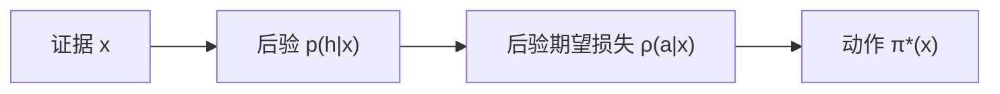
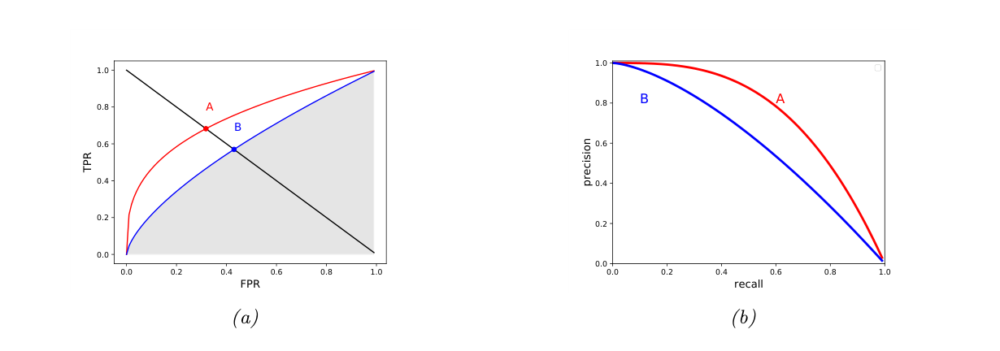
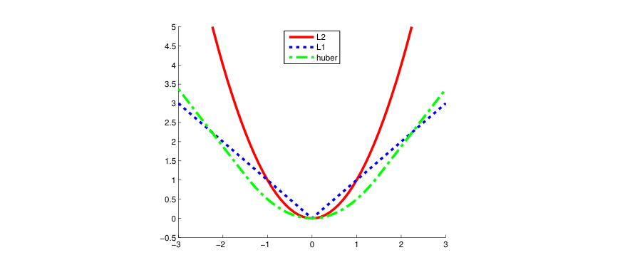
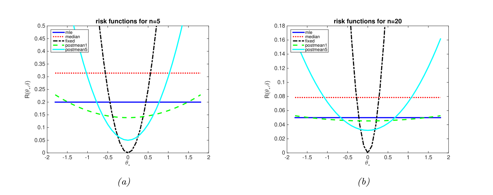
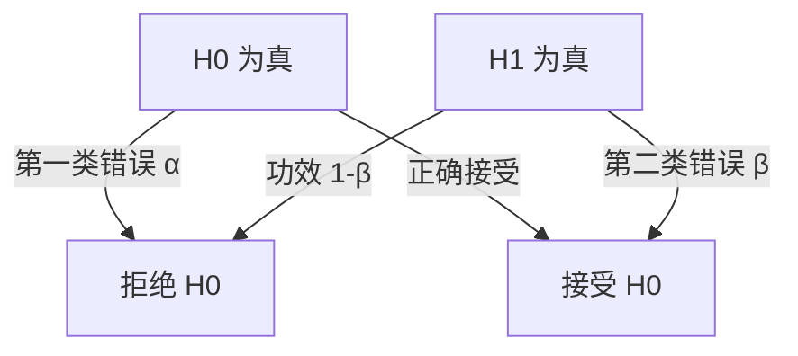

# 第5章 决策理论

### 来源说明

- 作者：Kevin P. Murphy
- 书名：*Probabilistic Machine Learning: An Introduction*（概率机器学习导论）
- 官方来源：https://github.com/probml/pml-book/releases/latest/download/book1.pdf
- 纸书由 MIT Press 出版，许可为 CC-BY-NC-ND。页脚写明在线版日期为 2025-04-18。本笔记仅供个人学习使用。

阅读范围：Chapter 5 Decision Theory（决策理论），PDF 第 197–236 页。第 5 章标题在 PDF 第 197 页，正文与习题到 PDF 第 235 页。PDF 第 236 页没有继续的正文。第 6 章从 PDF 第 237 页开始。带星号的 5.4.4 与 5.5 仍在本章范围内，一并记下。习题只收正文已经写出的结论，不补证明。

### 本章总览

推断给出后验 $p(h|x)$。决策理论再把信念变成动作。智能体有动作集 $\mathcal{A}$，自然状态是 $h\in\mathcal{H}$。损失 $\ell(h,a)$ 表示状态为 $h$ 时采取 $a$ 的代价。给定证据 $x$，比较各动作的后验期望损失，取最小的那个。效用取损失的相反数时，同一规则变成最大期望效用。

这一套先用于分类、回归和概率预测，再用于模型选择。0-1 损失选出后验最大的类。代价敏感和拒识会改阈值。ROC 与 PR 曲线比较一串阈值，而不是只报一个点。平方损失的最优动作是后验均值，绝对损失是后验中位数。比较两个模型时，0-1 损失在均匀模型先验下比较边际似然，比值叫贝叶斯因子。

后半章把状态 $\theta$ 当成固定未知量，对数据取期望，得到频率派风险。贝叶斯风险是再对先验平均。经验风险用训练样本代替未知的总体分布。假设检验一节把「选哪个模型」写成控制第一类错误的检验，并说明 $p$ 值不是 $p(H_0|D)$。

图注：贝叶斯决策不直接拿似然最大的状态当答案。先把损失对后验平均，再在动作集里取最小。证据可以是单次观测，也可以是整份数据集。

### 核心知识点

#### 后验期望损失

状态不必被完全观测。书中的例子把患者年龄当成可直接看到的量，把是否患有 COVID-19 当成必须从检验推断的量。损失矩阵是假设的，单位用质量调整生命年（quality-adjusted life year, QALY）。年轻人的期望 QALY 取 60，老年人取 10，给药的代价取 8。表 5.1 因此是：未患病时不给药损失 0、给药损失 8；年轻患者不给药损失 60、给药损失 8；年老患者不给药损失 10、给药损失 8。这些数表示决策者的相对偏好。书中指出，一致的偏好可以换成序数代价，此处不证明。

后验期望损失，也叫风险，是

$$
\rho(a|x)\triangleq\mathbb{E}_{p(h|x)}[\ell(h,a)]=\sum_{h\in\mathcal{H}}\ell(h,a)\,p(h|x).
\tag{5.1}
$$

最优策略 $\pi^\star(x)$ 也叫贝叶斯估计（Bayes estimator）或贝叶斯决策规则：

$$
\pi^\star(x)=\operatorname{argmin}_{a\in\mathcal{A}}\mathbb{E}_{p(h|x)}[\ell(h,a)].
\tag{5.2}
$$

令效用 $U(h,a)=-\ell(h,a)$，则

$$
\pi^\star(x)=\operatorname{argmax}_{a\in\mathcal{A}}\mathbb{E}_h[U(h,a)].
\tag{5.3}
$$

这叫最大期望效用原理（maximum expected utility principle）。

观测 $x$ 含年龄和检验结果。表 5.2 用第 2 章算出的患病后验，再套表 5.1。检验阴性、患病概率 0.01 时，年轻与年老的不给药代价分别是 0.84 和 0.14，都低于给药的 8，动作是不给药。检验阳性、患病概率 0.80 时，年轻的不给药代价是 47.73，给药是 8，动作是给药；年老的不给药代价是 7.95，仍低于 8，动作是不给药。把药的代价从 8 改到 5，最优策略变成所有阳性都给药。把灵敏度从 0.875 提高到 0.975，阳性者的患病概率从 0.80 升到 0.81，药价仍为 8 时也会对所有阳性给药。

到这里默认决策者风险中性（risk neutral）：确定拿到 50，和以 1/2 概率拿到 100 或 0，对他相同。风险厌恶（risk averse）会选确定的 50。书中说框架可以推广到风险敏感，但这里不展开。

👉 患病后验来自第 2 章 2.3.1 节的贝叶斯诊断。检验的灵敏度、特异度先变成患病概率，本章只拿这个概率去乘损失。阳性概率 0.80 以及改灵敏度后的 0.81 都是书中已经算好的数。📝待补全

🔑 关键速记：最优动作最小化后验期望损失 (5.1)；效用是损失的相反数，规则变成 (5.3)。

#### 分类：0-1 损失、代价敏感与拒识

状态和动作都是类别，$\mathcal{H}=\mathcal{Y}=\{1,\ldots,C\}$，$\mathcal{A}=\mathcal{Y}$。0-1 损失（zero-one loss）是

$$
\ell_{01}(y^\star,\hat y)=\mathbb{I}(y^\star\neq\hat y).
\tag{5.5}
$$

后验期望损失就是预测错误的概率：

$$
\rho(\hat y|x)=p(\hat y\neq y^\star|x)=1-p(y^\star=\hat y|x).
\tag{5.6}
$$

最小风险的动作是后验最大的标签，也就是最大后验（maximum a posteriori, MAP）估计：

$$
\pi(x)=\operatorname{argmax}_{y\in\mathcal{Y}}p(y|x).
\tag{5.7}
$$

二分类的损失写成四格 $\ell_{00},\ell_{01},\ell_{10},\ell_{11}$。记 $p_0=p(y^\star=0|x)$，$p_1=1-p_0$。选 $\hat y=0$ 当且仅当

$$
\ell_{00}p_0+\ell_{10}p_1<\ell_{01}p_0+\ell_{11}p_1.
\tag{5.9}
$$

正确分类的损失为 0 时，简化成

$$
p_1<\frac{\ell_{01}}{\ell_{01}+\ell_{10}}.
\tag{5.10}
$$

若假阴性代价是假阳性的 $c$ 倍，$\ell_{10}=c\ell_{01}$，则选 0 当且仅当 $p_1<1/(1+c)$。$c=2$ 时，判阳性的阈值是 $1/3$。

拒识（reject option）把动作扩成 $\mathcal{A}=\mathcal{Y}\cup\{0\}$，0 表示「不知道」。损失 (5.11)：判对为 0，拒识代价 $\lambda_r$，判错代价 $\lambda_e$。最优规则是 Chow 规则（Chow's rule）。令

$$
y^\star=\operatorname{argmax}_y p(y|x),\quad p^\star=\max_y p(y|x),\quad\lambda^\star=1-\frac{\lambda_r}{\lambda_e},
\tag{5.13–5.15}
$$

则 $p^\star>\lambda^\star$ 时输出 $y^\star$，否则拒识，即 (5.12)。图 5.1 把两类后验画在输入轴上，两条曲线都低于阈值的那段就是拒识区。书中用 Jeopardy 节目里的 Watson 说明：系统先估计自己有多确信，不够确信就不抢答。

🔑 关键速记：0-1 损失给出 MAP；假阴性更贵就把阳性阈值降到 $1/(1+c)$；最可能类的概率低于 $1-\lambda_r/\lambda_e$ 就拒识。

#### 混淆矩阵与 ROC

固定阈值 $\tau$ 的决策是

$$
\hat y_\tau(x)=\mathbb{I}\bigl(p(y=1|x)\ge 1-\tau\bigr).
\tag{5.16}
$$

$\tau$ 变大时，不等式右边 $1-\tau$ 变小，更容易判成阳性。在 $N$ 个带标签样本上数出假阳性 $\mathrm{FP}_\tau$、假阴性、真阳性、真阴性，放进 $2\times 2$ 混淆矩阵（class confusion matrix）。表 5.3 的行和是真实的阴性个数 $N$、阳性个数 $P$；列和是预测的 $\hat N$、$\hat P$。

按行归一得到 $p(\hat y|y)$，表 5.4。按列归一得到 $p(y|\hat y)$，表 5.5。本章真正用到的比率如下。

| 名称 | 定义 | 书中的别名 |
| --- | --- | --- |
| 真阳性率 TPR | $\mathrm{TP}/(\mathrm{TP}+\mathrm{FN})$ | 灵敏度（sensitivity）、召回率（recall）、命中率 |
| 假阳性率 FPR | $\mathrm{FP}/(\mathrm{FP}+\mathrm{TN})$ | 假警报率、第一类错误率（type I）、fallout |
| 真阴性率 TNR | $\mathrm{TN}/N$ | 特异度（specificity） |
| 假阴性率 FNR | $\mathrm{FN}/P$ | 漏检率、第二类错误率（type II） |
| 精确率 Prec | $\mathrm{TP}/(\mathrm{TP}+\mathrm{FP})$ | 阳性预测值 PPV |
| 阴性预测值 NPV | $\mathrm{TN}/\hat N$ |  |
| 错误发现率 FDR | $\mathrm{FP}/\hat P$ |  |
| 错误遗漏率 FOR | $\mathrm{FN}/\hat N$ |  |

表后要点：$\mathrm{FNR}=1-\mathrm{TPR}$，$\mathrm{FPR}=1-\mathrm{TNR}$，$\mathrm{FDR}=1-\mathrm{PPV}$，$\mathrm{FOR}=1-\mathrm{NPV}$。TPR、FPR 是行内比例；精确率、FDR 是列内比例。

TPR 对 FPR 随 $\tau$ 变化的曲线叫受试者工作特征（receiver operating characteristic, ROC）。图 5.2(a) 里红线系统 A 整段高于蓝线系统 B。

曲线下面积（area under the curve, AUC）越大越好，最大为 1。等错误率（equal error rate, EER）是 $\mathrm{FPR}=\mathrm{FNR}$ 的那个值。因为 $\mathrm{FNR}=1-\mathrm{TPR}$，它是从左上到右下的直线与 ROC 的交点。EER 越小越好，最小为 0，对应左上角。

类别不平衡（class imbalance）不改变 ROC，因为 TPR 只在阳性内部做比，FPR 只在阴性内部做比。绝对假阳性变得很多时，分母 $\mathrm{FP}+\mathrm{TN}$ 也很大，FPR 几乎不动，曲线的变化挤在最左边。这时书中建议改看 PR 曲线。

图注：图 5.2。左图纵轴是 TPR，横轴是 FPR。红线 A 优于蓝线 B。黑线与曲线的交点是 EER，阴影是 B 的 AUC。右图纵轴是精确率，横轴是召回率，越靠近右上越好，仍是 A 优于 B。

🔑 关键速记：ROC 画的是 TPR 对 FPR；AUC 越大越好，EER 越小越好；不平衡时 ROC 的形状不随阴阳比例改变。

#### 精确率、召回率与 F 分数

有些问题里「阴性」的个数取决于算法，而不是问题本身。图像里滑窗检测的真阴性个数随窗口数改变；检索系统的候选集大小也是算法参数。这时用精确率–召回率曲线（precision-recall curve）。精确率是检出里有多少真阳性，召回率就是 TPR：

$$
P(\tau)\triangleq p(y=1|\hat y=1,\tau)=\frac{\mathrm{TP}_\tau}{\mathrm{TP}_\tau+\mathrm{FP}_\tau},
\tag{5.20}
$$

$$
R(\tau)\triangleq p(\hat y=1|y=1,\tau)=\frac{\mathrm{TP}_\tau}{\mathrm{TP}_\tau+\mathrm{FN}_\tau}.
\tag{5.21}
$$

0-1 预测下，二者分别是 $\sum y_n\hat y_n/\sum\hat y_n$ 和 $\sum y_n\hat y_n/\sum y_n$，即 (5.22)、(5.23)。图 5.2(b) 越靠近右上越好。

标量概括有几种，不要混用。前 $K$ 个召回对象上的精确率叫 precision at $K$。原始 PR 曲线下的面积不一定等于插值后的面积，因为精确率可以不随召回率单调下降。书中的例子：召回率 10% 时精确率 90%，召回率 20% 时精确率 96%。插值精确率（interpolated precision）在「召回率至少达到某个值」的前提下取能得到的最大精确率，这个例子里召回率至少 10% 的插值精确率是 96%。插值精确率的平均叫平均精确率（average precision, AP），等于插值 PR 曲线下的面积。多条 PR 曲线的 AP 再平均，叫平均精确率的均值（mean average precision, mAP）。

固定一个阈值后，把精确率 $P$ 和召回率 $R$ 合成

$$
\frac{1}{F_\beta}=\frac{1}{1+\beta^2}\frac{1}{P}+\frac{\beta^2}{1+\beta^2}\frac{1}{R},
\tag{5.24}
$$

也就是

$$
F_\beta\triangleq(1+\beta^2)\frac{P\cdot R}{\beta^2 P+R}=\frac{(1+\beta^2)\mathrm{TP}}{(1+\beta^2)\mathrm{TP}+\beta^2\mathrm{FN}+\mathrm{FP}}.
\tag{5.25}
$$

$\beta=1$ 时是调和平均：

$$
F_1=\frac{2PR}{P+R}=\frac{\mathrm{TP}}{\mathrm{TP}+\frac12(\mathrm{FP}+\mathrm{FN})}.
\tag{5.27}
$$

调和平均比算术平均保守。若全部判阳性，则 $R=1$，精确率等于患病率。患病率 $10^{-4}$ 时，算术平均约 50%，调和平均约 0.02%。召回更重要用 $\beta=2$，精确率更重要用 $\beta=0.5$。

令阳性比例 $\pi=P/(P+N)$，$r=P/N=\pi/(1-\pi)$。ROC 不随 $r$ 改变，把哪一类叫阳性也不改变 TPR、FPR 的定义方式。精确率则是

$$
\mathrm{Prec}=\frac{\mathrm{TPR}}{\mathrm{TPR}+\frac{1}{r}\mathrm{FPR}}.
\tag{5.28}
$$

$r\to\infty$ 时精确率趋于 1，$r\to 0$ 时趋于 0。$r$ 从 0.5 降到 0.1，同一阈值上的精确率下降、召回率不变，整条 PR 曲线下移。不同患病率的检测任务不能把精确率随便平均。[Wil20] 指出 PR 对不平衡敏感，ROC 不敏感。$F_\beta$ 同样依赖 $r$，见 (5.31)。

🔑 关键速记：阴性个数由算法决定时看 PR，不看 ROC；$F_1$ 是调和平均，两个数都高才会高。

#### 回归的三种损失

动作和状态都在实数轴上时，损失可以逐坐标用到 $\mathbb{R}^D$。

平方损失，也叫 $\ell_2$ 损失，

$$
\ell_2(h,a)=(h-a)^2.
\tag{5.32}
$$

风险对 $a$ 求导并令其为零，最优动作是后验均值。书中把求导条件放到第 8 章，这里只留结论：

$$
\pi(x)=\mathbb{E}[h|x]=\int h\,p(h|x)\,dh.
\tag{5.34}
$$

这叫最小均方误差估计（minimum mean squared error, MMSE）。

绝对损失 $\ell_1(h,a)=|h-a|$ 对离群点不那么敏感。最优估计是后验中位数：$\Pr(h<a|x)=\Pr(h\ge a|x)=0.5$。习题 5.4 要求证明这一点，正文已经把结论写出。

Huber 损失在阈值 $\delta$ 两侧切换。记 $r=h-a$，

$$
\ell_\delta(h,a)=
\begin{cases}
r^2/2 & |r|\le\delta,\\
\delta|r|-\delta^2/2 & |r|>\delta.
\end{cases}
\tag{5.36}
$$

小误差段是平方，大误差段是线性。图 5.3 取 $\delta=1.5$。$\ell_2$ 的定义 (5.32) 没有前面的 $1/2$，所以和图里的 Huber 二次段不是同一个式子，只是同一类二次惩罚。

可微时，后验期望损失对动作的导数为零，是内部极小的必要条件。平方损失下这个条件直接解出后验均值，绝对值损失则在中位数处左右概率平衡。稳健回归是把这两种损失放进回归目标，用来减轻离群点把估计拉偏。

👉 求导条件在第 8 章。中位数损失与 Huber 损失怎样写进回归，书中分别指向第 11 章 11.6.1 与 11.6.3，本章不写算法。📝待补全

图注：图 5.3。横轴是误差，纵轴是损失，$\delta=1.5$。红线 $\ell_2$ 在远离 0 时升得最快。蓝点线 $\ell_1$ 是折线。绿点划线 Huber 在 $\delta$ 内贴近二次，在 $\delta$ 外改成直线，大误差不被平方放大。

🔑 关键速记：平方损失选后验均值，绝对损失选后验中位数，Huber 在 $\delta$ 内用平方、在 $\delta$ 外用线性。

#### 概率预测与评分规则

动作也可以是一个分布 $q$，真实状态是另一个分布 $p$。比较分布的常用损失是 Kullback–Leibler 散度（Kullback–Leibler divergence）：

$$
D_{\mathrm{KL}}(p\parallel q)\triangleq\sum_y p(y)\log\frac{p(y)}{q(y)}.
\tag{5.37}
$$

它满足 $D_{\mathrm{KL}}(p\parallel q)\ge 0$，等号当且仅当 $p=q$，而且 $p$ 与 $q$ 不对称。拆开就是

$$
D_{\mathrm{KL}}(p\parallel q)=-H(p)+H_{\mathrm{ce}}(p,q),
\tag{5.39}
$$

其中熵 $H(p)=-\sum p\log p$，交叉熵 $H_{\mathrm{ce}}(p,q)=-\sum p\log q$。熵大表示 $p$ 不确定；均匀时最大，退化成一点时为 0。交叉熵是用 $q$ 设计的码去压缩来自 $p$ 的数据时期望比特数。KL 是因为用错分布而多付的比特。$H(p)$ 与 $q$ 无关，所以最小化 KL 等价于最小化交叉熵。

真实分布是独热（one-hot）$\mathbb{I}(Y=c)$ 时，交叉熵变成 $-\log q(c)$，叫对数损失（log loss）。

恰当评分规则（proper scoring rule）要求 $\ell(p,p)\le\ell(p,q)$，等号当且仅当 $p=q$。交叉熵是恰当的，因为 $D_{\mathrm{KL}}(p\parallel p)=0\le D_{\mathrm{KL}}(p\parallel q)$。

对数项对很小的概率很敏感。Brier 分数（Brier score）改用平方误差。$N$ 个独热结果 $y_{nc}$ 对预测 $q_{nc}$：

$$
\mathrm{BS}(p,q)\triangleq\frac1N\sum_{n=1}^N\sum_{c=1}^C(q_{nc}-y_{nc})^2.
\tag{5.44}
$$

二分类时两个类的平方误差相同，书中常把多类定义除以 2，得到 $\frac1N\sum(q_n-y_n)^2$，范围 $[0,1]$，0 最好。Brier 技能分数 $\mathrm{BSS}=1-\mathrm{BS}/\mathrm{BS}_{\mathrm{ref}}$，范围 $[-1,1]$，1 最好，0 表示没有超过参照。二分类的常见参照是样本里阳性的比例，气象里叫样本内的气候态预测。参照也可以是另一个数值天气预报模型。

👉 熵、交叉熵和 KL 的定义、非负性和前向/反向差异在第 6 章。本章只把它们当作预测分布的损失。独热向量的图在第 2 章图 2.1。📝待补全

🔑 关键速记：最小化 KL 就是最小化交叉熵；独热目标下变成 $-\log q(c)$；Brier 分数是预测概率的均方误差。

#### 贝叶斯因子与模型选择

两个模型 $M_0$（零假设）和 $M_1$（备择）里，0-1 损失选择后验更大的一个。均匀先验 $p(M_0)=p(M_1)=0.5$ 时，规则变成比较边际似然之比，即贝叶斯因子（Bayes factor）

$$
B_{1,0}\triangleq\frac{p(D|M_1)}{p(D|M_0)}.
\tag{5.45}
$$

它和似然比的差别是参数被积分掉了，因此可以比复杂度不同的模型。$B_{1,0}>1$ 偏好模型 1。Jeffreys 尺度（表 5.6）给证据强度，它是 $p$ 值的贝叶斯替代，不是同一种概率。

| 贝叶斯因子 $B_{1,0}$ | 书中的解释 |
| --- | --- |
| $B<1/100$ | 对 $M_0$ 决定性证据 |
| $B<1/10$ | 对 $M_0$ 强证据 |
| $1/10<B<1/3$ | 对 $M_0$ 中等证据 |
| $1/3<B<1$ | 对 $M_0$ 弱证据 |
| $1<B<3$ | 对 $M_1$ 弱证据 |
| $3<B<10$ | 对 $M_1$ 中等证据 |
| $B>10$ | 对 $M_1$ 强证据 |
| $B>100$ | 对 $M_1$ 决定性证据 |

表后要点：前两行都是上界，强证据的区域套在决定性证据外面，表不是把正半轴切成互不重叠的区间。$B$ 只略大于 1 时，书中明确说还不能很有把握。

硬币例子：$M_0$ 是公平硬币 $\theta=0.5$，边际似然是 $(1/2)^N$。$M_1$ 让 $\theta\in[0,1]$，Beta 先验下

$$
p(D|M_1)=\frac{B(\alpha_1+N_1,\alpha_0+N_0)}{B(\alpha_1,\alpha_0)}.
\tag{5.47}
$$

图 5.4(a) 取 $N=5$、均匀先验 $\alpha_0=\alpha_1=1$。出现 2 或 3 次正面时，$M_0$ 更可信，因为无参数的简单模型若碰巧打出接近对半的结果并不奇怪；次数很偏时才偏好有偏硬币。对称先验下曲线形状对 $\alpha$ 不敏感。$\log B_{1,0}$ 与 $\log p(D|M_1)$ 只差一个常数。图 5.4(b) 是 BIC 近似，纵轴刻度因 $N$ 固定而是任意的。

模型多于两个时，0-1 损失选择后验最大的模型 (5.48)。均匀模型先验下，这就是边际似然最大：

$$
p(D|m)=\int p(D|\theta,m)\,p(\theta|m)\,d\theta.
\tag{5.51}
$$

它也叫证据（evidence）：把似然对先验平均。所有 $\theta$ 都给数据高概率，模型才好。

一维多项式回归的例子用均匀模型先验，权重先验靠经验贝叶斯估计。$N=5$ 时，1、2、3 次多项式的对数证据分别约为 $-16.28$、$-20.64$、$-24.95$，后验集中在次数 1。$N=30$ 时分别约为 $-146.15$、$-72.37$、$-77.22$，MAP 模型是次数 2。样本变多才支持更复杂的多项式。图 5.5 与图 5.6 里，绿实线是真函数，红虚线是预测，蓝点线是均值上下 $2\sigma$。

👉 Beta–Bernoulli 的边际似然公式 (4.143) 在第 4 章。经验贝叶斯和证据的算法在第 11 章 11.7 与 11.7.7。本章只使用比较的结果：数据少时选低次，数据多时可以升一次。📝待补全

🔑 关键速记：均匀模型先验下，选模型就是选边际似然最大者；贝叶斯因子是两个边际似然之比。

#### 奥卡姆剃刀与信息准则

简单模型 $m_1$ 和复杂模型 $m_2$ 都能把参数调到使似然很大时，仍应偏好更简单的那个。这是奥卡姆剃刀（Occam's razor）。边际似然会自动这样：复杂模型的先验要在更大的参数空间里积分为 1，好参数 $\hat\theta_2$ 分到的先验质量更少，平均时会算进低似然区域。简单模型的先验集中在较小体积里。这叫贝叶斯奥卡姆剃刀效应。

另一种看法是概率质量守恒。所有可能数据集上 $p(D'|m)$ 之和为 1。复杂模型能解释的数据集更多，分给每一个的质量更薄。图 5.7 把数据集按抽象复杂度排在横轴上：太窄的模型给观测 $D_0$ 的概率低，太宽的模型也低，居中的模型最高。

边际似然还可以写成一连串预测，

$$
p(D|m)=\prod_{n=1}^N p(y_n|x_n,D_{1:n-1},m).
\tag{5.52}
$$

用插件近似把后验换成 $\hat\theta_m(D_{1:n-1})$ 上的点质量，对数边际似然近似成过去数据上逐点的对数预测概率 (5.55)。留一交叉验证用的是去掉第 $n$ 个样本后的全部其余数据，这里只用「过去」。直觉相同：过于复杂的模型会把早期样本拟合死，后面的点就预测差。

边际似然对先验敏感，也难算。信息准则（information criteria）改成负对数似然加复杂度惩罚：$L(m)=-\log p(D|\hat\theta,m)+C(m)$。把负对数似然乘 $-2$ 得到偏差（deviance），某些高斯模型里式子更好看。

BIC（Bayesian information criterion）来自后验的高斯近似。均匀先验下丢掉先验项，再用 MLE：

$$
\log p(D|m)\approx\log p(D|\hat\theta)-\frac12\log|H|.
\tag{5.57}
$$

$\log|H|$ 叫奥卡姆因子，衡量后验体积。把每个样本的经验 Fisher 信息近似成同一个 $\hat H$，则 $\log|H|=D_m\log N+\log|\hat H|$，$D_m=\dim(\theta)$，并假设 $H$ 满秩。$\log|\hat H|$ 不随 $N$ 增长，相对似然可以丢掉。要最大化的分数和要最小化的损失是

$$
J_{\mathrm{BIC}}(m)\approx\log p(D|\hat\theta,m)-\frac{D_m}{2}\log N,
\tag{5.59}
$$

$$
L_{\mathrm{BIC}}(m)=-2\log p(D|\hat\theta,m)+D_m\log N.
\tag{5.60}
$$

AIC（Akaike information criterion）是

$$
L_{\mathrm{AIC}}(m)=-2\log p(D|\hat\theta,m)+2D_m.
\tag{5.61}
$$

惩罚不随 $N$ 增长，比 BIC 更轻。书中说它可以从频率派推导，本章不写该推导。

最小描述长度（minimum description length, MDL）用信息论给模型打分：发送方要用尽量少的比特把数据交给接收方。参数只能可靠地估到 $O(1/\sqrt N)$，每个参数大约用 $\frac12\log_2 N$ 比特。再用模型编码数据，花费 $-\log p(D|\hat\theta,m)$。总费用

$$
L_{\mathrm{MDL}}(m)=-\log p(D|\hat\theta,m)+\frac{D_m}{2}\log N
\tag{5.62}
$$

与 BIC 同一形式。比特计数用了 $\log_2$，(5.62) 里写成 $\log$。最小消息长度是相近准则，本章不展开。

参数高度相关、似然不能唯一确定参数时，自由度难算。参数到似然不是一一对应时，模型是奇异统计模型，Fisher 信息矩阵和上面的 Hessian 可能奇异。过参数化模型有同类问题。WAIC（widely applicable information criterion，也叫 Watanabe–Akaike）不依赖这个自由度。它用期望对数逐点预测密度

$$
\mathrm{ELPD}(m)=\sum_n\log p(y_n|D,m)=\sum_n\log\mathbb{E}_{\theta|D,m}[p(y_n|\theta,m)],
$$

复杂度是这些预测概率在后验样本上的方差再取对数，$C(m)=\sum_n\log\mathbb{V}_{\theta|D,m}[p(y_n|\theta,m)]$。同一个点上不同后验样本给出很不一样的预测，就说明模型太灵活。要最小化的损失写成 $L_{\mathrm{WAIC}}(m)=-2\,\mathrm{LPPD}(m)+2C(m)$。定义段的名字是 ELPD，损失式里写成 LPPD，都是逐点对数后验预测密度之和。

WAIC 对参数后验取期望。边际似然对先验取平均，所以更吃先验。书中因此说模型选择一般更适合用 WAIC。具体的蒙特卡罗近似不在本章。

👉 高斯近似 (4.215) 与 4.6.8.2、经验 Fisher 信息 4.7.2、参数精度 $O(1/\sqrt N)$ 的 4.6.4.1，都在第 4 章。压缩比特的严格下界在第 6 章的熵。续作 [Mur23] 才讨论更多计算方法。📝待补全

🔑 关键速记：BIC 的惩罚是 $\frac{D_m}{2}\log N$，AIC 是常数 $D_m$，MDL 与 BIC 同形；奇异模型用 WAIC，复杂度看后验预测有多散。

#### 效应量与实际等价区域

贝叶斯因子要算两个边际似然，既贵又依赖先验。很多问题关心的是效应量（effect size）有多大，而不是它是不是恰好为 0。点零假设常被当成稻草人。

两个分类器的平均精度差 $\Delta=\mu_1-\mu_2$。$p(\Delta>0|D)$ 很大，改进仍可能没有实际意义。更有用的是 $p(\Delta>\epsilon|D)$ 或 $p(|\Delta|>\epsilon|D)$。区间 $R=[-\epsilon,\epsilon]$ 叫实际等价区域（region of practical equivalence, ROPE）。三个事件是：$H_0:\Delta\in R$，两者实际上一样；$H_A:\Delta>\epsilon$，模型 1 更好；$H_B:\Delta<-\epsilon$，模型 2 更好。比较它们只需要后验 $p(\Delta|D)$，不必算贝叶斯因子。

同一批测试样本上的配对比较用差值 $d_i=e^1_i-e^2_i$。$e$ 可以是错误，也可以是条件对数似然。假设 $d_i\sim\mathcal{N}(\Delta,\sigma^2)$。$(\Delta,\sigma)$ 用无信息先验时，均值的后验边缘是学生分布

$$
p(\Delta|d)=\mathcal{T}_{N-1}(\Delta\mid\mu,s^2/N),
$$

$\mu$ 是样本均值，$s^2$ 是除以 $N-1$ 的无偏方差。由此计算 $p(|\Delta|>\epsilon|d)$。书中举例 $\epsilon=0.01$。这叫贝叶斯 $t$ 检验。后验若紧紧围着 0，就看不出实际差别。箱线图连这个分布假设都可以省掉。

两套不同测试集上，正确个数 $y_m\sim\mathrm{Bin}(N_m,\theta_m)$，$\Delta=\theta_1-\theta_2$。均匀先验 $\mathrm{Beta}(1,1)$ 给出独立的后验 $\mathrm{Beta}(y_m+1,N_m-y_m+1)$。$p(\Delta>\epsilon|D)$ 用一维数值积分或解析式。这叫贝叶斯 $\chi^2$ 检验。

表 5.7 是左利手的 $2\times 2$ 列联表：男性 9 对 43，女性 4 对 44，合计 13 对 87，共 100 人。MLE 是 $\hat\theta_1=9/52=0.1731$，$\hat\theta_2=4/48=0.0417$。样本不大。书中算出 $p(\theta_1>\theta_2|D)=0.901$，与「男性左利手更常见」的方向一致，但不是点零假设的贝叶斯因子。

🔑 关键速记：与其问效应是不是恰好为零，不如看后验落在 $[-\epsilon,\epsilon]$ 外面的概率；配对用学生分布，两组比率用两个 Beta 的差。

#### 频率派风险

频率派把 $\theta$ 当成固定未知数，把数据 $x$ 当成随机的。估计量 $\delta$ 的风险是损失对数据的期望，不再对后验平均：

$$
R(\theta,\delta)\triangleq\mathbb{E}_{p(x|\theta)}[\ell(\theta,\delta(x))].
\tag{5.64}
$$

例子是估计高斯均值。$x_n\sim\mathcal{N}(\theta^\star,\sigma^2=1)$，损失是平方误差，风险就是均方误差。五个估计量是：样本均值 $\delta_1=\bar x$；样本中位数 $\delta_2$；常数 $\delta_3=\theta_0$；以及先验 $\mathcal{N}(\theta|\theta_0,\sigma^2/\kappa)$ 下的后验均值

$$
\delta_\kappa(x)=\frac{N}{N+\kappa}\bar x+\frac{\kappa}{N+\kappa}\theta_0.
\tag{5.65}
$$

图里 $\theta_0=0$，弱先验 $\kappa=1$，强先验 $\kappa=5$。均方误差拆成方差加偏差平方之后，风险是：

| 估计量 | 风险 |
| --- | --- |
| 样本均值 | $\sigma^2/N$，无偏 |
| 样本中位数 | 约 $\pi/(2N)$，$\pi=3.14$，无偏 |
| 常数 $\theta_0$ | $(\theta^\star-\theta_0)^2$，方差为 0 |
| 后验均值 | $\dfrac{N\sigma^2+\kappa^2(\theta_0-\theta^\star)^2}{(N+\kappa)^2}$ |

表后要点：谁最好取决于未知的 $\theta^\star$。$\theta^\star$ 几乎就是 $\theta_0$ 时，常数最好；离 $\theta_0$ 不远时，后验均值最好；离得很远时，MLE 最好。图 5.8 比较 $N=5$ 与 $N=20$。图注把每条曲线写成 $R(\hat\theta_i(\cdot),\theta^\star)$，(5.64) 的自变量顺序是 $R(\theta,\delta)$。横轴仍是真实均值 $\theta^\star$。

对先验 $\pi_0$ 再平均，得到贝叶斯风险，也叫积分风险，

$$
R_{\pi_0}(\delta)\triangleq\mathbb{E}_{\pi_0(\theta)}[R(\theta,\delta)].
\tag{5.74}
$$

最小化它的规则仍叫贝叶斯估计。把联合分布写成后验，它和 (5.2) 是同一个动作 (5.75)。逐次按后验行动，平均下来也达到频率派目标。

不想放先验时，用最大风险 $R_{\max}(\delta)=\sup_\theta R(\theta,\delta)$。最小化它的是极小化极大估计（minimax estimator）。图 5.9 里 $\delta_1$ 的最坏风险更低，即使 $\delta_2$ 在大多数 $\theta$ 上更好。极小化极大估计等于某个最不利先验下的贝叶斯估计。除了博弈，把自然当成对手通常过于悲观。

参数可识别是指 $p(x|\theta)=p(x|\theta')$ 当且仅当 $\theta=\theta'$。估计量相合（consistent）是指 $N\to\infty$ 时 $\hat\theta(x)$ 依概率趋于真值 $\theta^\star$。这相当于在参数上最小化 0-1 损失。MLE 是相合估计的一个例子。无偏不一定相合：$\delta(x)=x_N$ 的期望仍是均值，但抽样分布不缩成一个点。真实数据往往不来自所选模型族，这时更有用的是缩小经验分布和估计分布的差异。差异取 KL 时，估计就是 MLE。

$\delta_1$ 支配 $\delta_2$ 是指对所有 $\theta$ 都有 $R(\theta,\delta_1)\le R(\theta,\delta_2)$，并且至少一个 $\theta$ 上严格小于，才叫严格支配。不被严格支配的估计量是可容许的（admissible）。在一些技术条件下，可容许规则都等价于某种贝叶斯规则。图 5.8 里中位数的风险始终高于样本均值，所以中位数不是均值的可容许估计。更意外的是 Stein 悖论：高斯似然加平方损失时，样本均值也不总是可容许的。本章只点名，不写多维收缩估计。

可容许性的用处有限。$X\sim\mathcal{N}(\theta,1)$、平方损失下，常数 $\delta_1(x)=\theta_0$ 是可容许的：它在 $\theta_0$ 处风险为 0，任何别的估计量要在这一点不更差，就必须几乎处处等于它。这个估计完全忽略数据。反过来，有用的估计也可以不可容许。

图注：图 5.8。横轴是未知均值 $\theta^\star$，纵轴是平方损失下的风险，$\sigma^2=1$。蓝实线是样本均值，红点线是中位数，黑虚线是常数 0，绿虚线是 $\kappa=1$ 的后验均值，青实线是 $\kappa=5$。左图 $N=5$，右图 $N=20$。靠近 0 时强先验或常数的风险更低；离 0 远时水平的 MLE 更稳。中位数整段高于均值。

均方误差可以拆成估计量的方差，加上偏差的平方。无偏估计的风险只剩方差，常数估计的风险只剩偏差。分布之间的差异若用 KL 衡量，使经验分布与模型分布最接近的参数就是最大似然。

👉 偏差–方差分解的推导在第 4 章 4.7.6.3。KL 的定义和非负性在第 6 章。📝待补全

🔑 关键速记：频率派风险对数据取期望、$\theta$ 固定；贝叶斯风险再对先验平均，最优动作仍是最小化后验期望损失。

#### 经验风险、正则与交叉验证

监督学习里，每个 $x$ 有自己的未知输出 $y$，估计量是函数 $f$。总体风险（population risk）对真实联合分布取期望：

$$
R(f)\triangleq\mathbb{E}_{p^\star(x)p^\star(y|x)}[\ell(y,f(x))].
\tag{5.78}
$$

经验分布在每个训练点放质量 $1/|D|$。代进去得到经验风险

$$
R(f,D)=\frac1N\sum_{n=1}^N\ell(y_n,f(x_n)).
\tag{5.80}
$$

它随训练集随机。在假设空间 $\mathcal{H}$ 里最小化它，就是经验风险最小化（empirical risk minimization, ERM），即 (5.81)。

令 $f^{\star\star}$ 为所有函数里总体风险最小者，$f^\star_{\mathcal{H}}$ 为 $\mathcal{H}$ 内的最好者，$f^\star_D$ 为给定训练集上的 ERM 解。多期望之后，

$$
\mathbb{E}[R(f^\star_D)-R(f^{\star\star})]=E_{\mathrm{app}}(\mathcal{H})+E_{\mathrm{est}}(\mathcal{H},N).
\tag{5.83}
$$

第一项是近似误差，衡量 $\mathcal{H}$ 能不能表达最好的函数。第二项是估计误差，衡量有限样本找不准 $\mathcal{H}$ 里的最好函数。假设空间更富时近似误差下降，过拟合通常让估计误差上升。泛化间隙是

$$
\mathrm{GenGap}(f)=R(f)-R(f,D_{\mathrm{train}})\approx R(f,D_{\mathrm{test}})-R(f,D_{\mathrm{train}}).
\tag{5.84}
$$

正则经验风险是 $R_\lambda(f,D)=R(f,D)+\lambda C(f)$，$\lambda\ge 0$ 是超参数。参数化之后惩罚加在 $\theta$ 上。损失是对数损失、惩罚是负对数先验时，最小化正则风险就是 MAP。

若用训练上的正则经验风险去选 $\lambda$，最小值总在 $\lambda=0$，因为惩罚项只会把目标变大。训练误差偏乐观（optimism）。结构风险最小化（structural risk minimization）要的是正则后的总体风险，不是训练风险。估计总体风险的两条路是交叉验证，以及下面的统计学习理论。

验证风险把数据分成训练集和验证集，书中说常用大约 80% 与 20%。在训练集上拟合 $\hat\theta_\lambda$，再在验证集上算不带惩罚的经验风险 (5.91)。样本少时，训练不够、验证也不稳。$K$ 折交叉验证轮流留出一折：

$$
R^{\mathrm{cv}}_\lambda=\frac1K\sum_{k=1}^K R_0\bigl(\hat\theta_\lambda(D_{-k}),D_k\bigr).
\tag{5.92}
$$

$K=N$ 是留一法。用 $R^{\mathrm{cv}}_\lambda$ 选出 $\hat\lambda$ 后，再用全部数据按这个 $\lambda$ 重估参数。图 4.6 是 $K=5$ 的示意。

交叉验证把样本分成几折，每一折轮流当验证集，其余折用来拟合。这样每份数据都既参与训练又参与评估，比单独留出一块验证集更省样本。对数损失加上负对数先验之后，正则经验风险和后验的负对数只差一个不依赖参数的常数，最小值相同，所以就是 MAP。

👉 $K=5$ 的折法示意是第 4 章图 4.6，步骤在 4.5.5 节。后验与 MAP 的定义也在第 4 章，本章只使用这个等价。📝待补全

🔑 关键速记：训练误差选正则一定会选到 $\lambda=0$；验证或 $K$ 折估计的是总体风险，选出 $\lambda$ 后再用全部数据重拟合。

#### 统计学习理论

交叉验证要反复拟合，所以希望有总体风险的解析上界。统计学习理论（statistical learning theory）给泛化误差一个高概率上界。二分类上，若假设被这个界保证，就叫概率近似正确（probably approximately correct, PAC），假设类是 PAC 可学习的。

假设空间有限、$|\mathcal{H}|=\dim(\mathcal{H})$ 时，定理 5.4.1 说：对任意数据分布和任意大小为 $N$ 的样本，

$$
\Pr\Bigl(\max_{h\in\mathcal{H}}|R(h)-R(h,D)|>\epsilon\Bigr)\le 2\dim(\mathcal{H})\,e^{-2N\epsilon^2}.
\tag{5.93}
$$

这里的经验风险是 0-1 损失下的错误率。证明用 Hoeffding 不等式和并集界，步骤不展开。乐观程度随 $|\mathcal{H}|$ 增大，随 $N$ 减小。

$\mathcal{H}$ 无限时不能用元素个数。VC 维（VC dimension）用来衡量有效参数个数。书中不给计算方法，并说明很多模型的 VC 维难算，上界通常很松，实用价值有限。后来针对深度网络有别的泛化估计，本章只引用，不写公式。

🔑 关键速记：有限假设类上，训练误差偏离总体误差超过 $\epsilon$ 的概率被 $|\mathcal{H}|e^{-2N\epsilon^2}$ 控制；无限类改用 VC 维，本章没有可用的计算公式。

#### 频率派假设检验

本节在书中标了星号。选择模型仍要问「相对什么」。零假设 $H_0$ 与备择 $H_1$ 可以看成二分类。均匀先验和 0-1 损失下，最优规则是 $p(D|H_0)/p(D|H_1)>1$ 时接受 $H_0$。这叫似然比检验（likelihood ratio test）。

已知公共方差、比较两个高斯均值时，似然比 (5.98) 只通过样本均值 $\bar x$ 依赖数据。两条密度若只有一个交点 $x^\star$，则 $\bar x<x^\star$ 时比值大于 1。参数被完全指定或仅仅共享，叫简单假设。没有指定全部参数，叫复合假设。复合假设若直接比极大似然，参数更多的一边总会占优。贝叶斯做法是把多余参数积分掉。计算困难、先验又可能设错时，书中改用把参数最大化掉的近似，即最大似然比 (5.100)。

第一类错误是 $H_0$ 为真时接受备择，即假阳性，其概率 $\alpha$ 叫检验的显著性（significance）。第二类错误是 $H_1$ 为真时接受 $H_0$，概率记为 $\beta$。高斯均值例子里，

$$
x^\star=z_\alpha\frac{\sigma}{\sqrt N}+\mu_0,
$$

$z_\alpha$ 是标准正态的上 $\alpha$ 分位数。功效（power）是 $1-\beta$，即 $H_1$ 为真时拒绝 $H_0$ 的概率，也就是真阳性率。$\mu_1=\mu_0$ 时功效等于 $\alpha$；两均值拉开时功效趋于 1。同一 $\alpha$ 下功效处处不低于对方，就说这个检验支配另一个。在显著性 $\alpha$ 的检验里功效最高的，叫最大功效检验。似然比检验就是这样一个检验，即 Neyman–Pearson 引理。证明不展开。图 5.10(a) 用两条高斯和阈值 $x^\star$ 表示 $\alpha$ 与 $\beta$ 两块面积；图 5.10(b) 里同一 $\alpha$ 下曲线 B 的功效高于 A。

图注：显著性 $\alpha$ 是零假设为真时的假阳性率。功效是备择为真时的真阳性率。Neyman–Pearson 引理说，在固定 $\alpha$ 的检验中，似然比检验的功效最高。

零假设显著性检验（null hypothesis significance testing, NHST）有时写不出备择，只问简单零假设是否可信。定义检验统计量 $\mathrm{test}(D)$，与 $\tilde D\sim H_0$ 时会看到的值比较。$p$ 值是

$$
\mathrm{pval}\triangleq\Pr\bigl(\mathrm{test}(\tilde D)\ge\mathrm{test}(D)\mid\tilde D\sim H_0\bigr).
\tag{5.105}
$$

越小，越不利于 $H_0$。传统做法是 $p<\alpha=0.05$ 就拒绝。这样构造的检验，第一类错误率就是 $\alpha$。把阈值设成观测到的统计量时，$\alpha$ 等于这个 $p$ 值，所以 $p$ 值是仍能拒绝 $H_0$ 的最小 $\alpha$。

单侧 $p$ 值是 $1-\Phi(\mathrm{test}(D))$，$\Phi$ 是该统计量抽样分布的分布函数。Wald 统计量 $(\hat\theta-\theta_0)/\widehat{\mathrm{se}}$ 在 MLE 渐近正态下，双侧 $p$ 值约为 $2\Phi(-|\mathrm{test}(D)|)$。抽样分布可以用大样本正态近似，也可以用非参数自助法。比较两个经验分布、零假设是同一分布时，可以用置换检验：统计量取 $|\bar X-\bar Y|$，在 $H_0$ 下打乱样本不应改变它的分布，用随机置换近似尾部概率。

$p=0.05$ 不是「$H_1$ 以 0.95 的概率为真」。要的量是后验 $p(H_0|D)$。把 $p$ 值当成 $H_0$ 的似然、再跳到 $H_1$ 很可能，这个推理无效。书中的类比是：美国人多半不是议员，此人是议员，并不能推出他多半不是美国人。反过来，火星人按定义不是议员，此人是议员，就能推出他不是火星人。后者是从定义向前推的演绎，用的是否定后件。前者是从证据往回推的归纳，必须用概率。均匀先验下，令 $\mathrm{LR}=p(D|H_0)/p(D|H_1)$，

$$
p(H_0|D)=\frac{\mathrm{LR}}{\mathrm{LR}+1}.
\tag{5.107}
$$

议员例子里 $p(D|H_1)=0$，所以后验 $p(H_0|D)=1$。NHST 既不用 $p(D|H_1)$，也不用先验。即使 $p$ 值低到 0.05，均匀先验下 $H_0$ 的后验仍可以到 30% 或更高。

表 5.8 假设 200 项药物试验：无效且「不显著」171，无效且「显著」9，有效且「不显著」4，有效且「显著」16。于是 $\alpha=9/180=0.05$，$\beta=4/20=0.2$。若根据以往经验 90% 的药无效，

$$
p(H_0\mid\text{「显著」})=\frac{\alpha\,p(H_0)}{\alpha\,p(H_0)+(1-\beta)\,p(H_1)}=0.36.
\tag{5.110}
$$

这远大于人们常把 $p=0.05$ 理解成的 5%。与先验知识相反的「显著」结果不应直接相信。

👉 MLE 的渐近正态在第 4 章 4.7.2。自助法与置换检验的操作细节本章只给统计量 $|\bar X-\bar Y|$，完整算法指向 [Was04]。$p$ 值与后验的差距也在 4.7.5 节有频率派推断的其他反例。📝待补全

🔑 关键速记：似然比检验在固定第一类错误 $\alpha$ 时功效最高；$p$ 值是零假设下更极端统计量的概率，不是 $H_0$ 为假的概率。

#### 频率派与贝叶斯

频率派推断会违反似然原理（likelihood principle）：推断应当基于已经观测到的数据的似然，而不是没有观测到的未来数据。贝叶斯方法满足这条原理。Efron 在 1986 年用「为什么不是人人都是贝叶斯派」讨论过这一点。历史上 Laplace 和 19 世纪的许多科学家沿用 Bayes 的提法，Gauss 的统计工作也常被改写成频率派。Savage 与 de Finetti 给出了偏好贝叶斯的理论论据，同时也列出频率派的一批不一致。20 世纪的科学报告仍以非贝叶斯为主。Lindley 曾预期 21 世纪会改变。

书中举的后续变化包括：一些期刊限制 $p$ 值，*The American Statistician* 出过关于 $p$ 值和 NHST 的专刊。计算曾经是障碍；更快的计算机和算法使这一点减弱，算法放在续作。另一条批评是贝叶斯只在模型假设正确时才正确。频率派同样要假设数据如何产生，才能写出估计量的抽样分布。常见模型里，MLE 的抽样分布与无信息先验下的后验可以相同。模型可以用交叉验证、校准和贝叶斯模型检查来核对，这些方法在续作里。

Rubin 的说法可以收成一句：原则上按贝叶斯行动，实践中要校准到真实世界，并避开被数据在相关方面否定的模型。图 5.11 用漫画对照两边：一边在意 $p<0.05$，一边在意荷兰赌意义上的一致投注。荷兰赌定理说明贝叶斯决策在这类赌博问题里是最优的，证明不在本章。

👉 校准和模型检查在续作 [Mur23]。交叉验证的做法见第 4 章 4.5.5。本章不把续作的算法补进来。📝待补全

🔑 关键速记：贝叶斯用观测数据的后验做决策；频率派的 $p$ 值还依赖零假设下没发生的样本。

#### 习题里已经写出的结论

习题 5.1 的拒识损失用 $\lambda_s$ 表示误分类代价，与正文的 $\lambda_e$ 同一角色。题目要求证明：最可能的类还要满足 $p(Y=j|x)\ge 1-\lambda_r/\lambda_s$ 才采纳，否则拒识。这就是 (5.12)。$\lambda_r/\lambda_s$ 从 0 增到 1 时拒识变贵，题目要求定性描述，正文没有写变化方向。

习题 5.2 是报童问题。需求密度 $f$、分布函数 $F$，进价 $C$，售价 $P$。买进量 $Q$ 的期望利润是 (5.112)。题目要求化简后对 $Q$ 求导，并得到

$$
F(Q^\star)=\frac{P-C}{P}.
\tag{5.113}
$$

推导不在正文里展开。

习题 5.3 问：对贝叶斯因子 $B=p(D|H_1)/p(D|H_0)$ 取阈值画的 ROC，和对 $p(H_1|D)$ 取阈值画的 ROC，是否相同。正文没有给答案。

习题 5.4 要求证明 $\ell_1$ 损失下最优估计是后验中位数。结论已在 5.1.5.2 节写出。

🔑 关键速记：拒识阈值和 $\ell_1$ 中位数是正文结论；报童问题的目标式是 $F(Q^\star)=(P-C)/P$；贝叶斯因子与后验哪条 ROC 相同，本章没有回答。

### 关键速记

- 贝叶斯最优动作最小化 $\rho(a|x)=\mathbb{E}[\ell(h,a)|x]$。0-1 损失给出 MAP，平方损失给出后验均值，绝对损失给出后验中位数。
- ROC 比较 TPR 与 FPR，不受阴阳比例影响；PR 和 $F_\beta$ 受患病率影响。AUC 越大越好，EER 越小越好。
- 模型选择在 0-1 损失和均匀模型先验下比较边际似然。BIC 惩罚 $\frac{D_m}{2}\log N$，AIC 惩罚 $D_m$，奇异模型看 WAIC。
- 频率派风险对数据平均。贝叶斯风险再对先验平均，最优规则与 (5.2) 相同。训练误差不能用来选正则强度。
- $p$ 值是 $H_0$ 下的尾概率。药物例子里 $\alpha=0.05$ 仍可对应 $p(H_0|\text{显著})=0.36$。

### 易混淆点与差异对比

**后验期望损失** $\rho(a|x)$ 把证据 $x$ 固定，对状态 $h$ 平均。**频率派风险** $R(\theta,\delta)$ 把 $\theta$ 固定，对数据 $x$ 平均。贝叶斯风险 $R_{\pi_0}(\delta)$ 再对 $\theta$ 的先验平均。三个「风险」的随机变量不同。(5.75) 说的是：最小化贝叶斯风险的那条规则，算出来仍是每个 $x$ 上最小化后验期望损失。

贝叶斯因子是边际似然之比，参数已经积分。似然比里的参数是指定的，或在最大似然比里被最大化。后验赔率还要乘先验赔率。均匀模型先验时，后验赔率才等于贝叶斯因子。

**$p$ 值**小只说明观测统计量在 $H_0$ 下不常见。它没有使用 $p(D|H_1)$，也没有使用 $p(H_0)$。表 5.8 里第一类错误率 0.05、第二类错误率 0.2、无效药先验 0.9，显著结果下无效的后验仍是 0.36。

ROC 的两个轴都是类内比例，把哪一类叫阳性，TPR 与 FPR 的角色会互换，但曲线对患病率 $r$ 不敏感。PR 的精确率含 $1/r$，患病率下降时整条曲线下降。$F_1$ 是调和平均，不是 $(P+R)/2$。

MAP、后验均值、后验中位数来自三种损失，不是三种推断。0-1 损失看众数，$\ell_2$ 看均值，$\ell_1$ 看中位数。Huber 的二次段带 $1/2$，与 (5.32) 的 $(h-a)^2$ 差一个常数因子。

BIC、AIC、MDL 都惩罚 $-\log p(D|\hat\theta)$。AIC 的惩罚不随样本增加。MDL 的两项码与 BIC 同阶，BIC 损失多了一个约定的因子 2。三者都要一个自由度 $D_m$。参数不可识别时这个数不可靠，WAIC 改用后验预测的方差。边际似然对先验平均，WAIC 对后验平均。

可容许不等于有用。常数估计在自己的 $\theta_0$ 上风险为 0，因此可容许，却忽略数据。中位数估计高斯均值时被样本均值支配，因此不可容许。极小化极大看的是最坏 $\theta$，多数 $\theta$ 上风险更低的规则仍可能落选。

似然比检验要有 $H_0$ 和 $H_1$。NHST 可以只有 $H_0$。前者在固定 $\alpha$ 时有最大功效；后者的 $p$ 值是「还能拒绝的最小 $\alpha$」。功效 $1-\beta$ 是 $H_1$ 为真时的真阳性率，不是 AUC。

### 本章要点总结

决策先有损失，再对后验取期望。分类的默认损失是 0-1，最优标签是 MAP；假阳性与假阴性代价不同时阈值离开 $1/2$；最可能类仍不够确信时可以拒识。一串阈值画出 ROC 或 PR。不平衡改变 PR 和 $F_\beta$，不改变 ROC 的 TPR、FPR 定义。连续动作上，平方、绝对和 Huber 分别对应均值、中位数，以及小误差平方、大误差线性。预测分布时，交叉熵是恰当评分规则，Brier 分数是概率向量的均方误差。

模型选择把「选哪个模型」当成 0-1 决策。均匀先验下比较证据。证据对复杂模型有奥卡姆惩罚。BIC、AIC、MDL 是可计算的近似，WAIC 用于自由度说不清的模型。效应是否有实际大小，用 ROPE 上的后验概率，而不是点零假设的贝叶斯因子。

频率派风险解释为什么后验决策在重复抽样下也说得通，并给出相合、可容许、极小化极大这些性质。监督学习里用经验风险代替总体风险，正则强度要靠验证或交叉验证，不能靠训练误差。有限假设类的 PAC 界说明复杂度与样本量怎样控制乐观。假设检验一节把同一套错误类型用到 $H_0$ 与 $H_1$ 上：似然比检验最大功效，$p$ 值不是后验。
