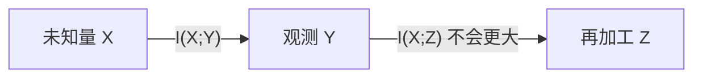
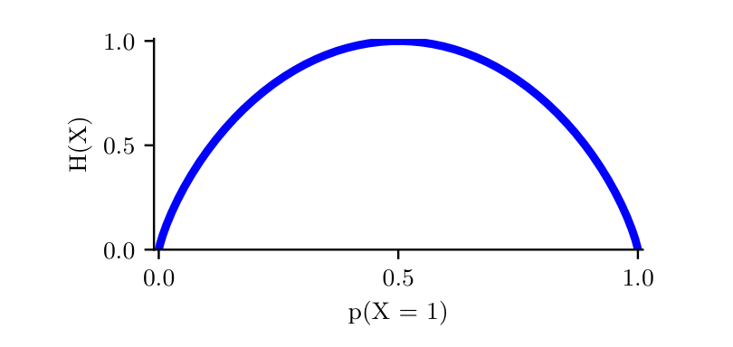
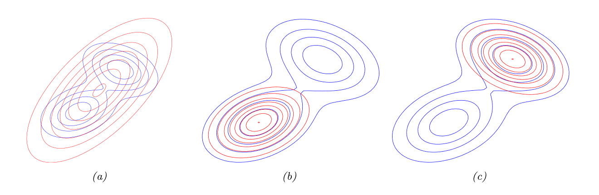
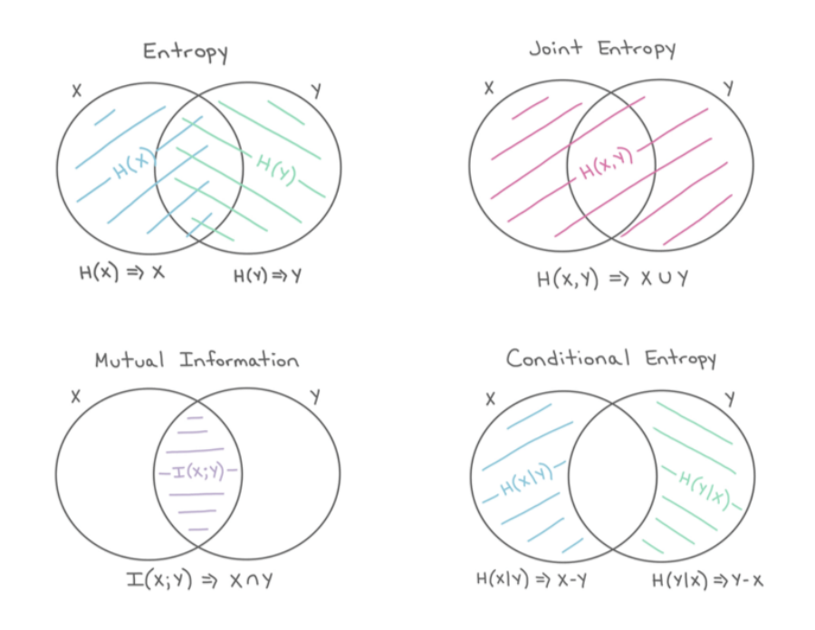

# 第6章 信息论

### 来源说明

- 作者：Kevin P. Murphy
- 书名：*Probabilistic Machine Learning: An Introduction*（概率机器学习导论）
- 官方来源：https://github.com/probml/pml-book/releases/latest/download/book1.pdf
- 纸书由 MIT Press 出版，许可为 CC-BY-NC-ND。页脚写明在线版日期为 2025-04-18。本笔记仅供个人学习使用。

阅读范围：Chapter 6 Information Theory（信息论），PDF 第 237–258 页。标题在 PDF 第 237 页，习题到 PDF 第 257 页。PDF 第 258 页没有继续的正文。第 7 章从 PDF 第 259 页开始，本笔记不读该章。微分熵、KL 散度、互信息以及 Fano 不等式在书中标了星号，仍属于本章，一并记下。证明只留结论。

### 本章总览

熵（entropy）度量一个分布有多难预测。离散均匀分布熵最大，退化成一个点时熵为 0。联合熵、条件熵和互信息（mutual information）描述两个变量共享多少不确定性。条件熵平均来说不会大于边缘熵。互信息是看到另一个变量之后不确定性下降的量，也是联合分布相对「独立模型」的 KL 散度。

KL 散度（Kullback–Leibler divergence）也叫相对熵。它非负，不对称，不满足三角不等式，所以不是度量。前向 KL 让近似分布盖住真实分布的支撑，反向 KL 让近似分布贴住其中一个峰。把 KL 对经验分布最小化，就是最大似然。

数据处理不等式说：沿马尔可夫链把观测再加工，不会增加关于原始未知量的信息。充分统计量是加工之后信息量不降的那种摘要。Fano 不等式把分类错误概率的下界写成条件熵，因此特征选择时会偏好与标签互信息高的特征。

图注：$X\to Y\to Z$ 是马尔可夫链时，关于 $X$ 的互信息沿链不增。这就是数据处理不等式。等号成立时，摘要没有丢掉推断 $X$ 所需的信息。

### 核心知识点

#### 离散熵

分布 $p$ 的熵可以读成随机变量有多不确定。若 $X_n\sim p$ 而且熵高，序列就难预测，数据的信息含量高。熵为 0 的退化分布每次都吐出同一个符号，序列几乎不带信息。压缩的严格表述书中放到续作，这里只用这个直觉。

$K$ 个状态的离散熵是

$$
H(X)\triangleq-\sum_{k=1}^K p(X=k)\log_2 p(X=k)=-\mathbb{E}_X[\log p(X)].
\tag{6.1}
$$

$H(X)$ 指的是这个随机变量的分布的熵，也可以写成 $H(p)$。通常用底数 2，单位是比特（bit）。底数 $e$ 时单位是奈特（nat）。书中的例子：$p=[0.25,0.25,0.2,0.15,0.15]$ 时 $H=2.29$ 比特。

$K$ 元变量的最大熵分布是均匀分布 $p(x=k)=1/K$，此时 $H(X)=\log_2 K$。最小熵是 0，任何把质量全部放在一个状态上的分布都达到它。

二值变量 $p(X=1)=\theta$ 时，

$$
H(X)=-[\theta\log_2\theta+(1-\theta)\log_2(1-\theta)].
\tag{6.4}
$$

这叫二元熵函数，也写成 $H(\theta)$。图 6.1 在 $\theta=0.5$ 处达到最大值 1 比特。公平硬币要一个是否问题才能确定状态。

状态很多时，熵的估计就是分布的估计。英文词的身份有长尾，新词还在增加，$p(X)$ 和 $H(X)$ 都不容易估稳。书中只指向 [VV13]，没有给出算法。

图注：图 6.1。横轴是 $p(X=1)$，纵轴是二元熵。曲线在 0 和 1 处降到 0，在 0.5 处达到 $\log_2 2=1$。越接近确定的 0 或 1，不确定性越小。

源编码定理说，来自分布 $p$ 的数据，平均至少要 $H(p)$ 比特才能无损压缩。用别的分布设计码会更长，多出来的长度就是 KL。第 5 章因此把 $H(p)$ 当成与预测分布 $q$ 无关的常数，最小化 KL 就收成最小化交叉熵。

👉 码本的具体构造在续作 [Mur23]。第 5 章只把交叉熵当作概率预测的损失，不讨论编码。📝待补全

🔑 关键速记：离散熵用 $\log_2$ 时单位是比特；均匀分布最大，单点分布为 0；公平硬币的熵是 1 比特。

#### DNA 序列标志

短 DNA 串上的分布可以用多条比对序列来估计。字母表是 $\{A,C,G,T\}$。位置 $t$ 上四个字母的计数组成长度 4 的向量 $N_t$，见 (6.5)。$\hat\theta_t=N_t/N$ 叫位置权重矩阵（position weight matrix），也叫序列模体（sequence motif）。图 6.2(b) 里字母的面积正比于经验频率。

序列标志（sequence logo）把每一列再乘 $R_t=2-H_t$。这里 $H_t$ 是 $\hat\theta_t$ 的熵，$2=\log_2 4$ 是四字母分布的最大熵。熵为 0 的确定列高度为 2，信息含量最大，进化上往往保守，常位于编码区。每个位置只留概率最大的字母、不管不确定程度，得到的是一致序列（consensus sequence）。

🔑 关键速记：四字母位置上，列高 $2-H_t$ 把「有多确定」画出来；熵 0 的列最高，等于 $\log_2 4$。

#### 交叉熵

分布 $p$ 与 $q$ 的交叉熵（cross entropy）是

$$
H_{\mathrm{ce}}(p,q)\triangleq-\sum_{k=1}^K p_k\log q_k.
\tag{6.7}
$$

它是用来自 $q$ 的码去压缩来自 $p$ 的样本时期望比特数。$q=p$ 时最小，等于 $H(p)$。这是 Shannon 源编码定理的结论，证明不在本章。

🔑 关键速记：交叉熵是「用错误的码本 $q$ 压缩 $p$」的期望长度；码本等于真实分布时，它退回熵。

#### 联合熵与条件熵

两个变量的联合熵是

$$
H(X,Y)=-\sum_{x,y}p(x,y)\log_2 p(x,y).
\tag{6.8}
$$

书中的例子从 $\{1,\ldots,8\}$ 里均匀抽整数。$X=1$ 表示偶数，$Y=1$ 表示素数。联合分布四格是 $1/8,3/8,3/8,1/8$，联合熵

$$
H(X,Y)=1.81\text{ 比特}.
\tag{6.9}
$$

边缘都是均匀的，$H(X)=H(Y)=1$，所以联合熵小于边缘熵之和 2 比特。一般地 $H(X,Y)\le H(X)+H(Y)$，独立时等号成立。相关减少了系统的自由度。下界是：若 $Y$ 是 $X$ 的确定函数，则 $H(X,Y)=H(X)$，因此

$$
H(X,Y)\ge\max\{H(X),H(Y)\}\ge 0.
\tag{6.10}
$$

多添一个未知量不会让熵下降。要下降，必须观测到数据。两个变量的定义可以照样写成 $n$ 个变量。

条件熵是看到 $X$ 之后 $Y$ 还剩多少不确定，再对 $X$ 平均：

$$
H(Y|X)\triangleq\mathbb{E}_{p(X)}[H(p(Y|X))]=H(X,Y)-H(X).
\tag{6.11、6.15}
$$

$Y$ 由 $X$ 唯一决定时 $H(Y|X)=0$。独立时 $H(Y|X)=H(Y)$。由联合熵的上界得到

$$
H(Y|X)\le H(Y),
\tag{6.16}
$$

等号当且仅当独立。平均而言，条件化不会增加不确定。必须加上「平均」：某一个具体的 $x$ 可以让 $H(Y|x)>H(Y)$。期望上，看数据是有益的。

链式法则是

$$
H(X_1,\ldots,X_n)=\sum_{i=1}^n H(X_i|X_1,\ldots,X_{i-1}).
\tag{6.18}
$$

两个变量时就是 $H(X_1,X_2)=H(X_1)+H(X_2|X_1)$。

🔑 关键速记：联合熵不超过边缘熵之和，不低于较大的那个边缘熵；条件熵平均后不会超过边缘熵，单次观测仍可能让人更糊涂。

#### 困惑度

离散分布的困惑度（perplexity）是

$$
\mathrm{perplexity}(p)\triangleq 2^{H(p)}.
\tag{6.19}
$$

均匀分布在 $K$ 个状态上时，困惑度就是 $K$。下界是 $2^0=1$，对应完全能预测结果。

经验分布 $p_D$ 对模型 $p$ 的困惑度用交叉熵：$2^{H_{\mathrm{ce}}(p_D,p)}$。长度为 $N$ 的文档、一元模型 $p(x_n)$ 时，交叉熵是 $-\frac1N\sum\log p(x_n)$，困惑度变成逆预测概率的几何平均 (6.23)，也叫指数交叉熵。

语言模型通常还条件于前面的词。二元模型是一阶马尔可夫 $p(x_i|x_{i-1})$。分支因子是一个词后面能接多少个词。困惑度可以读成加权平均分支因子。若每个词都预测成 $1/K$，困惑度就是 $K$。模型正确反映了不均等的概率，困惑度会低于 $K$。因为 $H(p^\star)\le H_{\mathrm{ce}}(p^\star,p)$，困惑度不能低于真实过程熵所对应的值。这个不等式要等 KL 非负才成立。

🔑 关键速记：困惑度是 $2$ 的熵次方；均匀 $K$ 类时等于 $K$；它不能低于真实分布自己的困惑度。

#### 微分熵

连续随机变量的微分熵（differential entropy）是

$$
h(X)\triangleq-\int p(x)\log p(x)\,dx,
\tag{6.24}
$$

假定积分存在。$X\sim U(0,a)$ 时 $h(X)=\log a$。和离散熵不同，微分熵可以为负，因为密度可以大于 1。$X\sim U(0,1/8)$ 时，书中写成 $h(X)=\log_2(1/8)=-3$。

实数只能写到有限位。$n$ 比特量化后的熵大约是 $h(X)+n$。均匀分布在 $(0,1/8)$ 上时，二进制小数点后前三位必须是 0，描述到 $n$ 比特只需要 $n-3$ 比特，与 $h(X)=-3$ 一致。(6.25) 的 $\log$ 没有再声明底；(6.26) 的高斯熵明确用 $\ln$。按比特解释量化时，书中改用 $\log_2$。

$d$ 维高斯的熵是

$$
h(\mathcal{N}(\mu,\Sigma))=\frac12\ln|2\pi e\Sigma|=\frac d2+\frac d2\ln(2\pi)+\frac12\ln|\Sigma|.
\tag{6.26}
$$

一维是 $\frac12\ln(2\pi e\sigma^2)$。方差变大时，这个熵单调变大。别的分布不一定如此。两个一维高斯分别以 $-1$ 和 $+1$ 为中心，再把中心挪到 $-10$ 和 $+10$，方差变大，熵几乎不变：样本仍只会落在两个峰附近，不确定的是哪一个峰。高斯混合的精确熵难算，书中只说 [Hub+08] 给了上下界，没有写出界的公式。

连续熵不好算时，可以把变量离散化。一种简单做法是按经验分位数分箱。箱数是关键。Scott 的启发式是

$$
B=N^{1/3}\frac{\max(D)-\min(D)}{3.5\,\sigma(D)},
\tag{6.28}
$$

$\sigma(D)$ 是经验标准差，$N=|D|$。$X$ 是高维向量时，分箱受维数诅咒，这一技巧不好用。

🔑 关键速记：微分熵可以为负；高斯熵随 $\ln|\Sigma|$ 增加；双峰拉开时方差变大，熵可以几乎不变。

#### KL 散度

散度 $D(p,q)$ 只要求 $D(p,q)\ge 0$ 且等号当且仅当 $p=q$。度量还要求对称和三角不等式。KL 散度是散度，不是度量。它也叫信息增益或相对熵。离散与连续的定义是

$$
D_{\mathrm{KL}}(p\parallel q)=\sum_k p_k\log\frac{p_k}{q_k}
=\int p(x)\log\frac{p(x)}{q(x)}\,dx.
\tag{6.29、6.30}
$$

拆开是负熵加交叉熵：

$$
D_{\mathrm{KL}}(p\parallel q)=-H(p)+H_{\mathrm{ce}}(p,q).
\tag{6.31}
$$

交叉熵是用 $q$ 的码压缩 $p$ 的数据时比特数的下界，KL 就是用错分布多付的比特。其他解释书中指向续作。

两个多元高斯之间，

$$
\begin{align*}
&D_{\mathrm{KL}}\bigl(\mathcal{N}(x|\mu_1,\Sigma_1)\parallel\mathcal{N}(x|\mu_2,\Sigma_2)\bigr)\\
&=\frac12\Bigl[\operatorname{tr}(\Sigma_2^{-1}\Sigma_1)+(\mu_2-\mu_1)^\top\Sigma_2^{-1}(\mu_2-\mu_1)-D+\log\frac{\det\Sigma_2}{\det\Sigma_1}\Bigr].
\end{align*}
\tag{6.32}
$$

一维写成

$$
D_{\mathrm{KL}}\bigl(\mathcal{N}(x|\mu_1,\sigma_1)\parallel\mathcal{N}(x|\mu_2,\sigma_2)\bigr)
=\log\frac{\sigma_2}{\sigma_1}+\frac{\sigma_1^2+(\mu_1-\mu_2)^2}{2\sigma_2^2}-\frac12.
\tag{6.33}
$$

(6.33) 的符号里，对数项是 $\sigma_2/\sigma_1$，二次项里出现的是 $\sigma_1^2$ 与 $\sigma_2^2$。多元式用的是协方差 $\Sigma$。

定理 6.2.1（信息不等式）：$D_{\mathrm{KL}}(p\parallel q)\ge 0$，等号当且仅当 $p=q$。证明用 $\log$ 的严格凹性和 Jensen 不等式，只留结论。Jensen 不等式本身：凸函数 $f$ 满足 $f(\sum\lambda_i x_i)\le\sum\lambda_i f(x_i)$，$\lambda_i\ge 0$ 且和为 1。$\log$ 是凹的，所以不等式方向相反，$\log(\mathbb{E} g)\ge\mathbb{E}\log g$。

推论 6.2.1：$H(X)\le\log|\mathcal{X}|$，等号当且仅当 $p$ 均匀。这是把 KL 的第二个论证取成均匀分布 $u(x)=1/|\mathcal{X}|$。

凸函数的图像落在弦的上方，所以函数在平均点的值不超过各点函数值的平均。对数是凹的，不等号反过来：平均之后再取对数，不会小于对数的平均。信息不等式就是把这件事用在 $q/p$ 上，得到 KL 非负；只有两分布处处相等时，严格凹才允许等号。

👉 凸函数的定义和图在第 8 章 8.1.3 节。KL 的其他解释在续作 [Mur23]，本章只用非负性、编码差值和前后向两种投影。📝待补全

🔑 关键速记：$D_{\mathrm{KL}}(p\parallel q)\ge 0$，仅当两分布相等时为 0；它不对称，所以不是距离。均匀分布把离散熵推到 $\log|\mathcal{X}|$。

#### KL 与最大似然

要找最接近 $p$ 的 $q$，就是最小化 $D_{\mathrm{KL}}(p\parallel q)$。$p$ 取经验分布 $p_D(x)=\frac1N\sum\delta(x-x_n)$ 时，

$$
D_{\mathrm{KL}}(p_D\parallel q)=-\frac1N\sum_n\log q(x_n)+C,
\tag{6.44}
$$

$C$ 与 $q$ 无关。这就是交叉熵目标，也是训练集上的平均负对数似然。最小化到经验分布的 KL，等价于最大化似然。

这个看法也指出似然训练的毛病：它把有限训练点上的尖峰当成真实分布，别处密度为零。一百万张图仍然比「所有自然图像」少得多。用核密度把经验分布平滑掉是一条路。另一条是数据增强：按认为合理的自然变化去扰动样本，再在扩充后的数据上做最大似然。参数很多时，书中说后者往往更好。

核密度估计在每个样本周围放一个核，把点质量铺成连续密度，避免训练点以外的概率都是零。数据增强按认为合理的变化生成新样本，让似然看到的不只是原始有限集。两者都在缓解经验分布过尖；参数很多时，书中更强调后一条。

👉 核的形式在第 16 章 16.3 节。增强的做法在第 19 章 19.1 节。本章不写具体核或扰动。📝待补全

🔑 关键速记：对经验分布做前向 KL，丢掉与 $q$ 无关的熵之后，就是平均负对数似然。

#### 前向 KL 与反向 KL

用简单的 $q$ 近似 $p$，最小化 $D_{\mathrm{KL}}(p\parallel q)$ 或 $D_{\mathrm{KL}}(q\parallel p)$ 行为不同。

前向 KL，也叫包含 KL（inclusive KL），

$$
D_{\mathrm{KL}}(p\parallel q)=\int p(x)\log\frac{p(x)}{q(x)}\,dx.
\tag{6.45}
$$

对 $q$ 最小化叫 M 投影或矩投影。$p(x)>0$ 而 $q(x)=0$ 时被积项无穷，所以 $q$ 必须盖住 $p$ 有质量的地方。$q$ 是避零的（zero-avoiding），也叫覆盖众数（mode-covering），常常高估 $p$ 的支撑。图 6.3(a) 里 $p$ 双峰、$q$ 单峰，红线把两个蓝峰都罩住。

反向 KL，也叫排他 KL（exclusive KL），

$$
D_{\mathrm{KL}}(q\parallel p)=\int q(x)\log\frac{q(x)}{p(x)}\,dx.
\tag{6.46}
$$

对 $q$ 最小化叫 I 投影或信息投影。$p(x)=0$ 而 $q(x)>0$ 时被积项无穷，所以 $q$ 必须躲开 $p$ 为零的区域。一种做法是只在很少的区域放质量，叫迫零（zero-forcing）或寻找众数（mode-seeking），常常低估支撑。图 6.3(b)(c) 里同一个双峰 $p$，单峰 $q$ 可以锁在左边或右边。

图注：图 6.3。蓝线是双峰真实分布 $p$ 的等高线，红线是单峰近似 $q$。(a) 最小化前向 KL，$q$ 铺开去盖住两个峰。(b) 和 (c) 最小化反向 KL，$q$ 收成其中一个峰，另一个峰被丢掉。

🔑 关键速记：前向 $D_{\mathrm{KL}}(p\parallel q)$ 覆盖众数，反向 $D_{\mathrm{KL}}(q\parallel p)$ 锁住一个众数。两个次序不是同一个优化问题。

#### 互信息

两个随机变量有多依赖，可以换成「联合分布离独立乘积有多远」：

$$
I(X;Y)\triangleq D_{\mathrm{KL}}\bigl(p(x,y)\parallel p(x)p(y)\bigr)
=\sum_{x,y}p(x,y)\log\frac{p(x,y)}{p(x)p(y)}.
\tag{6.47}
$$

写成 $I(X;Y)$ 而不是 $I(X,Y)$，是为了在 $X$ 或 $Y$ 本身是一组变量时仍能看清分组，例如 $I(X;Y,Z)$。连续情形把求和换成积分。因为 KL 非负，

$$
I(X;Y)\ge 0,
\tag{6.48}
$$

等号当且仅当 $p(x,y)=p(x)p(y)$。连续变量也一样。

它有三种熵的写法：

$$
I(X;Y)=H(X)-H(X|Y)=H(Y)-H(Y|X),
\tag{6.49}
$$

$$
I(X;Y)=H(X,Y)-H(X|Y)-H(Y|X),
\tag{6.50}
$$

$$
I(X;Y)=H(X)+H(Y)-H(X,Y).
\tag{6.51}
$$

(6.49) 把互信息读成看到 $Y$ 之后 $X$ 的不确定性减少了多少。由此又得到 $H(X|Y)\le H(X)$，也就是条件化平均后降低熵。图 6.4 用集合图把这几块叠在一起。形式上它是从集合表达式映到信息量的带符号测度。

偶数/素数的例子里 $H(X)=H(Y)=1$。按行归一后 $p(Y|X)$ 的四格是 $1/4,3/4,3/4,1/4$，条件熵 $H(Y|X)=0.81$ 比特，于是

$$
I(X;Y)=1-0.81=0.19\text{ 比特}.
\tag{6.53}
$$

代回 (6.54) 得到联合熵 $0.81+0.19+0.81=1.81$ 比特，与 (6.9) 一致。

图注：图 6.4。左上两圆分别是 $H(X)$ 与 $H(Y)$。右上整块并是联合熵 $H(X,Y)$。左下交集是互信息 $I(X;Y)$。右下两个月牙是条件熵 $H(X|Y)$ 与 $H(Y|X)$。四张图是同一组量的不同切法。

🔑 关键速记：互信息是联合分布到独立乘积的 KL；它等于边缘熵减去条件熵，独立时为 0。

#### 条件互信息

条件互信息是在 $Z$ 已知时 $X$ 与 $Y$ 还共享多少信息：

$$
I(X;Y|Z)=\mathbb{E}_{p(Z)}[I(X;Y)|Z]
=H(X|Z)-H(X|Y,Z).
\tag{6.56、6.59}
$$

它也等于 $I(Y;X,Z)-I(Y;Z)$，见 (6.61)。也就是：$X$ 关于 $Y$ 多告诉的那一部分，要扣掉只靠 $Z$ 已经知道的。链式法则是

$$
I(Z_1,\ldots,Z_N;X)=\sum_{n=1}^N I(Z_n;X|Z_1,\ldots,Z_{n-1}).
\tag{6.63}
$$

两个变量时，$I(Z,Y;X)=I(Z;X)+I(Y;X|Z)$。

🔑 关键速记：条件互信息是扣掉 $Z$ 之后还剩的依赖；互信息的链式法则把一组变量的贡献逐个加上。

#### 高斯情形下的互信息

$(X,Y)$ 联合高斯、边缘方差都是 $\sigma^2$、相关为 $\rho$ 时，由高斯熵 (6.26) 得到

$$
I(X;Y)=-\frac12\log(1-\rho^2).
\tag{6.70}
$$

三个特殊值：$\rho=1$ 时 $X=Y$，互信息为无穷，因为一个实数被完全确定；$\rho=0$ 时独立，互信息为 0；$\rho=-1$ 时 $X=-Y$，互信息同样为无穷。相关的符号不影响信息量，只看 $|\rho|$。

非高斯的连续变量要先估计联合密度。标量可以把两轴分箱再算经验分布上的互信息。箱数和箱边界会明显改变结果。K 近邻距离可以自适应地估密度，这是 [KSG04] 的 KSG 估计。书中点名它实现在 `sklearn.feature_selection.mutual_info_regression`。这里只记名字，不写调用。

🔑 关键速记：联合高斯的互信息只依赖相关系数的绝对值；$\rho=\pm 1$ 时为无穷，$\rho=0$ 时为 0。

#### 归一化互信息与 MIC

由 $I(X;Y)\le\min(H(X),H(Y))$ 可以定义归一化互信息

$$
\mathrm{NMI}(X,Y)=\frac{I(X;Y)}{\min(H(X),H(Y))}\le 1.
\tag{6.74}
$$

NMI 为 0 时两者独立。NMI 为 1 且 $H(X)<H(Y)$ 时 $H(X|Y)=0$，$X$ 是 $Y$ 的确定函数。例子：$p=[0.5,0.25,0.25]$ 时 $I(X;X)=H(X)=1.5$（底数 2），归一化值是 1。连续变量的微分熵对量化尺度敏感，这种归一化更难。

最大信息系数（maximal information coefficient, MIC）换一种归一化。在二维网格 $G$ 上把变量离散化，

$$
\mathrm{MIC}(X,Y)=\max_G\frac{I((X,Y)|G)}{\log\|G\|},
\tag{6.76}
$$

$\|G\|=\min(G_x,G_y)$。分母是该网格上均匀联合分布的熵，保证结果落在 0 与 1 之间。样本量 $n$ 限制网格：$G_x G_y\le B(n)=n^\alpha$，书中取 $\alpha=0.6$。特征矩阵 $M(k,l)$ 是尺寸 $(k,l)$ 的网格能达到的最大互信息，再除以 $\log(\min(k,l))$。MIC 是 $kl\le B(n)$ 范围内 $M$ 的最大元。图 6.5 是这个搜索过程。

等衡性（equitability）是指：噪声程度相同的关系得到相近的分数，不管关系是线性、非线性，还是非函数。后来的 MICe 只在一维网格上用动态规划优化，时间 $O(n)$。TICe 是特征矩阵在 $kl\le B(n)$ 上的和，小样本上更有检测力，等衡性较差。书中建议先用 TICe 筛选，再用 MICe 量化强度。

MIC 为 0 表示没有关系，为 1 表示无噪声的任意形式关系。它不限于线性。图 6.6 把若干二维散点的 $R^2$ 与 MIC 放在一起：线性关系两者都高；弯的或一对多的关系可以 $R^2$ 低而 MIC 高。图 6.7 的图注把 MIC 写成 maximal information criterion，节名则是 coefficient。图的内容是 WHO 的 357 个社会经济与健康指标、63546 对变量：C 点两者都低，对应没有关系；D 与 H 两者都高，接近线性；E、F、G 的相关系数低而 MIC 高，对应非线性或非函数关系。

🔑 关键速记：NMI 用较小的那个边缘熵做分母；MIC 在许多网格上取归一化互信息的最大者，用来抓住非线性关系。

#### 数据处理不等式与充分统计量

未知量 $X$ 的带噪观测是 $Y$，再加工成 $Z$。关于 $X$ 的信息不会因为这次加工变多。正式说法是定理 6.3.1：若 $X\to Y\to Z$ 是马尔可夫链，从而 $X\perp Z\mid Y$，则

$$
I(X;Y)\ge I(X;Z).
$$

同样有 $I(Y;Z)\ge I(X;Z)$。证明用互信息链式法则：$I(X;Y,Z)$ 可以写成 $I(X;Z)+I(X;Y|Z)$，也可以写成 $I(X;Y)+I(X;Z|Y)$。条件独立使后一项为 0，而 $I(X;Y|Z)\ge 0$，所以 $I(X;Y)\ge I(X;Z)$。

链 $\theta\to D\to s(D)$ 因此满足 $I(\theta;s(D))\le I(\theta;D)$。等号成立时，$s(D)$ 是推断 $\theta$ 的充分统计量（sufficient statistic）。这时也可以写成 $\theta\to s(D)\to D$：从摘要还原数据，和从 $\theta$ 还原一样准。数据本身 $s(D)=D$ 总是充分的，但没有压缩。最小充分统计量还要求不含关于 $\theta$ 的多余信息：对任何别的充分统计量 $s'$，存在函数 $f$ 使 $s(D)=f(s'(D))$。关系是

$$
\theta\to s(D)\to s'(D)\to D.
\tag{6.81}
$$

$s'$ 在最小充分统计量上又加了冗余，变成一对多。

$N$ 次伯努利试验的最小充分统计量是试验次数 $N$ 和成功次数 $N_1=\sum\mathbb{I}(X_n=1)$，不必保留正反面的顺序。已知方差的高斯均值，只需要经验均值和样本个数。

Fano 不等式的证明里，书中把「条件化降低熵」指到 6.2.4 节。6.2.4 节的标题是 KL 非负；条件熵不等式写在 6.1.4 节的 (6.16)。定理结论不受这处交叉引用影响。

🔑 关键速记：马尔可夫链上，关于链首变量的互信息不增；充分统计量是信息量保持相等的摘要，最小充分统计量不再多带无关细节。

#### Fano 不等式

特征选择常挑与响应 $Y$ 互信息高的输入 $X_d$。Fano 不等式说明这和分类错误概率有关。

定理 6.3.2：估计 $\hat Y=f(X)$ 使 $Y\to X\to\hat Y$ 成马尔可夫链。$E$ 表示 $\hat Y\neq Y$，$P_e=\Pr(Y\neq\hat Y)$。则

$$
H(Y|X)\le H(Y|\hat Y)\le H(E)+P_e\log|\mathcal{Y}|.
\tag{6.82}
$$

二元熵 $H(E)\le 1$，所以

$$
P_e\ge\frac{H(Y|X)-1}{\log|\mathcal{Y}|}.
\tag{6.84}
$$

最小化 $H(Y|X)$ 就是最大化 $I(X;Y)$，从而压低错误概率的这个下界。证明用熵的链式法则、条件化不增加熵，以及数据处理不等式 $I(Y;\hat Y)\le I(Y;X)$。步骤不展开。

🔑 关键速记：任何基于 $X$ 的分类器，错误概率至少约为 $(H(Y|X)-1)/\log|\mathcal{Y}|$；互信息越大，这个下界越小。

#### 习题里已经写出的式子

习题 6.1 要求证明 $I(X;Y)=H(X)-H(X|Y)=H(Y)-H(Y|X)$，以及 $H(X,Y)=H(X|Y)+H(Y|X)+I(X;Y)$。这两条就是正文的 (6.49) 与 (6.50)，编号又写成 (6.90)、(6.91)。

习题 6.2 要求在 $p\approx q$ 时说明

$$
D_{\mathrm{KL}}(p\parallel q)\approx\frac12\chi^2,\qquad
\chi^2=\sum_x\frac{(p(x)-q(x))^2}{q(x)}.
\tag{6.92、6.93}
$$

提示是令 $p=q+\Delta$，再把 $\log(1+x)$ 展开。展开过程不在正文里做完。

习题 6.3 给了一张 $4\times 4$ 的联合分布，问联合熵、两个边缘熵、每个 $y$ 上的 $H(X|Y=y)$ 是否会升高、平均条件熵，以及互信息。正文没有给出数值答案。6.1.4 节已经说明：某一次观测可以让条件熵上升，平均后则不会。

习题 6.4 考虑因子近似 $q(x,y)=q(x)q(y)$。前向 KL $D_{\mathrm{KL}}(p\parallel q)$ 的最优是 $q(x)=p(x)$、$q(y)=p(y)$，也就是边缘的乘积。题目接着给了一张含零的 $4\times 4$ 联合表，要求指出反向 KL 的三个不同极小点，并与 $q=p(x)p(y)$ 的值比较。三个极小点的具体分布正文没有写出。这和 6.2.6 节的图一致：反向 KL 可以锁在不同的峰上，前向 KL 则用边缘乘积去覆盖。

🔑 关键速记：互信息的熵恒等式已在正文；$p$ 接近 $q$ 时 KL 约是卡方的一半；反向 KL 的三个极小点要自己对那张表算，书中没给答案。

### 关键速记

- 离散熵在均匀分布上最大，等于 $\log_2 K$；单点分布为 0。条件熵平均后不超过边缘熵，联合熵介于较大边缘熵与边缘熵之和之间。
- KL 非负且不对称。前向 KL 覆盖众数，反向 KL 寻找众数。对经验分布的前向 KL 就是平均负对数似然。
- 互信息 $I(X;Y)=H(X)-H(X|Y)$，独立时为 0。联合高斯时它只取决于 $1-\rho^2$。
- $X\to Y\to Z$ 时 $I(X;Y)\ge I(X;Z)$。等号意味着充分统计量。伯努利只需次数与成功数，已知方差的高斯均值只需均值与样本量。
- Fano 下界把错误概率和 $H(Y|X)$ 连在一起，所以高互信息的特征能压低这个下界。

### 易混淆点与差异对比

熵、交叉熵、KL 是三项。$H(p)$ 只看真实分布。$H_{\mathrm{ce}}(p,q)$ 用 $q$ 的码去压 $p$ 的数据。KL 是两者之差，表示多付的比特。最小化 KL 时 $H(p)$ 可以丢掉，目标变成交叉熵。第 5 章的对数损失是交叉熵在独热 $p$ 上的特例。

KL 不是距离。$D_{\mathrm{KL}}(p\parallel q)$ 与 $D_{\mathrm{KL}}(q\parallel p)$ 一般不相等，也没有三角不等式。**前向 KL** 让 $q$ 去迁就 $p$ 的支撑，**反向 KL** 让 $q$ 避开 $p$ 为零的地方。图 6.3 的三个红线分布不能互相替代。

离散熵大于等于 0。微分熵可以是负数，因为密度可以大于 1。$U(0,1/8)$ 的例子是 $-3$ 比特量级的量化修正，不是「不确定性为负」的第二种离散熵。高斯熵用 $\ln$，二元熵的定义用 $\log_2$。困惑度公式里的指数底是 2，所以那个熵要按比特读。(6.22) 只写了 $\log$，没有再声明底。

$H(Y|X)\le H(Y)$ 是对 $X$ 平均之后的结论。习题 6.3 专门问某一个 $y$ 会不会让 $H(X|Y=y)$ 变大。正文在 6.1.4 节已经允许这种单次上升。互信息非负给出的也是平均意义下的下降。

相关系数和互信息只在联合高斯时绑在一起：$I=-\frac12\log(1-\rho^2)$，正负相关一样。图 6.6 的弯曲关系可以相关很低、MIC 很高。NMI 的分母是 $\min(H(X),H(Y))$。MIC 的分母是网格上均匀分布的熵，并且要对网格取最大。图 6.7 的图注写 criterion，节名写 coefficient，指的是同一个 MIC。

**数据处理不等式**约束的是关于链首变量的互信息，不是任意两个相邻变量的相关。充分不等于最小充分。整份数据总是充分的，伯努利的最小摘要只留 $N$ 与 $N_1$。在最小充分统计量上再添加细节，仍然充分，但不再最小。

Fano 给出的是错误概率的下界，不是某个分类器的真实错误率。最大化 $I(X;Y)$ 压低的是这个下界。它不能代替验证集上的错误率。

### 本章要点总结

离散熵用比特度量不可预测性，均匀时最大，确定时为零。联合熵因相关而小于边缘熵之和，条件熵平均后不会更大。困惑度是 $2^{H}$，语言模型里读成平均分支因子，并且不能低于真实过程自己的熵。连续情形的微分熵可以为负；高斯熵看协方差的行列式，双峰混合在峰距变大时方差增加、熵可以几乎不变。

KL 是非负、不对称的相对熵。信息不等式同时证明了均匀分布最大熵。前向 KL 覆盖，反向 KL 锁峰。经验分布上的前向 KL 就是最大似然，也会把训练点上的尖峰看得过重。

互信息是对独立模型的信息增益，等于边缘熵减条件熵。条件互信息和链式法则用来扣除已经由其他变量解释的部分。归一化可以用 NMI，实数变量上的非线性关系可以用 MIC。数据处理不等式保证再加工不会增加关于原始量的信息，等号给出充分统计量。Fano 不等式把还剩的条件熵换成分类错误概率的下界。
