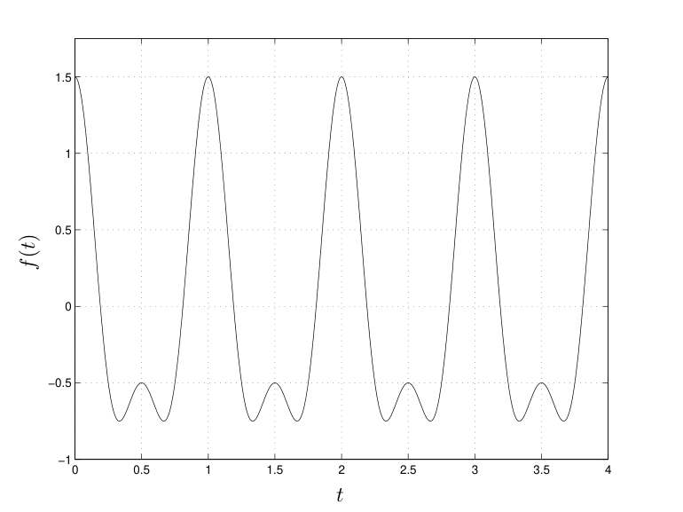
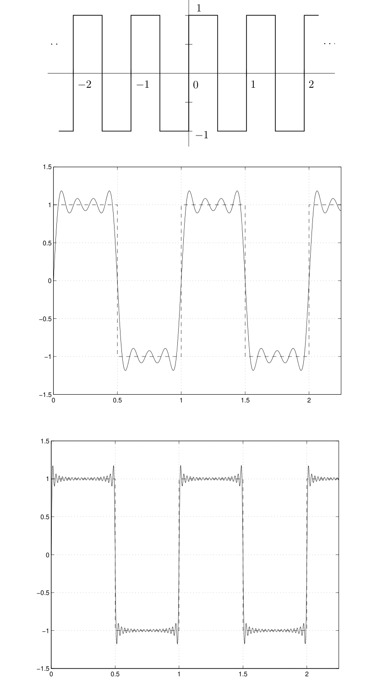
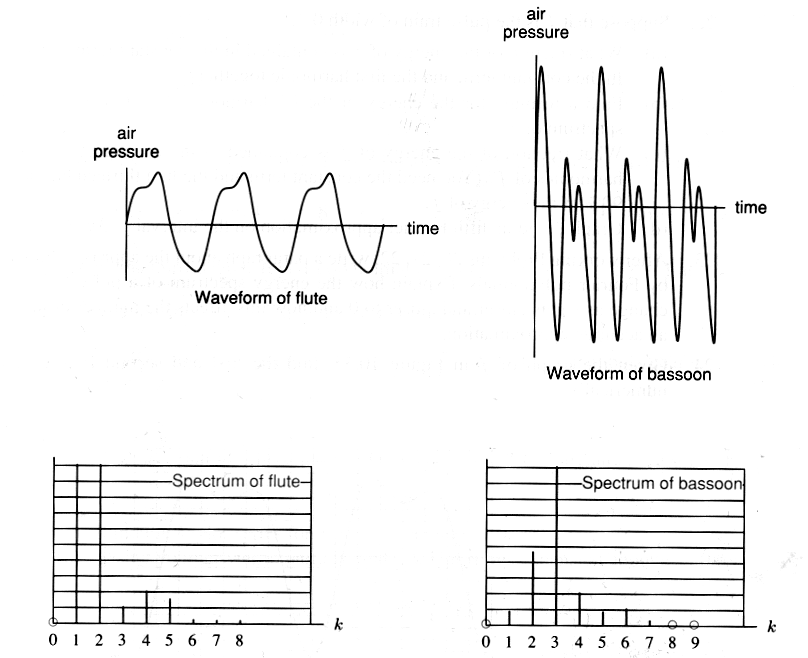

# 第1章 傅里叶级数

### 来源说明

- 作者：Brad Osgood
- 书名：The Fourier Transform and its Applications（傅里叶变换及其应用）
- 官方来源：https://see.stanford.edu/materials/lsoftaee261/book-fall-07.pdf
- 本笔记仅供个人学习使用。

阅读范围：PDF 7–70，对应书页 1–64。开读时 PDF 第 7 页章名为 Chapter 1 Fourier Series。本段逐页抽取，未遇到 zlib 读失败。PDF 70 只有章页眉，没有新正文；1.18 节在 PDF 69 收束。

### 本章总览

这一章把 Fourier series（傅里叶级数）当作整门课的入口。Fourier 分析起初处理周期现象，后来把非周期现象看成周期趋向无穷的极限，离散频率连成连续的 spectrum（频谱），再进入 Fourier transform（傅里叶变换）。

作者选的主线是复指数，几何是 $L^2$ 上的正交与最小二乘，分析问题是级数在什么意义下收敛。全章最反复出现的原则是：每个信号都有频谱，并且由它的频谱决定；同一信号可以在时间或空间域看，也可以在频率域看。

周期 $T$ 把频谱点距锁成 $1/T$。跳变和尖角把频谱推向任意高的频率。有限项光滑函数的和仍然光滑，所以方波、锯齿、三角波的级数必须是无穷级数。$L^2$ 收敛、逐点收敛和 Gibbs phenomenon（Gibbs 现象）回答的是三种不同的问题。

图注：周期越长，频谱越密。把非周期信号看成 $T\to\infty$ 的极限，是本章通向傅里叶变换的动机；连续谱的定义不在 PDF 7–70 内展开。

### 核心知识点

#### 起点与全书选择

Fourier 方法出现在电路、光谱、晶体、通信信号处理和成像里。不同教材的记号并不统一。Bracewell 先讲傅里叶变换，稍后再补级数；本书反过来，先用较短篇幅讲级数。

三条后文会反复用到的观念，本章先点名：

1. 最简单的周期块是正弦和余弦；计算时改用 complex exponential（复指数）。
2. 有限区间上平方可积函数的「几何」：最小二乘与正交。
3. 线性算子，尤其是微分算子的 eigenfunction（本征函数）。整数倍频率会出现，和边界条件、本征函数有关；线性系统里再细讲。

微分、积分会为 Fourier 分析被推广；卷积与 Fourier 变换的关系、群上的 Fourier 分析、级数收敛与无穷集合论的历史，本章只作为背景，不展开。

🔑 关键速记：本书从周期级数进入，把非周期看成周期趋向无穷。

#### 时间周期与空间周期

周期可以沿时间出现，也可以沿空间出现。固定空间一点，看波峰按时间重复，用 frequency（频率）$\nu$ 描述，量纲是 $1/\mathrm{s}$，单位 Hz。固定时刻看空间上相邻波峰的距离，用 wavelength（波长）$\lambda$ 描述。二者由传播速度 $v$ 连起来：

$$
v = \lambda\nu
$$

速度固定时，测到其中一个就能定另一个。声音里频率对应音高，光里频率对应颜色。复杂波形由简单正弦叠成，这是 Fourier 分析要做的事。

空间上的重复也可以来自对称性。晶体的原子排成 lattice（晶格），电子密度是 $\mathbb{R}^3$ 上的周期函数，沿三个晶格方向各有一个周期。二维图像里，黑白条纹是更一般图像的合成块。原书画了三块条纹：间距不同，方向也不同。二维的空间频率要同时说出间距和方向，所以是向量。无彩色图像可以看成灰度，由这类条纹做 Fourier synthesis（傅里叶合成）。

Brian Wandell 的 *Foundations of Vision* 里有一组蓝黄条纹：两幅图的蓝和黄相同，只改条纹疏密。更密的那幅在知觉上混成偏绿。作者提出两个实验问题：从低频往上加，刚看出绿时的频率；从高频往下降，刚只看见蓝和黄时的频率；二者是否相同，条纹方向有没有影响。作者写明这个问题有人研究过，自己不知道答案。

🔑 关键速记：一维波用 $v=\lambda\nu$ 把时间和空间周期锁在一起；二维空间频率是带方向的向量。

#### 周期的定义

$f(t)$ 以 $T>0$ 为周期，是指对所有 $t$，

$$
f(t+T)=f(t).
$$

满足该式的最小 $T$ 称为 fundamental period（基本周期）。它的每个整数倍也是周期：$f(t+nT)=f(t)$，$n=0,\pm 1,\pm 2,\ldots$。长度为 $T$ 的任意一段图像是一个 cycle（周期）。一段的形状决定整条曲线。变量写成 $t$ 只是记号，定义不限于时间。

口语里的 period 有时指基本周期，有时泛指任一周期。使用前要先对齐含义。

例子

$$
f(t)=\cos 2\pi t+\frac12\cos 4\pi t
$$

两项各自的周期是 $1$ 和 $1/2$，和的基本周期是 $1$。整体每 $1$ 秒重复一次，里面仍有 $1\,\mathrm{Hz}$ 和 $2\,\mathrm{Hz}$ 两个频率。一个周期可以含有多个频率。

图注：原书对 $f(t)=\cos 2\pi t+\frac12\cos 4\pi t$ 的图像。横轴约从 $0$ 到 $4$，曲线每 $1$ 个单位重复一次，每个周期里还能看见更密的起伏。这是「基本周期为 1，同时含有两个频率」的原书图，曲线未改绘。

两个周期函数的和可以不再是周期函数。$\cos t$ 与 $\cos(\sqrt{2}\, t)$ 的周期分别是 $2\pi$ 和 $2\pi/\sqrt{2}$，周期比是无理数，和 $\cos t+\cos(\sqrt{2}\, t)$ 不是周期函数。若计算时把无理数换成有理近似，和又会看起来几乎周期。原书把 $\cos t+\cos 1.4 t$ 与 $\cos t+\cos(\sqrt{2}\, t)$ 放在一起，并指出计算机画无理频率时必须采用有理近似。十二平均律把这个现象带回乐音，见下一节。

🔑 关键速记：基本周期是最小的 $T$；一个周期里可以叠着多个整数倍频率。

#### 谐波、圆环热分布与乐音

无摩擦弹簧或无电阻 LC 电路的状态可写成

$$
A\sin(2\pi\nu t+\phi).
$$

$A$ 是 amplitude（振幅），$\nu$ 是频率，$\phi$ 是 phase（相位），周期是 $1/\nu$。

Fourier 的经典空间例子是圆环上的温度。点用角度 $\theta$ 标记，$\theta$ 与 $\theta+2\pi$ 是同一点，连续的物理量对 $\theta$ 以 $2\pi$ 为周期。温度分布写成谐波和

$$
\sum_{n=1}^{N} A_n\sin(n\theta+\phi_n).
$$

时间变化进到系数 $A_n$ 里。单独一项 $A_n\sin(n\theta+\phi_n)$ 的周期是 $2\pi/n$，各项频率是基频 $1/(2\pi)$ 的整数倍，因此总和的周期仍是 $2\pi$：总和的周期不能短于其中最长的那一项。这些项称为 harmonics（谐波），名称来自音高的数学表示。

十二平均律从某音到高八度有 12 个音，相邻频率比是 $2^{1/12}$。音乐会标准音 A 取 $440\,\mathrm{Hz}$，

$$
A=\cos(2\pi\cdot 440\, t),
$$

向上 6 个音的 $\mathrm{D}\sharp$ 频率多一个 $\sqrt{2}=2^{6/12}$，

$$
\mathrm{D}\sharp=\cos(2\pi\cdot 440\sqrt{2}\, t).
$$

第 $n$ 个音是 $\cos(2\pi\cdot 440\cdot 2^{n/12}t)$，$n=0,\ldots,12$。A 与 $\mathrm{D}\sharp$ 同时响，就是前面 $\cos t+\cos\sqrt{2}\, t$ 那一类信号。调琴时用有理近似去逼近这些无理比。纯律在品丝乐器和管风琴上会把某些八度、和弦弄脏，平均律是为转调做的折中。Bach 的 *The Well-tempered Clavier* 被书中引文用来说明平均律可以在十二个大调和十二个小调里写作、移调。

🔑 关键速记：谐波的频率必须是基频的整数倍，和才保持同一个周期。

#### 三种写法与实信号的共轭对称

为了书写方便，先把周期收成 $1$。一般三角和写成

$$
\frac{a_0}{2}+\sum_{n=1}^{N}\bigl(a_n\cos(2\pi n t)+b_n\sin(2\pi n t)\bigr).
$$

常数项带 $1/2$，是为了和复指数系数对齐。电工里常数项常叫 DC component（直流分量），其余交替项对应 AC。各项频率为 $1,2,\ldots,N$，和的周期为 $1$。

用

$$
\cos t=\frac{e^{it}+e^{-it}}{2},\qquad
\sin t=\frac{e^{it}-e^{-it}}{2i}
$$

把上式改成

$$
\sum_{n=-N}^{N} c_n e^{2\pi i n t}.
$$

其中 $c_0=a_0/2$。实信号要求

$$
c_{-n}=\overline{c_n},\qquad |c_n|=|c_{-n}|,
$$

从而 $c_0$ 为实数。反过来，若系数满足这条共轭对称，正负频率可以配对成

$$
c_n e^{2\pi i n t}+c_{-n}e^{-2\pi i n t}=2\operatorname{Re}(c_n e^{2\pi i n t}),
$$

总和为实值。负频率在这个写法里成对出现；复指数如何表示实信号，书中放到复数附录，本次阅读范围内没有单独展开该附录。

实信号的正弦余弦型与复指数型之间，书中给出

$$
|c_n|=\frac12\sqrt{a_n^2+b_n^2},
$$

并写 $\hat f(n)$ 与 $\hat f(-n)$ 合在一起贡献的总能量为 $\sqrt{a_n^2+b_n^2}$。

下面先把三种写法并在一处，后面计算一律用复指数。

| 写法 | 公式骨架 | 书中强调的一点 |
| --- | --- | --- |
| 振幅–相位 | $\sum A_n\sin(2\pi n t+\phi_n)$ | 每个谐波的振幅和相位直接可见，计算别扭 |
| 正弦余弦 | $a_0/2+\sum(a_n\cos 2\pi n t+b_n\sin 2\pi n t)$ | 常数项写成 $a_0/2$，便于和 $c_0$ 对齐 |
| 复指数 | $\sum_{n=-N}^{N} c_n e^{2\pi i n t}$ | 实信号要求 $c_{-n}=\overline{c_n}$ |

实信号的频谱计算以第三列为主。第一列适合读谐波的强弱和相位，第二列适合和实三角恒等式对照。

🔑 关键速记：实信号的复系数成共轭对，$c_0$ 等于直流项 $a_0/2$。

#### 傅里叶系数

设周期为 $1$ 的 $f$ 已经写成有限和 $\sum_{n=-N}^{N} c_n e^{2\pi i n t}$。固定 $k$，两边乘 $e^{-2\pi i k t}$，再在 $[0,1]$ 上积分。$n\neq k$ 时

$$
\int_0^1 e^{2\pi i(n-k)t}\,dt=0,
$$

于是

$$
c_k=\int_0^1 e^{-2\pi i k t}f(t)\,dt.
$$

记

$$
\hat f(n)=\int_0^1 e^{-2\pi i n t}f(t)\,dt.
$$

这是 Fourier coefficients（傅里叶系数）。有限和 $\sum_{n=-N}^{N}\hat f(n)e^{2\pi i n t}$ 称为有限傅里叶级数。

这一步证明的是：若 $f$ 能写成这样的和，系数必须是这个积分。它没有证明每个周期函数都能这样写。推导不要求 $f$ 为实值。若 $f$ 为实，则 $\hat f(n)=\overline{\hat f(-n)}$，与上一节的共轭对称一致。

$\hat f(0)=\int_0^1 f(t)\,dt$ 是一个周期上的平均值。由于周期性，任何长度为 $1$ 的区间都可以用来算 $\hat f(n)$。把积分下限 $a$ 对 $a$ 求导，上下限的贡献互相抵消，导数为 $0$。常用的对称区间是 $[-1/2,1/2]$。

$f$ 定义在连续变量 $t$ 上，$\hat f(n)$ 定义在整数 $n=0,\pm 1,\pm 2,\ldots$ 上。系数可以有限个非零、除有限个外全部非零、全部非零，或非零与零都有无穷多个。在较一般的条件下还能估计系数的大小，见后面的光滑度讨论。

🔑 关键速记：系数公式是「若能展开则系数必为该积分」，还不是「每个周期函数都能展开」。

#### 频谱、功率谱与周期–频率互反

周期为 $1$ 时，把 $f$ 写成级数，意味着它由许多谐波合成，频率可以是正的、负的，也可以有无穷多个。spectrum（频谱）是信号里出现的那些频率，例如 $\pm 2,\pm 7,\pm 325$，是频率本身。$\hat f(\pm 2)$ 这些系数的数值是频谱点上的权重。

因为 $\hat f(-n)=\overline{\hat f(n)}$，$\hat f(n)$ 与 $\hat f(-n)$ 同时为零或同时非零。作者认为，系数为 $0$ 的那些整数仍然可以算在频谱里；若 $|n|>N$ 时系数全为 $0$，则常说频谱限制在 $-N$ 到 $N$，信号是 bandlimited（带限）的。bandwidth（带宽）说成 $N$ 或 $2N$，取决于说话的人，书中没有选定一个。

$\hat f(n)$ 一般是复数，不能直接当成柱高。$\hat f(0)$ 是平均值，为实数，是例外。频谱仪一类的图应画

$$
|\hat f(n)|^2,
$$

也就是系数模的平方。$|\hat f(n)|^2$ 被看成谐波 $e^{\pm 2\pi i n t}$ 的能量。这条平方模序列称为 power spectrum（功率谱）或 energy spectrum（能量谱），名称随领域而变。它用来看系数如何衰减、如何比较两个信号，不包含相位。也可以只画 $|\hat f(n)|$，更常见的是画平方。

$f$ 为实且为偶时，$\hat f(n)$ 为实数，并且 $f$ 为偶推出 $\hat f$ 为偶：$f(-t)=f(t)$ 蕴涵 $\hat f(-n)=\hat f(n)$。书中把奇函数的平行问题留在这次计算之后，没有在同一段写完。后面的方波是奇函数，级数只有正弦；三角波是偶函数，级数只有余弦。

周期改成 $T$ 时，令 $g(t)=f(Tt)$，则 $g$ 的周期为 $1$。换回 $f$ 得到

$$
f(t)=\sum_{n=-\infty}^{\infty} c_n e^{2\pi i n t/T},
\qquad
c_n=\frac1T\int_0^T e^{-2\pi i n t/T}f(t)\,dt.
$$

积分区间可以改成任何长度为 $T$ 的区间，例如 $[-T/2,T/2]$。作者把 $\hat f(n)$ 这个记号留给 $T=1$，周期为 $T$ 时改用 $c_n$。

另有一套归一化：谐波取 $T^{-1/2}e^{2\pi i n t/T}$，非零系数的积分前也乘 $T^{-1/2}$。级数里两个 $T^{-1/2}$ 相乘，回到上面的 $1/T$。它的来源是让这些谐波在 $[0,T]$ 上成为单位长，见正交一节。

时域里信号每 $T$ 秒重复一次，频谱点是 $0,\pm 1/T,\pm 2/T,\ldots$，间距为 $1/T$。$T=1$ 时间距也是 $1$。书中的格言是：时域周期越大，频谱间距越小；时域周期越小，频谱间距越大。把长周期想成慢振荡、短周期想成快振荡，和这句格言一致。让 $T\to\infty$，离散频率在想象中连成连续频率。这是后文傅里叶变换的入口。

傅里叶变换把非周期（或定义在整条实数轴上）的信号对应到连续频率上的函数。本章只建立「离散谱变密、最后连成一片」这个极限图像，不给变换的积分定义。👉 连续频谱与变换公式不在 PDF 7–70 内。

🔑 关键速记：频谱是频率的集合；柱状图要画 $|\hat f(n)|^2$。周期 $T$ 对应频谱间距 $1/T$。

#### 方波、三角波与尖角

周期为 $1$ 的方波

$$
f(t)=\begin{cases}
+1 & 0\le t<1/2\\
-1 & 1/2\le t<1
\end{cases}
$$

再按周期 $1$ 延拓。$\hat f(0)=0$。对其余 $n$，

$$
\hat f(n)=\frac{1}{\pi i n}\bigl(1-e^{-\pi i n}\bigr).
$$

$n$ 为偶数时括号为 $0$，$n$ 为奇数时括号为 $2$，级数先写成 $\sum_{n\,\mathrm{odd}} 2/(\pi i n)\, e^{2\pi i n t}$。正负项合并，并用 $e^{2\pi i n t}-e^{-2\pi i n t}=2i\sin 2\pi n t$，令 $n=2k+1$，得到

$$
\frac{4}{\pi}\sum_{k=0}^{\infty}\frac{1}{2k+1}\sin\bigl(2\pi(2k+1)t\bigr).
$$

只有正弦，与 $f$ 为奇函数一致。原书画出频率加到 $9$ 和加到 $39$ 的部分和：整体已经像方波，跳变处仍有过冲。有限个连续函数的和仍连续，方波有跳跃，所以任何有限和都写不出它，级数里必须有任意高的频率。

三角波

$$
f(t)=\begin{cases}
1/2+t & -1/2\le t\le 0\\
1/2-t & 0\le t\le 1/2
\end{cases}
$$

再按周期 $1$ 延拓。它连续，但有尖角。系数要用分部积分，书中不公开演算，结果是

$$
\frac14+\sum_{k=0}^{\infty}\frac{2}{\pi^2(2k+1)^2}\cos\bigl(2\pi(2k+1)t\bigr).
$$

只有余弦，与偶函数一致。只有奇次谐波，而且有无穷多项。方波系数按 $1/n$ 衰减，三角波按 $1/n^2$ 衰减。正弦、余弦无穷次可微，有限和也无穷次可微，因此有尖角的三角波也不能写成有限傅里叶级数。原书请读者自己画三角波的部分和，并指出它和方波的近似看起来不同，细节留到收敛一节。

由此得到另一句格言：做出尖角需要高频。滤波在后文要细讲，本章先把因果链说成三句：滤波意味着截断；截断意味着尖角；尖角意味着高频。计算机音乐里，滤波若留下间断，回放会听到咔嗒声。陡峭的截止会带来不满意的结果，滤波器要按减轻这个问题来设计。

同一音高的两件乐器听起来不同，是因为那个音是许多正弦的和，谐波的种类和强度不同。原书给了长笛与巴松演奏同一音时的近似波形，以及只画正频率的功率谱；真实频谱仪会显示成百个频率。频率域比时域更容易看出「配料差在哪里」，也更容易想象把某些柱压低、抬高或整段去掉。

图注：上图是原书的 $\pm 1$、周期为 $1$ 的方波。中图、下图按原书顺序，分别是频率加到 $9$ 和加到 $39$ 的部分和，虚线是原书所画的方波位置。加到 $39$ 后平台更平，跳变附近的过冲仍在，只是挤到更窄的一段。曲线未改绘。

图注：原书对同一音的长笛、巴松近似波形，以及只含正谐波的功率谱。柱高表示各谐波能量。长笛的能量较集中，巴松的低次谐波更丰富。书中说明这是高度简化的图，真实频谱仪会显示多得多的频率。

斯坦福的 Julius Smith 曾被问到：乐队为什么对双簧管的 A 校音。双簧管的频谱很丰富，校音时各乐器都能在里面找到一点自己的成分。乐器频谱的详细讨论，书中指向一篇 SIAM 综述，不在本次摘录范围内。

🔑 关键速记：间断使系数约按 $1/n$ 衰减，尖角约按 $1/n^2$；有限和做不出这些角。

#### $L^2$、最佳逼近与能量恒等式

代数几何方面，是把欧氏空间的内积、正交和范数搬到信号上。分析方面要新的极限和积分；本章只说一点，傅里叶变换定义时会再遇到。

周期函数即使定义在全部时间上，能量也只能在一个周期上积分。例如 $\int_{-\infty}^{\infty}\sin^2 t\,dt$ 不存在，或说是无穷。

信号在 $[0,1]$ 上的能量定义为 $\int_0^1 |f(t)|^2\,dt$。有些领域把这个积分称为功率。写成模的平方，是为了覆盖复值函数；实值时 $|f|^2$ 与 $f^2$ 相同。有限能量就是这个积分有限。

再取平方根，定义

$$
\|f\|=\left(\int_0^1 |f(t)|^2\,dt\right)^{1/2}.
$$

这样 $\|\alpha f\|=|\alpha|\,\|f\|$。若不取平方根，常数会以平方次出现，长度就不能按一次方缩放。三角不等式 $\|f+g\|\le\|f\|+\|g\|$ 成立，证明放在 1.10 节，本章附录只留结论。距离是 $\|f-g\|$。书中写 $\|f-g\|=0$ 当且仅当 $f=g$。这个范数是「分量平方和再开方」的连续类比。

$L^2([0,1])$ 是 $[0,1]$ 上满足 $\int_0^1 |f|^2<\infty$ 的函数集合。L 来自 Lebesgue。这个范数也写成 $\|f\|_2$。$f\in L^2([0,1])$ 时，傅里叶系数的积分存在，论证在 1.10 节：复指数拆成余弦减 $i$ 倍正弦后，归结为实积分。

对 $f\in L^2([0,1])$，书中列出四条。前两条的完整分析证明不在本章展开，陈述本身依赖 Lebesgue 积分；Riemann 积分被说成不完整，因为它积不了这套理论需要的那些更野的函数。John Tukey 的转述是：他不愿意乘坐一架设计依赖于函数到底是 Riemann 可积还是 Lebesgue 可积的飞机。实用上要记住的是方波、锯齿、三角波，以及把光滑信号用窗截断之后：只要有一处间断或尖角，级数就有无穷多项，频谱里就有任意高的频率。用无穷个光滑函数表示间断函数，是 Fourier 当时提出、当时不被相信、后来被证实的强结果。

1. 对任何 $N$，部分和 $\sum_{n=-N}^{N}\hat f(n)e^{2\pi i n t}$ 是 $L^2([0,1])$ 里、次数为 $N$ 的 trigonometric polynomial（三角多项式）对 $f$ 的最佳逼近，也就是最小二乘意义。三角多项式指同一基频的复指数的有限和。「次数 $N$」的说明和证明在 1.12 节。1.8 节还预告 Appendix 3 有更精确的陈述；PDF 7–70 里对应的证明正文是 1.12，没有另见一份标成 Appendix 3 的独立章节。
2. $e^{2\pi i n t}$（$n=0,\pm 1,\pm 2,\ldots$）构成 $L^2([0,1])$ 的基，部分和在 $L^2$ 距离下收敛到 $f$：

$$
\lim_{N\to\infty}\left\|\sum_{n=-N}^{N}\hat f(n)e^{2\pi i n t}-f(t)\right\|=0.
$$

等号 $f(t)=\sum_{n=-\infty}^{\infty}\hat f(n)e^{2\pi i n t}$ 按这个极限理解。引入内积后，更完整的说法是这些复指数构成 orthonormal basis（标准正交基）。本章实际证明的是标准正交，基的完备性留到 1.17 的提纲。

3. 能量可以由系数算出，称为 Rayleigh's identity（Rayleigh 恒等式），也叫 Parseval's theorem（Parseval 定理）：

$$
\int_0^1 |f(t)|^2\,dt=\sum_{n=-\infty}^{\infty}|\hat f(n)|^2.
$$

4. 反过来，若复数序列满足 $\sum |c_n|^2<\infty$，则 $f(t)=\sum c_n e^{2\pi i n t}$ 的部分和在 $L^2([0,1])$ 里收敛到某个函数，且 $c_n=\hat f(n)$。这是 Riesz–Fischer theorem（Riesz–Fischer 定理）。书中说这条用来收束图景，后面并不使用。

从时域走到频域，就是由 $f(t)$ 得到各谐波上的复系数 $\hat f(n)$。级数再把频域表示加回时域，等式先按 $L^2$ 理解。逐点代入 $t$ 是否相等，放到收敛一节。

$|\hat f(n)|^2$ 是第 $n$ 个谐波贡献的能量。$|\hat f(-n)|=|\hat f(n)|$，正负谐波的能量贡献相等。Rayleigh 恒等式的意思是：信号的能量等于各谐波能量之和。

最佳逼近是纯代数结果。实际计算总是有限项，这条结果说明该用哪些系数。它也给出系数的另一条刻画：不问「若能展开则系数是什么」，而问「最小二乘逼近用什么系数」，会得到同一个积分。Rayleigh 恒等式同样是代数结果。第 2、4 条才是分析。

🔑 关键速记：$L^2$ 部分和是同次三角多项式里的最佳逼近；能量等于 $|\hat f(n)|^2$ 的总和。

#### 正交与复内积

欧氏几何里能运算的垂直，来自勾股定理。$\mathbb{R}^n$ 中 $\mathbf v=(v_1,\ldots,v_n)$，

$$
\|\mathbf v\|=(v_1^2+\cdots+v_n^2)^{1/2},
$$

距离是 $\|\mathbf v-\mathbf w\|$。$\mathbf u\perp\mathbf v$ 当且仅当内积为零。内积

$$
(\mathbf v,\mathbf w)=v_1 w_1+\cdots+v_n w_n,
$$

也记成 $\langle\mathbf v,\mathbf w\rangle$。它满足 $(\mathbf v,\mathbf v)=\|\mathbf v\|^2$。几何公式 $(\mathbf v,\mathbf w)=\|\mathbf v\|\|\mathbf w\|\cos\theta$ 由 Cauchy–Schwarz 不等式反推出来，见附录。$(\mathbf v,\mathbf w)/\|\mathbf w\|$ 是 $\mathbf v$ 在 $\mathbf w$ 方向上的标量分量。

实内积的四条代数性质：正定，$(\mathbf v,\mathbf v)=0$ 当且仅当 $\mathbf v=\mathbf 0$；对称；对第一变元齐次；可加。

$\mathbb{R}^n$ 的自然基 $\mathbf e_k$ 是标准正交的，$(\mathbf e_i,\mathbf e_j)=\delta_{ij}$，Kronecker $\delta$ 在 $i=j$ 时为 $1$，否则为 $0$。分量就是内积：$v_k=(\mathbf v,\mathbf e_k)$，于是

$$
\mathbf v=\sum_{k=1}^{n}(\mathbf v,\mathbf e_k)\mathbf e_k.
$$

把勾股定理搬到实值的 $L^2([0,1])$，得到正交条件 $\int_0^1 f(t)g(t)\,dt=0$，内积 $(f,g)=\int_0^1 f g$。两条都平方可积时，乘积可积，论证依赖 Cauchy–Schwarz，见附录。函数内积没有要求画出「两幅图像互相垂直」的图画；书中建议在 $\mathbb{R}^2$、$\mathbb{R}^3$ 里想清楚代数关系，再用同一套词写到 $L^2$。

傅里叶系数里有复指数，所以改用复值平方可积函数。$L^2$ 的定义仍是 $\int_0^1 |f|^2<\infty$，这里的模是复数的模。复内积把共轭放在第二个位置：

$$
(f,g)=\int_0^1 f(t)\overline{g(t)}\,dt.
$$

性质改成：Hermitian symmetry（Hermite 对称）$(f,g)=\overline{(g,f)}$；正定不变；$(\alpha f,g)=\alpha(f,g)$，标量在第二位时出来要加共轭；两边都可加。于是 $(f,f)=\|f\|^2$。实值函数上，这个定义退回前面的实内积。为什么不能改成只取实部，见 1.11 的结论。

令 $e_n(t)=e^{2\pi i n t}$。$n\neq m$ 时 $(e_n,e_m)=0$，$n=m$ 时 $(e_n,e_n)=1$，所以

$$
(e_n,e_m)=\delta_{nm}.
$$

$f$ 在 $e_n$ 方向上的分量是 $(f,e_n)$。$e_n$ 必须放在第二个位置，共轭才会把指数变成 $e^{-2\pi i n t}$，于是 $(f,e_n)=\hat f(n)$。傅里叶级数

$$
f=\sum_{n=-\infty}^{\infty}(f,e_n)e_n
$$

和欧氏空间里对标准正交基的展开是同一句话。还没证明的是：这些函数确实构成基，也就是

$$
\lim_{N\to\infty}\left\|f-\sum_{n=-N}^{N}(f,e_n)e_n\right\|=0.
$$

书中写明这一步很难，1.17 只给提纲。

周期为 $T$ 时，工作空间改成 $L^2([0,T])$，内积在 $[0,T]$ 上积分。$e^{2\pi i n t/T}$ 彼此正交，但

$$
\bigl(e^{2\pi i n t/T},e^{2\pi i n t/T}\bigr)=T,
$$

长度是 $\sqrt{T}$。归一化成

$$
e_n(t)=T^{-1/2}e^{2\pi i n t/T}
$$

之后才有 $(e_n,e_m)=\delta_{nm}$。这就是前面 $T^{-1/2}$ 的来源。$(f,e_n)$ 再乘回 $e_n$，两个 $T^{-1/2}$ 合成系数公式里的 $1/T$。

Rayleigh 恒等式的推导只用三件事：复内积的代数性质、$e_n$ 的标准正交、以及把双重和里的 $\delta_{nm}$ 收成单重和。结论就是 $\|f\|^2=\sum |(f,e_n)|^2$。它和「向量长度的平方等于标准正交基下各分量的平方和」是同一句话。

🔑 关键速记：$\hat f(n)=(f,e_n)$，周期 $1$ 时 $e_n(t)=e^{2\pi i n t}$ 标准正交；周期 $T$ 时要先乘 $T^{-1/2}$。

#### 热传导：圆环与地窖

Fourier 在 1820 年代把函数展成三角级数，用来写温度问题的解。温度 $u(x,t)$ 同时依赖位置和时间。固定 $t$ 看空间分布，固定 $x$ 看时间变化。书中选圆环和地球温度，是因为一个在空间上周期，一个在时间上周期。

热被说成由温差引起的能量转移。热力学温度与物质内部原子动能成正比，零温（绝对零度）不能再转移能量。Newton 的原则是：接触的两份物质若有温差，能量从高温转到低温。

一维杆上，$q(x,t)$ 是 $x$ 处、时刻 $t$ 每秒流过的热量。Newton 冷却定律写成

$$
q(x,t)=-k u_x(x,t),\qquad k>0.
$$

温度沿 $x$ 增加时，热流向更冷的一侧，所以带负号。$k$ 对应热阻的倒数。温度上升的速率 $u_t$ 正比于单位长度上热量的累积，也就是流入减去流出再除以长度。取极限得到 $u_t=-k' q_x$，$k'>0$，$k'$ 对应单位长度热容的倒数。再对冷却定律的 $x$ 求导并代入，得到 heat equation（热方程）

$$
u_t = kk' u_{xx}.
$$

一个基于热方程的问题要给出空间区域，以及该区域上的初始温度。推导跟随 Bracewell 的讲法。热阻、热容是书中为了对照电报方程而用的词，可以换算到比热等标准术语，换算式不在本章。

圆环：把圆周看成端点粘合的区间 $0\le x\le 1$，并选单位使

$$
u_t=\frac12 u_{xx}.
$$

$u(x+1,t)=u(x,t)$。按空间变量做傅里叶级数，系数依赖时间：

$$
u(x,t)=\sum_{n=-\infty}^{\infty} c_n(t)e^{2\pi i n x}.
$$

对 $t$ 在积分号下求导，用热方程把 $u_t$ 换成 $\frac12 u_{xx}$，分部积分两次。边界上用 $e^{-2\pi i n}=1$ 和 $u(0,t)=u(1,t)$，得到

$$
c_n'(t)=-2\pi^2 n^2 c_n(t),
$$

所以 $c_n(t)=c_n(0)e^{-2\pi^2 n^2 t}$。初始温度 $u(x,0)=f(x)$ 为周期 $1$ 的函数时，$c_n(0)=\hat f(n)$。于是

$$
u(x,t)=\sum_{n=-\infty}^{\infty}\hat f(n)\,e^{-2\pi^2 n^2 t}e^{2\pi i n x}.
$$

把 $\hat f(n)$ 写回积分，交换和与积分（书中直接写下这一步），得到卷积

$$
u(x,t)=\int_0^1 g(x-y,t)f(y)\,dy,
$$

$$
g(x,t)=\sum_{n=-\infty}^{\infty} e^{-2\pi^2 n^2 t}e^{2\pi i n x}.
$$

$g$ 称为 Green's function（Green 函数），也叫这个圆环热方程的 fundamental solution（基本解）。它对空间变量以 $1$ 为周期。一般地，

$$
\int_0^1 g(x-y)f(y)\,dy
$$

称为 $f$ 与 $g$ 的 convolution（卷积）。$y$ 从 $0$ 积到 $1$ 时，$x-y$ 会跑出 $[0,1]$，所以 $g$ 必须有周期性，这个积分才有定义。

用线性系统的语言：输入是初始温度 $f$，输出是 $u(\cdot,t)$，$g(\cdot,t)$ 是「圆环上热流」这个系统的 impulse response（冲激响应），输出等于 $g$ 与输入的卷积。卷积在 Fourier 分析里到处出现。书中还预告：线性时不变系统里，输出与输入的关系必定出现卷积。该定理不在本章证明。

线性时不变系统是指：输入相加，输出相加；输入整体延时，输出整体延时同一段。满足这两条时，输出可以写成输入与某一固定响应的卷积。圆环热流是空间变量上的这一种结构，Green 函数扮演那个固定响应。👉 一般定理的证明不在 PDF 7–70 内。

在这个例子里，卷积的意思是：每个时刻，$x$ 处的温度是初始温度的一种平滑平均。$t\to 0$ 时，$g(x,t)$ 趋向后面的 buzz $\sum e^{2\pi i n x}$。

地球与酒窖：约定地表某点的温度逐年大致相同，周期取 $1$ 年，问地下 $x$ 米处的温度。例子来自 Dym 与 McKean，他们归到 Sommerfeld。仍用 $u_t=\frac12 u_{xx}$，但这次对时间做级数

$$
u(x,t)=\sum_{n=-\infty}^{\infty} c_n(x)e^{2\pi i n t}.
$$

对 $x$ 求导两次，用热方程并分部积分一次，得到 $c_n''(x)=4\pi i n\, c_n(x)$。平方根取成

$$
(4\pi i n)^{1/2}=\pm(2\pi|n|)^{1/2}(1\pm i),
$$

$n>0$ 时用 $1+i$，$n<0$ 时用 $1-i$。为了随深度衰减，根取负号：

$$
c_n(x)=A_n e^{-(2\pi|n|)^{1/2}(1\pm i)x}.
$$

地表温度 $u(0,t)=f(t)$ 时，$A_n=\hat f(n)$。把指数拆开，衰减因子是 $e^{-(2\pi|n|)^{1/2}x}$，相位移动 $(2\pi|n|)^{1/2}x$。

若地表就是 $\sin 2\pi t$，年平均 $\hat f(0)=0$，只留下 $n=\pm 1$，则

$$
u(x,t)=e^{-(2\pi)^{1/2}x}\sin\bigl(2\pi t-(2\pi)^{1/2}x\bigr).
$$

取深度使 $(2\pi)^{1/2}x=\pi$，振幅被 $e^{-\pi}=0.04$ 压低，相位与地表差半个周期，也就是半年。地下因此比较稳，并且夏凉冬暖。书中把这种地方称为 cellar（地窖）。

🔑 关键速记：圆环上的解是初温与 Green 函数的卷积；地下温度随深度指数衰减并发生相移。

#### 电报、扩散与临界质量

许多扩散过程用热方程或它的变体描述。William Thomson（后来的 Lord Kelvin）1855 年的论文 *On the theory of the electric telegraph* 处理海底电报。长电缆上，Morse 脉冲若发得太密会抹开、重叠，接收端无法分辨。Faraday 的定性解释是：浸在水里的电缆相当于巨大电容，充电和放电都要时间。

Thomson 把电缆看成轴线上半径 $a$ 的导线，外包绝缘层到半径 $b$。单位长度静电容量

$$
C=\frac{2\pi\epsilon}{\ln(b/a)},
$$

$\epsilon$ 是绝缘体的电容率。单位长度电阻记为 $K$。用 Kirchhoff 电路定律和 Ohm 定律写成

$$
v_t=\frac{1}{KC}v_{xx}.
$$

Thomson 指出这与固体导体里热的线性运动方程一致，Fourier 的解可以用来回答电报线的实用问题。电荷沿电缆扩散，对应于热沿杆扩散；电势梯度替换温度梯度。电子要到 1897 年才被发现，这个类比是事后的。$K$ 和 $C$ 分别扮演前面的热阻和热容。

实用结论是：瞬间接上电池之后，电动力效应达到最大的时刻为

$$
t_{\max}=\frac16 KC x^2.
$$

距离 $x$ 以平方进入。$1000$ 英里电缆上的延迟是 $100$ 英里的 $100$ 倍。这是 Thomson 的 Law of squares（平方律）。书中称这项工作为第二次工业革命的第一枪，电气工程从此明显数学化。Edward Whitehouse 在 1856 年否定这条定律。第一条跨大西洋电缆没有按 Thomson 把 $KC$ 做小的建议来设计，而是试图加大功率；1858 年 8 月接通，约三周后因电压过高烧毁。

1876 年 Oliver Heaviside 计入电感。单位长度电感记为 $S$，电压满足

$$
v_{xx}=KC v_t + SC v_{tt}.
$$

它混合了热方程和波动方程的样子，允许行波解。波动方程本身留到后文。现在通常把 Heaviside 的方程称为 telegraph equation（电报方程）。

波动方程描述以有限速度传播、可以来回振荡的波，热方程描述被抹平的扩散。Heaviside 的方程同时带 $v_t$ 和 $v_{tt}$，所以既有扩散式的衰减，也留有传播。👉 波动方程的推导不在 PDF 7–70 内。

原子炸药的早期理论要估计裂变中子在铀里的扩散：多少质量能在足够短的时间里使足够多的核发生裂变。书中说明，爆炸威力来自裂变时核内质子的静电排斥。Robert Serber 等人 1942 年在 Berkeley 的分析给出：临界质量约 $60\,\mathrm{kg}$ 的 U 235，排成半径约 $9\,\mathrm{cm}$ 的球，并加反射层；较粗糙的扩散模型给出 $200\,\mathrm{kg}$。书中讲述 Heisenberg 在德国计划里用了不够准的模型，临界质量估计偏高，从而拖慢了进度，并指向 Serber 的 *The Los Alamos Primer* 与 Frayn 的剧本 *Copenhagen*。这些数字是本章转述的历史结论。

🔑 关键速记：Thomson 的电缆方程就是热方程，延迟按距离的平方增长；Heaviside 方程再加进电感项。

#### Buzz、脉冲列与 Dirichlet 核

把「最完整、最均匀」的音模型写成所有谐波能量都是 $1$、周期为 $1$ 的和

$$
f(t)=\sum_{n=-\infty}^{\infty} e^{2\pi i n t}.
$$

它听起来是 buzz（蜂鸣），所有音高以同等地位出现。它的能量不是有限的，级数不按 $L^2$ 或别的容易定义的意义收敛。部分和

$$
D_N(t)=\sum_{n=-N}^{N} e^{2\pi i n t}
=1+2\sum_{n=1}^{N}\cos 2\pi n t.
$$

在整数点上的值是 $1+2N$，并且这是最大值，随 $N$ 增大。原书画出 $N=5,10,20$：峰越来越集中在整数上，也越来越高。后文要说明

$$
D_N(t)\to\sum_{n=-\infty}^{\infty}\delta(t-n),
$$

收敛的意义也留到后文。等间隔 $\delta$ 的和称为 impulse train（脉冲列）。它是采样的基本对象。采样是把模拟信号变成数字信号的第一步：用一串等间隔的脉冲去读取连续波形，得到离散时刻上的样本。本章只指出 $D_N$ 在整数上越长越高，并把极限对象叫做脉冲列。👉 $\delta$ 的定义和采样定理不在 PDF 7–70 内。

数学里 $D_N$ 叫 Dirichlet kernel（Dirichlet 核）。计算机音乐里实际使用的是它的离散形式，discrete time buzz（离散时间蜂鸣）。做法是在频率域合成：先生成各频率能量相等的离散脉冲列，再抬高、压低或置零某些谐波的能量，从整形后的频谱合成声音。书中指向 Ken Steiglitz 的 *A Digital Signal Processing Primer*。

$\delta$ 在本章只作为识别这个极限的提示：$\int \delta(t-s)f(s)\,ds=f(t)$。它把「核越来越尖、积分却回到函数值」说成同一类现象。严格定义同样不在这次阅读范围内。

🔑 关键速记：全谐波等能量的和不是 $L^2$ 信号；它的部分和 $D_N$ 在整数上等于 $1+2N$，后文趋向脉冲列。

#### 系数衰减与收敛速度

$L^2$ 收敛是

$$
\lim_{N\to\infty}\int_0^1\left|f(t)-\sum_{n=-N}^{N}\hat f(n)e^{2\pi i n t}\right|^2 dt=0,
$$

也叫均方收敛。若还想知道代入某个 $t$ 时部分和离 $f(t)$ 有多近、$N$ 要多大，就要离开 $L^2$，细节会迅速变多。应用里常见的函数，结论是清楚的；对最一般的函数追问收敛，才会变得危险。更全的材料指向 Dym 与 McKean 的 *Fourier Series and Integrals*。

由 Rayleigh 恒等式，$\sum |\hat f(n)|^2$ 收敛，因此 $|\hat f(n)|^2\to 0$（$n\to\pm\infty$）。收敛级数的通项趋于 $0$，这是微积分里的一般事实。特别地，buzz $\sum e^{2\pi i n t}$ 在任何 $t$ 都不能收敛，因为 $|e^{2\pi i n t}|=1$ 不趋于 $0$。

衰减有多快，取决于函数或其导数的间断。下面的讨论假设周期为 $1$，$f(0)=f(1)$，间断落在 $(0,1)$ 内部，离开间断点后要多少阶导数就有多少阶。把 $\hat f(n)$ 拆成间断点两侧的积分，做分部积分。

| 间断落在哪一阶 | 系数大小的经验规则 | 本章例子 |
| --- | --- | --- |
| $f$ 本身跳跃 | 出现 $1/n$ 量级的项 | 方波 |
| $f$ 连续，$f'$ 跳跃（尖角） | 出现 $1/n^2$ 量级的项 | 三角波；按本章定义，其导数在左右半周期上分别为 $+1$ 与 $-1$ |
| $f''$ 存在但不连续 | 出现 $1/n^3$ 量级的项 | 曲率间断；圆弧与切线相接时，加速度有一跳 |

多处跳跃仍是 $1/n$ 量级，端点处的跳跃同样如此。$f''$ 的间断较难看见，典型是曲率间断。更高阶导数的间断按同一方式类推。

光滑度还控制收敛速度。书中陈述、不证明：

若 $f$ 是 $p$ 次连续可微，$p\ge 1$，则部分和 $S_N(t)=\sum_{n=-N}^{N}\hat f(n)e^{2\pi i n t}$ 在 $[0,1]$ 上逐点且一致收敛到 $f$，并且

$$
\max |f(t)-S_N(t)|\le \mathrm{constant}\cdot N^{-(p-1/2)}.
$$

局部性质是光滑度，整体性质是级数收敛有多快。误差由光滑度控制，而且是区间上一致的。常数依赖 $f$，典型地依赖某阶导数在区间上的最大值。证明里，部分和自身收敛以及收敛多快相对容易；较难的是证明它收敛到的就是 $f(t)$。标题式结论：函数若光滑，级数按 $L^2$、逐点、一致这些意义都收敛。

逐点收敛：固定一个 $t$，级数在该点收敛到 $f(t)$。一致收敛：$[0,1]$ 上各点的收敛速度可以用同一个不依赖于 $t$ 的估计控制，也就是用 $\max|f-S_N|$ 来陈述。几何上，近似函数的图像整体贴近 $f$ 的图像。1.16 用 Dirichlet 核把这个定理和微分阶数连起来，见附录结论。

🔑 关键速记：系数趋于 $0$ 只来自能量有限；衰减阶由第几阶导数间断决定，光滑函数的部分和一致收敛。

#### 锯齿、跳点的平均值与 Gibbs 现象

作业中的锯齿，在 $[0,1)$ 上 $f(t)=t$，其余先记为 $0$，再按周期 $1$ 延拓。$n\neq 0$ 时分部积分得 $\hat f(n)=i/(2\pi n)$，量级是 $1/n$。$n=0$ 的系数要单独算，是 $1/2$。系数满足共轭对称，可用来检查计算。级数写成

$$
\frac12+\sum_{n\neq 0}\frac{i}{2\pi n}e^{2\pi i n t},
$$

等号先是 $L^2$ 意义。原书画出 $N=5,10,50$ 的部分和。

跳变处的定理：在跳跃间断点，部分和收敛到上下值的平均。锯齿在 $t=0,\pm 1,\pm 2,\ldots$ 收敛到 $1/2$。有人因此把函数在跳跃点的值定义成上下值的平均；作者认为在不少场合合理，但不把这当成必须遵守的定义。

实用的逐点定理：若 $f$ 连续且导数连续，只在一个周期里的有限个点例外，则对每个 $a\in[0,1]$，

$$
S_N(a)\to\frac12\left(\lim_{t\to a^-}f(t)+\lim_{t\to a^+}f(t)\right).
$$

$a$ 处连续时，左右极限相等，$S_N(a)\to f(a)$。有跳跃时，收敛到左右极限的平均。

尖角附近的过冲会留下来。方波的近似里已经见过。这是 Gibbs phenomenon（Gibbs 现象），名称来自 J. W. Gibbs。Michelson 与 Stratton 用机械装置画有限傅里叶级数，把跳跃处多出来的晃动当成机器问题。Gibbs 用锯齿说明现象是真实的，极限之下也不消失：振荡可以挤得更窄，但不会消失。它们对 $f$ 与其级数之差的 $L^2$ 范数的贡献在极限下是 $0$。

标准陈述用从 $-1$ 跳到 $+1$ 的方波：$t$ 从负到正经过 $0$ 时，$f$ 在 $[-1/2,0)$ 上为 $-1$，在 $[0,1/2]$ 上为 $+1$。离开这一处跳跃之后，$S_N$ 一致趋向 $+1$ 或 $-1$。要证明的是 $S_N$ 的最大值在 $N\to\infty$ 时仍然大于 $1$。书中给出

$$
\lim_{N\to\infty}\max S_N(t)=1.089490\ldots
$$

过冲将近 $9\%$。推导提纲在 1.18 节，见附录。那里又写出

$$
\frac{2}{\pi}\int_0^{\pi}\frac{\sin s}{s}\,ds=1.09940\ldots
$$

并说 $9\%$ 的过冲数字由此而来。PDF 7–70 里这两处小数没有再对齐，笔记两处都按原书保留。

逐点收敛说跳跃点上 $S_N$ 趋向平均值；Gibbs 说图像上的过冲不消失。二者可以同时成立，因为「在某个点 $t=0$ 收敛」和「$S_N$ 的图像一致贴近锯齿的图像」不是同一件事。区别就是逐点收敛与一致收敛，反例在 1.15 节。

间断很常见。窗和滤波器会引进跳跃。图像作为二维信号常常有边缘，检测边缘本身是重要问题。间断或尖角意味着频谱里有无穷高的频率，把近似在某处截断，再用有限傅里叶级数算函数值，就会带进波纹。

🔑 关键速记：跳跃点上级数趋向左右极限的平均；Gibbs 过冲在极限中仍在，但 $L^2$ 意义下贡献为 $0$。

#### 附录只留的结论

**1.10 Cauchy–Schwarz 不等式。** $|(v,w)|\le\|v\|\|w\|$。证明只用内积的四条代数性质，所以任何满足这四条的乘积都适用。实内积的论证是：对任意实数 $t$，$\|v-tw\|^2\ge 0$，展开成 $t$ 的二次式，该二次式恒非负，判别式不能为正，从而得到不等式。等号何时成立，书中留成问题，没有在这一节写出答案。由此 $-1\le (v,w)/(\|v\|\|w\|)\le 1$，存在唯一的 $\theta\in[0,\pi]$ 使 $(v,w)=\|v\|\|w\|\cos\theta$。

三角不等式由 Cauchy–Schwarz 直接推出：把 $\|v+w\|^2$ 展开，中间项用模和不等式吃掉。$L^2([0,1])$ 上写成

$$
\left|\int_0^1 f(t)g(t)\,dt\right|
\le\left(\int_0^1 f^2\right)^{1/2}\left(\int_0^1 g^2\right)^{1/2}.
$$

两条都平方可积时，乘积可积，因为 $fg\le f^2+g^2$（由 $(f-g)^2\ge 0$，也是算术平均与几何平均的不等式）。因此 $L^2([0,1])$ 函数的傅里叶系数存在：$\bigl|\int e^{-2\pi i n t}f\bigr|\le\int |f|$，而 $f=f\cdot 1$，常数函数 $1$ 在有限区间上平方可积。

这条论证不能原样搬到整条实数轴。常数 $1$ 在 $\mathbb{R}$ 上的积分是无穷。把定义在有限区间上的级数想法，用到定义在整条轴上的傅里叶变换时，遇到的就是这一类麻烦。

**1.11 复内积为什么要共轭。** 若只要求 $\operatorname{Re}\int f\overline{g}=0$ 作为垂直条件，内积若定义成这个实部，对称性很好，但复标量 $\alpha$ 不能从实部里提出来，$(\alpha f,g)=\alpha(f,g)$ 对非实的 $\alpha$ 失败。这个损失太大，所以采用 $(f,g)=\int f\overline{g}$。常用恒等式是

$$
\|f+g\|^2=\|f\|^2+2\operatorname{Re}(f,g)+\|g\|^2,
$$

以及把加号换成减号的那一条。复的 Cauchy–Schwarz 先用相位 $e^{-i\theta}$ 把 $(f,g)$ 转到正实轴，再套实论证。积分形式是

$$
\left|\int_0^1 f(t)\overline{g(t)}\,dt\right|
\le\left(\int_0^1 |f|^2\right)^{1/2}\left(\int_0^1 |g|^2\right)^{1/2}.
$$

**1.12 最佳 $L^2$ 逼近。** 定理：$f\in L^2([0,1])$，$\alpha_n$ 为任意复数，则

$$
\left\|f-\sum_{n=-N}^{N}(f,e_n)e_n\right\|
\le\left\|f-\sum_{n=-N}^{N}\alpha_n e_n\right\|,
$$

等号仅当每个 $\alpha_n=(f,e_n)$。也就是说，$f$ 到 $\{e_n:|n|\le N\}$ 所张成子空间的正交投影，就是 $\sum_{n=-N}^{N}\hat f(n)e^{2\pi i n t}$。证明是把任意系数的误差拆成「傅里叶部分和的误差」加上「系数差 $\alpha_n-(f,e_n)$」，中间交叉项因正交而为 $0$，剩下的平方和 $\sum|(f,e_n)-\alpha_n|^2$ 非负。整段只用内积代数。

**1.15 逐点收敛不必是一致收敛。** 在 $[0,1]$ 上，$f_n$ 从 $1/n$ 到 $1$ 为 $0$，在 $[0,1/n]$ 上是高 $n^2$ 的等腰三角形。对每个固定的 $t$，$n$ 足够大以后峰已经滑到 $t$ 的左边，所以 $f_n(t)\to 0$。图像却不整体贴近 $0$。Gibbs 图像上的过冲，和「在跳跃点上数值趋向平均值」，可以同时成立，就是因为二者分别对应一致与逐点。

**1.16 用 Dirichlet 核写部分和。** 把系数的积分代回 $S_N$，得到

$$
S_N(t)=\int_0^1 D_N(t-s)f(s)\,ds.
$$

部分和是 $f$ 与 $D_N$ 的卷积，和热方程的解是同一结构。$D_N$ 是等比级数，闭式为

$$
D_N(p)=\frac{\sin\bigl(\pi(2N+1)p\bigr)}{\sin(\pi p)}.
$$

$N$ 变大时 $D_N$ 在整数处越来越尖，$D_N(0)\to\infty$。卷积把 $0$ 处的峰移到 $t$ 再积分，其他整数上的峰在论证里不贡献，$N\to\infty$ 时积分趋向 $f(t)$。对 $f$ 假设得越多，这条论证给出的结论越多。光滑度与收敛速度的定理就是这样来的。数学上看 $D_N$ 像一件专门工具；从电路的眼光看，它就是卷积里那个已经见过的核。

**1.17 复指数是 $L^2([0,1])$ 的基。** 证明分三步，本章做不完第一步。任给 $\epsilon>0$：第一步，任何 $L^2$ 函数都能用连续可微函数在 $L^2$ 范数下逼近到 $\epsilon$ 以内；实际上还能用无穷次可微函数逼近。这一步需要更一般的积分理论，书中明确说做不到。第二步，连续可微函数的傅里叶部分和一致收敛到它自己（上一节定理里 $p=1$），从而 $L^2$ 误差也可以小于 $\epsilon$。第三步，傅里叶系数给出最佳有限逼近，所以 $f$ 的部分和至少和「用光滑近似函数的系数去逼近 $f$」一样好；三角不等式把两段误差加成小于 $2\epsilon$。因此 $N$ 足够大时，$\|f-S_N\|$ 可以任意小。

**1.18 Gibbs 现象的积分近似。** 对上面那个从 $-1$ 跳到 $+1$ 的方波，把 $S_N$ 写成与 $D_N$ 的卷积。利用 $D_N$ 为偶，换元并加减 $\int_{-t}^{t} D_N$，得到

$$
S_N(t)=\int_{-t}^{t} D_N(s)\,ds-\int_{1/2-t}^{1/2+t} D_N(s)\,ds.
$$

第二项的绝对值不超过某个常数除以 $n$（书中此处用小写 $n$），所以 $N\to\infty$ 时 $S_N(t)$ 与 $\int_{-t}^{t} D_N$ 的差趋于 $0$。$|t|$ 小、$N$ 大时，这个积分以及 $S_N(t)$ 可由

$$
\frac{2}{\pi}\int_0^{(2N+1)\pi t}\frac{\sin s}{s}\,ds
$$

很好地近似。该积分的最大值出现在 $\sin((2N+1)\pi t)=0$ 的第一处，即 $t=1/(2N+1)$。这一点上的值就是前面的 $1.09940\ldots$。书中说详细估计较烦，只给出这条路径和结果。

🔑 关键速记：有限区间上 $L^2$ 推出系数存在；最佳逼近就是正交投影；部分和是与 $D_N$ 的卷积。

### 🔑 关键速记

- 每个信号由它的频谱决定；周期 $T$ 的频谱间距是 $1/T$。
- 系数 $\hat f(n)=\int e^{-2\pi i n t}f(t)\,dt$ 是内积 $(f,e_n)$；实信号满足 $c_{-n}=\overline{c_n}$。
- $L^2$ 部分和是同次三角多项式的最佳逼近，能量等于 $\sum|\hat f(n)|^2$。
- 跳跃对应约 $1/n$，尖角对应约 $1/n^2$；截断高频会在间断附近留下 Gibbs 过冲。
- 圆环热方程的解是初温与 Green 函数的卷积；电缆延迟按距离平方增长。

### 易混淆点与差异对比

频谱和系数是两层东西。频谱是频率的集合。$|\hat f(n)|^2$ 是这些频率上的能量，相位在功率谱里看不见。复系数不能直接画成柱高。

一个基本周期和「里面有几个频率」也是两层。$\cos 2\pi t+\frac12\cos 4\pi t$ 的基本周期是 $1$，频率仍有 $1\,\mathrm{Hz}$ 和 $2\,\mathrm{Hz}$。常数项对任何数都是周期，讨论频率时通常把它搁在一边。

| 比较 | 周期为 $1$ | 周期为 $T$ |
| --- | --- | --- |
| 级数 | $\sum \hat f(n)e^{2\pi i n t}$ | $\sum c_n e^{2\pi i n t/T}$ |
| 系数 | $\int_0^1 e^{-2\pi i n t}f\,dt$ | $(1/T)\int_0^T e^{-2\pi i n t/T}f\,dt$ |
| 未归一化的复指数 | 已是单位长 | 长度为 $\sqrt{T}$，正交但还不是标准正交 |
| 频谱间距 | $1$ | $1/T$ |

$L^2$ 等式、逐点等式和图像是否贴紧，回答三个问题。光滑函数上三者一起成立。跳跃点上，部分和的数值趋向左右平均，图像却保留约 $9\%$ 的过冲；过冲对均方误差的贡献趋于 $0$。1.15 的尖三角序列说明：每个点都趋向 $0$，图像仍可以不贴近 $0$。

1.7 节计算系数用的方波，是 $[0,1/2)$ 上 $+1$、$[1/2,1)$ 上 $-1$。1.18 节陈述 Gibbs 时，改用 $[-1/2,0)$ 上 $-1$、$[0,1/2]$ 上 $+1$，跳跃放在 $t=0$。两处都是 $\pm 1$ 的周期方波，相位不同，数值结论不要直接混用。

方波与三角波的差别集中在光滑度。方波跳跃，系数约 $1/n$，只有正弦。三角波连续而导数跳跃，系数约 $1/n^2$，只有余弦。二者都只含奇次谐波，也都需要无穷多项。

带宽说成 $N$ 或 $2N$，书中并列，没有裁定。能量、功率这两个词在不同领域会对调：有的领域把 $\int|f|^2$ 叫能量，有的叫功率；$|\hat f(n)|^2$ 的序列也同时有 power spectrum 和 energy spectrum 两个名字。

Cauchy–Schwarz 保证有限区间上的 $L^2$ 函数绝对可积，从而傅里叶系数存在。同一句话在整条实数轴上失败，因为常数函数 $1$ 不平方可积。这是级数（有限区间）和变换（整条轴）分家的一个具体原因。

最佳逼近有两条入口，到达同一个积分：一条是「若已经写成指数和，系数必须是什么」；另一条是「同次三角多项式里谁的 $L^2$ 误差最小」。第一条不证明每个 $f$ 都能展开，第二条在 $L^2$ 里给出有限项的最优选择。无穷和等于 $f$，还要加上基的完备性。

### 本章要点总结

本章把周期信号写成整数倍频率的复指数和。系数是一个周期上的积分，也是与 $e^{2\pi i n t}$ 的内积。频谱记录哪些频率出现；功率谱记录 $|\hat f(n)|^2$，不记录相位。时域周期与频谱间距互为倒数。

$L^2([0,1])$ 上，这些复指数标准正交，部分和是最佳有限逼近，Rayleigh–Parseval 把能量拆到各谐波。基的完备性依赖 Lebesgue 积分，1.17 只证明了「若光滑函数能逼近，则级数在 $L^2$ 中收敛」这一段。

间断把高频留在级数里。跳跃点的部分和趋向平均值，Gibbs 过冲不随 $N\to\infty$ 消失。圆环热方程的解是卷积；地下温度随深度衰减并移相；电报延迟按距离平方增长。等能量的全谐波和不是 $L^2$ 对象，它的部分和是 Dirichlet 核，后文趋向脉冲列。

待补全与原书未对齐处：

- Gibbs 过冲，1.14 节写 $\lim\max S_N=1.089490\ldots$，1.18 节写 $\frac{2}{\pi}\int_0^{\pi}(\sin s)/s\,ds=1.09940\ldots$，并都联系到约 $9\%$。两处小数在 PDF 7–70 内没有再核对。
- 1.8 节预告的 Appendix 3，在本次页码里没有独立成章；最佳逼近的证明正文是 1.12。
- 奇函数与 $\hat f$ 的一般对称性，书中在偶函数计算后只提了一问；方波、三角波给出了正弦/余弦的例子，平行的一般推导没有写完。
- 复指数表示实信号、负频率的专门讨论，指向书中复数附录，不在 PDF 7–70。
- 卷积必出现于线性时不变系统、$\delta$ 与采样、波动方程、连续傅里叶变换，本章只有动机和结论。
- PDF 70 无新正文。本段没有因 zlib 失败而跳过的页。
