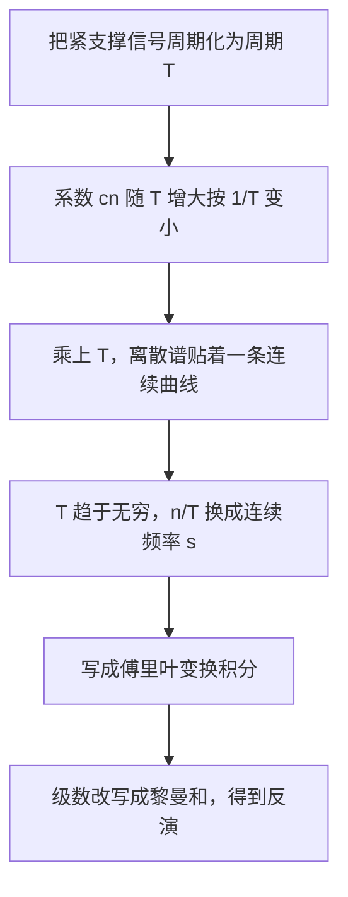
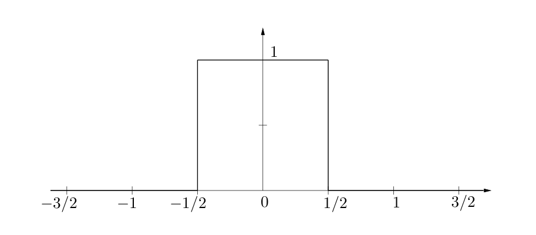
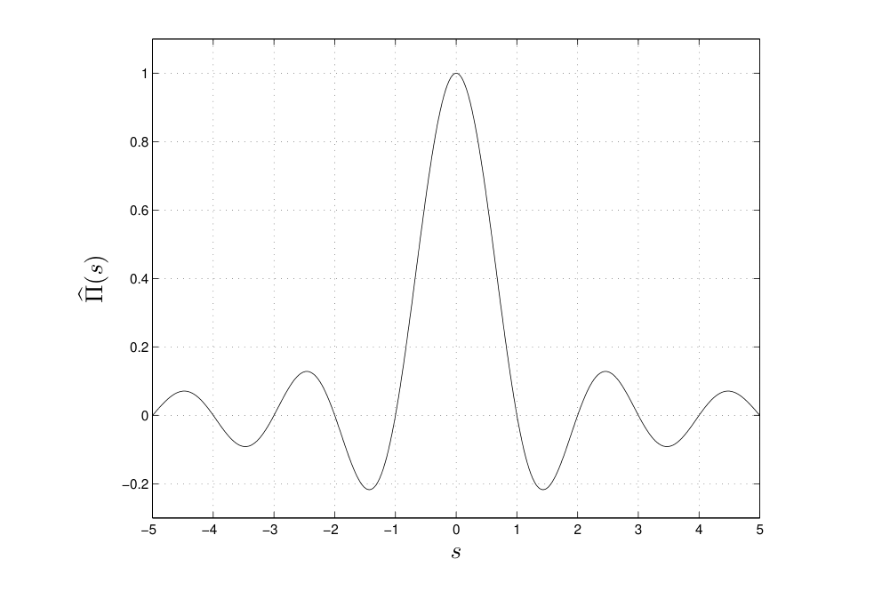
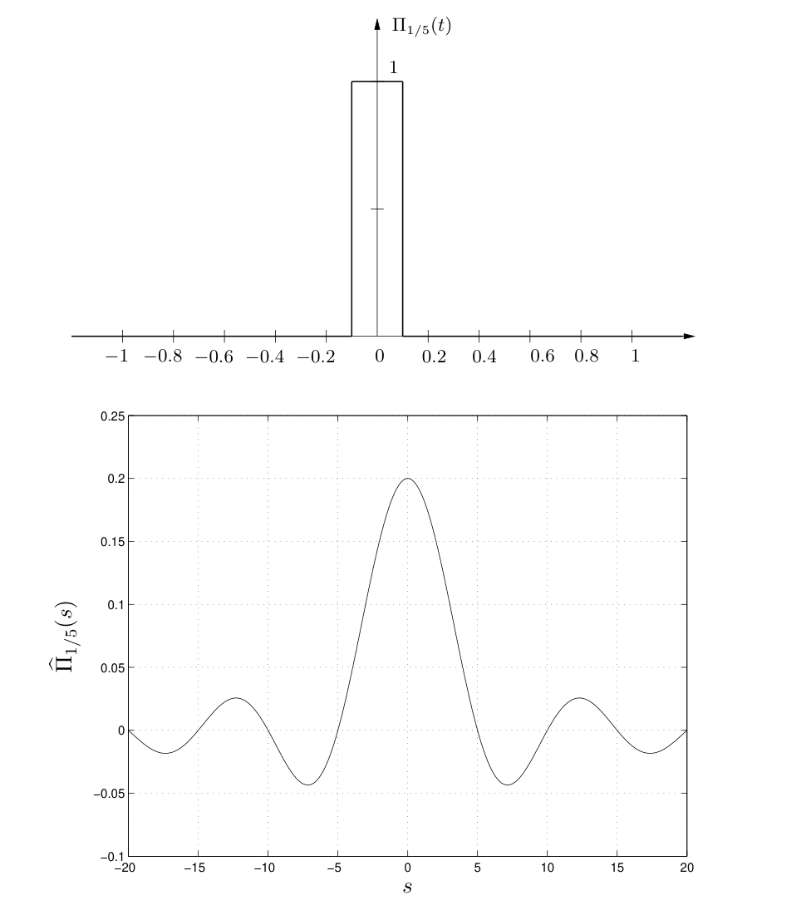

# 第2章 傅里叶变换

### 来源说明

- 作者：Brad Osgood
- 书名：*The Fourier Transform and its Applications*（傅里叶变换及其应用），Stanford EE 261 讲义
- 官方来源：https://see.stanford.edu/materials/lsoftaee261/book-fall-07.pdf
- 本笔记仅供个人学习使用。本地 PDF 不是可再分发的授权副本。

阅读范围：PDF 第 71–100 页。PDF 71 的标题是 Chapter 2 Fourier Transform，不是 Chapter 1。PDF 70 的页眉仍是 Chapter 1 Fourier Series。PDF 100 的页眉仍是 Chapter 2。页眉书页约为 65–94。本范围文本层都能抽出，没有因 zlib 错误跳过的页。

### 本章总览

这一章把傅里叶级数（Fourier series）从周期信号推到非周期信号，得到傅里叶变换（Fourier transform）的积分定义、反演公式，以及移位、伸缩、对偶这几条天天要用的性质。

做法是把一个很快归零的信号按很大的周期 $T$ 重复，再让 $T$ 趋于无穷。系数会像 $1/T$ 那样缩掉，所以要先乘回 $T$，离散频率 $n/T$ 才连成一条连续频谱。

积分什么时候绝对收敛、周期信号的变换为什么是一串 $\delta$、Parseval 恒等式的证明，本章都先放下。带限信号（bandlimited signal）和采样的关系只点到名字。

图注：第 2 章的路线。周期拉长只是动机；真正使用的对象是下面的积分定义和反演，不是某一条具体的周期化。

### 核心知识点

#### 矩形函数与周期拉长

矩形函数（rectangle function）记作 $\Pi$。正文的定义是

$$
\Pi(t)=
\begin{cases}
1, & |t|<1/2,\\
0, & |t|\ge 1/2.
\end{cases}
$$

它是偶函数，宽度为 1，可以看成开关只接通一秒。端点 $\pm 1/2$ 本书取 0。别的书写 1 或 $1/2$，也有人干脆不定义。多数积分里端点不影响结果；低通和高通在截止频率上要彼此衔接时，取 $1/2$ 更整齐。那是第 3 章滤波里的一句补充，本章先按 0 用。

图注：原书 $\Pi(t)$ 的图形。高为 1，底从 $-1/2$ 到 $1/2$，关于原点对称。端点按本章定义落在 0 上。

$\Pi$ 不是周期函数，没有傅里叶级数。把它的非零段按周期 $T$ 重复，中间留很长的 0，就得到周期化。周期函数的级数和系数，本章直接沿用第 1 章的形式：周期 $T$ 时

$$
f(t)=\sum_{n=-\infty}^{\infty} c_n e^{2\pi i n t/T},\qquad
c_n=\frac{1}{T}\int_{-T/2}^{T/2} e^{-2\pi i n t/T} f(t)\,dt.
$$

频率是 $n/T$，相邻间隔 $1/T$。$T$ 越大，谱越密。

第 1 章把周期函数的系数和收敛条件讲完整。这里只需要上面这两行：系数是一个周期上的积分，综合是这些频率上的指数求和。

👉 傅里叶级数的完整讨论见第 1 章。📝待补全

对周期化的 $\Pi$，正文算出

$$
c_n=\frac{1}{\pi n}\sin\frac{\pi n}{T}.
$$

$n$ 固定而 $T$ 很大时，$\sin\theta\approx\theta$，于是 $c_n$ 的大小像 $1/T$。不乘回去的话，极限是 0，谱被抹平了。乘上 $T$ 之后

$$
T c_n=\frac{\sin(\pi n/T)}{\pi n/T}=\operatorname{sinc}(n/T).
$$

正文说，前面画的系数图已经是乘过 $T$ 的。再把密点 $n/T$ 换成连续变量 $s$，就得到 $\operatorname{sinc} s$。

支撑在一个有限区间里的一般信号，同样有 $|c_n|\le A/T$。$A$ 是 $|f|$ 在那个区间上的积分，与 $n$、$T$ 无关。所以「先乘 $T$，再让 $T\to\infty$」不依赖矩形这一只例子。

🔑 关键速记：周期拉长后系数按 $1/T$ 消失，乘回 $T$ 才得到连续频谱。

#### 傅里叶变换的定义

正文把傅里叶变换定义为

$$
\hat f(s)=\mathcal{F}f(s)=\int_{-\infty}^{\infty} e^{-2\pi i s t} f(t)\,dt.
$$

$t$ 若是时间，指数里的 $st$ 要无量纲，$s$ 就是频率，单位是 $1/$时间。$\hat f(s)$ 一般是复值。$s=0$ 时

$$
\hat f(0)=\int_{-\infty}^{\infty} f(t)\,dt,
$$

也就是图像下的面积。$f$ 为实函数时，这个数是实的，其余频率仍可以是复的。

非周期信号的谱是一整条实数轴上的连续统，叫做该信号的 spectrum（频谱）。周期信号的谱是离散点。可以有一段 $|s|$ 大到一定程度后 $\hat f(s)=0$，这叫带限（bandlimited）。带限信号的频谱只占有限的一段频率，外面全是 0。采样要问的是：隔多远取一个样，这些样点还能把整条曲线还原出来。本章只把这类信号从连续谱里指认出来，没有写采样间隔，也没有写还原公式。

👉 采样定理的陈述与证明不在第 2–3 章。📝待补全

周期信号也有傅里叶变换，结果是一串 $\delta$。本章还没有 $\delta$ 的运算规则。

👉 分布（distribution）与 $\delta$ 从第 4 章 PDF 143 起，本笔记不读该页之后。📝待补全

对 $\Pi$ 直接积分，得到本章第一个变换对：

$$
\mathcal{F}\Pi(s)=\operatorname{sinc} s,\qquad \operatorname{sinc} x=\frac{\sin\pi x}{\pi x},\qquad \operatorname{sinc} 0=1.
$$

$\operatorname{sinc} 0=1$ 用的是 $\lim_{x\to 0}(\sin x)/x=1$。本书的 $\operatorname{sinc}$ 在分母里带 $\pi$，零点在非零整数。

图注：原书 $\hat\Pi(s)=\operatorname{sinc} s$ 的曲线。$s=0$ 处为 1，向两侧振荡衰减，非零整数附近穿过 0。纵轴刻度到 1 与 $-0.2$。这是连续谱，不是某一周期的系数棒。

定义先按形式积分来用。正文在写出积分时就声明，眼下不讨论这个反常积分何时收敛。反演那一节同样把换序和 $T\to\infty$ 先当作形式运算。能同时装下阶跃、斜坡和永远振荡的正弦，并且反演仍然成立的那一类对象，要等分布。

👉 使变换与反演同时成立的函数类，在分布那一章才放宽。📝待补全

🔑 关键速记：本书的正变换是 $\int e^{-2\pi i s t} f(t)\,dt$，矩形的变换是 $\operatorname{sinc}$。

#### 反演

仍从「大周期上的傅里叶级数」往回走。支撑在有限区间内时，系数就是

$$
c_n=\frac{1}{T}\hat f(n/T).
$$

代回级数，

$$
f(t)=\sum_{n=-\infty}^{\infty}\hat f(s_n) e^{2\pi i s_n t}\Delta s,\qquad s_n=n/T,\ \Delta s=1/T.
$$

这是一个黎曼和。$T\to\infty$ 时，正文写出反演

$$
f(t)=\int_{-\infty}^{\infty} \hat f(s) e^{2\pi i s t}\,ds.
$$

因此定义逆变换（inverse Fourier transform）

$$
\check g(t)=\mathcal{F}^{-1}g(t)=\int_{-\infty}^{\infty} e^{2\pi i s t} g(s)\,ds,
$$

并写下

$$
(\hat f)\check{}=f,\qquad (\check g)\hat{}=g.
$$

正变换和逆变换只差指数上的符号。由反演还有

$$
f(0)=\int_{-\infty}^{\infty}\hat f(s)\,ds.
$$

右边一般是复函数的积分，左边可以是实数。它没有「面积」那种直接的微积分解释。

本章把反演当作从黎曼和读出来的形式定理。积分是否真能换序、极限是否正当，先不追究。

🔑 关键速记：反演是 $\int \hat f(s) e^{2\pi i s t}\,ds$，紧凑写法是 $(\hat f)\check{}=f$。

#### 记号、能量谱与 $2\pi$ 放在哪里

同一件事有三套记号：$\hat f(s)$、大写 $F(s)$、算子 $\mathcal{F}f(s)$。工程里常用 $f(t)\rightleftharpoons F(s)$ 表示一对傅里叶变换。Bracewell 用的 $\supset$ 本书作者明确不喜欢。对偶讨论时，大写字母容易把「先变换再代入 $-s$」和「先把变量取反再变换」混在一起，所以后文更常用 $\mathcal{F}$。

$|\hat f(s)|^2$ 有三个名字：通信里叫 power spectrum（功率谱），光学里叫 spectral power density（谱功率密度），其余场合常叫 energy spectrum（能量谱）。

Parseval 恒等式在这里只预告，不证明：

$$
\int_{-\infty}^{\infty}|f(t)|^2\,dt=\int_{-\infty}^{\infty}|\hat f(s)|^2\,ds.
$$

它把时域能量和频域能量谱配成同一个数。第 3 章附录用它比较 $|f|^2$ 与 $|\hat f|^2$ 的方差，推导仍不在这两章。

👉 Parseval 的证明不在第 2–3 章。📝待补全

定义并不唯一。正文按 Körner 的清单，把各职业里的写法收成

$$
\mathcal{F}f(s)=\frac{1}{A}\int_{-\infty}^{\infty} e^{i B s t} f(t)\,dt,
$$

常见三档是 $A=\sqrt{2\pi}$、$B=\pm 1$；$A=1$、$B=\pm 2\pi$；$A=1$、$B=\pm 1$。

下面这张表只列常量怎么选。换约定以后导数和卷积前面的系数，第 3 章 3.8 节有一张对照，本章先不展开。

| 约定 | $A$ | $B$ | 本书是否采用 |
| --- | --- | --- | --- |
| 指数里带 $2\pi$ | $1$ | $-2\pi$ | 是，正变换取负号 |
| 根号 $2\pi$ 放在外面 | $\sqrt{2\pi}$ | $\pm 1$ | 否 |
| $2\pi$ 与归一化都不放 | $1$ | $\pm 1$ | 否 |

换一门课或一篇论文之前，先对齐 $A$、$B$ 和谁拿负号。同一条移位公式，差一个 $2\pi$ 就会整段对不上。

🔑 关键速记：本书 $A=1$、$B=-2\pi$；$|\hat f|^2$ 是能量谱，Parseval 这里只报名。

#### 三角、单边指数与高斯

三角脉冲（triangle function）

$$
\Lambda(x)=
\begin{cases}
1-|x|, & |x|\le 1,\\
0, & \text{其余}.
\end{cases}
$$

分部积分后得到 $\mathcal{F}\Lambda(s)=\operatorname{sinc}^2 s$。它是实偶函数，因为 $\Lambda$ 是实偶函数。正文说这不是巧合：$\Lambda$ 是 $\Pi$ 与自己的卷积。卷积把时域的卷积变成频域的乘积，所以 $\operatorname{sinc}$ 自己乘自己。

卷积（convolution）是用一个信号去加权平均另一个信号。两个 $\Pi$ 卷积正好得到 $\Lambda$，频域就变成 $\operatorname{sinc}\cdot\operatorname{sinc}$。第 2 章只先用这个现象解释 $\operatorname{sinc}^2$，定义和定理在下一章。

👉 卷积的定义和卷积定理见第 3 章。

单边指数衰减：$a>0$，$t\le 0$ 时为 0，$t>0$ 时为 $e^{-at}$。直接积分得

$$
\mathcal{F}f(s)=\frac{1}{a+2\pi i s},\qquad |\mathcal{F}f(s)|^2=\frac{1}{a^2+4\pi^2 s^2}.
$$

变换是复数，因为信号没有偶对称或奇对称。功率谱仍是 $s$ 的偶函数。正文把这条曲线叫做 Lorenz profile，并说明它不是高斯。$a$ 变小，时域衰减变慢、图形被拉宽；频域那条峰则变高变窄。时域自变量的缩放规则是：$a>1$ 时 $f(at)$ 被横向挤紧，$0<a<1$ 时 $f(at)$ 被横向拉宽。

高斯（Gaussian）先要一个积分结论：$\int_{-\infty}^{\infty} e^{-x^2}\,dx=\sqrt{\pi}$。它没有初等原函数，Euler 的算法是把平方写成极坐标下的二重积分。过程此处不展开。由此

$$
\int_{-\infty}^{\infty} e^{-\pi x^2}\,dx=1.
$$

傅里叶变换里最合适的归一化就是 $f(x)=e^{-\pi x^2}$。对 $s$ 在积分号下求导，分部积分后得到微分方程

$$
\frac{d}{ds}\mathcal{F}f(s)=-2\pi s\,\mathcal{F}f(s),\qquad \mathcal{F}f(0)=1,
$$

所以 $\mathcal{F}f(s)=e^{-\pi s^2}$。这个高斯是自己的傅里叶变换。

概率里更常见的是均值 $0$、标准差 $\sigma$ 的密度

$$
g(x)=\frac{1}{\sigma\sqrt{2\pi}}e^{-x^2/(2\sigma^2)}.
$$

正文用伸缩定理算出，它的变换仍是高斯，但是

$$
\hat g(s)=e^{-2\pi^2\sigma^2 s^2}.
$$

均值 $\mu$、标准差 $\sigma$ 的密度是上式再平移。拐点在 $\mu\pm\sigma$。$\sigma$ 大则平，$\sigma$ 小则尖，面积仍是 1。正文把 $\mu=0$ 算完；非零均值是平移，相位由下面的移位定理乘上，本章没有再写出那一行。

常用变换对可以收成下表。约束都来自上面的计算，不是额外假设。

| 信号 | 变换 | 约束与现象 |
| --- | --- | --- |
| $\Pi(t)$ | $\operatorname{sinc} s$ | 实偶；端点取值几乎不影响积分 |
| $\Lambda(x)$ | $\operatorname{sinc}^2 s$ | 实偶；与 $\Pi*\Pi$ 是同一件事 |
| 单边 $e^{-at}$（$t>0$） | $1/(a+2\pi i s)$ | $a>0$；变换为复，功率谱为偶 |
| 双边 $e^{-a|t|}$ | $2a/(a^2+4\pi^2 s^2)$ | 与单边只在原点差一个点，积分相同 |
| $e^{-\pi x^2}$ | $e^{-\pi s^2}$ | 面积为 1，变换是它自己 |
| $\dfrac{1}{\sigma\sqrt{2\pi}}e^{-x^2/(2\sigma^2)}$ | $e^{-2\pi^2\sigma^2 s^2}$ | $\mu=0$；仍是高斯，形状不照抄 |

双边指数由单边及其反转相加得到，原点上的差别不影响积分。结果是实的，和「实偶函数的变换为实偶」一致。

🔑 关键速记：$\Pi\mapsto\operatorname{sinc}$，$\Lambda\mapsto\operatorname{sinc}^2$，$e^{-\pi x^2}$ 的变换是它自己。

#### 对偶与反转信号

记反转 $f^-(t)=f(-t)$。偶就是 $f^-=f$，奇就是 $f^-=-f$。两次反转回到原信号。

正变换和逆变换的对称性可以收成两条，其余都由此推出：

$$
\mathcal{F}f=(\mathcal{F}^{-1}f)^-,\qquad \mathcal{F}(f^-)=\mathcal{F}^{-1}f.
$$

写成带变量的样子，就是 $\mathcal{F}f(-s)=\mathcal{F}^{-1}f(s)$。括号的位置很要紧：这是先变换、再把自变量换成 $-s$，不是先把 $f$ 的变量取反再变换。后一件事是 $\mathcal{F}(f^-)$。

再推一步，

$$
\mathcal{F}(\mathcal{F}f)=f^-,\qquad \mathcal{F}(\mathcal{F}f^-)=f.
$$

因此 $\mathcal{F}$ 做四次是恒等变换。

因为 $\Pi$ 和 $\Lambda$ 是偶的，对偶立刻给出 $\mathcal{F}\operatorname{sinc}=\Pi$，$\mathcal{F}\operatorname{sinc}^2=\Lambda$。

🔑 关键速记：先记住 $\mathcal{F}f=(\mathcal{F}^{-1}f)^-$ 和 $\mathcal{F}(f^-)=\mathcal{F}^{-1}f$，其余对偶公式往下推。

#### 偶奇与共轭

$f$ 为偶或奇时，$\mathcal{F}f$ 同样为偶或奇。实值信号还有共轭对称，和实周期信号的傅里叶系数是同一类现象：

$$
(\mathcal{F}f)^-=\overline{\mathcal{F}f},\qquad \mathcal{F}(f^-)=\overline{\mathcal{F}f}.
$$

合在一起：

- $f$ 实且偶，则 $\mathcal{F}f$ 实且偶。$\Pi$、$\Lambda$、双边指数、$e^{-\pi x^2}$ 都是这种。
- $f$ 实且奇，则 $\mathcal{F}f$ 纯虚且奇。

复值函数仍可以谈偶和奇，只是没有实函数那种关于纵轴或原点的图形。一个函数可以偶、奇或两者都不是；除非恒为 0，不能又偶又奇。

🔑 关键速记：实偶函数的变换是实偶函数；实信号的功率谱是偶函数。

#### 线性、移位与伸缩

变换对积分是线性的，所以

$$
\mathcal{F}(f+g)=\mathcal{F}f+\mathcal{F}g,\qquad \mathcal{F}(\alpha f)=\alpha\mathcal{F}f,
$$

$\alpha$ 可以是复数。第 3 章把「两个信号如何互相修改」从这条加法出发，再问乘法。

移位定理：若 $f(t)\rightleftharpoons F(s)$，则

$$
f(t+b)\rightleftharpoons e^{2\pi i s b} F(s),\qquad f(t\pm b)\rightleftharpoons e^{\pm 2\pi i s b} F(s).
$$

相位因子模长为 1，所以 $|\mathcal{F}\{f(t+b)\}|=|F|$。时间上挪一挪，各频率上的能量不变，变的是相位。

伸缩定理（stretch theorem，也称 similarity theorem）：$a\neq 0$ 时

$$
f(at)\rightleftharpoons \frac{1}{|a|} F(s/a).
$$

$a>1$ 时，$f(at)$ 在时间上被挤紧，$F(s/a)$ 在频率上被拉宽，前面的 $1/a$ 再把高度压低。$0<a<1$ 时相反：时间上拉宽，频率上挤紧并抬高。变换一般是复的，这种一宽一窄要看 $|F|$ 的图，不要把复数值本身当成一条实曲线去比胖瘦。

宽度为 $p>0$ 的矩形 $\Pi_p(t)=\Pi(t/p)$ 满足 $|t|<p/2$ 时为 1。由伸缩定理

$$
\mathcal{F}\Pi_p(s)=p\operatorname{sinc}(p s).
$$

图注：原书宽度 $p=1/5$ 的一对。上图 $\Pi_{1/5}(t)$ 在时间上很窄；下图 $\hat\Pi_{1/5}(s)=(1/5)\operatorname{sinc}(s/5)$，主峰高度为 $1/5$，振荡摊到大约 $|s|=20$。宽度为 5 的那一对在下一页，更高更窄，本图没有拼进去。

时域和频域不能同时都挤在一个点附近。周期情形有一个粗糙的类比：周期 $T$ 大，波形很久才重复，谱点间隔 $1/T$ 却很密。更定量的下界是 Heisenberg 不等式，第 3 章在引入均值和方差之后给出 $\sigma(f)\sigma(\hat f)\ge 1/(4\pi)$。

👉 不等式的陈述、等号情形和量子力学对照见第 3 章附录。

移位和伸缩可以叠在一起。正文先算例子 $\Pi((x-3)/2)$，积分结果是

$$
F(s)=2 e^{-6\pi i s}\operatorname{sinc}(2s).
$$

矩形被平移之后不再是偶函数，变换变成复数。$|F(s)|^2=4\operatorname{sinc}^2(2s)$ 只保留能量，相位看不出来。一般公式是

$$
f(at\pm b)=f\bigl(a(t\pm b/a)\bigr)\rightleftharpoons \frac{1}{|a|} e^{\pm 2\pi i s b/a} F(s/a).
$$

用 $a=1/2$、$b=-3/2$ 代回，与直接积分的结果一致。

🔑 关键速记：平移只乘 $e^{\pm 2\pi i s b}$；时间挤紧 $a$ 倍，频率就拉开并乘上 $1/|a|$。

### 章末速记

1. $\mathcal{F}f(s)=\int e^{-2\pi i s t} f(t)\,dt$，$\mathcal{F}^{-1}g(t)=\int e^{2\pi i s t} g(s)\,ds$，且 $(\hat f)\check{}=f$。
2. $\mathcal{F}\Pi=\operatorname{sinc}$，$\mathcal{F}\Lambda=\operatorname{sinc}^2$，$\mathcal{F}(e^{-\pi x^2})=e^{-\pi s^2}$，本书 $\operatorname{sinc} x=\sin(\pi x)/(\pi x)$。
3. 实偶则变换实偶；实奇则变换纯虚且奇；实信号满足 $(\mathcal{F}f)^-=\overline{\mathcal{F}f}$。
4. $f(t+b)\rightleftharpoons e^{2\pi i s b} F(s)$，幅度不变；$f(at)\rightleftharpoons |a|^{-1} F(s/a)$。
5. 对偶只记两条：$\mathcal{F}f=(\mathcal{F}^{-1}f)^-$，$\mathcal{F}(f^-)=\mathcal{F}^{-1}f$。

### 易混淆点与差异对比

周期信号与这条积分变换用的是两套谱。对照如下。

| 对象 | 谱长什么样 | 综合怎么写 |
| --- | --- | --- |
| 周期 $T$ 的傅里叶级数 | 离散点 $n/T$，间隔 $1/T$ | 系数乘指数后求和 |
| 整条直线上的傅里叶变换 | 连续变量 $s$ | $\hat f(s)$ 乘 $e^{2\pi i s t}$ 后积分 |
| 带限信号 | $\|s\|$ 足够大时 $\hat f(s)=0$ | 仍是反演积分，采样定理另章 |

级数的「逆」是求和，变换的「逆」几乎是同一只积分，只改指数符号。所以才会有对偶；级数没有这么对称的公式。

$\mathcal{F}f(-s)$ 与 $\mathcal{F}(f^-)$ 都出现反号，角色不同。前者等于 $\mathcal{F}^{-1}f$，后者等于 $(\mathcal{F}f)^-$。算 $\operatorname{sinc}$ 的变换时，用的是第一条加上 $\Pi$ 为偶。

移位与伸缩对图形的影响也不同。移位保持 $|F|$，只加相位。伸缩让时间和频率朝相反方向变胖变瘦，并且多一个 $1/|a|$。复值变换的胖瘦看 $|F|$ 或 $|F|^2$。$|F|^2$ 里没有相位，平移过的矩形就是例子。

$\operatorname{sinc}$ 的归一化、以及 $2\pi$ 放在指数里还是放在积分外面，各书不同。把别的书的公式抄进 $A=1$、$B=-2\pi$ 这套约定，要整份重算，不能只改一个符号。

高斯 $e^{-\pi x^2}$ 的变换是它自己。单边指数的功率谱也像一口钟，正文强调那是 Lorenz profile，高度和宽度由 $a$ 决定，代数形式是 $1/(a^2+4\pi^2 s^2)$。

要点：先看约定和括号，再看图。幅度图回答不了相位，相位因子也改变不了幅度。

### 本章要点总结

- 非周期信号的频谱用 $\int e^{-2\pi i s t} f(t)\,dt$ 定义。矩形给出 $\operatorname{sinc}$，反演把 $\hat f$ 再乘 $e^{2\pi i s t}$ 积分回去。
- 基本对子要能随手写出：$\Pi$、$\Lambda$、单边与双边指数、$e^{-\pi x^2}$。三角脉冲的 $\operatorname{sinc}^2$ 在下一章会从卷积再得到一次。
- 线性、共轭对称、移位、伸缩是后面滤波和中心极限定理的计算工具。时间上更窄，频谱就更宽、更矮。
- 对偶把逆变换收成「变换之后再反转自变量」。$\mathcal{F}$ 四次回到原函数。
- 能量谱的 Parseval 恒等式、带限采样、以及 $\delta$ 与周期信号的变换，本章只标出位置，证明和使用规则不在这 30 页里。
