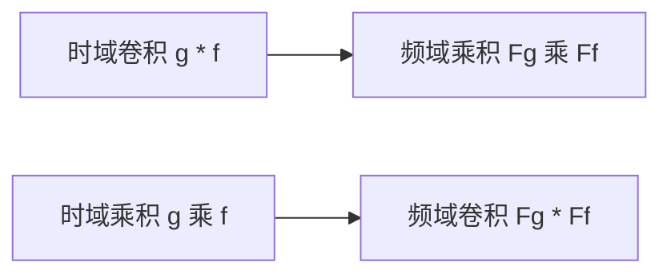
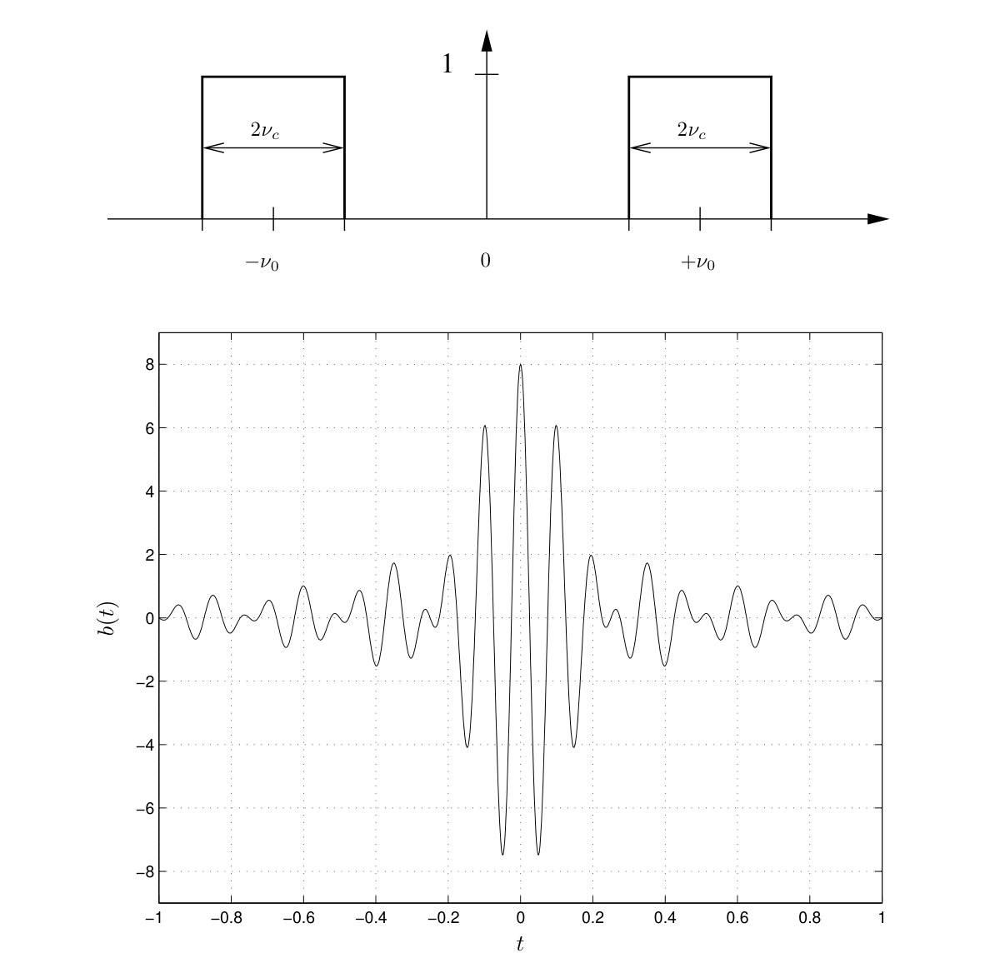
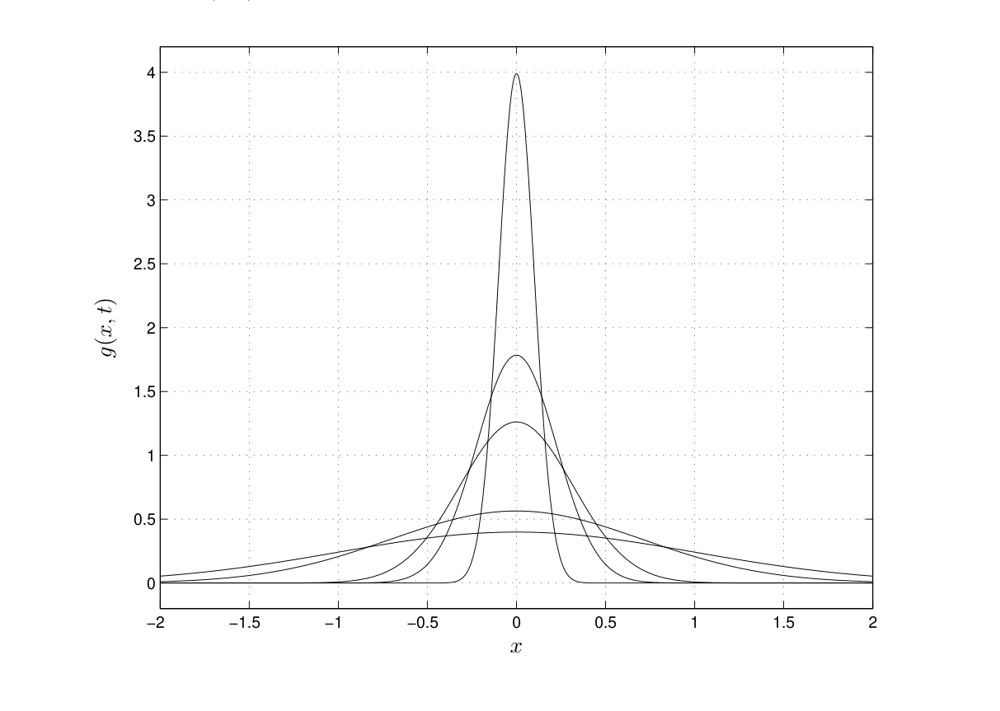
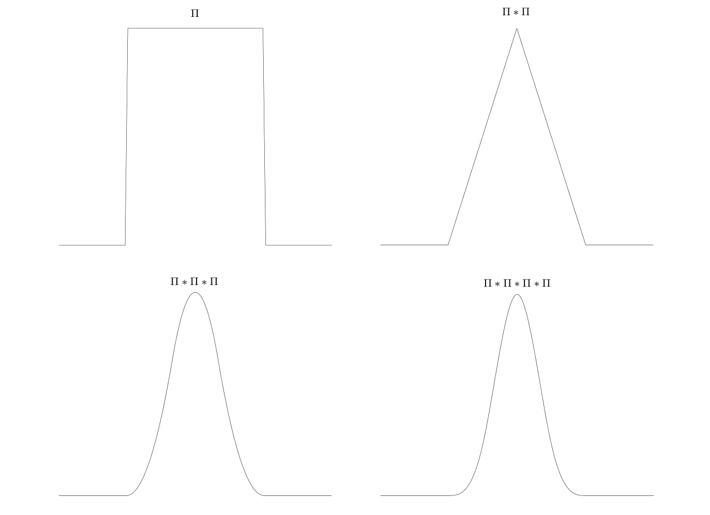

# 第3章 卷积

### 来源说明

- 作者：Brad Osgood
- 书名：*The Fourier Transform and its Applications*（傅里叶变换及其应用），Stanford EE 261 讲义
- 官方来源：https://see.stanford.edu/materials/lsoftaee261/book-fall-07.pdf
- 本笔记仅供个人学习使用。本地 PDF 不是可再分发的授权副本。

阅读范围：PDF 第 101–142 页。PDF 101 的标题是 Chapter 3 Convolution。PDF 142 的页眉仍是 Chapter 3。下一章 Chapter 4 Distributions and Their Fourier Transforms 从 PDF 143 起，本笔记不读 143 及之后。页眉书页约为 95–136。本范围文本层都能抽出，没有因 zlib 错误跳过的页。

### 本章总览

第 2 章的加法会让频谱相加。这一章问的是：有没有一种时域组合，使频谱变成两个变换的乘积。答案是卷积（convolution）。

卷积定理把「时域卷积、频域相乘」和「时域相乘、频域卷积」配成一对。后面用它做理想滤波、把常系数微分方程改成乘法、把热方程的解写成热核卷积，并说明独立随机变量之和的密度仍是卷积，从而得到中心极限定理（Central Limit Theorem）的一个形式。

\(\delta\) 作为卷积的单位元、高通和陷波的冲激响应、线性时不变系统的完整说法，都要等 \(\delta\) 可用之后再写。本章把缺口标出来，不把后一章的定义提前当成本章结论。

### 核心知识点

#### 卷积的定义

设 \(f\) 与 \(g\) 在整条实数轴上有定义。它们的卷积是

\[
(g*f)(t)=\int_{-\infty}^{\infty} g(t-x) f(x)\,dx.
\]

傅里叶级数里也有卷积，积分限是一个周期，并且 \(g\) 必须周期延拓，否则 \(t-x\) 会跑出 \([0,1]\)。直线上的卷积没有这道手续。积分是否收敛仍要单独看，本章和上一章一样，先按形式运算。

第 2 章的正变换是 \(\mathcal{F}f(s)=\int e^{-2\pi i s t} f(t)\,dt\)，逆变换只把指数改成正号，并且 \((\hat f)\check{}=f\)。下面所有「频域乘积再变回去」都靠这两条。

👉 定义、反演和对偶的细节见第 2 章。

把 \(\mathcal{F}g(s)\mathcal{F}f(s)\) 写成二重积分，令 \(u=t+x\)，交换积分次序，内层就是 \(h(u)=\int g(u-x)f(x)\,dx\)。外层正好是 \(\mathcal{F}h\)。于是这个 \(h\) 被定义成卷积，并得到定理。

记号上不要把卷积写成 \(g(t)*f(t)\) 再把 \(t\) 随便代。\(g(2t)\) 与 \(f(t)\) 的卷积是先令 \(h(t)=g(2t)\)，再算 \((h*f)(t)\)，积分核是 \(g(2(t-x))\)，也就是 \(g(2t-2x)\)。写成 \(g(2t-x)\) 是错的。

🔑 关键速记：\((g*f)(t)=\int g(t-x)f(x)\,dx\)；缩放要先作用在整个函数上，再进入 \(t-x\)。

#### 卷积定理

\[
\mathcal{F}(g*f)=\mathcal{F}g\cdot\mathcal{F}f.
\]

若 \(f\rightleftharpoons F\)、\(g\rightleftharpoons G\)，则 \(g*f\rightleftharpoons G F\)。一句话：时域卷积对应频域乘积。

逆变换有同样的形式 \(\mathcal{F}^{-1}(g*f)=\mathcal{F}^{-1}g\cdot\mathcal{F}^{-1}f\)。另一个方向需要第 2 章的 \(\mathcal{F}(\mathcal{F}f)=f^-\)：

\[
\mathcal{F}(gf)=\mathcal{F}g*\mathcal{F}f.
\]

时域乘积对应频域卷积。直接去拆 \(\mathcal{F}(gf)\) 的积分，凑不出这只卷积；所以正文先证明卷积变乘积，再用对偶把乘积变卷积。

图注：卷积定理的两个方向。左到右是本章先证的那条；右下这一条由对偶推回。滤波走上面一条，调制类的乘积走下面一条。

手算可以核对 \((\Pi*\Pi)(x)=\Lambda(x)\)。再由定理，

\[
\mathcal{F}\Lambda=\operatorname{sinc}\cdot\operatorname{sinc}=\operatorname{sinc}^2,
\]

与第 2 章对 \(\Lambda\) 直接分部积分的结果一致。

第 2 章已经算出 \(\mathcal{F}\Pi=\operatorname{sinc}\)、\(\mathcal{F}\Lambda=\operatorname{sinc}^2\)，\(\operatorname{sinc} x=\sin(\pi x)/(\pi x)\)。这里只是换一条路：先卷积，再看乘积。

👉 这些变换对的直接计算见第 2 章。

🔑 关键速记：时域卷积 \(\leftrightarrow\) 频域乘积；时域乘积 \(\leftrightarrow\) 频域卷积。

#### 卷积在做什么

正文不把卷积绑在一种解释上。信号与系统课里，线性时不变是指输入相加则输出相加、输入延迟则输出做同样的延迟。那种系统若知道对单位冲激的响应，任意输入的输出就是与这个响应做卷积。热方程里，卷积则是和 Green 函数做平滑。两条线都算卷积，但单位冲激还没有定义，系统那条线本章只留背景。

👉 线性时不变系统的完整模型依赖 \(\delta\)，不在本章写完。📝待补全

几何上，固定 \(t\) 时，\(g(t-x)\) 是把 \(g\) 平移到 \(t\) 附近再左右翻转。\((g*f)(t)\) 不是这两条曲线在一点的乘积，而是乘积对 \(x\) 的积分。\(t\) 变动就是把翻转后的 \(g\) 拖过去，所以有 flip and drag（翻转再拖动）这个说法。正文认为任意两条曲线都靠脑子翻转，不如直接看定理，并提到 Johns Hopkins 的 “Joy of Convolution” 演示，地址写在书里，这里不转述操作。

若 \(g\ge 0\)、集中在 0 附近且 \(\int g=1\)，则 \((g*f)(t)\) 是 \(f\) 在 \(t\) 附近的加权平均。\(t\) 挪一点，相邻平均共用不少样本，所以卷积往往比 \(f\) 更平。\(\Pi\) 在 \(\pm 1/2\) 有跳跃，\(\Pi*\Pi=\Lambda\) 连续，只留下角点。正文的格言是：\(g*f\) 至少和 \(f\)、\(g\) 各自一样光滑。

卷积也把支撑涂开。两条都在有限区间外恒为 0 时，卷积也在某个区间外恒为 0。只要有一条不最终归零，卷积也不会最终归零。

代数性质像乘法，但不全像。

- 交换：\(f*g=g*f\)。翻转看起来不对称，变量替换 \(v=t-u\) 之后两边相同。频域乘积本来就交换，所以结果必须交换。
- 结合：\((f*g)*h=f*(g*h)\)。正文留作积分练习；频域是普通乘法，结合性在那里是明显的。
- 分配：\(f*(g+h)=f*g+f*h\)。

卷积的「1」应满足 \(\mathcal{F}g=1\)，从而 \(g*f=f\)。形式地做逆变换会得到 \(\int e^{2\pi i s x}\,dx\)，这个积分不存在。没有经典函数能当这个单位元，它就是后面的 \(\delta\)。

👉 \(\delta\) 的定义与 \(\mathcal{F}\delta=1\) 不在第 2–3 章。📝待补全

已知 \(h=f*g\) 反解 \(f\)，叫做反卷积（deconvolution）。频域是 \(\mathcal{F}f=\mathcal{F}h/\mathcal{F}g\)。\(\mathcal{F}g=0\) 的那些频率除不动，反演积分本身也可能有问题。噪声模型通常还要加统计假设，本章只指出这一步。

若干恒等式可以直接当代数用，不必每次重算积分。小写与大写是变换对。

| 时域 | 频域 |
| --- | --- |
| \((f\cdot g)*(h\cdot k)\) | \((F*G)\cdot(H*K)\) |
| \((f+g)\cdot(h+k)\) | \((F+G)*(H+K)\) |
| \(f\cdot(g*h)\) | \(F*(G\cdot H)\) |

用的时候仍要避免 \(g(2t)*f(t)\) 那种把变量写进星号的简写。

🔑 关键速记：卷积是翻转后的加权平均，又交换、又涂开支撑；经典函数里没有卷积单位元。

#### 滤波

正文把滤波（filtering）说成：还想认出原来的信号，但要增强或去掉某一段频谱。最常见的做法是频域乘一个固定的 \(H(s)\)，时域就是卷积。

输入 \(v(t)\)，输出 \(w(t)=(h*v)(t)\)。大写表示变换时，

\[
W(s)=H(s) V(s).
\]

\(h\) 叫 impulse response（冲激响应），\(H\) 叫 transfer function（传递函数）。名字按习惯固定用 \(h\) 和 \(H\)。电路或程序里 \(h\) 是事先定好的，不随这一次的输入改。

图注：理想滤波的数据流。时域等价于与 \(h=\mathcal{F}^{-1}H\) 卷积。\(H\) 为实数时只改幅度，不改相位。

写成幅度和相位：\(|W|=|H|\,|V|\)，相位相加 \(\phi_W=\phi_V+\phi_H\)。\(H\) 为实数时相位增量是 0。乘 \(H\) 不会造出输入里没有的新频率，只会把某些频率乘小，直到乘成 0。

实信号有第 2 章的共轭对称 \(V(-s)=\overline{V(s)}\)。正频率和负频率要成对保留，重建时才仍是实信号。

理想低通（lowpass）在截止频率 \(\nu_c\) 以内原样通过，以外关掉：

\[
H(s)=\Pi_{2\nu_c}(s)=\Pi(s/(2\nu_c))=
\begin{cases}
1, & |s|<\nu_c,\\
0, & |s|\ge\nu_c.
\end{cases}
\]

频域矩形的宽度是 \(2\nu_c\)。第 2 章的伸缩定理把时间上的宽度 \(p\) 变成频谱 \(p\operatorname{sinc}(ps)\)。\(\Pi\) 与 \(\operatorname{sinc}\) 都是偶函数，正变换和逆变换给出同一对函数，所以频域上的宽矩形变回时域仍是一条 sinc。冲激响应是

\[
h(t)=2\nu_c\operatorname{sinc}(2\nu_c t).
\]

叫做理想，是因为截止是一根竖线。正文说实践中做不到这么陡，滤波器设计的很大一部分就是在逼近这道陡截止。这些逼近的具体做法，本章没有列出。

👉 可实现低通如何逼近理想矩形，本章没有展开。📝待补全

理想带通（bandpass）在 \(\pm\nu_0\) 两侧各留一条宽 \(2\nu_c\) 的通带：

\[
B(s)=
\begin{cases}
1, & \nu_0-\nu_c<|s|<\nu_0+\nu_c,\\
0, & \text{其余},
\end{cases}
=H(s-\nu_0)+H(s+\nu_0).
\]

频移对应时域乘指数，这一步正文称为移位定理或调制定理的直接使用：

\[
b(t)=h(t)e^{2\pi i\nu_0 t}+h(t)e^{-2\pi i\nu_0 t}=4\nu_c\cos(2\pi\nu_0 t)\operatorname{sinc}(2\nu_c t).
\]

第 2 章的移位定理是时间平移乘 \(e^{\pm 2\pi i s b}\)。正变换和逆变换只差一个符号，频率平移就变成时间上乘复指数。带通这一节直接写出上式，没有再单独证明一遍。

图注：原书理想带通。上图 \(B(s)\) 是两块高为 1、宽为 \(2\nu_c\) 的矩形，中心在 \(\pm\nu_0\)。下图是 \(\nu_0=10\)、\(\nu_c=2\) 时的 \(b(t)\)，横轴 \(t\in[-1,1]\)，纵轴约到 \(\pm 8\)。中心高度 \(4\nu_c=8\) 与公式一致。两图之间的正文已裁掉。

理想高通（highpass）放行 \(|s|>\nu_c\)，去掉更低的频率，用来削缓慢漂移。用在图像上，是保留边缘和细节所在的高空间频率，去掉模糊所在的低空间频率。传递函数

\[
\operatorname{High}(s)=1-\Pi_{2\nu_c}(s).
\]

在 \(\pm\nu_c\) 上这个写法取值 1 而不是 0。正文说实际无差别，同时也说明：若 \(\Pi\) 的端点定义为 \(1/2\)，低通和高通在截止点上就一致。冲激响应需要 \(\mathcal{F}^{-1}(1)\)，也就是 \(\delta\)，本章写不出。

陷波（notch）是带通的互补，\(\operatorname{Notch}(s)=1-B(s)\)，挖掉 \(\nu_0\) 附近对称的两段，其余通过。冲激响应同样要等 \(\delta\)。

👉 高通与陷波的 \(h(t)\) 含 \(\delta\)，见第 4 章。📝待补全

🔑 关键速记：低通的 \(H\) 是频域矩形，\(h\) 是 \(2\nu_c\operatorname{sinc}(2\nu_c t)\)；带通再调制成余弦乘 sinc。

#### 导数、常微分方程与热核

正文把求导公式当作已经可用的结论（作业里算过）：

\[
(\mathcal{F}f')(s)=2\pi i s\,\mathcal{F}f(s),\qquad (\mathcal{F}f^{(n)})(s)=(2\pi i s)^n\mathcal{F}f(s).
\]

常系数微分算子 \(P(d/dx)\) 变到频域，就是把多项式 \(P\) 代在 \(2\pi i s\) 上，再乘 \(\mathcal{F}f(s)\)。

3.8 节按一般的 \(A\)、\(B\) 列了一张换约定后的公式。其中 \(\mathcal{F}(\mathcal{F}f)=\dfrac{2\pi}{A^2|B|}f^-\)，\(\mathcal{F}(f*g)=A(\mathcal{F}f)(\mathcal{F}g)\)，\((\mathcal{F}f)'=i B\,\mathcal{F}(tf(t))\)。同一张表把 \(\mathcal{F}(f')\) 印成 \(-i B\,\mathcal{F}f\)，这一行的文本里没有单独的频率因子 \(s\)。本书约定 \(A=1\)、\(B=-2\pi\) 时，\(-i B=2\pi i\)，与上面的 \(2\pi i s\) 还差一个 \(s\)。求导时以 3.5 节的 \((\mathcal{F}f')(s)=2\pi i s\,\mathcal{F}f(s)\) 为准。

【信息缺口：3.8 对照式里 \(\mathcal{F}(f')\) 的频率因子 \(s\) 未在该行抽出。】

👉 \(A\)、\(B\) 三档约定本身见第 2 章。那里选定 \(A=1\)、\(B=-2\pi\)。换约定只改系数，不改「卷积变乘积」这件事；本书的 \(A=1\)，所以定理里没有额外常数。

模型方程 \(u''-u=-f\) 变到频域是 \((1+4\pi^2 s^2)\mathcal{F}u=\mathcal{F}f\)。而 \(1/(1+4\pi^2 s^2)\) 是 \(\tfrac12 e^{-|t|}\) 的变换，所以

\[
u(t)=\frac12 e^{-|t|}*f(t)=\frac12\int_{-\infty}^{\infty} e^{-|t-\tau|} f(\tau)\,d\tau.
\]

这是第 2 章双边指数的一次使用。

无限长杆上的热方程取

\[
u_t=\frac12 u_{xx},\qquad u(x,0)=f(x).
\]

对 \(x\) 做变换，时间 \(t\) 留下来，得到 \(\partial_t \mathcal{F}u=-2\pi^2 s^2\mathcal{F}u\)，于是

\[
\mathcal{F}u(s,t)=\mathcal{F}f(s)\, e^{-2\pi^2 s^2 t}.
\]

指数因子是热核（heat kernel，也称 Green 函数或基本解）

\[
g(x,t)=\frac{1}{\sqrt{2\pi t}} e^{-x^2/(2t)}
\]

的变换。因此 \(t>0\) 时

\[
u(x,t)=\int_{-\infty}^{\infty}\frac{1}{\sqrt{2\pi t}} e^{-(x-y)^2/(2t)} f(y)\,dy.
\]

每个固定的 \(t>0\)，\(g(\cdot,t)\) 的积分都是 1。温度是初值的平滑平均。

图注：原书热核 \(g(x,t)\) 对 \(x\) 的几条曲线，对应 \(t=1,0.5,0.1,0.05,0.01\)。图上没有把 \(t\) 标到每一条上。越尖的越集中在 \(x=0\)，纵轴最高刻度到 4。每条曲线下的面积都是 1。

\(t\) 越小，热核在 \(x=0\) 越尖，积分却始终是 1，图像上像把质量挤到一个点。正文说 \(t\to 0\) 时它们逼近 \(\delta\)，并声明这个极限以后再证。本章没有给出极限的含义，也没有写收敛的条件。

👉 热核收敛到 \(\delta\) 的论证不在本章。📝待补全

圆上的热方程（第 1 章的傅里叶级数应用）用周期 1 的核

\[
\sum_{n=-\infty}^{\infty} e^{-2\pi^2 n^2 t} e^{2\pi i n x},
\]

卷积只在 \([0,1]\) 上积分。把它和无限杆对比，靠的是本章证明的恒等式

\[
\sum_{n=-\infty}^{\infty} e^{-(x-n)^2/(2t)}=\sqrt{2\pi t}\sum_{n=-\infty}^{\infty} e^{-2\pi^2 n^2 t} e^{2\pi i n x}.
\]

证法的结论是：左边是高斯的周期化，它的傅里叶系数等于该高斯的傅里叶变换在整数上的取值。一般的 Poisson 求和公式以后才写，采样定理也建在那上面。这里只得到这条高斯恒等式。

Jacobi \(\vartheta\) 函数 \(\vartheta(t)=\sum_{n=-\infty}^{\infty} e^{-\pi n^2 t}\)（\(t>0\)）满足 \(\vartheta(t)=t^{-1/2}\vartheta(1/t)\)。正文说它由上面的恒等式取 \(x=0\)，再把 \(t\) 换成 \(1/(2\pi t)\) 得到。

👉 Poisson 求和的一般形式与采样定理不在第 2–3 章。📝待补全

半无限杆、左端喂入 \(f(t)\)、初值为 0 时，方程仍是 \(u_t=\tfrac12 u_{xx}\)。正文消掉未知的 \(u_x(0,\tau)\) 之后，Stokes 的解是

\[
u(x,t)=\int_0^t f(\tau)\, \frac{x\, e^{-x^2/(2(t-\tau))}}{\sqrt{2\pi(t-\tau)^3}}\,d\tau.
\]

Stokes 自己对 \(v_t=v_{xx}\)（右边系数是 1 不是 \(1/2\)）写出的形式是

\[
v(x,t)=\frac{x}{2\sqrt{\pi}}\int_0^t (t-t')^{-3/2} e^{-x^2/(4(t-t'))} f(t')\,dt'.
\]

中间几次换 \(\sigma\) 的代数，文本层和最终公式之间不容易逐符号对齐。使用时以上面两行最终公式为准。

【信息缺口：电缆问题推导中间的 \(\sigma\) 与指数 \(2\pi^2\) 在文本层里有一处对不齐，笔记只保留正文最终写出的解。】

🔑 关键速记：求导变成乘 \(2\pi i s\)；无限杆的解是初值与热核的卷积，热核面积恒为 1。

#### 中心极限定理

反复自卷积会变光滑，并且出现高斯的形状。\(\Pi\) 与自己卷积几次，矩形变成三角，再变成钟形。

图注：原书 \(\Pi\) 的自卷积，左上到右下依次是 \(\Pi\)、\(\Pi*\Pi\)、三重、四重。跳跃先变成角，再被抹平，轮廓趋向钟形。图上没有坐标刻度。正文另有一条随机取值的信号，四重自卷积后同样出现钟形，那一页没有裁进本图。

随机变量（random variable）在本章的工作定义是：一个还不知道的数，来自一次测量或实验。离散型只取有限个值，连续型的值铺在区间上。

连续型的概率密度（probability density function，pdf）是非负函数 \(p\)，且 \(\int_{-\infty}^{\infty} p=1\)。\(a>0\) 时 \(a\,p(ax)\) 仍是密度。概率是密度下的面积：

\[
\operatorname{Prob}(a\le X\le b)=\int_a^b p_X(x)\,dx.
\]

单点概率为 0。累积分布 \(P(t)=\int_{-\infty}^t p\) 求导回到 \(p\)。

均值、方差、标准差是

\[
\mu(X)=\int_{-\infty}^{\infty} x p(x)\,dx,\qquad
\sigma^2(X)=\int_{-\infty}^{\infty}(x-\mu(X))^2 p(x)\,dx,\qquad
\sigma(X)=\sqrt{\sigma^2(X)}.
\]

均值有限才能谈方差；两者都可能是无穷。\(X-a\) 的密度是 \(p(x+a)\)，均值变成 \(\mu-a\)。均值已经是 0 时，\(X/a\) 的方差是 \(\sigma^2/a^2\)。因此只要 \(\mu\) 与 \(\sigma\) 都有限，就可以把随机变量改成均值 0、方差 1。

两个例子：

- 连续均匀分布若放在 \([-1/2,1/2]\) 上，密度就是 \(\Pi\)。均值 0，方差 \(1/12\)。
- 正态密度就是高斯 \(g(x,\mu,\sigma)=\dfrac{1}{\sigma\sqrt{2\pi}}e^{-(x-\mu)^2/(2\sigma^2)}\)，均值 \(\mu\)，方差 \(\sigma^2\)。

独立（independence）在这里的用法是：事件同时发生的概率等于概率相乘。

独立随机变量之和的密度，等于各自密度的卷积。离散的骰子已经是这个样子：一颗骰子均匀，两颗之和的分布呈三角形。和为 \(n\) 的概率是 \(\sum_k p(k)p(n-k)\)。正文列出的理论值是：2 与 12 为 \(1/36\)，3 与 11 为 \(2/36\)，4 与 10 为 \(3/36\)，5 与 9 为 \(4/36\)，6 与 8 为 \(5/36\)，7 为 \(6/36\)。

连续情形的结论：\(X_1+X_2\) 的密度是 \(p_2*p_1\)。\(n\) 个独立随机变量的和，密度是 \(p_1*\cdots*p_n\)。同一个 \(p\) 卷积 \(n-1\) 次，记作 \(p^{*n}\)。

中心极限定理讨论独立同分布（independent and identically distributed，iid）的和 \(S_n=X_1+\cdots+X_n\)。共同的均值 \(\mu\)、标准差 \(\sigma\) 有限时，

\[
\mu(S_n)=n\mu,\qquad \sigma(S_n)=\sqrt{n}\,\sigma.
\]

均值的这条对 \(n=2\) 用卷积直接积分，再归纳。方差在正文里先假设均值是 0，得到 \(\sigma(S_2)=\sqrt{2}\sigma\)，再归纳；均值不是 0 时如何改写，正文留给读者。定理本体使用的是已经中心化、标准化的和。

概率形式：

\[
\lim_{n\to\infty}\operatorname{Prob}\left(a<\frac{S_n-n\mu}{\sqrt{n}\,\sigma}<b\right)=\frac{1}{\sqrt{2\pi}}\int_a^b e^{-x^2/2}\,dx.
\]

右边是均值 0、标准差 1 的高斯。

密度形式：设每个 \(X_j\) 已经均值 0、标准差 1，\(S_n/\sqrt{n}\) 的密度是

\[
p_n(x)=\sqrt{n}\, p^{*n}(\sqrt{n}\, x),
\]

则 \(n\to\infty\) 时 \(p_n(x)\to \dfrac{1}{\sqrt{2\pi}} e^{-x^2/2}\)。括号里是先把 \(n\) 重卷积算完，再把自变量换成 \(\sqrt{n}\,x\)。先把每个 \(p\) 伸缩成 \(p(\sqrt{n}x)\) 再卷积，是另一条公式。

论证只保留结论。令 \(P=\mathcal{F}p\)。伸缩加上卷积定理，\(p_n\) 的变换是 \([P(s/\sqrt{n})]^n\)。用 \(\int p=1\)、\(\int x p=0\)、\(\int x^2 p=1\) 做指数的泰勒展开，得到

\[
P(s/\sqrt{n})=1-\frac{2\pi^2 s^2}{n}+\frac{o(1)}{n}.
\]

于是 \([P(s/\sqrt{n})]^n\) 趋于 \(e^{-2\pi^2 s^2}\)。第 2 章已经知道，标准正态密度的变换就是这个指数，反演后得到极限密度。余项写成 \(o(1)\) 的细节在 3.10 节，不改变这个极限。

🔑 关键速记：独立和的密度是密度的卷积；标准化以后的和，密度趋于 \(\frac{1}{\sqrt{2\pi}}e^{-x^2/2}\)。

#### 不确定度不等式

伸缩定理已经说：时间上挤紧，频谱就铺开。用第 3 章的方差语言可以写成不等式。设能量有限，并且已经归一化成 \(\int |f|^2=1\)。由 Parseval，\(\int|\hat f|^2=1\) 同样成立，所以 \(|f|^2\) 与 \(|\hat f|^2\) 都能当作密度。把两者的均值都平移到 0（平移 \(f\) 只给 \(\hat f\) 乘一个模为 1 的相位，不改变 \(|\hat f|^2\)）。此时

\[
\sigma(f)\sigma(\hat f)\ge\frac{1}{4\pi}.
\]

一个很小，另一个就不能太小。等号当且仅当 \(f\) 是 \(e^{-k x^2}\) 的常数倍。证明用了 Cauchy–Schwarz、分部积分，以及 Parseval 用在 \(f'\) 上；并假设 \(x|f(x)|\) 在无穷远处趋于 0。更一般的函数用逼近，细节不展开。

👉 Parseval 在第 2 章只被点名，证明不在第 2–3 章。📝待补全

量子力学的对照，本章用很短的话说完。状态是 \(L^2(\mathbb{R})\) 里的复函数 \(\psi\)。位置对应乘以 \(x\)，动量对应 \(\frac{1}{2\pi i}\frac{d}{dx}\)。这两个算子不对易，

\[
(AB-BA)\psi=-\frac{1}{2\pi i}\psi.
\]

不确定度不等式是「不能同时把位置和动量的方差都压到任意小」的一个定量说法。平均动量从时域改写到频域时，正文用了 Parseval 的乘积形式，该形式的证明同样不在这两章。

🔑 关键速记：归一化之后 \(\sigma(f)\sigma(\hat f)\ge 1/(4\pi)\)，等号给高斯 \(e^{-kx^2}\)。

### 章末速记

1. \((g*f)(t)=\int g(t-x)f(x)\,dx\)，且 \(\mathcal{F}(g*f)=\mathcal{F}g\cdot\mathcal{F}f\)，\(\mathcal{F}(gf)=\mathcal{F}g*\mathcal{F}f\)。
2. 低通 \(H=\Pi_{2\nu_c}\) 的冲激响应是 \(2\nu_c\operatorname{sinc}(2\nu_c t)\)；带通是 \(4\nu_c\cos(2\pi\nu_0 t)\operatorname{sinc}(2\nu_c t)\)。
3. \((\mathcal{F}f')(s)=2\pi i s\,\mathcal{F}f(s)\)。\(u''-u=-f\) 的解是 \(\tfrac12 e^{-|t|}*f\)。
4. 热核 \(g(x,t)=(2\pi t)^{-1/2}e^{-x^2/(2t)}\) 与初值卷积，得到无限杆上的温度；每个 \(t\) 的面积都是 1。
5. iid 的和先减去 \(n\mu\) 再除以 \(\sqrt{n}\sigma\)，概率和密度都趋于标准正态。独立和的密度本身就是卷积。

### 易混淆点与差异对比

卷积和乘法的对应是双向的，方向不能调换。时域里做卷积，频域里看到乘积。时域里做乘法，频域里看到卷积。低通是前一种：频域乘矩形，时域与 sinc 卷积。

星号里的变量也容易写错。\(g(2t)*f\) 的核是 \(g(2(t-x))\)。把 \(2t\) 只替换第一个 \(t\)、留下 \(-x\)，得到的 \(g(2t-x)\) 不是这个卷积。

翻转拖动看起来 \(g\) 和 \(f\) 地位不同，结果却满足 \(f*g=g*f\)。平滑是平均，涂开支撑是另一件事：两条都最终归零，卷积才最终归零。

四种理想滤波器并排看：

| 滤波器 | 传递函数 | 本章能否写出 \(h(t)\) |
| --- | --- | --- |
| 低通 | \(\Pi_{2\nu_c}(s)\) | 能，\(2\nu_c\operatorname{sinc}(2\nu_c t)\) |
| 带通 | \(H(s-\nu_0)+H(s+\nu_0)\) | 能，余弦乘 sinc |
| 高通 | \(1-\Pi_{2\nu_c}(s)\) | 不能，差一个 \(\delta\) |
| 陷波 | \(1-B(s)\) | 不能，同样差 \(\delta\) |

低通保留 \(|s|<\nu_c\) 的一对正负频率。高通保留更高的空间频率，图像上对应边缘而不是模糊。

中心极限定理里的高斯，是标准化之后的极限，不是 \(S_n\) 本身的密度。\(S_n\) 的均值随 \(n\) 成倍增长，标准差只按 \(\sqrt{n}\) 增长。密度公式里的 \(\sqrt{n}\,p^{*n}(\sqrt{n}x)\) 也不能拆成「先伸缩再卷积」。

热方程有两套卷积。圆上的核是周期的，积分只走过一个周期。无限杆的核是高斯，积分走过整条直线。两者由本章的高斯周期化恒等式接上，一般 Poisson 求和还没有写。

要点：先分清乘积落在哪一个域，再分清理想滤波器里谁已经能写成 sinc、谁还在等 \(\delta\)。

### 本章要点总结

- 卷积是 \(\int g(t-x)f(x)\,dx\)。它把频谱相乘这件事落实到时域，自己又交换、结合、分配，但经典函数里没有单位元。
- 滤波是与固定的 \(h\) 卷积，也就是给频谱乘 \(H\)。低通和带通的 \(h\) 是 sinc 或余弦乘 sinc；高通和陷波要等 \(\delta\)。
- 求导变成乘 \(2\pi i s\) 之后，常系数方程和热方程都变成代数或一阶常微分方程。无限杆的解是热核卷积，热核面积恒为 1。
- 独立随机变量之和的密度是密度的卷积。iid 且方差有限时，减去均值再除以 \(\sqrt{n}\sigma\)，分布趋于标准正态。
- \(\sigma(f)\sigma(\hat f)\ge 1/(4\pi)\) 把第 2 章的伸缩现象写成不等式，等号落在高斯上。Parseval 的证明、\(\delta\)、一般 Poisson 求和都不在这两章。
