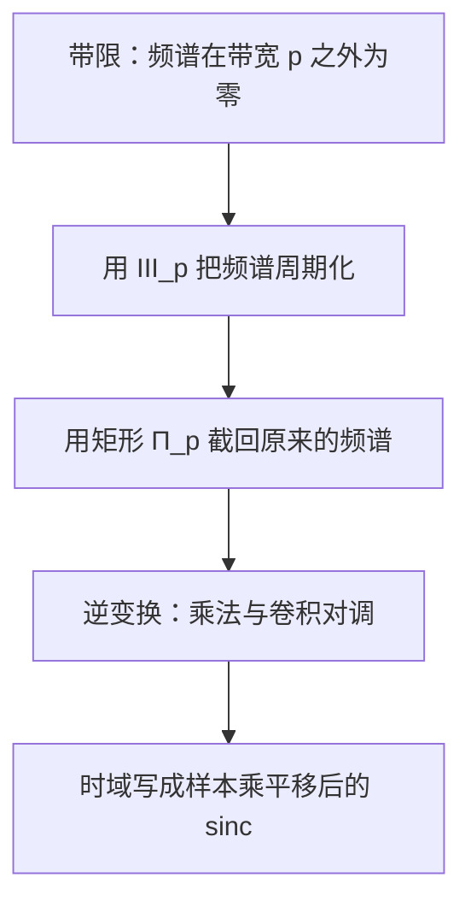
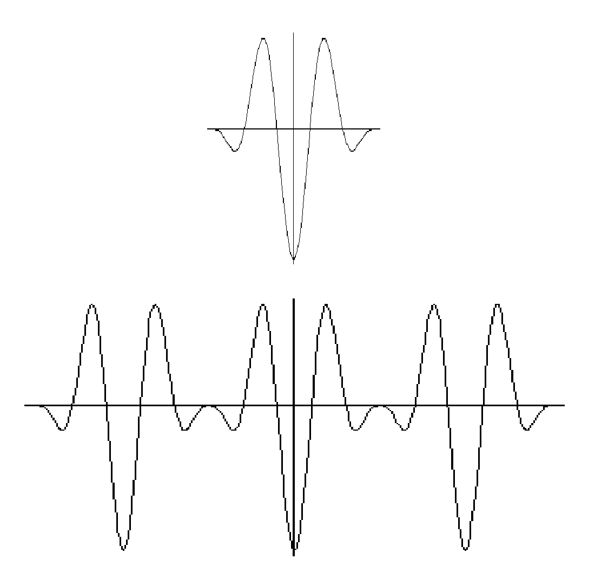
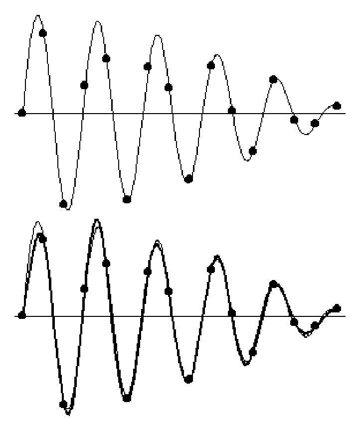
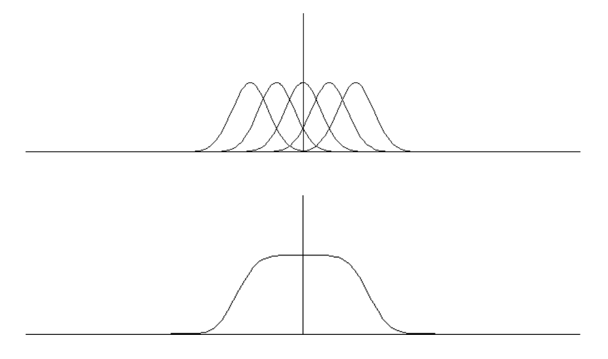

# 第5章 采样与插值

### 来源说明

- 作者：Brad Osgood
- 书名：*The Fourier Transform and its Applications*
- 官方来源：https://see.stanford.edu/materials/lsoftaee261/book-fall-07.pdf
- 本笔记仅供个人学习使用。

阅读范围：Chapter 5 **III, Sampling, and Interpolation**（梳状函数、采样与插值），PDF 第 217–256 页（书页约 212–250）。无书签，开读时已核对章名含 Sampling。证明只保留结论。未读第 4 章，未读第 7 章（PDF 301 起）。

### 本章总览

这一章的主角是梳状函数（shah function，也叫 Dirac comb）。Bracewell 按西里尔字母的形状称它为 shah。它做两件对偶的事：与函数卷积，得到周期函数；与函数相乘，在等间隔点上采样。

它的傅里叶变换仍是它自己。这件事来自 Poisson 求和公式（Poisson summation formula）。晶体衍射里，斑点间距是原子间距的倒数，就是这条互易关系的物理版本。

把「周期化、截断、再做逆变换」套到带限信号（bandlimited signal）上，得到 Shannon 采样定理：带宽决定最低采样率，样本经 sinc 插值可以还原整条信号。采得不够就发生混叠（aliasing）。信号不能同时严格时限又严格带限。

图注：采样定理的推导顺序。周期化再截断，在频谱还没重叠时会回到原频谱；逆变换把这一步变成用采样值做 sinc 插值。

### 核心知识点

#### 一维晶体为什么引出梳状函数

X 射线波长假设约在 $10^{-8}\,\mathrm{cm}$，可见光约 $400$–$700\,\mathrm{nm}$（$10^{-7}\,\mathrm{cm}$）。光栅缝宽要和波长相当才看得到衍射，所以可见光光栅做不到 X 射线。1912 年 von Laue 提出三条假设：X 射线是波、晶体是周期的、原子间距也是 $10^{-8}\,\mathrm{cm}$ 这一量级。Friedrich 等人的实验确认了这三条，X 射线晶体学由此开始。

一维模型里，单个原子的电子密度是快速衰减的 $\rho(x)$，间距 $p$ 的无限晶体是

$$
\rho_p(x)=\sum_{k=-\infty}^{\infty}\rho(x-kp)=(\rho*\mathrm{III}_p)(x).
$$

散射振幅与 $\mathcal{F}\rho_p$ 成比例，所以必须先知道 $\mathcal{F}\mathrm{III}_p$。更高维的格子与倒格子本章不展开。

一维上，格子的傅里叶变换落在间距为原间距倒数的另一把梳子上；更高维把这把梳子换成对偶格子（reciprocal lattice）。图像处理里也用同一类互易关系。书中只点到 Tekalp 的视频处理，没有展开公式。

👉 更高维 $\mathrm{III}$ 与倒格子见后续章节。📝待补全

🔑 关键速记：周期晶体的密度是单原子密度与梳子的卷积，衍射看到的是这只卷积的傅里叶变换。

#### 梳状函数的定义

标准间距取 $1$：

$$
\mathrm{III}(x)=\sum_{k=-\infty}^{\infty}\delta(x-k),\qquad
\mathrm{III}_p(x)=\sum_{k=-\infty}^{\infty}\delta(x-kp).
$$

对试验函数 $\varphi$，$\langle\mathrm{III}_p,\varphi\rangle=\sum_k\varphi(kp)$。和收敛，是因为 $\varphi$ 在无穷远处快速衰减。

尺度关系（$p>0$）来自 $\delta(px)=\frac{1}{p}\delta(x)$：

$$
\mathrm{III}(px)=\frac{1}{p}\mathrm{III}_{1/p}(x),\qquad
\mathrm{III}_p(x)=\frac{1}{p}\mathrm{III}\Bigl(\frac{x}{p}\Bigr).
$$

$\delta$ 的傅里叶变换是常数 $1$，平移会在频域乘上复指数。因此把梳子逐项变换，得到 $\mathcal{F}\mathrm{III}(s)=\sum_k e^{-2\pi iks}$。这还不是最终的封闭形式，封闭形式要等 Poisson 求和。

👉 $\delta$ 的变换与平移定理的完整推导见前面章节。📝待补全

🔑 关键速记：$\mathrm{III}_p$ 是间距为 $p$ 的无穷脉冲列；把间距乘 $p$，相当于另一把间距为 $1/p$ 的梳子再除以 $p$。

#### 用卷积做周期化

若与 $\mathrm{III}_p$ 的卷积有意义，则

$$
(f*\mathrm{III}_p)(t)=\sum_{k=-\infty}^{\infty}f(t-pk)
$$

以 $p$ 为周期。卷积是把平移后的图形**加**起来，不是把它们首尾相接、互不重叠。

分布的周期用延迟算子写：$\tau_p S=S$。$\mathrm{III}_p$ 自己以 $p$ 为周期。只要卷积的一方以 $p$ 为周期，卷积结果就以 $p$ 为周期。

矩形函数

$$
\Pi_p(x)=
\begin{cases}
1 & |x|<p/2,\\
0 & |x|\ge p/2.
\end{cases}
$$

若 $f$ 在 $|t|\ge p/2$ 处为零，则 $\Pi_p f=f$，并且 $f=\Pi_p(f*\mathrm{III}_p)$。这两句等价。端点 $\pm p/2$ 上 $\Pi_p$ 改成 $1$ 或 $1/2$，只影响离散点集，一般不影响应用。用间断的 $\Pi_p$ 去截分布，已经超出「分布只与光滑函数相乘」的已建立理论；书中照样使用，严格证明未给。

图注：书中示意图。上图是在 $|t|<p/2$ 外为零的 $f$；下图是 $f(x+p)+f(x)+f(x-p)$，也就是与有限段梳子卷积后的三周期。中间主峰对齐，两侧是平移后再相加，不是简单拼接。

🔑 关键速记：和 $\mathrm{III}_p$ 卷积得到周期 $p$；若原函数已经限制在一个周期内，再用 $\Pi_p$ 切一刀就能把这一周期取回来。

#### 用相乘做采样

$$
f(x)\,\mathrm{III}_p(x)=\sum_{k=-\infty}^{\infty}f(kp)\,\delta(x-kp).
$$

相乘把 $f$ 在点 $kp$ 上的值记进脉冲的系数。间距为 $1$ 时，采样点就是整数。

下面只对比本章给出的两种用法。

| 运算 | 对 $f$ 做什么 | 结果 |
| --- | --- | --- |
| 与 $\mathrm{III}_p$ 卷积 | 把 $f$ 按间距 $p$ 平移后相加 | 周期为 $p$ 的函数 |
| 与 $\mathrm{III}_p$ 相乘 | 只保留 $f(kp)$ 作为 $\delta$ 的系数 | 在 $kp$ 上的采样 |

表后要点：卷积管周期，相乘管采样。二者通过卷积定理在时域和频域对调，这是后面采样定理能写出来的原因。

卷积定理说：时域卷积对应频域相乘，时域相乘对应频域卷积。本章用它把 $\rho*\mathrm{III}_p$ 的变换写成 $\mathcal{F}\rho\cdot\mathcal{F}\mathrm{III}_p$，也用它在采样定理里把频谱上的截断变成时域的 sinc 卷积。

👉 卷积定理的完整推导见前面章节。📝待补全

🔑 关键速记：乘梳子是采样，卷积梳子是周期化；采样定理就是把这两件事经傅里叶变换对调。

#### Poisson 求和与 $\mathcal{F}\mathrm{III}=\mathrm{III}$

对 Schwartz 函数 $\varphi$，Poisson 求和公式是

$$
\sum_{k=-\infty}^{\infty}\mathcal{F}\varphi(k)=\sum_{k=-\infty}^{\infty}\varphi(k).
$$

结论的来路：先做 $\Phi=\varphi*\mathrm{III}$，它周期为 $1$。它的傅里叶系数恰好是 $\mathcal{F}\varphi(m)$。再把 $\Phi(0)$ 用定义和用傅里叶级数各算一次，两边相等。书中说，热方程在直线上和在圆周上的关系里出现过同类计算。

👉 第 3.5 节热方程里的对应写法见第 3 章。📝待补全

由这个等式得到 $\langle\mathcal{F}\mathrm{III},\varphi\rangle=\langle\mathrm{III},\varphi\rangle$，所以

$$
\mathcal{F}\mathrm{III}=\mathrm{III}.
$$

再用尺度关系与伸缩定理：

$$
\mathcal{F}\mathrm{III}_p(s)=\frac{1}{p}\mathrm{III}_{1/p}(s).
$$

伸缩定理把时间轴拉开时，频谱按倒数比例压缩，并带上尺度因子。上面这一行就是把它用在 $\mathrm{III}(x/p)$ 上的结果。

👉 伸缩定理的一般叙述见前面章节。📝待补全

同一条等式也给出梳子的傅里叶级数：$\mathrm{III}=\sum_{k=-\infty}^{\infty}e^{2\pi ikt}$。不能绕过 Poisson 求和，直接用级数当捷径去证明 $\mathcal{F}\mathrm{III}=\mathrm{III}$。

有限和是以前见过的 Dirichlet 核

$$
D_N(t)=\sum_{n=-N}^{N}e^{2\pi int}=\frac{\sin\bigl(\pi(2N+1)t\bigr)}{\sin\pi t}.
$$

$N\to\infty$ 时 $D_N\to\mathrm{III}$，收敛是在分布意义下。书中画了 $N=20$ 的图，峰又高又窄，此处不另贴。

🔑 关键速记：整数点上的采样和等于频谱在整数点上的采样和；因此单位间距的梳子是自己的傅里叶变换。

#### 衍射斑点落在倒数间距上

回到一维晶体：

$$
\mathcal{F}\rho_p(s)=\mathcal{F}\rho(s)\cdot\frac{1}{p}\mathrm{III}_{1/p}(s)
=\sum_{k=-\infty}^{\infty}\frac{1}{p}\mathcal{F}\rho\Bigl(\frac{k}{p}\Bigr)\delta\Bigl(s-\frac{k}{p}\Bigr).
$$

底片上的斑点对应这些 $\delta$。斑点强度与 $|\mathcal{F}\rho|$ 成比例，间距是 $1/p$，不是原子间距 $p$。把斑点间距当成和原子间距成正比，互易关系就反了。

周期分布的傅里叶变换也是同一模式。若 $\Phi=\varphi*\mathrm{III}_p$，$\varphi=\Pi_p\Phi$ 是切出一个周期，则

$$
\Phi(t)=\sum_{k=-\infty}^{\infty}c_k e^{2\pi ikt/p},\qquad
c_k=\frac{1}{p}\mathcal{F}\varphi\Bigl(\frac{k}{p}\Bigr)
=\frac{1}{p}\int_{-p/2}^{p/2}e^{-2\pi i(k/p)t}\Phi(t)\,dt.
$$

一般傅里叶级数 $\sum c_k e^{2\pi ikt/p}$ 的变换是 $\sum c_k\delta(s-k/p)$，只要级数作为缓增分布有意义。系数趋于零（例如可积）就够用；点态收敛不是必要条件。

🔑 关键速记：周期 $p$ 的频谱是间距 $1/p$ 的加权脉冲；晶体斑点间距和原子间距互为倒数。

#### 带限信号与最低采样率

一个正弦 $A\sin(2\pi\nu t+\phi)$ 有三个未知数：振幅、频率、相位。一个周期内要有三个严格落在周期内部的样本，样本间隔必须小于半个周期，也就是采样率 $>2\nu$。多个谐波叠在一起时，最高频率把采样率抬上去。没有最高频率的信号，例如方波的无穷傅里叶级数，就无法靠等间隔样本唯一确定。

带限的定义：存在有限的 $p$，使 $|s|\ge p/2$ 时 $\mathcal{F}f(s)=0$。满足这件事的最小 $p$ 叫带宽（bandwidth）。可积函数的变换连续，所以在开区间外为零会连带端点也为零。另一种说法是 $\mathcal{F}f$ 的支撑紧（闭且有界）。端点归不归进支撑，后面采样时仍要单独看。

若频谱的非零部分从 $-\nu_{\max}$ 到 $\nu_{\max}$，重建所需的采样率满足

$$
\text{采样率}>2\nu_{\max}.
$$

$2\nu_{\max}$ 常叫 Nyquist 频率。公式也常称 Shannon 采样定理；Whittaker 与 Shannon 都和这组想法有关。带宽不能再缩小，但可以把周期化用的间隔 $q$ 取得比带宽更大，相当于采样更密、做了多余的工作。

🔑 关键速记：最高频率决定最低采样率；采样率要严格高于 Nyquist 频率 $2\nu_{\max}$。

#### 采样定理

设 $|s|\ge p/2$ 时 $\mathcal{F}f(s)=0$。关键恒等式是

$$
\mathcal{F}f=\Pi_p(\mathcal{F}f*\mathrm{III}_p).
$$

两边做逆变换。截断是乘法，周期化是卷积，逆变换把二者对调，再用梳子的采样性质和 $\delta$ 的筛选性质，得到

$$
f(t)=\sum_{k=-\infty}^{\infty}f\Bigl(\frac{k}{p}\Bigr)\operatorname{sinc}\,p\Bigl(t-\frac{k}{p}\Bigr)
=\sum_{k=-\infty}^{\infty}f(t_k)\operatorname{sinc}\,p(t-t_k),
$$

其中 $t_k=k/p$。另一写法是 $\operatorname{sinc}(pt-k)$。样本间隔是带宽的倒数 $1/p$，而且要用上全部整数 $k$，不是有限段。

本章使用的恒等式是：频谱限制在 $[-p/2,p/2]$ 时，$f=p\operatorname{sinc}(pt)*f$。也就是这族带限信号上，$p\operatorname{sinc}(pt)$ 起着卷积单位元的作用，和 $\delta$ 对一般信号所起的作用同类。书中把 $\operatorname{sinc}t=\sin(\pi t)/(\pi t)$。它在 $t=0$ 为 $1$，在其余整数为零；平移 $\operatorname{sinc}(t-k)$ 则在 $t=k$ 为 $1$、在其他整数为零。

矩形 $\Pi_p$ 的逆变换写成 $p\operatorname{sinc}(pt)$，$\operatorname{sinc}(pt)$ 的变换写成 $\frac{1}{p}\Pi_p$。端点上 $\Pi_p$ 取 $0$、$1$ 或 $1/2$，不改变积分意义下的结果。

👉 $\operatorname{sinc}$ 与 $\Pi$ 这一对变换若在前文已定义，以前文为准；本章只使用上述关系。📝待补全

实际计算只能截断无穷和，所以只能是近似。带限信号不可能时限，因此样本原则上要取到 $\pm\infty$。有限傅里叶级数是例外，只要有限个样本，见下一节。

🔑 关键速记：带限信号等于自己的样本乘上平移后的 sinc；样本间隔是带宽的倒数。

#### sinc 是正交基，Lagrange 多项式不是重建

$\{\operatorname{sinc}(t-n):n\in\mathbb{Z}\}$ 在 $L^2(\mathbb{R})$ 的内积下正交归一。算法用 Parseval 恒等式把内积搬到频域，再在 $[-1/2,1/2]$ 上积分。$\operatorname{sinc}\in L^2$，两个 sinc 的乘积可积；$L^2$ 上的 Parseval 本章没有重证。

频谱含在 $[-1/2,1/2]$ 时，Nyquist 采样率是 $1$，插值就是

$$
g(t)=\sum_{n=-\infty}^{\infty}g(n)\operatorname{sinc}(t-n),
$$

而且 $g(n)=(g,\operatorname{sinc}(t-n))$。样本值就是向这组基的投影。

Lagrange 插值是另一件事。过 $n$ 个点的多项式次数是 $n-1$。先做在这些点上为零的 $p(t)=\prod(t-t_j)$，再令 $p_k(t)=p(t)/(t-t_k)$，则

$$
p(t)=\sum_{k=1}^{n}g(t_k)\frac{p_k(t)}{p_k(t_k)}
$$

只保证在指定点上等于 $g$，并不还原 $g$ 的其余值。sinc 是这种「在采样点为 $1$、在其他采样点为 $0$」的傅里叶版本；只有带限时，这个无穷和才等于原信号。

🔑 关键速记：带限插值是 sinc 正交基展开；Lagrange 多项式只拟合有限个点，不保证点以外相等。

#### 周期带限信号只要有限个样本

设实信号

$$
f(t)=\sum_{k=-N}^{N}c_k e^{2\pi ikt/q},\qquad c_{-k}=\overline{c_k},\quad c_N\neq 0.
$$

周期为 $q$，共 $2N+1$ 项。因为负频率系数由正频率决定，一个周期里 $2N+1$ 个样本就够：一个实数 $c_0$ 和 $N$ 个复数 $c_1,\ldots,c_N$。频谱是间距 $1/q$ 的 $\delta$，从 $-N/q$ 到 $N/q$。

把周期化的截断点放在 $N/q$ 与 $(N+1)/q$ 的中点，得到

$$
p=\frac{2N+1}{q}.
$$

令 $M=2N+1$，$t_k=kq/M$。样本值每 $M$ 个重复一次。把采样级数按这个周期拆开，每一组平移 sinc 的和有封闭形式，于是

$$
f(t)=\sum_{k=0}^{2N}f(t_k)\,
\frac{\operatorname{sinc}\bigl(p(t-t_k)\bigr)}{\operatorname{sinc}\bigl((1/q)(t-t_k)\bigr)}.
$$

用频率写：$\nu_{\min}=1/q$，$\nu_{\max}=N\nu_{\min}$，采样率是 $2\nu_{\max}+\nu_{\min}$，而一般带限信号要求的是采样率 $>2\nu_{\max}$。

$\cos 2\pi t$ 只有一个频率，$\nu_{\min}=\nu_{\max}=1$，所以 $N=1$，采样率为 $3$，样本点是 $0,1/3,2/3$。右边是三个 sinc 之比的线性组合。书中画出了这个右端，此处不重绘曲线。

sinc 的周期化有一条引理。设 $p,q>0$，$N$ 是严格小于 $pq/2$ 的最大整数，则

$$
\operatorname{sinc}(pt)*\mathrm{III}_q(t)
=\frac{1}{pq}\frac{\sin\bigl((2N+1)\pi t/q\bigr)}{\sin(\pi t/q)}
=\frac{2N+1}{pq}
\frac{\operatorname{sinc}((2N+1)t/q)}{\operatorname{sinc}(t/q)}.
$$

它本身就是把采样定理用到那个正弦比上。特例 $p=q=1$ 时 $N=0$，

$$
\sum_{n=-\infty}^{\infty}\operatorname{sinc}(t-n)=1.
$$

书中把和截到 $-100$ 至 $100$，两端有类似 Gibbs 的起伏。收敛类型本章没有再讨论。

🔑 关键速记：最高谐波为 $N$、基频为 $1/q$ 时，一个周期采 $2N+1$ 点，插值核是两个 sinc 的比，采样率是 $2\nu_{\max}+\nu_{\min}$。

#### 有限样本只是近似，欠采样会混叠

图注：书中 5.9 节的两张图。上图是一条信号和一组等间隔样本。下图把由这些样本做成的 sinc 插值画成较细的曲线，和原曲线很接近，但并不重合。公式要求 $k/p$ 的全部样本，这里只用了有限个。

时限信号不可能带限，采样定理不能无误差地用。带限信号又不可能时限，计算时却只能用有限样本。两条路都不理想。实用做法是采样前做低通，迫使信号接近带限，重建后再做平滑。具体滤波器本章没有给公式。

欠采样的例子：$f(t)=\cos(9\pi t/2)$，频率 $9/4\,\mathrm{Hz}$。有限采样公式要求的采样率是 $2\cdot(9/4)+(9/4)=27/4=6.75$；一般带限公式则要求采样率 $>9/2=4.5$。若每秒只采 $1$ 次，

$$
\frac{9\pi}{2}=4\pi+\frac{\pi}{2},
$$

整数点上 $\cos(9\pi n/2)=\cos(\pi n/2)$。因此 $g(t)=\cos(\pi t/2)$（频率 $1/4$）与 $f$ 在整数上同值，但不是同一个函数。二者互为别名（alias）。

在频域里，按 $1\,\mathrm{Hz}$ 采样就是用 $\mathrm{III}_1$ 把 $\mathcal{F}f$ 周期化，再用 $\Pi_1$ 截到 $(-1/2,1/2)$。截断后只剩下 $\frac12\bigl(\delta(s-1/4)+\delta(s+1/4)\bigr)$，逆变换正是 $\cos(\pi t/2)$。关键等式 $\Pi_1(\mathcal{F}f*\mathrm{III}_1)=\mathcal{F}f$ 不成立。sinc 级数

$$
\sum_{k=-\infty}^{\infty}\cos\frac{9\pi k}{2}\,\operatorname{sinc}(t-k)
$$

算出来的是 $g$，不是 $f$。

一般定义：采样率 $q$ 低于带宽时，仍可写下

$$
g(t)=\sum_{k=-\infty}^{\infty}f(t_k)\operatorname{sinc}\,q(t-t_k),\qquad t_k=k/q.
$$

因为 $\operatorname{sinc}\,q(t_j-t_k)$ 在 $j=k$ 为 $1$、否则为 $0$，所以 $g$ 和 $f$ 在采样点上相等。分不出二者时，就说它们是别名。机制是：$\mathcal{F}f*\mathrm{III}_q$ 把频谱的尾巴移进 $[-q/2,q/2]$，再截断就不再是原来的 $\mathcal{F}f$。

图注：书中 5.9 节。上图是带宽远大于采样间隔 $q$ 时，$\mathcal{F}f(s+2q)$ 到 $\mathcal{F}f(s-2q)$ 这几份平移已经叠在一起。下图是它们的和，中央被填成接近平台，不再像原来的频谱。截断这一平台回不到 $\mathcal{F}f$，逆变换也就回不到 $f$。

带宽刚好等于梳子间距时，截断可以回到原频谱，采样级数还原 $f$。书中把 $\mathrm{III}_p$ 叠在支撑为 $[-p/2,p/2]$ 的频谱上：脉冲间距是 $p$，相邻脉冲之间没有别的频谱尾巴。

🔑 关键速记：混叠后的插值仍穿过采样点，所以只看样本分不出原信号；频域上是频谱尾巴被折进基带再加在一起。

#### 采样率正好等于带宽时的端点

$f(t)=\sin 2\pi t$ 与 $g(t)=\cos 2\pi t$ 的带宽都是 $2$，变换在端点 $\pm 1$ 并不为零。用 $p=2$ 套采样公式：

- $\sin 2\pi t$ 的样本是 $\sin(k\pi)=0$，级数得到 $0$。周期化 $\mathcal{F}f*\mathrm{III}_2$ 里奇次脉冲成对抵消。
- $\cos 2\pi t$ 的样本是 $\cos(k\pi)=(-1)^k$，级数是两串 sinc 之差。周期化后脉冲相加。截断时，落在 $\Pi$ 边缘上的 $\delta$ 要算一半：书中写 $\Pi_1\delta_{1/2}=\frac12\delta_{1/2}$。这一步需要额外论证，本章没有做。

因此 $\sin 2\pi t$ 被混叠成 $0$，$\cos 2\pi t$ 仍能重建。书中不愿把这件事收成一条普遍规则，只说端点问题要单独处理。

🔑 关键速记：采样率贴着带宽时，正弦可能被混成零，余弦仍可能重建；端点上的 $\delta$ 被矩形截断时书中按一半计算。

#### 附录：谁等于自己的傅里叶变换，以及时限对带限

若 $S$ 是周期为 $1$ 的缓增分布，且 $\mathcal{F}S=S$，则 $S=c\,\mathrm{III}$。再要求傅里叶系数 $c_0=1$，这样的 $S$ 只有一个，就是 $\mathrm{III}$ 本身。周期必须是 $1$：$\mathrm{III}(2x)+\frac12\mathrm{III}(x/2)$ 周期为 $2$，而且也是自己的傅里叶变换。偶函数 $f$ 满足 $f+\mathcal{F}f$ 是自己的傅里叶变换，这是那个反例的来源。

带限信号不能时限。更强的结论是：若 $f$ 带限，并且在某一开区间 $a<t<b$ 上恒为零，则 $f$ 处处为零。证明用 Fourier 反演把 $f$ 写成有限频带上的积分，在那个区间上对 $t$ 求导得到各阶矩为零，再把指数展成幂级数。交换求和与积分要用一致收敛，这依赖频带有限。没有带限假设，这个交换不合法，否则会推出「停顿几秒就永远无话可说」。

对偶的一句：时限信号的变换若在某一频率区间上为零，则变换处处为零，信号本身也为零。

脚注：若 $f$ 是实解析的，即每一点附近都是收敛幂级数，则「在一个区间上为零 $\Rightarrow$ 处处为零」成立。这和带限不是一回事。

🔑 关键速记：周期 $1$ 且等于自己的傅里叶变换的缓增分布，归一后只有梳子；带限信号只要有一段时间为零，就只能是恒零信号。

### 易混淆点与差异对比

卷积梳子是平移后相加。若相邻副本的支撑重叠，重叠处的高度是和，不是拼接。

采样间隔、晶体斑点间距都是 $1/p$ 这种倒数。原子间距是 $p$ 时，斑点间距是 $1/p$。一般带限信号的样本间隔也是带宽的倒数。

Nyquist 频率 $2\nu_{\max}$ 是采样率必须超过的数，不是采样率本身。一般带限要求采样率 $>2\nu_{\max}$。周期带限的有限采样率是等式 $2\nu_{\max}+\nu_{\min}$，比「两倍最高频率」多一个基频。

混叠信号和原信号在采样点上相等。听或看起来「样本对得上」不能证明没有混叠。

端点情形里，$\sin 2\pi t$ 在采样率等于带宽时变成 $0$，$\cos 2\pi t$ 仍然可以重建。不能把「刚好采在 Nyquist 频率」说成一律失败或一律成功。

「在一段时间上为零就处处为零」只在带限（或脚注里的实解析）条件下成立。普通时限信号可以中途为零，并不因此恒为零。

### 本章要点总结

- $\mathrm{III}_p$ 与函数相乘是在间距 $p$ 上采样，与函数卷积是做成周期 $p$；单位间距时 $\mathcal{F}\mathrm{III}=\mathrm{III}$，一般间距时频谱梳子的间距变成 $1/p$。
- 带限信号由间隔为 $1/p$ 的全部样本经 sinc 唯一插值；采样率必须高于 Nyquist 频率 $2\nu_{\max}$。采得更密可以，采得更疏就会混叠。
- 有限个谐波的周期信号不必用无穷样本：最高谐波指标为 $N$ 时，每个周期采 $2N+1$ 点，核是两个 sinc 之比。
- 混叠是频谱周期化后尾巴折进基带。插值曲线仍穿过样本，但不再是原信号。采样率贴着带宽时，正弦和余弦的命运可以不同。
- 信号不能同时严格时限又严格带限。带限信号只要在一个时间区间上恒为零，就只能是恒零信号。
