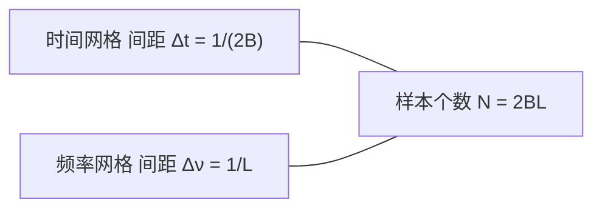
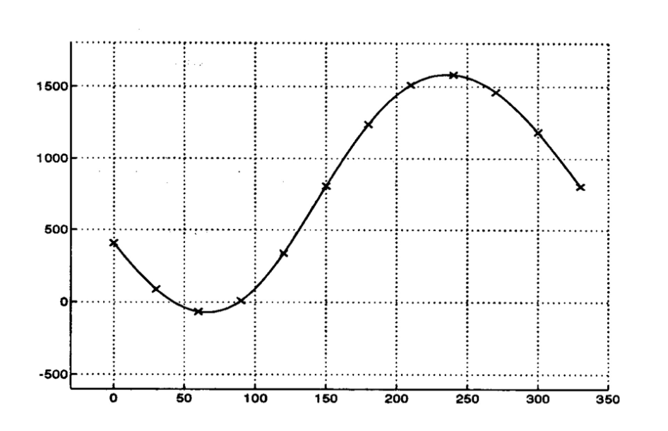
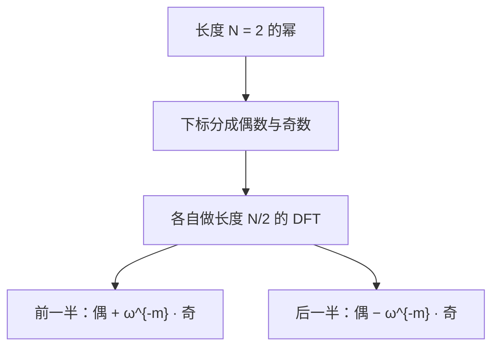

# 第6章 离散傅里叶变换

### 来源说明

- 作者：Brad Osgood
- 书名：*The Fourier Transform and its Applications*
- 官方来源：https://see.stanford.edu/materials/lsoftaee261/book-fall-07.pdf
- 本笔记仅供个人学习使用。

阅读范围：Chapter 6 **Discrete Fourier Transform**（离散傅里叶变换），PDF 第 257–300 页（书页约 251–294）。无书签，开读时已核对章名。FFT 只保留拆分结论与运算量，不写可运行步骤。未读第 7 章（PDF 301 起）。

### 本章总览

计算机只能做有限和。把连续信号变成有限样本，理论上要求信号既时限又带限，第 5 章已经说明这不可能严格成立。实践里这种近似仍然被大量使用。本书先从连续傅里叶变换走到离散，再把离散傅里叶变换（discrete Fourier transform，DFT）写成自身成立的定义；定义写完以后，前面的近似假设可以拿掉。

DFT 把长度为 \(N\) 的输入变成同样长度的输出。时间网格和频率网格由互易关系锁在一起。直接按矩阵去乘，乘法次数是 \(N^2\)。Cooley–Tukey 的快速傅里叶变换（fast Fourier transform，FFT）在 \(N\) 为 \(2\) 的幂时，把运算量降到 \(N\log_2 N\) 这一量级。Gauss 在十九世纪算智神星轨道时已经用过同类重排。

### 核心知识点

#### 从连续采样走到有限和

设 \(f(t)\) 在 \(0\le t\le L\) 外为零，\(\mathcal{F}f(s)\) 在 \(0<s<2B\) 外可以忽略。把频谱支撑写成 \((0,2B)\) 而不是 \((-B,B)\)，只是为了下标从 \(0\) 排起。\(L\) 和 \(B\) 都取整数。按第 5 章的采样定理，采样率 \(2B\) 时，长度 \(L\) 上需要

\[
N=\frac{L}{1/(2B)}=2BL
\]

个等间隔样本，\(N\) 为偶数。点是 \(t_n=n/(2B)\)，\(n=0,\ldots,N-1\)。

采样定理要求带限，而且样本间隔由带宽决定。这里却同时假定时限和带限，书中明确说是误用，只为了把下标排出来。定义一旦写成有限和，就不再依赖这两条假设。

👉 采样定理的条件与 sinc 插值见第 5 章笔记。

有限脉冲列给出

\[
f_{\mathrm{discrete}}(t)=\sum_{n=0}^{N-1}f(t_n)\delta(t-t_n),
\]

它的连续傅里叶变换是 \(\sum_n f(t_n)e^{-2\pi ist_n}\)。

时限在 \([0,L]\) 上，决定了频谱的采样间隔是 \(1/L\)，不是 \(2/L\)。在 \(0\) 到 \(2B\) 上按这个间隔取样，点数仍是 \(N\)。频率样本 \(s_m=m/L\)。本书不把 \(\mathcal{F}f(s_m)\) 直接当成离散频谱，而是把上面那个和在 \(s_m\) 处的值当成离散频谱：

\[
F(s_m)=\sum_{n=0}^{N-1}f(t_n)e^{-2\pi is_m t_n}.
\]

因为 \(f\) 时限在 \([0,L]\)，\(\mathcal{F}f(s_m)\) 是这段上的积分。用间距 \(\Delta t=1/(2B)\) 写成 Riemann 和，得到

\[
\mathcal{F}f(s_m)\approx\frac{1}{2B}F(s_m).
\]

差一个因子 \(1/(2B)\)。把 \(t_n\) 和 \(s_m\) 代回去，指数只剩下 \(e^{-2\pi inm/N}\)，样本的物理位置被藏进下标。

🔑 关键速记：同样 \(N\) 个时间样本和频率样本；离散和 \(F(s_m)\) 近似连续变换，但要除以 \(2B\)。

#### DFT 的定义

此后输入是 \(N\) 元组，下标从 \(0\) 到 \(N-1\)，不是从 \(1\) 到 \(N\)。可以是复数；来自信号时通常是实数，输出一般是复数。

\[
F[m]=\sum_{n=0}^{N-1}f[n]\,e^{-2\pi imn/N},\qquad m=0,1,\ldots,N-1.
\]

记 \(\omega=e^{2\pi i/N}\)，需要标出长度时写成 \(\omega_N\)。它是 \(N\) 次单位根：\(\omega^N=1\)，故 \(\omega^{n+kN}=\omega^k\)。\(N\) 为偶数时 \(\omega^{N/2}=-1\)。文献里有人把 \(\omega\) 定义成 \(e^{-2\pi i/N}\)，符号相反，查表时要先看定义。

向量写法把 \(N\) 个幂收成 \(\underline{\omega}=(1,\omega,\omega^2,\ldots,\omega^{N-1})\)，第 \(k\) 次幂向量是 \(\underline{\omega}^k\)。DFT 写成

\[
\underline{\mathcal{F}}\mathbf{f}=\sum_{k=0}^{N-1}f[k]\,\underline{\omega}^{-k}.
\]

特别地，

\[
F[0]=\sum_{k=0}^{N-1}f[k],
\]

是分量之和，不是平均。有人把 \(1/N\) 放在正变换前面，使 \(F[0]\) 成为平均。本书不这样做，\(1/N\) 放在逆变换上。

DFT 是线性映射。矩阵 \(\mathcal{F}\) 的第 \((m,n)\) 元（下标从 \(0\) 起）是 \(\omega^{-mn}\)：

\[
\mathcal{F}=
\begin{pmatrix}
1&1&1&\cdots&1\\
1&\omega^{-1}&\omega^{-2}&\cdots&\omega^{-(N-1)}\\
1&\omega^{-2}&\omega^{-4}&\cdots&\omega^{-2(N-1)}\\
\vdots&\vdots&\vdots&&\vdots\\
1&\omega^{-(N-1)}&\omega^{-2(N-1)}&\cdots&\omega^{-(N-1)^2}
\end{pmatrix}.
\]

矩阵通常从 \(1\) 编号，DFT 从 \(0\) 编号。两套下标不要混用。

🔑 关键速记：正变换是 \(\sum f[n]\omega^{-mn}\)，不加 \(1/N\)；\(F[0]\) 是输入分量之和。

#### 实输入的正频率与负频率

设 \(N\) 为偶数，输入为实数。中点

\[
F[N/2]=\sum_{k=0}^{N-1}(-1)^k f[k]
\]

是交错和，而且是实数。进一步

\[
F[N/2+1]=\overline{F[N/2-1]},
\]

这个共轭关系一直到 \(F[1]=\overline{F[N-1]}\)。因此下标 \(1\) 到 \(N/2-1\) 称为正频率，\(N/2+1\) 到 \(N-1\) 称为负频率。实输入的全部信息在 \(F[0]\)（直流，即分量和）、\(F[1],\ldots,F[N/2-1]\) 以及 \(F[N/2]\) 里。后半段只是前半段的共轭。

若改成对称下标 \([-(N/2)+1:N/2]\)，负频率才真正落在负指标上。由周期性，\(F[-1]=F[N-1]\)，\(F[-(N/2)+1]=F[N/2+1]\)，和上面的「约定负频率」是同一批数。

🔑 关键速记：实信号、偶数 \(N\) 时，\(N/2\) 之后的输出是前半段的共轭；\(F[N/2]\) 单独是实的交错和。

#### 互逆的两套网格

时间上信号限制在长度 \(L\)，频率上限制在长度 \(2B\)。时间网格间距 \(\Delta t=1/(2B)\)，频率网格间距 \(\Delta\nu=1/L\)。点数满足

\[
N=2BL,\qquad \Delta t\,\Delta\nu=\frac{1}{N}.
\]

\(B\)、\(L\)、\(N\) 里任意两个决定第三个。\(N\) 固定时，\(\Delta t\) 变小则 \(\Delta\nu\) 变大，反过来也一样。一次测量里通常先选定持续时间 \(L\)、样本个数 \(N\)、采样间隔 \(\Delta t\) 中的两个，其余就被锁死。

图注：互易关系。时间网格有多密，由频率上愿意覆盖多宽决定；频率网格有多密，由时间上记录多长决定。两者的间距乘积等于 \(1/N\)。

🔑 关键速记：\(\Delta t\,\Delta\nu=1/N\)。样本数不变时，时间上采得更密，频率上就分得更疏。

#### Gauss 的十二个轨道样本

Cooley 与 Tukey 在 1965 年发表了有效算法。Gauss 在十九世纪中叶的遗稿里已经有核心想法；他算智神星（Pallas）轨道时用了十二个样本。赤经 \(\theta\) 每 \(30^\circ\) 一个点，赤纬 \(X\) 以角分为单位：

| \(\theta\) | 0 | 30 | 60 | 90 | 120 | 150 | 180 | 210 | 240 | 270 | 300 | 330 |
| --- | --- | --- | --- | --- | --- | --- | --- | --- | --- | --- | --- | --- |
| \(X\) | 408 | 89 | −66 | 10 | 338 | 807 | 1238 | 1511 | 1583 | 1462 | 1183 | 804 |

表后要点：十二个样本要确定十二个系数。Gauss 利用正弦、余弦的对称把大方程组拆成较小的子问题，这种重排就是后来 FFT 的雏形。本书不重建他的手算过程。

他拟合的是

\[
X=a_0+\sum_{k=1}^{5}\Bigl(a_k\cos\frac{2\pi k\theta}{360}+b_k\sin\frac{2\pi k\theta}{360}\Bigr)
+a_6\cos\frac{12\pi\theta}{360}.
\]

现代 FFT 给出的系数（\(b_0\) 与 \(b_6\) 不出现）：

| \(k\) | 0 | 1 | 2 | 3 | 4 | 5 | 6 |
| --- | --- | --- | --- | --- | --- | --- | --- |
| \(a_k\) | 780.6 | −411.0 | 43.4 | −4.3 | −1.1 | 0.3 | 0.1 |
| \(b_k\) | — | −720.2 | −2.2 | 5.5 | −1.0 | −0.3 | — |

图注：书中图。横轴是赤经，从 \(0^\circ\) 到 \(330^\circ\)；纵轴是赤纬的角分。叉号是上表的十二个样本，曲线是由这些样本插出的有限傅里叶级数。曲线穿过样本，不是另画的一条无关拟合。

🔑 关键速记：十二个样本决定到 \(6\) 次的有限三角多项式；FFT 的重排思想在这次轨道计算里已经出现。

#### 输入和输出都按周期 \(N\) 理解

\(F[m]\) 的公式里 \(\omega^{-k(m+N)}=\omega^{-km}\)，所以 \(F[m+N]=F[m]\)。更一般地，\(p\equiv q\pmod N\) 时 \(F[p]=F[q]\)。逆变换写出来以后，输入 \(f\) 同样必须看成周期 \(N\) 的序列，否则卷积等公式在下标为负时没有定义。

连续傅里叶变换不必假设周期；傅里叶级数才处理周期。离散情形里，不把序列延拓成周期，卷积就做不下去。

成像里常见另一种下标：\(N\) 为偶数，输入输出都用 \([-(N/2)+1:N/2]\)。这相当于时间从 \(-L/2\) 到 \(L/2\)、频率从 \(-B\) 到 \(B\) 来采样。由于周期性，它和 \([0:N-1]\) 的定义算出同一组数。精确说法是：DFT 可以定义在任意连续 \(N\) 个整数下标上，结果与从 \(0\) 到 \(N-1\) 的 \(\underline{\mathcal{F}}\) 相同。逆变换也同样。证明用的就是序列和指数都以 \(N\) 为周期。

🔑 关键速记：DFT 的输入输出都是周期 \(N\) 的序列；任意连续 \(N\) 个下标都能做定义，结果不变。

#### 离散 \(\delta\)、正交性与逆变换

离散 \(\delta\) 不用分布：\(\delta_0=(1,0,\ldots,0)\)，周期意义下只在 \(N\) 的倍数处为 \(1\)。移位 \(\delta_k\) 在下标 \(k\) 处为 \(1\)。

\[
\underline{\mathcal{F}}\delta_0=\underline{1},\qquad \underline{\mathcal{F}}\delta_k=\underline{\omega}^{-k}.
\]

任意 \(\mathbf{f}=\sum_k f[k]\delta_k\)，再用线性，就回到 DFT 的定义。这和连续情形里 \(\mathcal{F}\delta=1\)、平移 \(\delta\) 变成复指数是同一格局。

向量复指数的内积：

\[
\underline{\omega}^k\cdot\underline{\omega}^\ell=
\begin{cases}
N & k\equiv\ell\pmod N,\\
0 & \text{否则}.
\end{cases}
\]

和来自有限几何级数：\(\omega^k\neq 1\) 时 \(1+\omega^k+\cdots+\omega^{(N-1)k}=0\)，\(\omega^k=1\) 时和为 \(N\)。因此这 \(N\) 个向量是 \(\mathbb{C}^N\) 的基，DFT 可逆。它们还不是正交归一，范数平方是 \(N\)。本书不改成除以 \(\sqrt{N}\)。

由此

\[
\underline{\mathcal{F}}\,\underline{\omega}^k=N\delta_k.
\]

连续情形里没有这个 \(N\)。后面 Parseval、乘积变卷积，都会带上 \(N\) 或 \(1/N\)。

反转信号 \(f^-[m]=f[-m]\)。在一个周期里写成 \(f^-[n]=f[N-n]\)。对偶关系是

\[
\underline{\mathcal{F}}(\mathbf{f}^-)=(\underline{\mathcal{F}}\mathbf{f})^-,\qquad
\underline{\mathcal{F}}\underline{\mathcal{F}}\mathbf{f}=N\mathbf{f}^-.
\]

逆变换因此定义为

\[
\underline{\mathcal{F}}^{-1}\mathbf{f}=\frac{1}{N}\underline{\mathcal{F}}(\mathbf{f}^-)
=\frac{1}{N}\sum_{n=0}^{N-1}f[n]\,\underline{\omega}^{n},
\]

分量是

\[
(\underline{\mathcal{F}}^{-1}\mathbf{f})[n]=\frac{1}{N}\sum_{k=0}^{N-1}f[k]\,\omega^{kn}.
\]

它确实是逆：\(\underline{\mathcal{F}}^{-1}\underline{\mathcal{F}}\mathbf{f}=\mathbf{f}\)，顺序反过来也对。

矩阵说法：列（以及行）是这些 \(\underline{\omega}^k\)，所以 \(\mathcal{F}^*\mathcal{F}=NI\)，

\[
\mathcal{F}^{-1}=\frac{1}{N}\mathcal{F}^*.
\]

共轭转置把 \(\omega^{-mn}\) 换成 \(\omega^{mn}\)，再除以 \(N\)，就是上面的逆公式。

连续傅里叶变换的对偶是「再变一次得到反转」，没有额外的 \(N\)。离散情形多出来的 \(N\) 来自 \(\|\underline{\omega}\|^2=N\)。平移、调制、卷积在连续情形的证明本章不重做，只列出和 DFT 对齐之后的公式。

👉 连续情形的对偶、Parseval、平移与卷积定理见前面章节。📝待补全

🔑 关键速记：逆变换是正变换的共轭转置再除以 \(N\)；指数从 \(e^{-2\pi imn/N}\) 改成 \(e^{+2\pi imn/N}\)。

#### 平移、调制、卷积与离散 \(\delta\) 的运算

延迟 \(\tau_p f[n]=f[n-p]\)。下面这些公式都默认序列已按周期 \(N\) 延拓。

| 性质 | 公式 | 和连续情形相比 |
| --- | --- | --- |
| Parseval | \(\underline{\mathcal{F}}\mathbf{f}\cdot\underline{\mathcal{F}}\mathbf{g}=N(\mathbf{f}\cdot\mathbf{g})\)；\(\|\underline{\mathcal{F}}\mathbf{f}\|^2=N\|\mathbf{f}\|^2\) | 多一个 \(N\) |
| 平移 | \(\underline{\mathcal{F}}(\tau_p\mathbf{f})=\underline{\omega}^{-p}\,\underline{\mathcal{F}}\mathbf{f}\) | 形式相同，平移定理的验证书中留作习题 |
| 调制 | \(\underline{\mathcal{F}}(\underline{\omega}^{n}\mathbf{f})=\tau_n(\underline{\mathcal{F}}\mathbf{f})\) | 乘复指数变成输出的移位 |
| 卷积 | \((\mathbf{f}*\mathbf{g})[m]=\sum_{k=0}^{N-1}f[k]g[m-k]\)，且 \(\underline{\mathcal{F}}(\mathbf{f}*\mathbf{g})=(\underline{\mathcal{F}}\mathbf{f})(\underline{\mathcal{F}}\mathbf{g})\) | 右边是逐分量相乘 |
| 乘积 | \(\underline{\mathcal{F}}(\mathbf{f}\mathbf{g})=\frac{1}{N}(\underline{\mathcal{F}}\mathbf{f}*\underline{\mathcal{F}}\mathbf{g})\) | 多一个 \(1/N\) |

表后要点：卷积交换、结合，并且 \((\tau_p\mathbf{f})*\mathbf{g}=\tau_p(\mathbf{f}*\mathbf{g})\)。定义卷积时 \(m<k\) 会使 \(g\) 的下标为负，必须用周期性把下标拉回 \(0\) 到 \(N-1\)。数字滤波依赖的就是「卷积对逐点乘」。

离散 \(\delta\) 还满足：

- 相乘：\(\mathbf{f}\,\delta_k=f[k]\,\delta_k\)。
- 卷积：\(\mathbf{f}*\delta_k=\tau_k\mathbf{f}\)，即 \((\mathbf{f}*\delta_k)[m]=f[m-k]\)。
- \(\delta_p*\delta_q=\delta_{p+q}\)；\(p=q\) 时 \(\delta_p\delta_q=\delta_p\)，否则为 \(0\)。连续情形不能把两个 \(\delta\) 相乘，离散情形可以。
- \(p=q\) 时 \(\underline{\omega}^p*\underline{\omega}^q=N\underline{\omega}^p\)，否则卷积为 \(0\)。

🔑 关键速记：DFT 把循环卷积变成逐点乘；把逐点乘变回卷积时要除以 \(N\)。

#### FFT：拆成一半，运算量是 \(N\log_2 N\)

矩阵形式 \((\mathcal{F})_{mn}=\omega^{-mn}\) 已经把 DFT 写全，但按这个矩阵去乘，乘法次数是 \(N^2\)。FFT 算的是同一个 DFT，只是少做乘法。算法在 \(N\) 为偶数时就能拆一次；要反复拆到长度 \(1\)，就要求 \(N\) 是 \(2\) 的幂。许多程序只接受这种长度，不够就补零，见下一节。

记 \(\omega[p,q]=\omega_p^{q}\)。偶数幂满足 \(\omega[N/2,-n]=\omega[N,-2n]\)，奇数幂多一个因子 \(\omega[N,-1]\)。把和按偶数下标、奇数下标拆开。令 \(\mathbf{f}_{\mathrm{even}}\)、\(\mathbf{f}_{\mathrm{odd}}\) 为长度 \(N/2\) 的两段（\(0\) 算偶数）。对 \(m=0,1,\ldots,N/2-1\)，

\[
\begin{aligned}
F[m]&=(\underline{\mathcal{F}}^{N/2}\mathbf{f}_{\mathrm{even}})[m]+\omega[N,-m]\,(\underline{\mathcal{F}}^{N/2}\mathbf{f}_{\mathrm{odd}})[m],\\
F[m+N/2]&=(\underline{\mathcal{F}}^{N/2}\mathbf{f}_{\mathrm{even}})[m]-\omega[N,-m]\,(\underline{\mathcal{F}}^{N/2}\mathbf{f}_{\mathrm{odd}})[m].
\end{aligned}
\]

后一半多出来的负号，是因为 \(\omega[N,-N/2]=-1\)。

图注：一层 FFT 拆分。两个一半长度的 DFT 用旋转因子 \(\omega^{-m}\) 拼回长度 \(N\) 的输出。下一层对每个一半重复，直到长度为 \(1\)。长度为 \(1\) 的 DFT 不做运算。

\(N=2^n\) 时，初始排序之后有 \(n=\log_2 N\) 层重组。输入的排序是：先从 \(f[0]\) 起每隔一个取，再从 \(f[1]\) 起每隔一个取，得到偶段和奇段，再对两段递归。这就是下标的位反转（bit reversal）。流程图常叫蝶形图（butterfly diagram），矩阵也因此记成 \(B\)。本章没有画出蝶形图，只说明标准文献里有。

👉 蝶形图的具体连线本章未画。📝待补全

运算量 \(C(N)\) 计加法和乘法。一层重组的运算次数与 \(N\) 成正比，故

\[
C(N)=2C(N/2)+KN.
\]

\(C(1)=0\)。解是 \(C(N)=KN\log_2 N\)。直接相乘是 \(N^2\)。\(N=1024=2^{10}\) 时，\(N^2=2^{20}\) 约一百万，而 \(2^{10}\log_2(2^{10})\) 约一万；书中说只取实输入再减半，约五千。

书中又写：当时最好的实现把乘法次数降到 \(N\log_2 N\)，加法次数写成 \(3\log_2 N\)，并且这是对复数输入；只取实输入则运算次数减半。加法那一项与前面 \(N\log_2 N\) 的量级、以及 \(N=1024\) 的数字例子对不齐。笔记不改写原文。

🔑 关键速记：\(N\) 为 \(2\) 的幂时，FFT 用 \(\log_2 N\) 层偶奇拆分计算同一个 DFT，总运算量是 \(KN\log_2 N\)，不是 \(N^2\)。

#### 补零把频率网格变密

长度不是 \(2\) 的幂时，常在末尾补零，补到程序要求的长度。这叫补零（zero padding）。设原输入长度 \(N\)，补到 \(M>N\)：

\[
g[n]=
\begin{cases}
f[n] & 0\le n\le N-1,\\
0 & N\le n\le M-1.
\end{cases}
\]

当 \(mN/M\) 是整数时，\(G[m]=F[mN/M]\)。选 \(M=kN\)，则每个 \(m\) 都满足

\[
F[m]=G[km].
\]

也就是：补零后的第 \(km\) 个输出，才是原信号的第 \(m\) 个输出。

若 \(f[n]=f(t_n)\) 来自间距 \(\Delta t\) 的采样，则未补零时 \(\Delta t\,\Delta\nu=1/N\)，补到 \(M=kN\) 后 \(\Delta t\,\Delta\nu=1/M\)。\(\Delta t\) 没变，所以

\[
\Delta\nu_{\mathrm{padded}}=\frac{1}{k}\Delta\nu_{\mathrm{unpadded}}.
\]

频率方向的总宽度仍是 \(1/\Delta t\)，没有变宽，只是网格更密。时域补零细化的是频率网格。

这件事只有在连续信号本来就在原区间外为零时才合法。否则补上去的零是在丢掉窗外的真实数据。

🔑 关键速记：末尾补零不改变采样间隔，只把频率样本加密 \(k\) 倍；原信号若在窗外不真为零，不能靠补零来「提高分辨率」。

### 易混淆点与差异对比

正变换不加 \(1/N\)，逆变换才加。\(F[0]\) 是分量和，不是平均值。有的软件和教材把 \(1/N\) 放在正变换上，和本书对调。

下标从 \(0\) 到 \(N-1\)。矩阵习惯从 \(1\) 到 \(N\)。成像里又常用以 \(0\) 为中心的 \(N\) 个连续下标。三套编号指的是同一条周期序列上的不同窗口。

负频率在 \(0\) 到 \(N-1\) 的编号里落在 \(N/2+1\) 到 \(N-1\)，下标本身不是负数。实输入时，后半段是前半段的共轭，不是另一组独立数据。

互易关系和第 5 章的带宽倒数是同一类现象，对象不同。第 5 章是连续信号的采样间隔等于带宽的倒数。本章是两套有限网格满足 \(\Delta t\,\Delta\nu=1/N\)。\(N\) 固定时，时间加密必然使频率变疏。

补零加密的是频率上的样本点，不增加新的高频内容，也不延长真实信号。信号在窗外不为零时，补零等于把那些样本改成 \(0\)。

FFT 不是另一种变换。它的输出应与直接按定义算的 DFT 相同，差别只在 \(N\) 为 \(2\) 的幂时的运算次数。

离散卷积是循环卷积。下标减去 \(k\) 之后若为负，要加 \(N\) 的倍数拉回来。不延拓成周期，公式就和连续卷积不是同一个对象。

连续公式里的许多 \(1\)，在离散公式里变成 \(N\)：\(\underline{\mathcal{F}}\underline{\omega}^k=N\delta_k\)，Parseval 多一个 \(N\)，乘积变卷积要除以 \(N\)。漏掉这个因子，逆变换会差 \(N\) 倍。

### 本章要点总结

- DFT 把长度 \(N\) 的序列变成另一条长度 \(N\) 的序列：\(F[m]=\sum_{n=0}^{N-1}f[n]e^{-2\pi imn/N}\)。正变换不除以 \(N\)，逆变换除以 \(N\)，指数改号。
- 时间和频率两套网格满足 \(\Delta t\,\Delta\nu=1/N\)。样本数固定时，一边变密，另一边变疏。实输入、偶数 \(N\) 时，\(N/2\) 以后的频谱是前半段的共轭。
- 输入输出都按周期 \(N\) 理解。循环卷积变成逐点乘；逐点乘变回卷积要乘 \(1/N\)。任意连续 \(N\) 个下标给出同一个 DFT。
- \(N=2^n\) 时，FFT 把 DFT 拆成偶、奇两个一半长度的 DFT，再用 \(\omega^{-m}\) 拼回去，共 \(\log_2 N\) 层。运算量是 \(KN\log_2 N\)，直接矩阵乘是 \(N^2\)。
- 补零到 \(M=kN\) 时，原输出 \(F[m]\) 出现在新输出的第 \(km\) 位，频率网格间距变成原来的 \(1/k\)。只在原连续信号于窗外本来为零时，这才是合法的细化。
