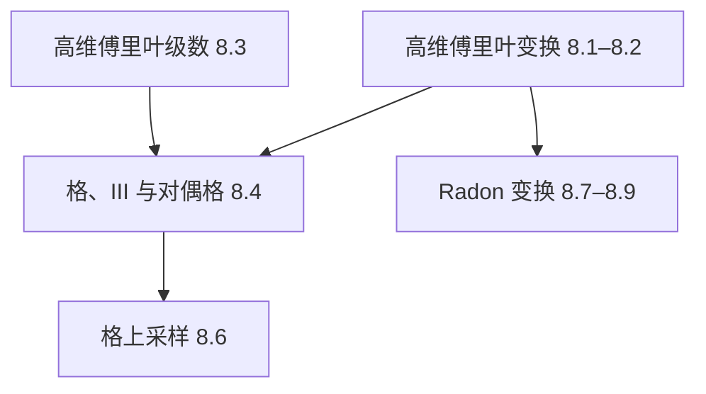
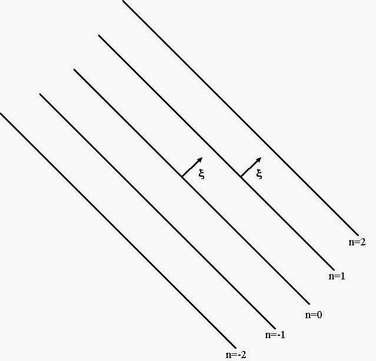
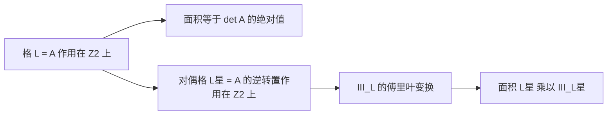
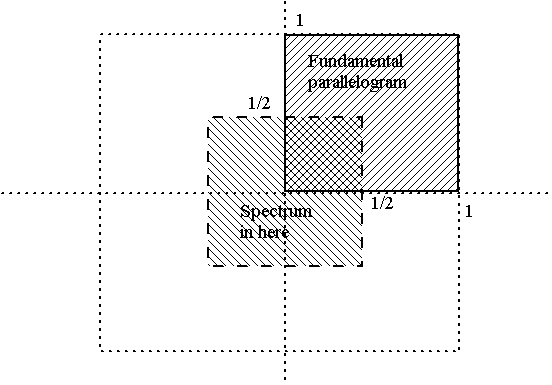
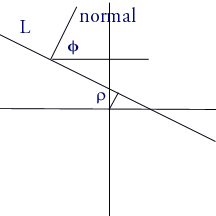
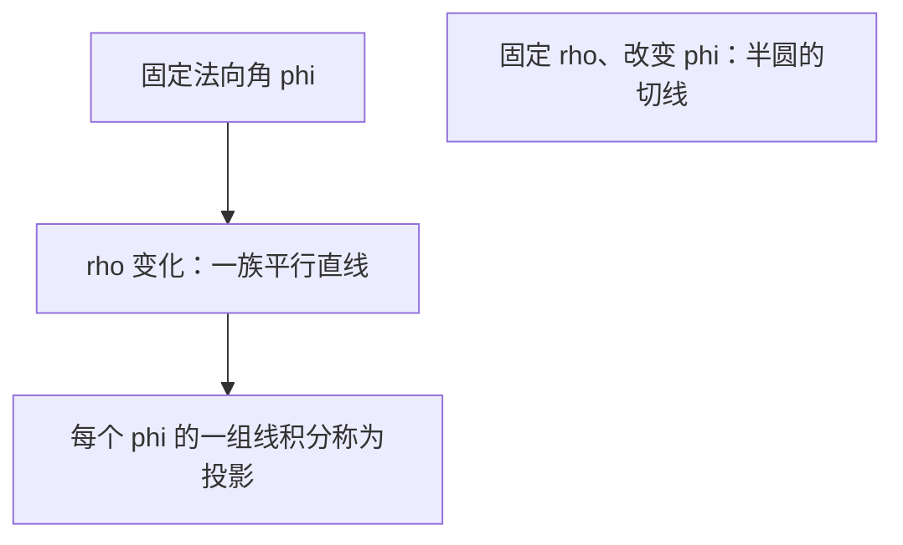

# 第8章 高维傅里叶变换

### 来源说明

- 作者：Brad Osgood
- 书名：*The Fourier Transform and its Applications*（傅里叶变换及其应用）
- 官方来源：https://see.stanford.edu/materials/lsoftaee261/book-fall-07.pdf
- 本笔记仅供个人学习使用。

阅读范围：PDF 341–408（书页约 335–402）。章名已核对为 Chapter 8 n-dimensional Fourier Transform。Appendix A 从 PDF 409 起，未读。本范围逐页读完，无 zlib 跳页。

### 本章总览

这一章把傅里叶变换从直线抬到 \(\mathbb{R}^n\)。定义几乎只改一件事：指数里的乘积换成点积 \(x\cdot\xi\)。可分离函数、平移、伸缩、卷积和 \(\delta\) 都沿着这条线推过去。真正新的东西是线性变换带来的逆转置 \(A^{-T}\)、径向函数里的 Bessel 函数，以及格（lattice）和对偶格（dual lattice）。

后半章用这些工具做两件事。带限函数在**对偶格**上采样，再用频谱那一侧的基做 sinc 重建。直线积分定义 Radon 变换（Radon transform），并给出 circ 与高斯的闭式。晶体衍射和医学成像的反演只在章末定位，不展开重建步骤。

图注：前半章把一维运算换成向量。格把周期化脉冲串推广到平面。采样用对偶格。Radon 变换是另一条线，把密度变成直线积分，本章写到性质和闭式为止。

### 核心知识点

#### 定义与记号

点写成 \(x=(x_1,\ldots,x_n)\)，频率写成 \(\xi=(\xi_1,\ldots,\xi_n)\)。\(x_i\) 带长度量纲时，\(\xi_i\) 带 \(1/\)长度，点积 \(x\cdot\xi\) 无量纲，指数 \(e^{-2\pi i x\cdot\xi}\) 才有意义。

\(\mathbb{R}^n\) 上的傅里叶变换和逆变换是

\[
Ff(\xi)=\int_{\mathbb{R}^n} e^{-2\pi i x\cdot\xi} f(x)\,dx,
\qquad
F^{-1}g(x)=\int_{\mathbb{R}^n} e^{2\pi i x\cdot\xi} g(\xi)\,d\xi.
\]

积分是 \(n\) 重积分，每个坐标从 \(-\infty\) 到 \(\infty\)。被积函数是标量：点积是数。函数类仍是 Schwartz 函数、\(L^1\)、\(L^2\)，缓增分布不在本章重做。

写成坐标，二维是

\[
Ff(\xi_1,\xi_2)=\int_{-\infty}^{\infty}\int_{-\infty}^{\infty} e^{-2\pi i(x_1\xi_1+x_2\xi_2)} f(x_1,x_2)\,dx_1\,dx_2.
\]

对偶关系和一维相同。记 \(f^-(\xi)=f(-\xi)\)，则 \(Ff^-=(Ff)^-\)，\((Ff)^-=F^{-1}f\)。\(f\) 为实值时 \(Ff(-\xi)=\overline{Ff(\xi)}\)。偶、奇仍是 \(f^-=f\) 与 \(f^-=-f\)。实且偶的函数，其变换也实且偶。高维没有一维那种对折图形，这些只作为代数性质使用。

换元比一维麻烦。本章按需要使用，一般伸缩的换元放在 8.2.7，只留结论。

🔑 关键速记：高维傅里叶变换就是把指数里的乘积换成点积 \(x\cdot\xi\)，积分仍是标量。

#### 谐波、零相位与频谱

谐波仍是 \(e^{\pm 2\pi i x\cdot\xi}\)。二维里，固定 \(\xi\)，相位为零的条件是 \(\xi_1 x_1+\xi_2 x_2=n\)，\(n\) 为整数。\(n=0\) 是过原点、以 \(\xi\) 为法向的直线；其余 \(n\) 是平行直线。相邻两条的间距是

\[
\frac{1}{\|\xi\|}=\frac{1}{\sqrt{\xi_1^2+\xi_2^2}}.
\]

沿单位法向 \(\xi/\|\xi\|\) 以单位速度走动，指数对路程 \(t\) 的周期就是这个间距。间距小称为高频，间距大称为低频。走到半个间距，\(t=1/(2\|\xi\|)\)，指数等于 \(-1\)。

图注：书中 PDF 345（书页 339）附近的零相位图。固定 \(\xi\) 后，\(\xi\cdot x=n\) 是一族平行直线，法向为 \(\xi\)，相邻直线相距 \(1/\|\xi\|\)。图中的箭头标的是法向，不是条纹走向。

实部 \(\cos 2\pi(x\cdot\xi)\) 有同样的零相位直线。白纹对应余弦非负，黑纹对应余弦为负，可看成空间上的周期明暗。

\(f(x_1,x_2)\) 的变换找出空间频率 \((\xi_1,\xi_2)\)。全部空间频率的集合叫频谱（spectrum）。逆变换把这些谐波按 \(Ff(\xi)\) 加回去。实信号若 \(Ff(\xi_1,\xi_2)\neq 0\)，则 \((-\xi_1,-\xi_2)\) 也有贡献，所以**频率点集**关于原点对称。对称的不是复数值本身。能量谱（power spectrum）画的是 \(|Ff|\)，它满足 \(|Ff(\xi)|=|Ff(-\xi)|\)，因而关于原点对称。图像动态范围大时，常用强度的对数点亮像素。

黑白图像在这里就是各点光强 \(f(x_1,x_2)\)。周期噪声会在频谱里成团，去掉那些频率再做逆变换，是频域滤波的直接用法。数字水印则是往频谱里加少量谐波并记下位置，用来核对文档，本章不写具体嵌入步骤。

三维时，\(\xi\cdot x=\) 整数是一族平行平面，法向为 \(\xi\)，相邻平面相距 \(1/\|\xi\|\)，指数沿 \(\xi\) 的周期也是这个距离。\(n\) 维是法向为 \(\xi\) 的平行超平面，维数 \(n-1\)，间距同样是 \(1/\|\xi\|\)。

🔑 关键速记：频率是法向向量；零相位线（或面）的间距是 \(1/\|\xi\|\)，间距越小频率越高。

#### 可分离函数

若 \(f(x_1,\ldots,x_n)=f_1(x_1)\cdots f_n(x_n)\)，则

\[
Ff(\xi_1,\ldots,\xi_n)=Ff_1(\xi_1)\cdots Ff_n(\xi_n).
\]

用张量积（tensor product）写，就是 \(f=f_1\otimes\cdots\otimes f_n\)，并且 \(F\) 穿过张量积。

二维 rect 在边长为 1、中心在原点的正方形上为 1，外面为 0：

\[
\Pi(x_1,x_2)=\Pi(x_1)\Pi(x_2),\qquad F\Pi(\xi_1,\xi_2)=\operatorname{sinc}\xi_1\operatorname{sinc}\xi_2.
\]

边界上取 0 还是 1，书中留作约定。各边半宽改成 \(a_1/2\)、\(a_2/2\) 时，

\[
\Pi_{a_1 a_2}(x_1,x_2)=\Pi_{a_1}(x_1)\Pi_{a_2}(x_2),
\]

\[
F\Pi_{a_1 a_2}(\xi_1,\xi_2)=(a_1\operatorname{sinc} a_1\xi_1)(a_2\operatorname{sinc} a_2\xi_2).
\]

\(n\) 维基本 rect 是各坐标都在 \((-1/2,1/2)\) 时为 1，变换是 \(\operatorname{sinc}\xi_1\cdots\operatorname{sinc}\xi_n\)。本章不重写 sinc 的一维显式公式。

高斯 \(g(x)=e^{-\pi|x|^2}=e^{-\pi(x_1^2+\cdots+x_n^2)}\) 拆成 \(n\) 个一维高斯。由一维结果，

\[
Fg(\xi)=e^{-\pi|\xi|^2}.
\]

它仍是自己的傅里叶变换。

一维 rect 的变换为何是 sinc、一维高斯为何自对偶，本章当作已有结论。👉 那两条一维计算不在本章重做。

🔑 关键速记：能写成各坐标函数之积时，高维变换就是一维变换之积；方形 rect 给出 sinc 之积，高斯仍变回自己。

#### 线性、平移、伸缩与旋转

线性是 \(F(\alpha f+\beta g)=\alpha Ff+\beta Fg\)。

平移定理：若 \(f(x)\rightleftharpoons F(\xi)\)，则 \(f(x\pm b)\rightleftharpoons e^{\pm 2\pi i b\cdot\xi} F(\xi)\)。延迟算子 \((\tau_b f)(x)=f(x-b)\) 满足

\[
F(\tau_b f)(\xi)=e^{-2\pi i b\cdot\xi} Ff(\xi).
\]

\(\tau_b\) 的定义里是减 \(b\)。二维写开就是两个指数相乘：\(e^{\pm 2\pi i\xi_1 b_1}e^{\pm 2\pi i\xi_2 b_2}\)。证明是换元，各坐标可分开做，也可直接用多重积分换元。本章只留这个结论。

各轴独立伸缩：

\[
F\bigl(f(a_1 x_1,a_2 x_2)\bigr)=\frac{1}{|a_1||a_2|}Ff\Bigl(\frac{\xi_1}{a_1},\frac{\xi_2}{a_2}\Bigr).
\]

更高维是同样的乘积因子。一般线性变换才是新内容。\(A\) 为可逆 \(n\times n\) 矩阵，记 \(A^{-T}=(A^{-1})^T=(A^T)^{-1}\)。伸缩定理是

\[
F\bigl(f(Ax)\bigr)=\frac{1}{|\det A|}Ff(A^{-T}\xi)=|\det A^{-T}|\,Ff(A^{-T}\xi).
\]

缩放算子 \((\sigma_A f)(x)=f(Ax)\) 把同一式写成 \(F(\sigma_A f)(\xi)=\frac{1}{|\det A|}Ff(A^{-T}\xi)\)。

对角阵 \(A=\operatorname{diag}(a_1,a_2)\) 退回独立伸缩。旋转

\[
A=\begin{pmatrix}\cos\theta&-\sin\theta\\ \sin\theta&\cos\theta\end{pmatrix}
\]

正交且 \(\det A=1\)，于是 \(A^{-T}=A\)，

\[
F\bigl(f(Ax)\bigr)=Ff(A\xi).
\]

空域旋转对应频域的同一个旋转。\(2\times 2\) 时可直接写出

\[
\begin{pmatrix}a&b\\ c&d\end{pmatrix}^{-T}=\frac{1}{\det A}\begin{pmatrix}d&-c\\ -b&a\end{pmatrix}.
\]

换元结论（8.2.7）：\(u=Ax\) 时 \(du=|\det A|\,dx\)，并且 \(\xi\cdot Bu=B^T\xi\cdot u\)。取 \(B=A^{-1}\) 就得到 \(A^{-T}\)。\(\det A>0\) 保定向，\(\det A<0\) 反定向，所以公式里是绝对值。

平移加伸缩的结论是

\[
F\bigl(f(Ax+b)\bigr)=\exp(2\pi i b\cdot A^{-T}\xi)\,\frac{1}{|\det A|}Ff(A^{-T}\xi).
\]

先平移再伸缩，或先写成 \(f(A(x+A^{-1}b))\) 再先做平移，结果相同。算子写法是 \(f(Ax+b)=(\sigma_A\tau_{-b}f)(x)\)。

中心在原点的平行四边形，对边间距为 \(p\)、\(q\)，沿两边的单位向量为 \(u\)、\(v\)。书中图把 \(\theta\) 标在两边方向之间。指示函数 \(P\) 在平行四边形内为 1、外为 0，其变换是练习结论

\[
FP(\xi)=\frac{pq}{|\sin\theta|}\operatorname{sinc}\Bigl(\frac{p(u\cdot\xi)}{\sin\theta}\Bigr)\operatorname{sinc}\Bigl(\frac{q(v\cdot\xi)}{\sin\theta}\Bigr).
\]

本章不给推导。

下面把这几条运算收成一张表。独立伸缩是对角阵的特例，旋转是 \(A^{-T}=A\) 的特例。

| 名称 | 功能 | 主要参数 | 约束与坑点 |
| --- | --- | --- | --- |
| 平移 | 空域平移变成频域相位 | 位移 \(b\) | \(\tau_b\) 的定义是 \(f(x-b)\)，相位指数带减号 |
| 独立伸缩 | 各轴缩放，频率按倒数缩，前面乘 \(1/|a_i|\) | \(a_1,a_2\neq 0\) | 坐标不混合 |
| 一般伸缩 | 可逆线性变换下的频谱 | \(\det A\)，\(A^{-T}\) | 高维的「倒数」是逆转置 |
| 旋转 | 频谱做同一个旋转 | 正交阵，行列式 1 | 只对旋转成立 \(A^{-T}=A\) |
| 平移加伸缩 | 先移再线性变换 | \(A\) 与 \(b\) | 相位是 \(b\cdot A^{-T}\xi\)，不是 \(b\cdot\xi\) |

表中四条都来自 8.2。一般伸缩要求 \(\det A\neq 0\)。把相位写成 \(b\cdot\xi\) 会在斜变换时出错。

🔑 关键速记：平移只加相位 \(e^{-2\pi i b\cdot\xi}\)；可逆线性变换用 \(A^{-T}\) 和 \(1/|\det A|\)；旋转时频谱跟着转同一个角。

#### 卷积与 \(\delta\)

\[
(f*g)(x)=\int_{\mathbb{R}^n} f(x-y)g(y)\,dy.
\]

结论仍是 \(F(f*g)=Ff\,Fg\)，以及 \(F(fg)=Ff*Fg\)。平滑、平均这些读法还在，不必在高维里想象翻转拖动。

Schwartz 函数：\(|x|^p|\partial^q\phi(x)|\to 0\)（\(|x|\to\infty\)）。\(p\) 是正整数，\(q=(q_1,\ldots,q_n)\) 是多重指标，\(\partial^q\) 是相应的混合偏导。缓增分布和它的傅里叶变换与一维同一套。👉 分布的一般理论不在本章重做。

\(\delta\) 由 \(\langle\delta,\phi\rangle=\phi(0)\) 定义，也写成 \(\int_{\mathbb{R}^n}\phi(x)\delta(x)\,dx=\phi(0)\)。它是偶分布。光滑函数满足 \(f(x)\delta(x)=f(0)\delta(x)\)，并且 \(f*\delta=f\)。平移后 \(f(x)\delta(x-b)=f(b)\delta(x-b)\)，\(f*\delta(x-b)=f(x-b)\)。

可以按坐标因子分解，尽管分布一般不能相乘：

\[
\delta(x_1,\ldots,x_n)=\delta_1(x_1)\cdots\delta_n(x_n).
\]

两边对试验函数的作用相同。由此

\[
\delta(a_1 x_1,\ldots,a_n x_n)=\frac{1}{|a_1\cdots a_n|}\delta(x),
\]

可逆矩阵则是 \(\delta(Ax)=\frac{1}{|\det A|}\delta(x)\)。后者与一般伸缩定理的关系，和独立伸缩与对角阵的关系一样。

\(F\delta=1\)（常函数），由对偶 \(F1=\delta\)。平移得 \(\delta(x-b)\rightleftharpoons e^{-2\pi i b\cdot\xi}\)。因此

\[
F\cos(2\pi x\cdot\xi_0)=\frac12\bigl(\delta(\xi-\xi_0)+\delta(\xi+\xi_0)\bigr).
\]

黑白条纹频谱里成对的点，就来自这个余弦。

🔑 关键速记：卷积定理形式不变；高维 \(\delta\) 可写成一维 \(\delta\) 之积，\(F\delta=1\)，\(\delta(Ax)\) 要除以 \(|\det A|\)。

#### 径向函数

\(\mathbb{R}^2\) 上的径向函数（radial function）只依赖到原点的距离 \(r\)，不依赖极角。把变换改写到极坐标：面积元是 \(r\,dr\,d\theta\)，\(r\) 从 0 到 \(\infty\)，\(\theta\) 从 0 到 \(2\pi\)。若 \(x\) 的极坐标是 \((r,\theta)\)，\(\xi\) 的极坐标是 \((\rho,\phi)\)，则 \(x\cdot\xi=r\rho\cos(\theta-\phi)\)。

对 \(\theta\) 的积分与 \(\phi\) 无关。零阶第一类 Bessel 函数定义为

\[
J_0(a)=\frac{1}{2\pi}\int_0^{2\pi} e^{-ia\cos\theta}\,d\theta.
\]

它没有更简单的闭式，积分本身就是定义。于是径向函数的变换仍是径向的：

\[
F(\rho)=2\pi\int_0^{\infty} f(r) J_0(2\pi r\rho)\, r\, dr.
\]

这个公式也叫零阶 Hankel 变换（Hankel transform），它就是径向函数的傅里叶变换。

circ 是圆对称的 rect：\(r<1\) 时为 1，\(r\ge 1\) 时为 0，圆周上的值书中说可以争论。其变换只积分到 \(r=1\)。再用 \(\int_0^x u J_0(u)\,du=x J_1(x)\)，得到

\[
F\operatorname{circ}(\rho)=\frac{J_1(2\pi\rho)}{\rho}.
\]

jinc 定义为 \(\operatorname{jinc}(\rho)=J_1(\pi\rho)/(2\rho)\)，于是 \(F\operatorname{circ}(\rho)=4\operatorname{jinc}(2\rho)\)。它看起来像径向的 sinc。从 sinc 到 jinc 的对称化过程，作者说另有笔记，本章未写。【信息缺口：sinc 与 jinc 的卷积对称化不在本章】

🔑 关键速记：径向函数的傅里叶变换仍径向，公式是带 \(J_0\) 的 Hankel 积分；单位圆盘的变换是 \(J_1(2\pi\rho)/\rho\)。

#### 高维傅里叶级数

\((p_1,p_2)\) 周期指两个方向分开周期：\(f(x_1+p_1,x_2)=f(x_1,x_2)\) 且 \(f(x_1,x_2+p_2)=f(x_1,x_2)\)，因而对一切整数 \(n_1,n_2\) 有 \(f(x+n)=f(x)\)。只写 \(f(x_1+p_1,x_2+p_2)=f(x_1,x_2)\) **不能**推出各方向独立周期，不能当作定义。

本章随后把各方向周期取成 1。\(d\) 维里，\(n\in\mathbb{Z}^d\) 时 \(f(x+n)=f(x)\)，自然定义域是 \([0,1]^d\)。平方可积空间是 \(L^2([0,1]^d)\)。

谐波是 \(e^{2\pi i n\cdot x}\)，\(n\) 跑遍整格。系数与级数是

\[
\hat f(n)=\int_{[0,1]^d} e^{-2\pi i n\cdot x} f(x)\,dx,
\qquad
\sum_{n\in\mathbb{Z}^d}\hat f(n)\, e^{2\pi i n\cdot x}.
\]

\(\mathbb{Z}^2\)、\(\mathbb{Z}^d\) 就是整点格。一维傅里叶级数的其余定理本章不重述。👉 系数为何是这个积分，论证与一维相同，完整一维理论不在本章。

8.3.1 用这个级数讨论等概率随机游走，只用到独立事件概率相乘和期望。\(d\) 维每一步是 \(2d\) 个单位方向之一，概率各为 \(1/(2d)\)，步与步独立。\(n\) 步位置 \(w_n=s_1+\cdots+s_n\) 落在整点上。

Pólya 定理的结论：\(d=1,2\) 时，以概率 1 无穷次回到原点，称为常返（recurrent）；\(d\ge 3\) 时，以概率 1 有 \(|w_n|\to\infty\)，称为瞬时（transient）。

证明骨架只留等式。记

\[
\phi_d(x)=\frac1d\bigl(\cos 2\pi x_1+\cdots+\cos 2\pi x_d\bigr).
\]

则 \(\operatorname{Prob}(w_n=l)\) 是 \(\phi_d^n\) 的傅里叶系数，特别地

\[
\operatorname{Prob}(w_n=0)=\int_{[0,1]^d}\phi_d(x)^n\,dx.
\]

回到原点的期望次数等于 \(\int_{[0,1]^d} dx/(1-\phi_d(x))\)。原点附近 \(1-\phi_d(x)\sim c|x|^2\)。幂积分 \(\int 1/|x|^2\,dx\) 在 \(d=1,2\) 发散，在 \(d\ge 3\) 收敛，所以期望次数在低维无穷、在三维及以上有限。\(d\ge 3\) 时每个格点只被访问有限次，游走最终离开任意大球。\(d\le 2\) 时用引理：至少访问原点 \(n\) 次的概率 \(p_n=p_1^n\)，恰好 \(n\) 次的概率 \(q_n=p_1^n(1-p_1)\)。若 \(p_1<1\)，期望次数等于 \(p_1/(1-p_1)\)，与积分发散矛盾，故 \(p_1=1\)。

🔑 关键速记：高维傅里叶级数是 \(\sum\hat f(n)e^{2\pi i n\cdot x}\)，\(n\) 跑遍整格；等概率随机游走在一、二维常返，三维及以上瞬时。

#### 格、III 与对偶格

一维采样用脉冲串 \(\mathrm{III}_p(t)=\sum_k\delta(t-kp)\)。卷积把它变成周期化 \(\sum f(t-kp)\)，相乘把它变成采样 \(\sum f(kp)\delta(t-kp)\)。傅里叶变换是 \(F\mathrm{III}_p=(1/p)\mathrm{III}_{1/p}\)，间距互为倒数，所以一个域的周期化对应另一个域的采样。若 \(Ff(s)\) 在 \(|s|\ge p/2\) 为零，则

\[
f(t)=\sum_{k=-\infty}^{\infty} f\Bigl(\frac{k}{p}\Bigr)\operatorname{sinc}(pt-k).
\]

原书把这一维公式所在章写成 Chapter ???。【信息缺口：一维采样的章号在本章留空】上面三句是本章自己复述的一维结论。👉 完整一维推导不在第 8 章。

二维整格 \(\mathbb{Z}^2\) 的 III，Bracewell 称为钉床（bed of nails）：

\[
\mathrm{III}_{\mathbb{Z}^2}(x)=\sum_{k\in\mathbb{Z}^2}\delta(x-k).
\]

它是偶的。\(\phi*\mathrm{III}_{\mathbb{Z}^2}\) 对一切整点 \(n\) 满足 \(\Phi(x+n)=\Phi(x)\)。结论是

\[
F\mathrm{III}_{\mathbb{Z}^2}=\mathrm{III}_{\mathbb{Z}^2}=F^{-1}\mathrm{III}_{\mathbb{Z}^2}.
\]

一般格：取 \(\mathbb{R}^2\) 的一组基 \(u_1,u_2\)，整系数组合 \(p=p_1 u_1+p_2 u_2\) 构成格 \(L\)。同一格的两组基相差一个行列式为 1 的 \(2\times 2\) 整数矩阵，本章不证这句话。基向量张成的平行四边形叫基本平行四边形，晶体学里也叫晶胞（unit cell）。格的面积 \(\operatorname{Area}(L)\) 就是这个平行四边形的面积，换基不改变它。半开约定（含两边、不含对边）不影响后面的使用。

任一格都是 \(L=A(\mathbb{Z}^2)\)，\(A\) 把 \(e_1,e_2\) 送到一组基。于是 \(\operatorname{Area}(L)=|\det A|\)。书中例子

\[
A=\begin{pmatrix}3&-1\\ 1&2\end{pmatrix},
\]

基为 \(u_1=(3,1)\)、\(u_2=(-1,2)\)，面积为 7。这一页的斜格图没有抽出清晰位图，不另画点阵。

\[
\mathrm{III}_L(x)=\sum_{p\in L}\delta(x-p)=\frac{1}{|\det A|}\mathrm{III}_{\mathbb{Z}^2}(A^{-1}x).
\]

与 \(\mathrm{III}_L\) 卷积得到对 \(L\) 周期的函数：沿任一基的整数倍都是周期。与 \(\mathrm{III}_L\) 相乘则在格点上采样。

对偶格（晶体学里的倒易格，reciprocal lattice）\(L^*\) 由所有满足「对每个 \(p\in L\)，\(q\cdot p\) 都是整数」的 \(q\) 组成。若 \(L=A(\mathbb{Z}^2)\)，则 \(L^*=A^{-T}(\mathbb{Z}^2)\)。本章的提醒：有的领域要求 \(q\cdot p\) 是 \(2\pi\) 的整数倍，那一套对应把 \(2\pi\) 放在积分前面的傅里叶变换。这里采用 \(e^{-2\pi i x\cdot\xi}\)，对偶格用整数条件。

因此 \(\operatorname{Area}(L^*)=1/\operatorname{Area}(L)\)。上例的

\[
A^{-T}=\begin{pmatrix}2/7&-1/7\\ 1/7&3/7\end{pmatrix},
\]

对偶格面积是 \(1/7\)，比原格更密。对偶基满足 \(u_i\cdot u_j^*=\delta_{ij}\)（Kronecker \(\delta\)）。\(\mathbb{Z}^2\) 的对偶是自己，所以它是「最均匀」的那一个。

傅里叶变换的结论：

\[
F(\mathrm{III}_L)=\operatorname{Area}(L^*)\,\mathrm{III}_{L^*},
\qquad
\operatorname{Area}(L)\,F(\mathrm{III}_L)=\mathrm{III}_{L^*}.
\]

对调 \(L\) 与 \(L^*\)：\(F(\mathrm{III}_{L^*})=\operatorname{Area}(L)\,\mathrm{III}_L\)。III 是偶的，逆变换同样。这就是一维 \(F\mathrm{III}_p=(1/p)\mathrm{III}_{1/p}\) 的二维版：间距的倒数变成面积的倒数，格变成对偶格。三维及以上同样，面积改称体积。

Poisson 求和在 \(\mathbb{Z}^2\) 上的结论与一维相同：Schwartz 函数 \(\phi\) 满足

\[
\sum_{k\in\mathbb{Z}^2} F\phi(k)=\sum_{k\in\mathbb{Z}^2}\phi(k).
\]

它等价于 \(F\mathrm{III}_{\mathbb{Z}^2}=\mathrm{III}_{\mathbb{Z}^2}\)。做法是把 \(\phi\) 用 \(\mathrm{III}_{\mathbb{Z}^2}\) 周期化，傅里叶系数正好是 \(F\phi(k)\)，再令 \(x=0\)。斜格不能做这么简单的整数平移换元。👉 一维 Poisson 求和见第 5 章；它说整数点上的函数值之和等于整数频率上的变换值之和，并且等价于一维 III 的傅里叶变换仍是 III。

图注：斜格原图本章没有清晰位图，这张图只表示书中的对应关系。对偶用逆转置，两格面积互为倒数，III 的傅里叶变换落在对偶格上。

🔑 关键速记：\(F\mathrm{III}_L\) 等于对偶格面积乘 \(\mathrm{III}_{L^*}\)；\(\mathbb{Z}^2\) 自对偶，所以它的 III 变回自己。

#### 格上采样

\(f\) 为实值，则 \(Ff(-\xi)=\overline{Ff(\xi)}\)。带限（bandlimited）指 \(Ff\) 在某个有界区域外恒为 0，频谱作为点集关于原点对称。

做法和一维一样：用某个格的 III 把频谱周期化，用 rect 切回原来的一块，再做逆变换。频谱必须落在一个足够大的平行四边形里，平移后的副本才不会叠上自己。

先做正方形。设 \(Ff\) 在开正方形 \(|\xi_1|<1/2\)、\(|\xi_2|<1/2\) 外为零。\(\mathbb{Z}^2\) 的基本平行四边形是 \(0<\xi_1<1\)、\(0<\xi_2<1\)。频谱坐在四块这样的方块交界处的中心那一块。用 \(\mathrm{III}_{\mathbb{Z}^2}\) 周期化刚好把频谱移开；脉冲间距再缩小，副本就会叠上。乘上 \(\Pi(\xi_1)\Pi(\xi_2)\) 切回 \(Ff\)。逆变换用 \(F^{-1}\mathrm{III}_{\mathbb{Z}^2}=\mathrm{III}_{\mathbb{Z}^2}\) 和卷积定理，得到

\[
f(x)=\sum_{k_1,k_2=-\infty}^{\infty} f(k_1,k_2)\,\operatorname{sinc}(x_1-k_1)\operatorname{sinc}(x_2-k_2).
\]

因为 \(\mathbb{Z}^2\) 自对偶，采样点就是整点。写成基向量：

\[
f(x)=\sum_{k_1,k_2} f(k_1 e_1+k_2 e_2)\,\operatorname{sinc}(x\cdot e_1-k_1)\operatorname{sinc}(x\cdot e_2-k_2).
\]

图注：书中 PDF 390（书页 384）附近的频谱支集图。第一象限标到 1 的方块是整数格的基本平行四边形。频谱画在以原点为中心、半宽 \(1/2\) 的开正方形里。这个间距刚好能把频谱移开自身。

一般情形：频谱落在一个开平行四边形里，\(u_1,u_2\) 平行于两边且与边一样长，\(A\) 把 \(e_1,e_2\) 送到 \(u_1,u_2\)，\(L=A(\mathbb{Z}^2)\)。令 \(B=A^{-T}\)，则 \(B\) 把 \(\mathbb{Z}^2\) 送到 \(L^*\)，对偶基是 \(u_i^*=Be_i\)。令 \(g(x)=f(Bx)\)。一般伸缩给出

\[
Fg(\xi)=\frac{1}{|\det B|}Ff(B^{-T}\xi)=|\det A|\,Ff(A\xi).
\]

前面的行列式不影响支集：\(g\) 的频谱落在上述开正方形里。对 \(g\) 用正方形公式，再换回 \(f\)，得到格采样公式 (8.1)

\[
f(x)=\sum_{k_1,k_2=-\infty}^{\infty} f(k_1 u_1^*+k_2 u_2^*)\,\operatorname{sinc}(x\cdot u_1-k_1)\operatorname{sinc}(x\cdot u_2-k_2).
\]

书中要记住的三句：频谱所在的平行四边形决定基 \(u_1,u_2\)；对偶基 \(u_1^*,u_2^*\) 在空域给出采样格；sinc 用 \(u_1,u_2\)，采样点是对偶格上的点。

「二维采样率」书中留作练习，正文没有定义。【信息缺口：格采样率的定义未给出】混叠以及频谱、采样都有限的情形，作者写明留到以后。【信息缺口：混叠与有限采样本章未写】

🔑 关键速记：频谱落在以 \(u_1,u_2\) 为边的平行四边形里时，在对偶格上采样，用 \(\operatorname{sinc}(x\cdot u_i-k_i)\) 重建。

#### 衰减、直线积分与 Radon 变换

均匀介质里，光强按同一百分比衰减，模型是 \(I=I_0 e^{-\mu x}\)。\(\mu\) 是正的混浊系数，量纲 \(1/\)长度。分层则

\[
I=I_0\exp\Bigl(-\sum_i\mu_i\Delta x_i\Bigr).
\]

\(\mu(x)\) 沿直线 \(L\) 变化时，

\[
I=I_0\exp\Bigl(-\int_L\mu(x)\,dx\Bigr).
\]

衰减系数（attenuation coefficient）

\[
p=\int_L\mu(x)\,dx=-\ln(I/I_0).
\]

一条读数不能还原 \(\mu\)：许多分布可以给出同一个终点强度。若探测器能沿路径移动，得到积分上限可变的 \(p(\xi)\)，再对位置求导就能得到 \(\mu\)。抽取文本里导数记号连成两个撇；按正文「求导」和微积分基本定理，这是对积分上限的一阶导数。探测器不能在介质里移动，所以这条路在成像里走不通。

断层成像（tomography；希腊语 tomos 指切片）把问题放在身体的一个平面切片上。密度 \(\mu(x_1,x_2)\) 在体外为零。X 射线沿切片内的直线、以弧长 \(s\) 前进，强度

\[
I=I_0\exp\Bigl(-\int_{s_0}^{s_1}\mu(x_1(s),x_2(s))\,ds\Bigr).
\]

这个积分称为 \(\mu\) 沿 \(L\) 的直线积分。基本问题是：由许多直线上的积分还原 \(\mu(x,y)\)。允许的操作是转动源和探测器，取得一族族平行射线。不允许把探测器插进体内。

斜率截距 \(y=mx+b\) 描述不了竖直线。本章改用 \((\rho,\phi)\)。过原点的直线由单位法向 \(n=(\cos\phi,\sin\phi)\) 决定，\(0\le\phi<\pi\)，这样 \(n\) 与 \(-n\) 不算两条。一般直线再加有向距离 \(\rho\in(-\infty,\infty)\)：\(\rho>0\) 沿 \(n\) 量，\(\rho<0\) 沿 \(-n\) 量。直线方程是 \(\rho=x\cdot n\)。

固定 \(\phi\) 而改变 \(\rho\)，得到平行直线。\(\rho=0\) 是过原点的直线。\(\rho>0\) 而 \(\phi\) 从 0 到 \(\pi\)（含 0 不含 \(\pi\)）时，是半径 \(\rho\) 的上半圆的切线族；\(\rho<0\) 是下半圆的切线族。

图注：书中 PDF 395（书页 389）的直线参数图。直线 \(L\) 的单位法向与 \(x_1\) 轴成角 \(\phi\)，原点沿法向到直线的有向距离是 \(\rho\)。同一条直线不会因为把法向反过来再被记一次，因为 \(\phi\) 只取半圈。

Radon 变换把每条直线变成一个数：

\[
R\mu(\rho,\phi)=\int_{L(\rho,\phi)}\mu\,ds.
\]

用直线脉冲（line impulse）写成

\[
R\mu(\rho,\phi)=\int_{-\infty}^{\infty}\int_{-\infty}^{\infty}\mu(x_1,x_2)\,\delta(\rho-x_1\cos\phi-x_2\sin\phi)\,dx_1\,dx_2,
\]

也即 \(R\mu(\rho,n)=\int_{\mathbb{R}^2}\mu(x)\,\delta(\rho-x\cdot n)\,dx\)。对直线脉冲求积分等于沿该直线的线积分，这个识别的细节书中指向另一些 notes，本章直接使用。【信息缺口：直线脉冲与线积分等价的证明不在本章】高维推广书中点到为止，没有展开。

固定 \(\phi\)、让 \(\rho\) 变化，这一列值叫投影（projection）：平行射线在该法向上的线积分剖面。扫描就是先固定角度打出一组平行 X 射线，再改变角度。这里的投影不是把切片外形几何地投到一条线上。

图注：\((\rho,\phi)\) 的两种切片。成像用的是左边这条：固定方向，收集平行线积分。右边说明同一坐标系也能描述切线族，不是采样步骤。

🔑 关键速记：Radon 变换是密度沿直线的积分；直线用单位法向角 \(\phi\in[0,\pi)\) 和有向距离 \(\rho\) 编号，固定 \(\phi\) 就是一组投影。

#### Radon 变换的性质与两个闭式

医学上的密度不必光滑。骨与软组织之间可以有跳跃。路径在数学上无限长，实际上 \(\mu\) 在有限区域外为零。

能手算的例子不多。circ 在极坐标下 \(r\le 1\) 为 1、\(r>1\) 为 0。圆对称使投影与 \(\phi\) 无关，可取 \(\phi=0\)。单位圆在距离 \(\rho\)（\(|\rho|\le 1\)）处的弦长是 \(2\sqrt{1-\rho^2}\)，所以

\[
R\operatorname{circ}(\rho,\phi)=
\begin{cases}
2\sqrt{1-\rho^2}, & |\rho|\le 1,\\
0, & |\rho|>1.
\end{cases}
\]

注意 8.2.6 把 circ 的边界写成 \(r<1\) 为 1、\(r\ge 1\) 为 0，这里写成 \(r\le 1\) 为 1。两条都声明边界可以另议，线积分不受单点影响。

高斯 \(g=e^{-\pi(x_1^2+x_2^2)}\) 的 Radon 变换与 \(\phi\) 无关：

\[
R(e^{-\pi r^2})=e^{-\pi\rho^2}.
\]

做法是把坐标旋转 \(\phi\)，使 \(u_1\) 沿法向。雅可比行列式为 1，\(u_1^2+u_2^2=x_1^2+x_2^2\)。\(\delta(\rho-u_1)\) 筛出 \(e^{-\pi\rho^2}\)，剩下的 \(\int e^{-\pi u_2^2}\,du_2=1\)，因为这个高斯的积分已归一。

线性：\(R(\alpha f+\beta g)=\alpha Rf+\beta Rg\)。

平移：\(n=(\cos\phi,\sin\phi)\) 时

\[
R\bigl(\mu(x-b)\bigr)=(R\mu)(\rho-b\cdot n,\phi).
\]

空域平移 \(b\) 只把每条投影在 \(\rho\) 上挪 \(b\cdot n\)，角度不变。

偶性：\(R\mu(-\rho,\phi+\pi)=R\mu(\rho,\phi)\)。因为 \(\cos(\phi+\pi)=-\cos\phi\)，\(\sin(\phi+\pi)=-\sin\phi\)，再由 \(\delta\) 为偶。同一条直线从反方向编号，积分不变。

| 名称 | 功能 | 主要参数 | 约束与坑点 |
| --- | --- | --- | --- |
| Radon 变换 | 沿直线积分 | \(\rho,\phi\)，法向 \(n\) | 斜率截距会丢掉竖直线 |
| 投影 | 固定 \(\phi\)，\(\rho\) 变化 | 平行线族 | 不是外形的几何投影 |
| circ | 单位圆盘的闭式 | 弦长 \(2\sqrt{1-\rho^2}\) | 与 \(\phi\) 无关；\(|\rho|>1\) 为 0 |
| 高斯 | \(e^{-\pi r^2}\) 变到 \(e^{-\pi\rho^2}\) | 旋转后的 \(u_1\) | 横方向积分必须是 1 |
| 平移 | \(\rho\) 减去 \(b\cdot n\) | 位移 \(b\) | \(\phi\) 不变 |
| 偶性 | \((-\rho,\phi+\pi)\) 与 \((\rho,\phi)\) 相同 | | 由 \(\delta\) 为偶 |

这张表只收 8.8–8.9 写明的运算。反演公式不在表里。

🔑 关键速记：Radon 变换线性；平移只改 \(\rho\)；\((-\rho,\phi+\pi)\) 与 \((\rho,\phi)\) 是同一条线；单位圆盘得弦长，高斯仍得高斯。

#### 晶体、玻璃附录与医学成像

这三块在阅读范围内，但晶体和医学成像按要求只定位。

**8.5 Crystals（晶体）**，书页 381，PDF 387–388。晶体看成三维格点上的原子；衍射斑落在对偶格上，而且是三维对偶格在底片平面上的投影。散射振幅正比于电子密度傅里叶变换的模，相位仍然难定。由斑点反推原子排列的做法这里不展开。

**8.10 Appendix: Clarity of Glass（玻璃清晰度）**，书页 395，PDF 401。这是一张历史曲线：纵轴刻度按 10 的幂，单位却是分贝；光纤那一次跃升，主要来自去掉玻璃里的水。古埃及窗户的清晰度作者标明带有文字上的夸张。曲线上的具体刻度本章不摘，也不另画。8.7 正文把这份附录叫成 8.12，目录编号是 8.10。

**8.11 Medical Imaging: Inverting the Radon Transform（反演 Radon 变换）**，书页 396，PDF 402–408。反演的数学结论是投影切片定理（Projection-Slice Theorem，也称 Central Slice Theorem）：把每个角度上的投影对 \(\rho\) 做一维傅里叶变换，就得到密度 \(\mu\) 的二维傅里叶变换在一条过原点的直线上的值，再做二维傅里叶反演。实用时要换成 DFT 与 FFT，极坐标上的频谱搬到直角网格会带来伪影（artifact）。离散步骤、插值权重和书中的脑模型图不在这里展开。👉 数值傅里叶变换的定义见第 6 章；本章不把那一套重写成重建流程。

🔑 关键速记：晶体看 8.5 书页 381，医学反演看 8.11 书页 396；两者都停在「对偶格上的斑」和「投影切片定理」这两句，不写重建。

### 关键速记

- 高维傅里叶变换用点积 \(x\cdot\xi\)。可分离函数的变换是一维变换之积，高斯 \(e^{-\pi|x|^2}\) 仍是自己的变换。
- 平移只乘相位。可逆线性变换的频谱用 \(A^{-T}\) 和 \(1/|\det A|\)。旋转时频谱做同一个旋转。
- 格 \(L\) 的 III 变到对偶格：\(F\mathrm{III}_L=\operatorname{Area}(L^*)\,\mathrm{III}_{L^*}\)，两格面积互为倒数。
- 频谱落在以 \(u_1,u_2\) 为边的平行四边形内时，采样点在对偶格上，重建用式 (8.1) 的 sinc。
- Radon 变换是 \((\rho,\phi)\) 编号的直线积分。单位圆盘得 \(2\sqrt{1-\rho^2}\)，高斯 \(e^{-\pi r^2}\) 变到 \(e^{-\pi\rho^2}\)。

### 易混淆点与差异对比

实信号的对称有两层。\(Ff(-\xi)=\overline{Ff(\xi)}\) 是复数值的共轭对称。频谱作为点集关于原点对称，能量谱 \(|Ff|\) 才是数值对称。不能把 \(Ff(\xi)\) 本身说成关于原点对称。

零相位直线的法向是 \(\xi\)，条纹与法向垂直。水平条纹的法向是 \((0,\xi_2)\)，竖直条纹的法向是 \((\xi_1,0)\)。高频指 \(1/\|\xi\|\) 小，不是单看某一个坐标。

周期必须各坐标独立。只要求对角平移 \(f(x_1+p_1,x_2+p_2)=f(x)\)，推不出 \(f(x_1+p_1,x_2)=f(x)\)。

一维的倒数，到格上是逆转置 \(A^{-T}\)，不是 \(A^{-1}\) 本身，也不是逐坐标取倒数。\(\mathbb{Z}^2\) 自对偶，正方形采样才看起来像「在同一张整点格上采样」。斜格时，sinc 用频谱平行四边形的基 \(u_1,u_2\)，采样点用对偶基 \(u_i^*\)。把两者对调，式 (8.1) 就错了。对偶格还有另一套 \(2\pi\) 归一化，和本章的指数约定不是同一个格。

正方形情形里，基本平行四边形在第一象限 \((0,1)^2\)，频谱支集却是中心在原点的开正方形 \(|\xi_i|<1/2\)。支集必须是开集，周期化后的副本才只是相贴而不重叠。再把矩形格加密，副本就会叠上。

circ 在 8.2.6 与 8.9 的边界约定差一个等号，书中都说边界可以另议。jinc 不是把 sinc 的公式里把半径代进去，本章没有给出那个替换。

Radon 的投影是平行线积分的一列数。它不是切片轮廓的几何投影，也不是 8.6 的格采样。斜率截距会漏掉竖直线，所以必须用 \((\rho,\phi)\)。\((\rho,\phi)\) 与 \((-\rho,\phi+\pi)\) 是同一条直线。

晶体底片上的斑是三维对偶格的平面投影，不是晶体格自己，也不是未经投影的三维对偶格。8.11 的投影切片定理把「一个角度的投影」对应到「二维频谱上过原点的一条直线」，那是反演的入口；离散极坐标插值不在 8.8–8.9 的结论里。

8.7 把玻璃附录叫成 8.12，目录标题是 8.10，书页 395。

### 本章要点总结

高维傅里叶变换用点积把一维定义原样抬上去。可分离的 rect 与高斯仍由一维结果相乘得到，平移只产生相位，一般线性变换的频谱变量是 \(A^{-T}\xi\)，旋转则频谱同步旋转。径向函数的变换仍径向，单位圆盘对应 jinc。整格上的傅里叶级数形式与一维相同；等概率随机游走在一、二维以概率 1 无穷次回家，三维及以上以概率 1 走向无穷。

格上的 III 把一维脉冲串推广到平面。它的傅里叶变换落在对偶格上，面积互为倒数，Poisson 求和是整格情形的等价说法。带限函数若频谱落在某个平行四边形内，就在对偶格上采样，并用该平行四边形的基做 sinc 重建，这是式 (8.1)。

Radon 变换把平面密度变成直线积分，直线由 \(\phi\in[0,\pi)\) 和有向距离 \(\rho\) 编号。它线性，平移只改 \(\rho\)，并满足 \((\rho,\phi)\) 与 \((-\rho,\phi+\pi)\) 相同。单位圆盘的变换是弦长 \(2\sqrt{1-\rho^2}\)，高斯 \(e^{-\pi r^2}\) 变到 \(e^{-\pi\rho^2}\)。晶体在 8.5 书页 381，医学反演在 8.11 书页 396，后者的数学入口是投影切片定理；两边的重建算法都不在本笔记展开。
