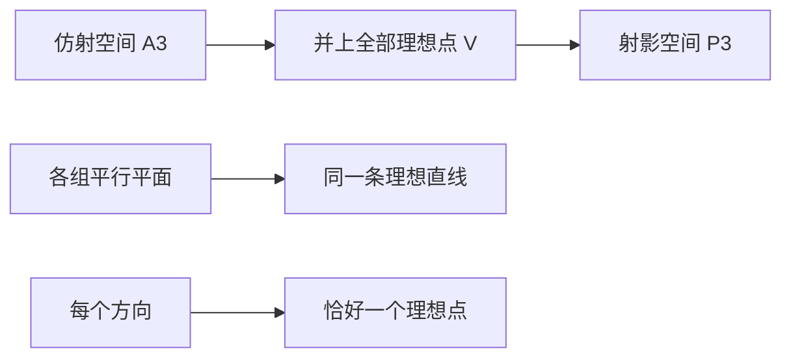
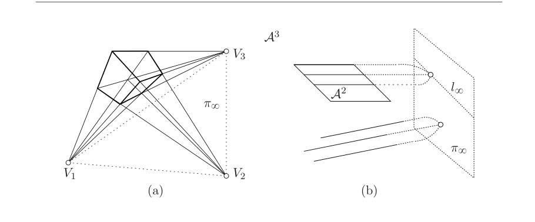

# 第10章 射影空间

### 来源说明

- 作者：Tomas Pajdla
- 书名：*Elements of Geometry for Computer Vision*（计算机视觉几何基础），CTU 讲义，日期 Monday 9th May, 2016
- 官方来源：https://cmp.felk.cvut.cz/~pajdla/gvg/GVG-2016-Lecture.pdf
- 本笔记仅供个人学习使用。

阅读范围：PDF 105–107（书页 101–103）。开读时 PDF 105 章名为 `10 Projective space`。书页加 4 等于 PDF 页。未读 PDF 108 起的第 11 章。

### 本章总览

第 9 章把仿射平面补上一条理想直线，得到射影平面。这一章把同一件事做到三维：把三维仿射空间里所有方向上的理想点并起来，得到三维实射影空间 $P^3$。

几何动机来自立方体的透视像。三组平行棱交到三个消失点，六个面各自贡献一条消失线。代数上则用 $\mathbb{R}^4$ 的子空间来写点、平面和直线，并让模型兼容已经用 $\mathbb{R}^3$ 子空间写成的射影平面。

本章只建立模型与对偶，不讲变换、不讲相机。点与平面对偶，直线不再与点对偶，这是和 $P^2$ 最大的差别。

### 核心知识点

#### 动机：所有仿射平面的理想点之并

图 10.1(a) 是三维实仿射空间里一个立方体的透视像。三组平行棱的像分别趋向消失点 $V_1,V_2,V_3$。立方体有六个面，每个面给出两对平行线，因而给出两个消失点。

每个面所在的仿射平面，都可以补上该平面自己的理想点直线，扩成射影平面。三条理想直线的像就是三条消失线

$$
l_{12}=V_1\vee V_2,\qquad l_{23}=V_2\vee V_3,\qquad l_{31}=V_3\vee V_1.
$$

现在想象三维仿射空间里所有可能的仿射平面，以及它们各自的理想点。把这些理想点的集合并起来，记作 $V$。$V$ 里每一个理想点正好对应一组平行线，也就是三维仿射空间里的一个方向。每个平面 $\pi$ 贡献一条理想直线 $l_\infty$；所有与 $\pi$ 平行的平面贡献同一条 $l_\infty$。

射影平面是仿射平面补上一条理想直线。这里按同样的类比，把三维仿射空间补上整套 $V$。补完之后，原来平行的直线都会相交。这个新空间叫做三维实射影空间，记作 $P^3$。

射影平面本身是把仿射平面沿各个方向「补上无穷远点」再粘成一条理想直线。它的代数模型是 $\mathbb{R}^3$ 的一维子空间（点）与二维子空间（直线）。本章要求 $P^3$ 的模型把这一套包含进去，所以升一维，改用 $\mathbb{R}^4$ 的子空间。

👉 射影平面的完整深度讲解见第 9 章。

图注：从 $A^3$ 到 $P^3$ 的两步直观。方向变成理想点，平行平面族变成同一条理想直线；全部并起来就是理想平面。

图注：原书 Figure 10.1。(a) 立方体透视像给出三个消失点 $V_1,V_2,V_3$，从而给出三条消失线。(b) 每个平面给三维仿射空间添一条理想点直线；每个理想点对应一个方向，每条理想直线对应一族平行平面。

🔑 关键速记：$P^3$ 就是 $A^3$ 并上「所有方向上的理想点」；平行线在那里相交。

#### 代数模型：用 $\mathbb{R}^4$ 的一维子空间写 $A^3$

先在三维实仿射空间 $A^3$ 里固定坐标系 $(O,\delta)$，$\delta=(\vec d_1,\vec d_2,\vec d_3)$。仿射平面 $\pi$ 在这个坐标系里是

$$
\pi=\bigl\{[x,y,z]^\top \mid ax+by+cz+d=0,\; a,b,c,d\in\mathbb{R},\; a^2+b^2+c^2\neq 0\bigr\}
\tag{10.1}
$$

$\pi$ 上用 $[x,y,z]^\top$ 表示的点，也可以写成 $\mathbb{R}^4$ 的一维子空间 $\{\lambda[x,y,z,1]^\top\mid\lambda\in\mathbb{R}\}$。于是整张平面变成

$$
\pi=\Bigl\{\{\lambda[x,y,z,1]^\top\mid\lambda\in\mathbb{R}\} \Bigm| [a,b,c,d][x,y,z,1]^\top=0,\; a^2+b^2+c^2\neq 0\Bigr\}
\tag{10.2}
$$

定义里没有要求 $\lambda\neq 0$。每个线性空间都含零向量；这里建立的是向量 $[x,y,z]$ 与「整个」一维子空间之间的对应，所以 $\lambda=0$ 也收进来。

每个 $[x,y,z]^\top\in\mathbb{R}^3$ 在 $(O,\delta)$ 里表示 $A^3$ 的一个点，因此

$$
A^3=\bigl\{\{\lambda[x,y,z,1]^\top\mid\lambda\in\mathbb{R}\} \mid x,y,z\in\mathbb{R}\bigr\}
\tag{10.3}
$$

是 $\mathbb{R}^4$ 里那批第四个坐标可以写成 $1$ 的一维子空间。

🔑 关键速记：仿射点写成 $\{\lambda[x,y,z,1]^\top\}$；第四个坐标固定成 $1$ 的那一层就是 $A^3$。

#### 理想平面与 $P^3=A^3\cup\pi_\infty$

$\mathbb{R}^4$ 的一维子空间还没用完。剩下的是

$$
\pi_\infty=\bigl\{\{\lambda[x,y,z,0]^\top\mid\lambda\in\mathbb{R}\} \mid x,y,z\in\mathbb{R},\; x^2+y^2+z^2\neq 0\bigr\}
\tag{10.4}
$$

它与 $\mathbb{R}^3$ 的全体非零向量一一对应，也就是与 $A^3$ 里的方向一一对应。这正是要并到 $A^3$ 上的那批理想点。三维实射影空间是

$$
P^3=\bigl\{\{\lambda[x,y,z,w]^\top\mid\lambda\in\mathbb{R}\} \mid x,y,z,w\in\mathbb{R},\; x^2+y^2+z^2+w^2\neq 0\bigr\}
\tag{10.5}
$$

也就是 $\mathbb{R}^4$ 的全部一维子空间。结论是

$$
P^3=A^3\cup\pi_\infty.
$$

🔑 关键速记：第四个坐标为 $0$ 的非零方向是理想点；全部一维子空间合起来就是 $P^3$。

#### 点：非零向量，零向量不是点

§56 规定：$\mathbb{R}^4$ 的每个非零向量生成一个一维子空间，因而表示 $P^3$ 的一个点。零向量 $[0,0,0,0]^\top$ 不表示任何点。

这和射影平面里「$\mathbb{R}^3$ 的非零向量表示点、零向量排除」是同一条规则，只是空间升到了 $\mathbb{R}^4$。

🔑 关键速记：点 = $\mathbb{R}^4$ 的一维子空间；$[0,0,0,0]^\top$ 没有点。

#### 平面：一维子空间与三维子空间的两种看法

§57 先从仿射平面看。式 (10.2) 里的仿射平面与下面这批一维子空间一一对应：

$$
\pi_{A^3}=\bigl\{\{\lambda[a,b,c,d]^\top\mid\lambda\in\mathbb{R}\} \mid a,b,c,d\in\mathbb{R},\; a^2+b^2+c^2\neq 0\bigr\}
\tag{10.6}
$$

$\mathbb{R}^4$ 里只缺一个一维子空间 $\{\lambda[0,0,0,1]^\top\mid\lambda\in\mathbb{R}\}$。缺的正好对应 $P^3$ 的理想点集合 $\pi_\infty$：

$$
\pi_\infty=\bigl\{\{\lambda[x,y,z,w]^\top\mid\lambda\in\mathbb{R}\} \mid x^2+y^2+z^2\neq 0,\; [0,0,0,1][x,y,z,w]^\top=0\bigr\}
\tag{10.7}
$$

换一个看法：仿射平面与 $\mathbb{R}^4$ 的三维子空间一一对应。$\pi_\infty$ 也对应一个三维子空间，因此可以把它看成 $P^3$ 的另一张平面，叫做理想平面。

于是 $P^3$ 的全部平面既可以写成

$$
\pi_{P^3}=\bigl\{\{\lambda[a,b,c,d]^\top\mid\lambda\in\mathbb{R}\} \mid a,b,c,d\in\mathbb{R},\; a^2+b^2+c^2+d^2\neq 0\bigr\}
\tag{10.8}
$$

也可以看成 $\mathbb{R}^4$ 的全部三维子空间。式 (10.8) 比式 (10.6) 多收了 $[0,0,0,1]^\top$ 这一支，正好把理想平面补进去。

🔑 关键速记：平面既是 $\mathbb{R}^4$ 的一维子空间（法向量），也是三维子空间（点集）；理想平面对应 $[0,0,0,1]^\top$。

#### 点与平面的对偶和关联

点和平面都用 $\mathbb{R}^4$ 的一维子空间表示，因此对偶。点 $X$ 由 $\vec X=[x,y,z,w]^\top$ 表示，平面 $\pi$ 由 $\vec\pi=[a,b,c,d]^\top$ 表示。关联 $X\mathbin{\circ}\pi$ 当且仅当

$$
\vec\pi^\top\vec X=ax+by+cz+dw=0
\tag{10.9}
$$

正文叙述向量时有一处把 $\vec X$ 写成了 $[x,y,x,w]^\top$，与式 (10.9) 的 $[x,y,z,w]^\top$ 不一致。笔记按编号公式采用 $z$。

🔑 关键速记：对偶就是同一套齐次四元组；关联是一次式 $\vec\pi^\top\vec X=0$。

#### 直线：二维子空间，不再与点对偶

§58 规定：$P^3$ 里的直线用 $\mathbb{R}^4$ 的二维子空间表示。与 $P^2$ 不同，直线不与点对偶。

在 $P^2$ 里，点是一维子空间、直线是二维子空间，两者维数互补，对偶整齐。到了 $P^3$，点仍是一维，平面变成与点同型的一维（或互补的三维），直线落在中间的二维，对偶对象换成了平面。本章只写到这一句，没有再给直线的关联、交、连公式。

👉 该细节原书本章未再展开。📝待补全

🔑 关键速记：$P^3$ 的直线是 $\mathbb{R}^4$ 的二维子空间；对偶发生在点与平面之间，不在点与直线之间。

### 章末速记

1. 把所有仿射平面的理想点并成 $V$，再并到 $A^3$ 上，得到 $P^3$；平行线在 $P^3$ 里相交。
2. 代数模型是 $\mathbb{R}^4$ 的一维子空间：第四个坐标可写成 $1$ 的是仿射点，写成 $0$ 的是理想点。
3. $P^3=A^3\cup\pi_\infty$。零向量不表示点。
4. 平面对应 $\mathbb{R}^4$ 的三维子空间，也可用齐次四元组 $[a,b,c,d]^\top$ 表示；理想平面对应 $[0,0,0,1]^\top$。
5. 点–平面对偶由 $\vec\pi^\top\vec X=0$ 给出。直线是二维子空间，不与点对偶。

### 易混淆点与差异对比

$A^3$、$\pi_\infty$、$P^3$ 是包含关系，不是三套无关空间。$A^3$ 是第四个坐标能归一成 $1$ 的那些点，$\pi_\infty$ 是第四个坐标为 $0$ 的那些点，两者不交，并起来才是 $P^3$。

平面的「一维子空间」和「三维子空间」说的是同一张平面的两种坐标：前者是法向量方向，后者是落在平面上的点。不要把 $\pi_{A^3}$ 和 $\pi_{P^3}$ 当成两种几何对象；差别只在于后者多收了理想平面。

和射影平面对比：

| 对象 | $P^2$（第 9 章） | $P^3$（本章） |
| --- | --- | --- |
| 点 | $\mathbb{R}^3$ 的一维子空间 | $\mathbb{R}^4$ 的一维子空间 |
| 直线 | $\mathbb{R}^3$ 的二维子空间，与点对偶 | $\mathbb{R}^4$ 的二维子空间，不与点对偶 |
| 平面 | 无（整个空间就是一张面） | $\mathbb{R}^4$ 的三维子空间，与点对偶 |
| 无穷远 | 一条理想直线 | 一张理想平面 $\pi_\infty$ |

消失点仍是理想点的像，消失线仍是理想直线的像。本章只说明三维里这些对象如何拼成 $\pi_\infty$，不重算第 9 章的投影公式。

### 本章要点总结

- 三维实射影空间 $P^3$ 是三维仿射空间补上全部方向上的理想点。几何上，平行线相交；代数上，它是 $\mathbb{R}^4$ 的全部一维子空间。
- 仿射点写成 $\{\lambda[x,y,z,1]^\top\}$，理想点写成 $\{\lambda[x,y,z,0]^\top\}$。$P^3=A^3\cup\pi_\infty$。
- 点与平面对偶，关联条件是 $\vec\pi^\top\vec X=ax+by+cz+dw=0$。理想平面对应 $[0,0,0,1]^\top$。
- 直线是二维子空间，不再与点对偶。直线上的交、连运算本章没有写出。
- 本章为后面的自标定和双视图重建准备「空间里的平面与无穷远」这一层语言，本身还没有相机矩阵。
