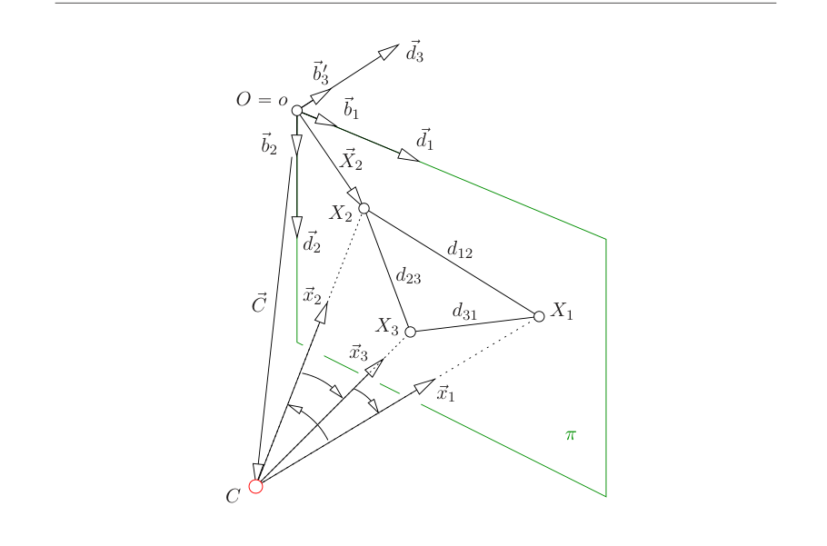
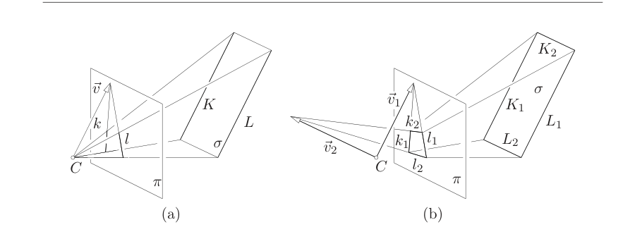
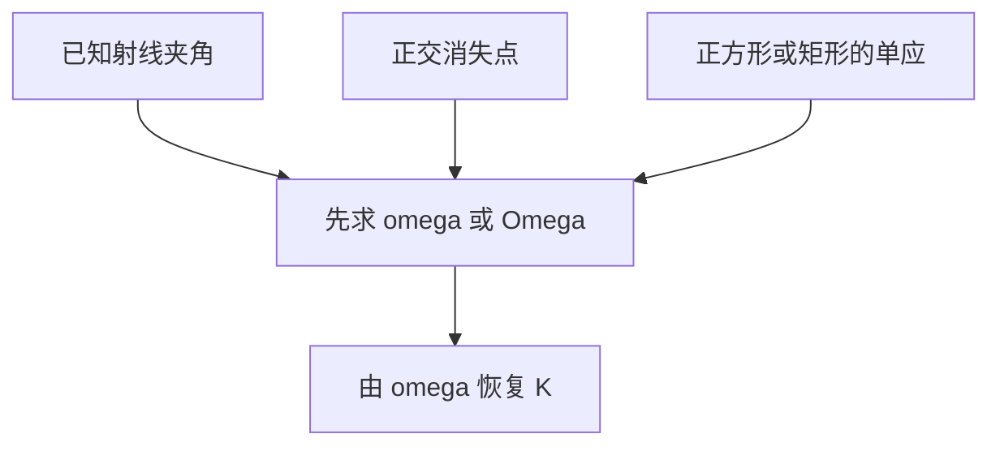

# 第11章 相机自标定

### 来源说明

- 作者：Tomas Pajdla
- 书名：*Elements of Geometry for Computer Vision*（计算机视觉几何基础），CTU 讲义，日期 Monday 9th May, 2016
- 官方来源：https://cmp.felk.cvut.cz/~pajdla/gvg/GVG-2016-Lecture.pdf
- 本笔记仅供个人学习使用。

阅读范围：PDF 108–116（书页 104–112）。开读时 PDF 108 章名为 `11 Camera auto-calibration`。书页加 4 等于 PDF 页。未读 PDF 117 起的第 12 章。

### 本章总览

自标定（camera auto-calibration）是从场景的几何性质，或从已知的相机运动，把成像参数求出来。本章关心的量是矩阵 \(\omega=K^{-\top}K^{-1}\)，文献 [14] 把它叫做绝对二次曲线的像（image of the absolute conic）。

第 7 章已经说明：只要有 \(K\)，就能量投影射线的夹角。本章进一步说明，夹角其实只依赖 \(\omega\)；并且可以从 \(\omega\) 把 \(K\) 恢复到两个符号。随后给出三类约束：一般 \(K\) 的代数恒等式、正方形像素、以及由夹角、消失点、正方形像得到的方程。

目标是在图像里做度量（metrology），而不是先摆棋盘再做经典标定。

### 核心知识点

#### 自标定在求什么：\(\omega\) 与夹角

第 7 章的标定矩阵 \(K\) 把像素坐标和相机坐标系里的射线方向连起来。它是上三角的，通常写成

\[
K=\begin{bmatrix}k_{11}&k_{12}&k_{13}\\0&k_{22}&k_{23}\\0&0&1\end{bmatrix}
\tag{11.2}
\]

焦距、主点和斜畸都装在这五个数里。有了 \(K\)，两条投影射线的夹角可以算出来。本章指出：真正进入夹角公式的是

\[
\omega=K^{-\top}K^{-1}
\]

对应图像点 \(\vec x_{1\beta},\vec x_{2\beta}\) 的射线夹角满足

\[
\cos\angle(\vec x_1,\vec x_2)=\frac{\vec x_{1\beta}^\top\omega\vec x_{2\beta}}{\sqrt{\vec x_{1\beta}^\top\omega\vec x_{1\beta}}\,\sqrt{\vec x_{2\beta}^\top\omega\vec x_{2\beta}}}
\tag{11.1}
\]

知道 \(\omega\) 几乎就知道 \(K\)：\(K\) 可以从 \(\omega\) 恢复到两个符号。

👉 \(K\) 的几何意义与用它量角，完整深度讲解见第 7 章。

🔑 关键速记：自标定先求 \(\omega=K^{-\top}K^{-1}\)；夹角只依赖 \(\omega\)，不单独再要 \(K\)。

#### 从 \(\omega\) 恢复 \(K\)

§59 给出手续。先把 \(K^{-1}\) 写成同样的上三角形状，五个元素记作 \(m_{11},m_{12},m_{13},m_{22},m_{23}\)，再反解回 \(K\)，得到式 (11.3)、(11.4)。把 \(\omega\) 写成对称矩阵

\[
\omega=\begin{bmatrix}\omega_{11}&\omega_{12}&\omega_{13}\\\omega_{12}&\omega_{22}&\omega_{23}\\\omega_{13}&\omega_{23}&\omega_{33}\end{bmatrix}
=K^{-\top}K^{-1}
\tag{11.5}
\]

代入后得到式 (11.6)：\(\omega\) 的六个元素是 \(m_{ij}\) 的二次式。逐个开方、回代，得到

\[
\begin{aligned}
m_{11}&=s_1\sqrt{\omega_{11}},&
m_{12}&=s_1\omega_{12}/\sqrt{\omega_{11}},&
m_{13}&=s_1\omega_{13}/\sqrt{\omega_{11}},\\
m_{22}&=s_2\sqrt{\omega_{22}-\omega_{12}^2/\omega_{11}},&
m_{23}&=s_2(\omega_{23}-\omega_{12}\omega_{13}/\omega_{11})\big/\sqrt{\omega_{22}-\omega_{12}^2/\omega_{11}}
\end{aligned}
\]

其中 \(s_1=\pm 1\)、\(s_2=\pm 1\)。于是

\[
K=\begin{bmatrix}
s_1\sqrt{\omega_{11}} & s_1\omega_{12}/\sqrt{\omega_{11}} & s_1\omega_{13}/\sqrt{\omega_{11}}\\
0 & s_2\sqrt{\omega_{22}-\omega_{12}^2/\omega_{11}} & s_2(\omega_{23}-\omega_{12}\omega_{13}/\omega_{11})\big/\sqrt{\omega_{22}-\omega_{12}^2/\omega_{11}}\\
0 & 0 & 1
\end{bmatrix}^{-1}
\tag{11.7}
\]

符号由图像坐标系的选取决定。标准选取是 \(s_1=s_2=1\)，对应 \(k_{11}>0\) 且 \(k_{22}>0\)。

\(\sqrt{\omega_{11}}\) 对真实相机不会为零，因为 \(m_{11}=1/k_{11}\neq 0\)。式 (11.8) 还断言

\[
\sqrt{\omega_{22}-\omega_{12}^2/\omega_{11}}\neq 0
\]

理由是真实相机里 \(|k_{12}|\) 远小于 \(|k_{22}|\)。中间把该根式写成 \(\sqrt{m_{11}^2-m_{12}^2}\) 再化到 \(1/(k_{11}k_{22})\sqrt{k_{22}^2-k_{12}^2}\)。由式 (11.6) 直接消元应得到 \(m_{22}^2\)；笔记保留书上的链式写法，只采用「真实相机上该量不为零」这一结论。

🔑 关键速记：\(\omega\) 开方回代得到 \(K^{-1}\) 的五个 \(m_{ij}\)，再取逆；标准符号取 \(s_1=s_2=1\)。

#### 一般 \(K\) 对 \(\omega\) 的约束

\(\omega\) 是 \(3\times 3\) 对称矩阵，独立元素看起来有六个：\(\omega_{11},\omega_{12},\omega_{13},\omega_{22},\omega_{23},\omega_{33}\)。§60 指出，一般的 \(K\) 也只贡献五个 \(m_{ij}\)，所以六个 \(\omega_{ij}\) 不能独立。

把式 (11.6) 消掉 \(m_{ij}\) 之后，得到八次多项式恒等式 (11.10)。因为 \(\omega_{11}\neq 0\)，可以改用五个未知数的矩阵

\[
\Omega=\begin{bmatrix}
1 & o_{12} & o_{13}\\
o_{12} & o_{22} & o_{23}\\
o_{13} & o_{23} & o_{33}
\end{bmatrix}
=\begin{bmatrix}
1 & \omega_{12}/\omega_{11} & \omega_{13}/\omega_{11}\\
\omega_{12}/\omega_{11} & \omega_{22}/\omega_{11} & \omega_{23}/\omega_{11}\\
\omega_{13}/\omega_{11} & \omega_{23}/\omega_{11} & \omega_{33}/\omega_{11}
\end{bmatrix}
\tag{11.11}
\]

再由式 (11.10) 解关于正数 \(\omega_{11}\) 的二次方程

\[
a_2\omega_{11}^2+a_1\omega_{11}+a_0=0
\tag{11.12}
\]

系数 \(a_2,a_1,a_0\) 由 \(\Omega\) 的元素给出，见 (11.13)–(11.15)。证明只留结论：一般 \(K\) 的 \(\omega\) 落在一个超曲面上；先估五个 \(o_{ij}\)，再回一个二次式取出 \(\omega_{11}\)。

🔑 关键速记：一般 \(K\) 只有五个自由度，\(\omega\) 的六个元素受一条八次约束；实用上先算 \(\Omega\) 再解 \(\omega_{11}\)。

#### 正方形像素：三条更简单的恒等式

相机常常是正方形像素：\(\|\vec b_1\|=\|\vec b_2\|\) 且 \(\angle(\vec b_1,\vec b_2)=\pi/2\)。由第 7 章式 (7.13)、(7.15)、(7.16)，这时

\[
K=\begin{bmatrix}k_{11}&0&k_{13}\\0&k_{11}&k_{23}\\0&0&1\end{bmatrix}
\tag{11.16}
\]

斜畸为零，两个尺度相等。对应的 \(\omega\) 是

\[
\omega=\frac{1}{k_{11}^2}
\begin{bmatrix}
1 & 0 & -k_{13}\\
0 & 1 & -k_{23}\\
-k_{13} & -k_{23} & k_{11}^2+k_{13}^2+k_{23}^2
\end{bmatrix}
\tag{11.17}
\]

于是有三条恒等式

\[
\omega_{12}=0
\tag{11.18}
\]

\[
\omega_{22}-\omega_{11}=0
\tag{11.19}
\]

\[
\omega_{13}^2+\omega_{23}^2-\omega_{11}\omega_{33}+\omega_{11}=0
\tag{11.20}
\]

此时

\[
\Omega=k_{11}^2\omega=\begin{bmatrix}1&0&o_{13}\\0&1&o_{23}\\o_{13}&o_{23}&o_{33}\end{bmatrix}
=\begin{bmatrix}1&0&-k_{13}\\0&1&-k_{23}\\-k_{13}&-k_{23}&k_{11}^2+k_{13}^2+k_{23}^2\end{bmatrix}
\tag{11.21}
\]

主点和尺度可以直接读出：

\[
k_{11}^2=o_{33}-o_{13}^2-o_{23}^2,\qquad k_{13}=-o_{13},\qquad k_{23}=-o_{23}
\tag{11.22--11.24}
\]

👉 \(K\) 各元素与像素基 \(\vec b_1,\vec b_2\) 的关系见第 7 章。正方形像素把五个参数收成三个：一个尺度、两个主点。

🔑 关键速记：正方形像素 \(\Rightarrow\) \(\omega_{12}=0\)、\(\omega_{11}=\omega_{22}\)，并且 \(k_{13}=-o_{13}\)、\(k_{23}=-o_{23}\)。

#### 用投影射线夹角标定

一般 \(K\) 的 \(\Omega\) 有五个独立参数。一对已知夹角的射线给出式 (11.25)，平方去分母后是 \(\Omega\) 元素的二次方程 (11.26)。因此需要五对已知夹角的射线，解五个二次方程。

§62：若像素是正方形，只需三对已知夹角，未知数只剩 \(o_{13},o_{23},o_{33}\)。这件事和第 7.3 节的绝对位姿是同一道题。

图 11.2 在像平面 \(\pi\) 上取坐标系 \((o,\delta')\)，\(\delta'=(\vec b_1,\vec b_2,\vec b_3')\)，由图像坐标系 \((o,\alpha)\) 导出。正方形像素下，\(\vec b_1,\vec b_2\) 可以补上 \(\vec b_3'\) 做成正交系。再取全局标准正交系 \((O=o,\delta)\)，使

\[
\vec d_1=\frac{\vec b_1}{\|\vec b_1\|},\qquad
\vec d_2=\frac{\vec b_2}{\|\vec b_1\|},\qquad
\vec d_3=\frac{\vec b_3'}{\|\vec b_1\|}
\tag{11.27}
\]

从而 \(\vec x_\delta=\|\vec b_1\|\,I\,\vec x_{\delta'}\)，见 (11.28)。已知三个夹角和三个像点，就能算出像平面上的边长 \(d_{12},d_{23},d_{31}\)，再按第 7.3 节求相机中心在 \((O,\delta')\) 里的位姿 \(\vec C_{\delta'}=[c_1,c_2,c_3]^\top\)。选取 \(c_3<0\) 的解；必要时用像平面上的第四个点在多解里判别。

像点 \(o\) 在 \(\beta\) 里是 \([0,0,1]^\top\)，在 \(\delta\) 里是 \([0,0,0]^\top\)。坐标系取得使 \(R=I\) 且 \(\vec C_\delta=\|\vec b_1\|\vec C_{\delta'}\)，于是

\[
K^{-1}\begin{bmatrix}0\\0\\1\end{bmatrix}=-\frac{\|\vec b_1\|}{f}\vec C_{\delta'}
\tag{11.30}
\]

再按第 7 章式 (7.16)、(7.17) 解释 \(K\) 的元素，得到

\[
\begin{bmatrix}k_{13}\\k_{23}\\-f/\|\vec b_1\|\end{bmatrix}=\begin{bmatrix}c_1\\c_2\\c_3\end{bmatrix}
\tag{11.32}
\]

因此

\[
K=\begin{bmatrix}-c_3&0&c_1\\0&-c_3&c_2\\0&0&1\end{bmatrix}
\tag{11.33}
\]

👉 绝对位姿把已知夹角和已知边长的三点问题收成相机中心坐标，完整深度讲解见第 7.3 节。

图注：原书 Figure 11.2。像平面 \(\pi\) 上三点 \(X_1,X_2,X_3\) 的射线夹角已知时，正方形像素相机的中心 \(\vec C_{\delta'}\) 可按第 7.3 节绝对位姿求出，再由 \(c_1,c_2,c_3\) 拼出 \(K\)。

🔑 关键速记：一般 \(K\) 要五对已知夹角；正方形像素三对就够，并且就是绝对位姿，\(K\) 由 \(-c_3,c_1,c_2\) 拼成。

#### 消失点：平行线的交点如何进相机

先看一条几何观察。空间中一对平行线 \(K,L\) 落在仿射平面 \(\sigma\) 上，投影到像平面 \(\pi\) 成为 \(k,l\)，见图 11.1(a)。

用相机中心 \(C\) 把 \(\sigma\) 扩成射影平面 \(\Sigma\)，并取标准正交系 \((C,\delta)\)，使 \(\vec d_1,\vec d_2\) 张成 \(\sigma\)。\(K,L\) 关于 \(\bar\delta\) 的齐次坐标叉乘

\[
\vec w_\delta=\vec K_{\bar\delta}\times\vec L_{\bar\delta}
\tag{11.34}
\]

就是它们在 \(\Sigma\) 里的交点。同样，用 \(C\) 把 \(\pi\) 扩成 \(\Pi\)，在相机坐标系 \((C,\beta)\) 里

\[
\vec v_\beta=\vec k_{\bar\beta}\times\vec l_{\bar\beta}
\tag{11.35}
\]

是像上的交点，也就是消失点。

第 8 章式 (8.14) 给出两张平面之间的单应。因为 \(\delta\) 标准正交，\(K_1=I\)，所以存在单应

\[
H=KR
\tag{11.36}
\]

把 \(\Sigma\) 映到 \(\Pi\)。这里的 \(K,R\) 是相对于世界系 \((C,\delta)\) 写的。于是存在实数 \(\lambda\) 使

\[
\lambda\vec v_\beta=KR\vec w_\delta
\tag{11.37}
\]

单应是把一张平面上的点（含理想点）一一送到另一张平面。透视相机看一张空间平面时，像点与平面点之间就是一个单应；\(H=KR\) 是把「相机中心与平面」做成的那一张。

👉 平面到像平面的单应，完整深度讲解见第 8 章。

图注：原书 Figure 11.1。(a) 平行线 \(K,L\) 投影成 \(k,l\)，消失点向量 \(\vec v\) 与 \(k,l\) 平行。(b) \(\vec v_1,\vec v_2\) 的夹角等于空间中 \(K_1,K_2\) 或 \(L_1,L_2\) 的夹角。

🔑 关键速记：消失点是空间平行线在像上的交点，并且 \(\lambda\vec v=KR\vec w\)。

#### 正交消失点对与正方形像素

§63 考虑两对平行线，并且这两组方向互相正交，见图 11.1(b)。\(K_1\parallel L_1\)，\(K_2\parallel L_2\)，同时 \(K_1\perp K_2\)、\(L_1\perp L_2\)。矩形的四边是典型例子，但四条线在空间里也可以不相交。

两组平行线的消失点是

\[
\vec v_{1\beta}=\vec k_{1\bar\beta}\times\vec l_{1\bar\beta},\qquad
\vec v_{2\beta}=\vec k_{2\bar\beta}\times\vec l_{2\bar\beta}.
\]

正交在相机的正交基 \(\delta\) 里写成 \(\vec w_{1\delta}^\top\vec w_{2\delta}=0\)。代入式 (11.37) 并利用 \(R^\top R=I\)，得到

\[
\vec v_{1\beta}^\top\omega\vec v_{2\beta}=0
\tag{11.41}
\]

这是 \(\omega\) 的一条线性齐次方程。再假定正方形像素，用 §61 的 \(\Omega\)，未知数只剩 \(o_{13},o_{23},o_{33}\)，并且可以收成

\[
\begin{bmatrix}v_{23}v_{11}+v_{21}v_{13}& v_{23}v_{12}+v_{22}v_{13}& v_{23}v_{13}\end{bmatrix}
\begin{bmatrix}o_{13}\\o_{23}\\o_{33}\end{bmatrix}
=-(v_{21}v_{11}+v_{22}v_{12})
\]

因此只需三对正交消失点，例如观察三个不共面的矩形，就能求出 \(o_{13},o_{23},o_{33}\)，再得

\[
k_{13}=-o_{13},\qquad k_{23}=-o_{23},\qquad k_{11}=\sqrt{o_{33}-k_{13}^2-k_{23}^2}.
\]

🔑 关键速记：正交消失点给出 \(\vec v_1^\top\omega\vec v_2=0\)；正方形像素下三个不共面矩形就够。

#### 用正方形的像标定

第 8 章已经说明：空间平面 \(\sigma\) 上的点，经透视相机落到像平面，坐标之间是一个单应 \(H\)。把投影矩阵写成

\[
P=\bigl[KR\mid -KR\vec C_\delta\bigr]=\bigl[\vec d_{1\nu}\;\;\vec d_{2\nu}\;\;\vec d_{3\nu}\;\;-\vec C_\nu\bigr]
\tag{11.42}
\]

则把 \(\sigma\) 映到 \(\pi\) 的单应 \(H\)（第 8 章式 (8.31)）的列是

\[
h_1=p_1=\vec d_{1\nu},\qquad h_2=p_2=\vec d_{2\nu},\qquad h_3=p_4=-\vec C_\nu
\tag{11.43--11.45}
\]

现在观察 \(\sigma\) 上一个正方形的四个角，并把 \(\sigma\) 上的坐标系取成

\[
\vec X_{1\delta}=[0,0,0],\quad
\vec d_{1\delta}=\vec X_{2\delta}=[1,0,0],\quad
\vec d_{2\delta}=\vec X_{3\delta}=[0,1,0],\quad
\vec X_{4\delta}=[1,1,0]
\tag{11.46--11.49}
\]

正方形给出两条欧氏约束：邻边正交、邻边等长，

\[
\vec d_{1\delta}^\top\vec d_{2\delta}=0
\tag{11.50}
\]

\[
\vec d_{1\delta}^\top\vec d_{1\delta}-\vec d_{2\delta}^\top\vec d_{2\delta}=0
\tag{11.51}
\]

用 \(\vec d_{i\nu}=KR\vec d_{i\delta}\) 和 \(R^\top R=I\) 推到像上，成为 \(\omega\) 的两条线性方程。写成 \(\Omega\) 和 \(H\) 的列，就是

\[
h_1^\top\Omega h_2=0
\tag{11.56}
\]

\[
h_1^\top\Omega h_1-h_2^\top\Omega h_2=0
\tag{11.57}
\]

式 (11.53) 有一处把第一个向量的下标写成 \(\beta\)，其后的 (11.54)–(11.55) 一律用 \(\nu\)。笔记按 \(\nu\) 与 \(H\) 的列来记。

一个正方形提供两条方程。三个处于一般位置、分属两张平面的正方形，足够标定完整的 \(K\)。\(\Omega\) 只有五个参数，三条正方形其实多一条方程。因此两个正方形加一个矩形也够五个约束。若像素已是正方形，则一张平面上的一个正方形加一个矩形就够。

坐标的特殊取法并没有被真正用到：\(X_4\) 可以在别处，只要能在 \((O,\vec d_1,\vec d_2)\) 里给它坐标。手续是：先给角点坐标，再由

\[
\lambda_i\vec x_{i\beta}=H\vec X_{i\delta}
\tag{11.58}
\]

估计 \(H\)（书中把循环指标写成 \(\alpha_i=1,\ldots,4\)），最后用 \(H\) 的列求 \(\Omega\)。

👉 \(P\) 的列与平面到图像的 \(H\) 的对应，完整深度讲解见第 8 章。

图注：本章三条自标定路线都先约束 \(\omega\) 或 \(\Omega\)，最后用 §59 或正方形像素的显式公式取出 \(K\)。

下面这张表只收本章写明的计数，方便对照。

| 路线 | 一般 \(K\) | 正方形像素 |
| --- | --- | --- |
| 已知射线夹角 | 五对，解五个二次式 (11.26) | 三对；或改走绝对位姿 |
| 正交消失点 | 线性式 (11.41)，计数本章未单列 | 三对，例如三个不共面矩形 |
| 正方形的像 | 三个正方形分属两张一般平面；或两正方形加一矩形 | 一张平面上的一正方形加一矩形 |

🔑 关键速记：一个正方形给 \(\Omega\) 两条线性式；两平面上的三个正方形标定完整 \(K\)。

### 章末速记

1. 自标定求的是 \(\omega=K^{-\top}K^{-1}\)；夹角公式 (11.1) 只含 \(\omega\)。\(K\) 由 \(\omega\) 恢复到符号 \(s_1,s_2\)，标准取 \(+1\)。
2. 一般 \(K\) 给 \(\omega\) 一条八次约束。先估五个参数的 \(\Omega\)，再解 \(\omega_{11}\) 的二次式。
3. 正方形像素：\(\omega_{12}=0\)、\(\omega_{11}=\omega_{22}\)，并且 \(k_{13}=-o_{13}\)、\(k_{23}=-o_{23}\)。
4. 夹角、正交消失点、正方形单应是三条具体约束。消失点满足 \(\lambda\vec v=KR\vec w\)；正交则 \(\vec v_1^\top\omega\vec v_2=0\)。
5. 正方形像素加三对已知夹角，等于第 7.3 节绝对位姿，\(K=\mathrm{diag}(-c_3,-c_3,1)\) 再加上主点 \(c_1,c_2\)。

### 易混淆点与差异对比

\(\omega\) 和 \(K\) 不是两套无关参数。\(\omega=K^{-\top}K^{-1}\) 丢掉了 \(K\) 的两个符号，以及整体尺度里已经被 \(K_{33}=1\) 固定的那一部分。量角用 \(\omega\) 就够；要把像素尺度和主点写回相机矩阵，才需要 §59 的开方。

\(\Omega\) 不是另一种物理量，只是 \(\omega/\omega_{11}\)。一般 \(K\) 用它把未知数从六个降到五个；正方形像素下它几乎就是 \(k_{11}^2\omega\)，主点直接读负号。

自标定和第 7 章的标定对象相同，都是 \(K\)，数据来源不同。第 7 章用已知的三维点或已知运动；本章用场景里的平行、正交、正方形和已知夹角。棋盘格标定可以看成「很多正方形」的特例，但本章没有把棋盘格算法单独写出。

三条路线不要混用计数。夹角给的是 \(\Omega\) 的二次式；消失点和正方形给的是线性式。正方形像素会少未知数，不会把二次式变成线性式，除非改走绝对位姿那条等价路。

式 (11.53) 的下标 \(\beta/\nu\) 与后文不一致，以 (11.54)–(11.57) 为准。式 (11.8) 中间的根式链与由 (11.6) 直接得到的 \(m_{22}\) 写法不同，结论「真实相机上不为零」不变。

### 本章要点总结

- 自标定从场景几何或已知运动求成像参数。核心矩阵是 \(\omega=K^{-\top}K^{-1}\)，夹角只通过 \(\omega\) 出现。
- 一般 \(K\) 的 \(\omega\) 有一条八次约束；实用未知数是 \(\Omega\) 的五个元素。正方形像素再把未知数收到 \(o_{13},o_{23},o_{33}\)。
- 已知夹角、正交消失点、正方形单应分别给出二次或线性方程。计数见上表，多一条方程可以用来稳健化，本章没有展开稳健估计。
- 正方形像素加三对夹角，回到第 7.3 节绝对位姿，\(K\) 由相机中心的三个坐标直接拼出。
- \(\omega\) 在 [14] 中称为绝对二次曲线的像。本章只用矩阵代数，没有把二次曲线本身写开。👉 该几何对象原书本章未展开。📝待补全
