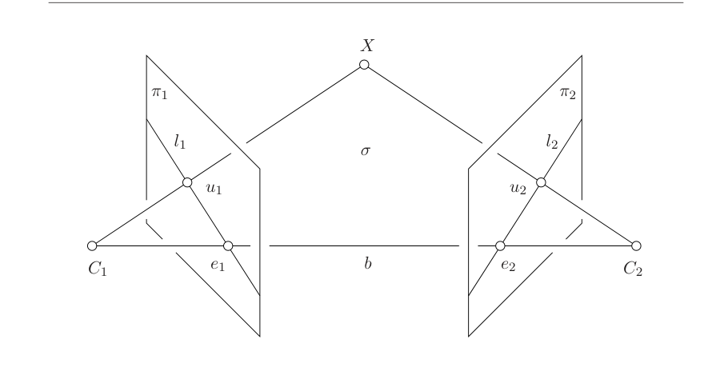
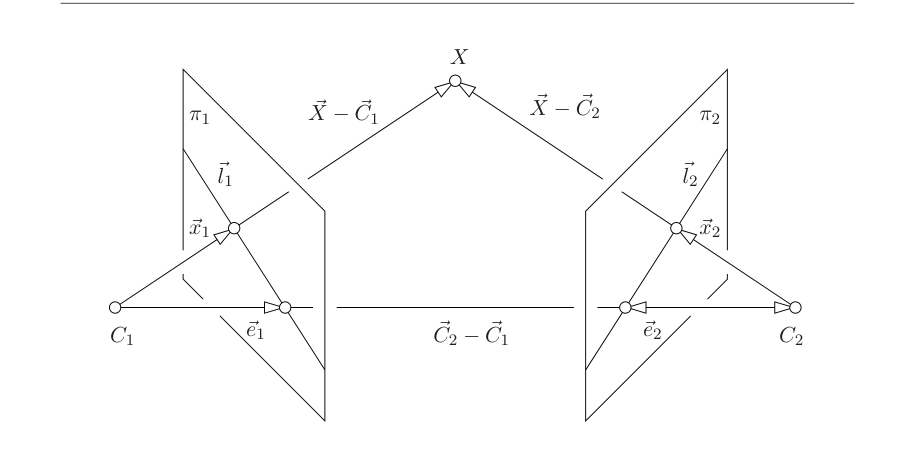
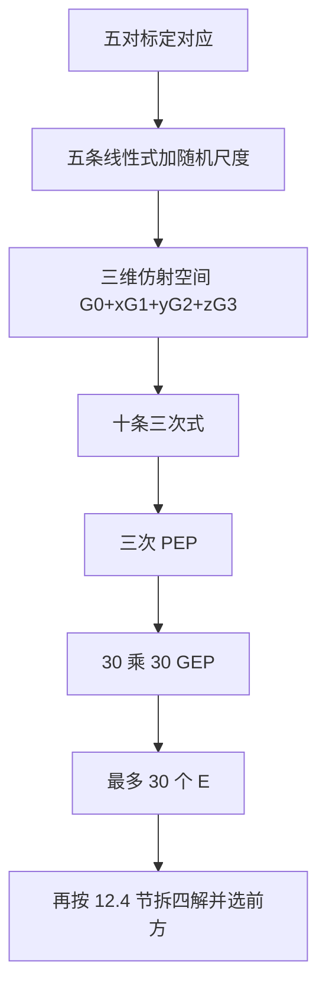

# 第12章 双视图场景重建

### 来源说明

- 作者：Tomas Pajdla
- 书名：*Elements of Geometry for Computer Vision*（计算机视觉几何基础），CTU 讲义，日期 Monday 9th May, 2016
- 官方来源：https://cmp.felk.cvut.cz/~pajdla/gvg/GVG-2016-Lecture.pdf
- 本笔记仅供个人学习使用。

阅读范围：PDF 117–132（书页 113–128）。开读时 PDF 117 章名为 `12 Two-view scene reconstruction`。书页加 4 等于 PDF 页。PDF 132 仍是 12.5.4.2 的求解正文。PDF 133 起为 Bibliography，未纳入本章。PDF 135 起为 Index，按要求未读。

### 本章总览

两台中心不同的相机看同一片空间。本章问：怎样恢复两台相机的投影矩阵，以及空间点的「有意义」坐标，使重建出来的相机和点重新生成这两幅图像。

先建立对极几何，写出本质矩阵 \(E\) 和基础矩阵 \(F\)。再讲如何从像点对应估计 \(F\)，以及一般重建只确定到一个 \(4\times 4\) 的空间变换。已知标定后，相对位姿有四个相容解，用「点在相机前方」选出一个，再线性三角化。最后把标定从一开始就用上，用五对对应直接求 \(E\)。

12.5 节开头写 “In the previous chapter”，对照上下文是上一节 12.4 的七点加 \(K\) 路线，不是第 11 章。

### 核心知识点

#### 对极几何的对象

图 12.1 里，两台相机中心是 \(C_1,C_2\)，像平面是 \(\pi_1,\pi_2\)，空间点 \(X\) 的像是 \(u_1,u_2\)。连接两个中心的基线 \(b\) 交 \(\pi_1,\pi_2\) 于对极点（epipole）\(e_1,e_2\)。\(C_1,C_2,X\) 张成对极平面（epipolar plane）\(\sigma\)。\(\sigma\) 交 \(\pi_1\) 于对极线 \(l_1\)，交 \(\pi_2\) 于对极线 \(l_2\)。\(l_1\) 过 \(e_1\) 和 \(u_1\)，\(l_2\) 过 \(e_2\) 和 \(u_2\)。

图注：原书 Figure 12.1。基线 \(b=C_1C_2\) 交出对极点 \(e_1,e_2\)；点 \(X\) 与两个中心张成对极平面 \(\sigma\)，\(\sigma\) 在两幅像上切出对极线 \(l_1,l_2\)。

世界系取 \((O,\delta)\)。两台相机的投影矩阵是

\[
P_1=\bigl[K_1R_1\mid -K_1R_1\vec C_{1\delta}\bigr],\qquad
P_2=\bigl[K_2R_2\mid -K_2R_2\vec C_{2\delta}\bigr]
\tag{12.1}
\]

点 \(X\) 投影为

\[
\zeta_1\vec x_{1\beta_1}=P_1\begin{bmatrix}\vec X_\delta\\1\end{bmatrix},\qquad
\zeta_2\vec x_{2\beta_2}=P_2\begin{bmatrix}\vec X_\delta\\1\end{bmatrix}
\tag{12.2}
\]

深度满足 \(\zeta_1>0\)、\(\zeta_2>0\)（标准相机坐标系）。消去投影矩阵后，

\[
\zeta_1R_1^\top K_1^{-1}\vec x_{1\beta_1}=\vec X_\delta-\vec C_{1\delta},\qquad
\zeta_2R_2^\top K_2^{-1}\vec x_{2\beta_2}=\vec X_\delta-\vec C_{2\delta}
\tag{12.4}
\]

三个向量 \(\vec X_\delta-\vec C_{1\delta}\)、\(\vec X_\delta-\vec C_{2\delta}\)、\(\vec C_{2\delta}-\vec C_{1\delta}\) 构成三角形，因而

\[
\vec C_{2\delta}-\vec C_{1\delta}=\zeta_1R_1^\top K_1^{-1}\vec x_{1\beta_1}-\zeta_2R_2^\top K_2^{-1}\vec x_{2\beta_2}
\tag{12.6}
\]

🔑 关键速记：对极平面由两中心和空间点张成；对极线是它在两幅像上的痕迹，必过对极点。

#### 本质矩阵 \(E\) 与基础矩阵 \(F\)

用第 2.3 节的叉积恒等式 \(\vec x\times\vec x=0\) 和 \(\vec y^\top(\vec x\times\vec y)=0\)，从式 (12.6) 左边叉乘 \(\vec C_{2\delta}-\vec C_{1\delta}\)，再左乘 \(\zeta_2\vec x_{2\beta_2}^\top K_2^{-\top}R_2\)，深度 \(\zeta_1,\zeta_2\) 被消掉，得到

\[
0=\vec x_{2\beta_2}^\top K_2^{-\top}E K_1^{-1}\vec x_{1\beta_1}
\tag{12.12}
\]

\[
0=\vec x_{2\beta_2}^\top F\vec x_{1\beta_1}
\tag{12.13}
\]

本质矩阵（essential matrix）是

\[
E=R_2\bigl[\vec C_{2\delta}-\vec C_{1\delta}\bigr]_\times R_1^\top\in\mathbb{R}^{3\times 3}
\tag{12.14}
\]

基础矩阵（fundamental matrix）是

\[
F=K_2^{-\top}R_2\bigl[\vec C_{2\delta}-\vec C_{1\delta}\bigr]_\times R_1^\top K_1^{-1}\in\mathbb{R}^{3\times 3}
\tag{12.15}
\]

也就是 \(F=K_2^{-\top}E K_1^{-1}\)。式 (12.13) 对所有对应点成立。

图注：原书 Figure 12.2。同一套对极几何改用向量写出：\(\vec X-\vec C_1\)、\(\vec X-\vec C_2\) 与基线 \(\vec C_2-\vec C_1\) 共面，这是导出 \(E\) 和 \(F\) 的起点。

叉积的矩阵表示 \([\vec v]_\times\) 以及它在换基下的变换，本章调用第 2 章 §8、§9。直观上，\([\vec v]_\times\vec w=\vec v\times\vec w\)，所以 \(E\) 先把第一幅标定射线叉上基线方向，再旋到第二台相机。

👉 叉积的线性表示与换基，完整深度讲解见第 2 章。

🔑 关键速记：\(E=R_2[C_2-C_1]_\times R_1^\top\)，\(F=K_2^{-\top}EK_1^{-1}\)，对应点满足 \(\vec x_2^\top F\vec x_1=0\)。

#### 对极点、秩以及对极线公式

把 \(C_2\) 投到第一幅像、把 \(C_1\) 投到第二幅像，得到对极点

\[
\zeta_1\vec e_{1\beta_1}=K_1R_1(\vec C_{2\delta}-\vec C_{1\delta}),\qquad
\zeta_2\vec e_{2\beta_2}=K_2R_2(\vec C_{1\delta}-\vec C_{2\delta})
\tag{12.16--12.17}
\]

深度仍取正。把它们代回式 (12.15)，并用 §8、§9 的叉积换基，得到 \(F\) 的两种写法 (12.21) 与 (12.26)。结论是：对极点的齐次坐标由

\[
F\vec e_{1\beta_1}=0,\qquad F^\top\vec e_{2\beta_2}=0
\tag{12.27}
\]

恢复（各差一个非零倍数）。因此 \(F\) 有非零核，秩小于 3。当两中心不重合时，\([\vec C_{2\delta}-\vec C_{1\delta}]_\times\) 的秩是 2，于是 \(F\) 的秩恰好是 2。

对极线过对应像点与对极点：\(l_1=x_1\vee e_1\)，\(l_2=x_2\vee e_2\)（书中有一处把 \(l_2\) 印成 \(l_{2x}\)）。由 \(F\vec e_1=0\) 和 \(\vec x_2^\top F\vec x_1=0\) 得到

\[
\vec l_{1\bar\beta_1}=F^\top\vec x_{2\beta_2},\qquad
\vec l_{2\bar\beta_2}=F\vec x_{1\beta_1}
\tag{12.31}
\]

条件是 \(\vec x_{2\beta_2}\neq\vec e_{2\beta_2}\)、\(\vec x_{1\beta_1}\neq\vec e_{1\beta_1}\)。

🔑 关键速记：\(F e_1=0\)、\(F^\top e_2=0\)，秩为 2；对极线是 \(l_1=F^\top x_2\)、\(l_2=F x_1\)。

#### 从像点对应估计对极几何

目标是求 \(G=\tau F\)，\(\tau\neq 0\)。把式 (12.13) 按元素展开，第 \(i\) 对对应 \(\vec x_{1i\beta_1}=[u_{1i},v_{1i},w_{1i}]^\top\)、\(\vec x_{2i\beta_2}=[u_{2i},v_{2i},w_{2i}]^\top\) 给出一行

\[
\begin{bmatrix}u_{2i}u_{1i}& u_{2i}v_{1i}& u_{2i}w_{1i}& v_{2i}u_{1i}& v_{2i}v_{1i}& v_{2i}w_{1i}& w_{2i}u_{1i}& w_{2i}v_{1i}& w_{2i}w_{1i}\end{bmatrix}\operatorname{vec}(G)=0
\]

\(w_{1i}=0\) 或 \(w_{2i}=0\) 时仍成立，因而理想点也能用。

八点法：一般位置的八对对应决定 \(F\) 的非零倍数。「一般」指点不都在一张平面上，也不在某些过两个相机中心的特殊二次曲面上，细节见 [14]。有噪声时，这样求出的矩阵一般是秩 3。

七点法：只用七对对应，解空间是二维的，

\[
G=G_1+\alpha G_2
\tag{12.34}
\]

再加秩约束 \(0=|G|=|G_1+\alpha G_2|\)，得到 \(\alpha\) 的三次多项式 (12.36)。其中 \(a_3=|G_2|\)，\(a_0=|G_1|\)，中间两项是 \(G_1,G_2\) 元素的三次型。最多三个秩为 2 的矩阵。推导时假定 \(G_1\) 的系数非零，因此还要单独检查 \(G=G_2\) 是不是解。

👉 过相机中心的退化二次曲面，原书指向 [14]，本章未展开。📝待补全

🔑 关键速记：八点给线性解，噪声下常失去秩 2；七点加 \(|G|=0\) 的三次式，最多三解。

#### 双视图重建的歧义

重建的目标是找到 \(P_1,P_2\) 和 \(\vec X_\delta\)，使式 (12.37) 成立（书中假设处误引了后文的 (12.43)，对象是同一套投影方程）。若一组解已经满足投影，则对任意 \(4\times 4\) 实可逆矩阵 \(H\)，

\[
P_1'=P_1H^{-1},\qquad P_2'=P_2H^{-1},\qquad
\begin{bmatrix}\vec X_\delta'\\1\end{bmatrix}=H\begin{bmatrix}\vec X_\delta\\1\end{bmatrix}
\tag{12.38}
\]

仍投影到同一批像点，见 (12.39)–(12.40)。

因此，一般只能把相机和场景重建到一个未知的空间变换。这个变换比 \(\mathbb{R}^3\) 里换基更宽：\(H\) 在三维仿射空间上的作用，正好相当于二维仿射空间上的单应。

若 \(K_1,K_2\) 已知，可以把 \(H\) 限制成三维仿射空间里一种特殊的坐标变换。下一节就做这件事。

单应在二维是把一张平面（含理想直线）变到另一张平面。这里的 \(4\times 4\) 的 \(H\) 是三维里的同一类映射：仿射点可以送到仿射点或理想点，平行性不必保持。

👉 二维单应的完整深度讲解见第 8 章。

🔑 关键速记：未标定的双视图重建只确定到射影变换 \(H\in\mathrm{GL}(4)\)；像点完全一样。

#### 已知标定时的相对位姿

设 \(K_1,K_2\) 已知。由 (12.14)、(12.15) 得

\[
E=K_2^\top F K_1
\tag{12.41}
\]

先把未标定点改成标定点

\[
\vec x_{1\gamma_1}=K_1^{-1}\vec x_{1\beta_1},\qquad
\vec x_{2\gamma_2}=K_2^{-1}\vec x_{2\beta_2}
\tag{12.42}
\]

再把世界系选成 \((C_1,\epsilon_1)\)。取

\[
H^{-1}=\begin{bmatrix}R_1^\top & \vec C_{1\delta}\\ \vec 0^\top & 1\end{bmatrix}
\tag{12.44}
\]

则

\[
P_{1\gamma_1}=\bigl[I\mid\vec 0\bigr]
\tag{12.45}
\]

\[
P_{2\gamma_2}=\bigl[R_2R_1^\top\mid -R_2(\vec C_{2\delta}-\vec C_{1\delta})\bigr]=\bigl[R\mid -R\vec C_{\epsilon_1}\bigr]
\tag{12.46--12.47}
\]

对应的本质矩阵化成

\[
E=R\bigl[\vec C_{\epsilon_1}\bigr]_\times
\tag{12.48}
\]

从像点按 12.2 节只能得到 \(G=\tau E=\tau R[\vec C_{\epsilon_1}]_\times\)，因而 \(\vec C_{\epsilon_1}\) 只能恢复到倍数 \(\tau\)。

用 Frobenius 范数固定 \(|\tau|\)。计算给出

\[
\|G\|_F=|\tau|\sqrt{2}\,\|\vec C_{\epsilon_1}\|
\tag{12.51}
\]

于是归一化矩阵

\[
\bar G=\frac{\sqrt{2}\,G}{\sqrt{\sum_{i,j=1}^3 G_{ij}^2}}=s_1 R[\vec t_{\epsilon_1}]_\times
\tag{12.53}
\]

其中 \(s_1\in\{+1,-1\}\)，\(\vec t_{\epsilon_1}\) 是第二中心在 \(\epsilon_1\) 里的单位方向。再解

\[
\bar G\vec v_{\epsilon_1}=0,\qquad \|\vec v_{\epsilon_1}\|=1
\tag{12.54}
\]

得到 \(\vec v_{\epsilon_1}=s_2\vec t_{\epsilon_1}\)，\(s_2\in\{+1,-1\}\)。写成 \(s\bar G=R[\vec v_{\epsilon_1}]_\times\) 后，\(R\) 还不能由两个秩 2 矩阵唯一确定，必须加上 \(R^\top R=I\) 和 \(|R|=1\)。

本章不走多项式，而用 §8 的叉积性质直接构造。对旋转有 \((R\vec x)\times(R\vec y)=R(\vec x\times\vec y)\)。把 \(\bar G\) 和 \([\vec v]_\times\) 的列记成 \(g_i,v_i\)，则 \(s\) 在叉积里消掉，并且

\[
\bigl[s g_1\;\; s g_2\;\; s g_3\;\; g_1\times g_2\;\; g_2\times g_3\;\; g_1\times g_3\bigr]
=R\bigl[v_1\;\; v_2\;\; v_3\;\; v_1\times v_2\;\; v_2\times v_3\;\; v_1\times v_3\bigr]
\tag{12.63}
\]

\(s=\pm 1\) 给出两个旋转 \(R_+,R_-\)，再与 \(\vec t^\pm_{\epsilon_1}=\pm\vec v_{\epsilon_1}\) 组合，得到四个投影矩阵

\[
\begin{aligned}
P_{2\gamma_2}^{++}&=R_+\bigl[I\mid -\vec t^+_{\epsilon_1}\bigr],&
P_{2\gamma_2}^{+-}&=R_+\bigl[I\mid -\vec t^-_{\epsilon_1}\bigr],\\
P_{2\gamma_2}^{-+}&=R_-\bigl[I\mid -\vec t^+_{\epsilon_1}\bigr],&
P_{2\gamma_2}^{--}&=R_-\bigl[I\mid -\vec t^-_{\epsilon_1}\bigr].
\end{aligned}
\tag{12.64--12.67}
\]

四个都与 \(\bar G\) 相容。真正的那一个，要求重建点都在两台相机前方：对所有像点，重建点都是 \(\vec x_{1\epsilon_1}\) 与 \(\vec x_{2\epsilon_2}\) 的正倍数。

🔑 关键速记：标定后 \(E=R[C]_\times\)，归一化后拆出四个 \((R,t)\)，用「点在前方」选出一解。

#### 已知相机后的点计算

设已经有 \(P_1,P_2\) 和对应 \(\vec x_{1\beta_1},\vec x_{2\beta_2}\)，满足 (12.68)。把深度和空间点放在一起，解线性方程组 (12.69)：

\[
\begin{bmatrix}
\vec x_{1\beta_1} & \vec 0 & -P_1\\
\vec 0 & \vec x_{2\beta_2} & -P_2
\end{bmatrix}
\begin{bmatrix}\zeta_1\\ \zeta_2\\ \vec X_\delta\\ 1\end{bmatrix}
=0
\tag{12.69}
\]

书称这是 inhomogeneous 线性方程：最后一维当作 \(1\) 时，未知数是 \(\zeta_1,\zeta_2,\vec X_\delta\)。

🔑 关键速记：两台投影矩阵已知后，三角化就是 (12.69) 这一条线性式。

#### 标定后的五点相对位姿：\(E\) 的约束

12.5 节从一开始就用标定，直接由五对对应求 \(E\) 的倍数。五点比七点少；而且生成这些对应的空间点允许全部落在一张平面上。

标定点满足

\[
\vec x_{2\gamma_2}^\top E\vec x_{1\gamma_1}=0
\tag{12.71}
\]

\(E\) 秩为 2，因而 \(|E|=0\)。由 \(E=R[\vec C_{\epsilon_1}]_\times\) 算得

\[
E^\top E=\|\vec C_{\epsilon_1}\|^2 I-\vec C_{\epsilon_1}\vec C_{\epsilon_1}^\top
\tag{12.75}
\]

再左乘 \(E\)，并用 \(\operatorname{trace}(E^\top E)=2\|\vec C_{\epsilon_1}\|^2\)，得到矩阵恒等式

\[
2E E^\top E=\operatorname{trace}(E^\top E)\,E
\tag{12.77}
\]

这是 \(E\) 元素的九条方程。对实的 \(3\times 3\) 矩阵，式 (12.77) 已经蕴含 \(|E|=0\)：若 \(2EE^\top-\operatorname{trace}(E^\top E)I\) 可逆，迹恒等式会逼出 \(\operatorname{trace}(E^\top E)=0\)，再取行列式仍得到 \(|E|=0\)。因此九点方程包含行列式约束。

对 \(G=\tau E\)，把式 (12.78) 乘上 \(\tau^3\) 后形式不变，所以 \(E\) 与 \(G\) 服从同一套约束，并且 \(\operatorname{rank}(G)=2\)。

几何上，式 (12.77) 乘任意 \(\vec y\) 再还原叉积，就是

\[
\vec C_{\epsilon_1}\times\bigl(\vec C_{\epsilon_1}\times(\vec C_{\epsilon_1}\times\vec y)\bigr)=-\|\vec C_{\epsilon_1}\|^2\,(\vec C_{\epsilon_1}\times\vec y)
\tag{12.94}
\]

这是 \(\mathbb{R}^3\) 里熟知的三重叉积恒等式，见图 12.3。

🔑 关键速记：实本质矩阵满足 \(2EE^\top E=\operatorname{trace}(E^\top E)E\)，并且自动有 \(|E|=0\)；\(G=\tau E\) 同一套。

#### \(E\) 的特征：两枚相等奇异值

反之，非零实 \(3\times 3\) 矩阵只要满足式 (12.77)，秩就为 2，并且能写成 \(E=R[\vec C_{\epsilon_1}]_\times\)。证明用 SVD

\[
E=U\operatorname{diag}(a,b,c)V^\top
\tag{12.95}
\]

\(a,b,c\ge 0\)，\(U,V\) 正交，因而 \(|U|=\pm 1\)、\(|V|=\pm 1\)。代入 (12.77) 得到

\[
a(a^2-b^2-c^2)=0,\quad b(b^2-c^2-a^2)=0,\quad c(c^2-a^2-b^2)=0
\tag{12.100--12.102}
\]

两种互斥情形：若 \(a,b,c\) 中有两个为零，则第三个也必须为零，与 \(E\neq 0\) 矛盾；若有两个非零，则这两个相等、第三个为零，从而 \(\operatorname{rank}(E)=2\)。于是

\[
E=U\operatorname{diag}(a,a,0)V^\top
\]

再经过绕 \(z\) 轴的旋转拼出 \(W\)，并用第 2 章式 (2.53)，得到

\[
E=R\bigl[\operatorname{sign}(|U|)\,a\,v_3\bigr]_\times
\tag{12.107}
\]

其中 \(v_3\) 是 \(V\) 的第三列，\(a>0\) 当且仅当秩为 2。\(R=\operatorname{sign}(|W|)WV^\top\operatorname{sign}(|V^\top|)\) 是旋转，并且 \(\operatorname{sign}(|W|)=\operatorname{sign}(|U|)\)。

🔑 关键速记：满足 (12.77) 的非零实矩阵必有两枚相等奇异值和一个零奇异值，因而 \(E=R[t]_\times\)。

#### 用五对对应求 \(E\) 的倍数

每一对标定点给一条线性式 (12.71)，式 (12.77) 再给九条多项式。12.2 节已经用七点加 \(|E|=0\) 求出倍数：七条线性加一条三次。

若只用 (12.77) 代替 \(|E|=0\)，动机是前者对实矩阵蕴含后者。可是把 \(E\) 放到复数里，这个蕴含不成立：\(|E|\) 不在式 (12.77) 生成的理想里。因此多项式求解必须同时使用 (12.77) 和 \(|E|=0\)。九条方程里任何一条也不在其余八条生成的理想里，所以九条都要留下。这两条代数事实由 Groebner 基验证，程序在脚注，结论已写出。

(12.77) 加 \(|E|=0\) 一共十条次数高于 1 的方程。未知数看起来更少，但仍不确定 \(E\)。这十条生成的理想的 Hilbert 维数是 6。每加一条独立线性式，维数减 1，因此还要五条独立的像点线性式，才能把维数降到 1。

所有方程都是齐次的，再加点对应也不能把维数降到 0。这正好说明：像点只把 \(E\) 确定到非零尺度。尺度要用别的办法固定，例如把某个元素设为 1（多一条独立线性式，维数到 0），或要求 \(\|E\|^2=1\)（一条二次式，维数到 0，但解的个数加倍）。

结论：五条独立的 (12.71)，加上 (12.77) 和 \(|E|=0\)，把 \(E\) 确定到非零尺度。

🔑 关键速记：五点 + 九条 (12.77) + \(|E|=0\) 定到尺度；再固定一个元素或范数。

#### 把方程收成多项式特征值

一组具体解法依据 [19]，比 [20, 21] 稍慢，但只需要特征值。要解的是

\[
\vec x_{i,2\gamma_2}^\top E\vec x_{i,1\gamma_1}=0,\quad
\bigl(2EE^\top-\operatorname{trace}(E^\top E)I\bigr)E=0,\quad
|E|=0,\quad i=1,\ldots,5
\tag{12.108}
\]

先用第 2.5 节式 (2.92) 把五条线性式加上一行随机的 \(\vec a^\top\operatorname{vec}(E)=1\)，得到 \(6\times 9\) 的线性系统。\(\vec a\) 落到解空间正交补上的概率可忽略；若发生，解会退化成平凡解，换一根即可。

行线性无关时，解是三维仿射空间。把特解和齐次基排回 \(3\times 3\) 矩阵 \(G_0,G_1,G_2,G_3\)，则

\[
G=G_0+xG_1+yG_2+zG_3
\tag{12.110}
\]

代入 (12.108) 剩下的方程，得到十条三次式、二十个单项式，写成 \(Mm=0\)。\(M\) 是常数 \(10\times 20\) 矩阵，

\[
m^\top=[x^3,yx^2,y^2x,y^3,zx^2,zyx,zy^2,z^2x,z^2y,z^3,x^2,yx,y^2,zx,zy,z^2,x,y,z,1]
\tag{12.112}
\]

再按 \(z\) 整理成三次多项式特征值问题（Polynomial Eigenvalue Problem, PEP）

\[
(z^3C_3+z^2C_2+zC_1+C_0)c=0
\tag{12.113}
\]

\(C_0,\ldots,C_3\) 是由 \(M\) 的列拼成的 \(10\times 10\) 常数矩阵，见 (12.115)–(12.118)。正文写过 “\(C_0,\ldots,C_4\)”，实际只定义了四块。对 \(x\) 或 \(y\) 也能写成同样形状，因为 \(m\) 含齐三次及以下的全部单项式。

标准做法是放松成更大的广义特征值问题（Generalized Eigenvalue Problem, GEP）

\[
Av=zBv
\tag{12.120}
\]

尺寸 \(30\times 30\)，一般有 30 个解。从 \(v\) 里取 \(c\)，书上写 \(x=c_8/c_{10}\) 且第二处也写成 \(x=c_9/c_{10}\)。按 \(c\) 的构造，第二处应是 \(y=c_9/c_{10}\)。

若 \(C_0\) 可逆，可改成关于 \(w=1/z\) 的普通特征值问题 (12.121)，用来处理非零的 \(z\)。

图注：12.5.4.2 的求解链。先把尺度和线性约束收成三维仿射族，再用 (12.77) 与行列式做成 PEP/GEP。得到 \(E\) 之后，相对位姿仍走 12.4 节的四解判别。

🔑 关键速记：五点法把 \(E\) 收成 \(G_0+xG_1+yG_2+zG_3\)，十条三次式变成 \(30\times 30\) 广义特征值，一般 30 解。

### 章末速记

1. 对极几何的代数核心是 \(\vec x_2^\top F\vec x_1=0\)。\(E=R_2[C_2-C_1]_\times R_1^\top\)，\(F=K_2^{-\top}EK_1^{-1}\)。
2. \(F e_1=0\)、\(F^\top e_2=0\)，秩为 2。对极线 \(l_1=F^\top x_2\)、\(l_2=F x_1\)。
3. 八点线性、七点加三次行列式。未标定重建只确定到 \(H\in\mathrm{GL}(4)\)。
4. 已知 \(K\) 时 \(E=K_2^\top FK_1=R[C]_\times\)，归一化后四个 \((R,t)\)，用点在前方选取，再解 (12.69)。
5. 五点直接求 \(E\)：空间点可以共面。实约束是两枚相等奇异值。尺度另固定。一种解法是 30 维 GEP。

### 易混淆点与差异对比

\(E\) 和 \(F\) 不要互换。\(E\) 连的是标定射线 \(\vec x_\gamma=K^{-1}\vec x_\beta\)，\(F\) 连的是像素齐次坐标。已知 \(K\) 时 \(E=K_2^\top F K_1\)，不要漏转置。对极线公式里，\(F\) 右乘第一幅点得到第二幅的线，\(F^\top\) 才给第一幅的线。

八点、七点、五点的前提不同。八点、七点在未标定像素上工作，一般位置不能共面。五点必须先标定，反而允许全部点共面。12.5 节把「先七点再乘 \(K\)」和「一上来就用 \(K\)」分成两条路，点数和退化都不一样。

未标定的 \(H\) 歧义和标定后的四个 \((R,t)\) 不是同一层。前者是整个场景的射影变换，深度和角度都可以被拧弯；后者只剩一个反射/基线反向造成的离散四解，欧氏尺度仍差基线长度。Frobenius 归一化只固定了 \(\|\vec t\|=1\)，没有恢复真实米制长度。

式 (12.77) 对实矩阵蕴含 \(|E|=0\)，对复矩阵不蕴含。多项式求解必须两套都写。Hilbert 维数 6 降到 1 靠的是五条线性式，不是九条多项式自己再复制。

书内几处印刷需按公式编号理解：12.5 节的 “previous chapter” 指 12.4 节；(12.37) 误引 (12.43)；\(l_{2x}\) 应为 \(l_2\)；PEP 的 \(C_0,\ldots,C_4\) 实为 \(C_0,\ldots,C_3\)；\(c_9/c_{10}\) 对应 \(y\)。

| 矩阵 | 输入坐标 | 最少对应（本章） | 秩 | 分解 |
| --- | --- | --- | --- | --- |
| \(F\) | 像素齐次 \(\vec x_\beta\) | 7（加 \(\lvert F\rvert=0\)）或 8 | 2 | 未标定，重建差 \(H\) |
| \(E\) | 标定 \(\vec x_\gamma=K^{-1}\vec x_\beta\) | 5（加 (12.77) 与 \(\lvert E\rvert=0\)） | 2，两枚相等奇异值 | \(R[t]_\times\)，四个位姿 |

### 本章要点总结

- 两幅像的对应点被对极平面锁在一对对极线上。代数上这就是 \(\vec x_2^\top F\vec x_1=0\)。
- \(E\) 由相对旋转和基线叉积构成，\(F\) 再左右乘上两台 \(K^{-1}\)。对极点是 \(F\) 的左右核，对极线是 \(F\) 或其转置乘像点。
- 没有标定，重建只到三维射影变换。有了标定，相对位姿有四个代数解，用深度符号选出，点用 (12.69) 线性求出。
- 五点法把标定用在最前面，点数更少，并且允许点共面。\(E\) 的内在约束是 \(2EE^\top E=\operatorname{trace}(E^\top E)E\)，等价于两枚相等奇异值。
- 一种可实现的求解是：五条线性式加随机尺度 \(\to\) 三维仿射族 \(\to\) 十条三次式 \(\to\) \(30\times 30\) GEP。更高效的 [20, 21] 本章只点名。👉 该细节原书未展开。📝待补全
