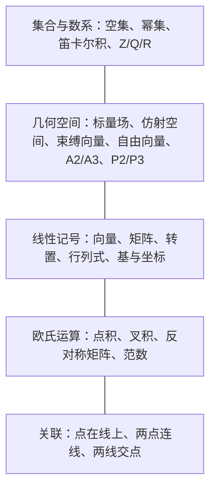

# 第1章 记号

### 来源说明

- 作者：Tomas Pajdla
- 书名：Elements of Geometry for Computer Vision（计算机视觉几何基础）
- 官方来源：https://cmp.felk.cvut.cz/~pajdla/gvg/GVG-2016-Lecture.pdf
- 本笔记仅供个人学习使用。

阅读范围含第1章。开读时 PDF 第 5 页章名为 Chapter 1 Notation，对应书页 1。无书签；书页 $N$ 对应 PDF 页 $N+4$。本章没有插图。

### 本章总览

第1章是全书的记号表，不是概念章。它把后文要用的集合、几何空间、矩阵、基与坐标、欧氏运算、以及点线关联符号一次列清。

表中方括号里的数字是参考文献编号，不是书页。几何对象从标量场、仿射空间、束缚向量、自由向量一路标到射影平面与射影空间。矩阵转置写成上标 $\mathrm{J}$，叉积配套反对称矩阵 $[\vec{x}]_{\times}$。

点与线的关联用 $\circ$、$\vee$、$\wedge$，后文单应与射影平面会反复用到。

图注：第1章把记号分成四簇。集合与数系是底层；几何空间给出点、向量、仿射与射影的舞台；线性与欧氏记号负责计算；关联记号负责点线关系。

### 核心知识点

#### 集合与数系

空集记作 $\emptyset$。集合 $U$ 的幂集（set of all subsets）记作 $\exp U$。两个集合的笛卡尔积（Cartesian product）记作 $U\times V$。

整数记作 $\mathbb{Z}$（原文 whole numbers）。有理数记作 $\mathbb{Q}$，实数记作 $\mathbb{R}$。虚数单位记作 $i$。

🔑 关键速记：$\exp U$ 是幂集，不是指数函数。

#### 几何空间

几何标量（geometric scalars）做成空间 $(S,+,\cdot)$。仿射空间（affine space）同时被叫做几何向量的空间，记作 $A$。

固定一点 $o$ 后，束缚在 $o$ 上的几何向量做成 $(A_o,\oplus,\odot)$。自由向量（free vectors）做成 $(V,\oplus,\odot)$。

实仿射平面记作 $\mathbb{A}^2$，三维实仿射空间记作 $\mathbb{A}^3$。实射影平面记作 $\mathbb{P}^2$，三维实射影空间记作 $\mathbb{P}^3$。

仿射空间的几何构造在第3章展开。射影平面与射影空间本讲义后文另立专章，本章只登记符号。

👉 仿射空间是点集配上自由向量空间，以及把有序点对送到自由向量的规则。👉 完整深度讲解见第3章。

🔑 关键速记：$A$ 是仿射空间，$A_o$ 是绑在定点上的向量，$V$ 是可平移的自由向量。

#### 向量、矩阵与基

向量写成 $\vec{x}$。矩阵写成 $A$，第 $i$ 行第 $j$ 列元素写成 $A_{ij}$。转置写成 $A^{\mathrm{J}}$，行列式写成 $|A|$。单位矩阵写成 $I$，旋转矩阵写成 $R$。

Kronecker 积（Kronecker product）在记号表里写作 $b$。后文矩阵运算节把它展开成块矩阵 $A\otimes B$。

有序基（basis）是三个线性无关生成元组成的有序组

$$
\beta=[\vec{b}_1,\vec{b}_2,\vec{b}_3].
$$

对偶基（dual basis）写成 $\beta^{\ast}$ 或 $\bar{\beta}$。向量 $\vec{x}$ 相对 $\beta$ 的坐标列写成 $\vec{x}_{\beta}$。

换基、行列式、叉积、对偶基的计算约定在第2章。

👉 完整深度讲解见第2章。

🔑 关键速记：本书转置用 $A^{\mathrm{J}}$，坐标写成带基下标的列。

#### 欧氏积、叉积与范数

欧氏点积写成 $\vec{x}\cdot\vec{y}$。在标准正交（orthonormal）基 $\beta$ 下，

$$
\vec{x}\cdot\vec{y}=\vec{x}_{\beta}^{\mathrm{J}}\vec{y}_{\beta}.
$$

叉积（cross / vector product）写成 $\vec{x}\times\vec{y}$。配套矩阵 $[\vec{x}]_{\times}$ 满足

$$
[\vec{x}]_{\times}\vec{y}=\vec{x}\times\vec{y}.
$$

欧氏范数 $\|\vec{x}\|=\sqrt{\vec{x}\cdot\vec{x}}$。

本书对 orthogonal vectors 的写法是：彼此垂直，并且长度相等。orthonormal vectors 是单位化之后的 orthogonal vectors。这和常见教材「正交只要求垂直、标准正交再单位化」不完全一样，读后文旋转与标定时应按本书口径核对。

🔑 关键速记：叉积可改写成左乘 $[\vec{x}]_{\times}$；正交在本书里还带等长。

#### 点与线的关联

$P\circ l$ 表示点 $P$ 与直线 $l$ 关联（incident）。$P\vee Q$ 表示过点 $P,Q$ 的直线（可以不止一条，记号写成 line(s)）。$k\wedge l$ 表示直线 $k,l$ 的交点（同样允许写成 point(s)）。

这三项是后文射影平面里 join 与 meet 的符号预备，本章不给运算法则。

👉 完整深度讲解见后文射影平面章。📝待补全

🔑 关键速记：$\circ$ 问是否在线上，$\vee$ 连点成线，$\wedge$ 交线成点。

### 🔑 关键速记

- 第1章只定记号，不证定理；方括号数字是文献号。
- 仿射对象用 $A,A_o,V,\mathbb{A}^2,\mathbb{A}^3$，射影对象用 $\mathbb{P}^2,\mathbb{P}^3$。
- 转置是 $A^{\mathrm{J}}$，坐标是 $\vec{x}_{\beta}$，叉积矩阵是 $[\vec{x}]_{\times}$。
- 关联符号 $\circ,\vee,\wedge$ 留给射影平面。
- 本书 orthogonal 带等长，和常见「只垂直」不同。

### 易混淆点与差异对比

$A$ 既表示仿射空间，也表示一般矩阵。读公式时看上下文：几何段落里的 $A$ 是点与几何向量的舞台，线性代数段落里的 $A$ 是变换坐标的矩阵。

$R$ 在数系里是实数 $\mathbb{R}$，在矩阵里是旋转矩阵。本书用不同字体区分，笔记里实数写成 $\mathbb{R}$，旋转矩阵保持 $R$。

$A_o$ 与 $A$ 不是同一个集合。$A$ 是全部有序点对；$A_o$ 只保留第一分量固定为 $o$ 的那些箭头。

orthogonal 与 orthonormal：按本书，前者已要求等长，后者再单位化。不要按「正交=垂直」直接代入后文的旋转讨论。

Kronecker 积在记号表写作 $b$，第2章正文用块矩阵定义。本笔记后文写成 $\otimes$，避免和标量 $b$ 混。

### 本章要点总结

第1章用一页表把全书符号固定下来。集合与数系、几何空间、矩阵与基、欧氏运算、点线关联，五块各管后文一类计算。

转置、坐标下标、叉积矩阵、关联运算是后面换基、相机与射影平面的共用写法。几何空间的真正定义从第3章才开始；射影对象本章只占位。

阅读第2、3章时，遇到 $A^{\mathrm{J}}$、$\vec{x}_{\beta}$、$[\vec{x}]_{\times}$、$A_o$、$V$，回到本表核对即可。
