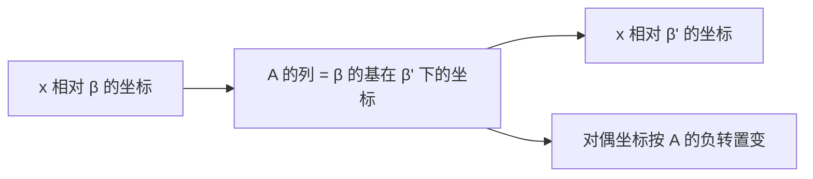

# 第2章 线性代数复习

### 本章总览

本章对应 Pajdla 讲义 Chapter 2 Linear algebra，PDF 第 6–18 页，书页 2–14。开读时 PDF 第 6 页章名为 Linear algebra。作者声明依赖线性代数教材 [3,4,5,6,7,8]，本章只复习后文几何要用的几条。

目录是：2.1 换基引起的坐标变换；2.2 行列式（含置换）；2.3 向量积；2.4 对偶空间与对偶基；2.5 矩阵运算（Kronecker 积与向量化）。

本笔记**不重写** Gallier 的线性代数。只写后文相机、单应、对极几何会反复用到的四件事：换基、行列式、叉积、对偶空间。每条先给能独立看懂的计算约定，再指回 01 线性代数。

2.5 节的 Kronecker 积与 $\mathrm{v}(\cdot)$ 在 PDF 16–18、书页 12–14。后文把矩阵方程改写成 $Mx=b$ 时会用到，本章不展开。

👉 该细节原书已写出但不纳入本复习范围。📝待补全

### 核心知识点

#### 换基引起的坐标变换

换基回答一件事：同一个向量，换一组有序基，坐标列怎么变。本书在三维实线性空间 $V^3$ 上推导，再把 $3$ 换成 $n$。

##### 坐标与标准基

有序基 $\beta=[\vec{b}_1,\vec{b}_2,\vec{b}_3]$ 下，$\vec{v}=x\vec{b}_1+y\vec{b}_2+z\vec{b}_3$ 的坐标列是 $\vec{v}_{\beta}=[x,y,z]^{\mathrm{J}}$。全体这样的三元组本身又是坐标空间 $\mathbb{R}^3$。标准基 $\sigma$ 由 $(2.1)$ 的三个坐标向量组成。在 $\mathbb{R}^3$ 里，向量与它相对 $\sigma$ 的坐标列是同一个对象。

##### 本书的矩阵 $A$

两套基 $\beta$ 与 $\beta'$ 把同一个 $\vec{x}$ 写成两套线性组合。把 $\beta$ 的基向量按 $\beta'$ 展开，系数排成 $(2.2)$。唯一性给出

$$
\vec{x}_{\beta'}=A\vec{x}_{\beta}
\tag{2.8}
$$

$A$ 的列是 $\vec{b}_1,\vec{b}_2,\vec{b}_3$ 在 $\beta'$ 下的坐标，见 $(2.9)$。因此 $(2.8)$ 也就是用 $\beta$ 坐标去组合这些列，见 $(2.10)$。

把基向量排成一行，同一件事写成

$$
[\vec{b}_1,\vec{b}_2,\vec{b}_3]=[\vec{b}'_1,\vec{b}'_2,\vec{b}'_3]\,A
\tag{2.14}
$$

反过来 $\beta'= \beta\,A^{-1}$，见 $(2.15)$。若把基向量看成列，则

$$
\begin{bmatrix}\vec{b}'_1\\\vec{b}'_2\\\vec{b}'_3\end{bmatrix}
=A^{-\mathrm{J}}
\begin{bmatrix}\vec{b}_1\\\vec{b}_2\\\vec{b}_3\end{bmatrix}
\tag{2.16}
$$

文献里 “change of basis matrix” 有三种相反的叫法：有人把这里的 $A$ 叫做从 $\beta$ 到 $\beta'$，有人叫做从 $\beta'$ 到 $\beta$，还有人把 $A^{-1}$ 叫做从 $\beta$ 到 $\beta'$。本书不用这个容易打架的名字，只说：$A$ 把 $\beta$ 坐标变成 $\beta'$ 坐标。

一组基把向量写成坐标，换基就把旧坐标左乘 $A$。$A$ 的列是旧基在新基下的坐标；基向量自身按 $(2.14)$ 右乘 $A$。文献对「换基矩阵」从哪到哪说法相反，后文只认 $(2.8)$。

👉 完整深度讲解见 01 线性代数。📝待补全

##### 数值例子

基 $\alpha,\beta$ 用坐标写成 $(2.18)(2.19)$，$\vec{x}_{\alpha}=[1,1,1]^{\mathrm{J}}$。由 $\alpha=\beta A$ 得到

$$
A=\begin{pmatrix}1&1&-1\\0&-1&0\\0&1&1\end{pmatrix},\qquad
\vec{x}_{\beta}=A\vec{x}_{\alpha}=\begin{pmatrix}1\\-1\\2\end{pmatrix}
\tag{2.26}
$$

$(2.29)$ 核验 $\alpha=\beta A$。何时坐标与基向量按同一规则变，即何时 $A=A^{-\mathrm{J}}$，留到 2.4 节用旋转回答。

图注：同一向量换基时，坐标左乘 $A$。对偶空间里的线性函数坐标按 $A^{-\mathrm{J}}$ 变，见 2.4 节。两套规则只在 $A^{\mathrm{J}}A=I$ 时重合。

🔑 关键速记：$\vec{x}_{\beta'}=A\vec{x}_{\beta}$，并且 $\beta=\beta'A$；不要靠「换基矩阵」这个词判断方向。

#### 行列式

行列式 $|A|$ 用来检验一组向量是否线性无关，并给空间定向。

置换（permutation）$\pi$ 是 $[n]=\{1,\ldots,n\}$ 上的双射。恒等置换写成 $\epsilon$。两个置换的复合仍是置换。符号是

$$
\operatorname{sgn}(\pi)=(-1)^{N(\pi)}
\tag{2.30}
$$

$N(\pi)$ 是逆序对个数：$i<j$ 但 $\pi(i)>\pi(j)$。

$n\times n$ 矩阵的行列式按 Leibniz 公式定义为

$$
|A|=\sum_{\pi\in S_n}\operatorname{sgn}(\pi)\,A_{1,\pi(1)}A_{2,\pi(2)}\cdots A_{n,\pi(n)}
\tag{2.31}
$$

因为乘法可交换，同一条公式也可以按列写，见 $(2.33)$。用两个单调单射 $\rho,\nu$ 从 $A$ 抽出 $k\times k$ 子矩阵 $A_{\rho,\nu}$，它的行列式是 $(2.35)(2.36)$。

把行分成 $k$ 与 $m=n-k$ 两组后，$|A|$ 可以写成互补子式的带符号求和。书中把这件事写成广义 Laplace 展开 $(2.37)$，引用 [11,12]。证明过程只留结论：$|A|$ 等于这些互补子式乘积再乘由 $\varphi_{\omega}$ 决定的符号。

行列式是带置换符号的多项求和，非零当且仅当各列无关。子式是抽行抽列之后再求行列式；Laplace 展开用互补子式还原 $|A|$。后文叉积的分量正好是 $2\times 2$ 子式。

👉 完整深度讲解见 01 线性代数。📝待补全

🔑 关键速记：$|A|$ 按 $(2.31)$ 用符号求和；后文只用「非零则无关」和子式。

#### 向量积与反对称矩阵

向量积（vector product），也常叫叉积（cross product），是 $\mathbb{R}^3\times\mathbb{R}^3\to\mathbb{R}^3$ 的映射。本书用线性方程组来引出它。

##### 用两行方程的核定义

两个线性无关坐标向量 $\vec{x},\vec{y}\in\mathbb{R}^3$ 排成两行，方程 $(2.38)$ 的解空间是一维。把第一行或第二行再接到方程组下面，得到两个行列式为零的 $3\times 3$ 矩阵，见 $(2.40)$。展开后看出

$$
\vec{w}=\begin{pmatrix}x_2 y_3-x_3 y_2\\ -x_1 y_3+x_3 y_1\\ x_1 y_2-x_2 y_1\end{pmatrix}
\tag{2.44}
$$

满足 $(2.38)$。$\vec{w}$ 的三个分量正是那两行矩阵的三个 $2\times 2$ 子式。秩为 2 时至少一个子式非零，所以 $\vec{w}\neq 0$。这个 $\vec{w}$ 就是 $\vec{x}\times\vec{y}$。

##### 换基时叉积怎么变

对任意三个坐标向量，有

$$
\vec{z}^{\mathrm{J}}(\vec{x}\times\vec{y})
=\left|\begin{pmatrix}\vec{x}^{\mathrm{J}}\\\vec{y}^{\mathrm{J}}\\\vec{z}^{\mathrm{J}}\end{pmatrix}\right|
\tag{2.46}
$$

由此推出：若 $\vec{x}_{\beta'}=A\vec{x}_{\beta}$，则

$$
\vec{x}_{\beta'}\times\vec{y}_{\beta'}
=A^{-\mathrm{J}}\,|A^{-\mathrm{J}}|\,(\vec{x}_{\beta}\times\vec{y}_{\beta})
\tag{2.47}
$$

##### 写成左乘矩阵

同一个叉积可以写成

$$
\vec{x}\times\vec{y}=[\vec{x}]_{\times}\vec{y},\qquad
[\vec{x}]_{\times}=\begin{pmatrix}0&-x_3&x_2\\ x_3&0&-x_1\\ -x_2&x_1&0\end{pmatrix}
\tag{2.49}
$$

并且 $[\vec{x}]_{\times}^{\mathrm{J}}=-[\vec{x}]_{\times}$，因而 $(\vec{x}\times\vec{y})^{\mathrm{J}}=-\vec{y}^{\mathrm{J}}[\vec{x}]_{\times}$，见 $(2.51)$。换基规则改写成矩阵形式是

$$
[A\vec{x}_{\beta}]_{\times}A=A^{-\mathrm{J}}\,|A^{-\mathrm{J}}|\,[\vec{x}_{\beta}]_{\times}
\tag{2.53}
$$

两个无关向量的叉积张成它们公共法向，分量是两行的 $2\times 2$ 子式。计算时改写成左乘反对称矩阵 $[\vec{x}]_{\times}$。换基之后，叉积按 $A^{-\mathrm{J}}$ 再乘 $|A^{-\mathrm{J}}|$ 变，不是按 $A$ 变。

👉 完整深度讲解见 01 线性代数。📝待补全

🔑 关键速记：$\vec{x}\times\vec{y}=[\vec{x}]_{\times}\vec{y}$；换基用 $(2.47)$ 或 $(2.53)$，不要误乘 $A$。

#### 对偶空间与对偶基

从三维线性空间 $L$（标量域 $S$）出发，全体线性函数 $f:L\to S$ 做成集合 $L^{\ast}$。线性是指

$$
f(a\vec{x}+b\vec{y})=a\,f(\vec{x})+b\,f(\vec{y})
\tag{2.54}
$$

按点式加法与数乘 $(2.55)(2.56)$，$(L^{\ast},+^{\ast},\cdot^{\ast})$ 自己也是线性空间，叫做 $L$ 的对偶空间（dual linear space）。线性函数因此也可以在符号上加箭头。

##### 对偶基

对 $L$ 的基 $\beta=[\vec{b}_1,\vec{b}_2,\vec{b}_3]$，存在唯一的三个线性函数，满足 $\vec{b}_i^{\ast}(\vec{b}_j)=\delta_{ij}$，见 $(2.57)$。它们组成 $L^{\ast}$ 的有序基 $\beta^{\ast}$，叫做对偶基（dual basis）。有限维时维数相同；任意维的对偶空间定义一样，对偶基只对有限维那样做，见 §14。

##### 用坐标求值

$\vec{x}$ 相对 $\beta$ 的坐标与 $\vec{h}$ 相对 $\beta^{\ast}$ 的坐标满足

$$
\vec{h}(\vec{x})=\vec{h}_{\beta^{\ast}}^{\mathrm{J}}\vec{x}_{\beta}
\tag{2.64}
$$

中间那张取值矩阵正好是单位阵，因为用的是一对对偶基。若两套基不对偶，就要把中间矩阵改成 $[\bar{b}_i(\vec{b}_j)]$，见 $(2.65)$。

##### 原空间换基时对偶坐标怎么变

原空间里 $\vec{x}_{\beta'}=A\vec{x}_{\beta}$。对偶基跟着从 $\beta^{\ast}$ 换到 $\beta'^{\ast}$ 时，取值不变：

$$
\vec{h}_{\beta^{\ast}}^{\mathrm{J}}\vec{x}_{\beta}=\vec{h}_{\beta'^{\ast}}^{\mathrm{J}}\vec{x}_{\beta'}
\tag{2.67}
$$

于是 $\vec{h}_{\beta^{\ast}}=A^{\mathrm{J}}\vec{h}_{\beta'^{\ast}}$，也就是

$$
\vec{h}_{\beta'^{\ast}}=A^{-\mathrm{J}}\vec{h}_{\beta^{\ast}}
\tag{2.72}
$$

这和基向量的 $(2.16)$ 形式上相同。$A$ 的行是 $\beta'^{\ast}$ 的基在 $\beta^{\ast}$ 下的坐标，见 $(2.71)$。

何时原空间坐标与对偶坐标按同一个 $A$ 变？比较 $(2.72)$ 与 $\vec{h}_{\beta'^{\ast}}=A\vec{h}_{\beta^{\ast}}$，得到 $A=A^{-\mathrm{J}}$，即 $A^{\mathrm{J}}A=I$，见 $(2.75)(2.76)$。旋转矩阵满足这条。这时常常不再区分 $L$ 与 $L^{\ast}$ 里的向量。

##### 一般基的对偶坐标

$\mathbb{R}^3$ 的标准基 $\sigma$ 有对偶标准基 $\sigma^{\ast}$。另一组基 $\gamma$ 的对偶基 $\gamma^{\ast}$ 相对 $\sigma^{\ast}$ 的坐标满足

$$
\gamma^{\ast}_{\sigma^{\ast}}=\gamma_{\sigma}^{-\mathrm{J}}
\tag{2.79}
$$

对偶空间是全体线性函数。对偶基在原基上取值为单位阵，所以求值就是对偶坐标转置乘原坐标。原空间乘 $A$ 换基时，对偶坐标乘 $A^{-\mathrm{J}}$。只有 $A$ 满足 $A^{\mathrm{J}}A=I$ 时，两套坐标才一起变。

👉 完整深度讲解见 01 线性代数。📝待补全

🔑 关键速记：求值用 $\vec{h}_{\beta^{\ast}}^{\mathrm{J}}\vec{x}_{\beta}$；对偶坐标按 $A^{-\mathrm{J}}$ 变。

### 🔑 关键速记

- 坐标变换认 $(2.8)$：$\vec{x}_{\beta'}=A\vec{x}_{\beta}$，并且 $\beta=\beta'A$。
- $|A|$ 用 $(2.31)$；后文主要用「非零则无关」和子式。
- $\vec{x}\times\vec{y}=[\vec{x}]_{\times}\vec{y}$，换基按 $(2.47)$，不是按 $A$。
- 对偶求值是 $\vec{h}^{\mathrm{J}}\vec{x}$；对偶坐标走 $A^{-\mathrm{J}}$。
- $A^{\mathrm{J}}A=I$（例如旋转）时，原空间与对偶空间可以混用同一套坐标规则。

### 易混淆点与差异对比

「换基矩阵从 $\beta$ 到 $\beta'$」在文献里方向相反。本书避免这个词。读公式只看 $\vec{x}_{\beta'}=A\vec{x}_{\beta}$ 和 $\beta=\beta'A$。

$A$ 变换的是坐标，不是向量本身。向量 $\vec{x}$ 没变；变的是用来读它的尺子。

叉积的换基因子是 $A^{-\mathrm{J}}|A^{-\mathrm{J}}|$，对偶坐标的换基因子是 $A^{-\mathrm{J}}$。两者都出现负转置，但叉积还多一个行列式。不要把 $(2.47)$ 和 $(2.72)$ 写成同一条。

转置记号是 $A^{\mathrm{J}}$，不是 $A^{\mathrm{T}}$。$A^{-\mathrm{J}}$ 表示 $(A^{-1})^{\mathrm{J}}=(A^{\mathrm{J}})^{-1}$。

Gallier 把换基、行列式、对偶写成完整理论。本章只保留后文几何要用的计算约定，深度证明回到 01 线性代数。

2.5 的 Kronecker 积与列堆叠 $\mathrm{v}(A)$ 可以把 $AXB=C$ 改写成 $(B^{\mathrm{J}}\otimes A)\,\mathrm{v}(X)=\mathrm{v}(C)$。本复习不展开。

👉 该细节原书在 2.5 节，暂不展开。📝待补全

### 本章要点总结

2.1 固定后文所有坐标变换的方向：旧坐标左乘 $A$ 得到新坐标，旧基右乘 $A$ 得到与新基的关系。不要使用互相矛盾的「换基矩阵」名称。

2.2 给出 Leibniz 定义和广义 Laplace 展开。后文真正用到的是「行列式非零则无关」，以及叉积分量等于 $2\times 2$ 子式。

2.3 把两行齐次方程的一维核写成 $\vec{x}\times\vec{y}$，再改写成 $[\vec{x}]_{\times}$。换基规则 $(2.47)(2.53)$ 是后文本质矩阵一类对象换坐标系时的模板。

2.4 说明线性函数活在对偶空间里。对偶基让求值变成一次矩阵乘法；原空间换基时对偶坐标走负转置。旋转使两套规则重合，这是后文常把点和法向写成同一种坐标的理由。
