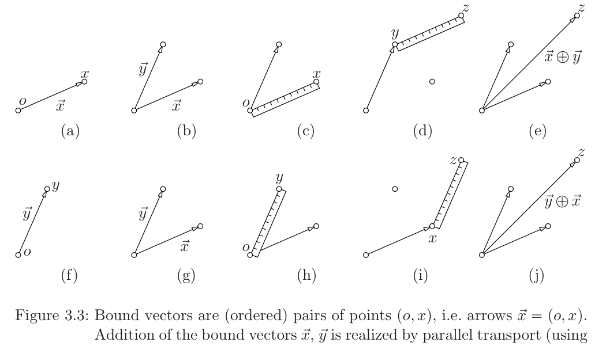
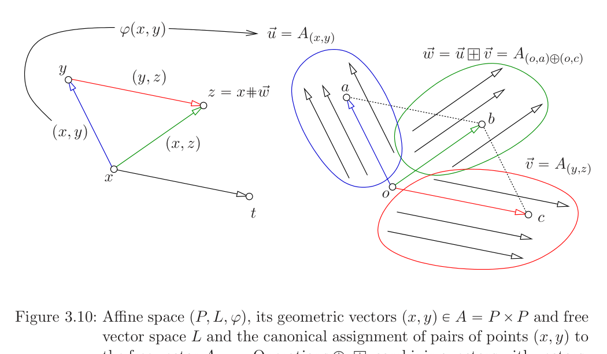
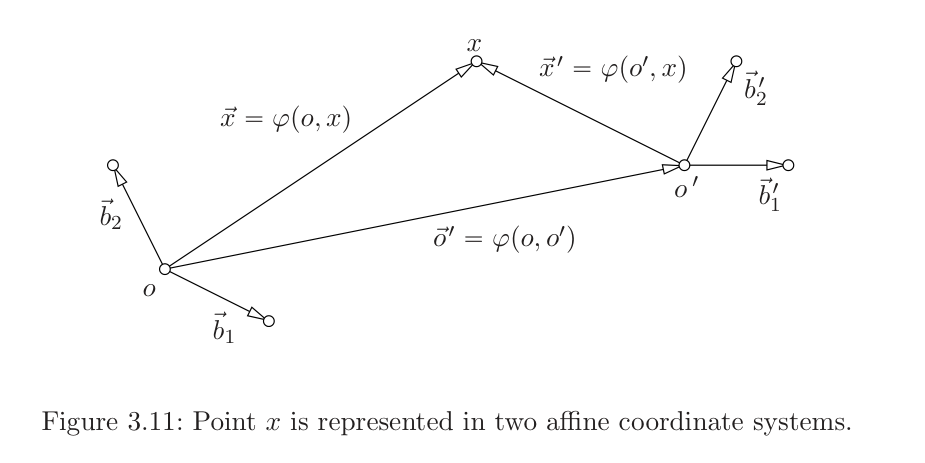

# 第3章 仿射空间

### 本章总览

本章对应 Pajdla 讲义 Chapter 3 Affine space，PDF 第 19–29 页，书页 15–25。开读时 PDF 第 19 页章名为 Affine space。下一章 Motion 从书页 26、PDF 30 开始，本章在书页 25 收束。

仿射空间（affine space）和线性空间（linear space）贴得很近，工程里常被混用。作者用 \(f(x)=ax+b\) 说明：这个函数常被叫做「线性」，但 \(b\neq 0\) 时 \(f(\alpha x)\neq \alpha f(x)\)，见 \((3.1)(3.2)\)。它是仿射函数，只有 \(b=0\) 才是线性函数。几何里必须把两者分开。

路线是：先用尺子在点的空间里做出几何标量和几何向量，再得到束缚向量上的线性空间，再把可平移的箭头做成自由向量，最后用公理写出仿射空间 \((P,L,\varphi)\)。坐标是「原点 + 线性空间的基」。章末用线性方程组的解集当例子。

Gallier 第5章把仿射空间写成代数三元组，并声明几何标架不展开。本章补的就是那一套几何模型：点、尺子、束缚向量、自由向量、仿射标架。

👉 仿射映射是线性部分加平移，齐次坐标把平移收进多一行的矩阵。👉 完整深度讲解见 01 线性代数第5章。

### 核心知识点

#### 为什么先分清仿射和线性

函数 \(f:\mathbb{R}\to\mathbb{R}\)，\(f(x)=ax+b\)，\(a,b\neq 0\) 时不保数乘，见 \((3.2)\)。几何里平移、相机坐标系换原点，都会出现这种「线性加常数」的对象。本章先把线性空间的几何模型讲清楚，再进入仿射空间。

🔑 关键速记：\(ax+b\) 是仿射的；\(b=0\) 才是线性的。

#### 点、尺子与几何向量

我们生活的空间由点组成，记作 \(P\)。一根带标记的有向线段叫做 marked ruler（标记尺），从原点指向末端。尺子可以和任意两点对齐，也可以平移，从而传递距离，但本章不把它当成测量数值的刻度尺。

图 3.1 画了三件事：点的空间；尺子对齐；尺子平移。

有序点对 \((x,y)\) 叫做几何向量（geometric vector），也写成 \(\overrightarrow{xy}\)。全体几何向量的集合记作 \(A\)。要让这些箭头能加减乘，先要有几何标量。

🔑 关键速记：几何向量是有序点对；尺子只负责对齐与平移。

#### 几何标量

几何标量（geometric scalars）是水平的有向尺子。原点与末端重合的那根是 \(0\)。加法 \(a+b\)：把 \(b\) 的原点移到 \(a\) 的末端。乘法 \(ab\)：先取出单位尺 \(1\)，做出加法逆元 \(-1\)，从而分出正负；\(0\) 既不正也不负；规定 \((-1)a=-a\)；非负尺子的乘法用对齐 \(1\) 再作相似平移完成，见图 3.2。

这些操作都是几何作图。书中结论：这样定义的加法和乘法满足实数的运算法则，几何标量关于 \(a+b\) 与 \(ab\) 做成一个域（field）。

🔑 关键速记：标量是可加减乘的有向尺子，必须先指定单位 \(1\)。

#### 束缚向量

选定一点 \(o\)，只保留形如 \((o,x)\) 的有序对，得到 \(A\) 的子集 \(A_o\)。元素写成 \(\vec{x}=(o,x)\)，叫做束缚于 \(o\) 的几何向量（bound vectors）。\((o,o)\) 是零束缚向量 \(\vec{0}\)。

加法 \(\oplus:A_o\times A_o\to A_o\) 用平行移动完成：把表示 \(\vec{x}\) 的尺子移到 \(y\)，末端给出 \(z\)，定义 \(\vec{x}\oplus\vec{y}=(o,z)\)。交换加数得到同一个 \(z\)，所以加法交换。每个 \(\vec{x}\) 有唯一的逆 \(-\vec{x}\)，并且 \(\vec{x}\oplus\vec{0}=\vec{x}\)。因此 \((A_o,\oplus)\) 是交换群。

 

图注：图 3.3。束缚向量是有序点对 \((o,x)\)。(a)–(e) 把 \(\vec{x}\) 加到 \(\vec{y}\) 上；(f)–(j) 把 \(\vec{y}\) 加到 \(\vec{x}\) 上。平行移动尺子后得到同一个 \(z\)，所以 \(\vec{x}\oplus\vec{y}=\vec{y}\oplus\vec{x}\)。

数乘 \(\odot:S\times A_o\to A_o\)：取出能与 \(\vec{x}\) 对齐的尺子 \(b\)，做标量乘法得到 \(ab\)，再沿 \(\vec{x}\) 所在直线从 \(o\) 放下 \(ab\)，末端 \(y\) 给出 \(\vec{y}=a\odot\vec{x}=(o,y)\)。图 3.4 画的就是这一步。水平束缚向量上的 \(\oplus,\odot\) 与标量的 \(+,\cdot\) 一致。

🔑 关键速记：束缚向量都从同一个 \(o\) 出发；加法是平行四边形，数乘是沿自身缩放。

#### 线性空间公理与坐标

对任意标量 \(a,b\) 和束缚向量 \(\vec{x},\vec{y},\vec{z}\)，书中列出八条 \((3.3)\)–\((3.10)\)：加法结合、交换、零元、逆元；\(1\odot\vec{x}=\vec{x}\)；数乘结合；数乘对向量加法分配；标量加法对同一向量分配。这就是线性空间的公理。束缚向量是线性空间的一个几何模型。其他模型包括 \(n\) 元实数组、多项式、数列、函数。

在平面里取两条不共线的束缚向量 \(\vec{b}_1,\vec{b}_2\) 当基。任意 \(\vec{x}\) 都能唯一写成

\[
\vec{x}=x_1\odot\vec{b}_1\oplus x_2\odot\vec{b}_2
\tag{3.11}
\]

标量 \(x_1,x_2\) 就是 \(\vec{x}\) 在有序基 \([\vec{b}_1,\vec{b}_2]\) 下的坐标。图 3.5 画的是这组平行四边形。

线性空间是能加、能数乘、并且满足那八条的对象。坐标是把向量唯一拆成基向量组合时的那组标量。束缚向量只是其中一个模型。

👉 完整深度讲解见 01 线性代数第2章。📝待补全

🔑 关键速记：八条公理做出线性空间；坐标是拆基时的唯一标量。

#### 自由向量

换一个原点 \(o'\)，再做一套束缚向量，运算法则和公理不变。图 3.6：用同一次平移把 \(o\) 处的 \(\vec{b}_1,\vec{b}_2,\vec{x}\) 搬到 \(o'\)，则 \(\vec{x}\) 相对 \([\vec{b}_1,\vec{b}_2]\) 的坐标，等于 \(\vec{x}'\) 相对 \([\vec{b}'_1,\vec{b}'_2]\) 的坐标。

这件事允许另一种模型。把全体几何向量 \(A\) 按「能否互相平移」分成互不相交的子集 \(A_{(o,x)}\)。每个子集里的箭头彼此等价，不同子集不相交，每个几何向量恰好落在一个子集里。「由平移相联系」是等价关系。这样的子集叫做自由向量（free vectors），全体自由向量记作 \(V\)。

图 3.7 画了若干几何向量，以及两个自由向量 \(A_{(o,x)}\)、\(A_{(o,y)}\)。换一个原点 \(o'\) 得到的划分相同：对每个 \(x\) 恰有一个 \(x'\)，使 \((o,x)\) 能平移到 \((o',x')\)。

自由向量的加法与数乘不依赖代表元的起点：\(\vec{x}\oplus\vec{y}\) 定义为 \(A_{(o,x)\oplus(o,y)}\)，\(a\odot\vec{x}\) 定义为 \(A_{a\odot(o,x)}\)。于是 \(V\) 也是线性空间。

§18 说明为什么要同时保留两种向量。纯公理化的线性代数可以不谈几何模型；工程上要描述我们住的空间，束缚向量记住「从哪一点画出」，自由向量记住「方向和长度，可以到处搬」。

图 3.8 补充：两个绑在不同点上的自由向量相加时，先平移到同一点，再按束缚向量相加，最后把结果放回它所在的等价类。

🔑 关键速记：自由向量是可平移的箭头类；坐标与选哪个原点无关。

#### 仿射空间

全体几何向量 \(A\) 本身不是线性空间：起点不同的箭头，没有一种只靠平移就能普遍定义的加法。\(A\) 是仿射空间。它把点、几何标量、束缚向量和自由向量连在一起。

两个有序点 \(x,y\) 给出几何向量 \((x,y)\)，从而给出唯一的自由向量 \(\vec{v}=A_{(x,y)}\)。映射 \(\varphi:A\to V\) 在这里实际是从点对到自由向量：\(\varphi(x,y)=A_{(x,y)}\)。正文稍后把 \(\varphi\) 的定义域写成 \(P\times P\)。

反过来，定点 \(a\) 和自由向量 \(\vec{x}\) 之后，\(\vec{x}\) 里恰有一个以 \(a\) 为起点的代表 \((a,x)\)，从而定出终点 \(x\)。这个运算写成

\[
a\#\vec{x}=x,\qquad \vec{x}=\varphi(a,x).
\]

三个点 \(x,y,z\) 给出 \(\vec{u}=\varphi(x,y)\)，\(\vec{v}=\varphi(y,z)\)，\(\vec{w}=\varphi(x,z)\)。把代表元都搬到以 \(x\) 为起点后，平行四边形给出三角形恒等式

\[
\vec{u}\oplus\vec{v}=\vec{w}
\tag{3.12}
\]

图 3.9 画的是 \(\vec{u}\oplus\vec{v}=\vec{w}\)。图 3.10 把同一套运算画到另一个原点 \(o\) 上，并标出 \(\varphi\) 与 \(\#\)。

 

图注：图 3.10。左边是点 \(x,y,z\) 与几何向量；\(z=x\#\vec{w}\)。右边把自由向量画成等价类：蓝、绿、红三个椭圆是三个自由向量，\(\oplus\) 在类与类之间做，\(\#\) 把点沿一个自由向量送到另一个点。

##### 记号合并

正文一直区分标量的 \((+,\cdot)\)、束缚向量的 \((\oplus,\odot)\)、自由向量的加法与数乘、以及点与向量的 \(\#\)。这是正确的，但很少有人坚持。§19 说，实际书写常常只用标量那一套符号：

\[
+\quad\text{同时表示}\quad +,\ \oplus,\ \oplus,\ \#
\tag{3.13}
\]
\[
\cdot\quad\text{同时表示}\quad \cdot,\ \odot,\ \odot
\tag{3.14}
\]

后文读 \(x+v\) 时，要能看出 \(x\) 是点、\(v\) 是向量。

##### 公理定义

三元组 \((P,L,\varphi)\) 叫做仿射空间，其中 \(P\) 是点集，\((L,\oplus,\odot)\) 是某个标量域上的线性空间，\(\varphi:P\times P\to L\)，并且：

- A1：对任意三点 \(x,y,z\in P\)，\(\varphi(x,z)=\varphi(x,y)\oplus\varphi(y,z)\)。
- A2：对每个定点 \(o\in P\)，映射 \(\varphi_o:P\to L\)，\(\varphi_o(x)=\varphi(o,x)\) 是双射。

A1 要求点对对应到向量时满足三角形法则。A2 要求固定起点之后，点和向量一一对应。由此定义

\[
o\#\vec{x}=\varphi_o^{-1}(\vec{x}),
\]

也就是 \(\varphi(o,\ o\#\vec{x})=\vec{x}\)。\(\#\) 很像加法，所以常被改写成 \(+\)。

在前面的几何模型里，\(\varphi(x,y)=A_{(x,y)}\)，而 \(x\#\vec{v}\) 是那个使 \((x,y)\) 代表 \(\vec{v}\) 的终点 \(y\)。

Gallier 定义 5.11 用 \(\langle E,\overrightarrow{E},+\rangle\) 写出另一套公理，并明确不再展开几何标架。两边说的是同一类对象：点不能相加，点只能被向量平移。

👉 完整深度讲解见 01 线性代数第5章。📝待补全

🔑 关键速记：仿射空间是 \((P,L,\varphi)\)；A1 是三角形法则，A2 是固定原点后点与向量一一对应。

#### 仿射坐标系

\(\varphi\) 把许多不同点对送到同一个自由向量。要让点有唯一的向量代表，先选定原点 \(o\)，再用位置向量 \(\vec{x}=\varphi(o,x)\) 表示点 \(x\)。几何模型里，这就是束缚向量 \((o,x)\)，或点 \(o\) 加上自由向量 \(A_{(o,x)}\)。

再在 \(L\) 里取基 \(\beta=(\vec{b}_1,\vec{b}_2,\ldots)\)，点就有了坐标列

\[
\vec{x}_{\beta}=\begin{pmatrix}x_1\\x_2\\\vdots\end{pmatrix},\qquad
\vec{x}=x_1\vec{b}_1+x_2\vec{b}_2+\cdots
\tag{3.15}
\]

一对 \((o,\beta)\) 叫做仿射坐标系（affine coordinate system），也简称坐标系。

换原点 \(o'\) 和换基 \(\beta'\) 之后，同一点有两套坐标 \(\vec{x}_{\beta}=\varphi(o,x)_{\beta}\) 与 \(\vec{x}'_{\beta'}=\varphi(o',x)_{\beta'}\)。三角形法则给出

\[
\varphi(o,x)=\varphi(o,o')\oplus\varphi(o',x)
\tag{3.16}
\]

在基 \(\beta\) 下写成坐标加法 \(\vec{x}_{\beta}=\vec{x}'_{\beta}+\vec{o}'_{\beta}\)，再用把 \(\beta'\) 坐标变到 \(\beta\) 坐标的矩阵 \(A\)，得到

\[
\vec{x}_{\beta}=A\vec{x}'_{\beta'}+\vec{o}'_{\beta}
\tag{3.19}
\]

\(A\) 的列是 \(\vec{b}'_1,\vec{b}'_2,\ldots\) 在 \(\beta\) 下的坐标。真实空间里，这些坐标可以用尺子在以 \(o\) 为起点的束缚向量上量出来。

 

图注：图 3.11。点 \(x\) 相对原点 \(o\) 的位置向量是 \(\vec{x}=\varphi(o,x)\)，相对 \(o'\) 是 \(\vec{x}'=\varphi(o',x)\)。两原点之间的自由向量是 \(\vec{o}'=\varphi(o,o')\)。换基再换原点之后，坐标按 \((3.19)\) 变成「线性变换加平移」。

这正是第2章换基公式加上一个平移项。下一章运动会继续用它。

👉 完整深度讲解见第4章。📝待补全

🔑 关键速记：仿射坐标是原点加一组基；换系公式是 \(\vec{x}_{\beta}=A\vec{x}'_{\beta'}+\vec{o}'_{\beta}\)。

#### 例子：线性方程组的解集

平面上的方程组

\[
\begin{pmatrix}1&1\\-1&-1\end{pmatrix}\vec{x}=\begin{pmatrix}2\\-2\end{pmatrix}
\tag{3.20}
\]

有无穷多解，可以写成一个特解加上齐次解：

\[
\vec{x}=\begin{pmatrix}2\\0\end{pmatrix}+\tau\begin{pmatrix}1\\-1\end{pmatrix},\qquad\tau\in\mathbb{R}
\tag{3.21}
\]

伴随齐次方程 \((3.22)\) 的解是 \(\vec{v}=\tau[-1,1]^{\mathrm{J}}\)，与 \((3.21)\) 里的方向向量只差一个符号，张成同一条直线。

解集里的点构成仿射空间 \((P,V,\varphi)\)：\(P\) 是 \((3.20)\) 的解，画在直线 \(p\) 上；\(V\) 是齐次方程的解空间，是真正的线性子空间；\(\varphi\) 把两个解 \(\vec{x},\vec{y}\) 送到 \(\vec{u}=\vec{y}-\vec{x}\in V\)。取 \(\vec{o}=[2,0]^{\mathrm{J}}\) 当原点，取 \(\vec{b}=\varphi(\vec{o},\vec{x})=\vec{x}-\vec{o}\) 当 \(V\) 的基，则图 3.12 中那个 \(\vec{x}\) 的坐标是 \(1\)。

这个例子里，仿射空间的「点」本身是 \(\mathbb{R}^2\) 里的向量，配上的线性空间是过原点的平行直线。非齐次解集不经过原点，所以不是线性子空间，但是仿射空间。

🔑 关键速记：非齐次线性方程的解集是仿射空间；平移到齐次解就回到线性空间。

### 🔑 关键速记

- \(ax+b\) 是仿射函数；线性函数必须把零送到零。
- 束缚向量从定点画出，自由向量是可平移的箭头类，两者都满足线性空间公理。
- 仿射空间是 \((P,L,\varphi)\)：A1 三角形法则，A2 固定原点后点与向量一一对应。
- 仿射坐标系是 \((o,\beta)\)；换系是线性变换加平移，公式 \((3.19)\)。
- 线性方程组的解集是仿射空间的标准例子：特解当原点，齐次解当 \(L\)。

### 易混淆点与差异对比

线性空间与仿射空间：线性空间有唯一的零向量，必须过「原点」。仿射空间的点集没有天然原点；原点是坐标系的一部分，可以换。\(A\) 里的几何向量不能随便相加，\(A_o\) 和 \(V\) 可以。

束缚向量与自由向量：前者记住起点，后者只记住等价类。图 3.6 说明坐标对平移不变，这才允许从 \(A_o\) 走到 \(V\)。后文说「把向量从一点搬到另一点」，搬的是自由向量的代表元。

\(\varphi\) 的写法：3.4 节先把它写成 \(\varphi:A\to V\)，公理里写成 \(\varphi:P\times P\to L\)。两者指同一件事：一对有序点决定一个自由向量。笔记按公理采用 \(P\times P\)。

符号 \(+\)：§19 之后，\(x+v\)、\(\vec{u}+\vec{v}\)、\(a+b\) 共用一个加号。看运算对象：点加向量仍是点，向量加向量仍是向量，标量加标量仍是标量。

与 Gallier 第5章：那边先定义仿射组合和仿射映射 \(f(x)=h(x)+c\)，仿射空间只占定义 5.11 的三条。本章几乎不谈映射，只把点的舞台搭好。相机位姿、坐标系变换是仿射映射，要两边一起看。

👉 仿射映射保住系数和为 1 的组合，矩阵形状是 \(y=Ax+d\)。👉 完整深度讲解见 01 线性代数第5章。

与第2章换基：第2章的 \(A\) 只改坐标，没有平移。本章 \((3.19)\) 多出 \(\vec{o}'_{\beta}\)。原点不动时，两条公式重合。

\((3.21)\) 的方向向量是 \([1,-1]^{\mathrm{J}}\)，随后齐次解写成 \(\tau[-1,1]^{\mathrm{J}}\)。它们张成同一条 \(V\)，不要当成两个不同的解空间。

### 本章要点总结

3.1 用尺子从点的空间里做出几何标量和几何向量。标量是域，束缚向量是绑在定点上的箭头，加法靠平行移动。

3.2 验证束缚向量满足线性空间八条公理，并在平面基下引入坐标。线性空间还有许多非几何模型，但视觉首先用这个几何模型。

3.3 按平移划分 \(A\)，得到自由向量空间 \(V\)。坐标与原点选择无关，所以方向可以到处搬，起点信息留给束缚向量。

3.4 指出 \(A\) 本身不是线性空间，而是仿射空间。公理 A1、A2 把点集 \(P\)、线性空间 \(L\) 和对应 \(\varphi\) 锁在一起。\(\#\) 用向量平移点。

3.5 用 \((o,\beta)\) 给点坐标。换原点再换基，坐标按 \(\vec{x}_{\beta}=A\vec{x}'_{\beta'}+\vec{o}'_{\beta}\) 变。这是后文刚体运动和相机坐标系的代数起点。

3.6 用一条直线上的非齐次解说明：点可以是向量空间里的元素，只要它们不构成过原点的子空间，结构仍然是仿射的。
