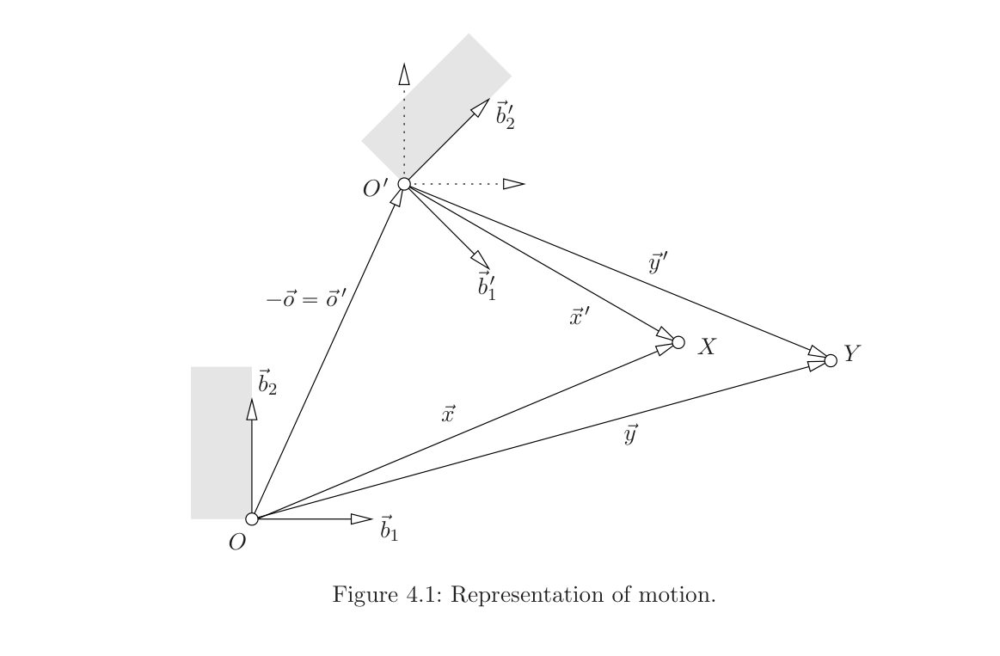
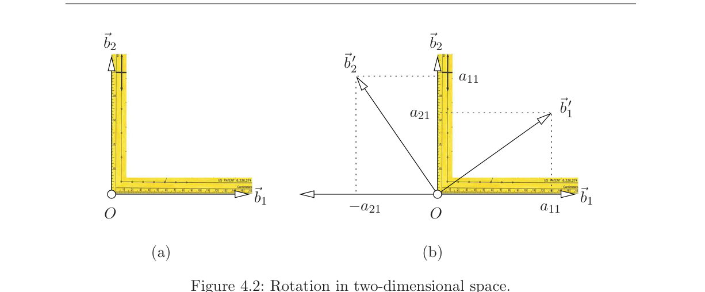

# 第4章 运动

### 来源说明

- 作者：Tomas Pajdla
- 书名：*Elements of Geometry for Computer Vision*（计算机视觉几何基础）
- 官方来源：https://cmp.felk.cvut.cz/~pajdla/gvg/GVG-2016-Lecture.pdf
- 本笔记仅供个人学习使用。讲义日期 Monday 9th May, 2016。

阅读范围：PDF 第 30–35 页（书页 26–31）。PDF 30 标题为 `4 Motion`。下一章 `5 Image coordinate system` 从 PDF 36 起，本笔记不读 36 及之后。

### 本章总览

本章给三维欧氏空间里的 **rigid motion（刚体运动）** 建数学模型。刚体只改位置、不改形状，物体上点与点的距离保持不变。后文把“运动”当作“刚体运动”的简称。

路线分三段。先用两套坐标系写位置向量的坐标变换，并区分 alias（别名 / 换坐标）与 alibi（不在场证明 / 点跟着物体走）两种说法。再把至少固定一点的运动叫 rotation（旋转），用矩阵 \(R\) 表示，先从二维直角尺实验看出 \(R^\top R=I\)，再推广到三维，并用行列式把旋转和 reflection（反射）分开，得到 \(\mathrm{SO}(3)\)。最后说明：当旧基是标准基时，新基向量与 \(R\) 的行列如何对齐。

### 核心知识点

#### 刚体运动保持距离

刚体运动把物体搬到新位置，但不改变形状。物体上任意两点的距离在运动前后相同。三维欧氏空间里的位置用坐标系、点和 position vector（位置向量）来写。

🔑 关键速记：刚体=只搬家、不变形；点距不变。

#### Alias 表示：同一点换坐标系

图 4.1 把坐标系 \((O,\beta)\) 钉在运动刚体上。物体走到新位置后，再造一套 \((O',\beta')\)。空间中一般位置的点 \(X\)，在旧系里由位置向量 \(\vec{x}\) 表示，在新系里由 \(\vec{x}'\) 表示。运动诱导映射 \(\vec{x}'_{\beta'}\mapsto\vec{x}_{\beta}\)。这个映射也反过来刻画运动本身。

alias 与 alibi 两套用语来自经典专著 [13]。

向量关系先写成

\[
\vec{x}=\vec{x}'+\vec{o}'
\tag{4.1}
\]

再全部改到同一组基 \(\beta\) 下，得到 (4.2)。要把 \(\beta'\) 里的坐标送进 \(\beta\)，引入矩阵

\[
R=\bigl[\vec{b}'_{1\beta}\ \vec{b}'_{2\beta}\ \vec{b}'_{3\beta}\bigr],
\]

它的列是 \(\beta'\) 的基向量在 \(\beta\) 中的坐标。于是

\[
\vec{x}_{\beta}=R\vec{x}'_{\beta'}+\vec{o}'_{\beta}
\tag{4.4}
\]

\[
\vec{x}'_{\beta'}=R^{-1}\bigl(\vec{x}_{\beta}-\vec{o}'_{\beta}\bigr)
\tag{4.5}
\]

(4.4) 是 alias 的正向公式：同一点 \(X\)，新坐标经 \(R\) 再加新原点，得到旧坐标。

图注：旧系 \((O,\beta)\) 钉在刚体上。运动后出现新系 \((O',\beta')\)。点 \(X\) 的位置向量在两系中分别是 \(\vec{x}\) 与 \(\vec{x}'\)。点 \(Y\) 是 \(X\) 随物体一起走过去的像。图中标了 \(-\vec{o}=\vec{o}'\)。原书图 4.1。

🔑 关键速记：alias 是同一点换基，\(\vec{x}_{\beta}=R\vec{x}'_{\beta'}+\vec{o}'_{\beta}\)。

#### Alibi 表示：点随物体走

另一种模型看图 4.1 里的 \(X\) 与 \(Y\)。\(Y\) 是 \(X\) 跟着物体一起走过去的点，因此 \(Y\) 在新系 \((O',\beta')\) 里的坐标等于 \(X\) 在旧系 \((O,\beta)\) 里的坐标：\(\vec{y}'_{\beta'}=\vec{x}_{\beta}\)。

相对旧系 \((O,\beta)\)，把 \(X\) 送到 \(Y\) 的公式是

\[
\vec{y}_{\beta}=R\vec{x}_{\beta}-\vec{o}_{\beta}
\tag{4.6}
\]

\[
\vec{y}_{\beta}=R\vec{x}_{\beta}+\vec{o}'_{\beta}
\tag{4.7}
\]

图 4.1 已标 \(-\vec{o}=\vec{o}'\)，所以 (4.6) 与 (4.7) 是同一件事的两种写法。

🔑 关键速记：alibi 是点跟着刚体走；旧系里 \(\vec{y}_{\beta}=R\vec{x}_{\beta}+\vec{o}'_{\beta}\)。

#### 旋转与二维旋转矩阵

至少固定一点的运动叫 rotation（旋转）。把这个定点取成原点，则 \(O=O'\)，从而 \(\vec{o}=\vec{0}\)。运动完全由矩阵 \(R\) 决定，这个矩阵叫 rotation matrix（旋转矩阵）。

二维先做直角尺实验，见图 4.2。等臂直角尺绕顶点（也就是原点 \(O\)）转动。由对称性，过 \(\vec{b}'_1\)、\(\vec{b}'_2\) 端点、沿旧基画出的平行四边形会转过 \(90^\circ\)。于是存在实数 \(a_{11},a_{21}\) 使

\[
\vec{b}'_1=a_{11}\vec{b}_1+a_{21}\vec{b}_2
\tag{4.8}
\]

\[
\vec{b}'_2=-a_{21}\vec{b}_1+a_{11}\vec{b}_2
\tag{4.9}
\]

对照 (4.3) 得到

\[
R=\begin{pmatrix}a_{11}&-a_{21}\\a_{21}&a_{11}\end{pmatrix}
\tag{4.10}
\]

直接相乘得 \(R^\top R=I\)，因为 \(a_{11}^2+a_{21}^2\) 是基向量的平方长度，等于 1。于是

\[
R^{-1}=R^\top
\tag{4.12}
\]

\[
R=R^{-\top}
\tag{4.13}
\]

对由旋转联系起来的坐标，还有

\[
(x')^2+(y')^2=\vec{x}'^\top_{\beta'}\vec{x}'_{\beta'}=(R\vec{x}_{\beta})^\top R\vec{x}_{\beta}=\vec{x}_{\beta}^\top\vec{x}_{\beta}=x^2+y^2
\tag{4.14}
\]

若 \(\beta\) 按图 4.2 取成 orthonormal basis（标准正交基），测坐标的平行四边形是矩形，\(x^2+y^2\) 就是 \(\vec{x}\) 的平方长度（勾股定理）。旋转后的 \(\beta'\) 同样如此。结论：两套基都标准正交时，运动诱导的 \(R\) 满足 \(R^\top R=I\)。

图注：左图是未转的等臂直角尺，基为 \(\vec{b}_1,\vec{b}_2\)。右图转到 \(\vec{b}'_1,\vec{b}'_2\)，平行四边形标出 \(a_{11}\) 与 \(a_{21}\)。由此读出 (4.10)。原书图 4.2。

🔑 关键速记：二维旋转矩阵形如 \(\begin{pmatrix}a_{11}&-a_{21}\\a_{21}&a_{11}\end{pmatrix}\)，并且 \(R^{-1}=R^\top\)。

#### 三维旋转与 \(\mathrm{SO}(3)\)

三维若把图 4.2 直接加一根轴，图和推导都会变复杂。书改走更直观的路：二维里长度能用勾股算，是因为测坐标的平行四边形是矩形。三维只要用三个互相正交的向量做基，平行四边形仍是矩形，三维勾股同样可用。图 4.3 用三把互相垂直的尺表示这样一套标准正交坐标系。

设 \(\beta,\beta'\) 都标准正交，\(\vec{x}_{\beta}=[x,y,z]^\top\)，\(\vec{x}'_{\beta'}=[x',y',z']^\top\)。长度不变要求对一切 \(\vec{x}\) 都有

\[
\vec{x}_{\beta}^\top C\vec{x}_{\beta}=\vec{x}_{\beta}^\top\vec{x}_{\beta},\qquad C=R^\top R
\tag{4.15}
\]

把 (4.16) 里六组特殊坐标代进去：前三个单位向量给出 \(c_{11}=c_{22}=c_{33}=1\)；后三个 \([1,1,0]^\top\) 等给出 \(c_{12}+c_{21}=c_{13}+c_{31}=c_{23}+c_{32}=0\)。于是 \(C\) 先具有 (4.22) 的形状。又因 \(C^\top=(R^\top R)^\top=R^\top R=C\)，\(C\) 对称，迫使 \(c_{12}=c_{13}=c_{23}=0\)。结论：

\[
R^\top R=C=I
\tag{4.24}
\]

并非所有满足 (4.24) 的 \(3\times 3\) 矩阵都是三维旋转。反例

\[
S=\begin{pmatrix}1&0&0\\0&1&0\\0&0&-1\end{pmatrix}
\tag{4.25}
\]

把 \(xy\) 平面点对点固定，并把其余点关于该平面反射，所以不是旋转。区分办法看行列式：\(|S|=-1\)，\(|I|=1\)。一般地

\[
1=|I|=|R^\top R|=|R|^2
\tag{4.26}
\]

故 \(|R|=\pm 1\)。行列式的符号把满足 (4.24) 的矩阵分成两组：**旋转**取正号，**反射**取负号。两个旋转的乘积仍是旋转；旋转乘反射是反射；两个反射的乘积是旋转。

三维旋转因此由 \(3\times 3\) 矩阵 \(R\) 表示，并同时满足 \(R^\top R=I\) 与 \(|R|=1\)。这样的矩阵以及对应的旋转全体记作 \(\mathrm{SO}(3)\)，即 special orthonormal three-dimensional group（三维特殊正交群）。二维旋转全体类似地记作 \(\mathrm{SO}(2)\)。

刚体姿态就是 \(\mathrm{SO}(3)\) 里的一个旋转，再加上平移。同一旋转还可以写成绕轴转角，或写成单位四元数；每个旋转对应两个单位四元数，符号不能在整个 \(\mathrm{SO}(3)\) 上连续选定。指数坐标则把旋转看成 \(\mathrm{SO}(3)\) 上的曲线。本章只用矩阵条件 \(R^\top R=I\)、\(|R|=1\)，不展开轴角、四元数或李代数。

👉 完整深度讲解见 06 第3章（刚体运动）与 Gallier 第15章（单位四元数）。📝待补全

🔑 关键速记：\(\mathrm{SO}(3)=\{R\in\mathbb{R}^{3\times 3}:R^\top R=I,\ |R|=1\}\)；\(|R|=-1\) 的是反射，不是旋转。

#### 标准基下的坐标向量

运动诱导的 \(R\) 还有一条性质：坐标和基向量按同一种方式变。当 \(\beta\) 取标准基

\[
\beta=\left(
\begin{pmatrix}1\\0\\0\end{pmatrix},
\begin{pmatrix}0\\1\\0\end{pmatrix},
\begin{pmatrix}0\\0\\1\end{pmatrix}
\right)
\tag{4.27}
\]

时，第 2 章的 (2.16) 变成 (4.28)。由此算出

\[
\vec{b}'_1=r_{11}\vec{b}_1+r_{12}\vec{b}_2+r_{13}\vec{b}_3=\begin{pmatrix}r_{11}\\r_{12}\\r_{13}\end{pmatrix}
\tag{4.29}
\]

\(\vec{b}'_2,\vec{b}'_3\) 同理。于是

\[
\bigl[\vec{b}'_1\ \vec{b}'_2\ \vec{b}'_3\bigr]=R^\top
\tag{4.30}
\]

这与在 (2.14) 中取 \(A=R\) 再反解一致：

\[
I=\bigl[\vec{b}'_1\ \vec{b}'_2\ \vec{b}'_3\bigr]R
\tag{4.31}
\]

前面 (4.3) 把 \(R\) 的列写成 \(\beta'\) 的基在 \(\beta\) 中的坐标；(4.30) 在标准基下把新基向量排成列后又得到 \(R^\top\)。两处行列摆放要对着第 2 章的 (2.14)、(2.16) 一起读，本章不另改公式。

👉 基变换矩阵的定义与 (2.14)、(2.16) 的完整写法见第 2 章。📝待补全

🔑 关键速记：\(\beta\) 是标准基时，新基向量排成的矩阵等于 \(R^\top\)，见 (4.30)。

### 章末速记

1. 刚体运动保持点距；后文把“运动”当作“刚体运动”。
2. alias：同一点换系，\(\vec{x}_{\beta}=R\vec{x}'_{\beta'}+\vec{o}'_{\beta}\)。alibi：点随物体走，\(\vec{y}_{\beta}=R\vec{x}_{\beta}+\vec{o}'_{\beta}\)。
3. 至少固定一点的运动是旋转；原点取在定点上时，运动完全由 \(R\) 决定。
4. 二维实验给出 \(R^\top R=I\)，从而 \(R^{-1}=R^\top\)。三维同样要求 \(R^\top R=I\)，但还要 \(|R|=1\) 才是旋转。
5. \(\mathrm{SO}(3)\) 是三维旋转群；\(|R|=-1\) 的是反射，例如 \(\operatorname{diag}(1,1,-1)\)。

### 易混淆点与差异对比

alias 与 alibi 不是两套不同的物理运动。alias 问的是**同一个点**在两套坐标系里的坐标怎么换。alibi 问的是**跟着刚体走的那个点**在旧系里跑到哪里。公式看起来都是“\(R\) 乘向量再加减原点”，左右两边的向量含义不同。

(4.6) 写 \(-\vec{o}_{\beta}\)，(4.7) 写 \(+\vec{o}'_{\beta}\)。图 4.1 已经标明 \(-\vec{o}=\vec{o}'\)，两式相等，不是两套平移约定。

\(R^\top R=I\) 只说明 \(R\) 正交，还不能说它是旋转。三维里必须再看 \(|R|\)：\(+1\) 是旋转，\(-1\) 是反射。二维公式 (4.10) 已经自动带上正行列式，三维则要单独检查。

两个反射相乘得到旋转，旋转乘反射得到反射。不要把“正交矩阵全体”和 \(\mathrm{SO}(3)\) 当成同一个集合。

(4.3) 与 (4.30) 对“\(R\) 的列是不是新基”的说法要对着第 2 章一起读，不要只按其中一处改另一处。

### 本章要点总结

刚体运动用钉在物体上的坐标系来写。alias 换的是同一点的坐标，alibi 搬的是随物体走的点。旋转是至少固定一点的运动，矩阵条件是 \(R^\top R=I\) 且 \(|R|=1\)，这样的矩阵组成 \(\mathrm{SO}(3)\)。二维直角尺实验先给出 \(R^{-1}=R^\top\)；三维还要用行列式把反射剔掉。标准基下新基向量排成 \(R^\top\)。轴角、四元数与指数坐标不在本章展开。
