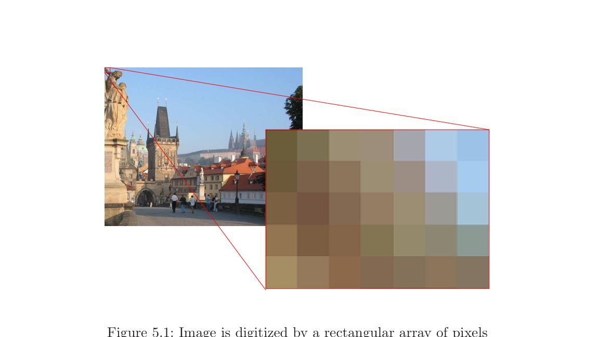

# 第5章 图像坐标系

### 来源说明

- 作者：Tomas Pajdla
- 书名：*Elements of Geometry for Computer Vision*（计算机视觉几何基础）
- 官方来源：https://cmp.felk.cvut.cz/~pajdla/gvg/GVG-2016-Lecture.pdf
- 本笔记仅供个人学习使用。讲义日期 Monday 9th May, 2016。

阅读范围：PDF 第 36–37 页（书页 32–33）。PDF 36 标题为 `5 Image coordinate system`。下一章 `6 Perspective camera` 从 PDF 38 起，本笔记不读 38 及之后。

### 本章总览

数字图像 \(\mathrm{Im}\) 是像素排成的矩阵。光强由排成网格的传感器量出来，见图 5.1。后文用两种方式碰这张图：一种按内存里的三维数组读强度，一种为几何计算另造一套 image coordinate system（图像坐标系）。

这套二维坐标系是 left-handed（左手系）。选择看起来别扭，是为了下一步把它扩成三维右手系，并让 \(\vec{b}_3\) 指向场景。扩三维的做法在第 6 章。

### 核心知识点

#### 像素数组与颜色下标

强度值在内存里存成三维字节数组，三个下标分别是行下标 \(i\)、列下标 \(j\)、颜色下标 \(k\)。颜色下标取三个值：\(1\) 对应 red（红），\(2\) 对应 green（绿），\(3\) 对应 blue（蓝）。

书中的访问约定按行、列、颜色的顺序写 \(\mathrm{Im}(i,j,k)\)。最左上角像素的行下标和列下标都是 \(1\)。行下标 \(2\)、列下标 \(3\) 的那个像素，其红色通道写成 \(\mathrm{Im}(2,3,1)\)。

有 \(H\) 行 \(W\) 列的数字图像，行范围是 \(1\) 到 \(H\)，列范围是 \(1\) 到 \(W\)，颜色范围是 \(1\) 到 \(3\)。尺寸记成 \([H,\ W,\ 3]\)。

图注：数字图像由矩形网格上的像素采样得到。红线框出的局部被放大成右侧色块阵列。原书图 5.1。

🔑 关键速记：\(\mathrm{Im}(i,j,k)\) 是第 \(i\) 行、第 \(j\) 列、第 \(k\) 个颜色；左上角是 \((1,1)\)，\(k=1,2,3\) 为红、绿、蓝。

#### 几何用的图像坐标系

几何计算不直接使用 \((i,j)\)，而是另造一套图像坐标系，见图 5.2(b)。原点的取法是：让**最左上角像素的中心**得到坐标 \(1,1\)。水平轴 \(\vec{b}_1\) 从左到右。竖直轴 \(\vec{b}_2\) 从上到下。

按 \(\mathrm{Im}(i,j,k)\) 访问到的那个像素，在图像坐标系里写成向量

\[
\vec{u}=[j,\ i]^\top.
\]

最右下角像素的中心，坐标是 \([W,\ H]^\top\)。

图 5.2 用同一块像素把两套下标画在一起。左图按行 \(i\)、列 \(j\) 读数组；右图按 \(\vec{b}_1,\vec{b}_2\) 读几何坐标。数组里的 \(\mathrm{Im}(2,3,1)\)，在图像坐标系里是 \(\vec{u}=[3,2]^\top\)。

![同一块像素阵列上的两套坐标：左边按 (i,j) 读数组，右边按图像坐标系读 [j,i]](./assets/第5章_图像坐标系.png)

图注：左图用行 \(i\)、列 \(j\) 访问 \(\mathrm{Im}(i,j,k)\)，左上角为 \((1,1)\)。右图水平轴是 \(\vec{b}_1\)、竖直轴是 \(\vec{b}_2\)，同一像素写成 \(\vec{u}=[3,2]^\top\)。原书图 5.2。

这套图像坐标系与书中所说的 Matlab 图像坐标系一致：先设成 image 轴，再按 \((j,i)\) 的顺序描点，点会落在 \(\mathrm{Im}(i,j,k)\) 对应的像素上。

🔑 关键速记：几何坐标 \(\vec{u}=[j,i]^\top\)，不是 \([i,j]^\top\)；左上像素中心是 \((1,1)\)，右下是 \((W,H)\)。

#### 左手系，以及为什么这样选

二维里这套图像坐标系是非标准的：它是 left-handed system（左手系）。\(\vec{b}_1\) 向右、\(\vec{b}_2\) 向下，按平面上通常的右手规则转不过去。

这样选是为了下一步把它扩成三维 right-handed（右手）坐标系，并且让 \(\vec{b}_3\) 指向场景。扩出来的第三轴在第 6 章的 camera coordinate system（相机坐标系）里出现。

图像坐标系本身只负责把像素中心变成平面上的 \((u,v)\)。它还不是相机坐标系，也不测量三维角度或长度。

👉 把 \(\vec{b}_1,\vec{b}_2\) 再加 \(\vec{b}_3=\overrightarrow{Co}\) 扩成三维右手相机坐标系，见第 6 章。相机从投影中心看向场景时，像平面在前方，\(\vec{b}_3\) 指向场景，整套 \(\beta\) 成为右手系。📝待补全

🔑 关键速记：图像坐标系二维是左手系；这样选是为了加 \(\vec{b}_3\) 后变成指向场景的三维右手系。

### 章末速记

1. 数字图像是矩形像素阵列；强度按行 \(i\)、列 \(j\)、颜色 \(k\) 存放，\(k=1,2,3\) 为红、绿、蓝。
2. 左上角像素的数组下标是 \((1,1)\)；\(\mathrm{Im}(2,3,1)\) 是第 2 行第 3 列的红通道。
3. 几何原点使左上像素中心为 \((1,1)\)；\(\vec{b}_1\) 向右，\(\vec{b}_2\) 向下。
4. 数组 \(\mathrm{Im}(i,j,\cdot)\) 对应几何向量 \(\vec{u}=[j,i]^\top\)；右下像素中心是 \([W,H]^\top\)。
5. 这套二维坐标系是左手系，目的是第 6 章把它扩成 \(\vec{b}_3\) 指向场景的三维右手系。

### 易混淆点与差异对比

数组下标 \((i,j)\) 与几何坐标 \((u,v)\) 的顺序相反。数组先写行再写列；几何向量先写水平再写竖直。\(\mathrm{Im}(2,3,1)\) 不是 \(\vec{u}=[2,3]^\top\)，而是 \(\vec{u}=[3,2]^\top\)。

正文写原点对准**像素中心**。图 5.2 的图注只写“最左上角像素得到坐标 \(1,1\)”，没有重复“中心”二字。笔记以正文为准：坐标 \(1,1\) 落在左上像素中心。

左手、右手说的是二维图像平面本身。像素网格画在纸上时，\(y\) 向下已经和数学里常用的 \(y\) 向上不同。第 6 章会再加一根指向场景的 \(\vec{b}_3\)，那时整套三维基才是右手系。不要把“图像平面是左手”理解成相机会变成左手相机。

颜色下标 \(k\) 不是几何坐标。几何向量 \(\vec{u}\) 只有两个分量。

### 本章要点总结

数字图像一边按 \((i,j,k)\) 读颜色，一边按图像坐标系读几何位置。几何原点放在左上像素中心，\(\vec{u}=[j,i]^\top\)，\(\vec{b}_1\) 向右、\(\vec{b}_2\) 向下。这套二维坐标系是左手系，为的是第 6 章加 \(\vec{b}_3\) 后指向场景并变成右手系。
