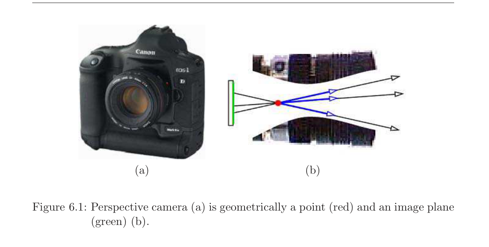
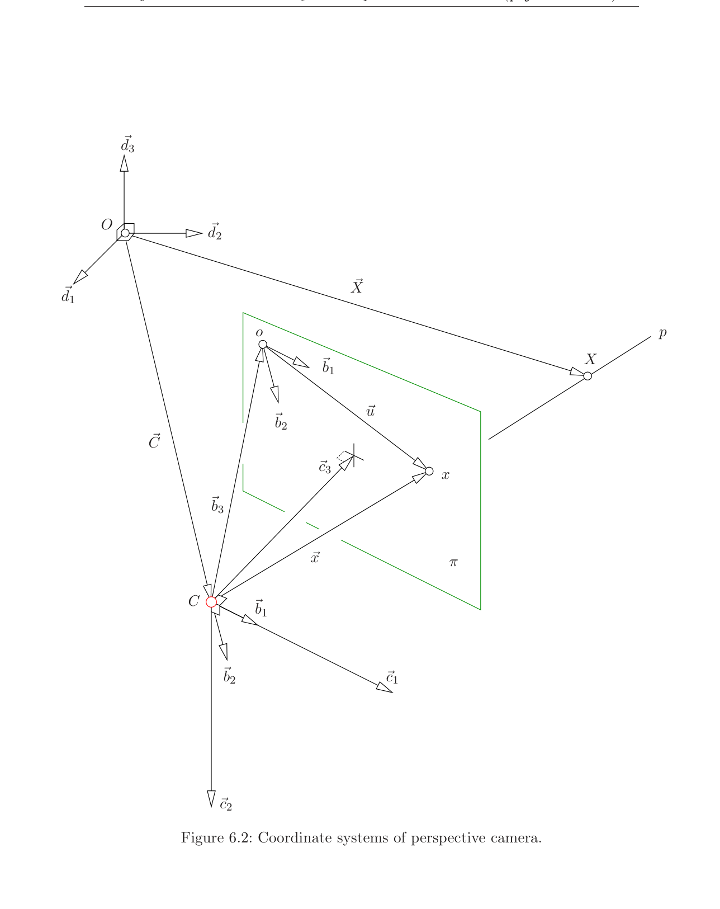

# 第6章 透视相机

### 来源说明

- 作者：Tomas Pajdla
- 书名：*Elements of Geometry for Computer Vision*（计算机视觉几何基础）
- 官方来源：https://cmp.felk.cvut.cz/~pajdla/gvg/GVG-2016-Lecture.pdf
- 本笔记仅供个人学习使用。讲义日期 Monday 9th May, 2016。

阅读范围：PDF 第 38–45 页（书页 34–41）。PDF 38 标题为 `6 Perspective camera`。下一章 `7 Camera calibration` 从 PDF 46 起，本笔记不读 46 及之后。

### 本章总览

现代照相机构造复杂，见图 6.1(a)。本章丢掉物理与技术细节，只留几何：空间点 \(X\) 与投影中心连成一条直线，这条线与平面像平面相交，交点就是像点 \(x\)，见图 6.1(b)。

先造相机坐标系，把像点坐标 \((u,v)\) 写成射线上的方向向量 \(\vec{x}_{\beta}=[u,v,1]^\top\)。再写出空间点到像点的投影方程，以及反过来由像点还原投影射线。最后用至少六对“空间点 \(\leftrightarrow\) 像点”估计 \(3\times 4\) 投影矩阵，并给出对任意齐次像点都适用的叉积写法。

### 核心知识点

#### 透视投影的几何对象

从几何看，perspective camera（透视相机）是一个投影中心（图中红色）加上一张平面像平面（图中绿色）。空间点 \(X\) 沿连接 \(X\) 与投影中心的直线投到像平面上的 \(x\)。

模型要做两件事：把空间点 \(X\) 投成像点 \(x\)；以及反过来找出 \(X\) 所在的那条空间射线 \(p\)。

图注：物理相机在几何上就是一个点（红）和一张像平面（绿）。空间点沿过红点的直线落到绿平面上。原书图 6.1。

过投影中心 \(C\)、且与像平面平行的平面叫 principal plane（主平面）。

🔑 关键速记：透视相机=投影中心 \(C\) + 像平面 \(\pi\)；像点是 \(CX\) 与 \(\pi\) 的交点。

#### 相机坐标系

图 6.2 画出三套坐标系。

像平面带着第 5 章的图像坐标系 \((o,\alpha)\)，\(o\) 是原点，\(\alpha=[\vec{b}_1,\vec{b}_2]\) 是像平面上的基。图中 \(\alpha\) 画成不正交：模型要覆盖像平面坐标轴不互相垂直的情形。像点 \(x\) 在 \((o,\alpha)\) 里由 \(\vec{u}\) 表示，

\[
\vec{u}=u\vec{b}_1+v\vec{b}_2,\qquad
\vec{u}_{\alpha}=\begin{pmatrix}u\\v\end{pmatrix}
\tag{6.1}
\]

三维空间带着世界坐标系 \((O,\delta)\)，\(\delta=[\vec{d}_1,\vec{d}_2,\vec{d}_3]\) 是三维标准正交基。空间点 \(X\) 由 \(\vec{X}\) 表示，投影中心 \(C\) 由 \(\vec{C}\) 表示，二者都在 \((O,\delta)\) 里。

相机坐标系 \((C,\beta)\) 的原点就在投影中心 \(C\)。基 \(\beta=[\vec{b}_1,\vec{b}_2,\vec{b}_3]\) 直接复用 \(\alpha\) 的两根轴，再补上第三根 \(\vec{b}_3\)，它对应向量 \(\overrightarrow{Co}\)。只要 \(C\) 不在 \(\pi\) 上——对有意义的透视相机这总成立——\(\beta\) 就是一组基。这是三维坐标系。

图像坐标系如何把像素中心写成 \(\vec{u}=[j,i]^\top\)，以及为什么二维里它是左手系，见第 5 章。那里已经说明：这样选是为了加 \(\vec{b}_3\) 后变成指向场景的三维右手系。

👉 图像坐标系的原点、\(\vec{u}=[j,i]^\top\) 以及左手约定见第 5 章。📝待补全

像平面上的 \(o\) 与 \(x\) 也是三维空间里的点。\(x\) 在 \((C,\beta)\) 里由 \(\vec{x}\) 表示，它正是投影射线 \(p\) 的方向向量。\(\vec{u}\)、\(\vec{x}\)、\(\vec{b}_3\) 构成三角形：

\[
\vec{x}=\vec{u}+\vec{b}_3
\tag{6.2}
\]

\[
\vec{x}=u\vec{b}_1+v\vec{b}_2+1\cdot\vec{b}_3
\tag{6.3}
\]

因此

\[
\vec{x}_{\beta}=\begin{pmatrix}u\\v\\1\end{pmatrix}
=\begin{pmatrix}\vec{u}_{\alpha}\\1\end{pmatrix}
\tag{6.4}
\]

第三坐标恒为 \(1\)，是因为 \(\vec{b}_3\) 按 \(\overrightarrow{Co}\) 来造。\(C\) 相对像平面的精确位置不必事先知道，只要它不在 \(\pi\) 上，这套相机坐标系就存在。

从 \(C\) 穿过像平面看向场景时，像平面在前方，\(\vec{b}_3\) 指向场景，所以 \(\beta\) 是 right-handed（右手系）。

这里用了 free vector（自由向量）：\(\vec{b}_1,\vec{b}_2,\vec{u}\) 看成自由向量。以 \(o\) 为起点量出的 \(u,v\)，等于以 \(C\) 为起点量出的前两个坐标。所以 \(u,v\) 直接出现在 \(\vec{x}_{\beta}\) 里。

👉 自由向量与仿射空间的完整说法见第 3 章。相机这里只用“起点可以平移、坐标不变”这一条。📝待补全

消费级相机里，\(\vec{b}_3\) 常常比 \(\vec{b}_1,\vec{b}_2\) 长得多，并且往往不与它们正交。因此 \(\beta\) 一般既不正交、更不是标准正交。后果很严重：在 \(\beta\) 里不能直接量空间中的角度和距离，除非先知道各向量的长度和夹角。

图注：\(C\) 是投影中心（红点），绿色矩形是像平面 \(\pi\)。\(X\) 沿射线 \(p\) 落到 \(x\)。\(\vec{x}=\vec{u}+\vec{b}_3\)，故 \(\vec{x}_{\beta}=[u,v,1]^\top\)。\(\vec{c}_1,\vec{c}_2,\vec{c}_3\) 是后文第 7 章要用的笛卡尔相机基，本章先出现在图里。原书图 6.2。

🔑 关键速记：\(\vec{x}_{\beta}=[u,v,1]^\top\)；\(\beta\) 一般不正交，不能在 \(\beta\) 里直接量角和距离。

#### 透视投影方程

\(X\) 沿 \(p\) 投到 \(x\)。\(\vec{x}\) 是 \(p\) 的方向，于是 \(X\) 在 \((C,\beta)\) 里可写成 \(\eta\vec{x}\)，其中 \(\eta\) 是某个非负实数。\(\eta\) 是 \(X\) 的 scaled depth（带尺度的深度）：它是 \(X\) 到过 \(C\)、由 \(\vec{b}_1,\vec{b}_2\) 张成的平面的距离，单位等于 \(C\) 到 \(\pi\) 的距离。投影过程把 \(\eta\) 丢掉了，但它可以用来参数化射线上所有可能投到 \(x\) 的空间点。

书选择让 \(\eta\) 非负。若像坐标系或 \(\vec{x}\) 的指向不清楚，负的 \(\eta\) 也可能必要，见 [14]。例如 \(\vec{x}\) 沿 \(p\) 指离 \(X\) 时，\(\eta\) 必须为负。\(\eta\) 可在两台投影中心不同的相机同时看到 \(X\) 时恢复。

👉 两台相机如何把丢掉的深度找回来，见第 12 章。单台透视相机只留下过 \(C\) 的一条射线。📝待补全

\(\vec{X}\)、\(\vec{C}\)、\(\vec{x}\) 共面，并且

\[
\eta\vec{x}=\vec{X}-\vec{C}
\tag{6.6}
\]

改到 \(\beta\) 下再代入 (6.4)，得到

\[
\eta\begin{pmatrix}\vec{u}_{\alpha}\\1\end{pmatrix}
=\vec{X}_{\beta}-\vec{C}_{\beta}
\tag{6.8}
\]

右侧再换到世界基 \(\delta\)。存在矩阵 \(A\)，把一般向量从 \(\delta\) 坐标变到 \(\beta\) 坐标：\(\vec{y}_{\beta}=A\vec{y}_{\delta}\)，见第 2 章 §3。于是

\[
\eta\begin{pmatrix}\vec{u}_{\alpha}\\1\end{pmatrix}
=A\bigl(\vec{X}_{\delta}-\vec{C}_{\delta}\bigr)
=A\bigl[I\ |\ -\vec{C}_{\delta}\bigr]
\begin{pmatrix}\vec{X}_{\delta}\\1\end{pmatrix}
\tag{6.10}
\]

\[
\eta\begin{pmatrix}\vec{u}_{\alpha}\\1\end{pmatrix}
=P_{\beta}
\begin{pmatrix}\vec{X}_{\delta}\\1\end{pmatrix}
\tag{6.11}
\]

其中 \(3\times 4\) 的 image projection matrix（图像投影矩阵）为

\[
P_{\beta}=\bigl[A\ |\ -A\vec{C}_{\delta}\bigr]
\tag{6.13}
\]

(6.11) 说：存在 \(\eta\) 使该式成立，就表示 \(\vec{X}_{\delta}\) 投到了 \(\vec{u}_{\alpha}\)。从 \(\vec{X}_{\delta}\) 算 \(\vec{u}_{\alpha}\) 时，用最后一行消掉 \(\eta\)：

\[
\vec{u}_{\alpha}
=\begin{pmatrix}
p_1^\top X/p_3^\top X\\
p_2^\top X/p_3^\top X
\end{pmatrix}
\tag{6.14}
\]

这里 \(p_1^\top,p_2^\top,p_3^\top\) 是 \(P_{\beta}\) 的三个行，并且

\[
X=\begin{pmatrix}\vec{X}_{\delta}\\1\end{pmatrix}
\tag{6.15}
\]

投影方程不是线性的。它是 \(X\) 的元素的一次多项式之比，即一阶有理函数。

🔑 关键速记：\(\eta[u,v,1]^\top=P_{\beta}[X;1]\)，\(P_{\beta}=[A\ |\ -A\vec{C}_{\delta}]\)；像点坐标是行向量之比。

#### 投影射线

已知像点 \(\vec{u}_{\alpha}\)，可以造出空间中的投影射线 \(p\)：所有能投到 \(\vec{u}_{\alpha}\) 的点 \(\vec{Y}\) 组成这条射线。在 \((C,\beta)\) 里它从原点 \(C\) 出发，用实数 \(\eta\) 参数化，再写回 \((O,\delta)\)：

\[
\vec{Y}_{\beta}=\eta\begin{pmatrix}\vec{u}_{\alpha}\\1\end{pmatrix}=\eta\vec{x}_{\beta}
\]

\[
\vec{X}_{\delta}=\eta A^{-1}\vec{x}_{\beta}+\vec{C}_{\delta}
\tag{6.16}
\]

给定 \(\eta\)，也可以直接解线性方程组 (6.12) 得到 \(\vec{X}_{\delta}\)。

🔑 关键速记：一条像点对应一条过 \(C\) 的射线 \(\vec{X}_{\delta}=\eta A^{-1}\vec{x}_{\beta}+\vec{C}_{\delta}\)。

#### 由六对点估计投影矩阵

现在从测量里求 \(P_{\beta}\)。假定空间点与其像点都能量到。一对测量 \([x,y,z]^\top\leftrightarrow[u,v]^\top\) 满足

\[
\lambda\begin{pmatrix}u\\v\\1\end{pmatrix}=QX
\tag{6.17}
\]

\(\lambda\) 是某个实数，\(Q\) 是 \(3\times 4\) 矩阵，\(X\) 是 \(4\times 1\) 坐标。\(\lambda\) 与 \(Q\) 都只确定到非零尺度：

\[
Q=\xi P_{\beta}
\tag{6.18}
\]

把 \(Q\) 按行写成 \(q_1^\top,q_2^\top,q_3^\top\)，则 \(\lambda u=q_1^\top X\)，\(\lambda v=q_2^\top X\)，\(\lambda=q_3^\top X\)。用第三式消去 \(\lambda\)，再移项，并利用 \(x^\top y=y^\top x\)，得到

\[
X^\top q_1-(uX^\top)q_3=0
\tag{6.25}
\]

\[
X^\top q_2-(vX^\top)q_3=0
\tag{6.26}
\]

把 \(Q\) 的元素排成

\[
q=[q_1^\top\ q_2^\top\ q_3^\top]^\top
\tag{6.27}
\]

一对对应点贡献两行：

\[
\begin{pmatrix}
x&y&z&1&0&0&0&0&-ux&-uy&-uz&-u\\
0&0&0&0&x&y&z&1&-vx&-vy&-vz&-v
\end{pmatrix}q=0
\tag{6.28}
\]

即 \(Mq=0\)。一般位置下至少需要 6 对对应，才能在 (6.28) 里凑出 11 个线性无关行，从而得到一维解空间。

若 \(Q\) 是解，则 \(\tau Q\) 也是解。对任意正数 \(\tau\)，二者给出同一投影：

\[
(\tau Q)X=\tau(QX)=\tau(\lambda\vec{x}_{\beta})=(\tau\lambda)\vec{x}_{\beta}
\tag{6.29}
\]

若令 \(P_{\beta}=\tau Q\)，则 \(\lambda=\eta/\tau\)。因此恢复不出 \(P_{\beta}\) 本身，只能恢复它的非零倍数。解 (6.28) 时，找的是秩为 3 的 \(3\times 4\) 矩阵的一维子空间。这个子空间决定一个投影。零矩阵不表示任何有意义的投影。

多对点时，\(M\) 按 (6.30)、(6.31) 往下堆。更紧凑的写法是

\[
M=\begin{pmatrix}
X_1^\top&0^\top&-u_1 X_1^\top\\
X_2^\top&0^\top&-u_2 X_2^\top\\
\vdots&\vdots&\vdots\\
0^\top&X_1^\top&-v_1 X_1^\top\\
0^\top&X_2^\top&-v_2 X_2^\top\\
\vdots&\vdots&\vdots
\end{pmatrix}
\tag{6.31}
\]

其中 \(0^\top=[0,0,0,0]\)。

下面这张表只收本章用到的矩阵，不发明新符号。

| 名称 | 功能 | 主要对象 | 约束与坑点 |
| --- | --- | --- | --- |
| \(P_{\beta}\) | 图像投影矩阵 | \(3\times 4\)，\(P_{\beta}=[A\mid -A\vec{C}_{\delta}]\) | 从图像只能恢复到非零倍数 |
| \(Q=\xi P_{\beta}\) | 带尺度的同一投影 | 仍是 \(3\times 4\)、秩 3 | 零矩阵无意义；正倍数给出同一投影 |
| \(M\) | 对应点堆成的系数阵 | 每对点两行，未知量 12 | 一般位置至少 6 对，才能得到 11 个无关行 |

🔑 关键速记：一般位置 6 点给出 \(Mq=0\) 的一维解；只能得到 \(P_{\beta}\) 的非零倍数。

#### 任意齐次像点的叉积写法

前面消 \(\lambda\) 时假定了 \(\vec{u}\) 的第三分量是 \(1\)。对任意非零 \(\vec{u}=[u,v,w]^\top\)，包括 \(w=0\)，改用

\[
0=\vec{u}\times(\lambda\vec{u})=\vec{u}\times QX=[\vec{u}]_{\times}QX
\tag{6.33}
\]

每对 \(\vec{u}\leftrightarrow X\) 给出三个方程，但只有两个线性无关，因为 \([\vec{u}]_{\times}\) 的秩是 2。再用第 2 章 (2.92) 把方程改写成对 \(\operatorname{vp}(Q^\top)\) 的线性式，得到 (6.34)–(6.39)。多对点堆成 (6.40)。当 \(w=1\) 时，它与 (6.30) 等价，并且 \(\operatorname{vp}(Q^\top)=q\)。

👉 叉积矩阵与 \(\operatorname{vp}\)（把矩阵拉成向量）的代数细节见第 2 章 (2.92)。本章只用“\([\vec{u}]_{\times}QX=0\) 对 \(w=0\) 也成立”这一条。📝待补全

🔑 关键速记：\(\vec{u}\times QX=0\) 对任意非零 \(\vec{u}\) 都可用；\(w=1\) 时回到 (6.30)。

### 章末速记

1. 透视相机几何上是点 \(C\) 加平面 \(\pi\)；像点是射线 \(CX\) 与 \(\pi\) 的交点。
2. 相机基 \(\beta\) 复用像平面的 \(\vec{b}_1,\vec{b}_2\)，并取 \(\vec{b}_3=\overrightarrow{Co}\)，于是 \(\vec{x}_{\beta}=[u,v,1]^\top\)。
3. \(\beta\) 是右手系，但一般不正交；不能在 \(\beta\) 里直接量角和距离。
4. \(\eta[u,v,1]^\top=P_{\beta}[X;1]\)，\(P_{\beta}=[A\mid -A\vec{C}_{\delta}]\)；像点是行之比，不是线性映射。
5. 一般位置 6 对点估计 \(Q=\xi P_{\beta}\)；只能得到秩 3 的一维子空间，零矩阵不是投影。

### 易混淆点与差异对比

\(P_{\beta}\) 把齐次空间点线性地送到 \(\eta\vec{x}_{\beta}\)。像平面坐标 \(\vec{u}_{\alpha}\) 却要再除以第三行，所以对 \(X\) 不是线性的。不要把 (6.11) 读成“像点等于 \(P_{\beta}\) 乘空间点”。

\(\eta\) 不是世界单位下的深度。它的单位是 \(C\) 到 \(\pi\) 的距离。第 7 章会引入 \(\zeta=f\eta\)，那才是世界单位下的深度。

\(Q\) 与 \(P_{\beta}\) 只差一个非零倍数。书在 (6.18) 写非零尺度 \(\xi\)，在 (6.29) 用正数 \(\tau\) 说明同一投影。解线性系时找的是一维子空间，不是某一个特定矩阵。

六对点是“一般位置”下的下限：要 11 条线性无关行。点 degenerate（退化）时，即使用了 6 对也不够。

(6.14) 假定第三分量用来消 \(\eta\)，对应 \(w=1\)。像点在无穷远（\(w=0\)）时必须改用叉积写法 (6.33)。

\(\beta\) 右手、\(\alpha\) 二维左手，并不矛盾。二维像平面上 \(\vec{b}_1\) 向右、\(\vec{b}_2\) 向下；加上指向场景的 \(\vec{b}_3\) 后，三维 \(\beta\) 是右手系。

### 本章要点总结

透视相机用 \(C\) 和 \(\pi\) 完成中心投影。相机坐标系特意让 \(\vec{x}_{\beta}=[u,v,1]^\top\)，代价是 \(\beta\) 一般不正交。投影写成 \(\eta\vec{x}_{\beta}=P_{\beta}X\)，像点坐标是有理函数。单应像点只决定过 \(C\) 的一条射线。空间与图像都能量到时，一般位置 6 点给出 \(P_{\beta}\) 的一维倍数；\(w=0\) 的像点要用叉积形式。深度 \(\eta\) 被单张像丢掉，两台不同中心的相机才能把它找回来。
