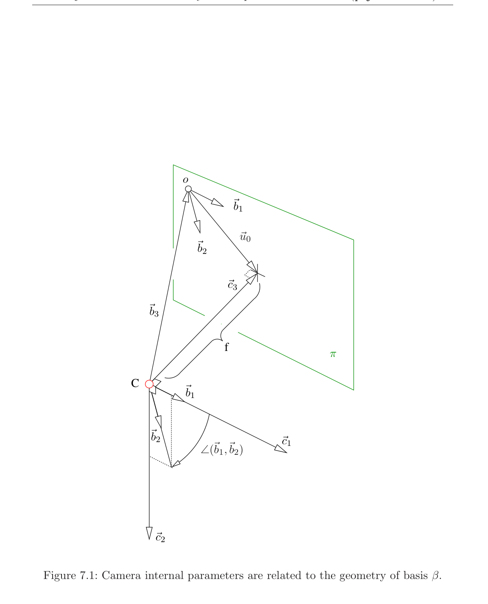
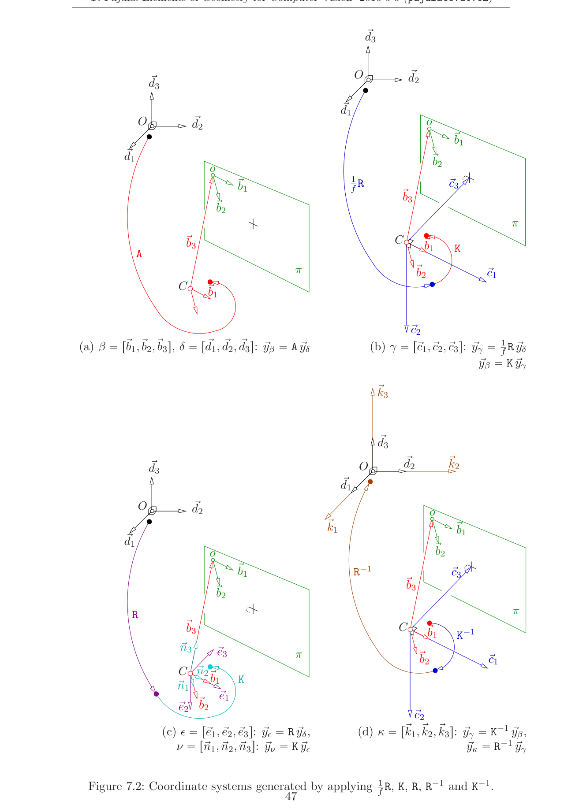
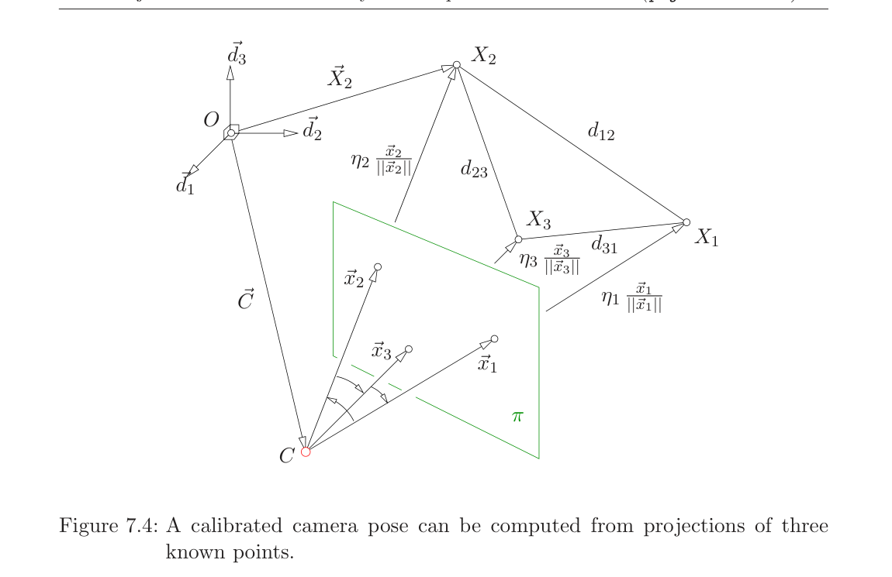

# 第7章 相机标定

### 来源说明

- 作者：Tomas Pajdla
- 书名：*Elements of Geometry for Computer Vision*（计算机视觉几何基础）
- 官方来源：https://cmp.felk.cvut.cz/~pajdla/gvg/GVG-2016-Lecture.pdf
- 本笔记仅供个人学习使用。讲义日期 Monday 9th May, 2016。

阅读范围：PDF 第 46–63 页（书页 42–59）。PDF 46 标题为 `7 Camera calibration`。下一章 `8 Homography` 从 PDF 64 起，本笔记不读 64 及之后。

### 本章总览

第 6 章的图像投影矩阵 $P_{\beta}$ 在笛卡尔坐标系里可以拆成内参与位姿。本章先引入 focal length（焦距）$f$、camera calibration matrix（相机标定矩阵）$K$ 和旋转 $R$，写出两个投影矩阵 $P_{\beta}$ 与 $P$ 的差别，再说明从 $P$ 能恢复什么、从 $K_{\beta}$ 能多恢复什么。

接着用 $K,R$ 及其逆造出若干套中间基，并从已求得的 $Q=\xi P$ 反解 $K,R,\vec{C}_{\delta}$。已知 $K$ 时，两射线夹角不需要 $f$。标定已知后，三个已知空间点就能求位姿；书先给古典消元，再给代数几何写法，最后由深度还原 $R$ 与 $\vec{C}_{\delta}$。

### 核心知识点

#### 位姿、焦距与 $fA=KR$

第 6 章的投影公式 (6.10) 说明，透视投影由矩阵 $A$ 和向量 $\vec{C}_{\delta}$ 决定。$\vec{C}_{\delta}$ 是投影中心在世界系里的位置。$A$ 的列是世界基 $\delta$ 的基向量在相机基 $\beta$ 中的坐标：

$$
A=\bigl[\vec{d}_{1\beta}\ \vec{d}_{2\beta}\ \vec{d}_{3\beta}\bigr]
\tag{7.1}
$$

focal length（焦距）$f$ 定义为 $C$ 到像平面 $\pi$ 的距离，单位是世界单位。把乘积 $fA$ 拆成两个 $3\times 3$ 矩阵的乘积

$$
fA=KR
\tag{7.2}
$$

旋转矩阵 $R$ 决定相机在空间中的朝向，再连同 $\vec{C}_{\delta}$ 就给出 camera pose（相机位姿）。camera calibration matrix（相机标定矩阵）$K$ 不随相机在空间中移动而改变。

👉 第 6 章已经写出 $\eta\vec{x}_{\beta}=A(\vec{X}_{\delta}-\vec{C}_{\delta})$ 与 $P_{\beta}=[A\mid -A\vec{C}_{\delta}]$。本章把 $A$ 再拆成尺度 $f$、内参 $K$ 和外参 $R$。📝待补全

🔑 关键速记：$fA=KR$；$R$ 与 $\vec{C}_{\delta}$ 是位姿，$K$ 是不随运动改变的内参。

#### 相机笛卡尔坐标系与 $K$ 的元素

图 7.1 再造一套 camera cartesian coordinate system（相机笛卡尔坐标系）$(C,\gamma)$。原点仍在 $C$，基 $\gamma=[\vec{c}_1,\vec{c}_2,\vec{c}_3]$ 取成

$$
\vec{c}_1=k_{11}\vec{b}_1,\qquad
\vec{c}_2=k_{12}\vec{b}_1+k_{22}\vec{b}_2,\qquad
\vec{c}_3=k_{13}\vec{b}_1+k_{23}\vec{b}_2+1\cdot\vec{b}_3
\tag{7.3}
$$

参数 $k_{ij}$ 选成让 $\gamma$ 正交。于是 $\vec{c}_3$ 垂直于 $\pi$，因为它垂直于张成 $\pi$ 的 $\vec{c}_1,\vec{c}_2$。$\gamma$ 一般仍不是标准正交：它的基向量长度都等于 $C$ 到 $\pi$ 的距离，也就是世界单位下的 $f$。

(7.3) 把 $K$ 定义为

$$
K=\bigl[\vec{c}_{1\beta}\ \vec{c}_{2\beta}\ \vec{c}_{3\beta}\bigr]
=\begin{pmatrix}k_{11}&k_{12}&k_{13}\\0&k_{22}&k_{23}\\0&0&1\end{pmatrix}
\tag{7.4}
$$

由此

$$
\vec{x}_{\beta}=A\vec{x}_{\delta}=K\vec{x}_{\gamma}
\tag{7.5}
$$

$$
\vec{x}_{\gamma}=\frac{1}{f}R\vec{x}_{\delta}
\tag{7.6}
$$

世界笛卡尔系的基向量长度是 1。相机笛卡尔系 $(C,\gamma)$ 的基向量长度是 $f$。因此

$$
\bigl[\vec{d}_{1\gamma}\ \vec{d}_{2\gamma}\ \vec{d}_{3\gamma}\bigr]=\frac{1}{f}R
\tag{7.7}
$$

其中 $R$ 是 $3\times 3$ 正交矩阵，行记为 $r_1^\top,r_2^\top,r_3^\top$。于是

$$
A=\frac{1}{f}KR
\tag{7.8}
$$

$\frac{1}{f}R$ 与 $K$ 都是坐标变换：一般向量 $\vec{y}$ 先从 $\delta$ 到 $\gamma$，再到 $\beta$，

$$
\vec{y}_{\beta}=K\vec{y}_{\gamma}=\frac{1}{f}KR\vec{y}_{\delta}
\tag{7.9}
$$

$\gamma$ 正交且三根轴一样长，都等于 $f$。由 $\vec{c}_1\cdot\vec{c}_1=f^2$、$\vec{c}_1\cdot\vec{c}_2=0$、$\vec{c}_2\cdot\vec{c}_2=f^2$ 以及 (7.3)，对正的 $f$ 得到方程组 (7.10)，再整理成 (7.11)。证明从略，结论是

$$
k_{11}=\frac{f}{\|\vec{b}_1\|}
\tag{7.16}
$$

$$
k_{22}=\frac{f}{\|\vec{b}_2\|\sin\angle(\vec{b}_1,\vec{b}_2)}
\tag{7.13}
$$

$$
k_{12}=-\frac{f\cos\angle(\vec{b}_1,\vec{b}_2)}{\|\vec{b}_1\|\sin\angle(\vec{b}_1,\vec{b}_2)}
\tag{7.15}
$$

这里已经用了 $\gamma$ 的造法使 $k_{22}>0$。主点是 $C$ 在 $\pi$ 上的垂足，对应向量 $\vec{u}_0$ 在 $\beta$ 里为

$$
\vec{u}_{0\beta}=\begin{pmatrix}k_{13}\\k_{23}\\0\end{pmatrix},\qquad
\vec{u}_{0\alpha}=\begin{pmatrix}k_{13}\\k_{23}\end{pmatrix}
\tag{7.17}
$$

水平像素尺寸对应 $\|\vec{b}_1\|$，所以 $k_{11}$ 就是用水平图像单位写出的 $f$。像轴夹角由 $k_{11}/k_{12}=-\tan\angle(\vec{b}_1,\vec{b}_2)$ 读出。轴长比由 $k_{11},k_{12},k_{22}$ 决定；文本层该句公式乱码，按已导出的 (7.13)–(7.16) 有

$$
\frac{\sqrt{k_{11}^2+k_{12}^2}}{k_{22}}=\frac{\|\vec{b}_2\|}{\|\vec{b}_1\|}.
$$

这不是原书另给的新关系，只是把 (7.13)–(7.16) 代回去。

图注：$C$ 到 $\pi$ 的垂距是 $f$。$\vec{u}_0$ 指向主点。$\angle(\vec{b}_1,\vec{b}_2)$ 是像轴夹角。$\vec{c}_3$ 垂直于 $\pi$。原书图 7.1。

🔑 关键速记：$K$ 上三角且 $K_{33}=1$；$k_{11}=f/\|\vec{b}_1\|$，主点是 $(k_{13},k_{23})$。

#### 投影方程、$P$ 与 $P_{\beta}$

把上面的分解代回第 6 章 (6.11)，并令 $\zeta=f\eta$（世界单位下的深度），得到

$$
\zeta\begin{pmatrix}\vec{u}_{\alpha}\\1\end{pmatrix}
=KR\bigl(\vec{X}_{\delta}-\vec{C}_{\delta}\bigr)
=KR\bigl[I\ |\ -\vec{C}_{\delta}\bigr]
\begin{pmatrix}\vec{X}_{\delta}\\1\end{pmatrix}
\tag{7.22}
$$

$$
P_{\beta}=\Bigl[\tfrac{1}{f}KR\ \Big|\ -\tfrac{1}{f}KR\vec{C}_{\delta}\Bigr]
\tag{7.24}
$$

$A$ 的最后一行 $a_3^\top$ 满足 $\|a_3^\top\|=1/f$，因此 $\|P_{\beta}(3,1:3)\|=1/f$。

许多实际场合摸不到相机的物理尺寸，只能看到图像。这时能恢复的是 $KR[I\ |\ -\vec{C}_{\delta}]$，而不是 $P_{\beta}$。书因此引入 camera projection matrix（相机投影矩阵）

$$
P=\bigl[KR\ |\ -KR\vec{C}_{\delta}\bigr]
\tag{7.26}
$$

它与图像投影矩阵的关系是

$$
P=fP_{\beta}
\tag{7.27}
$$

按本章记号本应给 $P$ 加下标 $\nu$，但书为了尽量跟 [14] 的用语一致，不加这个下标。

把 $K$ 按几何量写开，即 (7.28)：对角与上三角元素由 (7.13)–(7.17) 填入，$K_{33}=1$，主点 $(u_0,v_0)=\vec{u}_{0\alpha}$。从 $P$ **既恢复不出** $f$，也恢复不出 $\|\vec{b}_1\|$。

再引入 image calibration matrix（图像标定矩阵）

$$
K_{\beta}=\frac{1}{f}K
\tag{7.29}
$$

则

$$
P_{\beta}=\bigl[K_{\beta}R\ |\ -K_{\beta}R\vec{C}_{\delta}\bigr]
\tag{7.30}
$$

$K_{\beta}$ 写开后，(7.32) 给出

$$
\|\vec{b}_1\|=\frac{1}{(K_{\beta})_{11}},\qquad
f=\frac{1}{(K_{\beta})_{33}}
\tag{7.32}
$$

$K_{\beta}$（以及 $P_{\beta}$）保存一张透视图像的**全部**内参信息。$K$（以及 $P$）只保存后来能从图像做 auto-calibration（自标定）恢复的那一部分。若世界单位下的焦距或像素尺寸已知，更合适的是用 $K_{\beta}$ 或 $P_{\beta}$ 表示完整内参。

👉 自标定如何从多幅图像恢复 $K$，见第 11 章。本章只区分“$P$ 能看到的”和“$P_{\beta}$ 才有的尺度”。📝待补全

完整标定可以记成 $P_{\beta}$，或下面任一元组：$(K_{\beta},R,\vec{C}_{\delta})$，$(K,R,\vec{C}_{\delta},f)$，$(K,R,\vec{C}_{\delta},\|\vec{b}_1\|)$，$(K,R,\vec{C}_{\delta},\|\vec{b}_2\|)$。把 $K_{33}$ 设成 1，是因为常常没有世界单位；不少任务也不需要世界单位。已知 $K$ 与 $f$ 可由 (7.3) 反推 $\|\vec{b}_1\|=f/k_{11}$；已知 $K$ 与 $\|\vec{b}_1\|$ 则 $f=\|\vec{b}_1\|k_{11}$。

下面这张表对照两种投影矩阵，不发明新参数。

| 名称 | 功能 | 主要对象 | 约束与坑点 |
| --- | --- | --- | --- |
| $K$ | 相机标定矩阵 | 上三角，$K_{33}=1$ | 单独从 $P$ 得不到 $f$ 与像素尺寸 |
| $K_{\beta}=K/f$ | 图像标定矩阵 | 含 $1/f$ | $(K_{\beta})_{11}=1/\|\vec{b}_1\|$，$(K_{\beta})_{33}=1/f$ |
| $P=fP_{\beta}$ | 相机投影矩阵 | $P=[KR\mid -KR\vec{C}_{\delta}]$ | 图像能恢复的是 $P$ 这一层 |
| $P_{\beta}$ | 图像投影矩阵 | 含 $1/f$ | 完整内参；$\|P_{\beta}(3,1:3)\|=1/f$ |

🔑 关键速记：$P=fP_{\beta}$；从图像通常只能拿到 $P$ 与 $K$，$f$ 或像素尺寸要另给。

#### $K,R$ 造出的坐标系

把 $A$ 拆成 $K$ 与 $R$ 之后，出现相机笛卡尔系 $(C,\gamma)$，见图 7.2(b)。对一般向量

$$
\vec{y}_{\gamma}=\frac{1}{f}R\vec{y}_{\delta},\qquad
\vec{y}_{\beta}=K\vec{y}_{\gamma}
\tag{7.33}
$$

再看 $R,K$ 及其逆作用在 $\vec{y}_{\delta}$ 与 $\vec{y}_{\beta}$ 上，还会多出三套基，见图 7.2。

从 $\delta$ 出发先乘 $R$ 再乘 $K$：$R\vec{y}_{\delta}$ 是 $\vec{y}$ 在新基 $\epsilon=[\vec{e}_1,\vec{e}_2,\vec{e}_3]$ 中的坐标；再乘 $K$ 得到基 $\nu=[\vec{n}_1,\vec{n}_2,\vec{n}_3]$。从 $\nu$ 回到 $\beta$ 只需 $\frac{1}{f}I$：

$$
\vec{y}_{\epsilon}=R\vec{y}_{\delta},\qquad
\vec{y}_{\nu}=K\vec{y}_{\epsilon},\qquad
\vec{y}_{\beta}=\frac{1}{f}\vec{y}_{\nu}
\tag{7.35}
$$

从 $\beta$ 出发先乘 $K^{-1}$ 再乘 $R^{-1}$：$K^{-1}\vec{y}_{\beta}$ 回到 $\gamma$；$R^{-1}\vec{y}_{\gamma}$ 是 $\vec{y}$ 在新基 $\kappa=[\vec{k}_1,\vec{k}_2,\vec{k}_3]$ 中的坐标。从 $\kappa$ 回到 $\delta$ 要乘 $fI$：

$$
\vec{y}_{\gamma}=K^{-1}\vec{y}_{\beta},\qquad
\vec{y}_{\kappa}=R^{-1}\vec{y}_{\gamma},\qquad
\vec{y}_{\delta}=f\vec{y}_{\kappa}
\tag{7.38}
$$

图 7.3 汇总各套坐标之间、以及各套基之间的箭头。图像投影矩阵 $P_{\beta}$ 给出的是射线方向在 $\beta$ 中的坐标；相机投影矩阵 $P$ 给出的是同一方向在 $\nu$ 中的坐标。这就是两个矩阵下标不同的原因。

图注：四幅分别对应 $\vec{y}_{\beta}=A\vec{y}_{\delta}$、$\vec{y}_{\gamma}=(1/f)R\vec{y}_{\delta}$ 再 $\vec{y}_{\beta}=K\vec{y}_{\gamma}$、$\vec{y}_{\epsilon}=R\vec{y}_{\delta}$ 再 $\vec{y}_{\nu}=K\vec{y}_{\epsilon}$、以及 $K^{-1}$ 与 $R^{-1}$ 定义的 $\kappa$。原书图 7.2。

🔑 关键速记：$P_{\beta}$ 的射线在 $\beta$ 里，$P$ 的射线在 $\nu$ 里；中间还隔着 $\gamma,\epsilon,\kappa$。

#### 从投影矩阵恢复位姿

设已经得到

$$
Q=\xi P=\xi KR\bigl[I\ |\ -\vec{C}_{\delta}\bigr]
=\bigl[M\ |\ m\bigr]
\tag{7.41}
$$

$M$ 是 $3\times 3$，$m$ 是 $3\times 1$。要恢复位姿，需从 $m$ 取出 $\vec{C}_{\delta}$，并把 $Q$ 的左边拆成 (7.4) 那种 $K$ 与满足 $R^\top R=I$、$|R|=1$ 的 $R$。

$KR$ 的最后一行就是 $R$ 的最后一行，因此范数为 1。要把 $M$ 除以最后一行的范数，才能拆成 $KR$。又因 $\beta$ 的造法使 $k_{11}>0$、$k_{22}>0$，故 $|KR|=|K||R|=k_{11}k_{22}>0$。还要用 $M$ 行列式的符号去乘，才能拆成 $KR$：

$$
\frac{\operatorname{sign}|M|}{\|m_3\|}M=KR
\tag{7.44}
$$

比较两边的行内积，得到 (7.45)–(7.49)。结论是：

$$
\frac{m_2^\top m_3}{\|m_3\|^2}=k_{23},\qquad
\frac{m_1^\top m_3}{\|m_3\|^2}=k_{13}
\tag{7.45}
$$

$$
\frac{m_2^\top m_2}{\|m_3\|^2}=k_{22}^2+k_{23}^2,\qquad
\frac{m_1^\top m_2}{\|m_3\|^2}=k_{12}k_{22}+k_{13}k_{23}
\tag{7.48}
$$

$$
\frac{m_1^\top m_1}{\|m_3\|^2}=k_{11}^2+k_{12}^2+k_{13}^2
\tag{7.49}
$$

消费级数码相机通常 $k_{11}>0$、$k_{22}>0$、$k_{13}>0$、$k_{23}>0$，据此可解出全部 $k_{ij}$。然后

$$
R=K^{-1}\frac{\operatorname{sign}|M|}{\|m_3\|}M
\tag{7.50}
$$

投影中心有两种算法。一是

$$
\vec{C}_{\delta}=-M^{-1}m
\tag{7.51}
$$

二是求 $Q$ 的一维右零空间基 $c$，即 $Qc=0$，再令

$$
\begin{pmatrix}\vec{C}_{\delta}\\1\end{pmatrix}=\frac{1}{c_4}c
\tag{7.53}
$$

其中 $c_4$ 是 $c$ 的第四个坐标。

🔑 关键速记：先用 $\operatorname{sign}|M|/\|m_3\|$ 把 $M$ 标准化成 $KR$，再拆 $K$ 与 $R$；$\vec{C}_{\delta}=-M^{-1}m$。

#### 投影射线夹角

两像点 $\vec{u}_{1\alpha},\vec{u}_{2\alpha}$ 对应的方向在 $\beta$ 里是 $\vec{x}_{i\beta}=[\vec{u}_{i\alpha};1]$。要用内积量夹角，必须换到正交基。最近的正交基是 $\gamma$：

$$
\cos\angle(\vec{x}_1,\vec{x}_2)
=\frac{\vec{x}_{1\gamma}^\top\vec{x}_{2\gamma}}{\|\vec{x}_{1\gamma}\|\,\|\vec{x}_{2\gamma}\|}
=\frac{\vec{x}_{1\beta}^\top K^{-\top}K^{-1}\vec{x}_{2\beta}}{\|K^{-1}\vec{x}_{1\beta}\|\,\|K^{-1}\vec{x}_{2\beta}\|}
\tag{7.55}
$$

用 $\gamma$ 而不用更近的标准正交基 $\epsilon$ 即可，因为未知尺度 $f$ 在 (7.56) 里约掉。结论：**量射线夹角不需要知道 $f$**。

🔑 关键速记：夹角在 $\gamma$ 里用 $K^{-1}$ 算；$f$ 会消掉。

#### 已标定相机的三点位姿

未标定透视相机的位姿，第 6 章用六个已知点的投影来求，同时把标定也求了出来。标定若已经知道，三个已知点的投影就够。这是古典问题，见 [15]。

图 7.4 中，相机中心 $C$ 把三个空间点 $X_1,X_2,X_3$ 投到 $\vec{x}_{1\beta},\vec{x}_{2\beta},\vec{x}_{3\beta}$。点对距离

$$
d_{12}=\|\vec{X}_{2\delta}-\vec{X}_{1\delta}\|,\quad
d_{23}=\|\vec{X}_{3\delta}-\vec{X}_{2\delta}\|,\quad
d_{31}=\|\vec{X}_{1\delta}-\vec{X}_{3\delta}\|
\tag{7.57}
$$

三点互异，所以三个距离都为正。在 $(C,\gamma)$ 里

$$
\frac{\eta_i\vec{x}_{i\gamma}}{\|\vec{x}_{i\gamma}\|}=\eta_i\frac{K^{-1}\vec{x}_{i\beta}}{\|K^{-1}\vec{x}_{i\beta}\|},\qquad i=1,2,3
\tag{7.58}
$$

$\eta_i$ 是 $C$ 到 $X_i$ 的距离，且必须为正，否则看不见这些点。

图注：三个已知点 $X_1,X_2,X_3$ 构成空间三角形，边长 $d_{ij}$。每条投影射线上的深度是 $\eta_i$。像平面上看到的是三个方向 $\vec{x}_i$。原书图 7.4。

已标定相机能量出射线夹角

$$
c_{ij}=\cos\angle(\vec{x}_i,\vec{x}_j)
=\frac{\vec{x}_{i\beta}^\top K^{-\top}K^{-1}\vec{x}_{j\beta}}{\|K^{-1}\vec{x}_{i\beta}\|\,\|K^{-1}\vec{x}_{j\beta}\|}
\tag{7.59}
$$

其中 $j=(i-1)\bmod 3+1$。余弦定理给出三元二次方程组

$$
d_{12}^2=\eta_1^2+\eta_2^2-2\eta_1\eta_2 c_{12}
\tag{7.60}
$$

$$
d_{23}^2=\eta_2^2+\eta_3^2-2\eta_2\eta_3 c_{23}
\tag{7.61}
$$

$$
d_{31}^2=\eta_3^2+\eta_1^2-2\eta_3\eta_1 c_{31}
\tag{7.62}
$$

古典解法把三个方程消成一个一元方程，再回代。先用 (7.61) 的两边去乘另外两式，得到 (7.63)、(7.64)。因所有 $d_{ij}\neq 0$，选哪一式当“用两次”的那一条都合法。两式对 $\eta_i$ 齐次，除以 $\eta_1^2\neq 0$，令 $\eta_{12}=\eta_2/\eta_1$、$\eta_{13}=\eta_3/\eta_1$，得到两个关于 $\eta_{12},\eta_{13}$ 的二次方程 (7.65)、(7.66)。再按 $\eta_{13}$ 整理成

$$
m_1\eta_{13}^2+p_1\eta_{13}=q_1,\qquad
m_2\eta_{13}^2+p_2\eta_{13}=q_2
\tag{7.68}
$$

系数 $m_1,p_1,q_1,m_2,p_2,q_2$ 由 (7.69)–(7.74) 给出，里面藏着 $\eta_{12}$。把它看成线性系 (7.75)。

**情形 A**　系数矩阵非奇异。Cramer 法则给出 (7.78)、(7.79)。消去 $\eta_{13}$ 得到 (7.80)，再代入系数后变成 $\eta_{12}$ 的四次方程

$$
a_4\eta_{12}^4+a_3\eta_{12}^3+a_2\eta_{12}^2+a_1\eta_{12}+a_0=0
\tag{7.81}
$$

系数 $a_4,\ldots,a_0$ 由 $d_{ij}$ 与 $c_{ij}$ 按 (7.82)–(7.86) 写出，此处不抄展开。数值上造 companion matrix（伴随矩阵）

$$
C=\begin{pmatrix}
0&0&0&-a_0/a_4\\
1&0&0&-a_1/a_4\\
0&1&0&-a_2/a_4\\
0&0&1&-a_3/a_4
\end{pmatrix}
\tag{7.87}
$$

则 $|\eta_{12}I-C|$ 就是对应的首一多项式 (7.88)。实根才留下，复根是方法伪迹。每个实根代回 (7.79) 得 $\eta_{13}$。再由 (7.90) 取正值

$$
\eta_1=\frac{d_{12}}{\sqrt{1+\eta_{12}^2-2\eta_{12}c_{12}}},\qquad
\eta_2=\eta_1\eta_{12},\qquad
\eta_3=\eta_1\eta_{13}
\tag{7.91}
$$

**情形 B**　(7.75) 奇异。代入系数后化成 $\eta_{12}c_{23}=c_{31}$，这里用了 $d_{12}\neq 0$ 与 $d_{23}\neq 0$。

- **B1**　$c_{23}\neq 0$ 时 $\eta_{12}=c_{31}/c_{23}$，再得到 $\eta_{13}$ 的二次方程 (7.100)，然后仍用 (7.91)–(7.93)。
- **B2**　$c_{23}=0$ 则必有 $c_{31}=0$。回到 (7.65)、(7.66) 得到 (7.101)、(7.102)。
  - **B2.1**　$d_{23}^2\neq d_{31}^2$ 时，$\eta_{13}^2$ 由 (7.104) 给出，代入后得到 $\eta_{12}$ 的二次方程 (7.106)。
  - **B2.2**　$d_{23}^2=d_{31}^2$ 时 $\eta_{12}=1$，正的 $\eta_{13}$ 由 (7.109) 给出。

消元常常同时冒出 A 与某些 B 的根，但只有一种情形真正成立。必须代回 (7.60)–(7.62)，只保留实的、正的、且满足原方程的解。

🔑 关键速记：已标定三点位姿先用余弦定理求三个深度；一般情形是 $\eta_{12}$ 的四次方程，奇异情形降次。

#### 代数几何写法与还原 $R,\vec{C}$

古典消元合法但繁琐。另一条路用代数几何 [16, 17]。仍从 (7.60)–(7.62) 走到比值，但三个配对都用上，得到 $f_1,f_2,f_3=0$，即 (7.110)–(7.112)。对有限多个解的代数方程组，总可以造出只含最后一个变量的多项式 $g(x_n)=0$；若无解，手续会得到非零常数，对应 $1=0$。

手续是：用次数不超过 $m$ 的全部单项式去乘各个 $f_i$，再对系数矩阵做高斯消元，直到出现只含 $x_n$ 的一行。$m$ 总存在，有时只能逐步加单项式才找到。本题用四个不超过二次的单项式 $\eta_{12},\eta_{13},\eta_{12}\eta_{13},\eta_{12}^2$，不必用 $\eta_{13}^2$。于是 $3+4\times 3=15$ 个方程，写成 $Mm=0$，见 (7.117)。系数矩阵 $M$ 的非零模式由 12 个量 $m_1,\ldots,m_{12}$ 填出，它们是 $d_{ij}^2$ 与 $2d_{ij}^2 c_{kl}$ 的组合，见 (7.119)。单项式事先排好，使最后五个只含 $\eta_{12}$。

对 $M$ 做带主元的高斯消元得到 $M'$。可以验证 $M'$ 的第 10 行前九个元素为 0，因而 $M'_{10,:}m=0$ 是只含 $\eta_{12}$ 的多项式。它正是情形 A、B1、B2.1、B2.2 所得多项式的非零倍数。分情形发生在带主元的消元里：避免除以接近 0 的元。结果可以是四次（情形 A），其他情形次数更低。

有了 $\eta_1,\eta_2,\eta_3$，再由 (7.24) 求 $\vec{C}_{\delta}$ 与 $R$。三点在世界系里是 $\vec{X}_{i\delta}$，在相机标准正交系 $(C,\epsilon)$ 里是

$$
\vec{Y}_{i\epsilon}=\eta_i\frac{\vec{x}_{i\gamma}}{\|\vec{x}_{i\gamma}\|},\qquad i=1,2,3
\tag{7.121}
$$

$f$ 在 (7.121) 里约掉。坐标满足 $\vec{Y}_{i\epsilon}=R(\vec{X}_{i\delta}-\vec{C}_{\delta})$。三个向量方程是 9 个标量方程，$R$ 与 $\vec{C}_{\delta}$ 共 12 个未知数；另外 7 个方程来自 $R^\top R=I$ 与 $|R|=1$。

先消去 $\vec{C}_{\delta}$：

$$
\vec{Y}_{2\epsilon}-\vec{Y}_{1\epsilon}=R(\vec{X}_{2\delta}-\vec{X}_{1\delta})
\tag{7.125}
$$

对 $\vec{Y}_3-\vec{Y}_1$ 同样。再用第 2 章 (2.47)：对 $\mathrm{SO}(3)$ 中的 $R$，向量积满足 $R(\vec{X}\times\vec{Y})=(R\vec{X})\times(R\vec{Y})$。于是差向量的叉积也只差一个 $R$。令

$$
\vec{Z}_{2\epsilon}=\vec{Y}_{2\epsilon}-\vec{Y}_{1\epsilon},\quad
\vec{Z}_{2\delta}=\vec{X}_{2\delta}-\vec{X}_{1\delta}
$$

$$
\vec{Z}_{3\epsilon}=\vec{Y}_{3\epsilon}-\vec{Y}_{1\epsilon},\quad
\vec{Z}_{3\delta}=\vec{X}_{3\delta}-\vec{X}_{1\delta}
$$

$$
\vec{Z}_{1\epsilon}=\vec{Z}_{2\epsilon}\times\vec{Z}_{3\epsilon},\quad
\vec{Z}_{1\delta}=\vec{Z}_{2\delta}\times\vec{Z}_{3\delta}
\tag{7.132}
$$

则

$$
R=\bigl[\vec{Z}_{1\epsilon}\ \vec{Z}_{2\epsilon}\ \vec{Z}_{3\epsilon}\bigr]
\bigl[\vec{Z}_{1\delta}\ \vec{Z}_{2\delta}\ \vec{Z}_{3\delta}\bigr]^{-1}
\tag{7.134}
$$

已知 $R$ 后，

$$
\vec{C}_{\delta}=\vec{X}_{i\delta}-R^\top\vec{Y}_{i\epsilon},\qquad i=1,2,3
\tag{7.135}
$$

三个 $i$ 都应给出同一个中心。

刚体旋转在本章始终写成满足 $R^\top R=I$、$|R|=1$ 的矩阵。同一旋转的轴角、指数坐标与单位四元数写法不在本章展开。

👉 完整深度讲解见 06 第3章（刚体运动）与 Gallier 第15章（单位四元数）。📝待补全

🔑 关键速记：三点深度求出后，用两条边及其叉积在两套基里对齐，得到 $R$，再反推 $\vec{C}_{\delta}$。

### 章末速记

1. $fA=KR$。$K$ 上三角且 $K_{33}=1$；$R$ 与 $\vec{C}_{\delta}$ 是位姿。
2. $P=fP_{\beta}=[KR\mid -KR\vec{C}_{\delta}]$。从图像通常只能恢复 $P$ 与 $K$，恢复不出 $f$ 或像素尺寸；那些在 $K_{\beta}$ 与 $P_{\beta}$ 里。
3. 从 $Q=[M\mid m]$ 恢复位姿：用 $\operatorname{sign}|M|/\|m_3\|$ 把 $M$ 标准化成 $KR$，再拆 $K,R$；$\vec{C}_{\delta}=-M^{-1}m$ 或取 $Q$ 的右零空间。
4. 射线夹角用 $K^{-1}$ 在 $\gamma$ 里算，不需要 $f$。
5. 已标定相机三个已知点即可求位姿：余弦定理给出深度，一般是四次方程；再由边向量与叉积还原 $R$ 与 $\vec{C}_{\delta}$。

### 易混淆点与差异对比

$P$ 与 $P_{\beta}$ 差一个焦距倍数。只拿图像做自标定，得到的是 $K$ 与 $P$ 这一层，不是完整的像素尺寸。$K_{33}=1$ 不是“第三轴长度为 1”，而是把世界尺度从 $K$ 里拿掉。

$K$ 与 $K_{\beta}$ 不要混用。(7.32) 的 $\|\vec{b}_1\|=1/(K_{\beta})_{11}$、$f=1/(K_{\beta})_{33}$ 只对 $K_{\beta}$ 成立，不能把 $K$ 的 $(1,1)$ 或 $(3,3)$ 直接当成这两个量。$K_{11}$ 已经是“用水平像素单位写出的 $f$”。

$\eta$ 是第 6 章的带尺度深度，单位是 $C$ 到 $\pi$ 的距离。$\zeta=f\eta$ 才是世界单位深度。三点位姿里的 $\eta_i$ 又是另一回事：它是 $C$ 到 $X_i$ 的欧氏距离，见 (7.58)。同一个字母在两章、两节里尺度不同。

未标定六点与已标定三点不是同一道题。六点同时把标定和位姿求出来；三点假定 $K$ 已知，只求位姿。

古典消元会同时冒出情形 A 和某些 B 的根。必须代回余弦定理，只留实的、正的、满足原方程的解。复根是伴随矩阵方法的伪迹。

从 $Q$ 拆 $KR$ 时，既要除以 $\|m_3\|$，也要乘 $\operatorname{sign}|M|$。漏掉符号会得到 $\det R=-1$ 的反射，而不是旋转。

$\mathrm{SO}(3)$ 在第 4 章已经用 $R^\top R=I$ 与 $|R|=1$ 定义。本章还原 $R$ 时沿用同一条件。四元数与指数坐标是另一套坐标，不是另一套旋转。

### 本章要点总结

透视投影在笛卡尔系里拆成 $KR(\vec{X}-\vec{C})$。$K$ 编码焦距（用像素单位）、主点和轴偏斜；$R$ 与 $\vec{C}$ 是位姿。$P$ 比 $P_{\beta}$ 少一个世界尺度，自标定通常停在 $P$ 这一层。已有 $Q$ 时可按行范数与行列式符号拆出 $K,R,\vec{C}$。夹角不需要 $f$。标定已知后，三个已知点通过余弦定理求深度，再对齐边向量得到旋转和平移。
