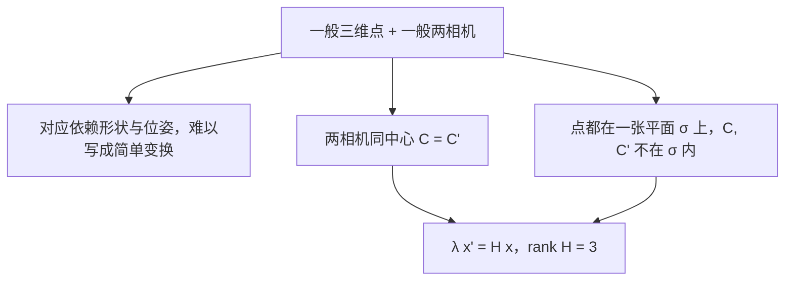
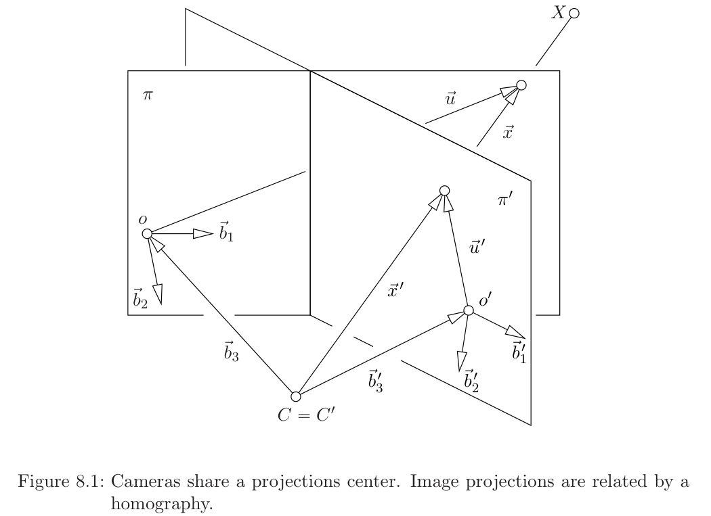
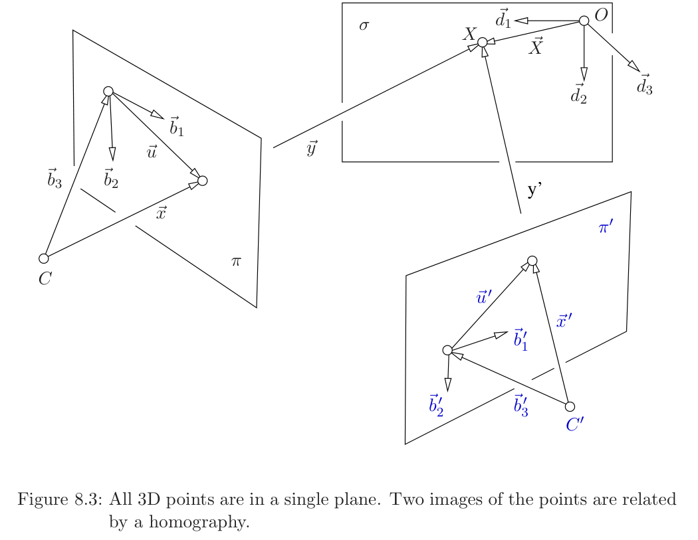
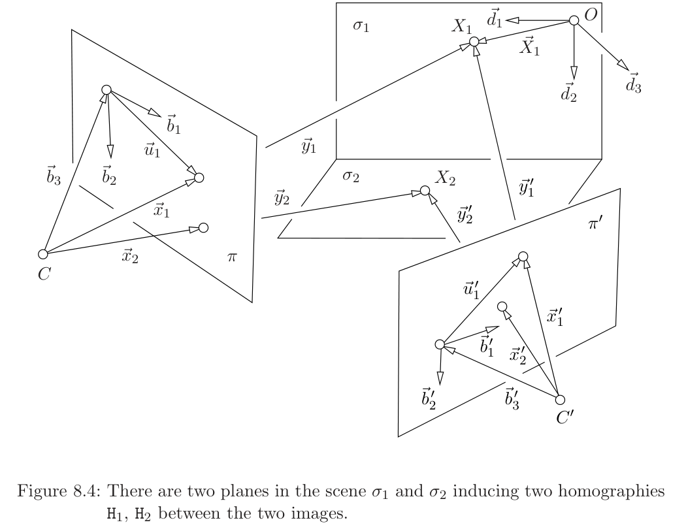

# 第8章 单应（Homography）

### 本章总览

本章对应 Tomas Pajdla，*Elements of Geometry for Computer Vision*（计算机视觉几何基础），2016-5-9。阅读范围：PDF 第 64–88 页，书页 60–84。开读时 PDF 第 64 页章名为 `8 Homography`。无书签；书页 $N$ 对应 PDF 页 $N+4$。

三维点落到两幅透视图像上的对应，一般既依赖场景形状，也依赖两台相机的位姿，很难写成简单公式。本章给出两类例外：两台相机**共用一个投影中心**（projection center）；或者空间点被限制在**一张不含相机中心的平面**上。这两种情形下，对应点由一张秩为 3 的 $3\times 3$ 矩阵联系起来，这张变换叫做**单应**（homography）。

正文路线：8.1 同中心单应，并把它写成标定与旋转；8.2 平面单应，从「平面到像」推到「两幅平面像」，再写出场景平面诱导的分解；8.3 球面图像；8.4 三种情形的统一写法；8.5 两张平面给出两张单应时的特征向量约束；8.6 由图像匹配算单应。Maple 数值演示只留解的个数，不抄中间式。

图注：一般立体对应写不出简单公式。只有同中心，或点被限制在一张平面上，对应才由一张满秩 $3\times 3$ 单应给出。

### 核心知识点

#### 同中心单应

两台透视相机共用投影中心 $C=C'$，但坐标系和朝向可以不同。绕投影中心旋转拍全景，就是这种情形。空间点 $X$ 沿同一条射线落到像平面 $\pi$ 与 $\pi'$。

在 $\pi$ 上取像坐标系 $(o,\alpha)$，$\alpha=[\vec{b}_1,\vec{b}_2]$；在 $\pi'$ 上取 $(o',\alpha')$。再把第三条轴取成 $\overrightarrow{Co}$、$\overrightarrow{Co'}$，得到相机坐标系 $(C,\beta)$ 与 $(C,\beta')$。像点坐标写成 $\vec{u}_\alpha=[u,v]^\mathrm{J}$、$\vec{u}'_{\alpha'}=[u',v']^\mathrm{J}$。

方向向量 $\vec{x}$ 与 $\vec{x}'$ 共线。$X\neq C$ 时二者都非零，线性相关就是：存在 $\lambda\in\mathbb{R}$，使得

$$
\lambda\vec{x}'=\vec{x}
\tag{8.1}
$$

换成坐标后，存在秩为 3 的 $3\times 3$ 实矩阵 $H$，把 $\beta$ 下的坐标送到 $\beta'$：

$$
\lambda\vec{x}'_{\beta'}=H\vec{x}_\beta
\tag{8.5}
$$

$$
\lambda
\begin{bmatrix}u'\\v'\\1\end{bmatrix}
=
H
\begin{bmatrix}u\\v\\1\end{bmatrix}
\tag{8.6}
$$

因为 $C=C'$，这张关系只看像点，不需要知道 $X$ 在空间里的实际位置。

图注：图 8.1。两台相机共用投影中心 $C=C'$。同一条射线先后穿过 $\pi$ 与 $\pi'$，像点由单应相连。

🔑 关键速记：同中心时 $\lambda[u',v',1]^\mathrm{J}=H[u,v,1]^\mathrm{J}$，$H$ 满秩，求 $H$ 不必知道空间点。

#### 单应矩阵与投影矩阵

把 $H$ 接到两台相机的投影矩阵上。投影公式沿用第6章式 (6.12)。

透视相机把空间点沿过投影中心的直线送到像平面。投影矩阵把世界齐次坐标乘成像点的齐次坐标，一般写成 $P=[KR\mid -KR\vec{C}_\delta]$，其中 $K$ 是内参，$R$ 是相机朝向，$\vec{C}_\delta$ 是中心。

👉 完整深度讲解见第6章。📝待补全

本章写出

$$
\zeta\vec{x}_\beta=P\begin{bmatrix}\vec{X}_\delta\\1\end{bmatrix}=[KR\mid -KR\vec{C}_\delta]\begin{bmatrix}\vec{X}_\delta\\1\end{bmatrix}=KR(\vec{X}_\delta-\vec{C}_\delta)
\tag{8.7}
$$

$$
\zeta'\vec{x}'_{\beta'}=P'\begin{bmatrix}\vec{X}_\delta\\1\end{bmatrix}=[K'R'\mid -K'R'\vec{C}_\delta]\begin{bmatrix}\vec{X}_\delta\\1\end{bmatrix}=K'R'(\vec{X}_\delta-\vec{C}_\delta)
\tag{8.8}
$$

两式给出同一条 $\vec{X}_\delta-\vec{C}_\delta$，因此

$$
\frac{\zeta'}{\zeta}\vec{x}'_{\beta'}=K'R'R^\mathrm{J}K^{-1}\vec{x}_\beta
\tag{8.12}
$$

与 (8.5) 比较，得到

$$
H=K'R'R^\mathrm{J}K^{-1},\qquad\lambda=\frac{\zeta'}{\zeta}
\tag{8.14}
$$

内参相同 $K=K'$ 时，

$$
H=KR'R^\mathrm{J}K^{-1}
\tag{8.15}
$$

于是 $K^{-1}HK=R'R^\mathrm{J}$ 与一张旋转相似，特征值一个是 1，另外两个是模为 1 的共轭复数。

🔑 关键速记：同中心单应 $H=K'R'R^\mathrm{J}K^{-1}$；内参不变时它与旋转相似。

#### 共轭于旋转的单应

§47 研究满足 (8.16) 的单应，即与旋转 $S=R'R$ 共轭的那些 $H$。这类 $H$ 的特征值必须是

$$
\mathrm{eig}(H)=(1,\,x+iy,\,x-iy),\qquad x,y\in\mathbb{R},\quad x^2+y^2=1
\tag{8.17}
$$

因为 $|H-\lambda I|=|S-\lambda I|$，$H$ 与 $S$ 特征值相同。反过来，若 $H$ 的特征值已经是某张旋转的特征值：$y\neq 0$ 时特征值两两不同，可用单位特征向量拼出可逆的 $U,V$，再经 Gram–Schmidt 写成 $VU^{-1}=KQ$，从而 $H$ 经上三角 $K$ 与一张旋转相似。$y=0$ 时特征值是 $(1,1,1)$ 或 $(1,-1,-1)$：前者 $H=I$；后者 $S$ 是 $180^\circ$ 旋转，$H$ 仍与旋转相似。

特征多项式化成

$$
p(\lambda)=|\lambda I-H|=\lambda^3-(2x+1)\lambda^2+(2x+1)\lambda-1
\tag{8.26}
$$

其中 $H_{ij}$ 表示去掉第 $i$ 行第 $j$ 列后的余子式。于是得到两条代数约束

$$
\mathrm{trace}\,H=H_{11}+H_{22}+H_{33},\qquad |H|=1
\tag{8.28}
$$

分别是 $H$ 元素的二次与三次多项式。任意非零倍数代表同一张单应；因此，只保留 (8.28) 第一条、并且秩为 3 的矩阵，就可以代表「绕中心旋转、内参不变」的单应。若再有 $K=K'=I$，代表元就是旋转本身，所有非零倍数都合法。

🔑 关键速记：旋转相机且内参不变时，$H$ 的特征值是 $1$ 加上一对单位模共轭复数；约束是迹等于三个主余子式之和，并且 $\lvert H\rvert=1$。

#### 平面上点与其像的单应

8.2.1 节把空间点全部放进一张平面 $\sigma$。世界系 $(O,\delta)$ 里 $\vec{d}_1,\vec{d}_2$ 张成 $\sigma$，因此

$$
\vec{X}_\delta=\begin{bmatrix}x\\y\\0\end{bmatrix}
\tag{8.29}
$$

用投影矩阵 $P=[p_1\ p_2\ p_3\ p_4]$ 投影，第三列乘到 0 上，剩下

$$
\zeta\begin{bmatrix}u\\v\\1\end{bmatrix}=P\begin{bmatrix}\vec{X}_\delta\\1\end{bmatrix}=[p_1\ p_2\ p_4]\begin{bmatrix}x\\y\\1\end{bmatrix}=H\vec{y}_\tau
\tag{8.30}
$$

$\vec{y}_\tau=[x,y,1]^\mathrm{J}$ 是点 $X$ 在坐标系 $(C,\tau)$ 下的坐标，基为 $\tau=(\vec{d}_1,\vec{d}_2,\vec{d}_4)$，$\vec{d}_4=\overrightarrow{CO}$。$C\notin\sigma$ 时这三个向量独立，

$$
H=[p_1\ p_2\ p_4]
\tag{8.31}
$$

是换基矩阵，秩为 3。把 $(C,\sigma)$ 看成与 $(C,\pi)$ 共用中心的另一台「相机」，就回到了 8.1 的同中心关系。

🔑 关键速记：平面到像的单应就是 $P$ 去掉对准平面法向的那一列，$H=[p_1\ p_2\ p_4]$。

#### 同一平面的两幅图像

相机中心 $C,C'$ 现在可以不同，只要都不在 $\sigma$ 上。两台投影矩阵写成列 $P=[p_1\ p_2\ p_3\ p_4]$、$P'=[p'_1\ p'_2\ p'_3\ p'_4]$。仍用 $\vec{X}_\delta=[x,y,0]^\mathrm{J}$，得到

$$
\zeta\vec{x}_\beta=G\vec{y}_\tau,\qquad
\zeta'\vec{x}'_{\beta'}=G'\vec{y}'_{\tau'}
\tag{8.35}
$$

其中 $G=[p_1\ p_2\ p_4]$，$G'=[p'_1\ p'_2\ p'_4]$。坐标系 $(C,\tau)$ 与 $(C',\tau')$ 选得足够特殊，使得平面上每一点都有

$$
\vec{y}_\tau=\vec{y}'_{\tau'}
\tag{8.37}
$$

两边都等于 $[x,y,1]^\mathrm{J}$。因此 $C\notin\sigma$ 且 $C'\notin\sigma$ 时

$$
\zeta'\vec{x}'_{\beta'}=G'G^{-1}\zeta\vec{x}_\beta
\tag{8.40}
$$

即

$$
\lambda\vec{x}'_{\beta'}=H\vec{x}_\beta,\qquad
\lambda=\frac{\zeta'}{\zeta},\quad
H=G'G^{-1},\quad
H\in\mathbb{R}^{3\times 3},\ \mathrm{rank}\,H=3
\tag{8.41}
$$

两幅平面像之间的单应，就是「平面到第一幅像」与「平面到第二幅像」两张单应的合成。

图注：图 8.3。空间点都在平面 $\sigma$ 上。两台中心 $C,C'$ 可以分开，平面点的两幅像仍由一张单应相连。

🔑 关键速记：平面点的两幅像满足 $\lambda x'=G'G^{-1}x$，中心不必重合，但不能落在那张平面上。

#### 同中心再看平面

推导 (8.41) 时并没有要求 $C\neq C'$。$C=C'$ 时 (8.40) 仍然成立，同时 (8.14) 也成立，于是同一张 $H$ 有两种写法：

$$
H=G'G^{-1}=[p'_1\ p'_2\ p'_4][p_1\ p_2\ p_4]^{-1}
\tag{8.42}
$$

$$
H=K'R'R^\mathrm{J}K^{-1}=[p'_1\ p'_2\ p'_3][p_1\ p_2\ p_3]^{-1}
\tag{8.44}
$$

代数原因是同中心时 $p_4=-KR\vec{C}_\delta$、$p'_4=-K'R'\vec{C}_\delta$，中间那块 $[i\ j\ -\vec{C}_\delta]$ 消掉，得到 (8.50)。因此，只要中心相同，

$$
[p'_1\ p'_2\ p'_4][p_1\ p_2\ p_4]^{-1}
=
[p'_1\ p'_2\ p'_3][p_1\ p_2\ p_3]^{-1}
\tag{8.51}
$$

与空间点是否真在 $z=0$ 无关：用射线去切世界系里的平面 $z=0$，得到的像是一样的。

🔑 关键速记：同中心时，用 $P$ 的第 1、2、4 列算的 $H$，等于用前三列算的 $H$。

#### 场景平面诱导的单应

把 (8.40) 写成四块乘积，中间两块是中心坐标，乘完得到

$$
\frac{\zeta'}{\zeta}\vec{x}'_{\beta'}
=
A'A^{-1}
\left(
I+(\vec{C}'_\beta-\vec{C}_\beta)\frac{1}{\vec{C}_\delta(3)}\,\vec{n}^\mathrm{J}_{\bar\beta}
\right)
\vec{x}_\beta
\tag{8.65}
$$

这里 $\vec{n}_{\bar\beta}$ 是 $\sigma$ 在对偶基 $\bar\beta$ 下的法向，$\vec{C}_\delta(3)$ 是 $\sigma$ 到第一台中心的距离，$\zeta,\zeta'$ 是点到各自主平面的距离（以焦距为单位）。对偶基是原基的对偶：对偶向量给原空间的向量配对出标量，平面方程里的法向就坐在对偶空间里。

👉 完整深度讲解见第2章。📝待补全

§48 第一台完全标定，$P_1=[I\mid -\vec{C}_\delta]$，$P_2=[A'\mid -A'\vec{C}'_\delta]$。此时 $\beta'$ 与 $\delta$ 重合，(8.65) 写成

$$
\tau'\vec{x}'_{\beta'}
=
\left(
A'-\frac{\vec{t}_{\beta'}}{d}\,\vec{n}^\mathrm{J}_\delta
\right)
\vec{x}_\delta
\tag{8.67}
$$

$\vec{t}_{\beta'}$ 是从 $C$ 指向 $C'$ 的向量在 $\beta'$ 下的坐标，$d\neq 0$ 是 $\sigma$ 到第一台中心的距离，$\tau'=\zeta'/\zeta\neq 0$。标准基下 $\vec{n}_{\bar\delta}$ 与 $\vec{X}_\delta$ 用同一套矩阵变基，书把 $\vec{n}_{\bar\delta}$ 改写成 $\vec{n}_\delta$。

§49 两台都已内部标定，$K=K'=I$，$A,A'$ 都是旋转：

$$
\tau'\vec{x}'_{\gamma'}
=
\left(
R'R^{-1}+\frac{\vec{t}_{\gamma'}}{d}\,\vec{n}^\mathrm{J}_{\bar\gamma}
\right)
\vec{x}_\gamma
\tag{8.69}
$$

书接着问：是不是每一个秩为 3 的实 $3\times 3$ 矩阵，都代表两幅已标定图像之间、由一张场景平面诱导的单应？结论是**是**。对 $H$ 做 SVD

$$
H=U\,\mathrm{diag}(a,b,c)\,V^\mathrm{J}
\tag{8.70}
$$

按行列式符号调整 $c$ 的正负，使 $U,V$ 行列式为 1。有两个奇异值相等时，可直接拆成 $bR+tn^\mathrm{J}$ 的形状。三个奇异值两两不同时，书给出旋转 $S$ 与向量 $u,v$，使得 $H=bUSV^\mathrm{J}+Uuv^\mathrm{J}V^\mathrm{J}=bR+tn^\mathrm{J}$，并且 $S^\mathrm{J}S=I$、$\lvert S\rvert=1$。

因此存在非零倍数，把 $H$ 写成 $S+\vec{v}_{\gamma'}\vec{n}^\mathrm{J}_{\bar\gamma}$。这给出 (8.74) 的 8 个方程、7 个未知数。把法向朝向第一台相机，并把 $\xi$ 清到分母里，得到多项式组 (8.75)。一般有 12 个解，其中只有 4 个实解，并且 $\psi$ 只出现一对相反值。再要求点的尺度 $\zeta,\zeta'$ 为正，只剩两个解、一个正 $\psi$。结论：一般位置下，四张共面点给出两台已标定相机的相对定向，至多两个解。

🔑 关键速记：已标定平面单应都能写成旋转加上 $tn^\mathrm{J}$；四个共面点定相对定向，一般只剩两个几何解。

#### 球面图像

相机绕固定中心 $C$ 转一圈，拍 $n$ 幅图，使从 $C$ 出发的每条射线都至少落进一幅图。选定第一台为参考，

$$
\lambda_i\vec{x}_{\beta_1}=H_i\vec{x}_{\beta_i},\qquad i=1,\ldots,n
\tag{8.76}
$$

因为所有方向都被拍到，参考相机里必然出现

$$
\vec{x}_{\beta_1}=\begin{bmatrix}x\\y\\0\end{bmatrix}
\tag{8.77}
$$

这种向量第三坐标不是 1，不能表示第一台仿射像平面 $\pi_1$ 上的点。要表示全部方向，必须改用**球面图像**（spherical image）：$\mathbb{R}^3$ 里全体单位向量的集合，也叫全向图像（omnidirectional image）。有时只用球面的一部分，常见是圆柱，用来做全景：像素先映到圆柱，再把圆柱摊平。摊平之后，空间直线在图像里不再是直线。

前面推出的方程，对最后一坐标为 0 的向量只需小改就仍然成立。仿射像平面与完整球面之间，还隔着射影平面。

射影平面把仿射平面补上无穷远点，使平行线相交，透视投影不再出现「没有交点」的空洞。它比仿射像平面大，比单位球面小：球面区分相反方向，射影平面把一条直线的两个指向看成同一个点。

👉 完整深度讲解见第9章。📝待补全

🔑 关键速记：要装下全部射线，仿射像平面不够，必须用球面图像；第三坐标为 0 的向量就是那些「像平面够不着」的方向。

#### 单应小结：三种情形与分数形式

下列三种情形都会出现单应。

1. **同一投影中心的两幅图像**：两台透视相机中心相同，对应像点坐标 $[u,v]^\mathrm{J}$ 与 $[u',v']^\mathrm{J}$。
2. **一张平面的像**：空间点都在平面 $\sigma$ 上，中心不在 $\sigma$ 内，平面坐标与像坐标成单应。
3. **一张平面的两幅像**：两个中心都不在 $\sigma$ 内，两幅像的对应点成单应。

统一写法是：存在 $H\in\mathbb{R}^{3\times 3}$、$\mathrm{rank}\,H=3$，使每一对对应点都有 $\lambda\in\mathbb{R}$ 满足

$$
\lambda
\begin{bmatrix}u'\\v'\\w'\end{bmatrix}
=
H
\begin{bmatrix}u\\v\\w\end{bmatrix}
\tag{8.78}
$$

透视图像取 $w=w'=1$；球面图像里 $w,w'$ 可以是一般值。

消掉 $\lambda$ 得到分式

$$
u'=\frac{h_{11}u+h_{12}v+h_{13}}{h_{31}u+h_{32}v+h_{33}},\qquad
v'=\frac{h_{21}u+h_{22}v+h_{23}}{h_{31}u+h_{32}v+h_{33}}
\tag{8.83}
$$

映射 $h:\mathbb{R}^2\supset U\to\mathbb{R}^2$ 由仿射函数的商组成，**不是** $\mathbb{R}^2$ 上的线性映射。$H$ 作为 $\mathbb{R}^3\to\mathbb{R}^3$ 的线性映射是线性的，但我们真正跟踪的是一维子空间，也就是投影射线的方向。$\lambda$ 可以吸收向量长度的任何非零伸缩：

$$
\xi'\begin{bmatrix}u'\\v'\\1\end{bmatrix}=H\,\xi\begin{bmatrix}u\\v\\1\end{bmatrix}
\tag{8.86}
$$

把 $x,x'$ 看成 $\mathbb{R}^3$ 的一维子空间时，写法 $x'=Hx$ 的含义是：存在 $\vec{x}\in x$、$\vec{x}'\in x'$，使得 $\vec{x}'=H\vec{x}$。$\mathbb{R}^3$ 是线性空间，它的一维子空间的集合按这种用法并不是线性空间，所以单应不是通常意义下的线性映射。

任意秩为 3 的 $3\times 3$ 实矩阵都代表一张单应；相差非零倍数的 $H$ 与 $G=\xi H$ 代表同一张单应。因此单应对应 $3\times 3$ 矩阵空间里的一维子空间。零矩阵不代表有意义的映射。

🔑 关键速记：单应在像素平面上是分式，在 $\mathbb{R}^3$ 的一维子空间上由矩阵相乘实现；$H$ 与 $\xi H$ 是同一张单应。

#### 两张平面诱导的两张单应

场景里现在有两张平面 $\sigma_1,\sigma_2$，它们各诱导一张单应 $H_1,H_2$。把 (8.65) 写两遍，得到 (8.94)。任意代表元 $G_1=\lambda_1 H_1$、$G_2=\lambda_2 H_2$ 满足

$$
G_2^{-1}G_1
=
\frac{\lambda_2}{\lambda_1}
\bigl(I+\vec{t}_\beta\vec{v}_{2\bar\beta}^\mathrm{J}\bigr)^{-1}
\bigl(I+\vec{t}_\beta\vec{v}_{1\bar\beta}^\mathrm{J}\bigr)
\tag{8.96}
$$

用 Sherman–Morrison 型逆公式 (8.97) 展开后，只要 $\vec{v}_{2\bar\beta}\neq\vec{v}_{1\bar\beta}$，所有满足 $(\vec{v}_{2\bar\beta}+\vec{v}_{1\bar\beta})^\mathrm{J}\vec{w}_\beta=0$ 的 $\vec{w}_\beta$ 都是 $G_2^{-1}G_1$ 的特征向量，特征空间是二维的。这些 $\vec{w}_\beta$ 正是两平面交线 $l$ 在第一幅图像里的投影：$l$ 同时属于两张平面，所以 $H_1$ 与 $H_2$ 把它映成同一条像。

图注：图 8.4。场景中的 $\sigma_1,\sigma_2$ 各诱导一张单应。两平面交线在第一幅图像里，是 $G_2^{-1}G_1$ 的二维特征空间。

🔑 关键速记：两张平面单应的 $G_2^{-1}G_1$ 有二维特征空间，对应两平面交线的像。

#### 由匹配计算单应：一般透视相机

目标是在对相机一无所知时，从若干对对应点求出 (8.78) 里的 $H$。把 $H$ 按行写成 $h_1^\mathrm{J},h_2^\mathrm{J},h_3^\mathrm{J}$，记 $x=[u,v,1]^\mathrm{J}$，则 $\lambda u'=h_1^\mathrm{J}x$，$\lambda v'=h_2^\mathrm{J}x$，$\lambda=h_3^\mathrm{J}x$。用第三式消 $\lambda$，再改写成

$$
x^\mathrm{J}h_1-(u'x^\mathrm{J})h_3=0,\qquad
x^\mathrm{J}h_2-(v'x^\mathrm{J})h_3=0
\tag{8.107}
$$

堆成 $h=[h_1^\mathrm{J}\ h_2^\mathrm{J}\ h_3^\mathrm{J}]^\mathrm{J}$ 后，每一对对应点贡献两行：

$$
\begin{bmatrix}
u&v&1&0&0&0&-u'u&-u'v&-u'\\
0&0&0&u&v&1&-v'u&-v'v&-v'
\end{bmatrix}h=0
\tag{8.111}
$$

全部对应点叠成 $Mh=0$。$H$ 只确定到非零倍数，要找的是秩为 3 的 $3\times 3$ 矩阵的一维子空间。一般位置下至少要 4 对对应点，才能让 $M$ 的秩达到 8，从而解空间是一维的。一般位置的含义是：四点中没有三点共线。

§50 给出更一般的手续，对应点写成 $x=[u,v,w]^\mathrm{J}$、$x'=[u',v',w']^\mathrm{J}$，由 $\lambda x'=Hx$ 得到 $[x']_\times Hx=0$，再 Kronecker 化成 $vp(H^\mathrm{J})$ 的齐次方程 (8.124)。$w=1$ 时它与第6章算 $Q$ 的式 (6.30) 同类，并且 $vp(H^\mathrm{J})$ 就是上面的 $h$。

第6章用已知空间点与像点列线性方程，解投影矩阵；这里只知道两幅图像上的对应点，未知量换成单应的 9 个元素。两者都是「一行对应一条齐次线性约束，再求一维解空间」。

👉 完整深度讲解见第6章。📝待补全

🔑 关键速记：一般单应是 $Mh=0$；四点且无三点共线时 $M$ 秩为 8，解是一维的。

#### 由匹配计算单应：已标定相机

§51 **绕中心旋转的已标定相机**。单应代表元就是旋转。用一对半匹配点构造 $R=R_2R_1$：先把第一幅图的单位向量 $x/\|x\|$、$y/\|y\|$ 转到标准形状，再从第二幅图转回来。两帧的第三轴由叉积给出，符号 $s_1,s_2\in\{+1,-1\}$ 用来保证例如 $\xi>0$、$\xi'>0$。测量有噪声、两组向量并不能精确由旋转相连时，这个手续仍给出一张旋转；误差小时，它接近真实相对旋转。

§52 **绕中心旋转、内参恒定但未知**。$H$ 必须满足 (8.28)，写成元素就是 (8.133)。这组方程的 Hilbert 维数是 7，因此还要 7 条独立线性方程才能得到有限个解。四对点提供 8 条线性方程，精确数据下得到唯一解；但有噪声时 8 条方程会过度约束到不相容。因此应当只用 7 条线性方程： Groebner 基在 $h_{33}$ 上是 6 次多项式，得到 6 个解，也就是 6 张与旋转共轭的单应。误差小时，其中一张接近真实单应。四个点更精确地说是 $3+\tfrac12$ 个点。

§53 **已标定相机看一张平面并发生位移**。单应形状是 $\lambda x'=(R+un^\mathrm{J})x$。旋转用 Cayley 参数 (8.134)，它排除 $180^\circ$ 旋转：两台透视相机看着一块非退化平面时，不可能朝相反方向。法向第三分量取 $\vec{n}_{\bar\gamma 3}=1$，并把法向朝向第一台，用来去掉一半多余解。

精确数据、四张共面点：一般 11 个解，其中 3 个实解；理想是根式但不是素理想，簇由三个实点与 8 个非实点组成。测量带噪声时：变成 12 个解，其中 4 个实解；理想变成素的、准素的、极大的。噪声大约是量程的 $0.1\%$ 时，四个实解里仍有一个靠近模拟真值。分解手续本身见 §49。

🔑 关键速记：已标定旋转相机用一对半点就能拼出 $R$；内参未知的旋转单应用 7 条线性方程，一般 6 解；平面加位移时精确 11 解、带噪 12 解。

### 章末3–5条

1. 同中心，或点在一张不含中心的平面上，对应点才由单应相连；一般立体对应不是单应。
2. $H$ 是 $\mathbb{R}^3$ 上的满秩线性映射，看的是一维子空间；落到像素平面上是分式，不是 $\mathbb{R}^2$ 线性变换。
3. $H$ 与非零倍数代表同一张单应。一般相机用 4 对点解 $Mh=0$，且不能有三点共线。
4. 内参不变的旋转单应与旋转相似；已标定平面单应都能写成旋转加上 $tn^\mathrm{J}$。
5. 第三坐标为 0 的向量已经不是仿射像点，要改用球面图像，中间隔着射影平面。

### 易混淆点与差异对比

同中心单应与平面单应都能写成 $\lambda x'=Hx$，矩阵长得一样，几何前提不同。前者两台中心必须重合，点可以在空间任意处；后者中心可以分开，点必须在一张平面上，并且中心不能落在这张平面里。

$H$ 作为 $3\times 3$ 矩阵是线性的，作为像素映射 $h(u,v)$ 不是线性的。不要把单应叫做「图像上的线性变换」。

(8.28) 里的 $H_{ij}$ 是余子式，不是矩阵元素 $H_{ij}$。迹等于三个主余子式之和，这一条才是二次约束。

§48 把平面单应写成 $A'-\vec{t}n^\mathrm{J}/d$，§49 写成 $R'R^{-1}+\vec{t}n^\mathrm{J}/d$。两处 $\vec{t}$ 的指向都说成「从 $C$ 到 $C'$」，符号相反，书没有再解释。笔记按公式原文保留，不改写成同一套符号。

四点算一般 $H$ 要 8 条方程；算「与旋转共轭」的 $H$ 只能用 7 条，多用一条在有噪声时会不相容。不要把两种计数混在一起。

球面图像、圆柱全景、射影平面不是同一层对象。圆柱摊平后直线不再是直线；射影平面补的是无穷远点，不是单位球面。

### 本章要点总结

单应出现在两类视觉情形：相机绕投影中心转，或者两台相机看同一张平面。统一方程是 $\lambda x'=Hx$，$H$ 满秩且只确定到倍数。平面诱导的单应可以拆成内参、旋转、法向与平移；已标定情形下几乎所有满秩 $3\times 3$ 矩阵都合法，四个共面点给出两个相对定向。由匹配求解时，一般相机走线性 $Mh=0$；带标定约束则变成低次多项式，解的个数由 Hilbert 维数和实根筛选决定。
