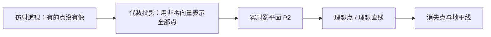
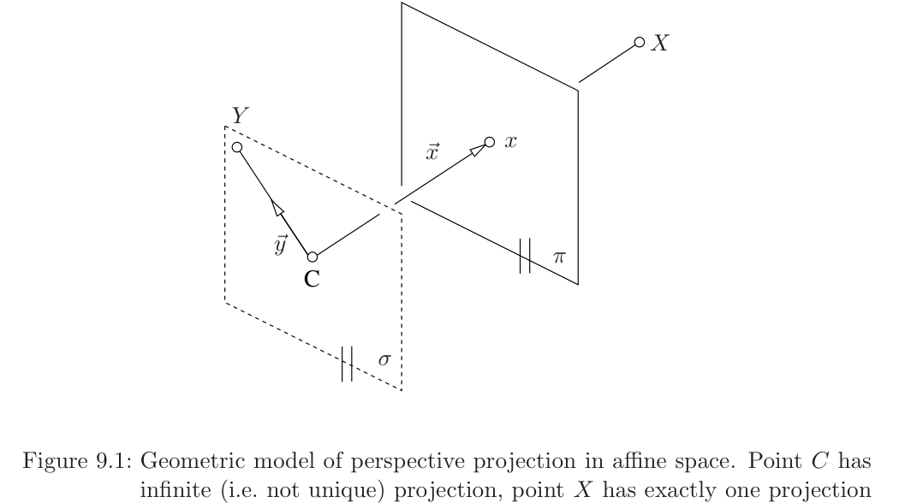
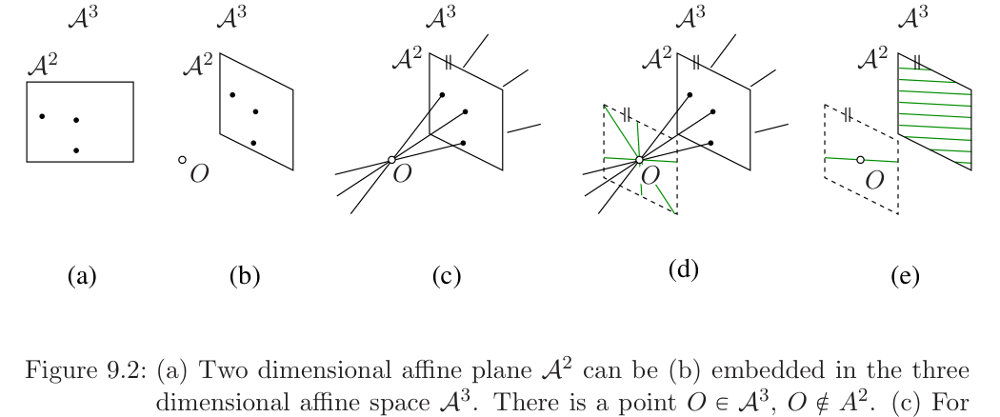
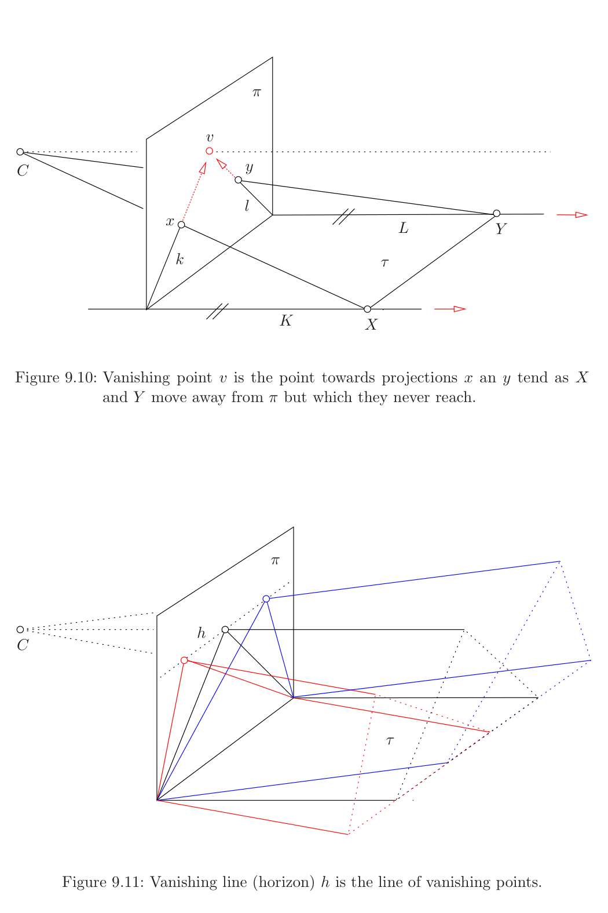

# 第9章 射影平面（Projective plane）

### 本章总览

本章对应 Tomas Pajdla，*Elements of Geometry for Computer Vision*（计算机视觉几何基础），2016-5-9。阅读范围：PDF 第 89–104 页，书页 85–100。开读时 PDF 第 89 页章名为 `9 Projective plane`。无书签；书页 \(N\) 对应 PDF 页 \(N+4\)。PDF 第 104 页是本章最后一页，书页 100。下一章从 PDF 第 105 页 `10 Projective space` 开始。

第8章已经碰到第三坐标为 0 的向量：它们表示射线，却不是仿射像平面上的点。本章从仿射空间里的透视投影说起，说明几何交点模型覆盖不了主平面上的点，代数模型却能表示它们。补上这些点之后，得到**实射影平面**（real projective plane）\(\mathbb{P}^2\)。

正文路线：9.1 用仿射几何与代数两种模型对照透视投影；9.2 给出 \(\mathbb{P}^2\) 的几何模型与代数模型，并定义理想直线、齐次坐标、关联、连线与交点；9.3 看单应怎样变换直线坐标；9.4–9.5 用射影语言解释消失点与地平线。

图注：仿射几何交点盖不住与像平面平行的那些点。代数模型先用向量补上它们，再把全体一维子空间叫做射影平面。理想直线上的点就是消失点的几何位置。

### 核心知识点

#### 仿射空间里透视投影的缺口

§54 在三维仿射空间里用交点做透视投影：过 \(C\) 与 \(X\) 的直线去切仿射像平面 \(\pi\)。三种情形见图 9.1。

1. \(X=C\)：过该点的直线有无穷多，与 \(\pi\) 的交点铺满整张 \(\pi\)，投影不是单点。
2. \(Y\neq C\) 落在过 \(C\) 且平行于 \(\pi\) 的平面 \(\sigma\) 上：过 \(C,Y\) 的唯一直线与 \(\pi\) 不相交，投影是空集。
3. \(X\notin\sigma\)：过 \(C,X\) 的唯一直线与 \(\pi\) 交于唯一点 \(x\)。

仿射空间是点集配上自由向量，平行线不相交，平行平面也不相交。这就是第 2 条没有交点的原因。

👉 完整深度讲解见第3章。📝待补全

§55 用投影矩阵写出代数模型：

\[
P_\beta=[A\mid -A\vec{C}_\delta]
\tag{9.1}
\]

\[
\eta\vec{x}_\beta=[A\mid -A\vec{C}_\delta]\begin{bmatrix}\vec{X}_\delta\\1\end{bmatrix}
\tag{9.2}
\]

\(\eta\in\mathbb{R}\)。三种几何情形对应三种代数结果。

1. \(X=C\) 时右边是零向量。可以取 \(\eta=0\) 而让 \(\vec{x}_\beta\) 任意，也可以取 \(\eta\neq 0\) 并令 \(\vec{x}_\beta=\vec{0}\)。书采用后者，用零向量表示「所有非零向量」，也就是整张像平面。
2. \(Y\neq C\) 在 \(\sigma\) 上时，\(\mathrm{rank}\,A=3\) 给出 \(\eta A^{-1}\vec{x}_\beta=\vec{Y}_\delta-\vec{C}_\delta\)。\(A^{-1}\) 的列是相机基在世界基 \(\delta\) 下的坐标。\(Y\) 在平行于 \(\pi\) 的平面上，\(\vec{Y}_\delta-\vec{C}_\delta\) 只用到前两个基向量，第三系数 \(r=0\)，因此

\[
\vec{x}_\beta=\begin{bmatrix}p\\q\\0\end{bmatrix}
\tag{9.9}
\]

并且 \(\eta\neq 0\)，否则左边为零，对应 \(Y=C\)，已排除。
3. \(X\notin\sigma\) 时第三系数 \(r\neq 0\)，可归一化成

\[
\eta'\begin{bmatrix}u\\v\\1\end{bmatrix}=A(\vec{X}_\delta-\vec{C}_\delta)
\tag{9.14}
\]

同样 \(\eta\neq 0\)。

表 9.1 的对照结论是：可以一律取 \(\eta\neq 0\)；\(C\) 的「投影」用零向量表示，其余点用非零向量；代数模型能表示仿射空间里的全部点；几何交点模型更弱，无法表示 \(\sigma\) 上除 \(C\) 以外的点。

图注：图 9.1。仿射几何投影：\(C\) 的投影不唯一，\(X\) 有唯一像 \(x\)，\(\sigma\) 上的 \(Y\) 没有像。

🔑 关键速记：仿射交点模型会漏掉主平面上的点；代数模型用 \([u,v,0]^\mathrm{J}\) 表示它们，用零向量表示相机中心。

#### 实射影平面的几何模型

仿射几何模型不够用，于是把仿射空间升级，使透视投影都能用几何对象的相交写完。这个升级叫做射影空间。本章先做最重要的一层：**实射影平面** \(\mathbb{P}^2\)。

把实仿射平面 \(\mathbb{A}^2\) 看成 \(\mathbb{A}^3\) 的子集，并取一点 \(O\in\mathbb{A}^3\setminus\mathbb{A}^2\)，见图 9.2。\(\mathbb{A}^2\) 上每一点 \(X\) 对应 \(\mathbb{A}^3\) 里唯一一条过 \(X\) 与 \(O\) 的直线。另外还有一批过 \(O\) 却不穿过 \(\mathbb{A}^2\) 的直线：它们平行于 \(\mathbb{A}^2\)，铺满过 \(O\) 且平行于 \(\mathbb{A}^2\) 的那张平面。

**实射影平面**定义为 \(\mathbb{A}^3\) 里所有过 \(O\) 的直线的集合。这些直线叫做射影平面上的**点**。脚注说明：也可以不提任何仿射平面，直接取一点 \(O\) 和过它的全体直线。本章是从给定的 \(\mathbb{A}^2\) 扩出来的，因此能区分两类点。

与 \(\mathbb{A}^2\) 相交的那些直线，一一对应 \(\mathbb{A}^2\) 上的点，叫做射影平面的**仿射点**（affine points；捷克语 vlastní body；Hartley–Zisserman [14] 称 finite points）。不与 \(\mathbb{A}^2\) 相交的那些直线是多出来的点，叫做**理想点**（ideal points；nevlastní body；[14] 称 points at infinity）。

每个理想点 \(P\)（即过 \(O\) 且平行于 \(\mathbb{A}^2\) 的直线 \(l\)）对应 \(\mathbb{A}^2\) 里一组与 \(l\) 平行的平行线。不同平行线族用方向区分。因此理想点就是 \(\mathbb{A}^2\) 里的方向，也可以看成平行线的交点。这些平行线在 \(\mathbb{A}^2\) 里并不相交，因为 \(P\notin\mathbb{A}^2\)；它们在把 \(\mathbb{A}^2\) 扩大后的实射影平面里相交。

图注：图 9.2。(a) 仿射平面 \(\mathbb{A}^2\)；(b) 嵌进 \(\mathbb{A}^3\) 并取 \(O\notin\mathbb{A}^2\)；(c) 每点对应唯一一条过 \(O\) 的直线；(d) 有一束过 \(O\) 的直线不对应 \(\mathbb{A}^2\) 上的点；(e) 这束直线对应 \(\mathbb{A}^2\) 里各组平行线。

🔑 关键速记：\(\mathbb{P}^2\) 是过定点 \(O\) 的全体直线；与 \(\mathbb{A}^2\) 相交的是仿射点，平行于 \(\mathbb{A}^2\) 的是理想点。

#### 实射影平面的代数模型

几何模型在 \(\mathbb{A}^3\) 里，计算改到 \(\mathbb{R}^3\)。取坐标系 \((O,\vec{b}_1,\vec{b}_2,\vec{b}_3)\)，原点在 \(O\)，\(\vec{b}_1,\vec{b}_2\) 来自 \(\mathbb{A}^2\) 的坐标系，\(\vec{b}_3=\varphi(O,o)\)。过 \(O\) 的直线对应 \(\mathbb{R}^3\) 的一维子空间。

因此：**实射影平面是 \(\mathbb{R}^3\) 的全体一维子空间的集合。**

仿射平面是去掉某个二维子空间里全部一维子空间之后剩下来的那些一维子空间。能扮演「仿射平面」的子集有无穷多种，具体选哪一个，由 \(\mathbb{R}^3\) 的一组基决定。

选定基 \(\beta=(\vec{b}_1,\vec{b}_2,\vec{b}_3)\) 后，由

\[
\vec{x}_\beta=\begin{bmatrix}x\\y\\1\end{bmatrix},\qquad x,y\in\mathbb{R}
\tag{9.15}
\]

生成的一维子空间代表仿射点；由

\[
\vec{x}_\beta=\begin{bmatrix}x\\y\\0\end{bmatrix},\qquad x,y\in\mathbb{R},\ \text{且 }x\neq 0\text{ 或 }y\neq 0
\tag{9.16}
\]

生成的一维子空间代表理想点。仿射点与一张二维仿射平面一一对应；理想点正好补齐 \(\mathbb{R}^3\) 里剩下的一维子空间。

第8章球面图像里出现的 \([x,y,0]^\mathrm{J}\)，在这里就是理想点的齐次代表。球面还区分相反方向；射影平面把 \(\vec{x}\) 与 \(-\vec{x}\) 看成同一个点。

👉 完整深度讲解见第8章。📝待补全

🔑 关键速记：代数上 \(\mathbb{P}^2\) 就是 \(\mathbb{R}^3\) 的一维子空间；第三坐标为 1 是仿射点，为 0 且非零是理想点。

#### 射影平面上的直线

仿射直线 \(l\) 上的点，对应几乎填满某个二维子空间的那些一维子空间，只缺一个由 \(\vec{z}\) 生成的理想点。把这个理想点补回去，就得到该二维子空间，也就是仿射直线的**射影完备化**（projective completion）。以后仍把它叫做直线。

因此，实射影平面上的直线对应 \(\mathbb{R}^3\) 的二维子空间。

用一组基 \((\vec{x},\vec{y})\) 表示二维子空间不唯一，判断两组基是否给出同一条直线，要看四个向量并在一起是否秩为 2，见 (9.17)。更方便的办法是：\(3=2+1\)，每个二维子空间对应三维对偶空间里恰好一个一维子空间。取这个一维子空间的基 \(\vec{l}\)，则

\[
\vec{l}^\mathrm{J}_{\bar\beta}\,[\vec{x}_\beta\ \vec{y}_\beta]=0
\tag{9.18}
\]

\(\bar\beta\) 是 \(\beta\) 的对偶基。于是点和直线都用 \(\mathbb{R}^3\) 的一维子空间表示：点在 \(V=\mathbb{R}^3\)，直线在对偶空间 \(\bar V\)。配上对偶基后，坐标都变成 \(\mathbb{R}^3\) 向量，并满足 (9.18)。几何模型里，可用垂直关系唯一做出与 \(l\) 对应平面相垂直的那条直线。

对偶基使线性函数的系数也有坐标。直线方程 \(\vec{l}^\mathrm{J}\vec{x}=0\) 里的 \(\vec{l}\) 就坐在对偶空间。

👉 完整深度讲解见第2章。📝待补全

🔑 关键速记：射影直线是 \(\mathbb{R}^3\) 的二维子空间，也可用对偶空间里的一维子空间 \(\vec{l}\) 表示，条件是 \(\vec{l}^\mathrm{J}\vec{x}=0\)。

#### 理想直线

全体不对应仿射点的一维子空间，自己又构成 \(\mathbb{R}^3\) 的一个二维子空间，因此是射影平面上的一条直线，而且不落在所选的仿射平面里。它叫做该仿射平面的**理想直线**（ideal line；nevlastní přímka；[14] 称 line at infinity），图 9.6 里记作 \(\vec{l}_\infty\)。

每个仿射平面恰好对应一条理想直线。反过来，在射影平面里选定一条直线当作理想直线，剩下的点就构成与之配套的仿射平面。

把「仿射点 / 理想点」这个划分说清楚，必须先有一张指定的仿射平面，或者先在 \(\mathbb{P}^2\) 里指定哪一条直线是无穷远。换一条理想直线，哪些点算仿射点就会跟着换。

🔑 关键速记：全体理想点合成一条理想直线 \(l_\infty\)；选定 \(l_\infty\) 就选定了配套的仿射平面。

#### 齐次坐标

仿射平面上，点的坐标是基下向量的坐标，是唯一的。射影平面上的点是一维子空间，一维子空间的基是一个非零向量，这样的基有无穷多，彼此相差非零倍数。例如

\[
\begin{bmatrix}1\\0\\1\end{bmatrix}
\quad\text{与}\quad
\begin{bmatrix}2\\0\\2\end{bmatrix}
\tag{9.19}
\]

是同一个点的两套「坐标」。唯一性被破坏了，所以要换一个名字：**齐次坐标**（homogeneous coordinates）。

射影平面上一点的齐次坐标，就是代表该点的一维子空间里某一个基向量的坐标。一条射影直线的齐次坐标，定义相同。

仿射点可以同时拥有仿射坐标与齐次坐标。仿射坐标为 \([x,y]^\mathrm{J}\) 的点，把理想直线取成 \(z=0\) 这张二维子空间后，可用 \([x,y,1]^\mathrm{J}\) 生成一维子空间。因此齐次坐标 \([u,v,w]^\mathrm{J}\) 满足 \(u=\lambda x\)，\(v=\lambda y\)，\(w=\lambda\cdot 1\)，\(\lambda\neq 0\)。

理想点没有仿射坐标。它们的齐次坐标是

\[
\begin{bmatrix}x\\y\\0\end{bmatrix},\qquad x,y\in\mathbb{R},\ \text{且 }x\neq 0\text{ 或 }y\neq 0
\tag{9.22}
\]

零向量 \(\vec{0}\) 不是任何一维空间的基，因此既不代表点，也不代表直线。

第1章记号表已经把 \(\mathbb{P}^2\) 和齐次写法登记下来，当时只给符号，不讲为什么第三坐标可以是 0。

👉 完整深度讲解见第1章。📝待补全

🔑 关键速记：齐次坐标不唯一，相差非零倍数仍是同一个点；\(w=0\) 是理想点，零向量什么都不是。

#### 点与直线的关联、连线与交点

点 \(x\) 与直线 \(l\) **关联**（incident），当且仅当它能和另一点 \(y\) 一起生成这条直线。写成子空间就是

\[
\vec{l}^\mathrm{J}_{\bar\beta}\,\vec{x}_\beta=0
\tag{9.23}
\]

也就是代表直线的一维子空间，按标准欧氏内积与代表点的一维子空间正交。几何模型里，\(A^3\) 中代表 \(x\) 的直线垂直于代表 \(l\) 的直线。写开坐标 \(\vec{x}_\beta=[x,y,z]^\mathrm{J}\)、\(\vec{l}_{\bar\beta}=[a,b,c]^\mathrm{J}\)，得到 \(ax+by+cz=0\)；仿射点取 \(z=1\) 就回到熟悉的 \(ax+by+c=0\)。

**连线**（join）：射影平面上任意两个不同点恰好关联一条直线。齐次坐标由

\[
\vec{l}^\mathrm{J}_{\bar\beta}\vec{x}_\beta=0,\qquad
\vec{l}^\mathrm{J}_{\bar\beta}\vec{y}_\beta=0
\tag{9.24}
\]

的解空间给出。这个解空间是一维的。用第2章 2.3 节的向量积，可取

\[
\vec{l}_{\bar\beta}=\vec{x}_\beta\times\vec{y}_\beta
\tag{9.26}
\]

射影平面和仿射平面里，两点都恰好决定一条直线。

向量积 \(\vec{x}\times\vec{y}\) 垂直于 \(\vec{x}\) 和 \(\vec{y}\)，长度是平行四边形面积，方向由右手系决定。这里只用「同时垂直于两个向量」这一条，所以它正好给出直线的对偶坐标。

👉 完整深度讲解见第2章。📝待补全

**交点**（meet）：射影平面上任意两条不同直线恰好关联一个点。齐次坐标由 \(\vec{k}^\mathrm{J}\vec{x}=0\)、\(\vec{l}^\mathrm{J}\vec{x}=0\) 的解空间给出，一个基向量是

\[
\vec{x}_\beta=\vec{k}_{\bar\beta}\times\vec{l}_{\bar\beta}
\]

仿射平面里这件事不成立：平行线没有交点。射影平面把交点补成理想点，平行线也相交。

🔑 关键速记：关联就是 \(\vec{l}^\mathrm{J}\vec{x}=0\)；连线 \(\vec{l}=\vec{x}\times\vec{y}\)，交点 \(\vec{x}=\vec{k}\times\vec{l}\)；射影平面上两线必交。

#### 单应作用下的直线坐标

两点 \(\vec{x}_\beta,\vec{y}_\beta\) 被单应 \(H\) 送到 \(\vec{x}'_{\beta'},\vec{y}'_{\beta'}\)：

\[
\lambda_1\vec{x}'_{\beta'}=H\vec{x}_\beta,\qquad
\lambda_2\vec{y}'_{\beta'}=H\vec{y}_\beta,\qquad\lambda_1\lambda_2\neq 0
\tag{9.27}
\]

过原两点的直线 \(\vec{p}_{\bar\beta}\) 与过像点的直线 \(\vec{p}'_{\bar\beta'}\) 都由关联方程决定。把 \(x=H^{-1}x'\) 代进去，\(\vec{p}_{\bar\beta}\) 与 \(H^{-\mathrm{J}}\vec{p}_{\bar\beta}\) 满足同一组齐次方程。两点独立时解空间一维，因此存在 \(\lambda\in\mathbb{R}\) 使得

\[
\lambda\vec{p}'_{\bar\beta'}=H^{-\mathrm{J}}\vec{p}_{\bar\beta}
\tag{9.31}
\]

这就是直线齐次坐标在单应下的变换。点用 \(H\)，直线用 \(H^{-\mathrm{J}}\)。

用向量积写连线，再套第2章式 (2.47)，得到

\[
\vec{p}'_{\bar\beta'}
=
\frac{H^{-\mathrm{J}}}{\lambda_1\lambda_2\,\lvert H^{-\mathrm{J}}\rvert}\,\vec{p}_{\bar\beta}
\tag{9.36}
\]

交点的变换是

\[
\vec{x}'_{\beta'}
=
\frac{H}{\lambda_1\lambda_2\,\lvert H\rvert}\,\vec{x}_\beta
\tag{9.40}
\]

两对点先连线再求交，合成后仍按 \(H\) 走，只多一个行列式与四个 \(\lambda\) 的倍数，见 (9.45)。若单应本身是旋转，并且齐次坐标取单位向量，则所有 \(\lambda\) 等于 1，\(\lvert H\rvert=1\)，\(H^{-\mathrm{J}}=H\)，点和直线的齐次坐标都只乘同一个 \(H\)。

第8章已经说明，单应作用在点的一维子空间上，并且 \(H\) 与 \(\xi H\) 是同一张单应。本章补上直线：直线走 \(H^{-\mathrm{J}}\)，所以倍数和行列式会出现在分母里，但不改变那条直线。

👉 完整深度讲解见第8章。📝待补全

🔑 关键速记：单应下点乘 \(H\)，直线乘 \(H^{-\mathrm{J}}\)；旋转且用单位向量时，点和线乘同一张 \(H\)。

#### 消失点

用仿射像平面做透视投影时，会出现不舒服的情形。设空间平面 \(\tau\) 里有两条平行线 \(K,L\)，过中心 \(C\) 投到 \(\pi\) 上成为像直线 \(k,l\)。让两点 \(X,Y\) 沿 \(K,L\) 远离 \(\pi\)，它们的像 \(x,y\) 越来越靠近像上一点 \(v\)，但永远走不到 \(v\)。这个会聚点叫做**消失点**（vanishing point；úběžník）。

在射影语言里，\(K,L\) 交于 \(\tau\) 的一个理想点；这个理想点的像就是 \(v\)。仿射模型到不了 \(v\)，因为理想点根本不在仿射平面 \(\tau\) 里。

🔑 关键速记：消失点是一组平行线的公共理想点落到像上的位置；仿射像点只能逼近它，不能到达它。

#### 消失直线与地平线

\(\tau\) 里每一个方向给出一组平行线，也就给出一个消失点。这些消失点铺满像上一条完整的直线 \(h\)。\(h\) 叫做**消失直线**（vanishing line）；当 \(\tau\) 是地面时，也叫做**地平线**（horizon；horizont）。

用仿射几何模型把 \(\tau\) 投到 \(\pi\)：\(\tau\) 上没有点落到 \(h\) 上。反向把 \(\pi\) 投到 \(\tau\)：\(h\) 没有像。两边都不对称。

若改用实射影平面来做透视投影（这与 \(\mathbb{R}^3\) 里的代数模型等价），把 \(\tau\) 与 \(\pi\) 都做射影完备化之后，射影平面 \(\tau\) 上每一点在射影平面 \(\pi\) 上恰好有一个像，反过来也一样。书把这种完全对称叫做既有用、又漂亮。

把所有仿射平面的理想点并起来，就从 \(\mathbb{P}^2\) 走到三维实射影空间 \(\mathbb{P}^3\)。平行的空间直线将在那里相交。

👉 完整深度讲解见第10章。📝待补全

图注：图 9.10 与图 9.11。平行线 \(K,L\) 的像逼近消失点 \(v\) 但到不了；\(\tau\) 上各个方向的消失点连成消失直线（地平线）\(h\)。

🔑 关键速记：一个方向一个消失点，一张平面一条消失直线；地面的那条就是地平线。射影完备化之后，投影重新变成双方一一对应。

### 章末3–5条

1. 仿射交点模型盖不住主平面上的点；代数模型用 \([u,v,0]^\mathrm{J}\) 表示它们。
2. \(\mathbb{P}^2\) 是过定点的全体直线，也是 \(\mathbb{R}^3\) 的全体一维子空间。
3. 理想点对应方向，全体理想点合成一条理想直线；齐次坐标相差非零倍数仍是同一点。
4. 关联、连线、交点都化成 \(\vec{l}^\mathrm{J}\vec{x}=0\) 与向量积；射影平面上两线必交。
5. 消失点是平行线族理想点的像，消失直线是这些点的轨迹；地面时叫做地平线。

### 易混淆点与差异对比

仿射点、理想点这个划分依赖于先选定哪一张仿射平面，或先选定哪一条直线当 \(l_\infty\)。换理想直线，原来的理想点可以变成普通仿射点。

齐次坐标不是「多写一个 1」。仿射坐标 \([x,y]^\mathrm{J}\) 唯一；齐次坐标 \([\lambda x,\lambda y,\lambda]^\mathrm{J}\) 不唯一。零向量既不是点也不是线，不能拿来当齐次坐标。

\(\mathbb{P}^2\)、球面图像、仿射像平面是三层对象。仿射像平面只要 \(w=1\)；\(\mathbb{P}^2\) 允许 \(w=0\)，并把 \(\vec{x}\) 与 \(-\vec{x}\) 看成一点；球面图像用单位向量，区分相反方向。第8章已经说明圆柱全景还会把直线弯掉。

点变换乘 \(H\)，直线变换乘 \(H^{-\mathrm{J}}\)，不要都乘 \(H\)。只有 \(H\) 是旋转并且坐标取单位长度时，两者才变成同一张矩阵。

消失点不是像平面上「很远的普通像素」；在仿射模型里它根本不是任何空间点的像。只有把 \(\tau\) 完备化成射影平面，它才是理想点的像。地平线是消失直线的地面特例，不是另一套定义。

相机中心在仿射几何里投影成整张像平面，代数上写成零向量。这与理想点的非零 \([u,v,0]^\mathrm{J}\) 不是一类对象。

### 本章要点总结

透视投影在仿射空间里不完整：平行于像平面的点没有交点。把过定点的直线叫做点，就得到实射影平面。代数上这些点是 \(\mathbb{R}^3\) 的一维子空间，坐标叫齐次坐标；\(w=0\) 的非零向量是理想点，它们铺成理想直线。点线关联、连线、交点都变成一次齐次方程和向量积，平行线在这里相交。单应下点走 \(H\)、直线走 \(H^{-\mathrm{J}}\)。消失点与地平线是理想点、理想直线在像上的名字；用射影平面做投影之后，景物平面与像平面重新一一对应。
