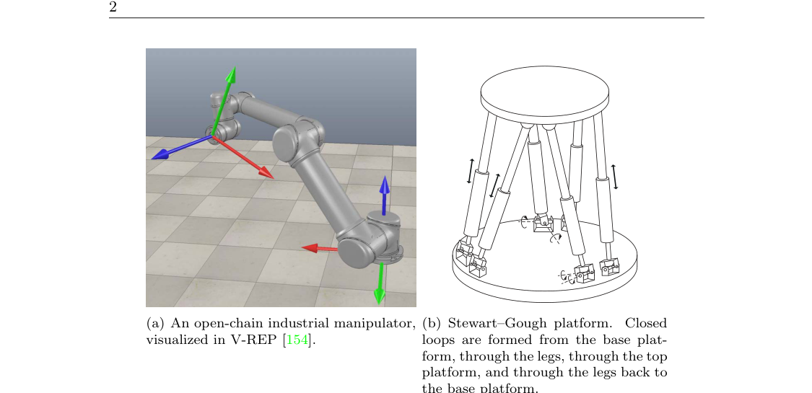
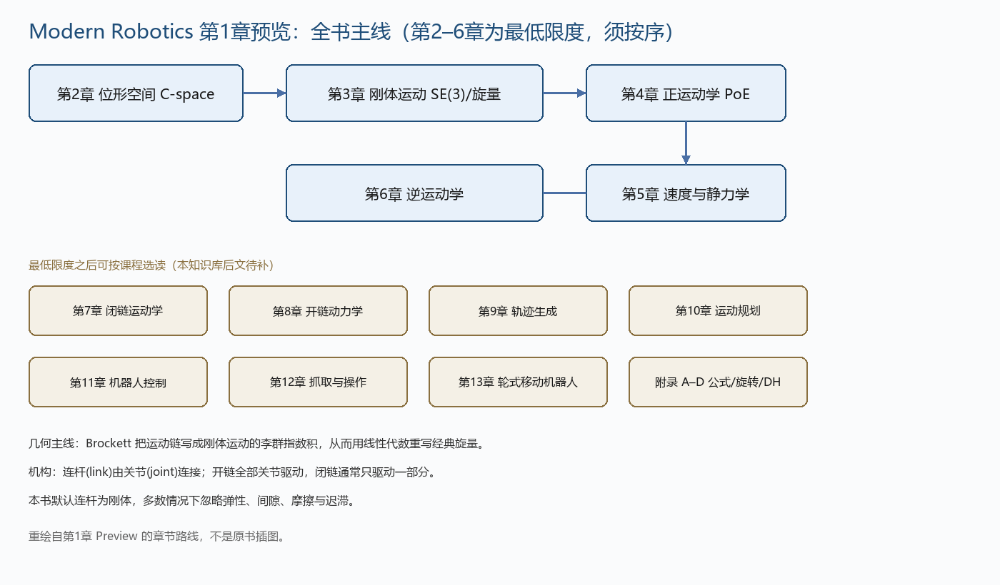

# 第1章 预览

### 来源说明

- 作者：Kevin M. Lynch, Frank C. Park
- 书名：Modern Robotics: Mechanics, Planning, and Control（现代机器人学：力学、规划与控制）
- 官方预印本：https://hades.mech.northwestern.edu/images/2/2e/MR-largefont-v2.pdf
- 预印本仅供个人学习使用，不得再分发。
- 正式出版：Cambridge University Press, 2017，ISBN 9781107156302。本地文件是 2019 年 12 月 30 日的更新第一版大字预印本；引用仍应写剑桥 2017 年版。配套站点 http://modernrobotics.org。

阅读范围：Preface（前言）PDF 第 15–20 页（PDF 20 仅有页码 xviii），Chapter 1 Preview（预览）PDF 第 21–30 页。未读第 3 章及之后。

### 本章总览

前言交代写作动机：把 robot mechanics（机器人力学）、planning（规划）和 control（控制）写成一门课，而不是拆进传统科目。读者只需大学一年级物理、常微分方程、线性代数和少量计算基础。

几何是本书的第二条主线。经典 screw theory（旋量理论）的记号对本科生不友好；1980 年代初 Roger Brockett 把运动链写成刚体运动的 Lie group（李群）结构，于是可用线性代数和线性微分方程重写旋量。作者称之为 modern screw theory（现代旋量理论）。更深的微分几何放到 Murray, Li and Sastry 的研究生教材。

第 2–6 章是最低限度，而且必须按顺序读。第 7–13 章和附录按课程目标选读。第 1 章本身是全书 Preview：先定义机构，再按章预告后面要解决的问题。

图注：第 2–6 章构成前言所说的最低限度主线。位形空间先回答“机器人在哪里”，刚体运动给出刚体位姿的矩阵写法，再进入正/逆运动学和 Jacobian。第 7 章及以后不在本批笔记里。

### 核心知识点

#### 写作背景与读者设定

2008 年 IEEE ICRA（帕萨迪纳）上，两位作者决定合写本科教材。Frank 自 1996 年起在首尔大学用自编讲义讲运动学；Kevin 在西北大学用论文和多本书拼课。他们要同时满足两件事：力学、规划、控制写成统一视角，并且难度落在第一门机器人课。

作者署名按字母序，自认贡献相等。更新第一版改正了若干错误并做少量增补；勘误、视频、软件、习题解答都指向配套网站。本笔记不抄软件。

🔑 关键速记：这是面向本科第一门课的统一教材，不是把运动学、规划和控制定成三门互不相干的课。

#### 现代几何与旋量

经典旋量用 screw、twist、wrench、reciprocity、transversality、conjugacy 等一套独立语言。代数替代方案又容易让人埋进计算、丢掉几何。Brockett 的突破是：运动链可以直接写在刚体运动的李群上，指数映射把旋量变成熟悉的矩阵运算。

前言点名：第 2–6 章必须按序；第 8 章动力学可以跳过，那时第 11、13 章的控制就改成“每个驱动器控制速度”而不是力/力矩。只做运动规划可以读第 2、3、10、13 章。

👉 刚体位姿的矩阵指数、twist（旋量速度）和 wrench（力旋量）的具体定义在第 3 章。旋转矩阵、指数坐标、空间速度都在那里展开。📝待补全

🔑 关键速记：现代旋量 = 用李群指数和线性代数重写经典旋量，而不是另学一套孤立记号。

#### 机构、连杆与关节

本书关心的是会在物理世界里运动的 mechanism（机构），不是单独的人工智能或感知。典型对象：robot arm（机械臂）、wheeled vehicle（轮式车），以及装在轮式底盘上的臂。

机构由 rigid body（刚体）组成的 link（连杆）经 joint（关节）连接，使相邻杆可以相对运动。关节通常由 electric motor（电机）驱动，从而让机器人按需要运动并出力。

驱动可以是电的（直流/交流电机、步进电机、shape memory alloy），也可以是气动或液压缸。理想的旋转电机应当轻、转速只在数百 RPM、并能出大力矩；现有电机往往力矩小、转速到数千 RPM，所以需要减速增矩。传动包括齿轮、绳驱、带轮、链轮。speed-reduction device（减速装置）应尽量无滑动，并控制 backlash（间隙）：输出端在输入不动时仍能转过的角度。还可以加制动器，用来急停或保持姿态。

传感方面：转动和移动关节用 encoder（编码器）、potentiometer（电位计）、resolver（旋转变压器）测位移，有时用 tachometer（测速机）测速度；关节或 end-effector（末端执行器）用力–力矩传感器。定位还可以用纯视觉相机、RGB-D 相机、激光测距和各类声学传感器。

本书默认连杆是刚体，多数情况下忽略弹性、间隙、摩擦和 hysteresis（迟滞）。

🔑 关键速记：机构 = 刚体连杆 + 关节 + 驱动；电机通常要减速，传感先保证关节运动可测。

#### 开链与闭链

连杆可以串成 open chain（开链），也可以形成 closed loop（闭链）。开链的典型是工业机械臂；闭链的典型是 Stewart–Gough platform（Stewart–Gough 平台）：从基座平台经腿到上平台，再经腿回到基座，构成闭环。

开链通常每个关节都驱动。闭链往往只驱动一部分关节，其余是被动关节。

图注：左图是 V-REP 里画出的开链工业臂，各关节独立驱动。右图是 Stewart–Gough 平台，六条腿把上下平台连成闭环，闭链约束会减少自由度。原书 Figure 1.1，PDF 第 22 页。

自由度怎么数、Grübler 公式怎么用，第 1 章只点出结论：开链的 dof 就是各关节自由度之和；闭链要用公式扣掉关节约束。

👉 位形、自由度、关节约束和 Grübler 公式的完整计算见第 2 章。开链、四杆、Delta、Stewart–Gough 的数字例子也在那里。

🔑 关键速记：开链关节全驱动、自由度直接相加；闭链有环，只有一部分关节驱动，必须扣约束。

#### 位形空间、任务空间与工作空间

configuration（位形）是机器人每一点位置的完整指定。平面刚体用 3 个数（2 个位置 + 1 个朝向），空间刚体用 6 个数（3 + 3）。这个数目就是 degrees of freedom（自由度，dof），也是 configuration space（位形空间，C-space）的维数。

机器人的 dof 等于各刚体自由度之和减去关节施加的独立约束。最常见的 revolute（转动）和 prismatic（移动）关节只给相对运动 1 个自由度，因此对空间刚体相当于提供 5 条约束。

同一维数的空间可以有不同 topology（拓扑）。单位球面可以用纬度、经度做 explicit parametrization（显式参数化），也可以用 $(x,y,z)$ 加 $x^2+y^2+z^2=1$ 做 implicit parametrization（隐式表示）。本书对刚体位形采用隐式表示。

end-effector 上固连坐标系的位姿空间叫 task space（任务空间）。机器人 C-space 与任务空间一般不是一一对应。workspace（工作空间）是任务空间里末端坐标系实际能够到达的子集。

👉 第 2 章给出 Definition 2.1、刚体点数自由度、Grübler 公式、拓扑与表示、完整约束与速度约束，以及任务空间/工作空间的例子。

🔑 关键速记：C-space 描述整机在哪里；任务空间描述任务怎么写；工作空间只收末端够得着的那些位姿。

#### 后文各章在做什么

下面各段只保留第 1 章给出的预告，不补后文章节里尚未抽出的公式。

**第 3 章 Rigid-Body Motions（刚体运动）。** 在刚体上固连参考系，用 $3\times 3$ rotation matrix（旋转矩阵）写朝向。旋转矩阵有 3 个独立坐标；最直观的是 exponential coordinate（指数坐标）：绕单位向量 $\hat{\omega}\in\mathbb{R}^3$ 转 $\theta\in[0,\pi]$，指数坐标写成 $\omega=\hat{\omega}\theta\in\mathbb{R}^3$。Euler 角、Cayley–Rodrigues 参数、单位四元数放到 Appendix B。指数写法直接延伸到刚体运动，并给出六维 twist（也称 spatial velocity）和六维 wrench（也称 spatial force）。

👉 完整深度讲解见第 3 章。📝待补全

**第 4 章 Forward Kinematics（正运动学）。** 开链的末端位姿由关节位置唯一确定。本章给出 product of exponentials（指数积，PoE）：关节轴看成 twist，只需基座系和末端系，不必给每个连杆单独建系。Appendix C 另讲 Denavit–Hartenberg（D–H）参数：参数更少，但连杆系必须按规则来。

👉 完整深度讲解见第 4 章。📝待补全

**第 5 章 Velocity Kinematics and Statics（速度运动学与静力学）。** 关节速度与末端速度之间的线性关系由 forward kinematics 的 Jacobian（雅可比）给出：用它乘关节速度得到末端 twist。Jacobian 秩不到最大时出现 kinematic singularity（运动学奇异）。manipulability ellipsoid（可操作椭球）也从 Jacobian 来。静平衡时，同一矩阵用来由期望 wrench 反求关节力/力矩。本书默认末端速度写成六维 twist。

👉 完整深度讲解见第 5 章。📝待补全

**第 6 章 Inverse Kinematics（逆运动学）。** 已知末端位姿求关节位置。开链正问题通常唯一，逆问题可能多解或无解。先讲一类有封闭解的六自由度开链，再讲用 Jacobian 逆的迭代数值法。关节数多于任务空间维数时称为 kinematically redundant（运动学冗余），改用 Jacobian 的伪逆。

👉 完整深度讲解见第 6 章。📝待补全

**第 7 章 Kinematics of Closed Chains（闭链运动学）。** 闭链的正运动学常有多解，逆运动学有时也有多解；奇异分析因同时存在主动关节和被动关节而更细。先看平面五杆和 Stewart–Gough，再推广。

👉 完整深度讲解见第 7 章。📝待补全

**第 8 章 Dynamics of Open Chains（开链动力学）。** forward dynamics 由关节力/力矩求加速度；inverse dynamics 由期望加速度求关节力/力矩。方程是二阶常微分方程。Lagrangian 路线：选 generalized coordinates（广义坐标），把动能加势能代入 Euler–Lagrange 方程。Newton–Euler 路线：从近端往远端推速度加速度，再从远端往回算 wrench。开链可以递归算。

👉 完整深度讲解见第 8 章。📝待补全

**第 9 章 Trajectory Generation（轨迹生成）。** trajectory（轨迹）= path（路径，纯几何的位形序列）+ time scaling（时间标度，何时到达这些位形）。输入常是带时间的 control points（控制点）。三种情形：关节空间或任务空间的点到点直线；过经由点的光滑轨迹；沿给定路径、受动力学和驱动限制的时间最优轨迹。避障路径放到第 10 章。

👉 完整深度讲解见第 9 章。📝待补全

**第 10 章 Motion Planning（运动规划）。** 在杂乱工作空间里找无碰撞运动，同时避开关节限位、驱动限位等。path planning 是其子问题：只找无碰路径，通常不管动力学和耗时。没有单一规划器适用所有问题。三种基本路线：grid-based methods（网格法）、sampling methods（采样法）、virtual potential fields（虚拟势场）。

👉 完整深度讲解见第 10 章。📝待补全

**第 11 章 Robot Control（机器人控制）。** 控制器把任务规格变成各驱动器的力/力矩。对应行为包括 motion/position control（运动/位置控制）、force control（力控制）、hybrid motion–force control（运动–力混合控制）、impedance control（阻抗控制）。同一方向上不能既独立规定运动又独立规定力：你规定运动，环境决定力，反之亦然。实用方案用反馈弥补模型误差；在无完整动力学模型的反馈极限之后，再讲 computed torque control（计算力矩控制）等。

👉 完整深度讲解见第 11 章。📝待补全

**第 12 章 Grasping and Manipulation（抓取与操作）。** 对接触建模：接触对物体运动的约束，以及有摩擦接触能传哪些力。由此讨论 form closure（形封闭）和 force closure（力封闭），以及推、动态搬运、结构稳定性等非抓取操作。

👉 完整深度讲解见第 12 章。📝待补全

**第 13 章 Wheeled Mobile Robots（轮式移动机器人）。** omniwheel / mecanum wheel 可以原地旋转或沿任意方向平移。普通轮不侧滑，这种 no-slip 约束与闭链的 loop-closure 不同：后者是 holonomic（完整约束，即位形约束），前者是 nonholonomic（非完整约束，速度约束不能积分成等价的位形约束）。两类车的运动学、规划和控制定义不同；odometry（里程计，由轮编码器估计底盘位形）和移动操作的反馈控制则可以对两类车用同一套。移动操作的核心对象是把关节速度和轮速映到末端 twist 的 Jacobian。

👉 完整深度讲解见第 13 章。📝待补全

图注：上排是前言规定的最低限度（第 2–6 章，须按序）。下排是可按课程选读的第 7–13 章与附录。这张图是按 Preview 重绘的路线，不是原书插图。

#### 配套材料在本章的位置

每章末有概念摘要。Appendix A 汇总常用公式。视频和可读的配套函数在网站上；作者写明软件不以最强健或最高效为目标，而是为了把公式变成可核对的步骤。V-REP 被用作可交互的臂与移动操作可视化。本知识库笔记不展开软件接口。

🔑 关键速记：第 1 章是地图，不是定理章；公式从第 2 章才开始写全。

### 章末要点

1. 第 2–6 章是最低限度，必须按顺序读；其余章按课程裁剪。
2. 几何主线是 Brockett 的现代旋量：用刚体运动的李群指数写运动链。
3. 机构由刚体连杆和关节组成；开链全驱动，闭链通常只驱动一部分。
4. 位形空间描述整机，任务空间描述任务，工作空间是末端实际可达的子集。
5. 完整约束限制位形，非完整约束只限制速度，轮式无侧滑是后者的典型来源。

### 易混淆点与差异对比

力学、规划、控制在本书里是一条链，不是三门可以任意调换顺序的课。跳过第 8 章动力学时，控制章必须改成“驱动器输出速度”。

开链和闭链不是“有没有电机”的区别，而是“有没有闭环”。闭链里可以有未驱动的被动关节。

C-space、task space、workspace 三个词不要混用。七关节开链的六维末端位姿不是整机位形；黑板上某些点可以在任务空间里但根本不在工作空间里。

完整约束（闭链环闭合）会降低 C-space 维数。非完整约束（轮不侧滑）只降低可行速度的维数，不降低能到达的 C-space 维数。第 1 章只给定义，例子在第 2 章和第 13 章。

显式参数用最少的坐标，但可能有奇异；隐式表示坐标更多，却没有表示奇异。本书后文对刚体取向走隐式的旋转矩阵。

### 本章要点总结

第 1 章加上前言，只做三件事：说明这是一本用现代几何统一力学、规划与控制的本科书；规定第 2–6 章必须按序；用开链/闭链、驱动与传感、刚体假设，把后面每一章要回答的问题列成地图。真正的定义、公式和计数从第 2 章的位形空间开始。第 3 章及以后的矩阵指数、PoE、Jacobian、动力学与控制，本章只保留预告中的结论，细节标为待补全。
