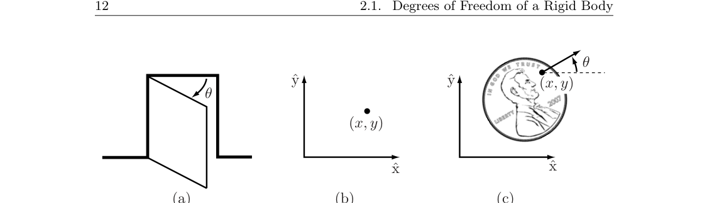
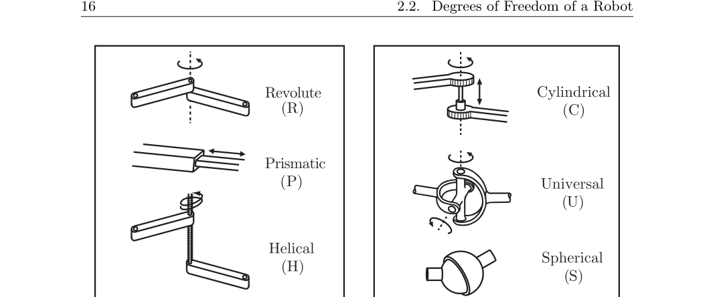
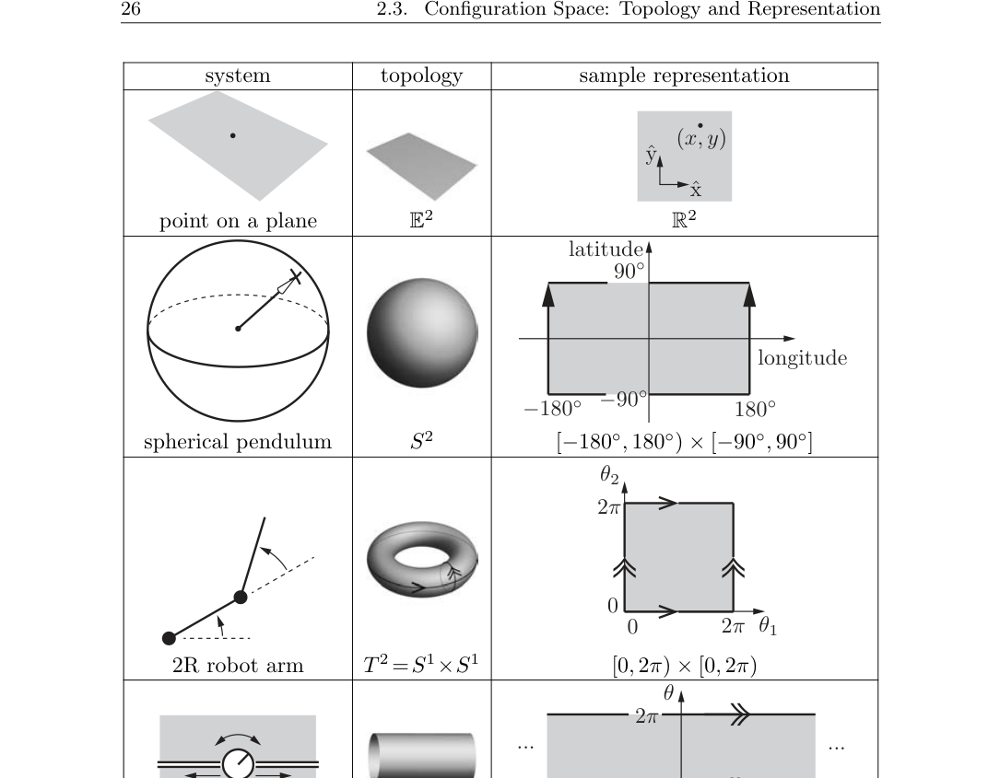

# 第2章 位形空间

### 来源说明

- 作者：Kevin M. Lynch, Frank C. Park
- 书名：Modern Robotics: Mechanics, Planning, and Control（现代机器人学：力学、规划与控制）
- 阅读范围：Chapter 2 Configuration Space（位形空间），PDF 第 31–76 页（书页 11–56）。PDF 第 77 页起为第 3 章，本批未读。
- 2.8 Exercises（习题）只保留章内已出现的概念，不解答。

### 本章总览

机器人由 link（连杆）经各类 joint（关节）连接，actuator（驱动器）把力或力矩送到关节。末端通常装 gripper 或手。本书出现的连杆一律按 rigid body（刚体）处理。

最基本的问题是：它在哪里？答案是 configuration（位形）——机器人每一点位置的完整指定。连杆形状已知且为刚体，所以只需很少几个连续实数。这些实数的最少个数是 degrees of freedom（自由度，dof）。全体位形构成 configuration space（位形空间，C-space）；一个位形对应 C-space 里的一个点。

本章先数单个刚体的自由度，再数多杆机构，给出 Grübler 公式；然后看 C-space 的 topology（拓扑）和数值表示；最后把完整约束、速度约束和末端的 task space / workspace 分开。单个刚体位姿的矩阵写法留到第 3 章。

### 核心知识点

#### 位形、自由度与 C-space

门只需铰链角 \(\theta\)。平面上一个点用 \((x,y)\)。正面朝上躺在桌上的硬币用 \((x,y,\theta)\)，\(\theta\) 表示林肯朝向。这些坐标都在连续实数区间里取值。

即便允许硬币正反两面，C-space 仍然是 3 个自由度：正反面取值在离散集 \(\{\text{heads},\text{tails}\}\) 里，不增加连续坐标。软物体（如枕头）不在这一套计数里。

**Definition 2.1.** 机器人的 configuration 是其每一点位置的完整指定。表示该位形所需的最少实坐标个数 \(n\) 是自由度 dof。包含全部可能位形的 \(n\) 维空间称为 configuration space（C-space）。机器人的位形是其 C-space 中的一个点。

图注： (a) 门的位形由铰链角 \(\theta\) 描述；(b) 平面点由 \((x,y)\) 描述；(c) 桌上硬币由 \((x,y,\theta)\) 描述。原书 Figure 2.1，PDF 第 32 页。

🔑 关键速记：dof 只数连续实坐标的最少个数；离散开关不另加一个自由度。

#### 刚体自由度：从点到杆

桌上硬币取三个固连点 \(A,B,C\)。若三点可独立放在平面上，看起来有 6 个自由度。刚体要求距离恒定：

\[
d(A,B)=\sqrt{(x_A-x_B)^2+(y_A-y_B)^2}=d_{AB},
\]

\(d(B,C)=d_{BC}\)、\(d(A,C)=d_{AC}\) 同理。先自由放 \(A\)（2 个自由度），\(B\) 只能在以 \(A\) 为心、半径 \(d_{AB}\) 的圆上（1 个角度 \(\phi_{AB}\)），\(C\) 落在两圆交点的两个位置上，分别对应正反面。选定正反后，\(C\) 的两个坐标被两条距离约束消掉。于是平面刚体恰好 3 个自由度，可取 \((x_A,y_A,\phi_{AB})\)。

再加第四点 \(D\) 会带来三条距离约束，其中一条冗余，独立约束仍是两条，刚好消掉 \((x_D,y_D)\)。不必再加点。

一般规则：

\[
\text{degrees of freedom}
=(\text{sum of freedoms of the points})
-(\text{number of independent constraints}).
\tag{2.1}
\]

也就是

\[
\text{degrees of freedom}
=(\text{number of variables})
-(\text{number of independent equations}).
\tag{2.2}
\]

空间中不再把硬币按在桌上。\(A\) 自由（3），\(B\) 在球面 \(d(A,B)=d_{AB}\) 上（\(3-1=2\)，纬度与经度），\(C\) 在两球面交出的圆上（\(3-2=1\)）。三点不共线时，空间刚体有 6 个自由度。

平面刚体也可看成空间刚体加上 \(z_A=z_B=z_C=0\) 三条独立约束，\(6-3=3\)。

对由刚体组成的机器人，(2.1) 改写成

\[
\text{degrees of freedom}
=(\text{sum of freedoms of the bodies})
-(\text{number of independent constraints}).
\tag{2.3}
\]

这就是下一节 Grübler 公式的来源。

空间刚体位姿的具体矩阵表示不在本章展开。第 3 章会在刚体上固连参考系，用 \(4\times 4\) 齐次变换写这个 6 维 C-space：16 个矩阵元加上 10 条约束，得到隐式表示；速度则写成 \(\mathbb{R}^6\) 里的 twist。

👉 完整深度讲解见第 3 章。📝待补全

🔑 关键速记：平面刚体 3 自由度，空间刚体 6 自由度；多出来的点只带来冗余距离约束。

#### 关节：自由度与约束

铰链把门连到墙上：空间看是 6 减 5 条独立约束，剩下 \(\theta\)；平面看是 3 减 2 条约束，同样剩下 \(\theta\)。C-space 是 \(\theta\) 允许变化的某个 \([0,2\pi)\) 子区间。

约定：每个关节恰好连接两根杆，不允许一个关节同时连三根及以上。

图注：左列为单自由度关节 revolute (R)、prismatic (P)、helical (H)；右列为圆柱关节 cylindrical (C)、万向节 universal (U)、球关节 spherical (S)。原书 Figure 2.3，PDF 第 36 页。

三种单自由度关节：revolute / hinge（转动）、prismatic / sliding / linear（移动）、helical / screw（沿螺旋轴同时转和平移）。

多自由度：cylindrical 沿同一固定轴独立地转和平移，\(f=2\)；universal 由两根正交转轴组成，\(f=2\)；spherical / ball-and-socket 类似肩关节，\(f=3\)。

关节既可以看成“给相对运动提供自由度”，也可以看成“给两刚体施加约束”。刚体自由度（平面 \(m=3\)，空间 \(m=6\)）减去约束数，必须等于该关节提供的自由度数。因此对任意关节 \(i\) 有 \(f_i+c_i=m\)。

下表对应原书 Table 2.1。平面机构用不到的关节记为 N/A。

引导：读 Grübler 公式前先分清 \(f\) 和 \(c\)，同一关节在平面和空间里扣掉的约束数不同。

| 关节类型 | 自由度 \(f\) | 平面约束 \(c\) | 空间约束 \(c\) |
| --- | --- | --- | --- |
| Revolute (R) | 1 | 2 | 5 |
| Prismatic (P) | 1 | 2 | 5 |
| Helical (H) | 1 | N/A | 5 |
| Cylindrical (C) | 2 | N/A | 4 |
| Universal (U) | 2 | N/A | 4 |
| Spherical (S) | 3 | N/A | 3 |

要点：空间里 R/P/H 都扣 5 条约束；C 与 U 扣 4 条；S 扣 3 条。平面里只有 R 和 P，各扣 2 条。

🔑 关键速记：关节连且只连两杆；\(f+c=m\)，空间转动副看起来“只转一下”，实际扣掉 5 条约束。

#### Grübler 公式

**Proposition 2.2.** 机构有 \(N\) 个杆，地面也算一根。\(J\) 是关节数，\(m\) 是单刚体自由度（平面 \(m=3\)，空间 \(m=6\)），\(f_i\) 与 \(c_i\) 是第 \(i\) 个关节的自由度和约束，且 \(f_i+c_i=m\)。则

\[
\mathrm{dof}
= m(N-1)
- \sum_{i=1}^{J} c_i
= m(N-1)
- \sum_{i=1}^{J}(m-f_i)
= m(N-1-J)
+ \sum_{i=1}^{J} f_i.
\tag{2.4}
\]

第一项 \(m(N-1)\) 是：把地面当固定，其余 \(N-1\) 个刚体先按自由刚体数。公式在 generic（一般）情形成立；关节约束不独立时会失效。

open-chain / serial mechanism（开链 / 串联）没有闭环；closed-chain mechanism（闭链）有闭环。双脚站地的人是闭链：地面 \(\to\) 右腿 \(\to\) 腰 \(\to\) 左腿 \(\to\) 地面。手在空中自由挥动的手臂是开链。

下面数字全部按书中例子抄，不另造机构。

**四杆与曲柄滑块（Example 2.3）。** 平面四杆：\(N=4\)（含地面），\(J=4\)，每个 \(f_i=1\)，\(m=3\)，\(\mathrm{dof}=1\)。曲柄滑块两种数法都得 1：四杆四关节（3R+1P）；或把 RP 合成 \(f=2\) 的一个关节，于是 \(N=3\)、\(J=3\)。

**若干经典平面机构（Example 2.4）。** \(k\) 个转动副的平面串联（\(k\)R）：\(N=k+1\)，\(J=k\)，每个 \(f_i=1\)，

\[
\mathrm{dof}=3((k+1)-1-k)+k=k.
\]

平面五杆：\(N=5\)，\(J=5\)，\(\mathrm{dof}=3(5-1-5)+5=2\)。Stephenson 六杆与 Watt 六杆都是 \(N=6\)，\(J=7\)，每个 \(f_i=1\)，\(\mathrm{dof}=3(6-1-7)+7=1\)。

**重叠关节（Example 2.5）。** 三杆交于一点时，该点不是一个转动副，而是两个重叠的转动副。一种数法：\(N=8\)，8R+1P，\(\mathrm{dof}=3(8-1-9)+9=3\)。另一种把右下 RP 合成 \(f=2\)：\(N=7\)，7R+1 个两自由度关节，\(\mathrm{dof}=3(7-1-8)+7+2=3\)。

**冗余约束与奇异（Example 2.6）。** 平行四边形：\(N=5\)，\(J=6\)，Grübler 给出 \(3(5-1-6)+6=0\)，按定义是刚性结构，但机构其实能以 1 个自由度运动。三条平行杆里任意一条连同它的两个关节都不影响运动，应按 \(N=4\)，\(J=4\) 得到 1。原因：关节约束不独立。平面五杆本是 2 自由度；若把连地的两个关节锁住，一般变成刚性。但两中杆等长且重叠时，重叠杆仍可绕重叠关节转——这要求杆长满足特定条件，而且锁的若是另一对关节，机构仍会按预期变刚。

**Delta（Example 2.7）。** 上下平台加三条含平行四边形的腿：每条腿 3R+4S+5 杆，合计 \(N=17\)，\(J=21\)（9R+12S），

\[
\mathrm{dof}=6(17-1-21)+9(1)+12(3)=15.
\]

末端只看见 3 个自由度：平行四边形让动平台始终平行定平台，整机相当于 \(x\)-\(y\)-\(z\) 直角定位。其余 12 个是 12 根平行四边形杆绕长轴的扭转。

**Stewart–Gough（Example 2.8）。** 下平台当地面，上平台由 6 条 UPS 腿连接：\(N=14\)，6U（\(f=2\)）+6P（\(f=1\)）+6S（\(f=3\)），\(J=18\)，

\[
\mathrm{dof}=6(14-1-18)+6(1)+6(2)+6(3)=6.
\]

若把 6 个 U 换成 S，Grübler 给出 12：每条腿多一个绕腿轴的扭转，但不影响动平台。并联结构让每条腿只承担载荷的一部分，同时平移和转动范围小于六自由度开链末端。

引导：把上面几个数字收成一张对照表，便于检查自己有没有把地面算进 \(N\)、有没有把重叠关节拆开。

| 机构 | \(m\) | \(N\) | \(J\) | \(\sum f_i\) | Grübler 的 dof | 书中补充 |
| --- | --- | --- | --- | --- | --- | --- |
| 平面四杆 | 3 | 4 | 4 | 4 | 1 | 单闭环 |
| 平面 \(k\)R 开链 | 3 | \(k+1\) | \(k\) | \(k\) | \(k\) | 与直觉一致 |
| 平面五杆 | 3 | 5 | 5 | 5 | 2 | 锁两连地关节一般变刚 |
| Stephenson / Watt 六杆 | 3 | 6 | 7 | 7 | 1 | 两种六杆同数 |
| 平行四边形 | 3 | 5 | 6 | 6 | 0（公式） | 约束不独立，实际为 1 |
| Delta | 6 | 17 | 21 | \(9+36\) | 15 | 末端可见 3，余 12 为杆扭转 |
| Stewart–Gough（UPS） | 6 | 14 | 18 | \(6+12+18\) | 6 | 动平台满 6 自由度 |

要点：公式给出的是 generic 计数；平行四边形、特殊五杆位形说明约束独立性和杆长条件都会让数字偏离直觉。

🔑 关键速记：\(\mathrm{dof}=m(N-1-J)+\sum f_i\)；地面算一根杆，重叠交点要拆成多个两杆关节，约束不独立时公式会给出错的刚性。

#### C-space 的拓扑

维数之外还要看形状。球面上的点是 2 维，平面上的点也是 2 维，但球面会绕回去，平面不会。小球面、大球面、橄榄球面经连续拉伸可互变，与平面不可：把球面变成平面必须剪开。

本书不给严格拓扑教程。脚注写明：讨论的空间都看成嵌在更高维欧氏空间里，继承那里的欧氏拓扑。两个空间拓扑等价，当且仅当一个能连续变成另一个，过程中不剪不粘。

一维里拓扑不同的有：圆 \(S\) 或 \(S^1\)；直线 \(E\) 或 \(E^1\)，选了原点和尺度后常写成 \(\mathbb{R}\) 或 \(\mathbb{R}^1\)；闭区间 \([a,b]\subset\mathbb{R}^1\)。开区间 \((a,b)\) 能拉成直线，因而与直线拓扑等价；闭区间含端点，与直线不等价。更高维：\(\mathbb{R}^n\) 是 \(n\) 维欧氏空间，\(S^n\) 是 \((n+1)\) 维空间里球面的 \(n\) 维表面，例如 \(S^2\) 是三维空间里普通球面的表面。

拓扑是空间本身的性质，与坐标选取无关。圆上的点可以写成角度 \(\theta\)，也可以写成满足 \(x^2+y^2=1\) 的 \((x,y)\)。

有些 C-space 是低维空间的 Cartesian product（笛卡尔积）：

- 平面刚体：\(\mathbb{R}^2\times S^1\)
- PR 臂：\(\mathbb{R}^1\times S^1\)（若考虑关节限位，则是两条闭区间的积）
- 2R 臂：\(S^1\times S^1=T^2\)。\(n\) 个 \(S^1\) 的积是 \(T^n\) 不是 \(S^n\)；球面 \(S^2\) 与环面 \(T^2\) 拓扑不同
- 平面底盘加 2R 臂：\(\mathbb{R}^2\times S^1\times T^2=\mathbb{R}^2\times T^3\)
- 空间刚体：\(\mathbb{R}^3\times S^2\times S^1\)（第 2.1 节的点数：\(\mathbb{R}^3\) 放 \(A\)，\(S^2\) 放 \(B\)，\(S^1\) 放 \(C\)）

图注：同一维数可以是平面 \(\mathbb{E}^2\)、球面 \(S^2\)、环面 \(T^2=S^1\times S^1\) 或圆柱 \(\mathbb{E}^1\times S^1\)。纬度 \(\pm 90^\circ\) 各对应一个极点；经度在 \(\pm 180^\circ\) 处粘合；环面与圆柱在标箭头的边粘合。原书 Table 2.2，PDF 第 46 页。

🔑 关键速记：维数相同不等于形状相同；\(S^1\times S^1=T^2\neq S^2\)。

#### 显式参数与隐式表示

计算必须落到一组实数。表示是选择，拓扑不是。欧氏空间里选标架和尺度后用向量即可。曲面上不那么显然。

用 \(n\) 个坐标表示 \(n\) 维空间，称为 explicit parametrization（显式参数化），只在参数的某个范围内有效。球面的纬度 \([-90^\circ,90^\circ]\)、经度 \([-180^\circ,180^\circ)\) 就是一例。靠近北极或南极时，一小步会引起坐标剧变：这是表示的 singularity（奇异），不是球面自己的奇异——球面处处样子相同。若把速度写成坐标对时间的导数，奇异附近即使点在球面上以常速 \(\sqrt{\dot x^2+\dot y^2+\dot z^2}\) 运动，坐标速度也可能趋于无穷。

两条出路。

第一，用多张 coordinate chart（坐标卡），每张只盖一部分且无奇异；靠近一张的奇异就换到另一张。能互相重叠并盖住整个空间的一组无奇异坐标卡称为 atlas（图册）。优点是始终用最少的个数；缺点是要在图之间切换。欧氏空间一张卡就够。

第二，改用 implicit representation（隐式表示）：把 \(n\) 维空间嵌进更高维欧氏空间，用高维坐标再加约束。单位球面用 \((x,y,z)\) 加 \(x^2+y^2+z^2=1\)。缺点是个数多于自由度；优点是表示无奇异，整张球面共用一套数，闭链也容易写——所有关节坐标加上 loop-closure equations（环闭合方程）即可。

本书后文一律走隐式。空间刚体的 3 个取向自由度用 9 个数加 6 条约束，也就是 rotation matrix（旋转矩阵）。它没有 roll–pitch–yaw 那种三参数的表示奇异，并且能直接用线性代数做旋转和换系。脚注：RPY 与 Euler 角用 3 个参数写 \(S^2\times S^1\)，因此会碰到上面说的奇异。另一种无奇异隐式是 unit quaternion（单位四元数）：4 个数加单位长约束，并且是取向集合的 double covering（双覆盖）——每个取向对应两个单位四元数。

👉 旋转矩阵、指数坐标的完整运算见第 3 章；Euler 角、RPY、单位四元数、Cayley–Rodrigues 参数见 Appendix B。📝待补全

🔑 关键速记：显式最少但可能奇异；隐式个数多但无表示奇异。本书对刚体取向采用旋转矩阵。

#### 完整约束、Pfaffian 与非完整约束

闭链通常更容易写隐式。平面四杆虽是 1 自由度，四个关节角仍要满足环闭合：

\[
\begin{aligned}
L_1\cos\theta_1+L_2\cos(\theta_1+\theta_2)+\cdots+L_4\cos(\theta_1+\cdots+\theta_4)&=0,\\
L_1\sin\theta_1+L_2\sin(\theta_1+\theta_2)+\cdots+L_4\sin(\theta_1+\cdots+\theta_4)&=0,\\
\theta_1+\theta_2+\theta_3+\theta_4-2\pi&=0.
\end{aligned}
\]

这相当于把四杆看成四转动串联，并要求第 4 杆末端回到原点且保持水平。三个方程、四个未知数，解集是四维关节空间里的一条一维曲线，那条曲线就是 C-space。

一般闭链用列向量 \(\theta=[\theta_1\cdots\theta_n]^\mathrm{T}\in\mathbb{R}^n\) 和

\[
g(\theta)=\begin{bmatrix}g_1(\theta_1,\ldots,\theta_n)\\\vdots\\g_k(\theta_1,\ldots,\theta_n)\end{bmatrix}=0,
\tag{2.5}
\]

其中 \(k\le n\) 条独立方程。这类约束称为 holonomic constraints（完整约束）：它们降低 C-space 的维数。独立时，C-space 是嵌在 \(\mathbb{R}^n\) 里的 \(n-k\) 维曲面。刚体点与点之间的距离约束也是完整约束。

书中约定：一旦进入线性代数运算，向量按列向量写，例如 \(p=[1\ 2\ 3]^\mathrm{T}\)；不立刻计算时也可以写成有序列表 \(p=(1,2,3)\)。

沿轨迹 \(\theta(t)\) 对 \(g(\theta(t))=0\) 求导，得到

\[
\frac{\partial g}{\partial\theta}(\theta)\,\dot\theta=0,
\tag{2.7}
\]

其中 \(\partial g(\theta)/\partial\theta\in\mathbb{R}^{k\times n}\)。写成

\[
A(\theta)\,\dot\theta=0
\tag{2.8}
\]

的速度约束称为 Pfaffian constraints（Pfaffian 约束）。当 \(A(\theta)=\partial g(\theta)/\partial\theta\) 时，\(g\) 可看成 \(A\) 的“积分”，因此完整约束也叫 integrable constraints（可积约束）：它们蕴含的速度约束能积分回位形约束。

另有一类 Pfaffian 根本不可积。直立半径 \(r\) 的硬币在平面上无滑动滚动：位形由接触点 \((x,y)\)、转向角 \(\phi\) 和自转角 \(\theta\) 给出，C-space 是 \(\mathbb{R}^2\times T^2\)，四维。无滑滚动要求沿 \((\cos\phi,\sin\phi)\) 前进，速度为 \(r\dot\theta\)：

\[
\begin{bmatrix}\dot x\\\dot y\end{bmatrix}
= r\dot\theta
\begin{bmatrix}\cos\phi\\\sin\phi\end{bmatrix}.
\tag{2.9}
\]

令 \(q=[q_1\ q_2\ q_3\ q_4]^\mathrm{T}=[x\ y\ \phi\ \theta]^\mathrm{T}\)，则

\[
\begin{bmatrix}
1 & 0 & 0 & -r\cos q_3\\
0 & 1 & 0 & -r\sin q_3
\end{bmatrix}
\dot q=0,
\tag{2.10}
\]

即 \(A(q)\dot q=0\)，\(A(q)\in\mathbb{R}^{2\times 4}\)。书中核对：不存在可微的 \(g:\mathbb{R}^4\to\mathbb{R}^2\) 使 \(\partial g(q)/\partial q=A(q)\)。对第一个分量，四条偏导分别迫使 \(g_1\) 同时等于 \(q_1+h_1(q_2,q_3,q_4)\)、\(h_2(q_1,q_3,q_4)\)、\(h_3(q_1,q_2,q_4)\) 和 \(-rq_4\cos q_3+h_4(q_1,q_2,q_3)\)，互相矛盾。\(g_2\) 同样不存在。

不可积的 Pfaffian 称为 nonholonomic constraint（非完整约束）。它降低可行速度的维数，但不降低能到达的 C-space 维数。这枚硬币尽管有两条速度约束，仍能到达四维 C-space 的每一点。非完整约束出现在动量守恒和无滑滚动里，例如轮式车和抓取接触。

脚注：有的文献把自由度定义成可行速度的维数（这枚硬币就会被说成 2）。本书始终把 C-space 的维数叫做自由度。

👉 轮式车的运动学、规划与控制按全向轮和普通轮分开写，见第 13 章。📝待补全

🔑 关键速记：完整约束能积分成 \(g(\theta)=0\)，会削薄 C-space；非完整约束只限制 \(\dot q\)，可达位形仍是原来那一整块。

#### 任务空间与工作空间

两者都针对末端，不针对整机。

task space（任务空间）是任务本身适合被写出的空间。笔在纸上画，用 \(\mathbb{R}^2\)；操作刚体，默认用刚体的 C-space 来写末端固连系的位姿。如何定义由任务决定，与机器人结构无关。

workspace（工作空间）是末端实际能够到达的那些位形。如何定义主要由机器人结构决定，与任务无关。使用者可以决定不表示末端的某些自由度，例如取向。

它们都不同于整机 C-space。任务空间或工作空间里的一个点可能对应多个整机位形。七关节开链的六维末端位姿不能定整机位形。任务空间里可以有末端永远到不了的点；工作空间里的点按定义至少对应一个可达位形。

不同 C-space 可以有相同工作空间：只看笔尖、忽略取向时，等长 3 的平面 2R 与等长 2 的平面 3R 工作空间相同。相同 C-space 也可以有不同工作空间：平面 2R 的笔尖工作空间是圆盘，球面 2R 的笔尖工作空间是球面。

3R 腕式机构三轴交于工具尖：尖点的笛卡尔位置固定，取向可任意。工作空间宜取取向空间 \(S^2\times S^1\)，与 C-space \(T^3\) 不同。若任务只是让激光指向，绕光束的旋转无所谓，任务空间就是 \(S^2\)。

**SCARA（Example 2.9）。** RRRP 开链，末端用 \((x,y,z,\phi)\) 写全。任务空间通常取 \(\mathbb{R}^3\times S^1\)；工作空间通常只画可达的 \((x,y,z)\)，因为在这些点上 \(\phi\in S^1\) 都能取到。

**喷漆 6R（Example 2.10）。** 重要的是喷嘴位置和喷射方向，绕喷嘴轴的旋转无所谓。五个坐标：\((x,y,z)\) 加球面坐标 \((\theta,\phi)\)。任务空间可写成 \(\mathbb{R}^3\times S^2\)。工作空间可以是其中的可达点，也可以简化成喷嘴可达的笛卡尔子集，方便画图。

🔑 关键速记：任务空间按任务写，工作空间按结构收可达集；两者都不是整机 C-space。

#### 文献线索与习题范围

2.7 指出：机构学文献里这类结构也叫 mechanism 或 linkage，自由度也叫 mobility。C-space 由 Lozano-Perez 在运动规划里系统提出。弯曲的 C-space 与任务空间常具有 differentiable manifold（可微流形）结构。本章不展开流形教程。

2.8 的习题要求用 \(\mathbb{R}\)、\(S\)、\(T\) 描述拓扑，并用平面或空间 Grübler 公式数图中机构。本笔记不解答。

🔑 关键速记：本章的任务是把“在哪里”变成可计数、可表示的空间；流形语言和规划算法都指向后文与外部文献。

### 章末要点

1. 位形指定每一点；dof 是最少连续实坐标个数；C-space 的一个点就是一个位形。
2. 平面刚体 3 自由度，空间刚体 6 自由度；机器人自由度由 (2.3) 和 Grübler 公式 (2.4) 计算。
3. Grübler 在约束独立时才可靠；地面要计入 \(N\)，一个关节只连两杆。
4. 拓扑先于坐标。显式参数可能奇异；本书对刚体取向采用旋转矩阵这种隐式表示。
5. 完整约束降低 C-space 维数；非完整约束只降低可行速度维数。任务空间 \(\neq\) 工作空间 \(\neq\) 整机 C-space。

### 易混淆点与差异对比

自由度在本书里永远是 C-space 维数，不是可行速度维数。滚动硬币是 4 自由度系统，尽管有两条速度约束。

开链的 dof 往往等于关节自由度之和；闭链必须扣约束，而且还要检查约束是否独立。公式给出 0 并不保证机构真的不能动。

\(T^2=S^1\times S^1\) 不是 \(S^2\)。用纬度和经度写球面，极点处的剧变是坐标卡的问题，不是球面破了。

完整约束（环闭合、点距）可以积分成 \(g(\theta)=0\)。非完整约束（无滑滚动）写成 \(A(q)\dot q=0\) 却没有这样的 \(g\)。闭链环闭合是前者；汽车和差速轮的侧向无滑是后者。

任务空间里的点可以不可达；工作空间里的点必须可达。七关节臂的末端位姿不是整机位形。喷漆时绕喷嘴轴的旋转可以不写进任务空间。

### 本章要点总结

第 2 章把“机器人在哪里”收成一套可计算的语言。刚体先按点距约束计数：平面 3、空间 6。多杆机构用 Grübler 公式 \(\mathrm{dof}=m(N-1-J)+\sum f_i\)，并记住地面、重叠关节和冗余约束三个陷阱。C-space 不但有维数，还有拓扑；表示可以显式也可以隐式，本书后文对刚体走旋转矩阵。闭链给出完整约束和可积的 Pfaffian；无滑滚动给出不可积的非完整约束。末端另有任务空间与工作空间，二者都不等于整机 C-space。刚体位姿的矩阵指数和 twist 从第 3 章开始写。
