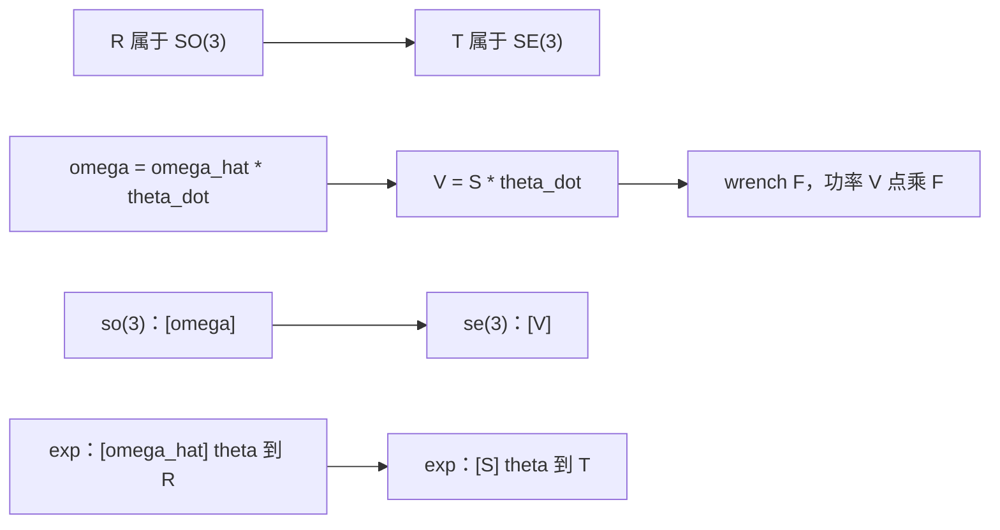
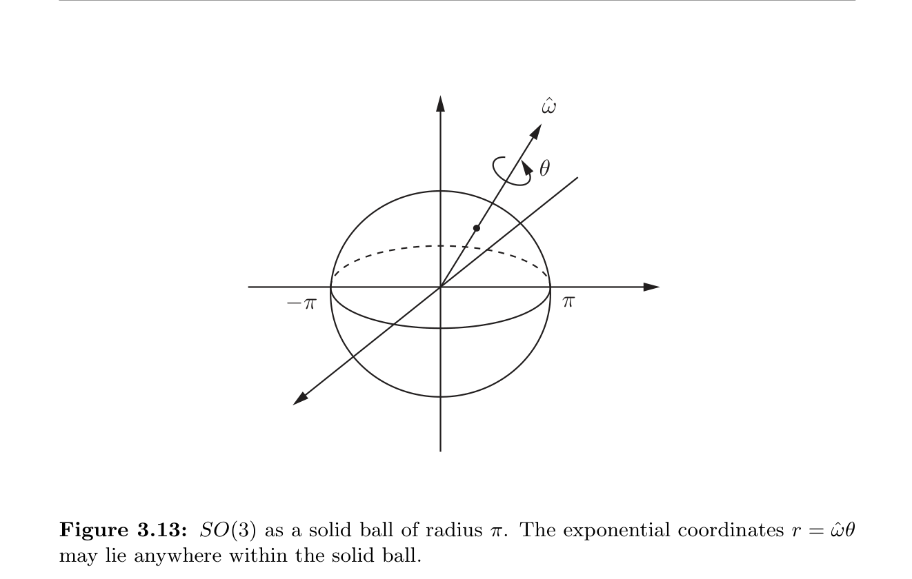
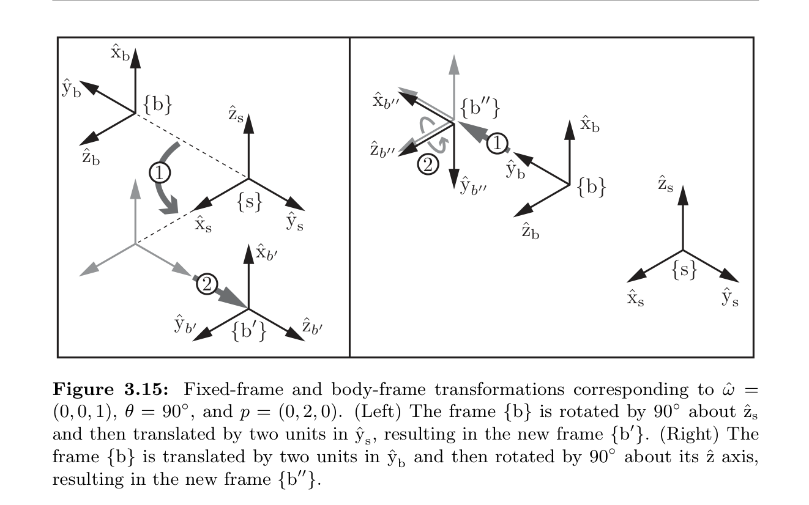
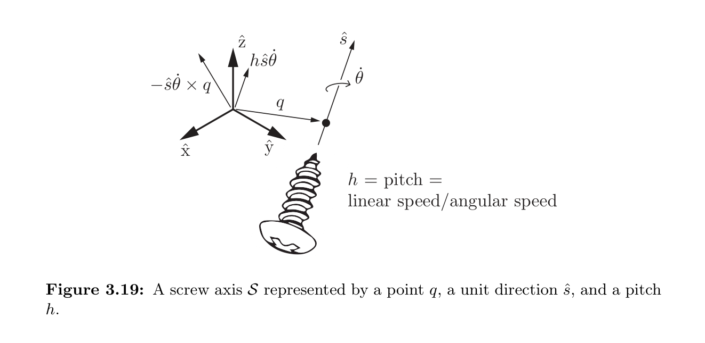

# 第3章 刚体运动

### 来源说明

- 作者：Kevin M. Lynch、Frank C. Park
- 书名：*Modern Robotics: Mechanics, Planning, and Control*（现代机器人学：力学、规划与控制），2017 初版、2019 年 12 月预印本大字版
- 官方来源：https://hades.mech.northwestern.edu/images/2/2e/MR-largefont-v2.pdf
- 本笔记仅供个人学习使用。

阅读范围：PDF 第 77–154 页。PDF 77 的标题是 Chapter 3 Rigid-Body Motions（刚体运动）。页眉书页约为 57–134。PDF 155 起是 Chapter 4 Forward Kinematics（正运动学），本笔记不读 155 及之后。3.8 节习题不展开。欧拉角、滚转–俯仰–偏航、单位四元数与 Cayley–Rodrigues 参数留在附录 B。

### 本章总览

刚体在三维空间里的位形最少用六个数字。本章把机体系相对固定系的位形写成一张 $4\times 4$ 齐次变换矩阵 $T\in\mathrm{SE}(3)$：十六个实数加上十条约束，剩下六维。同一张矩阵既能表示位形，也能换坐标系，还能把向量或坐标系做刚体位移。

位形空间本身不是平直的向量空间，但每个位形处的可行速度是向量空间。角速度与线速度合成六维 twist（旋量，书中也叫 spatial velocity）；力矩与力合成六维 wrench（力旋量，书中也叫 spatial force）。任意刚体位移都可以沿一条固定螺旋轴走一段距离到达，对应六维 exponential coordinates（指数坐标）$S\theta$。

平面情形先把旋转矩阵、螺旋运动和指数坐标走一遍，再推广到空间。配套程序函数只记名称与作用，不写可运行代码。

图注：第 3 章主线。旋转与角速度先立规矩，再把平移并进去得到齐次变换、twist 与螺旋指数坐标；wrench 用同一套伴随把力和力矩绑在一起。

### 核心知识点

#### 向量、参考系与记号

free vector（自由向量）只有长度和方向，用正体符号，例如 $\mathrm{v}$。选定参考系和长度单位后，把它挪到原点，坐标写成斜体 $v\in\mathbb{R}^n$。换系会改 $v$，不改 $\mathrm{v}$。点 $p$ 也可以写成从原点出发的向量。

全书假定长度单位已经选定。固定系（space frame / fixed frame）记作 $\{s\}$，全程静止。body frame（机体系）$\{b\}$ 在任意时刻指的是**与固连在刚体上的那个坐标系瞬间重合的静止惯性系**，不是动力学课里跟着物体转的非惯性系。$\{b\}$ 的原点不必在质心，甚至不必在物体上，只要相对物体不变即可。

所有参考系都是右手系：$\hat{x}\times\hat{y}=\hat{z}$。绕轴的正转角按右手螺旋。帽号表示单位向量。

🔑 关键速记：书中所有坐标系都是静止惯性系；说「机体系」时，指的是此刻与物体固连标架重合的那张静止标架。

#### 平面刚体运动预览

平面刚体的位形由 $\{b\}$ 相对 $\{s\}$ 的原点 $p=(p_x,p_y)$ 和转角 $\theta$ 决定。单位轴可打成旋转矩阵

$$
P=[\hat{x}_b\ \hat{y}_b]=\begin{pmatrix}\cos\theta&-\sin\theta\\ \sin\theta&\cos\theta\end{pmatrix}\in\mathrm{SO}(2).
$$

四元里有三条约束，只剩 $\theta$ 一个自由度。对三个平面标架，若 $\{b\}$ 在 $\{s\}$ 里是 $(P,p)$，$\{c\}$ 在 $\{b\}$ 里是 $(Q,q)$，则

$$
R=PQ,\qquad r=Pq+p.
$$

同一对 $(P,p)$ 有三种用法：表示 $\{b\}$ 在 $\{s\}$ 中的位形；把 $\{b\}$ 坐标改写成 $\{s\}$ 坐标；把一张标架按 $R'=PR$、$r'=Pr+p$ 做刚体位移。

平面位移也可以看成绕固定点 $s$ 转角 $\beta$ 的螺旋运动。纯平移时 $s$ 在无穷远。单位角速度绕 $s$ 得到螺旋轴 $S=(\omega,v_x,v_y)$，再乘距离 $\theta$ 就是平面指数坐标 $S\theta$。twist 是 $V=S\dot{\theta}$。

🔑 关键速记：平面里一对 $(P,p)$ 同时管「在哪」「换系」和「搬走」；搬走这件事又能收成绕一点转的螺旋。

#### 旋转矩阵与 SO(3)

空间里 $\{b\}$ 相对 $\{s\}$ 由 $p\in\mathbb{R}^3$ 和

$$
R=[\hat{x}_b\ \hat{y}_b\ \hat{z}_b]\in\mathbb{R}^{3\times 3}
$$

描述。九个元里只有三个独立。列向量单位且两两正交，等价于 $R^\top R=I$。右手系再加 $\det R=1$（左手系是 $-1$）。$R^\top R=I$ 已经迫使 $\det R=\pm 1$，$\det R=1$ 不增加连续自由度。

**Definition 3.1（定义 3.1）**。special orthogonal group（特殊正交群）$\mathrm{SO}(3)$ 是满足 $R^\top R=I$ 且 $\det R=1$ 的全部 $3\times 3$ 实矩阵。

**Definition 3.2（定义 3.2）**。$\mathrm{SO}(2)$ 是同样两条约束下的 $2\times 2$ 旋转矩阵，元素都写成 $\theta\in[0,2\pi)$ 的标准平面旋转。

$\mathrm{SO}(n)$ 对矩阵乘法构成群：封闭、结合、有单位元 $I$、有逆。它们还是 matrix Lie group（矩阵李群），元素构成可微流形。

下列结论只留结果。

- 命题 3.3：$R^{-1}=R^\top$，并且 $R^\top$ 仍在 $\mathrm{SO}(3)$。
- 命题 3.4：两旋转之积仍是旋转。
- 命题 3.5：乘法结合，一般不交换；$\mathrm{SO}(2)$ 里旋转可交换。
- 命题 3.6：$\|Rx\|=\|x\|$。

🔑 关键速记：$\mathrm{SO}(3)=\{R\mid R^\top R=I,\ \det R=1\}$；逆就是转置，乘积一般不能换序。

#### 旋转矩阵的三种用途

和平面一样，$R$ 有三种角色。

1. **表示姿态**。$R_{sc}$ 表示 $\{c\}$ 相对 $\{s\}$。任意两系满足 $R_{de}=R_{ed}^{-1}=R_{ed}^\top$。
2. **换参考系**。下标消去：$R_{ab}R_{bc}=R_{ac}$，以及 $R_{ab}p_b=p_a$。
3. **旋转向量或标架**。把 $R$ 看成算子 $\mathrm{Rot}(\hat{\omega},\theta)$。绕坐标轴的公式是标准的 $\mathrm{Rot}(\hat{x},\theta)$、$\mathrm{Rot}(\hat{y},\theta)$、$\mathrm{Rot}(\hat{z},\theta)$。一般轴 $\hat{\omega}=(\hat{\omega}_1,\hat{\omega}_2,\hat{\omega}_3)$ 的显式矩阵见 3.2.3.3 节展开式 (3.52)，也等于后文 Rodrigues 公式。任意 $R\in\mathrm{SO}(3)$ 都能从 $I$ 出发绕某 $\hat{\omega}$ 转某 $\theta$ 得到，并且 $\mathrm{Rot}(\hat{\omega},\theta)=\mathrm{Rot}(-\hat{\omega},-\theta)$。

左乘与右乘不是同一件事。设 $R=\mathrm{Rot}(\hat{\omega},\theta)$，$R_{sb}$ 是 $\{b\}$ 相对 $\{s\}$：

$$
R_{sb'}=RR_{sb}\qquad\text{（\(\hat{\omega}\) 按固定系解释）},
$$

$$
R_{sb''}=R_{sb}R\qquad\text{（\(\hat{\omega}\) 按机体系解释）}.
$$

转一个已经写在某系里的向量 $v$ 时，只有一个参考系，$\hat{\omega}$ 必须按这个系理解，$v'=Rv$。

🔑 关键速记：左乘 $RR_{sb}$ 绕固定轴转，右乘 $R_{sb}R$ 绕机体轴转；同一组数字，轴钉在哪一系，转到的地方不同。

#### 角速度与 so(3)

刚体标架的单位轴只能改方向。瞬时转轴 $\hat{w}$ 与转速 $\dot{\theta}$ 合成角速度 $\mathrm{w}=\hat{w}\dot{\theta}$，于是 $\dot{\hat{x}}=\mathrm{w}\times\hat{x}$（$\hat{y}$、$\hat{z}$ 同理）。

在固定系里写成 $\dot{R}=\omega_s\times R$。为了去掉叉积，引入斜对称表示。

**Definition 3.7（定义 3.7）**。对 $x=(x_1,x_2,x_3)^\top$，

$$
[x]=\begin{pmatrix}0&-x_3&x_2\\ x_3&0&-x_1\\ -x_2&x_1&0\end{pmatrix}=-[x]^\top.
$$

全体 $3\times 3$ 实斜对称矩阵记作 $\mathfrak{so}(3)$，它是李群 $\mathrm{SO}(3)$ 的 Lie algebra（李代数），对应 $R=I$ 时所有可能的 $\dot{R}$。

命题 3.8：$R[\omega]R^\top=[R\omega]$。

由此

$$
[\omega_s]=\dot{R}R^{-1},\qquad [\omega_b]=R^{-1}\dot{R}.
$$

$\omega_s=R_{sb}\omega_b$，$\omega_b=R^\top\omega_s$。$\omega_b$ 不是相对运动标架的角速度，而是相对**此刻与物体重合的静止标架** $\{b\}$ 的角速度。$\omega_s$ 与机体标架选法无关，$\omega_b$ 与固定标架选法无关：$\dot{R}R^{-1}$ 不含 $\{b\}$，$R^{-1}\dot{R}$ 不含 $\{s\}$。任意两系仍用下标消去：$\omega_c=R_{cd}\omega_d$。

🔑 关键速记：$[\omega_s]=\dot{R}R^{-1}$、$[\omega_b]=R^{-1}\dot{R}$；斜对称括号把叉积变成矩阵乘。

#### 旋转的指数坐标与 Rodrigues 公式

exponential coordinates（指数坐标）用单位轴 $\hat{\omega}$ 和转角 $\theta$ 写成 $\hat{\omega}\theta\in\mathbb{R}^3$。分开写 $\hat{\omega}$ 与 $\theta$ 就是 axis-angle（轴角）表示。三种读法等价：从与 $\{s\}$ 重合的标架绕 $\hat{\omega}$ 转 $\theta$；或以角速度 $\hat{\omega}\theta$ 走单位时间；或以角速度 $\hat{\omega}$ 走时间 $\theta$。

常系数线性方程 $\dot{x}=Ax$ 的解是 $x(t)=e^{At}x_0$，矩阵指数按级数

$$
e^{At}=I+tA+\frac{t^2}{2!}A^2+\cdots
$$

定义，$A$ 有限则级数收敛。命题 3.10 还给出：$\frac{d}{dt}e^{At}=Ae^{At}=e^{At}A$；$A=PDP^{-1}$ 则 $e^{At}=Pe^{Dt}P^{-1}$；$AB=BA$ 则 $e^Ae^B=e^{A+B}$；$(e^A)^{-1}=e^{-A}$。

向量 $p(0)$ 绕 $\hat{\omega}$ 以单位角速度转到 $p(\theta)$ 时，$\dot{p}=[\hat{\omega}]p$，故 $p(\theta)=e^{[\hat{\omega}]\theta}p(0)$。利用 $[\hat{\omega}]^3=-[\hat{\omega}]$ 把级数收成三角函数，得到 Rodrigues’ formula（Rodrigues 公式）。

**Proposition 3.11（命题 3.11）**。$\|\hat{\omega}\|=1$ 时

$$
\mathrm{Rot}(\hat{\omega},\theta)=e^{[\hat{\omega}]\theta}=I+\sin\theta\,[\hat{\omega}]+(1-\cos\theta)\,[\hat{\omega}]^2\in\mathrm{SO}(3).
$$

左乘 $e^{[\hat{\omega}]\theta}R$ 是绕固定系的 $\hat{\omega}$ 转 $R$；右乘 $R e^{[\hat{\omega}]\theta}$ 是绕机体系的 $\hat{\omega}$ 转 $R$。例 3.12：$\hat{\omega}_1=(0,0.866,0.5)$、$\theta_1=30^\circ=0.524\,\mathrm{rad}$ 给出一组具体 $R$ 与指数坐标 $\hat{\omega}_1\theta_1=(0,0.453,0.262)$。

Gallier 第 11 章把同一件事写成斜对称矩阵 $A$ 的指数：轴向量 $(a,b,c)$ 的长度就是转角 $\theta$，闭式是 $e^A=I_3+\frac{\sin\theta}{\theta}A+\frac{1-\cos\theta}{\theta^2}A^2$（$\theta\neq 0$）。Lynch 把单位轴和转角拆开，系数里不再除以 $\theta$。两式只差尺度：Lynch 的 $[\hat{\omega}]\theta$ 就是 Gallier 的 $A$。Gallier 第 15 章再用 $\mathrm{SU}(2)$ 的指数把同一旋转写成四元数，半角出现在 $\cos(\theta/2)$。

👉 完整深度讲解见 01 线性代数第 11 章、第 15 章。📝待补全

🔑 关键速记：单位轴版本的 Rodrigues 是 $e^{[\hat{\omega}]\theta}=I+\sin\theta[\hat{\omega}]+(1-\cos\theta)[\hat{\omega}]^2$；左乘绕固定轴，右乘绕机体轴。

#### 旋转的矩阵对数与半径 π 实心球

$[\hat{\omega}]\theta\in\mathfrak{so}(3)$ 是 $R$ 的 matrix logarithm（矩阵对数）。指数把常角速度「积」一秒钟得到 $R$，对数把 $R$ 「微」回这个常角速度。一张 $R$ 可以有多个对数，算法返回其中一组。

由 Rodrigues 展开式减转置，$\sin\theta\neq 0$ 时

$$
[\hat{\omega}]=\frac{1}{2\sin\theta}(R-R^\top),\qquad \operatorname{tr} R=1+2\cos\theta.
$$

$\theta=k\pi$ 时 $\sin\theta=0$。$k$ 为偶数则 $R=I$，轴没有定义。$k$ 为奇数则 $\operatorname{tr} R=-1$，公式退化成 $R=I+2[\hat{\omega}]^2$，$R$ 对称，轴由对角元 $\hat{\omega}_i=\pm\sqrt{(r_{ii}+1)/2}$ 与非对角关系 $2\hat{\omega}_i\hat{\omega}_j=r_{ij}$ 联立。任何三参数表示在这里都会遇到奇异，欧拉角和滚转–俯仰–偏航同样。

限制 $\theta\in[0,\pi]$ 的算法：

- $R=I$：$\theta=0$，$\hat{\omega}$ 无定义。
- $\operatorname{tr} R=-1$：$\theta=\pi$，从 (3.58)–(3.60) 三条里任取一条可行的 $\hat{\omega}$；$-\hat{\omega}$ 也是解。
- 其余：$\theta=\cos^{-1}\bigl(\tfrac{1}{2}(\operatorname{tr} R-1)\bigr)\in[0,\pi)$，$[\hat{\omega}]=\frac{1}{2\sin\theta}(R-R^\top)$。

因此每个 $R$ 都有对数，指数坐标可以画成半径为 $\pi$ 的实心球：$r=\hat{\omega}\theta$，$\|r\|=\theta$，方向是轴。$\operatorname{tr} R\neq -1$ 时球内点唯一；$\operatorname{tr} R=-1$ 时球面上对径两点 $r$ 与 $-r$ 表示同一旋转。

图注：书 Figure 3.13。指数坐标 $r=\hat{\omega}\theta$ 落在半径 $\pi$ 的实心球里；球面上的对径点对应转角 $\pi$ 的同一旋转。

🔑 关键速记：对数算法把 $\theta$ 收进 $[0,\pi]$；球内点一对一，球面 $\pi$ 旋转二对一。

#### 齐次变换与 SE(3)

把姿态 $R$ 和原点 $p$ 打进一张矩阵。

**Definition 3.13（定义 3.13）**。special Euclidean group（特殊欧氏群）$\mathrm{SE}(3)$ 是全部

$$
T=\begin{pmatrix}R&p\\ 0&1\end{pmatrix},\qquad R\in\mathrm{SO}(3),\ p\in\mathbb{R}^3
$$

的 $4\times 4$ 实矩阵，也叫 rigid-body motions 或 homogeneous transformation matrices（齐次变换矩阵）。有时把 $T$ 写成 $(R,p)$。

**Definition 3.14（定义 3.14）**。$\mathrm{SE}(2)$ 是同样块结构的 $3\times 3$ 矩阵，$R\in\mathrm{SO}(2)$，$p\in\mathbb{R}^2$。

命题 3.15–3.17：$\mathrm{SE}(3)$ 对乘法成群；一般不交换；逆是

$$
T^{-1}=\begin{pmatrix}R^\top&-R^\top p\\ 0&1\end{pmatrix}.
$$

点 $x$ 写成齐次坐标 $(x^\top,1)^\top$ 后，$T$ 一次乘法给出 $Rx+p$。滥用记号时 $Tx$ 就指 $Rx+p$。

命题 3.18：$T$ 保欧氏距离和夹角，所以把三角形变成全等三角形，也就是刚体位移。

🔑 关键速记：$T=\bigl(\begin{smallmatrix}R&p\\0&1\end{smallmatrix}\bigr)$；逆是转置 $R$ 再配 $-R^\top p$，不是把整张 $4\times 4$ 随便求逆公式硬套。

#### 齐次变换的三种用途

1. **表示位形**。$T_{sb}=(R_{sb},p_{sb})$。任意两系 $T_{de}=T_{ed}^{-1}$。
2. **换参考系**。$T_{ab}T_{bc}=T_{ac}$，$T_{ab}v_b=v_a$。
3. **位移一张标架**。把 $\mathrm{Rot}(\hat{\omega},\theta)$ 扩成不带平移的 $4\times 4$，再定义纯平移 $\mathrm{Trans}(p)$。左乘是固定系位移，右乘是机体系位移：

$$
T_{sb'}=\underbrace{\mathrm{Trans}(p)\,\mathrm{Rot}(\hat{\omega},\theta)}_{T}\,T_{sb}
=\begin{pmatrix}RR_{sb}&Rp_{sb}+p\\ 0&1\end{pmatrix},
$$

$$
T_{sb''}=T_{sb}T
=\begin{pmatrix}R_{sb}R&R_{sb}p+p_{sb}\\ 0&1\end{pmatrix}.
$$

固定系解释：先绕 $\{s\}$ 的 $\hat{\omega}$ 转 $\theta$（原点若不在 $\{s\}$ 原点会被带动），再按 $\{s\}$ 平移 $p$。机体系解释：先按 $\{b\}$ 平移 $p$，再绕**新的**机体轴 $\hat{\omega}$ 转（原点不动）。

图注：书 Figure 3.15。$\hat{\omega}=(0,0,1)$，$\theta=90^\circ$，$p=(0,2,0)$。左图绕 $\hat{z}_s$ 转 $90^\circ$ 再沿 $\hat{y}_s$ 平移 2，得到 $\{b'\}$；右图沿 $\hat{y}_b$ 平移 2 再绕新的机体 $\hat{z}$ 转 $90^\circ$，得到 $\{b''\}$。

例 3.19 用相机、移动平台、手臂和物体的已知 $T$ 求手相对物体的 $T_{ce}=(T_{ad}T_{db}T_{bc})^{-1}T_{ad}T_{de}$。正运动学里如何由关节角算出 $T_{bc}$，本章只当已知量。

👉 开链正运动学把若干螺旋指数连乘，见第 4 章。📝待补全

🔑 关键速记：左乘 $TT_{sb}$ 按固定系先转后移，右乘 $T_{sb}T$ 按机体系先移后转。

#### Twist 与 se(3)

对 $T(t)=(R(t),p(t))$，

$$
T^{-1}\dot{T}=\begin{pmatrix}[\omega_b]&v_b\\ 0&0\end{pmatrix},\qquad v_b=R^\top\dot{p}.
$$

$v_b$ 是 $\{b\}$ 原点速度在 $\{b\}$ 中的坐标。body twist（体旋量）是

$$
V_b=\begin{pmatrix}\omega_b\\ v_b\end{pmatrix}\in\mathbb{R}^6,\qquad [V_b]=T^{-1}\dot{T}\in\mathfrak{se}(3).
$$

$\mathfrak{se}(3)$ 是全部这种 $4\times 4$ 矩阵，为 $\mathrm{SE}(3)$ 的李代数，对应 $T=I$ 时所有可能的 $\dot{T}$。书中 twist 就是 robotics 里常用的 spatial velocity；mechanisms / 经典螺旋理论里「twist」用词并不统一。

另一侧

$$
\dot{T}T^{-1}=\begin{pmatrix}[\omega_s]&v_s\\ 0&0\end{pmatrix},\qquad v_s=\dot{p}-\omega_s\times p.
$$

$v_s$ **不是** $\{b\}$ 原点在固定系中的速度 $\dot{p}$。把物体想像成无限大，$v_s$ 是此刻经过 $\{s\}$ 原点的那一点的速度，写在 $\{s\}$ 里。spatial twist（空间旋量）$V_s=(\omega_s,v_s)$ 满足 $[V_s]=\dot{T}T^{-1}$。

对称读法：$\omega_b,\omega_s$ 是同一角速度在两系中的坐标；$v_b$ 是 $\{b\}$ 原点的速度（$\{b\}$ 坐标），$v_s$ 是 $\{s\}$ 原点处物点的速度（$\{s\}$ 坐标）。换系

$$
[V_b]=T^{-1}[V_s]T,\qquad [V_s]=T[V_b]T^{-1}.
$$

🔑 关键速记：$[V_b]=T^{-1}\dot{T}$，$[V_s]=\dot{T}T^{-1}$；$v_s\neq\dot{p}$，它是过固定原点的物点速度。

#### 伴随表示

把上面的换系写成 $6\times 6$。

**Definition 3.20（定义 3.20）**。对 $T=(R,p)$，adjoint representation（伴随表示）

$$
[\mathrm{Ad}_T]=\begin{pmatrix}R&0\\ [p]R&R\end{pmatrix}\in\mathbb{R}^{6\times 6}.
$$

$V'=\mathrm{Ad}_T(V)=[\mathrm{Ad}_T]V$，矩阵形式 $[V']=T[V]T^{-1}$。

命题 3.21：$\mathrm{Ad}_{T_1}\circ\mathrm{Ad}_{T_2}=\mathrm{Ad}_{T_1T_2}$，因而 $[\mathrm{Ad}_T]^{-1}=[\mathrm{Ad}_{T^{-1}}]$。

命题 3.22 汇总：$V_s=[\mathrm{Ad}_{T_{sb}}]V_b$，$V_b=[\mathrm{Ad}_{T_{bs}}]V_s$。一般两系 $V_c=[\mathrm{Ad}_{T_{cd}}]V_d$。$V_s$ 与 $\{b\}$ 的选法无关，$V_b$ 与 $\{s\}$ 的选法无关。

例 3.23 用三轮车绕平面点 $r$ 的纯角速度核对 $V_s$ 与 $V_b$，再用伴随互验。

🔑 关键速记：换 twist 的参考系就是乘 $[\mathrm{Ad}_T]$；它满足 $\mathrm{Ad}_{T_1T_2}=\mathrm{Ad}_{T_1}\mathrm{Ad}_{T_2}$。

#### 螺旋轴

twist 可以写成单位螺旋轴乘速率，就像 $\omega=\hat{\omega}\dot{\theta}$。

一种写法是集合 $\{q,\hat{s},h\}$：$q$ 是轴上任一点，$\hat{s}$ 是单位方向，pitch（节距）$h$ 是沿轴的线速度与绕轴角速度之比。对应

$$
V=\begin{pmatrix}\omega\\ v\end{pmatrix}
=\begin{pmatrix}\hat{s}\dot{\theta}\\ -\hat{s}\dot{\theta}\times q+h\hat{s}\dot{\theta}\end{pmatrix}.
$$

$v$ 由沿轴平移 $h\hat{s}\dot{\theta}$ 和因转动在原点处诱导的 $-\hat{s}\dot{\theta}\times q$ 相加。$\omega\neq 0$ 时 $\hat{s}=\omega/\|\omega\|$，$\dot{\theta}=\|\omega\|$，$h=\hat{\omega}^\top v/\dot{\theta}$，再选 $q$ 补上与轴正交的那部分 $v$。$\omega=0$ 时节距无穷，$\hat{s}=v/\|v\|$，$\dot{\theta}$ 改读成线速度 $\|v\|$。

图注：书 Figure 3.19。$h=$ 线速率 / 角速率。原点处的线速度是 $-\hat{s}\dot{\theta}\times q+h\hat{s}\dot{\theta}$。

为了避开无穷节距和 $q$ 不唯一，书改用归一化 twist 定义「单位」螺旋轴。

**Definition 3.24（定义 3.24）**。在给定参考系中，

$$
S=\begin{pmatrix}\omega\\ v\end{pmatrix}\in\mathbb{R}^6,
$$

满足 (i) $\|\omega\|=1$，或 (ii) $\omega=0$ 且 $\|v\|=1$。情形 (i) 时 $v=-\omega\times q+h\omega$（纯转动则 $h=0$）。情形 (ii) 是沿 $v$ 的纯平移。矩阵形式

$$
[S]=\begin{pmatrix}[\omega]&v\\ 0&0\end{pmatrix}\in\mathfrak{se}(3).
$$

$(\omega,v)$ 既用来写归一化的 $S$，也用来写一般 twist $V$，靠上下文区分。换系与 twist 相同：$S_a=[\mathrm{Ad}_{T_{ab}}]S_b$。

🔑 关键速记：有限节距时 $S$ 按 $\|\omega\|$ 归一化，纯平移按 $\|v\|$ 归一化；$V=S\dot{\theta}$。

#### 刚体运动的指数坐标

Chasles–Mozzi theorem（Chasles–Mozzi 定理）：任意空间刚体位移都是沿某条固定螺旋轴 $S$ 走一段距离。指数坐标是 $S\theta\in\mathbb{R}^6$。有限节距时 $\|\omega\|=1$，$\theta$ 是转角；无穷节距时 $\omega=0$、$\|v\|=1$，$\theta$ 是平移距离。

级数展开并用 $[\omega]^3=-[\omega]$ 得到命题 3.25：$\|\omega\|=1$ 时

$$
e^{[S]\theta}
=\begin{pmatrix}e^{[\omega]\theta}&G(\theta)v\\ 0&1\end{pmatrix},
$$

$$
G(\theta)=I\theta+(1-\cos\theta)[\omega]+(\theta-\sin\theta)[\omega]^2.
$$

$\omega=0$、$\|v\|=1$ 时 $e^{[S]\theta}=\bigl(\begin{smallmatrix}I&v\theta\\0&1\end{smallmatrix}\bigr)$。这套闭式本身就是 Chasles–Mozzi 的构造性证明：任意 $T=(R,p)$ 都能写成某个 $e^{[S]\theta}$。

对数算法（$\theta\in[0,\pi]$）：

- $R=I$：$\omega=0$，$v=p/\|p\|$，$\theta=\|p\|$。
- 否则先对 $R$ 做 $\mathrm{SO}(3)$ 对数得到 $\omega$（算法里的 $\hat{\omega}$）和 $\theta$，再

$$
v=G^{-1}(\theta)p,
\quad
G^{-1}(\theta)=\frac{1}{\theta}I-\frac{1}{2}[\omega]+\Bigl(\frac{1}{\theta}-\frac{1}{2}\cot\frac{\theta}{2}\Bigr)[\omega]^2.
$$

$G^{-1}$ 的验证留作习题。例 3.26 在平面上由 $T_{sc}T_{sb}^{-1}$ 读出 $S=(0,0,1,3.37,-3.37,0)$、$\theta=\pi/6$。平面情形可把 $\mathrm{SE}(2)$ 对到 $\mathfrak{se}(2)$。

Notes 3.7 写明：Brockett 把开链正运动学写成矩阵指数的乘积，那是下一章的主题。本章只处理**一条**螺旋的指数。

👉 完整深度讲解见第 4 章。📝待补全

🔑 关键速记：$T=e^{[S]\theta}$；有转动时平移块是 $G(\theta)v$，纯平移就是 $p=v\theta$。

#### Wrench

力 $f$ 作用在点 $r$ 上，在 $\{a\}$ 中力矩 $m_a=r_a\times f_a$。力沿作用线滑动，力矩不变。合成

$$
F_a=\begin{pmatrix}m_a\\ f_a\end{pmatrix}\in\mathbb{R}^6
$$

叫 spatial force 或 wrench（力旋量）。同一系里多个 wrench 直接向量相加。线力为零的叫 pure moment（纯力偶）。

功率 $V^\top F$ 与坐标系无关，因此 $V_b^\top F_b=V_a^\top F_a$。代入 $V_a=[\mathrm{Ad}_{T_{ab}}]V_b$ 得到命题 3.27：

$$
F_b=[\mathrm{Ad}_{T_{ab}}]^\top F_a,\qquad F_a=[\mathrm{Ad}_{T_{ba}}]^\top F_b.
$$

注意 wrench 用的是伴随的**转置**，和 twist 的伴随方向相反。通常再分 spatial wrench $F_s$ 与 body wrench $F_b$。例 3.28 把手和苹果的重力 wrench 变到力传感器系后相加。

🔑 关键速记：换 wrench 的参考系是乘 $[\mathrm{Ad}]^\top$，不是乘 $[\mathrm{Ad}]$；依据是功率不变。

#### 旋转与刚体运动对照

书 3.5 节把两条线并排对照。下面只收最常用的几组。

| 旋转 | 刚体运动 |
| --- | --- |
| $R\in\mathrm{SO}(3)$，$R^\top R=I$，$\det R=1$ | $T=\bigl(\begin{smallmatrix}R&p\\0&1\end{smallmatrix}\bigr)\in\mathrm{SE}(3)$ |
| $R^{-1}=R^\top$ | $T^{-1}=\bigl(\begin{smallmatrix}R^\top&-R^\top p\\0&1\end{smallmatrix}\bigr)$ |
| $R_{ab}R_{bc}=R_{ac}$ | $T_{ab}T_{bc}=T_{ac}$ |
| 左乘绕固定轴，右乘绕机体轴 | 左乘按固定系先转后移，右乘按机体系先移后转 |
| 单位轴 $\hat{\omega}$ | 单位螺旋 $S=(\omega,v)$ |
| $\omega=\hat{\omega}\dot{\theta}$ | $V=S\dot{\theta}$ |
| $[\omega]\in\mathfrak{so}(3)$ | $[V]\in\mathfrak{se}(3)$ |
| $\dot{R}R^{-1}=[\omega_s]$，$R^{-1}\dot{R}=[\omega_b]$ | $\dot{T}T^{-1}=[V_s]$，$T^{-1}\dot{T}=[V_b]$ |
| 指数坐标 $\hat{\omega}\theta$ | 指数坐标 $S\theta$ |
| $e^{[\hat{\omega}]\theta}=I+\sin\theta[\hat{\omega}]+(1-\cos\theta)[\hat{\omega}]^2$ | $e^{[S]\theta}$ 的转动块同左式，平移块为 $G(\theta)v$ |
| $m_a=R_{ab}m_b$ | $F_a=[\mathrm{Ad}_{T_{ba}}]^\top F_b$ |

表后要点：$(\omega,v)$ 既可能是一般 twist，也可能是归一化螺旋，必须看上下文。

🔑 关键速记：把 $\mathrm{SO}(3)$ 的每一条公式底下加一截平移，就得到 $\mathrm{SE}(3)$ 的对应公式。

#### 配套函数名

3.6 节给出随书程序的函数名。这里只记作用，不写实现。

| 名称 | 功能 | 主要参数 | 约束与坑点 |
| --- | --- | --- | --- |
| `RotInv` | 旋转矩阵求逆 | $R$ | 结果应是 $R^\top$ |
| `VecToso3` / `so3ToVec` | $\omega\leftrightarrow[\omega]$ | 3 向量或 $3\times 3$ | $[\omega]$ 必须斜对称 |
| `AxisAng3` | 从 $\hat{\omega}\theta$ 拆出轴和角 | `expc3` | 轴是单位向量 |
| `MatrixExp3` / `MatrixLog3` | $\mathfrak{so}(3)$ 与 $\mathrm{SO}(3)$ 互化 | `so3mat` 或 $R$ | 对数按 3.2.3.3 的分支 |
| `RpToTrans` / `TransToRp` | $(R,p)\leftrightarrow T$ | $R,p$ 或 $T$ | 底行必须是 $0\,0\,0\,1$ |
| `TransInv` | 齐次变换求逆 | $T$ | 用命题 3.15，不是盲目求逆 |
| `VecTose3` / `se3ToVec` | $V\leftrightarrow[V]$ | 6 向量或 $4\times 4$ | 底行全零 |
| `Adjoint` | 算 $[\mathrm{Ad}_T]$ | $T$ | $6\times 6$ |
| `ScrewToAxis` | $\{q,\hat{s},h\}\to S$ | 点、单位方向、节距 | $\hat{s}$ 须单位 |
| `AxisAng6` | 从 $S\theta$ 拆出 $S$ 和 $\theta$ | `expc6` | $S$ 已归一化 |
| `MatrixExp6` / `MatrixLog6` | $\mathfrak{se}(3)$ 与 $\mathrm{SE}(3)$ 互化 | `se3mat` 或 $T$ | 对数按 3.3.3.2 |

🔑 关键速记：3 族函数管旋转，6 族函数管刚体；`Exp` 走指数，`Log` 走对数，`Adjoint` 只管换系。

### 章末要点

- 刚体位形是 $\mathrm{SE}(3)$ 中的 $T$，不是随便 16 个数；速度永远是 $\mathbb{R}^6$ 里的 twist。
- 左乘按固定系，右乘按机体系；旋转如此，带平移的 $T$ 也如此。
- Rodrigues 把常轴转动收成 $e^{[\hat{\omega}]\theta}$；Chasles–Mozzi 把一般位移收成 $e^{[S]\theta}$。
- $v_s\neq\dot{p}$；空间线速度是过固定原点的物点速度。
- wrench 换系用 $[\mathrm{Ad}]^\top$，因为功率 $V^\top F$ 与坐标系无关。

### 易混淆点与差异对比

**自由向量与坐标。** 正体 $\mathrm{v}$ 不依赖坐标系，斜体 $v$ 依赖。换系改的是写法，不是物理箭头。

**机体系不是随体非惯性系。** $\{b\}$ 始终静止。$\omega_b$、$V_b$ 都是相对这张瞬间重合的静止标架。

**左乘 / 右乘。** 同一张 $R$ 或 $T$，放左边和放右边对应固定系与机体系两套轴，终点一般不同。平面旋转可交换，空间不行。

**$v_s$ 与 $\dot{p}$。** $\dot{p}$ 是机体原点的固定系速度；$v_s=\dot{p}-\omega_s\times p$ 是过 $\{s\}$ 原点的物点速度。把两者当成同一个量，后面的螺旋和伴随都会错。

**$S$ 与 $V$。** 都写成 $(\omega,v)$。$S$ 满足 $\|\omega\|=1$ 或 $\omega=0,\|v\|=1$；$V=S\dot{\theta}$ 没有这种归一化。

**twist 换系与 wrench 换系。** twist 乘 $[\mathrm{Ad}_T]$；wrench 乘 $[\mathrm{Ad}_T]^\top$。功率配对把两者绑在一起。

**指数坐标与欧拉角。** 本章主参数是 $\hat{\omega}\theta$ 和 $S\theta$。欧拉角、RPY、四元数、Cayley–Rodrigues 在附录 B。Notes 3.7 又称指数坐标为 Euler–Rodrigues parameters，不要和附录 B 的 Cayley–Rodrigues parameters、也不要和 ZYX Euler angles 混名。

**三参数奇异。** $\theta=k\pi$ 时轴角对数要单独处理；任何三个连续参数表示 $\mathrm{SO}(3)$ 都避免不了奇异。四元数用第四个变量换掉 $R=I$ 附近的除法，见附录 B。

**与 Gallier 的尺度。** Gallier 的 $A$ 把轴长做成 $\theta$；本书的 $[\hat{\omega}]$ 是单位轴。公式里的 $\sin\theta/\theta$ 是否出现，取决于 $A$ 有没有先除掉 $\theta$。

**本章不覆盖的下一批内容。** 开链正运动学的乘积指数在第 4 章；$\operatorname{atan2}$ 的定义在第 6 章开头。两处都只在本章被点名。

👉 $\operatorname{atan2}$ 的双参数约定见第 6 章。📝待补全

### 本章要点总结

刚体位形用机体系相对固定系的齐次变换 $T\in\mathrm{SE}(3)$ 表示。$T$ 同时负责描述位形、换坐标系和做刚体位移；左乘按固定系，右乘按机体系。旋转部分单独看就是 $\mathrm{SO}(3)$，角速度的斜对称矩阵落在 $\mathfrak{so}(3)$，Rodrigues 公式给出 $e^{[\hat{\omega}]\theta}$。加上平移之后，速度合成 twist $V\in\mathbb{R}^6$，矩阵落在 $\mathfrak{se}(3)$；空间线速度 $v_s$ 不是机体原点速度。任意位移都是沿归一化螺旋轴 $S$ 走距离 $\theta$，即 $T=e^{[S]\theta}$。力和力矩合成 wrench，换系用伴随的转置，以保持功率不变。欧拉角、四元数等其他旋转参数见附录 B。
